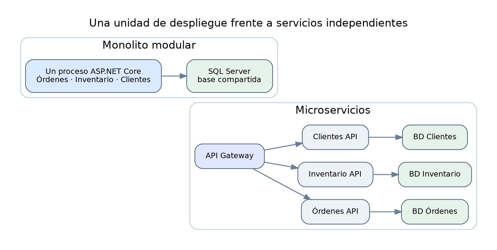
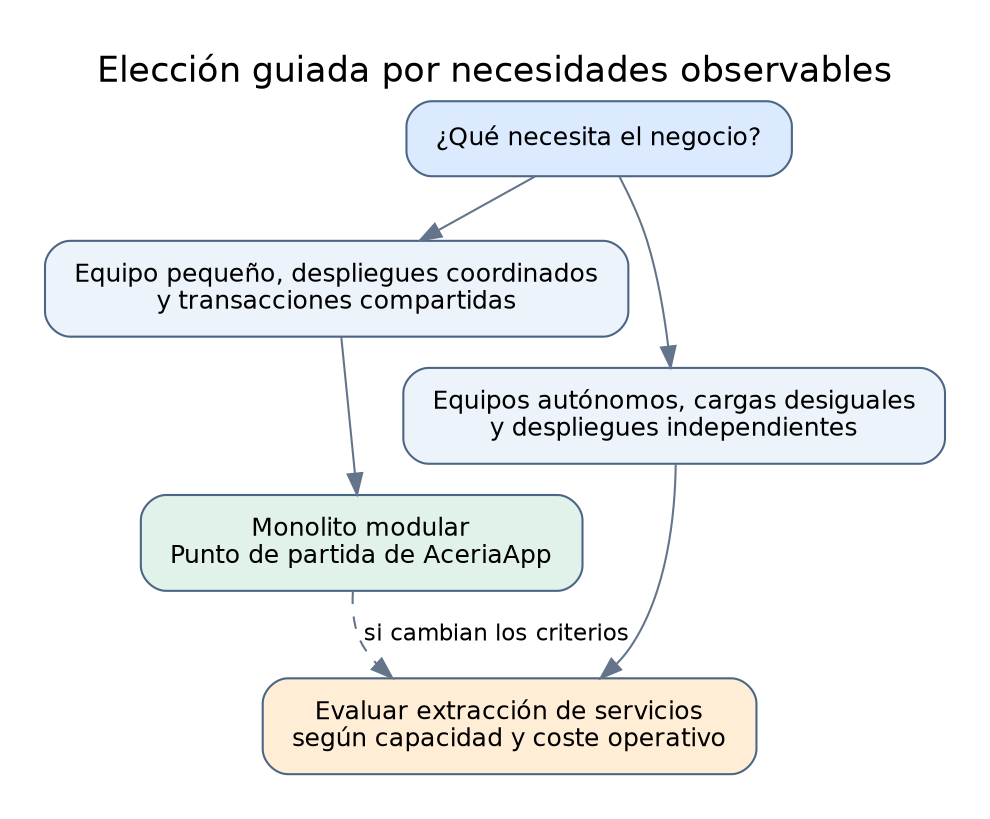
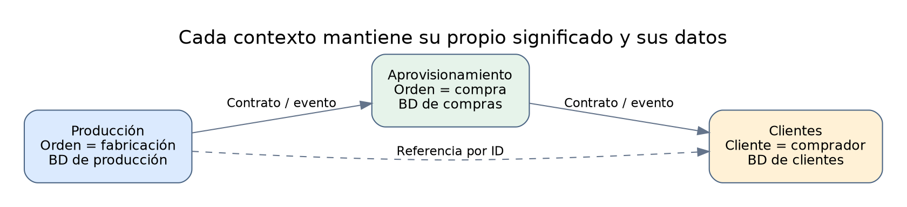
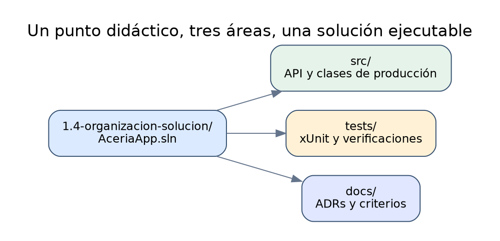
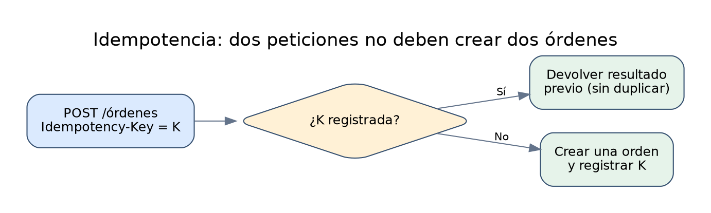

# Punto 1.1 — Arquitectura monolítica vs. microservicios

Módulo 1: Introducción a los microservicios

**Objetivos de aprendizaje:**

- Comprender qué es una arquitectura monolítica y qué características la definen.
- Comprender qué es una arquitectura de microservicios y qué características la definen.
- Identificar las ventajas y limitaciones de cada estilo arquitectónico.
- Reconocer los criterios técnicos y organizativos que justifican la adopción de microservicios.
- Crear la estructura inicial del proyecto creciente AceriaApp con una solución, un proyecto de API monolítico de referencia, un proyecto de tests y la documentación de la decisión arquitectónica.


---

## Desarrollo teórico

### Bloque 1 — Definición de arquitectura monolítica

**Esquema visual del concepto**



*Figura. Comparación de límites de despliegue entre monolito modular y microservicios.*

Una arquitectura monolítica es un estilo de diseño de software en el que todos los componentes funcionales de una aplicación se empaquetan y se despliegan como una única unidad. El término no implica por sí mismo una mala práctica: numerosas aplicaciones empresariales consolidadas se han construido con este enfoque durante décadas. En un monolito, la interfaz de presentación, la lógica de negocio y el acceso a datos residen en el mismo proceso y, con frecuencia, en el mismo artefacto desplegable. La compilación produce un único ensamblado o un conjunto reducido de ensamblados que se ejecutan juntos. Esta concentración simplifica la operación porque existe un único punto de despliegue, un único proceso que arrancar y un único registro donde investigar errores. La comunicación entre componentes se realiza mediante llamadas a métodos en memoria, lo que elimina la latencia de red y reduce la complejidad de la coordinación distribuida. La consecuencia inmediata es que el modelo mental del sistema es sencillo de construir y de explicar.

La estructura interna de un monolito suele organizarse por capas: presentación, aplicación, dominio e infraestructura. Cada capa depende de la inferior y expone una interfaz estable al resto del sistema. Esta organización por capas permite separar responsabilidades dentro del proceso, aunque todas ellas compartan el mismo ciclo de vida de compilación y despliegue. El código fuente completo reside en un único repositorio y, normalmente, en una única solución de Visual Studio. Los equipos trabajan sobre el mismo conjunto de archivos, lo que facilita la reutilización de utilidades comunes y evita duplicaciones accidentales de lógica. La transacción de base de datos se convierte en el mecanismo natural para garantizar la consistencia, porque todas las operaciones ocurren sobre el mismo contexto de persistencia. La clase Orden pertenece al mismo proceso que las rutas HTTP, aunque residan en carpetas distintas. Si una acción de producción empieza a invocar directamente utilidades de inventario desde cada endpoint, la estructura por carpetas no bastará para preservar la autonomía lógica.

```text
AceriaApp.Monolito/
├── AceriaApp.Monolito.Api/          → capa de presentación (endpoints)
├── AceriaApp.Monolito.Aplicacion/   → casos de uso y servicios
├── AceriaApp.Monolito.Dominio/      → entidades y reglas de negocio
└── AceriaApp.Monolito.Infraestructura/ → EF Core, repositorios, migraciones
```

**Lectura guiada del ejemplo**

- **Línea 1:** AceriaApp.Monolito.Api/ → proyecto que expone los endpoints HTTP y arranca el proceso.
- **Línea 2:** AceriaApp.Monolito.Aplicacion/ → proyecto que contiene los casos de uso y orquesta el dominio.
- **Línea 3:** AceriaApp.Monolito.Dominio/ → proyecto que contiene entidades, value objects y reglas invariantes.
- **Línea 4:** AceriaApp.Monolito.Infraestructura/ → proyecto que implementa la persistencia y los servicios externos.

Esta separación lógica de proyectos dentro de un mismo despliegue prepara el terreno para entender por qué los microservicios aplican el mismo principio de separación, pero con un límite físico distinto. La organización por capas dentro de un monolito no impide que el sistema crezca en complejidad interna. Cuando varias funcionalidades comparten el mismo proceso, cualquier cambio en una de ellas obliga a recompilar y redesplegar el conjunto completo. La transacción única garantiza consistencia fuerte, pero también acopla el ciclo de vida de todas las funcionalidades. Este acoplamiento es aceptable en dominios pequeños y estables, y se vuelve problemático cuando el dominio crece y los equipos se multiplican. Esto no impide diseñar módulos con contratos internos bien definidos; la modularidad no exige distribuir procesos. El primer control de calidad consiste en localizar quién conoce a quién: presentación puede invocar aplicación, y persistencia puede implementar necesidades definidas en el núcleo.

**Aplicación adicional:** En AceriaApp, la condición monolítica se verifica observando el límite de despliegue: el host de ASP.NET Core registra el DbContext, configura los endpoints y publica una aplicación. La separación entre capas debe comprobarse por la dirección de las dependencias y por la facilidad para modificar una regla sin alterar el transporte. Una solución con cuatro bibliotecas que se despliegan juntas sigue siendo monolítica.

#### Profundización: módulos lógicos y límites de despliegue

La estructura de un monolito no se determina por el número de proyectos de Visual Studio. Una solución puede contener bibliotecas de dominio, aplicación e infraestructura, compilar varios ensamblados y seguir desplegándose como una sola aplicación. Para identificar la arquitectura hay que seguir una petición desde Kestrel hasta su almacenamiento: si los endpoints invocan componentes dentro de un proceso y todas las capacidades se actualizan como una unidad, el límite operativo es monolítico. Separar el código en bibliotecas ayuda a ordenar las dependencias; no crea, por sí mismo, independencia de despliegue. Este matiz explica por qué el primer estado de AceriaApp utiliza una API ejecutable, aunque ya se distingan carpetas de dominio e infraestructura.

Un módulo lógico adecuado tiene una interfaz pequeña y un interior que puede cambiar sin afectar a los demás módulos. En el dominio de una acería, Órdenes debería responsabilizarse de las reglas de creación y estado de órdenes; Inventario debería administrar existencias y movimientos, y Clientes, la información comercial. Aunque todos compartan la misma base de datos al comienzo, conviene evitar que un endpoint de Órdenes modifique directamente la representación interna de Inventario. La modularidad se deteriora cuando una capacidad conoce las tablas, validaciones y estructuras privadas de todas las demás.

| Elemento observado | Monolito modular | Microservicios independientes |
|---|---|---|
| Cambio en una regla | Se publica el host común | Se publica el servicio propietario |
| Llamada entre capacidades | Puede resolverse en memoria | Atraviesa una interfaz remota |
| Compilación | Puede abarcar varios ensamblados | Puede ejecutarse por servicio |
| Diagnóstico | Logs centralizados del proceso | Correlación entre procesos |
| Persistencia | Es posible compartir una transacción local | Las operaciones distribuidas requieren coordinación |

La comparación muestra que modularizar no equivale a distribuir. Antes de separar procesos resulta más barato verificar el primer requisito: que una regla de negocio esté localizada. En el punto 1.1 puede localizarse `Orden` en `Dominio` y `AceriaDbContext` en `Infraestructura`; la revisión consiste en seguir esas referencias, observar qué cambios requiere cada funcionalidad y comprobar que el endpoint no es el único lugar donde se toman decisiones. El proyecto didáctico inicial es deliberadamente sencillo: prepara una referencia observable, no un ejemplo terminado de arquitectura hexagonal.


---

### Bloque 2 — Características operativas del monolito

El despliegue de un monolito consiste en publicar un único artefacto en un servidor o en un contenedor. La configuración se concentra en un archivo appsettings.json y en variables de entorno del proceso. El escalado se realiza replicando el artefacto completo: si una funcionalidad concreta consume más recursos que las demás, se replica todo el proceso, no solo esa funcionalidad. Esta característica se conoce como escalado horizontal homogéneo. Su principal ventaja es la simplicidad: no hay que decidir qué componente escalar ni cómo coordinar réplicas de distintos servicios. Su principal inconveniente es el desperdicio de recursos, porque se replica código que no lo necesita.

```json
{
  "ConnectionStrings": {
    "AceriaDb": "Server=.\\SQLEXPRESS;Database=AceriaDb;Trusted_Connection=True;TrustServerCertificate=True"
  },
  "Logging": {
    "LogLevel": {
      "Default": "Information",
      "Microsoft.AspNetCore": "Warning"
    }
  }
}
```

**Lectura guiada del ejemplo**

- **Línea 1:** { → abre el objeto raíz de configuración.
- **Línea 2:** "ConnectionStrings": { → abre la sección donde se declaran las cadenas de conexión.
- **Línea 3:** "AceriaDb": "Server=.\SQLEXPRESS;..." → cadena de conexión a SQL Server Express con autenticación integrada.
- **Línea 4:** }, → cierra la sección de cadenas de conexión.
- **Línea 5:** "Logging": { → abre la sección de configuración de logging.
- **Línea 6:** "LogLevel": { → abre la sección de niveles de log.
- **Línea 7:** "Default": "Information" → nivel por defecto para todos los proveedores.
- **Línea 8:** "Microsoft.AspNetCore": "Warning" → reduce el ruido de los logs del framework.
- **Línea 9:** } → cierra la sección de niveles.
- **Línea 10:** } → cierra la sección de logging.
- **Línea 11:** } → cierra el objeto raíz.

El archivo de configuración único refleja la naturaleza centralizada del monolito: una sola fuente de verdad para todos los componentes. La observabilidad en un monolito se concentra en un único flujo de logs. Cuando ocurre un error, existe un solo archivo o una sola consola donde buscar la traza completa. Esta concentración acelera el diagnóstico inicial, pero también genera ruido: los logs de todas las funcionalidades se mezclan en el mismo flujo. El versionado del artefacto es lineal y cada versión contiene el estado de todas las funcionalidades en ese instante. No es posible desplegar una funcionalidad nueva sin arrastrar los cambios de las demás que se hayan fusionado en la misma rama.

La cadena de conexión del ejemplo utiliza autenticación integrada y un servidor SQL Server Express identificado mediante el nombre de instancia. Es una configuración didáctica de Windows, no una cadena recomendable para entregar en producción con credenciales incrustadas. La aplicación debe obtener los parámetros sensibles del entorno de ejecución y registrar mensajes que permitan diferenciar fallos de configuración de fallos de consulta. Al escalar réplicas del host, todas usarán la misma base de datos salvo que se diseñe otra distribución; por ello debe comprobarse que las operaciones no dependen de memoria local. Un contador guardado en una variable estática del proceso tendrá valores distintos en cada réplica. En cambio, una orden persistida en SQL Server es visible para las demás, respetando el aislamiento transaccional. La trazabilidad de peticiones se beneficia de identificadores de correlación aunque el sistema sea un único proceso.

---

### Bloque 3 — Ventajas del monolito

La primera ventaja del monolito es la simplicidad operativa. Un único artefacto implica un único pipeline de compilación, un único proceso de despliegue y un único punto de monitorización. Los equipos pequeños pueden operar el sistema sin necesidad de infraestructura de orquestación. Esta simplicidad se traduce en menores costes de arranque y en una curva de aprendizaje más suave para desarrolladores que se incorporan al proyecto. La segunda ventaja es la consistencia transaccional. Al compartir un único contexto de base de datos, las operaciones que afectan a varias tablas pueden ejecutarse dentro de una transacción ACID sin necesidad de patrones de compensación ni de coordinación distribuida.

```csharp
using var scope = app.Services.CreateScope();
var db = scope.ServiceProvider.GetRequiredService<AceriaDbContext>();
await using var tx = await db.Database.BeginTransactionAsync();
db.Ordenes.Add(new Orden { Id = Guid.NewGuid(), Cliente = "ACX-001" });
db.Inventario.Add(new Movimiento { Id = Guid.NewGuid(), Material = "CHAPA-3MM" });
await db.SaveChangesAsync();
await tx.CommitAsync();
```

**Lectura guiada del ejemplo**

- **Línea 1:** using var scope = app.Services.CreateScope(); → crea un ámbito de servicios para resolver dependencias con ciclo de vida scoped.
- **Línea 2:** var db = scope.ServiceProvider.GetRequiredService<AceriaDbContext>(); → obtiene el contexto de EF Core desde el contenedor de dependencias.
- **Línea 3:** await using var tx = await db.Database.BeginTransactionAsync(); → abre una transacción explícita sobre SQL Server Express.
- **Línea 4:** db.Ordenes.Add(new Orden { ... }); → añade una orden al DbSet de órdenes.
- **Línea 5:** db.Inventario.Add(new Movimiento { ... }); → añade un movimiento al DbSet de inventario dentro de la misma transacción.
- **Línea 6:** await db.SaveChangesAsync(); → persiste los cambios pendientes en la base de datos.
- **Línea 7:** await tx.CommitAsync(); → confirma la transacción y hace visibles los cambios.

Esta transacción única es imposible de replicar de forma directa en microservicios, donde cada servicio posee su propia base de datos y la consistencia se gestiona con patrones como Saga. La tercera ventaja es la facilidad para refactorizar. Cuando todo el código reside en el mismo repositorio y en el mismo proceso, renombrar una clase o mover una responsabilidad entre capas es una operación mecánica que el IDE resuelve sin coordinación entre equipos. La cuarta ventaja es la depuración: se puede ejecutar el sistema completo en la máquina del desarrollador con un único F5 y establecer puntos de interrupción en cualquier capa sin necesidad de levantar varios procesos.

La transacción del ejemplo agrupa varias operaciones, pero la mera presencia de `BeginTransactionAsync` no garantiza que todas las entidades y tablas pertenezcan al modelo. En el punto inicial solo se incluye la entidad Orden; la operación con Movimiento e Inventario es conceptual y requiere modelar esos tipos antes de compilarse. `SaveChangesAsync` ejecuta las escrituras pendientes; `CommitAsync` decide la confirmación definitiva de la transacción explícita. Si el guardado falla, disponer correctamente la transacción evita que los cambios queden confirmados. También debe distinguirse un test unitario de una comprobación transaccional: un test de propiedades de Orden no confirma el funcionamiento de SQL Server. La ventaja ACID se demuestra ejecutando una operación real, provocando deliberadamente un error entre dos escrituras y verificando que ninguna queda persistida. Esta evidencia fundamenta la comparación posterior con los costes de coordinación distribuida.

#### Profundización: qué demuestra realmente una transacción

Una transacción de EF Core agrupa escrituras realizadas a través de la misma conexión y transacción de base de datos. La secuencia de crear una orden y registrar un movimiento parece simple, pero presenta dos condiciones distintas: el modelo debe contener ambas entidades y la ejecución debe llegar al mismo ámbito transaccional. En el primer estado de AceriaApp existe `Orden`, no la implementación completa de inventario. Por tanto, el ejemplo conjunto de este bloque describe la garantía que se quiere enseñar; no debe copiarse sin añadir antes las entidades y el mapeo faltantes. Diferenciar un fragmento conceptual de uno ejecutable evita que el alumno atribuya al proyecto capacidades que aún no ha construido.

La atomicidad se comprueba provocando un fallo entre dos operaciones de escritura y verificando el estado final de SQL Server Express. Si ambas escrituras se ejecutan dentro de una transacción y la segunda provoca una excepción antes de `CommitAsync`, ninguna debería quedar confirmada. En cambio, si se guarda y confirma la primera operación y después falla la segunda, la aplicación puede quedar en un estado incompleto. La propiedad ACID relevante aquí es la atomicidad; el aislamiento es otra característica, responsable de la visibilidad de cambios concurrentes. Conviene separar esas propiedades porque un caso de prueba que solo verifica que `SaveChangesAsync` no lanza excepciones no demuestra ninguna de ellas.

Para preparar una verificación reproducible deben anotarse el estado inicial de las tablas, los identificadores de las entidades afectadas y el resultado esperado tras el error. Un test con proveedor InMemory puede servir para reglas de dominio y consultas sencillas, pero no reproduce restricciones relacionales, aislamiento ni confirmación transaccional de SQL Server. Cuando se quiera verificar una propiedad de persistencia, el entorno adecuado será la base real y una comprobación posterior independiente. Esta distinción une el concepto teórico con la práctica: los tests de `Orden` introducen la automatización; la migración y el escenario HTTP/SQL acreditan que existe una persistencia ejecutable.


---

### Bloque 4 — Limitaciones del monolito

La primera limitación es el acoplamiento del ciclo de vida. Cualquier cambio, por pequeño que sea, obliga a recompilar y redesplegar el artefacto completo. Cuando el pipeline es largo, incluso una corrección pequeña debe recorrer el mismo ciclo completo de publicación. La segunda limitación es el escalado homogéneo. Si un endpoint concreto recibe diez veces más tráfico que el resto, hay que replicar todo el proceso y no solo ese endpoint. El coste de infraestructura crece de forma desproporcionada respecto a la carga real. La tercera limitación es la barrera tecnológica: todos los componentes deben compartir el mismo stack, la misma versión del runtime y las mismas bibliotecas.

```text
Monolito con 4 funcionalidades y escalado homogéneo:

[Instancia 1] Órdenes + Inventario + Clientes + Facturación
[Instancia 2] Órdenes + Inventario + Clientes + Facturación
[Instancia 3] Órdenes + Inventario + Clientes + Facturación

Si solo Órdenes necesita 3 instancias, las otras 3 funcionalidades
también se replican sin necesitarlo.
```

**Lectura guiada del ejemplo**

- **Línea 1:** [Instancia 1] Órdenes + Inventario + Clientes + Facturación → primera réplica del proceso completo.
- **Línea 2:** [Instancia 2] ... → segunda réplica idéntica.
- **Línea 3:** [Instancia 3] ... → tercera réplica idéntica.
- **Línea 4:** Si solo Órdenes necesita 3 instancias, ... → describe el desperdicio de recursos del escalado homogéneo.

La cuarta limitación es la organización de equipos. Cuando varias personas trabajan sobre el mismo artefacto, los conflictos de fusión se multiplican y las decisiones técnicas se centralizan. La quinta limitación es la adopción de nuevas tecnologías: migrar una parte del sistema a una versión superior del framework obliga a migrar todo el conjunto, porque el artefacto es indivisible. Estas limitaciones no invalidan el monolito como opción; simplemente definen el contexto en el que deja de ser la elección óptima. Para evaluar limitaciones del monolito conviene registrar el resultado observable y la restricción de negocio que motiva el cambio, antes de introducir infraestructura adicional.

El impacto del escalado homogéneo debe evaluarse sobre consumo real de CPU, memoria y concurrencia. Si Órdenes concentra las peticiones y Facturación casi no recibe tráfico, añadir réplicas del monolito aumenta la capacidad disponible para ambas funciones aunque solo una sea la causa. El coste adicional incluye memoria de arranque, conexiones potenciales a la base de datos y tiempo de inicialización del proceso. No implica necesariamente que todo el monolito sea ineficiente: un host ligero y una infraestructura sencilla pueden resultar más económicos que varios servicios mínimos. El dato útil no es el número de módulos, sino la relación entre carga y coste marginal de una instancia. Para justificar la extracción, conviene medir latencia del endpoint, porcentaje de CPU, uso de memoria y frecuencia de cambios; después se comprueba si la independencia de escalado compensa el coste de red y operación.

---

### Bloque 5 — Definición de arquitectura de microservicios

Una arquitectura de microservicios es un estilo de diseño en el que la aplicación se descompone en un conjunto de servicios pequeños, autónomos y desplegables de forma independiente. Cada servicio encapsula una capacidad de negocio concreta, posee su propio ciclo de vida y, con frecuencia, su propia base de datos. La comunicación entre servicios se realiza a través de la red mediante protocolos ligeros como HTTP o mensajería asíncrona. El término "micro" hace referencia al alcance funcional del servicio, no al número de líneas de código. Un microservicio puede contener cientos de archivos si su dominio lo justifica; lo relevante es que su límite coincida con una capacidad de negocio claramente identificable.

```text
AceriaApp (microservicios)/
├── AceriaApp.Ordenes.Api/       → servicio de órdenes (puerto 5001)
├── AceriaApp.Inventario.Api/    → servicio de inventario (puerto 5002)
├── AceriaApp.Clientes.Api/      → servicio de clientes (puerto 5003)
└── AceriaApp.Gateway/           → API Gateway con YARP (puerto 5000)
```

**Lectura guiada del ejemplo**

- **Línea 1:** AceriaApp.Ordenes.Api/ → servicio autónomo que gestiona las órdenes de producción.
- **Línea 2:** AceriaApp.Inventario.Api/ → servicio autónomo que gestiona las materias primas.
- **Línea 3:** AceriaApp.Clientes.Api/ → servicio autónomo que gestiona el registro de clientes.
- **Línea 4:** AceriaApp.Gateway/ → punto de entrada único que enruta las peticiones a cada servicio.

Cada servicio de la lista anterior se compila, se despliega y se escala de forma independiente respecto a los demás. La autonomía de cada servicio implica que su equipo puede elegir el stack tecnológico, la versión del runtime y la cadencia de despliegue. Esta libertad acelera la innovación, pero también introduce heterogeneidad operativa. La organización de equipos alrededor de servicios, con equipos pequeños, autónomos y responsables de extremo a extremo, es uno de los principios fundacionales de este estilo arquitectónico. El límite del servicio debe coincidir con una capacidad de negocio, no con una capa técnica.

En el sistema distribuido propuesto, Órdenes e Inventario tienen responsabilidades y límites de almacenamiento diferentes. Es importante evitar la equivalencia entre “servicio pequeño” y “una sola entidad”: la capacidad de órdenes puede necesitar estados, validaciones, historiales y varias tablas sin perder cohesión. El Gateway representa una capa de entrada que enruta solicitudes; no debe contener las reglas de negocio de todos los servicios. Las direcciones y puertos del esquema son ejemplos de desarrollo, no contratos de negocio. Para comprobar la autonomía, debe ser posible cambiar la implementación de Inventario manteniendo la interfaz pública usada por Órdenes. Si ambos servicios requieren coordinar una actualización del esquema de la misma tabla, la frontera es nominal y no real. La descomposición se justifica cuando disminuye un acoplamiento problemático, no cuando simplemente multiplica aplicaciones ASP.NET Core.

---

### Bloque 6 — Características operativas de los microservicios

El despliegue en microservicios se realiza servicio a servicio. Cada uno tiene su propio pipeline de compilación, su propio artefacto y su propia configuración. El escalado es selectivo: se replica únicamente el servicio que lo necesita. Esta selectividad reduce el coste de infraestructura y permite ajustar los recursos a la carga real de cada capacidad de negocio. La base de datos se descentraliza: cada servicio posee su propio esquema o su propia instancia, y ningún servicio accede directamente a la base de datos de otro. Esta regla se conoce como "database per service" y es la que garantiza el desacoplamiento real entre servicios.

```csharp
// AceriaApp.Ordenes.Api/Program.cs
var builder = WebApplication.CreateBuilder(args);
builder.Services.AddDbContext<OrdenesDbContext>(opt =>
    opt.UseSqlServer(builder.Configuration.GetConnectionString("OrdenesDb")));
builder.Services.AddEndpointsApiExplorer();
builder.Services.AddSwaggerGen();
var app = builder.Build();
app.MapGet("/api/v1/ordenes", async (OrdenesDbContext db) =>
    await db.Ordenes.ToListAsync());
app.Run();
```

**Lectura guiada del ejemplo**

- **Línea 1:** var builder = WebApplication.CreateBuilder(args); → crea el constructor de la aplicación Minimal API.
- **Línea 2:** builder.Services.AddDbContext<OrdenesDbContext>(...) → registra el contexto de EF Core específico del servicio de órdenes.
- **Línea 3:** opt.UseSqlServer(...) → configura SQL Server Express como proveedor, leyendo la cadena OrdenesDb.
- **Línea 4:** builder.Services.AddEndpointsApiExplorer(); → habilita la exploración de endpoints para OpenAPI.
- **Línea 5:** builder.Services.AddSwaggerGen(); → registra el generador de Swagger.
- **Línea 6:** var app = builder.Build(); → construye la aplicación.
- **Línea 7:** app.MapGet("/api/v1/ordenes", ...) → define un endpoint GET que devuelve las órdenes del servicio.
- **Línea 8:** await db.Ordenes.ToListAsync()); → consulta la tabla de órdenes del contexto propio.
- **Línea 9:** app.Run(); → arranca el servidor Kestrel.

Este archivo Program.cs pertenece exclusivamente al servicio de órdenes: el servicio de inventario tendrá su propio Program.cs, su propio DbContext y su propia cadena de conexión. La observabilidad en microservicios requiere correlación de trazas entre servicios, porque una petición puede atravesar varios procesos. El versionado es independiente: cada servicio puede evolucionar a su ritmo siempre que respete los contratos públicos. La consistencia se vuelve eventual y exige patrones como Saga, Outbox o compensación explícita. La comunicación entre servicios debe diseñarse con tolerancia a fallos desde el primer momento.

El ejemplo de `OrdenesDbContext` ilustra el aislamiento de datos, pero no significa que cada servicio necesite siempre un servidor SQL distinto. Puede disponer de una base de datos independiente en una misma instancia administrativa, con permisos que impidan acceder a los esquemas ajenos. Lo esencial es la propiedad exclusiva de su modelo y la ausencia de lecturas y escrituras directas desde otros servicios. Esta independencia obliga a expresar necesidades interdominio mediante una API o eventos. Si Inventario publica información de disponibilidad, Órdenes debe gestionar que la respuesta llegue tarde o cambie después de la consulta. También se debe distinguir el descubrimiento de endpoints de la propiedad de datos: el Gateway simplifica la entrada de clientes, pero no convierte automáticamente en autónomas las bases de datos. Los tests de un servicio deben poder ejecutarse sin modificar tablas propiedad de otro.

#### Profundización: independencia observable, no simplemente procesos separados

Separar Órdenes e Inventario en dos aplicaciones ASP.NET Core cambia las condiciones de error del sistema. En el monolito, una llamada local puede fallar por una excepción y un acceso a datos puede fallar por la base de datos. Cuando Órdenes consulta Inventario mediante HTTP aparecen nuevos estados: el nombre del servicio puede no resolverse, la conexión puede rechazarse, la petición puede expirar, el servidor puede devolver 503 o la respuesta puede tener una estructura incompatible. Todos esos resultados son posibles incluso cuando ambos servicios compilan correctamente. Por eso la independencia de despliegue debe acompañarse de contratos y tratamiento explícito del fallo remoto.

Consideremos una orden de fabricación que necesita verificar disponibilidad de chapa. Una petición para crear la orden llega correctamente al servicio de Órdenes, pero Inventario tarda más del límite configurado. Si el servicio repite la petición sin comprobar qué operación ha fallado, puede añadir carga al sistema precisamente cuando Inventario está degradado. Si, por el contrario, la operación exige confirmar una reserva y la reserva se realiza sin respuesta, Órdenes no puede deducir con certeza si la reserva tuvo éxito. Aparece una incertidumbre que no existe en una llamada local simple: el resultado de la operación remota y la respuesta recibida no siempre coinciden. Este hecho prepara el estudio posterior de idempotencia, mensajería y coordinación.

Una frontera distribuida correcta debe responder a tres comprobaciones: quién es propietario de los datos, qué contrato reconoce el consumidor y qué hace el consumidor cuando el productor no responde. No basta con probar el camino satisfactorio. Aunque los primeros proyectos AceriaApp aún se ejecuten como monolito modular, su documentación puede describir esos límites futuros sin añadir dependencias remotas prematuras. El alumno debe comprender que distribuir servicios aumenta la autonomía potencial y, al mismo tiempo, obliga a diseñar explícitamente los fallos que antes quedaban dentro de un mismo proceso.


---

### Bloque 7 — Ventajas de los microservicios

La primera ventaja es la independencia de despliegue. Un cambio en el servicio de inventario no obliga a redesplegar el servicio de órdenes. Esta independencia reduce el riesgo de cada despliegue y permite liberar versiones con mayor frecuencia. La segunda ventaja es el escalado selectivo: cada servicio se replica según su propia carga, lo que optimiza el uso de recursos. La tercera ventaja es la autonomía tecnológica: cada equipo puede elegir el stack que mejor se adapte a su dominio, siempre que respete los contratos de comunicación. La cuarta ventaja es el aislamiento de fallos: si un servicio cae, los demás pueden seguir operando, aunque con funcionalidad degradada.

```text
Escalado selectivo:

[Órdenes]    3 instancias  ← recibe el 70% del tráfico
[Inventario] 1 instancia   ← recibe el 20% del tráfico
[Clientes]   1 instancia   ← recibe el 10% del tráfico

Cada servicio se escala según su carga real.
```

**Lectura guiada del ejemplo**

- **Línea 1:** [Órdenes] 3 instancias → el servicio de órdenes se replica tres veces por su alta demanda.
- **Línea 2:** [Inventario] 1 instancia → el servicio de inventario mantiene una sola instancia.
- **Línea 3:** [Clientes] 1 instancia → el servicio de clientes mantiene una sola instancia.
- **Línea 4:** Cada servicio se escala según su carga real. → sintetiza la ventaja del escalado selectivo.

La quinta ventaja es la alineación con equipos autónomos. Cada equipo posee un servicio completo, desde la base de datos hasta el endpoint, y puede tomar decisiones sin coordinación con otros equipos. Esta alineación reduce los cuellos de botella organizativos y acelera la entrega. La sexta ventaja es la posibilidad de adoptar nuevas tecnologías de forma incremental: un servicio puede migrar a una versión superior del runtime sin afectar a los demás. La séptima ventaja es la resiliencia: el aislamiento de fallos permite diseñar degradaciones controladas.

La independencia de despliegue solo es una ventaja efectiva si los contratos permiten actualizar el productor sin romper consumidores antiguos. Un servicio de inventario con API estable puede cambiar su estructura interna y publicarse varias veces mientras Órdenes permanece en la versión anterior. Sin embargo, el aislamiento de fallos no implica disponibilidad universal: si crear una orden requiere reservar material de forma síncrona, la caída de Inventario todavía puede bloquear esa operación. La resiliencia consiste en decidir qué funciones deben detenerse, cuáles pueden continuar y qué información se puede recuperar después. Los beneficios se comprueban mediante métricas separadas por servicio, incluyendo duración del despliegue, tasa de errores y coste de las réplicas. También debe medirse el trabajo operacional necesario para certificados, configuración y alertas, pues puede superar el ahorro aparente del escalado selectivo.

---

### Bloque 8 — Desafíos y costes de los microservicios

El primer desafío es la complejidad distribuida. Una llamada que en un monolito era una invocación en memoria se convierte en una llamada de red que puede fallar, tardar o perderse. Hay que gestionar timeouts, reintentos, circuit breakers y compensaciones. El segundo desafío es la consistencia eventual: no existe una transacción ACID que abarque varios servicios, por lo que hay que diseñar patrones como Saga para mantener la coherencia del negocio. El tercer desafío es la observabilidad: sin trazabilidad distribuida, diagnosticar un error que atraviesa cinco servicios es inviable.

```csharp
var policy = Policy
    .Handle<HttpRequestException>()
    .WaitAndRetryAsync(3, attempt => TimeSpan.FromMilliseconds(200 * attempt));
var response = await policy.ExecuteAsync(() =>
    httpClient.GetAsync("http://acería-inventario/api/v1/materiales"));
```

**Lectura guiada del ejemplo**

- **Línea 1:** var policy = Policy → comienza la definición de una política de Polly.
- **Línea 2:** .Handle<HttpRequestException>() → indica que la política se activa ante errores HTTP.
- **Línea 3:** .WaitAndRetryAsync(3, attempt => ...) → reintenta hasta tres veces con retroceso exponencial.
- **Línea 4:** var response = await policy.ExecuteAsync(...) → ejecuta la llamada HTTP bajo la política.
- **Línea 5:** httpClient.GetAsync("http://acería-inventario/api/v1/materiales") → llamada al servicio de inventario.

La política anterior es necesaria porque en microservicios toda comunicación remota es falible por definición. El cuarto desafío es el coste operativo. Cada servicio requiere su propio pipeline, su propia monitorización y su propia configuración. La infraestructura mínima (contenedores, orquestación, descubrimiento de servicios) añade complejidad que un monolito no necesita. El quinto desafío es la duplicación de código: sin disciplina, cada equipo reimplementa utilidades comunes, lo que fragmenta las convenciones y multiplica los errores. El sexto desafío es la gestión de versiones de los contratos públicos entre servicios.

Las políticas de reintento y de circuit breaker requieren evaluar la semántica de cada operación. Reintentar un GET suele ser menos arriesgado que repetir un POST que crea un recurso, y hasta un GET puede tener efectos observables si modifica contadores o dispara procesos. El ejemplo del reintento lineal `200 * attempt` debe identificarse como espera creciente lineal, no exponencial; un retroceso exponencial necesita una función como `200 * 2^(attempt - 1)`. Los fallos de HTTP no se reducen a `HttpRequestException`: un servidor puede devolver un estado de error sin que `GetAsync` lance esa excepción. Por ello el manejo debe contemplar códigos de respuesta, cancelación y límites de tiempo. Al diseñar las políticas, la duración total esperada de todos los intentos debe mantenerse dentro del presupuesto de latencia del cliente.

#### Profundización: la latencia se acumula y el fallo se propaga

En una cadena de llamadas síncronas el tiempo total de una operación depende del servicio más lento, de las conexiones utilizadas y del trabajo que se ejecuta en cada salto. Si una petición del Gateway recorre Órdenes, Inventario y Clientes de forma secuencial, las esperas se acumulan. Una operación que parece barata vista desde cada servicio puede superar el presupuesto de respuesta del cliente cuando se ejecuta como flujo completo. Esta observación no significa que todas las llamadas deban hacerse en paralelo: algunas dependen de resultados previos y otras modifican el estado. Significa que el diseño necesita una vista del recorrido completo de la petición, no una optimización aislada de cada endpoint.

El patrón de reintento modifica además la presión sobre los servicios. Un cliente que intenta una petición cuatro veces puede multiplicar su carga. Si varios componentes de la cadena aplican a su vez cuatro intentos, el número potencial de solicitudes hacia el servicio más profundo crece rápidamente. Este fenómeno, denominado amplificación por reintentos, demuestra por qué no debe añadirse una política uniforme sin comprender la topología. Los límites de concurrencia, la espera entre intentos y el presupuesto temporal de la operación deben coordinarse. Una consulta GET sin efectos secundarios admite reintentos con menos riesgos que una orden POST que pueda duplicar una acción de negocio.

En AceriaApp, una verificación de resiliencia futura no debería limitarse a observar que Polly ha sido configurado. Debería simular una dependencia que responde tarde o con error, ejecutar una petición real, contar las llamadas efectuadas, medir la duración y comprobar el código HTTP final. También debe comprobar qué registra el sistema: sin un identificador de correlación, varias respuestas y reintentos pueden resultar indistinguibles en los logs. Estos criterios ofrecen al alumno una conexión precisa entre arquitectura, operación y evidencia verificable; en el módulo inicial se explican, pero no se presenta una política distribuida como si ya estuviera implementada.


---

### Bloque 9 — Comparativa y criterios de decisión

La elección entre monolito y microservicios no es binaria ni permanente. Un monolito bien modularizado puede evolucionar hacia microservicios extrayendo servicios a medida que aparecen necesidades concretas. Este enfoque se conoce como "monolito modular primero" y es el recomendado por numerosos arquitectos porque evita el coste prematuro de la distribución. La decisión debe basarse en el tamaño del dominio, el número de equipos, la frecuencia de despliegue requerida y la tolerancia al fallo del negocio.

```text
Criterio                  | Monolito            | Microservicios
--------------------------|---------------------|----------------------
Tamaño del dominio        | Pequeño/mediano     | Grande
Número de equipos         | 1-2                 | 3 o más
Frecuencia de despliegue  | Baja/media          | Alta
Consistencia requerida    | Fuerte (ACID)       | Eventual aceptable
Complejidad operativa     | Baja                | Alta
Coste de infraestructura  | Bajo                | Medio/alto
```

**Lectura guiada del ejemplo**

- **Línea 1:** Criterio | Monolito | Microservicios → cabecera de la tabla comparativa.
- **Línea 2:** Tamaño del dominio | Pequeño/mediano | Grande → el tamaño del dominio condiciona la elección.
- **Línea 3:** Número de equipos | 1-2 | 3 o más → los microservicios brillan cuando hay varios equipos.
- **Línea 4:** Frecuencia de despliegue | Baja/media | Alta → la independencia de despliegue importa cuando se libera a menudo.
- **Línea 5:** Consistencia requerida | Fuerte (ACID) | Eventual aceptable → la consistencia fuerte favorece al monolito.
- **Línea 6:** Complejidad operativa | Baja | Alta → los microservicios exigen más inversión operativa.
- **Línea 7:** Coste de infraestructura | Bajo | Medio/alto → el coste crece con la distribución.

La regla práctica es empezar con un monolito modular y extraer microservicios solo cuando un criterio objetivo lo justifique. Los criterios anteriores no son mutuamente excluyentes. Un sistema puede tener un monolito para el dominio administrativo y microservicios para el dominio transaccional. La arquitectura evoluciona con el negocio y con la organización, y la decisión debe revisarse periódicamente. La inversión en microservicios solo se recupera cuando la independencia de despliegue y el escalado selectivo aportan un valor medible. Para evaluar comparativa y criterios de decisión conviene registrar el resultado observable y la restricción de negocio que motiva el cambio, antes de introducir infraestructura adicional.

Los umbrales comparativos de equipos, costes o tamaños de dominio no deben interpretarse como reglas universales. Dos equipos pueden necesitar desplegar con independencia si gestionan productos sometidos a obligaciones regulatorias distintas; cuatro equipos pueden colaborar eficientemente sobre un monolito modular si el dominio cambia de manera coordinada. La decisión necesita mediciones históricas: cuántos despliegues por semana se bloquean entre sí, qué porcentaje de recursos consume cada capacidad y cuánto tarda en localizarse un fallo. También interesa saber si una transacción atraviesa varias funciones de negocio, porque extraerlas puede sustituir garantías ACID por un proceso distribuido explícito. El cuadro es un instrumento inicial para formular hipótesis. Una buena decisión registra el contexto y las consecuencias y señala indicadores que, si cambian, justificarán revisar el estilo arquitectónico.

#### Profundización: decidir con restricciones observables

Los criterios de comparación son útiles cuando se traducen a señales que el equipo pueda verificar. El número de personas, por sí solo, no obliga a distribuir; tampoco lo hace el tamaño del repositorio. Un equipo pequeño puede operar una arquitectura distribuida por exigencias de aislamiento o escala, y uno grande puede mantener un monolito bien modularizado. La pregunta decisiva es qué problema se pretende resolver y qué coste nuevo introduce la solución. Para AceriaApp, el problema inicial consiste en construir y validar reglas de producción con persistencia relacional y una API comprensible. No existe todavía evidencia de que el despliegue único impida entregar cambios ni de que sea rentable sostener varios servicios independientes.

| Señal observable | Evidencia que debe reunirse | Interpretación posible |
|---|---|---|
| Despliegues bloqueados | Cambios que esperan versiones de otras capacidades | Revisar acoplamiento del ciclo de vida |
| Carga desigual | Métricas por endpoint y consumo de recursos | Valorar escalado selectivo |
| Cambios coordinados | Pull requests que tocan varias capacidades siempre juntas | Revisar límites de dominio |
| Incidentes cruzados | Errores de una capacidad que detienen otras | Revisar aislamiento de fallos |
| Transacciones conjuntas | Operaciones que deben confirmarse de modo indivisible | Mantener un límite transaccional claro |

Estos indicadores pueden sugerir decisiones diferentes. Por ejemplo, una carga desigual puede resolverse optimizando la consulta o añadiendo caché antes de separar una API. Una organización lenta puede mejorar mediante propiedad clara de módulos sin necesidad de multiplicar repositorios. Y una necesidad estricta de consistencia puede aconsejar mantener ciertas operaciones dentro de un mismo servicio incluso cuando otras se distribuyen. La arquitectura resultante no tiene por qué ser puramente monolítica o puramente distribuida.

La decisión de comenzar con el monolito modular debe expresarse en un ADR con contexto, alternativas, consecuencias y condiciones de revisión. Registrar solamente «se elige monolito porque el equipo es pequeño» sería insuficiente: también hay que explicar qué observaciones justificarían revisar la decisión. Ese razonamiento fundamenta el ADR-001 de la práctica y enseña al alumno a reconocer que una elección arquitectónica es una hipótesis técnica susceptible de comprobarse, no una preferencia permanente.


---

### Bloque 10 — Evolución y contexto del proyecto del curso

El proyecto del curso parte de un monolito modular y evoluciona hacia microservicios a lo largo de los ocho módulos. Esta progresión permite entender cada decisión arquitectónica en el momento en que se toma y medir su impacto sobre el código existente. En el módulo 1 se construye la estructura inicial con un monolito de referencia. En el módulo 2 se añade la API REST de órdenes. En el módulo 3 se refactoriza a arquitectura hexagonal. En el módulo 4 se aplican patrones de arquitectura. En el módulo 5 se introduce DDD y CQRS. En el módulo 6 se comunican los servicios. En el módulo 7 se añade observabilidad y resiliencia. En el módulo 8 se publica todo mediante un API Gateway con YARP.

```text
Evolución del proyecto:

M1: Monolito modular de referencia
M2: + API REST de órdenes (Minimal API + OpenAPI)
M3: + Arquitectura hexagonal (puertos y adaptadores)
M4: + Patrones (Repository, UoW, MediatR, Result)
M5: + DDD y CQRS (entidades, VOs, commands, queries)
M6: + Comunicación HTTP y eventos entre servicios
M7: + Observabilidad (Serilog, health checks) y Polly
M8: + API Gateway con YARP (enrutamiento y balanceo)
```

**Lectura guiada del ejemplo**

- **Línea 1:** M1: Monolito modular de referencia → punto de partida del curso.
- **Línea 2:** M2: + API REST de órdenes → primera API REST con Minimal API y OpenAPI.
- **Línea 3:** M3: + Arquitectura hexagonal → refactorización a puertos y adaptadores.
- **Línea 4:** M4: + Patrones → aplicación de Repository, Unit of Work, MediatR y Result Pattern.
- **Línea 5:** M5: + DDD y CQRS → modelado del dominio con entidades, value objects, commands y queries.
- **Línea 6:** M6: + Comunicación entre servicios → HTTP síncrono y eventos asíncronos.
- **Línea 7:** M7: + Observabilidad y resiliencia → Serilog, health checks y Polly.
- **Línea 8:** M8: + API Gateway con YARP → enrutamiento y balanceo de carga.

Cada módulo añade código nuevo sin sustituir el anterior, de modo que la solución final conserva todas las versiones y permite comparar la evolución. El resultado final es una plataforma de microservicios funcional, con persistencia en SQL Server Express, pruebas automatizadas, observabilidad y resiliencia. El alumno puede abrir cualquier carpeta de punto y ejecutarla de forma independiente, y puede comparar dos carpetas consecutivas con diff -r para ver exactamente qué se ha añadido. El proyecto es acumulativo y no opcional: cada punto hace referencia explícita a cómo lo aprendido se integra en el proyecto creciente.

El recorrido de los ocho módulos no debe confundirse con una obligación de convertir cada capacidad en un microservicio. El monolito inicial es una referencia ejecutable sobre la que se añaden decisiones sucesivas: primero contratos REST, después una organización de puertos y adaptadores, más tarde patrones y límites de dominio. En cada transición deben preservarse las conductas observables mediante tests y comprobarse qué dependencia se eliminó o se hizo explícita. Las soluciones independientes por punto permiten comparar el resultado sin destruir la etapa previa. Al introducir comunicación de red en el módulo seis aparecerán nuevas causas de error y consistencia; en el siete se gestionarán mediante observabilidad y resiliencia. El Gateway final centraliza el acceso, pero no sustituye las responsabilidades de cada servicio. Esta evolución exige justificar los cambios a partir de necesidades, no de la disponibilidad de una biblioteca.

---

### Caso de análisis — Seguir una orden desde HTTP hasta SQL Server

La arquitectura del punto 1.1 se entiende mejor siguiendo una petición completa que identificando carpetas por separado. El usuario de la API envía un POST a `/api/v1/ordenes` con cliente, material y cantidad. Kestrel recibe la petición y ASP.NET Core selecciona el endpoint declarado en `Program.cs`. El sistema de inyección de dependencias proporciona `AceriaDbContext`, configurado con la cadena `AceriaDb`. El endpoint completa los datos gestionados por el servidor, añade la entidad `Orden` al contexto y ejecuta `SaveChangesAsync`. Si la base está preparada y la escritura tiene éxito, la API responde con la ubicación del recurso creado. Cada eslabón depende de un artefacto distinto, pero todos participan en el mismo host ejecutable.

Este recorrido deja ver una diferencia fundamental entre una responsabilidad de aplicación y una de infraestructura. Decidir si una cantidad es admisible es una regla de negocio. Saber cómo convertir una entidad en una instrucción SQL es una responsabilidad de persistencia. El primer proyecto reúne ambas en una implementación mínima para que el recorrido sea visible; todavía no pretende demostrar el aislamiento completo de todas las reglas del dominio. En una evolución hacia arquitectura hexagonal, las decisiones de negocio se moverían a un núcleo con puertos definidos, manteniendo las dependencias técnicas en los adaptadores externos. Eso cambiaría la estructura interna del código, aunque no obligaría a dividir inmediatamente la API en varios procesos.

| Punto de observación | Artefacto de AceriaApp | Evidencia esperada |
|---|---|---|
| Recepción de petición | `Program.cs` | Existe la ruta POST para órdenes |
| Modelo de datos | `Dominio/Orden.cs` | La entidad tiene las propiedades previstas |
| Conexión y mapeo | `Infraestructura/AceriaDbContext.cs` | El contexto expone `Ordenes` |
| Esquema físico | Migración EF Core | La tabla está creada en SQL Server Express |
| Persistencia | Petición POST real | La orden se inserta sin error |
| Recuperación | Petición GET real | El recurso creado vuelve a consultarse |

El diagnóstico de un fallo puede seguir exactamente la misma ruta. Si el POST devuelve un error de conexión, primero se verifica el nombre de la instancia SQL y la disponibilidad del servidor. Si devuelve una excepción de tabla inexistente, se examina si se ejecutó la migración. Si la ruta no aparece en Swagger, se revisa la inicialización del host y el entorno de desarrollo. Son problemas distintos y conviene no atribuirlos genéricamente a «microservicios» o «arquitectura»: pertenecen a configuración, persistencia y exposición HTTP. La utilidad de la solución mínima es que esas fronteras pueden identificarse con claridad.

También debe separarse la evidencia automatizada. El test inicial `Orden_ConDatosValidos_SeCreaCorrectamente` verifica propiedades de un objeto en memoria; no necesita arrancar Kestrel ni consultar SQL. El escenario E2E sí necesita iniciar el host, preparar la base y ejecutar peticiones reales. Una prueba no sustituye a la otra porque protegen riesgos diferentes. Esta distinción, aprendida en el primer punto, se aplicará a métricas, límites de servicio, convenciones y buenas prácticas: cada componente nuevo necesita un resultado observable apropiado a lo que afirma resolver.

Finalmente, el caso permite explicar por qué se parte del monolito. La ruta, el modelo y la persistencia son suficientes para recorrer una operación de negocio completa. Introducir otro proceso y una llamada HTTP interna no añadiría todavía una capacidad funcional; añadiría un nuevo límite operativo que necesitaría políticas de error, contratos y seguimiento. La futura distribución tendrá sentido cuando la separación resuelva un problema observado y cuando el equipo disponga de pruebas que demuestren que el comportamiento funcional sigue siendo correcto.

---

## Resumen rápido de la teoría

- Un monolito empaqueta todos los componentes en un único artefacto desplegable; su ventaja principal es la simplicidad operativa y transaccional, y su limitación principal es el acoplamiento del ciclo de vida.
- Los microservicios descomponen la aplicación en servicios autónomos con base de datos propia y despliegue independiente; su ventaja principal es la independencia y el escalado selectivo, y su coste principal es la complejidad distribuida.
- La decisión entre ambos estilos depende del tamaño del dominio, el número de equipos, la frecuencia de despliegue y la tolerancia al fallo.
- La estrategia recomendada es empezar con un monolito modular y extraer microservicios cuando un criterio objetivo lo justifique.
- El proyecto del curso evoluciona desde un monolito modular hasta una plataforma de microservicios con arquitectura hexagonal, patrones, DDD, CQRS, comunicación entre servicios, observabilidad, resiliencia y API Gateway.

# Punto 1.2 — Ventajas e inconvenientes

Módulo 1: Introducción a los microservicios

**Objetivos de aprendizaje:**

- Identificar las ventajas concretas de una arquitectura monolítica y de una arquitectura de microservicios.
- Identificar los inconvenientes concretos de cada estilo arquitectónico.
- Relacionar cada ventaja y cada inconveniente con criterios técnicos medibles.
- Reconocer los costes ocultos de la distribución y los costes ocultos de la centralización.
- Añadir al proyecto AceriaApp un documento de análisis comparativo en docs/ y una clase de cálculo de métricas de acoplamiento en el proyecto monolítico.


---

## Desarrollo teórico

### Bloque 1 — Marco de análisis de ventajas e inconvenientes

El análisis de ventajas e inconvenientes de un estilo arquitectónico exige un marco de comparación explícito. Sin ese marco, las decisiones se toman por preferencia técnica o por moda, y no por criterios medibles. Un marco útil organiza los criterios en cuatro dimensiones: despliegue, escalado, organización de equipos y consistencia de datos. Cada dimensión se evalúa con indicadores concretos que permiten comparar monolito y microservicios sin ambigüedad. La dimensión de despliegue mide el tiempo entre la fusión de un cambio y su puesta en producción. La dimensión de escalado mide el coste de infraestructura por unidad de carga. La dimensión de organización mide el número de equipos que pueden trabajar sin coordinación. La dimensión de consistencia mide el nivel de garantía transaccional que el negocio necesita. En un análisis real, cada dimensión debe tener una unidad de medida y un periodo de observación. La autonomía de equipos puede estimarse contando cambios que requieren aprobación o sincronización externa.

```text
Dimensiones del marco de análisis:

1. Despliegue    → tiempo de fusión a producción.
2. Escalado      → coste por unidad de carga.
3. Organización  → equipos que trabajan sin coordinación.
4. Consistencia  → garantía transaccional requerida.
```

**Lectura guiada del ejemplo**

- **Línea 1:** 1. Despliegue → primera dimensión del marco, mide el tiempo de puesta en producción.
- **Línea 2:** 2. Escalado → segunda dimensión, mide el coste de infraestructura por carga.
- **Línea 3:** 3. Organización → tercera dimensión, mide la autonomía de los equipos.
- **Línea 4:** 4. Consistencia → cuarta dimensión, mide la garantía transaccional.

Este marco se aplica a cada decisión arquitectónica del curso y permite justificar por qué el proyecto empieza como monolito modular y evoluciona hacia microservicios. La primera dimensión, el despliegue, es la que más peso tiene en equipos pequeños porque determina la frecuencia con la que se puede entregar valor al negocio. La segunda dimensión, el escalado, es la que más peso tiene en sistemas con cargas muy desiguales entre funcionalidades. El tiempo de entrega puede calcularse desde la fusión hasta la disponibilidad en producción, separando espera en cola y ejecución del pipeline. La consistencia debe describirse mediante invariantes de negocio: una orden no puede reservar más unidades de material que las disponibles, por ejemplo.

La tercera dimensión, la organización, es la que más peso tiene en empresas con varios equipos trabajando en paralelo sobre el mismo producto. La cuarta dimensión, la consistencia, es la que más peso tiene en dominios financieros o regulados donde la integridad transaccional no es negociable. Ninguna dimensión es universalmente más importante que las demás: el peso relativo depende del contexto del negocio. Lo que sí es universal es la necesidad de medir cada dimensión con indicadores concretos antes de decidir. El marco se completa con una quinta consideración transversal: el coste operativo total, que agrega el esfuerzo de monitorización, configuración y soporte. El escalado puede expresarse como euros por mil peticiones completadas bajo una latencia objetivo, para evitar comparar máquinas con cargas diferentes. Sin definir estas unidades, los resultados de la comparación no son reproducibles.

**Aplicación adicional:** El coste operativo es una dimensión transversal que incluye guardias, alertas, despliegues, administración de secretos y diagnóstico de incidencias, y no se deduce únicamente de la factura del proveedor de infraestructura.

#### Profundización: construir una comparación verificable

Una comparación arquitectónica requiere establecer primero una unidad de observación. Para despliegue puede utilizarse el intervalo entre la aprobación de un cambio y su disponibilidad en el entorno de destino. Para escalado, el coste puede normalizarse por petición atendida o por carga sostenida. En organización interesa la proporción de cambios que requieren coordinación entre equipos, no únicamente la cantidad de desarrolladores. En consistencia deben enumerarse las operaciones de negocio que exigen una confirmación atómica. Si estas definiciones cambian entre alternativas, la comparación deja de ser válida: un monolito medido bajo carga real no debe contrastarse con microservicios medidos sin tráfico ni supervisión.

Conviene distinguir también indicadores directos y aproximaciones. La cantidad de proyectos .NET es fácil de contar, pero no mide por sí sola el acoplamiento entre capacidades. El número de endpoints tampoco determina automáticamente la complejidad. Un endpoint que coordina movimientos, reservas e incidencias puede presentar más riesgos que diez consultas independientes. Las métricas construidas en este módulo permiten practicar el cálculo de ratios y el filtrado de candidatos, pero deben entenderse como indicadores pedagógicos iniciales. Para usarlas en una decisión empresarial habría que vincular cada referencia a una dependencia real y cada tabla compartida a una titularidad de datos documentada.

**Ejemplo de ficha de evaluación:** una operación de Órdenes cambia dos tablas, se despliega junto al resto de la API y no realiza llamadas de red entre módulos. La ficha puede registrar ese comportamiento como línea base. Si se propone extraer Inventario, se volverá a medir la misma operación y se anotarán la latencia, los errores remotos y el procedimiento de recuperación. La nueva arquitectura no se considerará mejor solo porque aumente la independencia de publicación. Debe mejorar el indicador que motivó el cambio sin introducir un coste inasumible en las demás dimensiones. Este método transforma la matriz teórica en una herramienta de decisión reproducible.


---

### Bloque 2 — Ventajas del monolito en la dimensión de despliegue

En la dimensión de despliegue, el monolito presenta una ventaja clara: un único artefacto implica un único pipeline. El pipeline se configura una vez y se reutiliza para todas las funcionalidades. No hay que coordinar versiones entre servicios ni gestionar contratos públicos entre equipos. La puesta en producción es una operación atómica: o se despliega la versión completa o no se despliega. Esta atomicidad simplifica las reversiones porque basta con volver a la versión anterior del único artefacto. El coste de esta ventaja es que cualquier cambio, por pequeño que sea, arrastra el ciclo de vida completo del artefacto.

```yaml
# Pipeline único del monolito
stages:
  - build
  - test
  - deploy

build:
  stage: build
  script:
    - dotnet build AceriaApp.sln

test:
  stage: test
  script:
    - dotnet test AceriaApp.sln

deploy:
  stage: deploy
  script:
    - dotnet publish src/AceriaApp.Monolito.Api -c Release
```

**Lectura guiada del ejemplo**

- **Línea 1:** stages: → declara las etapas del pipeline en orden.
- **Línea 2:** - build → primera etapa, compilación.
- **Línea 3:** - test → segunda etapa, pruebas.
- **Línea 4:** - deploy → tercera etapa, despliegue.
- **Línea 5:** build: → comienza la definición de la etapa de compilación.
- **Línea 6:** stage: build → asocia el bloque a la etapa build.
- **Línea 7:** script: → declara los comandos a ejecutar.
- **Línea 8:** - dotnet build AceriaApp.sln → compila la solución completa.
- **Línea 9:** test: → comienza la definición de la etapa de pruebas.
- **Línea 10:** stage: test → asocia el bloque a la etapa test.
- **Línea 11:** script: → declara los comandos a ejecutar.
- **Línea 12:** - dotnet test AceriaApp.sln → ejecuta todos los tests.
- **Línea 13:** deploy: → comienza la definición de la etapa de despliegue.
- **Línea 14:** stage: deploy → asocia el bloque a la etapa deploy.
- **Línea 15:** script: → declara los comandos a ejecutar.
- **Línea 16:** - dotnet publish src/AceriaApp.Monolito.Api -c Release → publica el artefacto único en modo Release.

La ventaja del pipeline único se materializa en equipos pequeños, donde una sola persona puede mantener el pipeline sin dedicación exclusiva. La desventaja aparece cuando el pipeline tarda más de lo aceptable: cada corrección de una línea paga el coste completo del pipeline. La dimensión de despliegue, por tanto, no es una ventaja absoluta del monolito sino una ventaja condicionada al tamaño del equipo y a la frecuencia de cambio.

Un pipeline único puede ejecutar comprobaciones parciales para acelerar la respuesta al desarrollador y mantener una validación global antes de desplegar. Por tanto, “recompilar todo” no significa necesariamente volver a compilar cada fichero si existen cachés incrementales; el límite que permanece compartido es el artefacto y su publicación. El ejemplo YAML describe conceptualmente las fases de construcción, pruebas y publicación, pero para ejecutarlo hay que adaptarlo al sistema de integración continua concreto. La reversión de un monolito depende además de las migraciones de base de datos: volver a la versión anterior del código puede no bastar si el esquema cambió de forma incompatible. Una estrategia segura requiere migraciones compatibles durante la transición, copias de seguridad y capacidad de restauración. El beneficio operativo se comprueba practicando un despliegue y una reversión en un entorno no productivo.

---

### Bloque 3 — Ventajas del monolito en la dimensión de consistencia

En la dimensión de consistencia, el monolito ofrece la garantía transaccional más fuerte posible: ACID sobre una única base de datos. Cualquier operación que afecte a varias tablas se ejecuta dentro de una transacción y se confirma o se revierte de forma atómica. No hay que diseñar patrones de compensación, no hay que gestionar estados intermedios y no hay que reconciliar datos entre servicios. La integridad referencial se mantiene con claves foráneas y restricciones declarativas. La consulta de datos relacionados se resuelve con un JOIN en la misma base de datos, sin llamadas de red ni composición de respuestas.

```csharp
await using var tx = await db.Database.BeginTransactionAsync();
try
{
    var orden = new Orden { Id = Guid.NewGuid(), Cliente = "ACX-001", Cantidad = 10 };
    db.Ordenes.Add(orden);
    var movimiento = new Movimiento { Id = Guid.NewGuid(), OrdenId = orden.Id, Material = "CHAPA-3MM" };
    db.Movimientos.Add(movimiento);
    await db.SaveChangesAsync();
    await tx.CommitAsync();
}
catch
{
    await tx.RollbackAsync();
    throw;
}
```

**Lectura guiada del ejemplo**

- **Línea 1:** await using var tx = await db.Database.BeginTransactionAsync(); → abre una transacción explícita.
- **Línea 2:** try → inicia el bloque protegido.
- **Línea 3:** var orden = new Orden { ... }; → instancia una nueva orden.
- **Línea 4:** db.Ordenes.Add(orden); → añade la orden al contexto.
- **Línea 5:** var movimiento = new Movimiento { ... }; → instancia un movimiento asociado a la orden.
- **Línea 6:** db.Movimientos.Add(movimiento); → añade el movimiento al contexto.
- **Línea 7:** await db.SaveChangesAsync(); → persiste ambos cambios en la misma transacción.
- **Línea 8:** await tx.CommitAsync(); → confirma la transacción.
- **Línea 9:** catch → captura cualquier error.
- **Línea 10:** await tx.RollbackAsync(); → revierte la transacción completa.
- **Línea 11:** throw; → propaga la excepción.

Esta garantía transaccional es el activo más valioso del monolito en dominios regulados. Su coste es el acoplamiento: todas las funcionalidades comparten el mismo esquema y el mismo contexto de persistencia. Un cambio en el esquema afecta a todas las funcionalidades y obliga a coordinarlas en el mismo despliegue. Para evaluar ventajas del monolito en la dimensión de consistencia conviene registrar el resultado observable y la restricción de negocio que motiva el cambio, antes de introducir infraestructura adicional. La decisión sobre ventajas del monolito en la dimensión de consistencia debe diferenciar lo que el ejemplo ilustra de lo que la aplicación implementa realmente en esta etapa.

Una transacción ACID de SQL Server permite actualizar filas de órdenes y movimientos como una unidad siempre que ambos modelos formen parte de la misma transacción y de la misma infraestructura transaccional. No significa que cualquier cambio en memoria se revierta automáticamente: las propiedades de objetos ya modificados no se restauran por arte de magia, y los mensajes externos enviados antes del commit tampoco se deshacen. La implementación debe distinguir entre el estado de la base de datos y los efectos secundarios que ocurren fuera de ella. En AceriaApp, el ejemplo con Movimiento es ilustrativo hasta que la entidad y el DbSet correspondientes existan. La garantía se verifica con una prueba que provoque un fallo en una de las escrituras y compruebe la ausencia de cambios parciales. Este enfoque explica después la necesidad de Outbox al integrar eventos con transacciones locales.

#### Profundización: consistencia fuerte y fronteras de propiedad

La consistencia relacional del monolito simplifica la coordinación cuando una misma operación necesita modificar órdenes y movimientos de inventario. Una transacción local puede asegurar que ambos cambios se confirmen o reviertan. Sin embargo, esa ventaja exige definir con precisión qué recursos participan. No todas las operaciones de negocio necesitan una transacción única. La consulta del catálogo de materiales puede tolerar datos ligeramente desactualizados, mientras que la confirmación de una reserva que afecte a existencias disponibles puede necesitar garantías más estrictas. Aplicar la misma exigencia a todos los flujos produce sobrecoste innecesario y dificulta la futura división del sistema.

Una separación por servicios redefine el límite transaccional: Órdenes puede confirmar su cambio local y emitir un evento; Inventario recibe el mensaje y procesa su propia transacción. Entre ambos momentos, los datos pueden encontrarse en un estado intermedio permitido. Este comportamiento no debe presentarse como «inconsistencia sin control». Se define una máquina de estados de negocio: por ejemplo, *pendiente de reserva*, *reservada* y *rechazada*. Las operaciones posteriores deben reconocer esos estados, y el sistema debe disponer de una política de recuperación cuando un mensaje no llega o se procesa dos veces. Un patrón Outbox relaciona la actualización local con el registro del evento pendiente dentro de una misma transacción; no convierte dos bases diferentes en una transacción ACID global.

En el módulo 1 no se implementa ese mecanismo distribuido. Sí se prepara la capacidad de razonar sobre él. El indicador `IndiceComparticionDeDatos` del ejercicio pretende visibilizar cuánto dependen unas capacidades de las tablas de otras, pero su implementación simplificada no identifica titularidad ni distingue tablas propias de compartidas. Por eso su valor debe acompañarse de una interpretación escrita: qué entidades pertenecen a Órdenes, cuáles a Inventario y qué consultas atraviesan el límite. El alumno aprende a diferenciar la propiedad transaccional comprobable en SQL Server de la independencia de datos que una futura arquitectura de microservicios debe diseñar.


---

### Bloque 4 — Ventajas del monolito en las dimensiones de escalado y organización

En la dimensión de escalado, el monolito ofrece simplicidad: se replica el artefacto completo y ya está. No hay que decidir qué componente escalar ni cómo enrutar el tráfico entre réplicas de distintos servicios. El balanceo se resuelve con un balanceador genérico. La configuración del escalado es idéntica para todas las réplicas. El coste es el desperdicio: se replican funcionalidades que no lo necesitan. En la dimensión de organización, el monolito también ofrece simplicidad: un único repositorio, un único pipeline y un único equipo responsable. Las decisiones técnicas se toman en una sola conversación. El coste es la coordinación: cuando el equipo crece, las decisiones se convierten en cuellos de botella y los conflictos de fusión se multiplican. La decisión sobre ventajas del monolito en las dimensiones de escalado y organización debe diferenciar lo que el ejemplo ilustra de lo que la aplicación implementa realmente en esta etapa.

```text
Escalado del monolito:

[Balanceador]
      |
      +---> [Instancia 1] (artefacto completo)
      +---> [Instancia 2] (artefacto completo)
      +---> [Instancia 3] (artefacto completo)

Todas las instancias ejecutan el mismo artefacto.
```

**Lectura guiada del ejemplo**

- **Línea 1:** [Balanceador] → punto de entrada único del tráfico.
- **Línea 2:** +---> [Instancia 1] → primera réplica del artefacto completo.
- **Línea 3:** +---> [Instancia 2] → segunda réplica idéntica.
- **Línea 4:** +---> [Instancia 3] → tercera réplica idéntica.
- **Línea 5:** Todas las instancias ejecutan el mismo artefacto. → sintetiza la homogeneidad del escalado.

Las ventajas de simplicidad en escalado y organización son reales y medibles. Su límite aparece cuando el tamaño del equipo supera la capacidad de una única conversación técnica o cuando la carga entre funcionalidades es muy desigual. En ese momento, la simplicidad se convierte en rigidez y el monolito empieza a frenar la evolución del producto. Para evaluar ventajas del monolito en las dimensiones de escalado y organización conviene registrar el resultado observable y la restricción de negocio que motiva el cambio, antes de introducir infraestructura adicional. La decisión sobre ventajas del monolito en las dimensiones de escalado y organización debe diferenciar lo que el ejemplo ilustra de lo que la aplicación implementa realmente en esta etapa.

El escalado horizontal del monolito no impide ajustar recursos verticalmente ni colocar cachés delante de endpoints con alta frecuencia de lectura. Antes de fragmentar la aplicación conviene probar mejoras que no añadan distribución: optimización de consultas, índices en SQL Server, paginación y reducción de bloqueo de recursos. La coordinación organizativa también depende del diseño del código y de las reglas de revisión. Un monolito modular con responsabilidades claras puede reducir conflictos de fusión aunque varios desarrolladores trabajen en el mismo repositorio. La decisión de escalar o dividir debe responder a los cuellos de botella medidos. Si tres réplicas reducen la latencia sin elevar demasiado el coste, la separación puede no aportar valor inmediato. Las métricas relevantes incluyen uso sostenido de CPU, presión de memoria, tiempos de respuesta por ruta y cambios simultáneos en las mismas zonas del código.

---

### Bloque 5 — Inconvenientes del monolito

El primer inconveniente del monolito es el acoplamiento del ciclo de vida. Cualquier cambio obliga a recompilar y redesplegar todo el artefacto. El tiempo de despliegue se convierte en un coste fijo por cambio. El segundo inconveniente es el escalado homogéneo: se replica el artefacto completo aunque solo una funcionalidad lo necesite. El tercer inconveniente es la barrera tecnológica: todos los componentes comparten el mismo stack y la misma versión del runtime. El cuarto inconveniente es la coordinación de equipos: cuando varias personas trabajan sobre el mismo código, los conflictos de fusión crecen y las decisiones se centralizan.

```text
Coste por cambio en el monolito:

Cambio de 1 línea → recompilar todo → ejecutar todos los tests → desplegar todo

Tiempo total = tiempo del pipeline completo.
```

**Lectura guiada del ejemplo**

- **Línea 1:** Cambio de 1 línea → cualquier modificación, por pequeña que sea.
- **Línea 2:** recompilar todo → se compila el artefacto completo.
- **Línea 3:** ejecutar todos los tests → se ejecuta la suite completa.
- **Línea 4:** desplegar todo → se publica el artefacto completo.
- **Línea 5:** Tiempo total = tiempo del pipeline completo. → el coste por cambio es constante e independiente del tamaño del cambio.

El quinto inconveniente es la adopción de nuevas tecnologías: migrar una parte del sistema obliga a migrar todo el conjunto. El sexto inconveniente es la escalabilidad organizativa: a partir de cierto número de equipos, el monolito se convierte en un cuello de botella de coordinación. Estos inconvenientes no invalidan el monolito en contextos pequeños; simplemente marcan el umbral a partir del cual su coste supera su beneficio. Para evaluar inconvenientes del monolito conviene registrar el resultado observable y la restricción de negocio que motiva el cambio, antes de introducir infraestructura adicional.

Los inconvenientes deben expresarse como riesgos condicionados, no como defectos inevitables. Compartir un ciclo de publicación se vuelve problemático cuando unos cambios urgentes quedan retenidos por pruebas de funcionalidades ajenas o por permisos organizativos. La barrera tecnológica puede mitigarse con modularización y actualización gradual de dependencias; no todas las bibliotecas del monolito necesitan renovarse a la vez. Los conflictos de fusión suelen reflejar responsabilidades mal repartidas, archivos demasiado centrales o ramas prolongadas. En AceriaApp, un indicador útil es cuánto código de Orden cambia cuando se modifica una regla exclusiva de Inventario. Si el cambio obliga a tocar Program.cs, consultas de varios módulos y scripts de despliegue simultáneamente, existe acoplamiento que conviene registrar. La lista de inconvenientes prepara preguntas para las métricas, no una orden automática de extraer servicios.

#### Profundización: coste de cambio y coste de coordinación

El coste de cambiar una línea no equivale siempre al tiempo completo del pipeline: existen cachés de compilación, pruebas selectivas, despliegues sin interrupción y distintos modos de publicación. El inconveniente propio de un monolito es la dependencia del ciclo de vida común: incluso si se optimiza la compilación, la versión publicada incluye un conjunto de funcionalidades. En un sistema de gran tamaño, la revisión de un cambio puede verse ralentizada por incertidumbre sobre sus efectos secundarios. La medida útil combina el tiempo de entrega, la tasa de despliegues fallidos y el tiempo de recuperación. Un pipeline rápido que rompe otras capacidades con frecuencia no representa una mejora real.

Para estimar la coordinación deben analizarse cambios concretos del repositorio: cuántas carpetas se modifican, cuántos responsables deben aprobarlos y cuántas incidencias se deben a interferencias entre módulos. Una carpeta compartida por varios equipos no garantiza por sí misma acoplamiento: el código puede estar organizado mediante contratos estables. Del mismo modo, varios repositorios no eliminan dependencias si todos deben publicar una nueva versión de su API en conjunto. El verdadero problema aparece cuando un cambio de Orden obliga a ajustar el modelo de Inventario, los tests de Clientes y el esquema de Facturación sin que exista una necesidad de negocio que justifique esa propagación.

En AceriaApp, la comparación de carpetas consecutivas ofrece un primer instrumento didáctico para visualizar el cambio. El alumno puede identificar los archivos nuevos de `Metricas`, `Diseno` u `Organizacion` y comprobar qué se conserva del punto anterior. Pero la ausencia de archivos modificados no es una prueba definitiva de buen diseño: el nuevo código podría depender directamente de clases internas antiguas. Para valorar la evolución se necesita examinar direcciones de referencia y responsabilidades además del diff. El coste oculto de un monolito crece por interacción entre responsabilidades mal delimitadas, no simplemente por compartir un proceso. Esta distinción evita concluir que cualquier separación física resolverá problemas que nacieron en el diseño lógico.


---

### Bloque 6 — Ventajas de los microservicios en la dimensión de despliegue

En la dimensión de despliegue, los microservicios ofrecen independencia: cada servicio tiene su propio pipeline y su propio ciclo de vida. Un cambio en el servicio de inventario no obliga a redesplegar el servicio de órdenes. La frecuencia de despliegue de cada servicio puede ajustarse a su propia cadencia. El riesgo de cada despliegue se limita al servicio afectado. La reversión también se limita al servicio afectado. El coste de esta ventaja es la multiplicación de pipelines: cada servicio requiere su propia configuración, sus propias credenciales y su propia monitorización.

```yaml
# Pipeline del servicio de órdenes
stages:
  - build
  - test
  - deploy

build:
  stage: build
  script:
    - dotnet build src/AceriaApp.Ordenes.Api

test:
  stage: test
  script:
    - dotnet test tests/AceriaApp.Ordenes.Tests

deploy:
  stage: deploy
  script:
    - dotnet publish src/AceriaApp.Ordenes.Api -c Release
```

**Lectura guiada del ejemplo**

- **Línea 1:** stages: → declara las etapas del pipeline del servicio de órdenes.
- **Línea 2:** - build → primera etapa, compilación del servicio.
- **Línea 3:** - test → segunda etapa, pruebas del servicio.
- **Línea 4:** - deploy → tercera etapa, despliegue del servicio.
- **Línea 5:** build: → comienza la definición de la etapa de compilación.
- **Línea 6:** stage: build → asocia el bloque a la etapa build.
- **Línea 7:** script: → declara los comandos a ejecutar.
- **Línea 8:** - dotnet build src/AceriaApp.Ordenes.Api → compila solo el servicio de órdenes.
- **Línea 9:** test: → comienza la definición de la etapa de pruebas.
- **Línea 10:** stage: test → asocia el bloque a la etapa test.
- **Línea 11:** script: → declara los comandos a ejecutar.
- **Línea 12:** - dotnet test tests/AceriaApp.Ordenes.Tests → ejecuta solo los tests del servicio.
- **Línea 13:** deploy: → comienza la definición de la etapa de despliegue.
- **Línea 14:** stage: deploy → asocia el bloque a la etapa deploy.
- **Línea 15:** script: → declara los comandos a ejecutar.
- **Línea 16:** - dotnet publish src/AceriaApp.Ordenes.Api -c Release → publica solo el servicio de órdenes.

La ventaja de la independencia de despliegue se materializa en equipos que necesitan liberar con frecuencia y sin coordinar con otros equipos. Su coste es la duplicación de configuración y la necesidad de gestionar versiones de contratos públicos entre servicios.

Un servicio con pipeline propio necesita controles que garanticen la compatibilidad de su API publicada. La independencia se pierde si Órdenes e Inventario deben desplegarse en una secuencia exacta para que las llamadas sigan funcionando. Por ello los cambios de contrato suelen introducir primero nuevos campos o rutas compatibles, permitir la migración de consumidores y retirar después lo obsoleto. El pipeline de ejemplo debe completarse con restauración de paquetes, pruebas del contrato, construcción del artefacto y validaciones de seguridad antes de producción. La aplicación no queda protegida únicamente porque el pipeline de cada servicio sea corto. En AceriaApp, el beneficio se mediría comparando la frecuencia real de publicación de Órdenes y el número de cambios de Inventario que requieren coordinar. Esa medida sirve para distinguir autonomía real de mera separación de repositorios.

---

### Bloque 7 — Ventajas de los microservicios en las dimensiones de escalado y organización

En la dimensión de escalado, los microservicios ofrecen selectividad: cada servicio se replica según su propia carga. El coste de infraestructura se ajusta a la demanda real de cada capacidad de negocio. En la dimensión de organización, ofrecen autonomía: cada equipo posee un servicio completo y puede tomar decisiones sin coordinación con otros equipos. Las decisiones técnicas se distribuyen y los conflictos de fusión desaparecen porque cada equipo trabaja en su propio repositorio. El coste es la heterogeneidad: distintos equipos pueden elegir distintos stacks, lo que complica la operación y el soporte.

```text
Escalado selectivo:

[Órdenes]    3 instancias  ← alta demanda
[Inventario] 1 instancia   ← demanda media
[Clientes]   1 instancia   ← demanda baja

Cada servicio se replica según su propia carga.
```

**Lectura guiada del ejemplo**

- **Línea 1:** [Órdenes] 3 instancias → el servicio de órdenes se replica tres veces.
- **Línea 2:** [Inventario] 1 instancia → el servicio de inventario mantiene una sola instancia.
- **Línea 3:** [Clientes] 1 instancia → el servicio de clientes mantiene una sola instancia.
- **Línea 4:** Cada servicio se replica según su propia carga. → sintetiza la selectividad del escalado.

La selectividad y la autonomía son ventajas medibles cuando el número de equipos y la desigualdad de carga lo justifican. Su coste aparece en la operación: cada servicio requiere su propia monitorización, su propia configuración y su propio soporte. El coste operativo agregado puede superar el ahorro de infraestructura si no se invierte en plataformas comunes de observabilidad y despliegue. Para evaluar ventajas de los microservicios en las dimensiones de escalado y organización conviene registrar el resultado observable y la restricción de negocio que motiva el cambio, antes de introducir infraestructura adicional.

La selectividad del escalado reduce recursos infrautilizados solo si el coste fijo de cada servicio no supera el ahorro obtenido. Incluso una instancia de una API de bajo tráfico necesita memoria base, configuración, monitorización y mantenimiento. La autonomía organizativa no exige necesariamente un repositorio por equipo: un monorepo puede contener servicios con políticas de revisión y pipelines separados. La evaluación debe evitar comparar un monolito sin observabilidad con microservicios dotados de una plataforma madura, porque la diferencia observada sería atribuible a la inversión operativa. Para AceriaApp conviene calcular el coste de una réplica completa frente al coste de tres réplicas del servicio de Órdenes más una de Inventario. También debe comprobarse la carga adicional sobre SQL Server y el balanceador, ya que un cambio en el número de instancias no incrementa automáticamente la capacidad de la base de datos.

#### Profundización: ahorro de infraestructura frente a coste operativo

La posibilidad de replicar Órdenes sin replicar Inventario es una capacidad técnica de los microservicios, pero su rentabilidad depende del perfil de recursos de cada uno. Imaginemos una carga en la que Órdenes necesita tres réplicas y los otros dos servicios solo una. En un monolito, tres réplicas del conjunto podrían ser suficientes; en una arquitectura distribuida se mantendrían cinco procesos separados. La segunda opción solo supone un ahorro claro si las réplicas adicionales del monolito consumen recursos significativamente mayores que los procesos del sistema distribuido. También hay que incluir balanceadores, observabilidad, configuración, copias de seguridad y capacidad de recuperación.

| Coste a examinar | Pregunta útil |
|---|---|
| Memoria residente | ¿Cuánto consume cada host en reposo y con carga? |
| CPU por operación | ¿Qué capacidad recibe realmente el tráfico? |
| Red interna | ¿Cuántas llamadas adicionales genera una orden? |
| Gestión operativa | ¿Quién actualiza, monitoriza y recupera cada servicio? |
| Disponibilidad | ¿Qué redundancia necesita cada capacidad crítica? |

Un cálculo didáctico puede comparar escenarios con los mismos requisitos de disponibilidad y el mismo volumen de operaciones. No deben mezclarse réplicas de alta disponibilidad con réplicas de escalado, pues responden a problemas diferentes. Tampoco se deben comparar solo los costes de las máquinas: las horas destinadas a mantener pipelines, certificados y alertas forman parte del coste total de propiedad. En equipos pequeños, ese componente humano puede ser el dominante.

La autonomía organizativa es igualmente condicional. Varios equipos pueden publicar servicios por separado, pero una nueva regla transversal de negocio todavía exigirá acordar semántica y compatibilidad. Si cada equipo decide nombres de campos y códigos de error sin convenciones comunes, se reduce el acoplamiento de repositorio a cambio de aumentar el acoplamiento de integración. El diseño debe equilibrar ambos costes mediante contratos públicos explícitos, políticas de versión y una plataforma común mínima. Esa es la razón por la que AceriaApp primero formaliza criterios y convenciones antes de introducir una topología distribuida.


---

### Bloque 8 — Inconvenientes de los microservicios

El primer inconveniente es la complejidad distribuida. Toda comunicación entre servicios es una llamada de red que puede fallar, tardar o perderse. Hay que gestionar timeouts, reintentos, circuit breakers y compensaciones. El segundo inconveniente es la consistencia eventual: no existe una transacción ACID que abarque varios servicios. Hay que diseñar patrones como Saga, Outbox o compensación explícita. El tercer inconveniente es la observabilidad: sin trazabilidad distribuida, diagnosticar un error que atraviesa varios servicios es inviable. La decisión sobre inconvenientes de los microservicios debe diferenciar lo que el ejemplo ilustra de lo que la aplicación implementa realmente en esta etapa.

```csharp
try
{
    var response = await httpClient.GetAsync("http://acería-inventario/api/v1/materiales");
    response.EnsureSuccessStatusCode();
    var materiales = await response.Content.ReadFromJsonAsync<List<Material>>();
    return materiales;
}
catch (HttpRequestException ex)
{
    logger.LogError(ex, "Fallo al consultar el servicio de inventario");
    throw;
}
```

**Lectura guiada del ejemplo**

- **Línea 1:** try → inicia el bloque protegido.
- **Línea 2:** var response = await httpClient.GetAsync(...); → llama al servicio de inventario.
- **Línea 3:** response.EnsureSuccessStatusCode(); → lanza excepción si el código HTTP no es 2xx.
- **Línea 4:** var materiales = await response.Content.ReadFromJsonAsync<List<Material>>(); → deserializa la respuesta.
- **Línea 5:** return materiales; → devuelve la lista de materiales.
- **Línea 6:** catch (HttpRequestException ex) → captura errores de red o códigos no exitosos.
- **Línea 7:** logger.LogError(ex, "..."); → registra el error con contexto.
- **Línea 8:** throw; → propaga la excepción.

El cuarto inconveniente es el coste operativo: cada servicio requiere su propio pipeline, su propia monitorización y su propia configuración. La infraestructura mínima añade complejidad que un monolito no necesita. El quinto inconveniente es la duplicación de código: sin disciplina, cada equipo reimplementa utilidades comunes. El sexto inconveniente es la gestión de versiones de contratos públicos entre servicios. El séptimo inconveniente es la latencia: una operación que en un monolito era una llamada en memoria se convierte en una cadena de llamadas de red.

La consistencia eventual no aparece obligatoriamente en todos los datos del sistema distribuido: cada servicio puede usar transacciones ACID dentro de su propia base de datos. El problema surge cuando una operación de negocio necesita actualizar estados propiedad de servicios distintos. Entonces debe describirse qué ocurre si Órdenes confirma un cambio y el envío a Inventario falla. Una Saga puede coordinar pasos y compensaciones, mientras que Outbox evita perder un evento generado dentro de una transacción local; ambos patrones resuelven riesgos diferentes. El fragmento HTTP mostrado captura errores de red, pero debe distinguirse un 404 funcional de un 503 transitorio antes de reintentar. La observabilidad debe unir las trazas de ambas peticiones mediante un identificador de correlación. Sin estas medidas, la autonomía del despliegue se compra a cambio de incertidumbre operativa.

---

### Bloque 9 — Costes ocultos de cada estilo

Los costes ocultos del monolito son tres. El primero es el coste de coordinación: a medida que el equipo crece, el tiempo dedicado a reuniones y a resolver conflictos de fusión crece de forma no lineal. El segundo es el coste de oportunidad tecnológica: no poder adoptar una nueva versión del framework en una parte del sistema sin migrar todo el conjunto. El tercero es el coste de escalado: replicar el artefacto completo cuando solo una funcionalidad lo necesita. Los costes ocultos de los microservicios son otros tres. El primero es el coste de la complejidad accidental: timeouts, reintentos, idempotencia y compensaciones que no aportan valor de negocio. El segundo es el coste de la observabilidad: sin trazabilidad distribuida, el tiempo medio de diagnóstico se multiplica. El tercero es el coste de la duplicación: utilidades comunes reimplementadas en cada servicio.

```text
Costes ocultos:

Monolito:
- Coordinación de equipos.
- Oportunidad tecnológica.
- Escalado homogéneo.

Microservicios:
- Complejidad accidental.
- Observabilidad distribuida.
- Duplicación de utilidades.
```

**Lectura guiada del ejemplo**

- **Línea 1:** Costes ocultos: → título del bloque.
- **Línea 2:** Monolito: → comienza la lista de costes ocultos del monolito.
- **Línea 3:** - Coordinación de equipos. → primer coste oculto.
- **Línea 4:** - Oportunidad tecnológica. → segundo coste oculto.
- **Línea 5:** - Escalado homogéneo. → tercer coste oculto.
- **Línea 6:** Microservicios: → comienza la lista de costes ocultos de los microservicios.
- **Línea 7:** - Complejidad accidental. → primer coste oculto.
- **Línea 8:** - Observabilidad distribuida. → segundo coste oculto.
- **Línea 9:** - Duplicación de utilidades. → tercer coste oculto.

La identificación explícita de estos costes ocultos permite comparar los dos estilos con criterios realistas. Sin este ejercicio, la decisión se basa en percepciones y no en datos. El coste oculto más subestimado en equipos pequeños es el de la complejidad accidental de los microservicios. El coste oculto más subestimado en equipos grandes es el de la coordinación del monolito. Para evaluar costes ocultos de cada estilo conviene registrar el resultado observable y la restricción de negocio que motiva el cambio, antes de introducir infraestructura adicional. La decisión sobre costes ocultos de cada estilo debe diferenciar lo que el ejemplo ilustra de lo que la aplicación implementa realmente en esta etapa.

Para valorar costes ocultos es necesario estimar el esfuerzo humano, no solo el número de máquinas. Un monolito grande puede requerir muchas reuniones de integración y pruebas de regresión costosas; varios microservicios exigen crear alertas, rotar certificados, versionar eventos y mantener contratos. En ambos casos, una parte del coste se hace visible solo durante incidentes: tiempo medio hasta detectar el problema, tiempo hasta restaurar el servicio y trabajo de conciliación posterior. En AceriaApp se puede construir una ficha por funcionalidad que registre dependencias, tablas utilizadas, equipos responsables y frecuencia de cambio. Esa ficha ayuda a distinguir acoplamiento de código, acoplamiento de datos y acoplamiento organizativo. Una métrica agregada, como referencias divididas por proyectos, sirve para observar tendencias, pero no sustituye el análisis del tipo y gravedad de cada dependencia.

---

### Bloque 10 — Criterios de decisión y aplicación al proyecto del curso

**Esquema visual del concepto**



*Figura. Criterios que orientan la decisión entre monolito modular y microservicios.*

La decisión entre monolito y microservicios debe tomarse con los seis criterios siguientes: tamaño del dominio, número de equipos, frecuencia de despliegue, tolerancia al fallo, requisitos de consistencia y madurez operativa. Cada criterio se evalúa con un indicador concreto y se pondera según el contexto. En el proyecto del curso, los seis criterios apuntan a empezar con un monolito modular: el dominio es mediano, el equipo es de dos personas, la frecuencia de despliegue es semanal, la tolerancia al fallo es baja, la consistencia requerida es fuerte y la madurez operativa es inicial. El monolito modular permite validar el dominio y las reglas de negocio antes de asumir el coste de la distribución.

```text
Criterios aplicados al proyecto del curso:

Dominio mediano               → monolito modular.
Equipo de 2 personas          → monolito modular.
Despliegue semanal            → monolito modular.
Tolerancia al fallo baja      → monolito modular.
Consistencia fuerte requerida → monolito modular.
Madurez operativa inicial     → monolito modular.
```

**Lectura guiada del ejemplo**

- **Línea 1:** Dominio mediano → el tamaño del dominio no justifica la distribución.
- **Línea 2:** Equipo de 2 personas → el equipo no tiene masa crítica para operar microservicios.
- **Línea 3:** Despliegue semanal → la frecuencia no exige independencia de despliegue.
- **Línea 4:** Tolerancia al fallo baja → el negocio no tolera degradaciones.
- **Línea 5:** Consistencia fuerte requerida → las transacciones ACID son necesarias.
- **Línea 6:** Madurez operativa inicial → no hay plataforma de observabilidad ni de despliegue.

La conclusión es que el monolito modular es la elección correcta para el punto de partida del curso. La evolución hacia microservicios se justificará en módulos posteriores cuando alguno de los seis criterios cambie. El proyecto no adopta microservicios por moda, sino que los adopta cuando un criterio objetivo lo justifique. Este enfoque evita el coste prematuro de la distribución y permite medir el impacto de cada decisión arquitectónica.

Los seis criterios de decisión necesitan pesos acordados por quienes operan el producto y por quienes asumen sus riesgos. Para un equipo pequeño con despliegue semanal y reglas transaccionales exigentes, el monolito modular evita introducir prematuramente red, mensajería y coordinación de fallos. Esa preferencia no impide reservar puntos de extensión: contratos internos, independencia lógica de módulos y documentación de decisiones. Las clases MetricasAcoplamiento y MetricasServicio de este punto representan un ejercicio de instrumentación, no un detector automático de microservicios óptimos. Sus índices son convenciones docentes que requieren validar qué se entiende por proyecto, referencia y tabla compartida. En particular, el denominador de IndiceComparticionDeDatos es NumeroDeProyectos y se debe comprobar la división por cero sobre esa propiedad. Las pruebas cubren las fórmulas, pero no validan por sí solas una decisión arquitectónica.

---

### Caso de análisis — Comparar dos despliegues con los mismos requisitos

Supongamos un escenario hipotético, creado para aplicar el marco de decisión, con tres capacidades: Órdenes, Inventario y Clientes. Durante un ensayo, Órdenes concentra la mayoría de peticiones y sus operaciones consumen más CPU; Inventario recibe consultas periódicas y Clientes se usa de forma esporádica. La necesidad inicial consiste en mantener un nivel de respuesta aceptable para Órdenes sin incrementar innecesariamente el coste del resto. Para evaluar una extracción se definen dos alternativas: tres réplicas del monolito completo o tres réplicas de Órdenes más una de Inventario y una de Clientes. Los números de procesos son conocidos; el ahorro económico, en cambio, no puede deducirse de ellos sin conocer memoria, CPU, red y operación.

La primera fase consiste en fijar condiciones idénticas: volumen de solicitudes, tamaño de la base, nivel de disponibilidad, duración del ensayo y perfil de uso. Después se mide el consumo en reposo, el consumo bajo carga, la latencia por operación y el número de errores. No resulta válido ejecutar una arquitectura en una máquina descargada y la otra con los logs de depuración activados y concluir que la diferencia se debe al estilo arquitectónico. También deben medirse los pasos extra de comunicación remota: obtener información de Inventario desde Órdenes no cuesta lo mismo en una llamada local que en una solicitud HTTP serializada.

| Indicador | Qué medir | Interpretación |
|---|---|---|
| Recursos | CPU y memoria totales de todos los procesos | Coste directo de operación |
| Respuesta | Latencia p50, p95 y errores por ruta | Calidad de servicio bajo carga |
| Despliegue | Cambios que requieren publicar componentes no afectados | Independencia de ciclos de vida |
| Coordinación | Componentes modificados por cada regla de negocio | Acoplamiento de evolución |
| Consistencia | Operaciones que necesitan confirmación atómica | Riesgo al dividir datos |
| Recuperación | Reversión y restauración ante fallo de dependencia | Complejidad operativa añadida |

La comparación se vuelve interesante si el monolito muestra un gasto elevado de memoria que la separación podría ahorrar. Pero la hipótesis puede fallar: cinco procesos separados podrían consumir más memoria base y exigir un Gateway, una plataforma de logs y una infraestructura de secretos que tres réplicas monolíticas. Por tanto, el equipo no debe anotar «microservicios más baratos», sino «microservicios potencialmente más selectivos; ahorro pendiente de medición». Esa formulación es más precisa y puede orientar pruebas posteriores sin decidir de antemano su resultado.

En el punto 1.2 el alumno crea métricas numéricas para representar dependencia entre proyectos y tablas. El índice de acoplamiento se calcula como referencias divididas por número de proyectos; un resultado de 2,0 significa que se han contado dos referencias por proyecto en promedio, no que exista una escala estándar donde 2,0 implique necesariamente mal diseño. El índice de compartición también depende de qué se está contando. Si cada tabla propia se contabiliza como «compartida», el indicador puede resultar engañoso. Es necesario acompañar los datos de un inventario de referencias y propietarios para interpretar el ratio.

La selección automática de candidatos en `MetricasServicio` utiliza un máximo de una dependencia externa y tres tablas. Son umbrales de la actividad didáctica, no reglas universales de industria. Un servicio con cuatro tablas estrechamente relacionadas podría constituir un límite excelente, mientras otro con una tabla y una dependencia crítica podría ser muy difícil de extraer. El alumno debe ser capaz de explicar por qué el validador devuelve `true` o `false` y, a la vez, por qué ese resultado no justifica por sí solo un despliegue real. Así se aprende la diferencia entre medir, clasificar y decidir.

La decisión final para AceriaApp consiste en conservar el monolito modular como referencia y utilizar las métricas para plantear hipótesis de separación. Un ADR adecuado registraría qué evidencia falta, cómo se obtendría y qué condiciones llevarían a revisar la elección. La arquitectura no se justifica por el número de servicios creados, sino por una mejora verificable para el negocio y por un coste operativo asumible.

---

## Resumen rápido de la teoría

- El análisis de ventajas e inconvenientes exige un marco explícito con cuatro dimensiones: despliegue, escalado, organización y consistencia.
- El monolito ofrece ventajas claras en despliegue, consistencia, escalado y organización cuando el dominio es mediano y el equipo es pequeño.
- Los microservicios ofrecen ventajas claras en despliegue independiente, escalado selectivo y autonomía de equipos cuando el dominio es grande y hay varios equipos.
- Los costes ocultos del monolito son coordinación, oportunidad tecnológica y escalado homogéneo.
- Los costes ocultos de los microservicios son complejidad accidental, observabilidad distribuida y duplicación de utilidades.
- Los seis criterios de decisión aplicados al proyecto del curso apuntan a empezar con un monolito modular.


---

#### Profundización: un ADR con condiciones de revisión

La decisión final no debe expresarse como un ranking universal entre monolito y microservicios. El tamaño del dominio, la capacidad del equipo y la exigencia de consistencia son restricciones observadas en un momento concreto. Un ADR es útil cuando conserva ese contexto y define qué debería cambiar para reexaminarlo. La motivación de AceriaApp consiste en disponer de un sistema inicial que permita demostrar operaciones HTTP, persistencia relacional y reglas de dominio sin necesitar desde el primer ejercicio mecanismos de comunicación distribuida. Se trata de una elección pedagógica y operativa concreta, no de afirmar que todos los proyectos de tamaño similar deban comenzar igual.

**Condiciones que justificarían reabrir la decisión:**

- Órdenes necesita desplegarse de manera independiente de Inventario con una frecuencia que afecta claramente al negocio.
- El consumo de recursos de una capacidad obliga a replicar funciones que permanecen prácticamente inactivas.
- Existe un límite de dominio estable, con propietario de datos y un contrato capaz de evolucionar sin coordinación continua.
- La organización puede mantener monitorización, recuperación y gestión de contratos de varios procesos sin descuidar el desarrollo de funcionalidades.
- Se dispone de una estrategia para las operaciones que antes dependían de una sola transacción local.

Un buen ADR contiene alternativas descartadas y sus costes. En este caso, empezar con microservicios obligaría a resolver descubrimiento, fallos remotos y consistencia sin que exista todavía una necesidad que compense esa inversión. Mantener un monolito sin modularizar también tiene un coste: las dependencias internas podrían dificultar la extracción posterior. La alternativa elegida es el punto intermedio, monolito modular con contratos y responsabilidades explícitas.

La práctica registra la decisión en documentación versionada y añade clases que calculan índices sencillos. Es esencial no confundir esos índices con evidencia suficiente para ejecutar una extracción automática: `EsCandidatoAExtraccion` aplica umbrales establecidos para aprender a razonar, pero no analiza latencia, requisitos de seguridad, transacciones ni carga real. El documento debe advertir esta limitación. Así se enseña al alumno a justificar una decisión con información incompleta, mantener trazabilidad y revisar sus hipótesis conforme el proyecto incorpora nuevos hechos.

# Punto 1.3 — Principios de diseño

Módulo 1: Introducción a los microservicios

**Objetivos de aprendizaje:**

- Comprender los principios de diseño que guían la descomposición de un sistema en servicios autónomos.
- Identificar el principio de responsabilidad única aplicado a servicios.
- Identificar el principio de ocultación de información y su relación con los límites del servicio.
- Identificar el principio de acoplamiento débil y cohesión fuerte.
- Aplicar los principios al dominio de la acería y añadir al proyecto un documento de principios y una clase de validación de límites de servicio.


---

## Desarrollo teórico

### Bloque 1 — Principios de diseño como criterios de descomposición

Los principios de diseño son reglas generales que guían la toma de decisiones arquitectónicas. En el contexto de los microservicios, su función es determinar dónde trazar la frontera entre un servicio y otro. Sin principios explícitos, la descomposición se convierte en una decisión arbitraria que produce servicios mal delimitados, con dependencias cruzadas y responsabilidades solapadas. Un principio de diseño no es una regla absoluta: es un criterio que se aplica con juicio y que se documenta para que la decisión sea trazable. Los principios se organizan en tres categorías: principios de responsabilidad, principios de ocultación y principios de acoplamiento. Cada categoría responde a una pregunta distinta sobre el límite del servicio. Una frontera arquitectónica se comprueba observando qué cambios obliga a realizar. Antes de crear servicios autónomos, el equipo debe identificar operaciones, invariantes y propietarios de datos.

```text
Categorías de principios de diseño:

1. Responsabilidad  → ¿qué hace el servicio?
2. Ocultación       → ¿qué esconde el servicio?
3. Acoplamiento     → ¿cómo se relaciona con otros?
```

**Lectura guiada del ejemplo**

- **Línea 1:** 1. Responsabilidad → primera categoría, define el alcance funcional del servicio.
- **Línea 2:** 2. Ocultación → segunda categoría, define qué detalles internos no se exponen.
- **Línea 3:** 3. Acoplamiento → tercera categoría, define las dependencias entre servicios.

La primera categoría, la responsabilidad, responde a la pregunta de qué hace el servicio. La segunda, la ocultación, responde a la pregunta de qué esconde. La tercera, el acoplamiento, responde a la pregunta de cómo se relaciona con otros servicios. Las tres categorías se aplican de forma conjunta: un servicio bien diseñado tiene una responsabilidad clara, oculta sus detalles internos y mantiene un acoplamiento débil con el resto. La aplicación conjunta de las tres categorías es lo que distingue un límite de servicio correcto de uno incorrecto. Si una nueva regla de Órdenes exige modificar clases de Facturación y de Inventario, la separación actual puede estar ocultando dependencias relevantes. El resultado puede registrarse en una decisión arquitectónica con evidencias observables: número de módulos afectados por cada cambio, contratos expuestos y necesidad de coordinación de despliegue.

La ausencia de principios explícitos produce tres síntomas reconocibles. El primero es el servicio "cajón de sastre", que acumula responsabilidades heterogéneas. El segundo es el servicio "transparente", que expone sus tablas y su modelo interno a otros servicios. El tercero es el servicio "acoplado", que necesita coordinarse con otros para cualquier cambio. Los tres síntomas se corrigen aplicando los principios de responsabilidad, ocultación y acoplamiento respectivamente. El curso aplica estos principios al dominio de la acería para que el alumno los vea en un contexto concreto. La responsabilidad, la ocultación y el acoplamiento deben evaluarse conjuntamente: trasladar métodos a dos carpetas reduce el tamaño de los archivos, pero no elimina las dependencias temporales ni el acceso compartido a tablas. En AceriaApp, las clases de validación sirven para practicar los criterios, pero sus umbrales son simplificaciones educativas y no sustituyen una revisión del dominio con especialistas.

---

### Bloque 2 — Principio de responsabilidad única aplicado a servicios

El principio de responsabilidad única establece que un servicio debe tener una única razón para cambiar. En el contexto de los microservicios, la "razón para cambiar" se identifica con una capacidad de negocio concreta. Un servicio de órdenes cambia cuando cambian las reglas de las órdenes. Un servicio de inventario cambia cuando cambian las reglas del inventario. Si un servicio cambia por dos motivos distintos, tiene dos responsabilidades y debería dividirse. La identificación de la razón para cambiar se realiza con el lenguaje del negocio, no con el lenguaje técnico. Un servicio no se define por la tecnología que usa, sino por la capacidad de negocio que encapsula.

```csharp
// Correcto: una responsabilidad por servicio
public class OrdenServicio
{
    public void CrearOrden(CrearOrdenCommand command) { }
    public void CancelarOrden(Guid id) { }
}

// Incorrecto: dos responsabilidades en el mismo servicio
public class OrdenYFacturacionServicio
{
    public void CrearOrden(CrearOrdenCommand command) { }
    public void EmitirFactura(Guid ordenId) { }
}
```

**Lectura guiada del ejemplo**

- **Línea 1:** // Correcto: una responsabilidad por servicio → comentario que indica el caso correcto.
- **Línea 2:** public class OrdenServicio → clase que encapsula solo la capacidad de órdenes.
- **Línea 3:** { → abre el cuerpo de la clase.
- **Línea 4:** public void CrearOrden(...) → método de creación de órdenes.
- **Línea 5:** public void CancelarOrden(...) → método de cancelación de órdenes.
- **Línea 6:** } → cierra el cuerpo de la clase.
- **Línea 7:** // Incorrecto: dos responsabilidades en el mismo servicio → comentario que indica el caso incorrecto.
- **Línea 8:** public class OrdenYFacturacionServicio → clase que mezcla dos capacidades.
- **Línea 9:** { → abre el cuerpo de la clase.
- **Línea 10:** public void CrearOrden(...) → método de órdenes.
- **Línea 11:** public void EmitirFactura(...) → método de facturación.
- **Línea 12:** } → cierra el cuerpo de la clase.

La aplicación del principio tiene una consecuencia práctica: los servicios tienden a ser más pequeños de lo que la intuición sugiere. Un servicio con cinco métodos relacionados con la misma capacidad de negocio es correcto. Un servicio con dos métodos de capacidades distintas es incorrecto aunque tenga pocas líneas de código. El tamaño no es el criterio; la razón para cambiar es el criterio. Para evaluar principio de responsabilidad única aplicado a servicios conviene registrar el resultado observable y la restricción de negocio que motiva el cambio, antes de introducir infraestructura adicional.

La responsabilidad única no equivale a limitar una clase o un servicio a un solo método. Un servicio de Órdenes puede crear, cancelar, consultar y validar órdenes si esas operaciones cambian por las mismas razones de negocio y comparten sus invariantes. La extracción de Facturación debe justificarse cuando existan reglas, ritmos de cambio o responsables suficientemente diferentes, no porque dos métodos aparezcan juntos. También debe evitarse que un servicio de dominio dependa del conocimiento técnico de otros servicios para ejecutar una operación cotidiana. En el modelo de acería, conviene anotar qué reglas pertenecen a planificación de producción y cuáles a emisión de facturas, junto con las entidades afectadas. Los nombres elegidos por el negocio son más fiables que separar módulos por controladores, repositorios o tablas. La calidad de la frontera se observa cuando un cambio habitual permanece localizado.

#### Profundización: la «razón para cambiar» pertenece al negocio

Un servicio no adquiere responsabilidad única por tener una clase o un verbo principal. Una capacidad de negocio contiene numerosas operaciones que evolucionan juntas. El servicio de Órdenes puede crear, cancelar, consultar y reprogramar órdenes; todas son responsabilidades coherentes cuando responden a las mismas reglas de producción y al mismo propietario funcional. En cambio, calcular el precio de una factura según condiciones fiscales y reservar stock disponible responden a reglas diferentes, aunque ambas operaciones se invoquen durante la aceptación de una orden. La frontera se descubre examinando quién decide cada política y qué cambios se producen conjuntamente, no contando métodos o líneas de C#.

En un taller de análisis, resulta útil formular varios cambios hipotéticos: una nueva restricción sobre cantidad mínima de chapa, una norma de retención de facturas y una forma diferente de notificar a clientes. Después se marca qué clase o módulo debería verse afectado. Si los tres cambios obligan a editar una única clase central, probablemente existen responsabilidades mezcladas. Si las modificaciones se concentran en componentes distintos y la comunicación entre ellos usa contratos estables, existe una señal de buena separación. Esta técnica evita dividir prematuramente un servicio por cada entidad, decisión que suele producir operaciones distribuidas innecesarias.

**Caso AceriaApp:** la entidad `Orden` del punto 1.1 representa un contrato de persistencia y transporte muy sencillo. Todavía no contiene una política compleja de fabricación. Su existencia no autoriza concluir que la futura capacidad Órdenes esté completamente diseñada. El alumno debe identificar qué reglas podrían incorporarse a esa capacidad y cuáles pertenecerían a Inventario o Facturación. El validador de límites que se añade en el punto 1.3 comprueba atributos declarados; no inspecciona automáticamente el contenido semántico de cada clase. Esta distinción es necesaria para interpretar correctamente el test `Validar_LimiteCompleto_DevuelveValido`: demuestra que un objeto cumple los umbrales configurados, no que el negocio real esté correctamente descompuesto.


---

### Bloque 3 — Principio de ocultación de información aplicado a servicios

El principio de ocultación de información establece que un módulo debe exponer solo lo que otros módulos necesitan y ocultar todo lo demás. En microservicios, la ocultación se aplica en tres niveles: el modelo de datos, la lógica interna y la topología de despliegue. El modelo de datos se oculta prohibiendo que un servicio acceda directamente a la base de datos de otro. La lógica interna se oculta exponiendo solo contratos públicos estables. La topología se oculta detrás de un API Gateway que centraliza el enrutamiento. La ocultación no es un fin en sí mismo: su objetivo es permitir que cada servicio evolucione sin romper a los demás.

```text
Ocultación en tres niveles:

1. Modelo de datos   → cada servicio tiene su propia base de datos.
2. Lógica interna    → solo se exponen contratos públicos.
3. Topología         → API Gateway centraliza el enrutamiento.
```

**Lectura guiada del ejemplo**

- **Línea 1:** 1. Modelo de datos → primer nivel, oculta el esquema de persistencia.
- **Línea 2:** 2. Lógica interna → segundo nivel, oculta la implementación.
- **Línea 3:** 3. Topología → tercer nivel, oculta la ubicación de los servicios.

La violación más común del principio es el acceso directo a la base de datos de otro servicio. Cuando dos servicios comparten una base de datos, cualquier cambio en el esquema afecta a ambos y la independencia de despliegue desaparece. La segunda violación es la exposición del modelo interno a través de la API. Cuando un servicio devuelve su entidad de base de datos tal cual, cualquier cambio en la entidad rompe a los consumidores. La tercera violación es la exposición de la topología interna. Cuando los clientes conocen la ubicación de cada servicio, cualquier cambio de infraestructura afecta a los clientes.

Un DTO público no debe incluir propiedades de navegación del ORM ni detalles como estados de seguimiento de EF Core. Si una entidad incorpora un nuevo atributo interno, el contrato de respuesta puede seguir siendo el mismo mientras los consumidores no necesiten ese dato. Es importante diferenciar ocultación de secreto: un DTO no protege información confidencial por sí solo; el servicio debe autorizar las operaciones y filtrar los campos según el cliente. La base de datos es otro límite de responsabilidad. Compartir el mismo servidor SQL por motivos administrativos puede ser compatible con autonomía si cada servicio posee sus tablas, permisos y migraciones, pero permitir consultas directas entre esquemas destruye esa independencia. En AceriaApp, los ejemplos de DTO y de Gateway anticipan decisiones que se desarrollarán después. En este punto solo se analizan y validan límites hipotéticos, no se implementa todavía esa infraestructura distribuida.

#### Profundización: ocultar persistencia sin ocultar el contrato

La ocultación de información debe evitar que el consumidor dependa de decisiones privadas del productor. Una entidad de EF Core puede contener propiedades de navegación, configuraciones de seguimiento, campos internos o reglas de actualización que no deberían convertirse en requisitos de una API pública. Cuando un endpoint devuelve directamente una entidad, un refactor del modelo puede modificar accidentalmente el JSON. Un DTO dedicado separa ambas representaciones: la entidad puede cambiar su forma interna mientras la API conserva el contrato que conocen los consumidores. Esa separación requiere mapear explícitamente valores y decidir qué campos se admiten en entrada y salida.

Existe también ocultación de topología. El cliente de una aplicación web no debería conocer cada host interno ni construir direcciones concatenando nombres de contenedor. Un Gateway puede resolver rutas públicas hacia servicios internos, pero no debe trasladar el modelo privado de un servicio ni asumir sus reglas de dominio. Los nombres DNS, puertos y réplicas pertenecen a la configuración operativa y pueden cambiar sin modificar el contrato semántico. En un monolito inicial esta separación puede parecer innecesaria, aunque prepara la migración hacia servicios independientes cuando las condiciones la justifiquen.

La prueba decisiva para evaluar la ocultación es un cambio controlado. Se puede renombrar internamente una propiedad, introducir una representación de persistencia diferente o modificar el proveedor de datos y comprobar que el mismo cliente sigue utilizando la API sin cambios. Si un consumidor necesita recompilar su código por una decisión privada del productor, la frontera no está funcionando. En AceriaApp, la clase `LimiteServicio` recoge `ExponeEntidadesDeDominio` y `ComparteBaseDeDatos` como indicadores de riesgo. Esos booleanos facilitan una explicación didáctica, pero no sustituyen pruebas de integración ni inspecciones de dependencias reales. La validación debe interpretarse como una herramienta para formular preguntas arquitectónicas precisas.


---

### Bloque 4 — Principio de acoplamiento débil y cohesión fuerte

El principio de acoplamiento débil y cohesión fuerte establece que los elementos de un módulo deben estar fuertemente relacionados entre sí y débilmente relacionados con otros módulos. En microservicios, la cohesión se mide por el número de conceptos distintos que maneja un servicio: a menos conceptos, mayor cohesión. El acoplamiento se mide por el número de servicios con los que un servicio necesita comunicarse para completar una operación: a menos servicios, menor acoplamiento. El equilibrio entre cohesión y acoplamiento determina la calidad del límite del servicio.

```text
Cohesión alta:  un servicio maneja un solo concepto.
Cohesión baja:  un servicio maneja varios conceptos.

Acoplamiento bajo:  un servicio depende de pocos servicios.
Acoplamiento alto:  un servicio depende de muchos servicios.
```

**Lectura guiada del ejemplo**

- **Línea 1:** Cohesión alta: un servicio maneja un solo concepto. → describe el caso deseable.
- **Línea 2:** Cohesión baja: un servicio maneja varios conceptos. → describe el caso no deseable.
- **Línea 3:** Acoplamiento bajo: un servicio depende de pocos servicios. → describe el caso deseable.
- **Línea 4:** Acoplamiento alto: un servicio depende de muchos servicios. → describe el caso no deseable.

La aplicación del principio tiene una consecuencia práctica: los servicios deben agrupar operaciones que cambian juntas y separar operaciones que cambian por motivos distintos. Un servicio que agrupa operaciones que cambian juntas tiene cohesión alta. Un servicio que depende de muchos otros para completar una operación tiene acoplamiento alto. El objetivo es maximizar la cohesión y minimizar el acoplamiento, sin caer en el extremo de crear servicios tan pequeños que cada operación requiera coordinar diez servicios. Para evaluar principio de acoplamiento débil y cohesión fuerte conviene registrar el resultado observable y la restricción de negocio que motiva el cambio, antes de introducir infraestructura adicional.

La cohesión no puede reducirse objetivamente al número de entidades o conceptos: tres conceptos fuertemente relacionados pueden formar un conjunto coherente, mientras dos conceptos sin relación pueden indicar una frontera incorrecta. Del mismo modo, contar dependencias salientes no expresa su criticidad. Una dependencia a un servicio disponible de manera asíncrona no tiene el mismo coste que una llamada síncrona imprescindible para confirmar cada operación. El validador del ejercicio utiliza umbrales de tres conceptos y tres dependencias porque necesita reglas comprobables, pero deben presentarse como heurísticas docentes. En un análisis real se documenta para cada dependencia su frecuencia, dirección, latencia, semántica de fallo y necesidad de consistencia. En AceriaApp, separar Órdenes e Inventario puede aumentar cohesión funcional y, al mismo tiempo, crear un flujo distribuido de reserva de materiales. Ambas consecuencias deben valorarse en la misma decisión.

#### Profundización: cohesión y acoplamiento no son simples contadores

Un número pequeño de dependencias salientes suele facilitar la evolución, pero no todas las dependencias tienen el mismo coste. Consumir un contrato estable para consultar un dato de referencia no equivale a necesitar que tres servicios confirmen simultáneamente cada operación de negocio. La primera dependencia puede introducir latencia y disponibilidad remota; la segunda, además, puede obligar a coordinar estados, compensaciones y versiones. De modo similar, medir cohesión por número de conceptos es una aproximación pedagógica: dos conceptos pueden ser inseparables dentro de una misma capacidad y cuatro conceptos pueden pertenecer a una regla de negocio perfectamente coherente.

Para detectar acoplamiento problemático deben observarse los motivos de cambio y los flujos de datos. Una dependencia es especialmente costosa cuando obliga a desplegar dos componentes simultáneamente, cuando impide operar si una capacidad secundaria está caída o cuando comparte tablas que ambos lados pueden modificar. En lugar de contar solo llamadas HTTP, conviene clasificar si son lecturas, comandos, eventos y consultas transaccionales. Cada categoría presenta riesgos distintos. En AceriaApp la organización por carpetas ayuda a identificar responsabilidades, mientras que los índices de `MetricasServicio` y `LimiteServicio` permiten practicar decisiones basadas en reglas simples.

| Indicio | Interpretación prudente |
|---|---|
| Muchos endpoints en una capacidad | Puede haber una API rica y coherente; revisar reglas, no solo cantidad |
| Pocas llamadas externas | Puede indicar autonomía o simplemente una responsabilidad muy estrecha |
| Varios módulos editan una tabla | Hay riesgo de propiedad compartida y coordinación de cambios |
| Dos capacidades cambian siempre juntas | Revisar si la frontera coincide con el negocio |

El método `Validar` del punto 1.3 marca como no válidos los límites que superan umbrales concretos. Esta automatización es útil para aprender a interpretar un informe de reglas: identifica candidatos a revisión, no emite sentencias definitivas. Antes de dividir una capacidad, el equipo debe contrastar el resultado con el lenguaje del dominio, las transacciones necesarias y las exigencias de operación. De esa forma, las métricas complementan el juicio arquitectónico en vez de sustituirlo.


---

### Bloque 5 — Principio de límite del contexto

**Esquema visual del concepto**



*Figura. Separación de contextos delimitados en una acería.*

El principio de límite del contexto establece que cada servicio debe corresponder a un contexto delimitado del dominio. Un contexto delimitado es una frontera dentro de la cual un término del negocio tiene un significado preciso y consistente. Fuera de esa frontera, el mismo término puede tener otro significado. En el dominio de la acería, el término "orden" puede significar una orden de producción en el contexto de planta y una orden de compra en el contexto de aprovisionamiento. Los dos significados son válidos, pero no deben convivir en el mismo servicio. El límite del contexto define dónde empieza y dónde termina el servicio.

```text
Contextos delimitados en la acería:

Contexto de producción  → "orden" = orden de fabricación.
Contexto de aprovisionamiento → "orden" = orden de compra.
Contexto de clientes    → "cliente" = empresa compradora.
```

**Lectura guiada del ejemplo**

- **Línea 1:** Contexto de producción → primer contexto delimitado, con su propio significado de "orden".
- **Línea 2:** Contexto de aprovisionamiento → segundo contexto, con otro significado de "orden".
- **Línea 3:** Contexto de clientes → tercer contexto, con su propio significado de "cliente".

La aplicación del principio tiene una consecuencia práctica: los servicios deben corresponder a contextos delimitados, no a entidades de la base de datos ni a capas técnicas. Un servicio que corresponde a una tabla de la base de datos no es un servicio, es un envoltorio de tabla. Un servicio que corresponde a un contexto delimitado encapsula un significado de negocio completo. El límite del contexto es el criterio más importante para decidir dónde trazar la frontera entre servicios. Para evaluar principio de límite del contexto conviene registrar el resultado observable y la restricción de negocio que motiva el cambio, antes de introducir infraestructura adicional.

Un contexto delimitado se define por el significado y las reglas que comparten sus participantes, no solo por el nombre de un objeto. En Producción, una orden puede representar trabajo planificado, rutas de proceso y fecha de fabricación; en Aprovisionamiento puede significar el pedido enviado a un proveedor. Aunque ambas utilicen el texto “orden”, sus estados, propietarios y ciclos de vida no tienen por qué coincidir. Intentar imponer una única entidad universal genera acoplamiento semántico. La traducción entre contextos debe realizarse mediante contratos explícitos y transformaciones conscientes, no compartiendo directamente clases del dominio. Durante el diseño conviene enumerar los eventos que cruzan la frontera: orden aprobada, material reservado o recepción confirmada. El catálogo de límites de AceriaApp incorpora el campo ContextoDelimitado para practicar esta identificación, pero no demuestra automáticamente que los significados sean consistentes.

#### Profundización: construir un mapa de contextos de la acería

El concepto *orden* tiene una forma distinta según el contexto. En Producción, una orden determina qué producto fabricar, en qué cantidad y bajo qué restricciones; en Compras, una orden se dirige a un proveedor y representa compromisos de aprovisionamiento. El hecho de compartir la palabra no significa que ambas operaciones deban emplear la misma clase o tabla. Si se crea un único tipo `Orden` con todas las propiedades posibles, cada capacidad termina dependiendo de campos que no tienen sentido para su negocio. Un contexto delimitado permite que cada modelo use sus propios términos y valide sus propias invariantes.

Un mapa de contextos indica también cómo se intercambia la información entre capacidades. Producción puede consultar disponibilidad a Inventario mediante un contrato expresado en cantidades de material; Inventario no necesita conocer las propiedades internas de una orden de fabricación. Facturación puede recibir la confirmación de una operación comercial y construir su documento fiscal a partir de datos acordados. Las traducciones entre modelos cumplen una función importante: impiden que un cambio semántico en un contexto se propague sin control a los demás. Un adaptador anticorrupción, estudiado posteriormente, formaliza ese cambio de representación.

**Ejemplo de límite correcto:** Producción conoce la referencia de material y la cantidad necesaria para fabricar; Inventario conoce existencias, ubicación y movimientos. Órdenes envía una solicitud de reserva con un identificador, no modifica directamente la tabla de movimientos. Si Inventario rechaza la operación, Producción conserva un estado de negocio reconocible y no inventa que la reserva se completó. Este escenario no exige desarrollar todavía mensajería ni un servicio remoto; sirve para explicar por qué la frontera se define por conocimiento y propiedad.

En la práctica del punto 1.3 se describen límites con atributos `CapacidadDeNegocio`, `ContextoDelimitado` y `NumeroDeDependenciasSalientes`. Cada atributo debe asociarse a una decisión de modelado que el alumno pueda verbalizar y justificar. Un test que marca un límite como válido no reemplaza el mapa conceptual: solo comprueba que las propiedades proporcionadas cumplen reglas explícitas. El resultado docente es comprender el razonamiento que permite llenar esas propiedades con información real.


---

### Bloque 6 — Principio de autonomía del servicio

El principio de autonomía establece que un servicio debe poder operar de forma independiente respecto a los demás. La autonomía se manifiesta en tres dimensiones: autonomía de despliegue, autonomía de datos y autonomía de fallo. La autonomía de despliegue permite que un servicio se actualice sin coordinar con los demás. La autonomía de datos permite que un servicio gestione su propia persistencia sin depender de otros. La autonomía de fallo permite que un servicio siga operando cuando otro falla, aunque con funcionalidad degradada. La autonomía no es absoluta: ningún servicio es completamente autónomo en un sistema distribuido.

```csharp
// Autonomía de datos: cada servicio tiene su propio DbContext
public class OrdenesDbContext : DbContext
{
    public DbSet<Orden> Ordenes => Set<Orden>();
}

public class InventarioDbContext : DbContext
{
    public DbSet<Material> Materiales => Set<Material>();
}
```

**Lectura guiada del ejemplo**

- **Línea 1:** // Autonomía de datos: cada servicio tiene su propio DbContext → comentario que indica el principio.
- **Línea 2:** public class OrdenesDbContext : DbContext → contexto propio del servicio de órdenes.
- **Línea 3:** { → abre el cuerpo de la clase.
- **Línea 4:** public DbSet<Orden> Ordenes => Set<Orden>(); → solo expone las órdenes.
- **Línea 5:** } → cierra el cuerpo de la clase.
- **Línea 6:** public class InventarioDbContext : DbContext → contexto propio del servicio de inventario.
- **Línea 7:** { → abre el cuerpo de la clase.
- **Línea 8:** public DbSet<Material> Materiales => Set<Material>(); → solo expone los materiales.
- **Línea 9:** } → cierra el cuerpo de la clase.

La aplicación del principio tiene una consecuencia práctica: los servicios no comparten contexto de persistencia. Cada servicio tiene su propio DbContext y su propia base de datos. La comunicación entre servicios se realiza a través de la red, no a través de la base de datos. Esta separación garantiza que un cambio en el esquema de un servicio no afecte a los demás. Para evaluar principio de autonomía del servicio conviene registrar el resultado observable y la restricción de negocio que motiva el cambio, antes de introducir infraestructura adicional.

La autonomía de datos exige que un servicio sea responsable de sus migraciones, respaldos y políticas de acceso. Dos DbContext diferentes conectados al mismo esquema y escribiendo las mismas tablas no cumplen el principio solo por tener nombres distintos. La autonomía de fallo también necesita diseñarse por caso de uso: una consulta histórica de órdenes puede continuar si Inventario no responde, mientras una operación que reserva material quizá deba suspenderse. En la autonomía de despliegue importa la compatibilidad del contrato; actualizar Órdenes de forma aislada carece de valor si Inventario debe desplegarse al mismo tiempo por una modificación compartida. Estas tres formas se miden de forma distinta y ninguna garantiza automáticamente las demás. En AceriaApp, el monolito de partida usa un DbContext común; la separación física se estudiará posteriormente cuando existan procesos verdaderamente independientes.

---

### Bloque 7 — Principio de contrato explícito

El principio de contrato explícito establece que la comunicación entre servicios debe realizarse a través de contratos públicos, versionados y documentados. Un contrato explícito define qué datos se intercambian, en qué formato y con qué garantías. El contrato no expone la implementación interna del servicio, solo su interfaz pública. Los contratos se versionan para permitir la evolución independiente de los servicios. La versión del contrato se negocia entre el servicio productor y el servicio consumidor. La violación del principio produce acoplamiento por implementación, donde un cambio interno rompe a los consumidores. La decisión sobre principio de contrato explícito debe diferenciar lo que el ejemplo ilustra de lo que la aplicación implementa realmente en esta etapa.

```csharp
public record OrdenDto(
    Guid Id,
    string Cliente,
    string Material,
    int Cantidad,
    DateTime FechaCreacion);
```

**Lectura guiada del ejemplo**

- **Línea 1:** public record OrdenDto( → declara un contrato inmutable con la palabra clave record.
- **Línea 2:** Guid Id, → identificador de la orden.
- **Línea 3:** string Cliente, → nombre del cliente.
- **Línea 4:** string Material, → material solicitado.
- **Línea 5:** int Cantidad, → cantidad solicitada.
- **Línea 6:** DateTime FechaCreacion); → fecha de creación de la orden.

La aplicación del principio tiene una consecuencia práctica: los servicios no exponen sus entidades de dominio a través de la API. Exponen DTOs específicos que representan el contrato público. La entidad Orden puede cambiar sin romper el contrato OrdenDto. La separación entre entidad y DTO es la garantía de que el contrato público se mantiene estable aunque la implementación evolucione. Para evaluar principio de contrato explícito conviene registrar el resultado observable y la restricción de negocio que motiva el cambio, antes de introducir infraestructura adicional. La decisión sobre principio de contrato explícito debe diferenciar lo que el ejemplo ilustra de lo que la aplicación implementa realmente en esta etapa.

El contrato no es solo una estructura de datos. También define códigos de respuesta, restricciones, errores, paginación y significado de los campos. Un OrdenDto con propiedades idénticas a una entidad sigue siendo útil si establece una frontera estable entre la API y el modelo de persistencia. Las fechas deben expresar con claridad la zona horaria y los identificadores deben conservar su significado entre versiones. Cambiar el nombre o el tipo de un campo puede romper consumidores generados automáticamente; añadir campos tampoco es siempre inocuo cuando el cliente realiza validación estricta. En AceriaApp, el DTO presentado es un ejemplo teórico para el módulo de APIs REST, no una clase añadida al proyecto en el punto 1.3. El validador de límites comprueba el indicador ExponeEntidadesDeDominio declarado por el autor, pero no inspecciona endpoints ni serialización de respuestas.

#### Profundización: contratos estables y modelos internos cambiantes

Un contrato público debe describir una promesa que los consumidores puedan comprender y verificar. Un DTO es una pieza de esa promesa, pero no la agota. El contrato incluye la ruta, el método HTTP, los campos obligatorios, las restricciones de validación, los posibles códigos de error y el significado de la respuesta. Cambiar un nombre en el JSON, por ejemplo `Cliente` por `Comprador`, puede romper aplicaciones externas incluso cuando el tipo C# se recompila correctamente. Por el contrario, modificar una entidad interna sin variar el DTO ni el comportamiento HTTP no tiene por qué afectar a ningún consumidor.

Conviene distinguir compatibilidad de código y compatibilidad de contrato. Dos servicios pueden utilizar el mismo ensamblado compartido y compilar en la misma solución, pero estar temporalmente acoplados: una actualización del paquete común puede exigir que ambos se desplieguen simultáneamente. En una arquitectura distribuida resulta preferible definir contratos públicos suficientemente estables y realizar cambios compatibles cuando sea posible. La coexistencia de versiones puede facilitar una migración, pero supone una obligación adicional de mantenimiento, observabilidad y retirada controlada de consumidores antiguos.

**Escenario de AceriaApp:** la versión `v1` de una orden expone identificador, cliente, material, cantidad y fecha. Una futura versión interna añade una clasificación de prioridad para planificar fabricación. Se puede conservar `v1` sin publicar inmediatamente la prioridad, o diseñar una adición opcional si los consumidores toleran campos desconocidos. No se debe asumir compatibilidad de forma automática: generadores de clientes, validadores estrictos y reglas de negocio pueden interpretar una ampliación como un cambio significativo. La prueba adecuada utiliza consumidores representativos y verifica deserialización, semántica y códigos de respuesta.

La teoría prepara así la práctica de buenas prácticas del punto 1.5, donde el catálogo registra la adopción de contratos. Ese catálogo no constituye por sí mismo una prueba de compatibilidad: la afirmación `EstaAplicada = true` es un dato proporcionado al validador. Para demostrar compatibilidad real deben ejecutarse contratos en un escenario que reproduzca las expectativas del consumidor. Separar declaración, implementación y evidencia evita convertir una norma de diseño en una simple casilla marcada.


---

### Bloque 8 — Principio de tolerancia al fallo

El principio de tolerancia al fallo establece que un servicio debe seguir operando cuando una dependencia falla, aunque sea con funcionalidad degradada. La tolerancia se implementa con timeouts, reintentos, circuit breakers y respuestas de reserva. El timeout evita que una llamada bloquee el servicio indefinidamente. El reintento recupera errores transitorios. El circuit breaker evita que un servicio saturado reciba más carga. La respuesta de reserva devuelve un valor por defecto cuando la dependencia no está disponible. La tolerancia no elimina el fallo: lo contiene y evita que se propague. La decisión sobre principio de tolerancia al fallo debe diferenciar lo que el ejemplo ilustra de lo que la aplicación implementa realmente en esta etapa.

```csharp
var policy = Policy
    .Handle<HttpRequestException>()
    .CircuitBreakerAsync(
        exceptionsAllowedBeforeBreaking: 3,
        durationOfBreak: TimeSpan.FromSeconds(30));
```

**Lectura guiada del ejemplo**

- **Línea 1:** var policy = Policy → comienza la definición de la política.
- **Línea 2:** .Handle<HttpRequestException>() → se activa ante errores HTTP.
- **Línea 3:** .CircuitBreakerAsync( → configura un circuit breaker.
- **Línea 4:** exceptionsAllowedBeforeBreaking: 3, → tres errores antes de abrir el circuito.
- **Línea 5:** durationOfBreak: TimeSpan.FromSeconds(30)); → el circuito permanece abierto .

La aplicación del principio tiene una consecuencia práctica: cada llamada a otro servicio se envuelve en una política de tolerancia. Sin esta política, un fallo en un servicio se propaga en cascada y bloquea todo el sistema. Con la política, el fallo se contiene y el sistema sigue operando con funcionalidad degradada. Para evaluar principio de tolerancia al fallo conviene registrar el resultado observable y la restricción de negocio que motiva el cambio, antes de introducir infraestructura adicional. La decisión sobre principio de tolerancia al fallo debe diferenciar lo que el ejemplo ilustra de lo que la aplicación implementa realmente en esta etapa.

La tolerancia al fallo debe distinguir los errores transitorios de los definitivos. Un 400 por validación de la solicitud no se soluciona repitiendo la llamada; un timeout puede indicar sobrecarga temporal, pero un reintento sin límite agrava esa condición. El circuit breaker reduce la presión sobre un destino que presenta fallos repetidos y debe configurarse junto con presupuestos de tiempo y un mecanismo para observar su estado. También es necesario definir qué funcionalidad degradada es aceptable: ofrecer la última disponibilidad conocida puede ser útil para una pantalla informativa, pero peligroso para confirmar una reserva física. En el ejemplo de Polly, el umbral de tres excepciones y la ventana de treinta segundos son valores ilustrativos, no universales. Las pruebas de resiliencia tienen que provocar fallos controlados y confirmar que el sistema no pierde datos ni promete resultados que no puede garantizar.

---

### Bloque 9 — Principio de evolución independiente

El principio de evolución independiente establece que un servicio debe poder evolucionar sin obligar a los demás a cambiar al mismo ritmo. La evolución se manifiesta en tres dimensiones: evolución del modelo de datos, evolución de la lógica interna y evolución del contrato público. La evolución del modelo de datos es libre porque cada servicio tiene su propia base de datos. La evolución de la lógica interna es libre porque la implementación está oculta. La evolución del contrato público se gestiona con versionado. La violación del principio produce acoplamiento temporal, donde todos los servicios deben desplegarse a la vez. La decisión sobre principio de evolución independiente debe diferenciar lo que el ejemplo ilustra de lo que la aplicación implementa realmente en esta etapa.

```text
Versionado de contratos:

/api/v1/ordenes  → contrato estable, sin cambios.
/api/v2/ordenes  → contrato nuevo, con campos adicionales.
```

**Lectura guiada del ejemplo**

- **Línea 1:** /api/v1/ordenes → primera versión del contrato, permanece activa.
- **Línea 2:** /api/v2/ordenes → segunda versión del contrato, con campos nuevos.

La aplicación del principio tiene una consecuencia práctica: los contratos públicos se versionan en la URL y las versiones antiguas se mantienen durante un periodo de transición. Los consumidores migran a la nueva versión cuando pueden. El productor retira la versión antigua cuando ningún consumidor la usa. Este ciclo permite la evolución independiente sin romper a los consumidores. Para evaluar principio de evolución independiente conviene registrar el resultado observable y la restricción de negocio que motiva el cambio, antes de introducir infraestructura adicional. La decisión sobre principio de evolución independiente debe diferenciar lo que el ejemplo ilustra de lo que la aplicación implementa realmente en esta etapa.

Un contrato versionado permite coexistencia temporal, pero mantener versiones antiguas indefinidamente introduce costes y riesgos de seguridad. Para retirar una versión, el productor necesita saber qué consumidores la utilizan, comunicar una fecha de eliminación y comprobar el tráfico residual. No todos los cambios requieren crear /v2: añadir un campo opcional puede ser compatible, mientras cambiar la semántica de una propiedad existente suele exigir contrato nuevo. El versionado por URL es una opción clara para formación, aunque existen alternativas basadas en cabeceras o tipos de contenido. La evolución de la base de datos debe coordinarse también con despliegues graduales, siguiendo cambios expansivos antes de retirar columnas antiguas. En AceriaApp, los ejemplos /api/v1 y /api/v2 son propuestas de contrato; las prácticas de este punto validan límites, no implementan todavía una segunda versión HTTP.

---

### Bloque 10 — Aplicación de los principios al proyecto del curso

El proyecto del curso aplica los principios de diseño en cada decisión arquitectónica. El principio de responsabilidad única justifica que el monolito modular se organice por capacidades de negocio. El principio de ocultación justifica que cada módulo tenga su propia carpeta y su propia interfaz. El principio de acoplamiento débil justifica que las dependencias entre módulos se gestionen con interfaces. El principio de límite del contexto justifica que el monolito se organice en torno a contextos delimitados. El principio de autonomía justifica la evolución hacia microservicios cuando el contexto lo permite. El principio de contrato explícito justifica la creación de DTOs. El principio de tolerancia al fallo justifica la introducción de Polly. El principio de evolución independiente justifica el versionado de contratos.

```text
Aplicación de los principios al proyecto:

Responsabilidad única       → módulos por capacidad de negocio.
Ocultación                  → cada módulo con su propia carpeta.
Acoplamiento débil          → interfaces entre módulos.
Límite del contexto         → contextos delimitados.
Autonomía                   → evolución hacia microservicios.
Contrato explícito          → DTOs públicos.
Tolerancia al fallo         → Polly.
Evolución independiente     → versionado de contratos.
```

**Lectura guiada del ejemplo**

- **Línea 1:** Responsabilidad única → módulos por capacidad de negocio.
- **Línea 2:** Ocultación → cada módulo con su propia carpeta.
- **Línea 3:** Acoplamiento débil → interfaces entre módulos.
- **Línea 4:** Límite del contexto → contextos delimitados.
- **Línea 5:** Autonomía → evolución hacia microservicios.
- **Línea 6:** Contrato explícito → DTOs públicos.
- **Línea 7:** Tolerancia al fallo → Polly.
- **Línea 8:** Evolución independiente → versionado de contratos.

La aplicación de los principios no es un ejercicio teórico: cada principio se materializa en una decisión concreta del proyecto. El alumno puede rastrear cada decisión hasta el principio que la justifica. Esta trazabilidad es lo que distingue una arquitectura razonada de una arquitectura por acumulación. El punto 1.3 cierra el bloque de fundamentos y prepara el terreno para el punto 1.4, donde se estudiará la organización concreta de una solución basada en microservicios. Para evaluar aplicación de los principios al proyecto del curso conviene registrar el resultado observable y la restricción de negocio que motiva el cambio, antes de introducir infraestructura adicional.

La aplicación de los principios se beneficia de una matriz explícita entre decisión, evidencia y riesgo. Para responsabilidad única se registra la capacidad de negocio; para ocultación, los contratos visibles; para acoplamiento, la lista de dependencias; para autonomía, la propiedad de los datos; para tolerancia, la respuesta ante fallos. En el código del punto 1.3, LimiteServicio es una descripción declarada, ValidadorLimiteServicio examina atributos de esa descripción y CatalogoLimites filtra resultados. Una prueba que marque ComparteBaseDeDatos como verdadero demuestra que el validador emite un error; no demuestra que la aplicación carezca de accesos compartidos. Esta distinción evita confundir pruebas del algoritmo educativo con auditorías automáticas de arquitectura real. En módulos posteriores pueden añadirse pruebas estructurales que analicen referencias, contratos y rutas de persistencia con evidencias directas.

---

### Caso de análisis — Corregir un límite de servicio mal definido

Consideremos una propuesta denominada `GestionGeneral`, responsable de crear órdenes, consultar existencias, actualizar fichas de clientes y generar facturas. Desde el punto de vista de la organización del código parece cómoda: la API ofrece un único lugar desde el cual ejecutar todo. Sin embargo, reúne reglas que cambian por razones distintas. El área de producción puede modificar la secuencia de fabricación, almacén puede cambiar su modelo de ubicaciones, el equipo comercial puede alterar los datos de cliente y administración puede revisar normas de facturación. Aunque esas cuatro capacidades utilicen la palabra «pedido» en distintos momentos, no comparten necesariamente el mismo modelo ni la misma cadencia de evolución.

Para identificar los límites se redactan primero las responsabilidades en lenguaje del negocio. Después se asocia cada responsabilidad a sus datos propietarios y a las decisiones que toma. La confirmación de una orden puede necesitar conocer la disponibilidad de material, pero conocer no significa poseer. Producción debería utilizar un contrato de Inventario y tratar sus respuestas como hechos externos. Una respuesta de «material insuficiente» pertenece a Inventario; la decisión sobre si una orden queda pendiente o rechazada pertenece a Producción. La frontera es más clara cuando se separan hechos observados de decisiones tomadas.

| Capacidad | Conocimiento propio | Información que recibe de otras capacidades |
|---|---|---|
| Producción | Reglas de fabricación y estado de órdenes | Disponibilidad o reserva de materiales |
| Inventario | Existencias, ubicaciones y movimientos | Solicitudes de reserva identificadas |
| Clientes | Identidad y datos comerciales autorizados | Referencias de operaciones relacionadas |
| Facturación | Emisión y estado de documentos fiscales | Datos necesarios de operaciones confirmadas |

La siguiente revisión examina datos compartidos. Si `GestionGeneral` dispone de una sola entidad `Orden` que representa simultáneamente orden de compra y orden de fabricación, el problema no se resuelve cambiando el nombre de una clase. Hace falta reconocer contextos donde el término tiene un significado diferente y definir una traducción explícita entre representaciones. Producción podría utilizar `OrdenFabricacion` y Compras `OrdenCompra`. No se trata de escribir más clases por costumbre, sino de evitar que las reglas específicas de una actividad contaminen la otra.

El validador del punto 1.3 ayuda a recorrer este razonamiento mediante propiedades declarativas. `CapacidadDeNegocio` y `ContextoDelimitado` obligan a dar nombre al propósito; `NumeroDeConceptos` y `NumeroDeDependenciasSalientes` introducen señales de cohesión y acoplamiento; `ExponeEntidadesDeDominio` y `ComparteBaseDeDatos` representan posibles filtraciones del límite. La implementación devuelve mensajes diferenciados para cada regla vulnerada. El valor pedagógico consiste en leer esos mensajes y relacionarlos con decisiones reales, no en memorizar el número tres de un umbral.

Es igualmente importante identificar falsos positivos y falsos negativos. Una propuesta puede superar todas las reglas numéricas y continuar siendo inadecuada porque su capacidad de negocio está mal descrita. También puede superar un umbral por una razón perfectamente legítima y requerir únicamente documentación, no una división adicional. El método `Validar` no interpreta el lenguaje de una organización ni conoce el significado de una reserva; solo procesa atributos. La validación automatizada es una ayuda para revisar, no un sustituto del modelado de dominio.

La evidencia que enlaza teoría y práctica es doble. Los tests verifican que el validador detecta los casos previstos y que `CatalogoLimites` separa elementos válidos e inválidos. La justificación escrita permite explicar por qué se aceptó o rechazó un límite en el contexto de la acería. Ambas formas de evidencia son necesarias para que la enseñanza de responsabilidad única y contexto delimitado no quede reducida a un conjunto de booleanos.

---

## Resumen rápido de la teoría

- Los principios de diseño se organizan en tres categorías: responsabilidad, ocultación y acoplamiento.
- El principio de responsabilidad única establece que un servicio debe tener una sola razón para cambiar, identificada con una capacidad de negocio.
- El principio de ocultación establece que un servicio debe exponer solo lo necesario y ocultar el modelo de datos, la lógica interna y la topología.
- El principio de acoplamiento débil y cohesión fuerte establece que los elementos de un servicio deben estar fuertemente relacionados entre sí y débilmente con otros.
- El principio de límite del contexto establece que cada servicio debe corresponder a un contexto delimitado del dominio.
- Los principios de autonomía, contrato explícito, tolerancia al fallo y evolución independiente completan el marco de diseño.

# Punto 1.4 — Organización de una solución basada en microservicios

Módulo 1: Introducción a los microservicios

**Objetivos de aprendizaje:**

- Comprender cómo se organiza una solución basada en microservicios.
- Diferenciar entre repositorio único (monorepo) y repositorio por servicio (polyrepo).
- Identificar las convenciones de nombres de proyectos, carpetas y ensamblados.
- Comprender la separación entre código de producción, tests y documentación.
- Añadir al proyecto AceriaApp un documento de organización de solución y una clase de verificación de convenciones de nombres.


---

## Desarrollo teórico

### Bloque 1 — Organización de soluciones y su impacto en la evolución

La organización de una solución basada en microservicios determina la facilidad con la que el equipo puede añadir servicios, extraerlos o reemplazarlos. Una organización deficiente produce dependencias ocultas, duplicación de convenciones y dificultad para localizar el código. Una organización correcta produce límites visibles, convenciones uniformes y navegación predecible. La organización se materializa en tres decisiones: la estructura de repositorios, la estructura de carpetas dentro de cada repositorio y las convenciones de nombres. Las tres decisiones son independientes entre sí, pero se refuerzan mutuamente. Una decisión coherente en las tres produce una solución que cualquier desarrollador puede entender con rapidez.

```text
Tres decisiones de organización:

1. Estructura de repositorios  → monorepo o polyrepo.
2. Estructura de carpetas      → src, tests, docs.
3. Convenciones de nombres     → proyectos, ensamblados, espacios de nombres.
```

**Lectura guiada del ejemplo**

- **Línea 1:** 1. Estructura de repositorios → primera decisión, define dónde vive el código.
- **Línea 2:** 2. Estructura de carpetas → segunda decisión, define cómo se organiza dentro del repositorio.
- **Línea 3:** 3. Convenciones de nombres → tercera decisión, define cómo se identifican los artefactos.

La organización no es una cuestión estética: tiene consecuencias medibles sobre el tiempo de incorporación de nuevos desarrolladores, sobre la facilidad para extraer servicios y sobre la capacidad de automatizar tareas. Un proyecto mal organizado tarda semanas en incorporar a un nuevo desarrollador. Un proyecto bien organizado tarda días. La diferencia no está en la complejidad técnica del código, sino en la previsibilidad de su estructura. El curso aplica estas tres decisiones al proyecto AceriaApp de forma explícita y trazable. Para evaluar organización de soluciones y su impacto en la evolución conviene registrar el resultado observable y la restricción de negocio que motiva el cambio, antes de introducir infraestructura adicional.

Un repositorio organizado debe permitir encontrar el código correcto sin conocer previamente a su autor. Esta propiedad se comprueba con tareas concretas: localizar un endpoint, identificar su test y encontrar el ADR que explica su existencia. La estructura solo aporta valor cuando se mantiene de forma constante; si cada equipo inventa un nombre distinto para las mismas responsabilidades, el coste de navegación aumenta con cada servicio. En AceriaApp la unidad pedagógica es el punto, y cada punto conserva una solución independiente con src, tests y docs. Esa organización no es idéntica a la estructura de un producto que mantiene una única solución evolutiva, pero permite repetir experimentos y comparar estados sin reemplazar entregas anteriores. Debe evitarse mezclar herramientas internas de verificación dentro de carpetas que el alumno interpreta como código o material lectivo.

---

### Bloque 2 — Monorepo frente a polyrepo

Un monorepo es un único repositorio que contiene todos los servicios, sus tests y su documentación. Un polyrepo es un conjunto de repositorios, uno por servicio, con su propio ciclo de vida. La elección entre ambos depende del tamaño del equipo, de la madurez de las herramientas de construcción y de la frecuencia con la que los servicios cambian juntos. El monorepo facilita la búsqueda global, la refactorización entre servicios y la coherencia de convenciones. El polyrepo facilita la autonomía total de cada equipo y la independencia de permisos. Ninguno de los dos es universalmente mejor: cada uno tiene ventajas e inconvenientes concretos.

```text
Monorepo:

AceriaApp/
├── modulo-1/
│   ├── 1.1-monolito-vs-microservicios/
│   ├── 1.2-ventajas-inconvenientes/
│   └── ...

Polyrepo:

AceriaApp.Ordenes/     → repositorio independiente.
AceriaApp.Inventario/  → repositorio independiente.
AceriaApp.Clientes/    → repositorio independiente.
```

**Lectura guiada del ejemplo**

- **Línea 1:** Monorepo: → título del ejemplo de monorepo.
- **Línea 2:** AceriaApp/ → raíz única del repositorio.
- **Línea 3:** ├── modulo-1/ → carpeta por módulo.
- **Línea 4:** │   ├── 1.1-monolito-vs-microservicios/ → punto 1.1 dentro del módulo.
- **Línea 5:** │   ├── 1.2-ventajas-inconvenientes/ → punto 1.2 dentro del módulo.
- **Línea 6:** Polyrepo: → título del ejemplo de polyrepo.
- **Línea 7:** AceriaApp.Ordenes/ → repositorio independiente del servicio de órdenes.
- **Línea 8:** AceriaApp.Inventario/ → repositorio independiente del servicio de inventario.
- **Línea 9:** AceriaApp.Clientes/ → repositorio independiente del servicio de clientes.

El monorepo es la elección del curso porque el equipo es pequeño y los servicios cambian juntos durante la fase de aprendizaje. Un equipo de dos personas que trabaja sobre tres servicios no se beneficia de la independencia de permisos del polyrepo, pero sí se beneficia de la búsqueda global y de la refactorización entre servicios del monorepo. La decisión se documenta en un ADR y se revisa cuando el equipo crece. Para evaluar monorepo frente a polyrepo conviene registrar el resultado observable y la restricción de negocio que motiva el cambio, antes de introducir infraestructura adicional.

Un monorepo puede tener integración continua selectiva: modificar únicamente el servicio de Órdenes no obliga necesariamente a volver a publicar Inventario. La independencia se consigue mediante detección de cambios, límites de paquetes y contratos estables; el número de repositorios no la garantiza por sí solo. Un polyrepo introduce otro tipo de trabajo, como sincronizar dependencias comunes, revisar varias solicitudes de cambio y gestionar permisos de acceso separados. En un curso con un equipo pequeño y servicios que evolucionan conjuntamente, mantener las versiones por punto en un único repositorio es una decisión práctica. La elección debe revisarse si los equipos necesitan permisos diferenciados o cadencias de despliegue propias. Conviene documentar quién puede modificar los contratos compartidos y cómo se verifican, sea cual sea la topología de repositorios elegida.

#### Profundización: monorepo y autonomía de publicación

El número de repositorios no determina cuántos servicios existen ni cuántos pueden desplegarse por separado. Un monorepo puede albergar decenas de servicios autónomos si las compilaciones y publicaciones están correctamente acotadas por dependencias. Un polyrepo, por el contrario, puede contener servicios tan acoplados que necesiten actualizarse al mismo tiempo. La diferencia se encuentra en la gestión del código, los permisos y los flujos de cambio. El monorepo facilita editar varios componentes en una misma operación y validar un contrato común; el polyrepo simplifica algunas fronteras de permisos y puede reducir el volumen de trabajo visible para cada equipo.

Para AceriaApp, el monorepo ofrece una ventaja didáctica concreta: cada punto conserva una solución completa, independiente de las demás, de modo que el alumno puede abrir el estado 1.1 y compararlo con 1.5. Esa duplicación intencional sirve para enseñar la progresión. En un proyecto de producción no tendría por qué conservarse una copia íntegra del código por cada cambio: normalmente se utilizaría el historial de Git, etiquetas y releases. Es importante reconocer la diferencia entre una estructura pensada para aprender y una estructura pensada para desplegar. Confundirlas lleva a creer que el mantenimiento habitual exige duplicar proyectos constantemente.

| Criterio | Monorepo | Polyrepo |
|---|---|---|
| Cambios que afectan a varios servicios | Más sencillos de revisar juntos | Requieren coordinar repositorios |
| Gestión de permisos | Puede requerir reglas por carpetas | Fronteras naturales por repositorio |
| Visibilidad de dependencias | Puede analizarse centralmente | Precisa inventario entre repositorios |
| Publicación independiente | Posible con pipelines selectivos | Natural, aunque no garantizada |
| Curso AceriaApp | Facilita comparar estados por punto | Añadiría coordinación sin valor formativo inicial |

La elección de repositorio debe reflejarse en los pipelines. En un monorepo no tiene sentido volver a desplegar Inventario por un cambio exclusivo en documentación de Clientes, salvo que exista una razón explícita. En la práctica del módulo 1 se utiliza una solución independiente por punto para comprobar el aprendizaje. Los workflows de prueba pueden verificar esas soluciones sin alterar la estructura de trabajo del estudiante. Así se distingue una convención del repositorio de una propiedad arquitectónica del sistema desplegado.


---

### Bloque 3 — Estructura de carpetas dentro de un repositorio

**Esquema visual del concepto**



*Figura. Separación del código, las pruebas y la documentación.*

Dentro de un repositorio, la estructura de carpetas debe separar claramente el código de producción, los tests y la documentación. La separación se materializa en tres carpetas de primer nivel: src/, tests/ y docs/. La carpeta src/ contiene los proyectos ejecutables y las bibliotecas compartidas. La carpeta tests/ contiene los proyectos de pruebas. La carpeta docs/ contiene la documentación, los ADRs y los diagramas. Esta separación es una convención ampliamente adoptada en el ecosistema .NET y facilita la configuración de pipelines de compilación y de pruebas.

```text
Estructura de un punto del curso:

1.1-monolito-vs-microservicios/
├── README.md
├── AceriaApp.sln
├── src/
│   └── AceriaApp.Monolito.Api/
├── tests/
│   ├── AceriaApp.Monolito.Tests/
│   ├── AceriaApp.Metricas.Tests/
│   └── AceriaApp.Diseno.Tests/
└── docs/
    ├── ADR-001-monolito-vs-microservicios.md
    ├── ADR-002-metricas-acoplamiento.md
    └── ADR-003-principios-diseno.md
```

**Lectura guiada del ejemplo**

- **Línea 1:** 1.1-monolito-vs-microservicios/ → carpeta del punto.
- **Línea 2:** ├── README.md → documento de descripción del punto.
- **Línea 3:** ├── AceriaApp.sln → solución que agrupa los proyectos.
- **Línea 4:** ├── src/ → carpeta de código de producción.
- **Línea 5:** │   └── AceriaApp.Monolito.Api/ → proyecto de API dentro de src.
- **Línea 6:** ├── tests/ → carpeta de proyectos de pruebas.
- **Línea 7:** │   ├── AceriaApp.Monolito.Tests/ → proyecto de tests del monolito.
- **Línea 8:** │   ├── AceriaApp.Metricas.Tests/ → proyecto de tests de métricas.
- **Línea 9:** │   └── AceriaApp.Diseno.Tests/ → proyecto de tests de diseño.
- **Línea 10:** └── docs/ → carpeta de documentación.
- **Línea 11:** ├── ADR-001-monolito-vs-microservicios.md → primer ADR.
- **Línea 12:** ├── ADR-002-metricas-acoplamiento.md → segundo ADR.
- **Línea 13:** └── ADR-003-principios-diseno.md → tercer ADR.

La separación en tres carpetas de primer nivel es una convención, no una obligación técnica. Su valor está en la previsibilidad: cualquier desarrollador que abra el repositorio sabe dónde buscar el código, dónde buscar los tests y dónde buscar la documentación. Esta previsibilidad reduce el tiempo de incorporación y facilita la automatización de tareas de compilación y despliegue. Para evaluar estructura de carpetas dentro de un repositorio conviene registrar el resultado observable y la restricción de negocio que motiva el cambio, antes de introducir infraestructura adicional.

La convención src/tests/docs distingue tipos de artefactos, pero no sustituye la separación lógica entre capacidades de negocio. Dentro de src se pueden agrupar los proyectos por servicio, y dentro de tests se colocan pruebas unitarias, de integración y de contrato según las necesidades. Los ADR explican decisiones y sus alternativas; no deben usarse como sustitutos de ejemplos que el alumno necesita ejecutar. En AceriaApp, cada punto representa un estado reproducible y la separación evita que pruebas de organización se confundan con archivos de infraestructura. Cuando el alumno abre la solución de 1.3 encuentra los módulos de los puntos anteriores ya activos y las clases nuevas comentadas. Esa diferencia entre código heredado y código por activar debe constar tanto en el README como en las instrucciones de prácticas. Sin esa correspondencia, la estructura parece correcta pero el itinerario falla.

#### Profundización: reconocer qué pertenece a cada carpeta

Una estructura consistente reduce el coste de encontrar información, pero también ayuda a detectar errores de dependencia. En `src` deben encontrarse los componentes de producción: proyectos ejecutables y bibliotecas que intervienen en la aplicación. En `tests` deben residir las pruebas automáticas que usan y verifican esos componentes. En `docs` conviene guardar decisiones, límites de contexto y procedimientos que explican por qué el sistema está construido de una manera determinada. Los archivos `.sln` y `.csproj` expresan relaciones técnicas; los ADR documentan razones. Ninguno de esos elementos sustituye al otro.

Una práctica habitual que genera confusión consiste en mezclar código de verificación con ejemplos para ejecutar manualmente. Si un test automatizado necesita un `DbContext` real, debe preparar sus dependencias y comprobar el resultado dentro del proyecto de pruebas correspondiente. Si se trata de una guía de uso, debe documentar el comando, la ruta y el comportamiento esperado. En el curso AceriaApp, cada punto contiene artefactos preparados con bloques comentados para que el alumno los active progresivamente. El lugar correcto para explicar esa activación es el documento de prácticas; el código puede contener marcadores didácticos, pero los informes internos de CI no deben aparecer mezclados con el material que se entrega al estudiante.

La carpeta `docs` es particularmente importante porque conserva el contexto que el código no puede expresar con facilidad. Un `ProjectReference` indica que un proyecto necesita otro; no explica si esa dependencia es aceptable dentro del dominio ni qué alternativa se evaluó. Un ADR sí puede describir el problema y las consecuencias. Para revisar una solución debe recorrerse el conjunto completo: localizar el requisito, encontrar la clase responsable, identificar los tests que verifican su comportamiento y leer la decisión documentada. Esta revisión detecta mejor los huecos que una comprobación limitada a la existencia de carpetas.

La estructura didáctica de cinco soluciones completas es, por tanto, un mecanismo de comparación. El alumno debe observar no solo los archivos añadidos, sino también qué responsabilidades no han cambiado desde el punto anterior. Si las nuevas clases de métricas o buenas prácticas obligaran a reescribir el modelo de `Orden` sin justificación, la ampliación habría creado un acoplamiento inesperado. La separación `src`/`tests`/`docs` facilita esta inspección, pero la evidencia procede de revisar contenido y dependencias, no del nombre de las carpetas.


---

### Bloque 4 — Convenciones de nombres de proyectos

Las convenciones de nombres de proyectos en .NET siguen el patrón Empresa.Producto.Componente.Tipo. El prefijo de empresa o producto agrupa todos los proyectos relacionados. El componente identifica la capacidad de negocio o el módulo. El tipo identifica la naturaleza del proyecto: Api, Tests, Domain, Infrastructure, Application. Esta estructura jerárquica permite agrupar y filtrar proyectos por convención. En el proyecto AceriaApp, el prefijo es AceriaApp, el componente es el nombre del servicio o módulo, y el tipo identifica la función del proyecto. La decisión sobre convenciones de nombres de proyectos debe diferenciar lo que el ejemplo ilustra de lo que la aplicación implementa realmente en esta etapa.

```text
Convención de nombres:

AceriaApp.Ordenes.Api        → API del servicio de órdenes.
AceriaApp.Ordenes.Domain     → dominio del servicio de órdenes.
AceriaApp.Ordenes.Tests      → tests del servicio de órdenes.
AceriaApp.Inventario.Api     → API del servicio de inventario.
AceriaApp.Monolito.Api       → API del monolito de referencia.
```

**Lectura guiada del ejemplo**

- **Línea 1:** AceriaApp.Ordenes.Api → prefijo AceriaApp, componente Ordenes, tipo Api.
- **Línea 2:** AceriaApp.Ordenes.Domain → tipo Domain para el dominio.
- **Línea 3:** AceriaApp.Ordenes.Tests → tipo Tests para las pruebas.
- **Línea 4:** AceriaApp.Inventario.Api → componente Inventario, tipo Api.
- **Línea 5:** AceriaApp.Monolito.Api → componente Monolito, tipo Api.

La convención facilita la búsqueda por nombre, la configuración de pipelines y la organización de la solución en el panel Solution Explorer. Un proyecto mal nombrado rompe la uniformidad y obliga a los desarrolladores a recordar excepciones. La convención se aplica también a los espacios de nombres: el espacio de nombres raíz de cada proyecto coincide con el nombre del proyecto. Esta coherencia entre nombre de proyecto y espacio de nombres facilita la resolución de tipos y la lectura del código. Para evaluar convenciones de nombres de proyectos conviene registrar el resultado observable y la restricción de negocio que motiva el cambio, antes de introducir infraestructura adicional.

El patrón de nombre AceriaApp.Componente.Tipo se puede evaluar de forma automática, aunque la validación de una cadena no demuestra que el contenido del proyecto corresponda a su etiqueta. Un proyecto llamado Ordenes.Domain podría contener acceso directo a SQL Server, lo que violaría su responsabilidad pese a cumplir la convención. Las reglas son útiles para evitar errores accidentales y favorecer herramientas de construcción, pero necesitan acompañarse de revisiones de dependencias. También hay decisiones legítimas que requieren nombres con más de tres segmentos, como adaptadores específicos; una regla rígida debe documentar sus excepciones. En el ejercicio, ValidadorConvencionNombres rechaza nombres que no tienen tres segmentos y tipos fuera de una lista cerrada. Sus tests comprueban ese contrato docente. La decisión de utilizar esa lista se registra en el ADR para que sea revisable si cambian los tipos admitidos.

#### Profundización: validar nombres sin convertir la convención en dogma

Una convención de nombres permite inferir una función a partir de un identificador, pero su valor depende de que el patrón refleje la estructura real. El formato `AceriaApp.Componente.Tipo` es sencillo de aplicar a `AceriaApp.Ordenes.Api`; también obliga a decidir cómo se representan componentes que contienen varias palabras y qué tipos se permiten. Un validador debe tratar esos casos de forma explícita. Si acepta una cadena con tres partes pero permite que `Componente` esté vacío, podría aceptar `AceriaApp..Api`, que no comunica ninguna responsabilidad. Del mismo modo, el hecho de empezar por `AceriaApp.` no garantiza que exista un nombre válido detrás del prefijo.

Los namespaces merecen una revisión independiente. En C#, una carpeta no obliga técnicamente a declarar un namespace específico: la convención se mantiene mediante disciplina y herramientas de análisis. Por ello la correspondencia entre ruta de archivo y namespace es una recomendación de organización, no una restricción automática del compilador. Un nombre válido tampoco implica que las referencias entre proyectos respeten la arquitectura. Una API puede llamarse correctamente `AceriaApp.Inventario.Api` y depender de una clase privada de Órdenes, reproduciendo el problema que se quería evitar.

**Casos de frontera para un validador de convenciones:**

- `AceriaApp.Ordenes.Api`: patrón permitido y componente explícito.
- `AceriaApp.Ordenes.Controlador`: tipo fuera de la lista acordada.
- `AceriaApp.Ordenes`: falta el tipo del proyecto.
- `AceriaApp..Api`: contiene un componente vacío; requiere una regla adicional para rechazarse.
- `OtraApp.Ordenes.Api`: no pertenece al prefijo de la solución.

En el punto 1.4 se construye un `ValidadorConvencionNombres` con reglas deliberadamente acotadas: comprueba prefijo, número de partes y tipo permitido. Los tests incluidos demuestran esas comprobaciones; no debe afirmarse que cubren todos los nombres inválidos posibles. Esta limitación es formativa porque enseña a definir una especificación verificable y después ampliarla mediante casos de borde. La calidad de una convención se evalúa por la claridad de la estructura que produce, no por la cantidad de reglas que se agreguen a un validador.


---

### Bloque 5 — Convenciones de nombres de espacios de nombres

Los espacios de nombres en .NET siguen el patrón Empresa.Producto.Componente.Tipo.Capa. El prefijo coincide con el nombre del proyecto. Las capas dentro del proyecto se organizan en subespacios: Dominio, Infraestructura, Metricas, Diseno, Aplicacion. Esta estructura permite organizar el código por responsabilidad y facilita la navegación. En el proyecto monolítico de referencia, los espacios de nombres son AceriaApp.Monolito.Api.Dominio, AceriaApp.Monolito.Api.Infraestructura, AceriaApp.Monolito.Api.Metricas y AceriaApp.Monolito.Api.Diseno. La decisión sobre convenciones de nombres de espacios de nombres debe diferenciar lo que el ejemplo ilustra de lo que la aplicación implementa realmente en esta etapa. Para evaluar convenciones de nombres de espacios de nombres conviene registrar el resultado observable y la restricción de negocio que motiva el cambio, antes de introducir infraestructura adicional.

```csharp
namespace AceriaApp.Monolito.Api.Dominio;

public class Orden
{
    public Guid Id { get; set; }
}
```

**Lectura guiada del ejemplo**

- **Línea 1:** namespace AceriaApp.Monolito.Api.Dominio; → espacio de nombres del dominio.
- **Línea 2:** public class Orden → clase del dominio.
- **Línea 3:** { → abre el cuerpo de la clase.
- **Línea 4:** public Guid Id { get; set; } → propiedad del dominio.
- **Línea 5:** } → cierra el cuerpo de la clase.

La convención de espacios de nombres debe ser consistente con la estructura de carpetas del proyecto. Un archivo en la carpeta Dominio debe declarar el espacio de nombres ...Dominio. Un archivo en la carpeta Infraestructura debe declarar el espacio de nombres ...Infraestructura. Esta correspondencia facilita la navegación y evita conflictos de nombres. La convención se aplica también a los tests: cada proyecto de tests declara un espacio de nombres que termina en Tests. Para evaluar convenciones de nombres de espacios de nombres conviene registrar el resultado observable y la restricción de negocio que motiva el cambio, antes de introducir infraestructura adicional.

La correspondencia entre carpeta y espacio de nombres facilita navegación y búsqueda, pero el compilador de C# no exige que coincidan. Esa diferencia es importante: una incoherencia puede compilar correctamente y seguir siendo difícil de mantener. La verificación debe inspeccionar el namespace real del archivo y compararlo con el prefijo del proyecto, no asumir que el nombre de carpeta lo determina. En AceriaApp, Orden pertenece a Dominio, AceriaDbContext a Infraestructura y las clases de métricas a Metricas, todas dentro del mismo proyecto monolítico. Esta estructura es apropiada como referencia inicial; más adelante pueden desplazarse algunas clases a bibliotecas separadas sin cambiar necesariamente sus contratos. Al renombrar una carpeta, conviene revisar las referencias y los usings para evitar confusiones. Los analizadores del IDE pueden ayudar a mantener una convención uniforme.

---

### Bloque 6 — Separación entre código de producción y tests

La separación entre código de producción y tests se materializa en dos carpetas de primer nivel: src/ y tests/. Cada proyecto de producción tiene su proyecto de tests correspondiente. La correspondencia se establece por convención de nombres: AceriaApp.Monolito.Api tiene su proyecto AceriaApp.Monolito.Tests. Esta correspondencia permite ejecutar los tests de un proyecto concreto sin ejecutar los de los demás. La separación también facilita la configuración de pipelines que compilan y publican solo el código de producción. Los tests no se publican en producción. La decisión sobre separación entre código de producción y tests debe diferenciar lo que el ejemplo ilustra de lo que la aplicación implementa realmente en esta etapa.

```text
Correspondencia entre producción y tests:

AceriaApp.Monolito.Api     → AceriaApp.Monolito.Tests
AceriaApp.Metricas         → AceriaApp.Metricas.Tests
AceriaApp.Diseno           → AceriaApp.Diseno.Tests
```

**Lectura guiada del ejemplo**

- **Línea 1:** AceriaApp.Monolito.Api → proyecto de producción.
- **Línea 2:** AceriaApp.Metricas → módulo de producción.
- **Línea 3:** AceriaApp.Diseno → módulo de producción.
- **Línea 4:** AceriaApp.Monolito.Tests → proyecto de tests correspondiente.
- **Línea 5:** AceriaApp.Metricas.Tests → proyecto de tests correspondiente.
- **Línea 6:** AceriaApp.Diseno.Tests → proyecto de tests correspondiente.

La correspondencia uno a uno entre producción y tests no es obligatoria pero sí recomendable. Un proyecto de producción sin proyecto de tests correspondiente es una señal de deuda técnica. Un proyecto de tests sin proyecto de producción correspondiente es una señal de código obsoleto. La convención facilita la detección de ambas señales. La separación entre src/ y tests/ también facilita la configuración de la solución para que los proyectos de tests no se incluyan en el artefacto publicado. Para evaluar separación entre código de producción y tests conviene registrar el resultado observable y la restricción de negocio que motiva el cambio, antes de introducir infraestructura adicional.

La relación entre código de producción y tests debe responder a los límites funcionales y a la velocidad de las pruebas, no a una obligación aritmética de tener exactamente un proyecto de tests por biblioteca. Un servicio puede contar con pruebas unitarias, de integración y de contrato en proyectos diferentes. En el módulo 1 se crean proyectos especializados para métricas, límites, organización y buenas prácticas aunque sus clases de producción estén en la misma API monolítica. Esa elección hace visible el aprendizaje progresivo, pero no debe presentarse como una correspondencia perfecta uno a uno. Al ejecutar una solución acumulativa se esperan los tests anteriores más los nuevos, sin duplicar métodos de prueba. Es necesario distinguir los tests básicos de los retos opcionales: los recuentos 1, 9, 13, 18 y 23 son del itinerario básico. Las pruebas opcionales aumentan el número únicamente si el alumno las activa.

---

### Bloque 7 — Documentación como parte del repositorio

La documentación es parte del repositorio, no un artefacto externo. Se organiza en la carpeta docs/ y contiene los ADRs, los diagramas y las guías. Los ADRs documentan las decisiones arquitectónicas con su contexto, alternativas y consecuencias. Los diagramas documentan la estructura del sistema. Las guías documentan los procedimientos operativos. La documentación se versiona junto con el código y se revisa en las mismas pull requests. Esta práctica garantiza que la documentación evoluciona con el código y no queda obsoleta. La decisión sobre documentación como parte del repositorio debe diferenciar lo que el ejemplo ilustra de lo que la aplicación implementa realmente en esta etapa. Para evaluar documentación como parte del repositorio conviene registrar el resultado observable y la restricción de negocio que motiva el cambio, antes de introducir infraestructura adicional.

```text
Contenido de docs/:

docs/
├── ADR-001-monolito-vs-microservicios.md
├── ADR-002-metricas-acoplamiento.md
├── ADR-003-principios-diseno.md
├── analisis-ventajas-inconvenientes.md
└── principios-diseno.md
```

**Lectura guiada del ejemplo**

- **Línea 1:** docs/ → carpeta de documentación.
- **Línea 2:** ADR-001-monolito-vs-microservicios.md → primer ADR.
- **Línea 3:** ADR-002-metricas-acoplamiento.md → segundo ADR.
- **Línea 4:** ADR-003-principios-diseno.md → tercer ADR.
- **Línea 5:** analisis-ventajas-inconvenientes.md → documento de análisis.
- **Línea 6:** principios-diseno.md → documento de principios.

La documentación se organiza por tipo: los ADRs con prefijo ADR-NNN-, los análisis con nombre descriptivo, las guías con prefijo guia-. Esta organización permite localizar rápidamente el documento relevante. La documentación no duplica el código: describe las decisiones y las razones, no la implementación. Un documento que describe línea por línea lo que hace el código es un documento que queda obsoleto en el primer cambio. Un documento que describe por qué se tomó una decisión es un documento que permanece válido aunque el código cambie. Para evaluar documentación como parte del repositorio conviene registrar el resultado observable y la restricción de negocio que motiva el cambio, antes de introducir infraestructura adicional.

Un ADR es útil cuando explica por qué se eligió una decisión frente a alternativas reales y bajo qué condiciones debería revisarse. Una lista de clases o comandos pertenece al README o a la práctica, mientras que la historia de una decisión permanece en el ADR. La documentación viva debe evitar dos extremos: copiar cada línea de código, que se vuelve obsoleto enseguida, o redactar afirmaciones vagas que nadie puede contrastar. En AceriaApp, ADR-001 registra el inicio monolítico y las siguientes decisiones explican métricas, límites, organización y buenas prácticas. El alumnado debe comprobar que los ADR heredados no cambian al pasar de un punto al siguiente. La verificación mediante hashes o una comparación textual ofrece una evidencia más precisa que confiar únicamente en el nombre del archivo. Esa disciplina conserva el historial de decisiones mientras el código crece.

#### Profundización: documentación viva y decisiones históricas

No toda la documentación debe generarse desde el código. OpenAPI puede describir rutas, parámetros y tipos de respuesta porque esos elementos forman parte del contrato implementado. En cambio, el motivo por el que se eligió un monolito modular en lugar de microservicios no puede inferirse de los archivos `.cs`. Un ADR conserva esa justificación, los supuestos que se aceptaron y los riesgos conocidos. El valor del ADR no reside en repetir el contenido de los endpoints, sino en permitir que un desarrollador futuro comprenda qué decisión está revisando y por qué se tomó originalmente.

Un buen historial de decisiones debe conservar cambios de criterio. Supongamos que, en una etapa posterior, AceriaApp necesita extraer Inventario para escalarlo de forma independiente. No conviene borrar el ADR-001 y sustituirlo silenciosamente por la nueva elección. La documentación debería registrar una nueva decisión que explique qué condiciones cambiaron, qué alternativas se consideraron y qué consecuencias tiene el nuevo diseño. De esa manera, el histórico permite comprender la evolución del sistema. El documento anterior sigue siendo válido como evidencia de lo que se sabía en el momento inicial.

En las prácticas, los archivos `ADR-001` a `ADR-005` permiten identificar decisiones diferentes: arquitectura inicial, métricas, principios de límites, organización y buenas prácticas. No son equivalentes a un manual de comandos. Al consultar el repositorio, el alumno debe poder distinguir una instrucción operativa para ejecutar `dotnet test` de una razón arquitectónica que condicionará módulos posteriores. Esta separación mejora la claridad y evita que una decisión acabe enterrada entre listados de pasos. También permite comprobar qué documentos permanecen iguales cuando se avanza de una solución a la siguiente.

La documentación viva exige mantenimiento, pero no significa reescribir todo en cada cambio. Si la estructura de proyectos permanece estable, el ADR puede conservarse. Si el contrato HTTP cambia, la descripción OpenAPI debe actualizarse y las pruebas de compatibilidad deben indicar qué clientes se ven afectados. El criterio de actualización deriva de la clase de conocimiento documentado. Esta distinción ofrece una regla práctica para mantener `docs` relevante sin duplicar el código ni llenar el repositorio de textos que se vuelven obsoletos inmediatamente.


---

### Bloque 8 — Convenciones de ramas y commits

Las convenciones de ramas y commits determinan la trazabilidad del trabajo. Las ramas se nombran con el prefijo del tipo de cambio: feature/, fix/, docs/, refactor/. Los commits se nombran con el prefijo del punto del curso: Punto N.M: descripción. Esta convención permite filtrar commits por punto y comparar el estado del proyecto entre puntos consecutivos. La trazabilidad entre commits, puntos y módulos facilita la auditoría del progreso del alumno. La decisión sobre convenciones de ramas y commits debe diferenciar lo que el ejemplo ilustra de lo que la aplicación implementa realmente en esta etapa. Para evaluar convenciones de ramas y commits conviene registrar el resultado observable y la restricción de negocio que motiva el cambio, antes de introducir infraestructura adicional.

```text
Convenciones de ramas:

feature/nueva-funcionalidad
fix/correccion-error
docs/actualizacion-adr
refactor/extraccion-servicio

Convenciones de commits:

Punto 1.1: estructura inicial del proyecto AceriaApp
Punto 1.2: análisis de ventajas e inconvenientes y métricas de acoplamiento
Punto 1.3: principios de diseño y validación de límites de servicio
Punto 1.4: organización de la solución y convenciones de nombres
```

**Lectura guiada del ejemplo**

- **Línea 1:** feature/nueva-funcionalidad → rama para una nueva funcionalidad.
- **Línea 2:** fix/correccion-error → rama para una corrección.
- **Línea 3:** docs/actualizacion-adr → rama para documentación.
- **Línea 4:** refactor/extraccion-servicio → rama para refactorización.
- **Línea 5:** Punto 1.1: estructura inicial del proyecto AceriaApp → primer commit.
- **Línea 6:** Punto 1.2: análisis de ventajas e inconvenientes y métricas de acoplamiento → segundo commit.
- **Línea 7:** Punto 1.3: principios de diseño y validación de límites de servicio → tercer commit.
- **Línea 8:** Punto 1.4: organización de la solución y convenciones de nombres → cuarto commit.

La convención de commits permite comparar el estado del proyecto entre dos puntos consecutivos con git diff Punto1.1 Punto1.2. Esta capacidad es útil para el alumno que quiere ver exactamente qué se añadió en cada punto. La convención de ramas permite aislar el trabajo en curso sin afectar a la rama principal. Ambas convenciones son recomendaciones, no obligaciones: su valor está en la trazabilidad que proporcionan. Para evaluar convenciones de ramas y commits conviene registrar el resultado observable y la restricción de negocio que motiva el cambio, antes de introducir infraestructura adicional. La decisión sobre convenciones de ramas y commits debe diferenciar lo que el ejemplo ilustra de lo que la aplicación implementa realmente en esta etapa.

Los nombres de ramas y commits son convenciones de comunicación, no mecanismos que garanticen calidad del código. Un commit identificado con un punto permite localizar un conjunto de cambios, pero solo una comparación real del árbol muestra qué archivos se añadieron o modificaron. En un repositorio previamente publicado, clonar una versión final puede dejar el árbol limpio antes de iniciar las prácticas: ejecutar git commit sin cambios no creará un commit nuevo. El alumno debe interpretar ese resultado correctamente, sin modificar archivos innecesariamente para forzar una confirmación. Los puntos separados dentro de PROYECTO proporcionan fotografías acumulativas; los commits docentes de cada punto pueden crearse cuando la sesión se reconstruye desde un repositorio de inicio o una rama de trabajo. Los materiales no deben confundir los commits históricos de publicación del instructor con los que produce el alumno.

---

### Bloque 9 — Estructura de una solución con varios servicios

Cuando el proyecto evolucione hacia microservicios, la estructura de la solución reflejará la separación entre servicios. Cada servicio tendrá su propio proyecto de API, su propio proyecto de dominio, su propio proyecto de infraestructura y su propio proyecto de tests. La solución agrupará todos los proyectos y permitirá compilarlos y ejecutarlos conjuntamente. La estructura de carpetas será la misma que en el monolito modular: src/ con los proyectos de producción y tests/ con los proyectos de tests. La decisión sobre estructura de una solución con varios servicios debe diferenciar lo que el ejemplo ilustra de lo que la aplicación implementa realmente en esta etapa.

```text
Estructura con varios servicios:

src/
├── AceriaApp.Ordenes.Api/
├── AceriaApp.Ordenes.Domain/
├── AceriaApp.Ordenes.Infrastructure/
├── AceriaApp.Inventario.Api/
├── AceriaApp.Inventario.Domain/
└── AceriaApp.Inventario.Infrastructure/

tests/
├── AceriaApp.Ordenes.Tests/
└── AceriaApp.Inventario.Tests/
```

**Lectura guiada del ejemplo**

- **Línea 1:** src/ → carpeta de producción.
- **Línea 2:** AceriaApp.Ordenes.Api/ → API del servicio de órdenes.
- **Línea 3:** AceriaApp.Ordenes.Domain/ → dominio del servicio de órdenes.
- **Línea 4:** AceriaApp.Ordenes.Infrastructure/ → infraestructura del servicio de órdenes.
- **Línea 5:** AceriaApp.Inventario.Api/ → API del servicio de inventario.
- **Línea 6:** AceriaApp.Inventario.Domain/ → dominio del servicio de inventario.
- **Línea 7:** AceriaApp.Inventario.Infrastructure/ → infraestructura del servicio de inventario.
- **Línea 8:** tests/ → carpeta de tests.
- **Línea 9:** AceriaApp.Ordenes.Tests/ → tests del servicio de órdenes.
- **Línea 10:** AceriaApp.Inventario.Tests/ → tests del servicio de inventario.

La estructura con varios servicios mantiene la separación entre src/ y tests/ y añade la separación entre servicios. Cada servicio tiene su propio conjunto de proyectos y su propio conjunto de tests. Esta estructura permite compilar y desplegar un servicio de forma independiente aunque todos los servicios vivan en el mismo repositorio. La solución se convierte en el punto de entrada común para compilar y probar todos los servicios. Para evaluar estructura de una solución con varios servicios conviene registrar el resultado observable y la restricción de negocio que motiva el cambio, antes de introducir infraestructura adicional.

La separación por servicio aumenta el número de proyectos, y por ello conviene evitar referencias cruzadas indiscriminadas. Ordenes.Api puede depender de una capa Application que expresa casos de uso, pero no debe acceder al proyecto Infrastructure de Inventario para leer su base de datos. La solución común de Visual Studio es una agrupación de compilación y navegación; su existencia no obliga a ejecutar todos los proyectos en el mismo proceso. Para desplegar de manera autónoma, cada servicio debe poder publicarse con las dependencias necesarias y una configuración propia. En AceriaApp la estructura futura con Ordenes e Inventario es ilustrativa. El código del módulo 1 todavía ejecuta un único host monolítico, y el objetivo de la práctica de organización es validar convenciones sobre nombres, no crear efectivamente seis servicios distribuidos. Esa precisión evita que el alumno espere proyectos inexistentes.

#### Profundización: separar servicios sin multiplicar dependencias compartidas

Una solución con varios servicios puede organizarse en proyectos de API, dominio e infraestructura, pero debe evitar una biblioteca compartida que concentre todos los modelos de negocio. Si Órdenes e Inventario referencian el mismo ensamblado con entidades mutables, un cambio interno de uno puede imponer una actualización al otro. Esa dependencia no desaparece porque los proyectos estén en carpetas separadas. Es preferible compartir convenciones muy estables y bibliotecas transversales pequeñas, mientras cada servicio mantiene su modelo de dominio bajo su propia responsabilidad. El contrato de integración se comparte como especificación, no necesariamente como una entidad de persistencia común.

La dirección de las referencias también importa. La API puede conocer la capa de aplicación para invocar casos de uso; la infraestructura puede implementar interfaces definidas por una capa interna. Un modelo de dominio que depende directamente de ASP.NET Core, SQL Server y un cliente HTTP concreto tendría dificultades para evolucionar de forma autónoma. La arquitectura hexagonal que se estudiará después formaliza esta separación mediante puertos y adaptadores, pero el punto de partida es reconocer qué conocimiento pertenece al negocio y cuál al mecanismo de entrada o salida.

**Lectura de la estructura futura de AceriaApp:** si existen `AceriaApp.Ordenes.Domain` y `AceriaApp.Inventario.Domain`, deben corresponder a conceptos diferentes aunque ambos utilicen tipos `Guid` o `DateTime`. Cada servicio puede tener proyectos de tests dedicados, pero todos esos tests no deben depender de que los demás servicios estén activos. Las pruebas de integración remota se ejecutarán aparte, con una frontera HTTP o de mensajería claramente definida. Esta separación mejora el diagnóstico: un test de dominio fallido identifica una regla, mientras que un escenario E2E fallido puede implicar base de datos, red o configuración.

Los diagramas de dependencias ayudan a detectar ciclos antes de que se conviertan en un impedimento. La existencia de un ciclo de `ProjectReference` impide compilar o fuerza soluciones artificiales; en un sistema distribuido, un ciclo de llamadas síncronas puede compilar pero producir una dependencia operativa igual de difícil de sostener. Por ello la organización del repositorio solo es la superficie visible de una estructura más profunda: la propiedad de las reglas, los contratos y los datos. La transición hacia servicios independientes tiene éxito cuando estas responsabilidades ya están claras.


---

### Bloque 10 — Aplicación de la organización al proyecto del curso

El proyecto del curso aplica las tres decisiones de organización de forma explícita. La estructura de repositorios es un monorepo con una carpeta por módulo y una carpeta por punto. La estructura de carpetas dentro de cada punto es src/, tests/ y docs/. Las convenciones de nombres de proyectos siguen el patrón AceriaApp.Componente.Tipo. Las convenciones de espacios de nombres coinciden con la estructura de carpetas. Las convenciones de commits siguen el patrón Punto N.M: descripción. Todas estas decisiones se documentan en un ADR y se verifican con una clase de validación de convenciones.

```text
Aplicación al proyecto:

Monorepo                  → AceriaApp/ con módulos y puntos.
src/, tests/, docs/       → separación dentro de cada punto.
AceriaApp.Componente.Tipo → convención de nombres.
Namespace = carpeta       → convención de espacios de nombres.
Punto N.M: descripción    → convención de commits.
```

**Lectura guiada del ejemplo**

- **Línea 1:** Monorepo → el proyecto usa un único repositorio.
- **Línea 2:** src/, tests/, docs/ → separación de carpetas dentro de cada punto.
- **Línea 3:** AceriaApp.Componente.Tipo → convención de nombres de proyectos.
- **Línea 4:** Namespace = carpeta → convención de espacios de nombres.
- **Línea 5:** Punto N.M: descripción → convención de mensajes de commit.

La aplicación de estas convenciones prepara el proyecto para la extracción de microservicios en módulos posteriores. Cuando un módulo se extraiga como servicio, mantendrá la misma estructura de carpetas y las mismas convenciones de nombres. La coherencia entre el monolito modular y los microservicios facilita la transición y reduce el coste de la migración. El punto 1.4 cierra el bloque de fundamentos del módulo 1 y prepara el terreno para el punto 1.5, donde se estudiarán las buenas prácticas de desarrollo de microservicios.

La convención debe sobrevivir a la evolución del curso sin convertirse en un obstáculo. Al añadir un Gateway, un servicio de eventos o adaptadores de infraestructura pueden aparecer tipos de proyecto que no estén previstos en una lista inicial de cinco valores. El validador debe recibir esa lista como configuración, y sus tests han de mostrar tanto nombres aceptados como nombres rechazados. CatalogoProyectos clasifica cadenas de nombres; no examina el sistema de archivos ni infiere automáticamente la composición de una solución. La práctica debe comunicar esta limitación y explicar qué parte se automatizó realmente. También debe reservar un lugar claro a la documentación de dependencias: el nombre de un proyecto ofrece una pista sobre su función, pero la dirección de sus referencias indica qué módulos conoce en realidad. La organización correcta combina convenciones, dependencias explícitas y contratos versionados.

---

### Caso de análisis — Seguir la evolución estructural de AceriaApp

Las soluciones independientes de los puntos del módulo 1 permiten observar cómo crece un proyecto sin perder el estado anterior. En el punto 1.1 existen un proyecto de API y un proyecto de tests. En el 1.2 se añade el proyecto de tests de métricas; en el 1.3 se añade el de diseño; en el 1.4 se incorpora el de organización; y en el 1.5 se añade el de buenas prácticas. Las clases de cada ampliación se sitúan dentro del proyecto de API existente en carpetas especializadas. Por tanto, el número de proyectos crece a razón de uno por punto después del primero y alcanza seis en la última solución, no siete. Es necesario distinguir este recuento de la cantidad de carpetas y de la cantidad de clases, que siguen otro patrón.

| Estado de la solución | Proyectos .NET acumulados | Nueva responsabilidad de estudio |
|---|---:|---|
| Punto 1.1 | 2 | API mínima y tests de `Orden` |
| Punto 1.2 | 3 | Métricas de acoplamiento |
| Punto 1.3 | 4 | Validación de límites de servicio |
| Punto 1.4 | 5 | Validación de convenciones de nombres |
| Punto 1.5 | 6 | Catálogo y validación de buenas prácticas |

Un alumno que abre la solución 1.4 antes de realizar sus pasos no debería encontrarse con seis proyectos. Encontrará los heredados del estado anterior y un archivo preparado para la nueva etapa, que puede estar comentado. La documentación tiene que distinguir «estructura disponible al comenzar» y «estructura obtenida después de activar los elementos del punto». Esta precisión evita un error de secuencia: si la guía ordena crear un proyecto que ya existe o verificar uno que todavía no se ha incorporado, el estudiante queda bloqueado aun cuando el código final compile sin problemas.

La existencia de una carpeta por punto es una estrategia docente para comparar versiones; no representa necesariamente una arquitectura de producción apropiada. En un repositorio profesional el historial Git podría conservar los estados intermedios sin replicar por completo la solución. Aquí la duplicación facilita abrir y ejecutar cada etapa de manera aislada. La contraparte es el riesgo de inconsistencias: un archivo heredado del punto anterior no debería cambiar en el siguiente sin que exista una razón didáctica explícita. La comparación por hashes permite comprobar conservación exacta y detectar cambios inadvertidos.

También conviene separar distintos niveles de validación. El script que activa bloques comentados y ejecuta `dotnet build` confirma que el código de la etapa puede compilar. La suite xUnit comprueba reglas particulares. Los escenarios E2E con SQL Server Express y HTTP ejercitan integración. La revisión manual del alumno confirma que sabe localizar el archivo, identificar el bloque correcto y comprender la consecuencia del cambio. Ninguna de esas pruebas sustituye por completo a las demás, aunque juntas proporcionan una evidencia mucho más sólida que limitarse a abrir Visual Studio y observar la ausencia de subrayados rojos.

El reto de organización introduce otra lección: una convención puede ser fácil de expresar y presentar excepciones. Un nombre con tipo no permitido es rechazado por el validador, pero algunos nombres mal formados podrían pasar si no se comprueba que el componente no está vacío. Este comportamiento no invalida el aprendizaje inicial; muestra cómo debe crecer una especificación automatizada mediante casos límite claros. En una evolución posterior, podría introducirse un analizador más completo sin sustituir el principio básico de usar nombres consistentes y comprensibles.

El resultado de este caso de análisis es poder recorrer cualquier estado del módulo, decir qué estaba disponible al comenzar y qué se incorpora en él, justificar las convenciones y señalar qué pruebas demuestran los resultados. La organización se aprende como un mecanismo de control de cambios y de responsabilidades, no como una mera decoración del árbol de carpetas.

---

## Resumen rápido de la teoría

- La organización de una solución se materializa en tres decisiones: estructura de repositorios, estructura de carpetas y convenciones de nombres.
- El monorepo facilita la búsqueda global y la coherencia de convenciones; el polyrepo facilita la autonomía total de cada equipo.
- La separación en src/, tests/ y docs/ es una convención ampliamente adoptada en el ecosistema .NET.
- Las convenciones de nombres de proyectos siguen el patrón Empresa.Producto.Componente.Tipo.
- Los espacios de nombres coinciden con la estructura de carpetas del proyecto.
- Las convenciones de commits siguen el patrón Punto N.M: descripción y permiten comparar el estado del proyecto entre puntos consecutivos.

# Punto 1.5 — Buenas prácticas

Módulo 1: Introducción a los microservicios

**Objetivos de aprendizaje:**

- Identificar las buenas prácticas aplicables al desarrollo de microservicios.
- Comprender la idempotencia como requisito de las operaciones expuestas.
- Comprender el versionado de contratos públicos y su relación con la evolución independiente.
- Comprender la gestión explícita de errores mediante códigos de respuesta y problem details.
- Añadir al proyecto AceriaApp un documento de buenas prácticas, una clase de validación de buenas prácticas y un cierre del módulo 1 con el resumen del estado del proyecto.


---

## Desarrollo teórico

### Bloque 1 — Buenas prácticas como marco de calidad

Las buenas prácticas son reglas de actuación que se aplican de forma sistemática en el desarrollo de un sistema. No son principios de diseño, que definen la estructura, ni patrones, que resuelven problemas recurrentes. Son hábitos de trabajo que reducen el coste de mantenimiento y aumentan la previsibilidad del resultado. En microservicios, las buenas prácticas se organizan en cuatro categorías: prácticas de contrato, prácticas de operación, prácticas de comunicación y prácticas de evolución. Cada categoría responde a un riesgo concreto del desarrollo distribuido. La aplicación sistemática de las cuatro categorías reduce los fallos más comunes en producción. Una buena práctica debe tener una condición de aplicación verificable. El validador de este punto comprueba que las categorías son admitidas y que los indicadores declarados son verdaderos, no inspecciona endpoints ni tráfico real.

```text
Categorías de buenas prácticas:

1. Contrato     → qué se expone y cómo.
2. Operación    → cómo se ejecuta y se recupera.
3. Comunicación → cómo se habla con otros servicios.
4. Evolución    → cómo se cambia sin romper.
```

**Lectura guiada del ejemplo**

- **Línea 1:** 1. Contrato → primera categoría, define el contrato público del servicio.
- **Línea 2:** 2. Operación → segunda categoría, define cómo se ejecuta y se recupera.
- **Línea 3:** 3. Comunicación → tercera categoría, define cómo se habla con otros.
- **Línea 4:** 4. Evolución → cuarta categoría, define cómo se cambia sin romper.

La primera categoría, contrato, agrupa las prácticas relacionadas con lo que el servicio expone. La segunda, operación, agrupa las prácticas relacionadas con la ejecución. La tercera, comunicación, agrupa las prácticas relacionadas con las llamadas a otros servicios. La cuarta, evolución, agrupa las prácticas relacionadas con el cambio. Las cuatro categorías se aplican de forma conjunta: un servicio con buen contrato pero mala operación falla en producción. Un servicio con buena operación pero mal contrato rompe a los consumidores. La aplicación conjunta es lo que produce un servicio de calidad. Por ejemplo, “usar idempotencia” solo se considera implantada cuando una misma clave enviada dos veces no crea dos órdenes y el resultado se conserva según un contrato definido. Esta distinción es esencial para interpretar los tests: una prueba del catálogo demuestra que filtra registros, pero no garantiza la presencia de timeouts o versionado.

La ausencia de buenas prácticas produce cuatro síntomas reconocibles. El primero es el contrato inestable, que cambia sin versionado y rompe a los consumidores. El segundo es la operación frágil, que no tolera fallos ni recupera el estado. El tercero es la comunicación caótica, sin timeouts ni reintentos controlados. El cuarto es la evolución bloqueada, donde ningún servicio puede cambiar sin coordinación global. Los cuatro síntomas se corrigen aplicando las buenas prácticas de contrato, operación, comunicación y evolución respectivamente. El curso aplica estas buenas prácticas al dominio de la acería de forma explícita y trazable. Marcar una propiedad EstaAplicada en un objeto no verifica automáticamente ese comportamiento: únicamente registra una declaración. En AceriaApp, estas clases constituyen un inventario educativo; las prácticas técnicas se van materializando en módulos posteriores y necesitan tests específicos de API, persistencia o resiliencia.

---

### Bloque 2 — Buena práctica de contrato: exposición de DTOs

La primera buena práctica de contrato es exponer DTOs específicos en lugar de entidades de dominio. Una entidad de dominio contiene la lógica y la estructura interna del servicio. Exponerla equivale a publicar la implementación interna como contrato público. Cualquier cambio en la entidad rompe a los consumidores. Un DTO, en cambio, es una proyección estable diseñada específicamente para el consumo externo. No contiene lógica ni referencias internas. Su única función es transportar datos. La separación entre entidad y DTO es la garantía de que el contrato público se mantiene estable aunque la implementación evolucione.

```csharp
// Entidad de dominio: no se expone.
public class Orden
{
    public Guid Id { get; set; }
    public string Cliente { get; set; } = string.Empty;
    public string Material { get; set; } = string.Empty;
    public int Cantidad { get; set; }
    public DateTime FechaCreacion { get; set; }
    public EstadoOrden Estado { get; set; }
}

// DTO público: se expone.
public record OrdenDto(
    Guid Id,
    string Cliente,
    string Material,
    int Cantidad,
    DateTime FechaCreacion);
```

**Lectura guiada del ejemplo**

- **Línea 1:** // Entidad de dominio: no se expone. → comentario que indica que la entidad no se expone.
- **Línea 2:** public class Orden → entidad de dominio.
- **Línea 3:** { → abre el cuerpo de la clase.
- **Línea 4:** public Guid Id { get; set; } → identificador de la orden.
- **Línea 5:** public string Cliente { get; set; } = string.Empty; → nombre del cliente.
- **Línea 6:** public string Material { get; set; } = string.Empty; → material solicitado.
- **Línea 7:** public int Cantidad { get; set; } → cantidad solicitada.
- **Línea 8:** public DateTime FechaCreacion { get; set; } → fecha de creación.
- **Línea 9:** public EstadoOrden Estado { get; set; } → estado de la orden.
- **Línea 10:** } → cierra el cuerpo de la clase.
- **Línea 11:** // DTO público: se expone. → comentario que indica que el DTO se expone.
- **Línea 12:** public record OrdenDto( → declara el contrato público inmutable.
- **Línea 13:** Guid Id, → identificador de la orden.
- **Línea 14:** string Cliente, → nombre del cliente.
- **Línea 15:** string Material, → material solicitado.
- **Línea 16:** int Cantidad, → cantidad solicitada.
- **Línea 17:** DateTime FechaCreacion); → fecha de creación.

La diferencia entre la entidad y el DTO no es solo de forma: la entidad puede cambiar sin romper el contrato, mientras que el DTO es el contrato. Si mañana la entidad Orden añade un campo Prioridad, el DTO sigue igual y los consumidores no se ven afectados. Si el DTO necesita el campo Prioridad, se crea un DTO nuevo o se versiona el contrato. La separación entre entidad y DTO es una inversión inicial que se recupera en el primer cambio de la entidad.

Separar DTOs de entidades obliga a decidir cómo se realiza el mapeo entre representación pública y modelo interno. Esa transformación debe definir qué campos son de lectura, qué datos puede enviar el cliente y cuáles genera siempre el servidor. En Orden, el identificador y la fecha de creación no deberían quedar sujetos a valores arbitrarios del POST si representan decisiones del sistema. En una API pública, exponer directamente la entidad también puede generar problemas de sobrepublicación de propiedades futuras, referencias circulares o acoplamiento a atributos del ORM. Un DTO debe validarse como contrato estable y versionarse cuando cambie su significado. El fragmento de este bloque es conceptual: en el código fuente del punto 1.5 todavía no se crea OrdenDto ni se cambia el endpoint para usarlo. Esa implementación corresponde a una etapa posterior y no debe afirmarse como resultado de esta práctica.

#### Profundización: diseñar DTOs de entrada y salida

Separar la entidad de dominio del DTO resulta útil incluso cuando ambos contienen inicialmente campos idénticos. La entidad representa el estado y las reglas que la aplicación controla; el DTO representa información que el consumidor está autorizado a enviar o recibir. En una operación de creación de órdenes no debería ser el cliente quien determine el identificador final o la fecha de creación, porque esas propiedades pertenecen al servidor. Un `CrearOrdenRequest` podría contener cliente, material y cantidad, mientras `OrdenResponse` incluiría también el identificador y el estado asignados tras persistir. Esta distinción reduce sobreescrituras involuntarias y permite evolucionar la entidad sin cambiar inmediatamente el contrato.

También debe decidirse qué campos son obligatorios, cómo se comunican los errores y cómo se representa la ausencia de un valor. Un atributo nullable en C# no define automáticamente toda la semántica de un contrato JSON: la validación de entrada, las anotaciones y la documentación OpenAPI deben ser coherentes. En un sistema con varios clientes, cambiar un campo de número a cadena o pasar de opcional a obligatorio puede ser incompatible aunque el servidor acepte la nueva compilación. Las pruebas de contrato deben comprobar el JSON y la respuesta HTTP observables, no solamente la existencia de una clase `record`.

| Elemento | Responsabilidad |
|---|---|
| `Orden` | Estado interno y reglas del dominio |
| DTO de creación | Datos que un cliente puede solicitar al crear |
| DTO de respuesta | Datos que el servidor se compromete a publicar |
| Validación HTTP | Rechazar datos incorrectos con respuesta explícita |
| Mapeo | Traducir entre transporte y modelo interno |

El primer estado de AceriaApp recibe una entidad `Orden` directamente en el endpoint POST. Esto es suficiente para introducir Minimal APIs y persistencia, pero no significa que el proyecto ya aplique la buena práctica explicada en este bloque. La teoría describe una mejora arquitectónica para etapas posteriores. En la práctica del punto 1.5, el catálogo registra declaraciones sobre buenas prácticas; no sustituye la creación y verificación de DTOs reales. Esta distinción entre estado actual y diseño objetivo evita que el alumno confunda conocer un principio con haberlo implementado.


---

### Bloque 3 — Buena práctica de contrato: versionado en la URL

La segunda buena práctica de contrato es versionar el contrato público en la URL. El versionado permite que varias versiones del mismo contrato convivan durante un periodo de transición. Los consumidores migran a la nueva versión cuando pueden. El productor retira la versión antigua cuando ningún consumidor la usa. El versionado en la URL es más explícito y visible que el versionado por cabecera. La versión forma parte de la ruta y se identifica a simple vista. En el proyecto AceriaApp, los endpoints se versionan con el prefijo /api/v1/ para la primera versión estable.

```text
Endpoints versionados:

GET  /api/v1/ordenes
GET  /api/v1/ordenes/{id}
POST /api/v1/ordenes
GET  /api/v2/ordenes   ← versión futura, convive con v1
```

**Lectura guiada del ejemplo**

- **Línea 1:** GET /api/v1/ordenes → primera versión del endpoint de lista.
- **Línea 2:** GET /api/v1/ordenes/{id} → primera versión del endpoint de detalle.
- **Línea 3:** POST /api/v1/ordenes → primera versión del endpoint de creación.
- **Línea 4:** GET /api/v2/ordenes → versión futura que convive con la v1.

El versionado en la URL tiene dos consecuencias prácticas. La primera es que el enrutamiento se resuelve con un prefijo explícito, sin lógica condicional. La segunda es que el consumidor declara explícitamente qué versión usa. La combinación de las dos consecuencias facilita la detección de consumidores obsoletos: el productor puede contar cuántas peticiones recibe cada versión y decidir cuándo retirar la antigua. El versionado en la URL es la práctica más adoptada en el ecosistema .NET y la que el curso aplica. Para evaluar buena práctica de contrato: versionado en la URL conviene registrar el resultado observable y la restricción de negocio que motiva el cambio, antes de introducir infraestructura adicional.

El prefijo /api/v1 ofrece una convención visible, pero no permite automáticamente mantener dos versiones. Para que /api/v2 conviva con la anterior deben existir rutas, transformaciones de datos y pruebas que comprueben el contrato de cada versión. También es necesario definir qué cambios admiten evolución compatible sin incrementar la versión mayor; añadir propiedades opcionales puede bastar si los consumidores toleran los campos desconocidos. Cuando un campo modifica su significado, mantener el nombre puede ser más peligroso que introducir una versión explícita. En AceriaApp el endpoint inicial ya incorpora /api/v1, pero todavía no existe una segunda versión. El material debe distinguir la práctica ya visible en el proyecto del diseño recomendado para el futuro. Las estadísticas de uso por versión permiten planificar la retirada de contratos antiguos con evidencias en lugar de suposiciones.

---

### Bloque 4 — Buena práctica de operación: idempotencia

**Esquema visual del concepto**



*Figura. Flujo de dos solicitudes con la misma clave de idempotencia.*

La primera buena práctica de operación es la idempotencia. Una operación es idempotente cuando ejecutarla varias veces produce el mismo resultado que ejecutarla una vez. La idempotencia es esencial en sistemas distribuidos porque las llamadas de red pueden duplicarse por reintentos. Sin idempotencia, un reintento puede crear dos órdenes en lugar de una. La idempotencia se implementa con un identificador de operación único que el servicio comprueba antes de ejecutar. Si el identificador ya existe, el servicio devuelve el resultado anterior sin ejecutar la operación de nuevo.

```csharp
app.MapPost("/api/v1/ordenes", async (
    AceriaDbContext db,
    Orden orden,
    [FromHeader(Name = "Idempotency-Key")] string? idempotencyKey) =>
{
    if (!string.IsNullOrWhiteSpace(idempotencyKey))
    {
        var existente = await db.Ordenes
            .FirstOrDefaultAsync(o => o.IdempotencyKey == idempotencyKey);
        if (existente is not null)
        {
            return Results.Ok(existente);
        }
    }

    orden.Id = Guid.NewGuid();
    orden.IdempotencyKey = idempotencyKey;
    orden.FechaCreacion = DateTime.UtcNow;
    db.Ordenes.Add(orden);
    await db.SaveChangesAsync();
    return Results.Created($"/api/v1/ordenes/{orden.Id}", orden);
});
```

**Lectura guiada del ejemplo**

- **Línea 1:** app.MapPost("/api/v1/ordenes", async ( → declara el endpoint POST.
- **Línea 2:** AceriaDbContext db, → inyecta el contexto de base de datos.
- **Línea 3:** Orden orden, → recibe la orden del cuerpo.
- **Línea 4:** [FromHeader(Name = "Idempotency-Key")] string? idempotencyKey) => → lee la cabecera de idempotencia.
- **Línea 5:** { → abre el cuerpo del lambda.
- **Línea 6:** if (!string.IsNullOrWhiteSpace(idempotencyKey)) → comprueba si hay clave.
- **Línea 7:** { → abre el bloque de comprobación.
- **Línea 8:** var existente = await db.Ordenes → consulta la orden existente.
- **Línea 9:** .FirstOrDefaultAsync(o => o.IdempotencyKey == idempotencyKey); → filtra por clave.
- **Línea 10:** if (existente is not null) → si ya existe.
- **Línea 11:** { → abre el bloque de retorno.
- **Línea 12:** return Results.Ok(existente); → devuelve la orden existente con 200.
- **Línea 13:** } → cierra el bloque de retorno.
- **Línea 14:** } → cierra el bloque de comprobación.
- **Línea 15:** orden.Id = Guid.NewGuid(); → asigna un identificador nuevo.
- **Línea 16:** orden.IdempotencyKey = idempotencyKey; → guarda la clave de idempotencia.
- **Línea 17:** orden.FechaCreacion = DateTime.UtcNow; → asigna la fecha de creación.
- **Línea 18:** db.Ordenes.Add(orden); → añade la orden al contexto.
- **Línea 19:** await db.SaveChangesAsync(); → persiste los cambios.
- **Línea 20:** return Results.Created($"/api/v1/ordenes/{orden.Id}", orden); → devuelve 201 con la ubicación.
- **Línea 21:** }); → cierra el lambda.

La idempotencia no se aplica a todas las operaciones: solo a las que crean o modifican estado. Las operaciones de lectura son idempotentes por definición. Las operaciones de borrado pueden ser idempotentes si el resultado es el mismo cuando el recurso ya no existe. La idempotencia de las operaciones de creación es la más crítica porque un duplicado produce un recurso duplicado. La clave de idempotencia se genera en el cliente y se envía en la cabecera. El servidor la comprueba y decide si ejecuta o devuelve el resultado anterior.

La idempotencia de un POST exige protección frente a concurrencia. Si dos solicitudes con la misma clave llegan al mismo tiempo, consultar primero y luego insertar puede permitir dos filas cuando ambas consultas observan que todavía no existe el registro. El almacenamiento necesita una restricción única sobre la clave dentro de su ámbito de validez y una gestión transaccional del conflicto. También debe definirse qué ocurre cuando una misma clave acompaña cargas de contenido distintas: devolver un error de conflicto suele ser más seguro que reutilizar silenciosamente una respuesta no relacionada. La repetición debe preservar la semántica acordada del resultado, incluida la identidad del recurso creado. En el módulo 1 el ejemplo presenta el algoritmo básico; la entidad Orden del proyecto no tiene IdempotencyKey ni se añade este endpoint idempotente. Por ello sería incorrecto afirmarlo como capacidad implementada al cerrar 1.5.

#### Profundización: idempotencia segura ante peticiones concurrentes

Consultar primero si existe una orden con una clave de idempotencia es un buen punto de partida conceptual, pero no garantiza por sí solo ausencia de duplicados. Dos peticiones concurrentes pueden ejecutar la consulta cuando la clave todavía no está registrada y ambas intentar insertar. Si la base de datos no aplica una restricción de unicidad, las dos operaciones pueden confirmarse. Por ello una implementación robusta necesita combinar un identificador estable de operación con una garantía de persistencia: índice único sobre la clave dentro de su ámbito, transacción adecuada y tratamiento del conflicto de inserción. Además debe definirse durante cuánto tiempo se conserva el resultado de una operación y qué ocurre si se reutiliza la clave con un cuerpo de petición distinto.

La respuesta reutilizada también debe formar parte del contrato. Si una creación inicial devuelve 201 con identificador y ubicación, el reintento con la misma clave puede devolver una representación equivalente o la respuesta previamente almacenada según la política definida. Lo esencial es evitar ejecutar de nuevo el efecto de negocio y mantener una semántica documentada. En operaciones con pago o reserva de stock, el servidor puede necesitar guardar tanto el identificador como un resumen del cuerpo y el resultado de la primera ejecución. En cambio, usar simplemente un diccionario en memoria no resulta suficiente cuando existen varias réplicas: cada proceso tendría su propio registro de claves.

**Secuencia de comprobación que debería superar una API idempotente:**

1. Enviar una petición de creación con una clave nueva y comprobar la persistencia de una sola orden.
2. Repetir exactamente la petición con la misma clave y verificar que no aparece una segunda orden.
3. Enviar dos peticiones concurrentes con esa clave y verificar que la restricción de almacenamiento evita duplicados.
4. Reutilizar la clave con datos diferentes y comprobar el tratamiento definido para el conflicto.
5. Repetir la prueba con dos instancias de la API para descartar un control limitado a memoria local.

El bloque de código original ilustra una búsqueda por clave, pero la entidad `Orden` de la práctica inicial no incluye aún `IdempotencyKey` ni una restricción única. Es, por tanto, un ejemplo de diseño, no un endpoint copiable sobre la solución 1.1 sin modificaciones. Este aviso es esencial: la validación del catálogo de buenas prácticas de 1.5 no prueba la ausencia real de duplicados. La propiedad se demostrará cuando los escenarios HTTP y SQL anteriores formen parte de la implementación.


---

### Bloque 5 — Buena práctica de operación: gestión explícita de errores

La segunda buena práctica de operación es la gestión explícita de errores mediante códigos de respuesta HTTP y problem details. La gestión implícita devuelve siempre 200 o 500 sin información útil. La gestión explícita devuelve el código adecuado a cada situación: 400 para errores de validación, 404 para recursos no encontrados, 409 para conflictos, 422 para entidades no procesables, 500 para errores internos. El cuerpo del error sigue el formato problem details definido en la RFC 7807. Este formato incluye el tipo del error, el título, el código de estado y el detalle. La adopción del formato facilita el consumo uniforme por parte de los clientes.

```csharp
app.MapPost("/api/v1/ordenes", async (AceriaDbContext db, Orden orden) =>
{
    if (string.IsNullOrWhiteSpace(orden.Cliente))
    {
        return Results.Problem(
            title: "Cliente requerido",
            detail: "El campo Cliente no puede estar vacío.",
            statusCode: StatusCodes.Status400BadRequest);
    }

    orden.Id = Guid.NewGuid();
    orden.FechaCreacion = DateTime.UtcNow;
    db.Ordenes.Add(orden);
    await db.SaveChangesAsync();
    return Results.Created($"/api/v1/ordenes/{orden.Id}", orden);
});
```

**Lectura guiada del ejemplo**

- **Línea 1:** app.MapPost("/api/v1/ordenes", async (AceriaDbContext db, Orden orden) => → declara el endpoint POST.
- **Línea 2:** { → abre el cuerpo del lambda.
- **Línea 3:** if (string.IsNullOrWhiteSpace(orden.Cliente)) → valida el campo Cliente.
- **Línea 4:** { → abre el bloque de error.
- **Línea 5:** return Results.Problem( → devuelve un problem details.
- **Línea 6:** title: "Cliente requerido", → título del error.
- **Línea 7:** detail: "El campo Cliente no puede estar vacío.", → detalle del error.
- **Línea 8:** statusCode: StatusCodes.Status400BadRequest); → código 400.
- **Línea 9:** } → cierra el bloque de error.
- **Línea 10:** orden.Id = Guid.NewGuid(); → asigna el identificador.
- **Línea 11:** orden.FechaCreacion = DateTime.UtcNow; → asigna la fecha.
- **Línea 12:** db.Ordenes.Add(orden); → añade al contexto.
- **Línea 13:** await db.SaveChangesAsync(); → persiste.
- **Línea 14:** return Results.Created($"/api/v1/ordenes/{orden.Id}", orden); → devuelve 201.
- **Línea 15:** }); → cierra el lambda.

La gestión explícita de errores tiene dos consecuencias prácticas. La primera es que el cliente sabe exactamente qué ha fallado. La segunda es que el soporte puede reproducir el error con el código y el detalle. La adopción del formato problem details evita la duplicación de estructuras de error y facilita la integración con herramientas de monitorización. El curso aplica este formato en todos los endpoints que devuelven errores. Para evaluar buena práctica de operación: gestión explícita de errores conviene registrar el resultado observable y la restricción de negocio que motiva el cambio, antes de introducir infraestructura adicional.

Los códigos HTTP deben distinguir situaciones diferentes del negocio. Un 400 indica que la solicitud no puede aceptarse por sus datos o formato; un 404 que el recurso solicitado no existe; un 409 que la operación entra en conflicto con el estado actual; un 500 que se produjo un fallo interno no esperado. El cuerpo Problem Details debe ofrecer información útil sin filtrar detalles internos, rutas sensibles ni credenciales. La especificación vigente RFC 9457 actualiza RFC 7807; ambos nombres pueden encontrarse en materiales anteriores. El ejemplo de Results.Problem ilustra una respuesta estructurada, pero no prueba que todos los endpoints manejen errores de esa manera. Una prueba de integración adecuada envía una petición inválida y comprueba el status code, el tipo de contenido y los campos devueltos. El validador declarativo de buenas prácticas no sustituye esta prueba.

#### Profundización: errores HTTP como contrato funcional

El formato *Problem Details* permite que clientes distintos interpreten los errores de forma uniforme. No basta con devolver un JSON que contenga un mensaje libre: el código HTTP, el título y el detalle deben representar una situación real y estable. Un recurso inexistente se asocia normalmente con 404, una entrada inválida con 400 y un conflicto de estado con 409. Un fallo inesperado del servidor no debe exponerse al cliente mediante detalles sensibles de la excepción interna. El mensaje público describe el problema que el consumidor puede entender; el log interno registra la excepción, la correlación y los datos necesarios para diagnóstico seguro.

En operaciones de creación, la validación debe realizarse antes de persistir. Para `Orden`, podría verificarse que `Cliente` no esté vacío, que el material corresponda a una referencia válida y que `Cantidad` sea positiva. Son reglas diferentes: unas pertenecen al formato y otras al negocio. La API debe comunicar cuáles han fallado y evitar guardar un estado inválido. El uso de *Problem Details* no implica que todos los errores compartan el mismo código. La especificación HTTP y la semántica del dominio son las que orientan la elección; el cuerpo uniforme facilita al cliente procesarla.

| Situación en AceriaApp | Respuesta orientativa | Razón |
|---|---|---|
| Cliente vacío en solicitud | 400 | Entrada que no supera validación |
| Orden consultada inexistente | 404 | El recurso solicitado no está disponible |
| Clave idempotente reutilizada indebidamente | 409 | Conflicto con una operación previa |
| Excepción de infraestructura no controlada | 500 | Fallo interno que debe registrarse |

Una prueba HTTP comprueba algo distinto de un test unitario que devuelve `null` al consultar la base de datos. Para verificar 404 debe realizarse una petición al endpoint, observar el código de estado y comprobar que la respuesta no revela información no prevista. En el reto de 1.1 aparecen ambos conceptos: el código del endpoint contempla `Results.NotFound()`, mientras el test inicial comprueba únicamente una consulta vacía. La batería E2E completa la evidencia HTTP, pero la teoría debe mostrar por qué ambos niveles son necesarios. Con esa distinción, los alumnos entienden qué requisito verifica cada prueba y evitan certificar un contrato mediante una simple comprobación interna.


---

### Bloque 6 — Buena práctica de comunicación: timeouts y reintentos

La primera buena práctica de comunicación es configurar timeouts y reintentos controlados en todas las llamadas a otros servicios. Un timeout evita que una llamada bloquee el servicio indefinidamente. Un reintento recupera errores transitorios. La combinación de ambos reduce la tasa de fallo observada sin añadir complejidad al código. Los timeouts se configuran con valores inferiores al tiempo máximo que el cliente está dispuesto a esperar. Los reintentos se configuran con retroceso exponencial para no saturar al servicio destino. La política se aplica de forma uniforme a todas las llamadas externas.

```csharp
var policy = Policy
    .Handle<HttpRequestException>()
    .WaitAndRetryAsync(
        retryCount: 3,
        sleepDurationProvider: attempt => TimeSpan.FromMilliseconds(200 * Math.Pow(2, attempt)),
        onRetry: (exception, delay, attempt, _) =>
        {
            Console.WriteLine($"Reintento {attempt} tras {delay.TotalMilliseconds} ms");
        });

var httpClient = new HttpClient { Timeout = TimeSpan.FromSeconds(5) };
var response = await policy.ExecuteAsync(() =>
    httpClient.GetAsync("http://acería-inventario/api/v1/materiales"));
```

**Lectura guiada del ejemplo**

- **Línea 1:** var policy = Policy → comienza la definición de la política.
- **Línea 2:** .Handle<HttpRequestException>() → se activa ante errores HTTP.
- **Línea 3:** .WaitAndRetryAsync( → configura reintentos con espera.
- **Línea 4:** retryCount: 3, → hasta tres reintentos.
- **Línea 5:** sleepDurationProvider: attempt => TimeSpan.FromMilliseconds(200 * Math.Pow(2, attempt)), → retroceso exponencial.
- **Línea 6:** onRetry: (exception, delay, attempt, _) => → acción en cada reintento.
- **Línea 7:** { → abre el bloque de la acción.
- **Línea 8:** Console.WriteLine($"Reintento {attempt} tras {delay.TotalMilliseconds} ms"); → registra el reintento.
- **Línea 9:** }); → cierra la política.
- **Línea 10:** var httpClient = new HttpClient { Timeout = TimeSpan.FromSeconds(5) }; → crea el cliente con timeout.
- **Línea 11:** var response = await policy.ExecuteAsync(() => → ejecuta bajo la política.
- **Línea 12:** httpClient.GetAsync("http://acería-inventario/api/v1/materiales")); → llamada al servicio de inventario.

La configuración de timeouts y reintentos no es opcional en sistemas distribuidos. La latencia de red es variable y los errores transitorios son frecuentes. Un servicio sin timeouts puede bloquearse indefinidamente. Un servicio sin reintentos propaga errores transitorios como fallos definitivos. La combinación de ambos reduce la tasa de fallo observada sin añadir complejidad al código. La política se aplica en un solo lugar y se reutiliza en todas las llamadas externas del servicio. Para evaluar buena práctica de comunicación: timeouts y reintentos conviene registrar el resultado observable y la restricción de negocio que motiva el cambio, antes de introducir infraestructura adicional.

Una estrategia de reintentos debe controlar el presupuesto global de latencia. Tres intentos con timeout de cinco segundos pueden mantener al cliente esperando mucho más de cinco segundos si el límite se aplica a cada intento por separado. El intervalo exponencial presentado crece según las potencias de dos, pero debe completarse con una pequeña variación aleatoria cuando muchos clientes puedan reintentar simultáneamente. Es importante decidir qué estados HTTP ameritan reintento; una validación fallida no es transitoria, mientras un 503 puede reflejar sobrecarga recuperable. El cliente HTTP también debe crearse y reutilizarse mediante IHttpClientFactory cuando corresponda, en lugar de instanciar uno por petición. Los fragmentos Polly de este bloque son ejemplos de diseño. El proyecto del módulo 1 no registra un HttpClient externo ni prueba políticas de comunicación entre microservicios.

#### Profundización: presupuestos temporales y seguridad de los reintentos

Timeout y reintento resuelven problemas diferentes. El timeout establece cuánto puede esperar una operación antes de abandonar la llamada; el reintento determina si vale la pena iniciar una petición nueva tras un fallo elegible. Si se configura un timeout de cinco segundos y se permiten tres reintentos completos, la duración máxima observable puede exceder ampliamente esos cinco segundos porque el límite se aplica a cada intento y además existen esperas entre ellos. Una política responsable define un presupuesto global de la operación y comprueba que los reintentos caben dentro de él. Ese presupuesto debe ser coherente con el límite de espera del consumidor final.

El retroceso exponencial aumenta la pausa entre intentos para reducir la presión sobre una dependencia degradada. Por ejemplo, una política ilustrativa con esperas de 200, 400 y 800 milisegundos introduce pausas crecientes; un cálculo lineal de `200 * intento` produciría 200, 400 y 600 milisegundos y no sería exponencial. Se recomienda incorporar variación aleatoria controlada cuando muchos clientes podrían reintentar al mismo tiempo, evitando que todos vuelvan a saturar el destino simultáneamente. Sin embargo, la política nunca debe aplicarse mecánicamente a operaciones que producen efectos no idempotentes.

Antes de permitir reintentar un POST de creación de órdenes hay que conocer su semántica. Si el servicio ha confirmado la orden pero la respuesta se pierde, el cliente no sabe si una segunda petición creará un duplicado. La solución puede incluir una clave de idempotencia persistida y una forma de consultar el resultado anterior. Sin esa garantía, el reintento automático de una escritura es una fuente de errores de negocio. Para una consulta GET la situación es más sencilla, pero siguen siendo necesarios límites de frecuencia y clasificación de fallos transitorios.

En la teoría de AceriaApp, los fragmentos con Polly muestran la sintaxis de las políticas, no una configuración ya incorporada a los proyectos de módulo 1. La evidencia de resiliencia futura debe demostrar cuántas llamadas se realizaron, cuánto duró el escenario y qué hizo la aplicación ante un fallo prolongado. Un test que solo construye un objeto `Policy` no acredita esa conducta. Esta explicación ayuda a relacionar los ejemplos del módulo con las prácticas E2E que serán necesarias cuando aparezcan comunicaciones entre servicios.


---

### Bloque 7 — Buena práctica de comunicación: circuit breaker

La segunda buena práctica de comunicación es el circuit breaker. Un circuit breaker es un mecanismo que abre el circuito cuando el servicio destino falla de forma repetida y lo cierra cuando se recupera. Mientras el circuito está abierto, las llamadas fallan inmediatamente sin intentar contactar con el destino. Esta falla rápida evita que el servicio origen se sature esperando respuestas que no van a llegar. El circuit breaker se configura con dos parámetros: el número de fallos que abren el circuito y el tiempo que permanece abierto. La combinación de ambos parámetros determina la sensibilidad del mecanismo.

```csharp
var circuitBreaker = Policy
    .Handle<HttpRequestException>()
    .CircuitBreakerAsync(
        exceptionsAllowedBeforeBreaking: 3,
        durationOfBreak: TimeSpan.FromSeconds(30),
        onBreak: (exception, timespan) =>
        {
            Console.WriteLine($"Circuito abierto durante {timespan.TotalSeconds} s");
        },
        onReset: () =>
        {
            Console.WriteLine("Circuito cerrado de nuevo");
        });
```

**Lectura guiada del ejemplo**

- **Línea 1:** var circuitBreaker = Policy → comienza la definición de la política.
- **Línea 2:** .Handle<HttpRequestException>() → se activa ante errores HTTP.
- **Línea 3:** .CircuitBreakerAsync( → configura el circuit breaker.
- **Línea 4:** exceptionsAllowedBeforeBreaking: 3, → tres errores antes de abrir.
- **Línea 5:** durationOfBreak: TimeSpan.FromSeconds(30), → permanece abierto .
- **Línea 6:** onBreak: (exception, timespan) => → acción al abrir el circuito.
- **Línea 7:** { → abre el bloque de la acción.
- **Línea 8:** Console.WriteLine($"Circuito abierto durante {timespan.TotalSeconds} s"); → registra la apertura.
- **Línea 9:** }, → cierra el bloque.
- **Línea 10:** onReset: () => → acción al cerrar el circuito.
- **Línea 11:** { → abre el bloque de la acción.
- **Línea 12:** Console.WriteLine("Circuito cerrado de nuevo"); → registra el cierre.
- **Línea 13:** }); → cierra la política.

El circuit breaker se combina con el reintento y con el timeout para formar una política completa de resiliencia. El reintento recupera errores transitorios. El timeout evita bloqueos indefinidos. El circuit breaker evita la saturación cuando el destino falla de forma sostenida. Las tres políticas se aplican en capas: primero el timeout, después el reintento, después el circuit breaker. El orden de aplicación determina el comportamiento observado. El curso introduce el circuit breaker en el módulo 7 con detalle; en el módulo 1 se presenta como buena práctica.

Un circuit breaker puede tener estados cerrado, abierto y de prueba de recuperación. Mientras está abierto, las solicitudes no deben continuar golpeando una dependencia que probablemente fallará; al cumplirse el periodo de espera se admiten intentos limitados para comprobar su recuperación. El número de errores consecutivos y los treinta segundos del ejemplo son parámetros didácticos que requieren medición en sistemas reales. El circuito no sustituye el timeout ni el reintento, y una composición incorrecta de políticas puede aumentar la carga sobre el servicio remoto. Debe supervisarse el número de aperturas y la proporción de solicitudes rechazadas rápidamente. En AceriaApp todavía no se añade este circuito al host monolítico; se estudiará en el módulo de resiliencia. La práctica de 1.5 clasifica una declaración de su adopción, no simula fallos ni valida el funcionamiento de Polly.

---

### Bloque 8 — Buena práctica de evolución: contratos compatibles

La primera buena práctica de evolución es mantener la compatibilidad de los contratos públicos. Un contrato es compatible hacia atrás cuando los consumidores antiguos siguen funcionando con la nueva versión del productor. La compatibilidad se mantiene añadiendo campos opcionales en lugar de obligatorios, evitando eliminar campos existentes y evitando cambiar el tipo de los campos. Un cambio incompatible requiere una nueva versión del contrato. La compatibilidad hacia atrás es la garantía de que el productor puede evolucionar sin romper a los consumidores. La decisión sobre buena práctica de evolución: contratos compatibles debe diferenciar lo que el ejemplo ilustra de lo que la aplicación implementa realmente en esta etapa. Para evaluar buena práctica de evolución: contratos compatibles conviene registrar el resultado observable y la restricción de negocio que motiva el cambio, antes de introducir infraestructura adicional.

```text
Cambios compatibles:

+ Añadir campo opcional al DTO.
+ Añadir nuevo endpoint.
+ Añadir nuevo valor a un enum existente.

Cambios incompatibles:

- Eliminar campo del DTO.
- Cambiar tipo de campo del DTO.
- Cambiar el significado de un campo existente.
- Eliminar un endpoint.
```

**Lectura guiada del ejemplo**

- **Línea 1:** + Añadir campo opcional al DTO. → cambio compatible.
- **Línea 2:** + Añadir nuevo endpoint. → cambio compatible.
- **Línea 3:** + Añadir nuevo valor a un enum existente. → puede romper consumidores con enumeraciones cerradas.
- **Línea 4:** - Eliminar campo del DTO. → cambio incompatible.
- **Línea 5:** - Cambiar tipo de campo del DTO. → cambio incompatible.
- **Línea 6:** - Cambiar el significado de un campo existente. → cambio incompatible.
- **Línea 7:** - Eliminar un endpoint. → cambio incompatible.

La compatibilidad de contratos se verifica con tests que consumen la versión antigua y comprueban que siguen funcionando. Estos tests se ejecutan en el pipeline antes de publicar una nueva versión. Si un test falla, el cambio es incompatible y requiere una nueva versión del contrato. La verificación automática evita que un cambio incompatible llegue a producción. El curso introduce los tests de compatibilidad en el módulo 2 con detalle; en el módulo 1 se presenta como buena práctica. Para evaluar buena práctica de evolución: contratos compatibles conviene registrar el resultado observable y la restricción de negocio que motiva el cambio, antes de introducir infraestructura adicional.

La compatibilidad hacia atrás depende de cómo interpreten los clientes los cambios. Añadir un valor a un enum puede ser incompatible para consumidores que utilicen una selección exhaustiva de casos o que rechacen valores desconocidos, de modo que no debe clasificarse universalmente como seguro. Añadir un campo opcional suele ser menos arriesgado, siempre que no modifique el significado de los campos existentes. Un test de contrato debería construir peticiones con un cliente antiguo contra una versión nueva del productor y comparar los resultados relevantes. Los cambios de esquema de datos también requieren compatibilidad durante el despliegue gradual de varias instancias. En AceriaApp el módulo 1 explica estas reglas, pero no aporta aún una suite de pruebas de compatibilidad HTTP. La declaración de buenas prácticas no debe confundirse con evidencia de compatibilidad real; esa verificación se abordará al desarrollar las APIs.

#### Profundización: cambios aditivos y compatibilidad de clientes

Añadir un campo opcional a una respuesta suele ser más seguro que eliminar uno, pero la compatibilidad depende del consumidor. Algunos clientes ignoran campos desconocidos; otros usan validadores estrictos o generan clases que rechazan diferencias. Añadir un valor a un enumerado también puede afectar a un cliente que asume conocer todas las alternativas y falla al recibir un valor nuevo. Por tanto, la compatibilidad hacia atrás debe definirse respecto a consumidores concretos y comprobarse con pruebas reales. Una tabla orientativa de cambios ayuda a razonar, pero no reemplaza la verificación de comportamientos en cada integración.

Un cambio debe evaluarse por sintaxis y semántica. Mantener el nombre `Cantidad` pero cambiar su unidad de kilogramos a toneladas rompe el significado del contrato aunque el JSON siga conteniendo el mismo número. Del mismo modo, conservar una respuesta 200 cuando la operación debería devolver un conflicto puede inducir errores en los clientes. Las versiones de URL permiten mantener dos contratos cuando aparece una incompatibilidad, pero también requieren gobernanza: saber qué clientes utilizan `v1`, comunicar la transición y establecer criterios para retirar una versión antigua.

En AceriaApp, la ruta `/api/v1/ordenes` sirve como primera referencia. Una futura ruta `v2` podría publicar una representación nueva, pero no debería introducirse únicamente por añadir una propiedad interna a la entidad. El cambio se decide cuando la interfaz observable realmente lo exige. Un inventario de consumidores ayuda a evitar versiones eternas o retiradas prematuras. Los registros deben permitir determinar qué versiones se utilizan sin exponer datos sensibles.

La prueba de compatibilidad debe ejercitar un cliente que conozca el contrato antiguo, invocar el productor actualizado y comprobar que conserva la semántica esperada. Un test unitario del DTO nuevo no demuestra esa propiedad. La documentación OpenAPI, los tests de consumidor y el versionado explícito forman un conjunto: la especificación declara el contrato, la ejecución lo cumple y las pruebas detectan desviaciones. Esta relación es una de las razones por las que la práctica de buenas prácticas no debe limitarse a registrar un booleano que afirma que «el contrato es compatible». La declaración es útil para auditar intenciones; la evidencia de integración es la que permite aprobar la compatibilidad.


---

### Bloque 9 — Buena práctica de evolución: documentación viva

La segunda buena práctica de evolución es mantener la documentación viva. La documentación viva se genera a partir del código y se actualiza automáticamente. OpenAPI es el estándar para documentar APIs REST. La documentación se publica junto con el servicio y se mantiene sincronizada con el código. Los consumidores consultan la documentación para conocer los contratos y los endpoints disponibles. La documentación viva evita la documentación obsoleta que describe APIs que ya no existen.

```csharp
builder.Services.AddEndpointsApiExplorer();
builder.Services.AddSwaggerGen(options =>
{
    options.SwaggerDoc("v1", new OpenApiInfo
    {
        Title = "AceriaApp.Ordenes.Api",
        Version = "v1",
        Description = "API de gestión de órdenes de producción."
    });
});

app.UseSwagger();
app.UseSwaggerUI(options =>
{
    options.SwaggerEndpoint("/swagger/v1/swagger.json", "AceriaApp.Ordenes.Api v1");
});
```

**Lectura guiada del ejemplo**

- **Línea 1:** builder.Services.AddEndpointsApiExplorer(); → habilita la exploración de endpoints.
- **Línea 2:** builder.Services.AddSwaggerGen(options => → registra el generador de Swagger.
- **Línea 3:** { → abre el bloque de configuración.
- **Línea 4:** options.SwaggerDoc("v1", new OpenApiInfo → declara el documento de la versión 1.
- **Línea 5:** { → abre el bloque de información.
- **Línea 6:** Title = "AceriaApp.Ordenes.Api", → título de la API.
- **Línea 7:** Version = "v1", → versión del contrato.
- **Línea 8:** Description = "API de gestión de órdenes de producción." → descripción.
- **Línea 9:** }); → cierra el bloque.
- **Línea 10:** }); → cierra la configuración.
- **Línea 11:** app.UseSwagger(); → habilita el endpoint de Swagger.
- **Línea 12:** app.UseSwaggerUI(options => → habilita la interfaz gráfica.
- **Línea 13:** { → abre el bloque de configuración.
- **Línea 14:** options.SwaggerEndpoint("/swagger/v1/swagger.json", "AceriaApp.Ordenes.Api v1"); → declara el endpoint del JSON.
- **Línea 15:** }); → cierra el bloque.

La documentación viva tiene dos consecuencias prácticas. La primera es que el contrato público está siempre actualizado porque se genera a partir del código. La segunda es que los consumidores pueden probar los endpoints directamente desde la interfaz gráfica. La combinación de ambas reduce el tiempo de integración entre servicios. La documentación se versiona con el código y se publica con el servicio. El curso usa OpenAPI con Swagger en todos los servicios. Para evaluar buena práctica de evolución: documentación viva conviene registrar el resultado observable y la restricción de negocio que motiva el cambio, antes de introducir infraestructura adicional.

OpenAPI se genera a partir de la configuración y los metadatos del servicio, por lo que su calidad depende de que estén declaradas rutas, tipos de respuesta y posibles errores. Swagger UI facilita la exploración, pero no garantiza por sí sola que los ejemplos se correspondan con las validaciones reales del endpoint. El documento debe publicarse de forma coherente con la configuración de seguridad y con el entorno de despliegue. En producción puede decidirse restringir la interfaz de pruebas mientras se mantiene una especificación consumible por herramientas autorizadas. El bloque utiliza OpenApiInfo, que requiere el espacio de nombres y paquete adecuados cuando se compila como ejemplo. En el proyecto 1.1 se registra Swagger para GET y POST básicos; en el 1.5 no se amplía con el catálogo de contratos futuros. La documentación del código publicado debe reflejar esa diferencia.

#### Profundización: documentación OpenAPI y comportamiento ejecutado

La documentación OpenAPI no se mantiene actualizada por el mero hecho de registrar `AddSwaggerGen`. El resultado depende de los endpoints, sus tipos de respuesta declarados y los metadatos que permitan al generador describir el contrato. Un endpoint que devuelve indistintamente varios tipos sin documentar los códigos posibles puede producir una especificación incompleta. En Minimal APIs conviene declarar de forma explícita los resultados relevantes, la validación y los ejemplos necesarios para que el consumidor comprenda la operación. El objetivo no es decorar Swagger UI, sino publicar una descripción verificable de las entradas y salidas que soporta el servicio.

El contrato generado puede inspeccionarse automáticamente. Una prueba E2E arranca la API, obtiene `/swagger/v1/swagger.json` y comprueba que existen rutas, verbos y esquemas esperados. Esa comprobación es más fuerte que mirar únicamente el registro de servicios en `Program.cs`, pero tampoco es suficiente para garantizar toda la semántica: un endpoint puede aparecer en el documento y devolver 500 cuando se ejecuta. Por ello es útil complementar el contrato con peticiones reales que ejerciten éxito y error, incluyendo persistencia con SQL Server cuando el comportamiento depende de la base de datos.

**Evidencias mínimas para la API de Órdenes:**

- El documento OpenAPI incluye las rutas previstas y sus métodos HTTP.
- La petición POST con datos válidos devuelve una respuesta de creación y persiste un identificador de orden.
- La consulta GET recupera la orden creada desde el almacenamiento configurado.
- La petición a una orden inexistente produce 404 en el endpoint de detalle.
- La API conserva el contrato esperado tras los cambios de implementación del punto.

El proyecto inicial ya ofrece una API mínima documentada y un escenario de persistencia que puede comprobarse. No debe afirmarse, sin embargo, que implemente idempotencia, DTOs separados o todas las políticas de resiliencia solo porque esos asuntos aparecen en la teoría. La documentación viva refleja lo que existe y permite detectar lo que falta. Esta disciplina cierra el módulo con una idea transferible: cada afirmación técnica debería vincularse a un artefacto observable y a una prueba adecuada al riesgo que se pretende controlar.


---

### Bloque 10 — Aplicación de las buenas prácticas al proyecto del curso

El proyecto del curso aplica las buenas prácticas de forma explícita en cada punto. La exposición de DTOs se aplica creando contratos separados de las entidades. El versionado en la URL se aplica con el prefijo /api/v1/. La idempotencia se aplica con la cabecera Idempotency-Key. La gestión explícita de errores se aplica con problem details. Los timeouts y reintentos se aplican con Polly. El circuit breaker se aplica con Polly. La compatibilidad de contratos se verifica con tests. La documentación viva se aplica con OpenAPI. La decisión sobre aplicación de las buenas prácticas al proyecto del curso debe diferenciar lo que el ejemplo ilustra de lo que la aplicación implementa realmente en esta etapa.

```text
Aplicación al proyecto del curso:

DTOs separados          → OrdenDto en lugar de Orden.
Versionado en URL       → /api/v1/ordenes.
Idempotencia            → cabecera Idempotency-Key.
Errores explícitos      → problem details.
Timeouts y reintentos   → Polly.
Circuit breaker         → Polly.
Contratos compatibles   → tests de compatibilidad.
Documentación viva      → OpenAPI.
```

**Lectura guiada del ejemplo**

- **Línea 1:** DTOs separados → contratos separados de las entidades.
- **Línea 2:** Versionado en URL → prefijo /api/v1/.
- **Línea 3:** Idempotencia → cabecera Idempotency-Key.
- **Línea 4:** Errores explícitos → problem details.
- **Línea 5:** Timeouts y reintentos → Polly.
- **Línea 6:** Circuit breaker → Polly.
- **Línea 7:** Contratos compatibles → tests de compatibilidad.
- **Línea 8:** Documentación viva → OpenAPI.

La aplicación de las buenas prácticas prepara el proyecto para la evolución hacia microservicios. Cuando un módulo se extraiga como servicio, mantendrá las mismas buenas prácticas. La coherencia entre el monolito modular y los microservicios facilita la transición. El punto 1.5 cierra el módulo 1 y prepara el terreno para el módulo 2, donde se estudiará el desarrollo de APIs REST con ASP.NET Core. Para evaluar aplicación de las buenas prácticas al proyecto del curso conviene registrar el resultado observable y la restricción de negocio que motiva el cambio, antes de introducir infraestructura adicional. La decisión sobre aplicación de las buenas prácticas al proyecto del curso debe diferenciar lo que el ejemplo ilustra de lo que la aplicación implementa realmente en esta etapa.

El cierre del módulo debe distinguir resultados construidos de prácticas únicamente estudiadas. El proyecto ejecutable contiene un monolito Minimal API, EF Core y una migración inicial, además de clases educativas para métricas, límites, convenciones y catálogo de buenas prácticas. Los tests básicos verifican esas clases y suman veintitrés en la última solución cuando se activan los bloques de los puntos sucesivos. No se incluyen todavía un servicio de Inventario separado, contratos DTO públicos, garantías de idempotencia POST, Saga, Outbox o Polly integrado en llamadas reales. El balance es útil precisamente porque registra ese límite. El siguiente módulo puede construir APIs y pruebas de respuesta HTTP que hagan efectivas varias recomendaciones teóricas. La trazabilidad del aprendizaje exige que cada capacidad anunciada como realizada tenga una ruta de código y una prueba observables.

---

### Caso de análisis — Del contrato declarado a la evidencia de una API fiable

El punto 1.5 reúne prácticas que pueden parecer similares porque todas pretenden mejorar la calidad, pero protegen riesgos diferentes. Usar un DTO evita que el cliente dependa del modelo interno. Versionar una ruta permite administrar cambios incompatibles. Validar una petición y responder con *Problem Details* hace explícito por qué no se ha aceptado. La idempotencia evita efectos duplicados cuando una operación se repite. Los timeouts y los reintentos limitan el efecto de fallos de red, y un circuit breaker contiene periodos prolongados de indisponibilidad. La documentación OpenAPI informa del contrato; las pruebas verifican que la implementación lo respeta. Ninguna de estas propiedades se deduce automáticamente de las demás.

Tomemos una orden de fabricación enviada dos veces con la misma intención de negocio. La primera petición llega al servidor, inserta la orden y devuelve 201. Por un problema de red, el cliente no recibe la respuesta y repite el POST. Si el servicio genera siempre un GUID nuevo y guarda sin comprobar una clave de operación, quedarán dos órdenes. El cliente podría creer que «el retry ha solucionado el error», cuando en realidad se ha duplicado el efecto. La solución idempotente define una clave estable, comprueba su uso, impide inserciones concurrentes duplicadas mediante una restricción en el almacenamiento y devuelve un resultado documentado para las repeticiones. Esta secuencia muestra que idempotencia no significa simplemente ejecutar el mismo método dos veces.

| Escenario | Comportamiento que debe probarse | Nivel de evidencia |
|---|---|---|
| POST válido | Se crea una única orden | HTTP + SQL Server |
| POST sin cliente | Se rechaza con error de validación | Contrato HTTP |
| GET de identificador inexistente | Respuesta 404 | HTTP real |
| Repetición con clave de idempotencia | No aparece una segunda orden | HTTP concurrente + restricción SQL |
| Dependencia externa lenta | Se respeta el presupuesto global de espera | E2E con fallo simulado |
| Cambio en DTO interno | El consumidor antiguo sigue funcionando | Test de compatibilidad |

La prueba del GET inexistente ilustra cómo se distinguen niveles. Consultar un `DbSet` y obtener `null` acredita que la consulta no encontró datos; no prueba el código HTTP que finalmente ve un cliente. Para probar 404 debe invocarse la ruta real. A su vez, comprobar que el endpoint devuelve 404 no demuestra que una transacción distribuida de inventario sea consistente. Cada afirmación exige una prueba que atraviese las fronteras relevantes. Esta disciplina permite usar las pruebas E2E como instrumento de aprendizaje y no solo como un resultado verde en el pipeline.

El módulo 1 aún no incorpora todas las prácticas descritas al comportamiento de la API. En particular, el `ValidadorBuenasPracticas` recibe una lista de objetos `Practica`, revisa categorías permitidas y detecta declaraciones pendientes. Sus tests demuestran esa lógica, pero no inspeccionan automáticamente endpoints, contratos ni políticas Polly. Por eso sería incorrecto marcar que la API es idempotente solamente porque existe una entrada con `Codigo = "O-01"` y `EstaAplicada = true`. El catálogo es un instrumento de seguimiento, no un certificado técnico de cumplimiento de los mecanismos declarados.

El cierre razonado del módulo distingue tres niveles de madurez. Primero, el alumno conoce el principio y puede explicar el riesgo que protege. Segundo, dispone de un componente de ejemplo cuya lógica se prueba mediante xUnit. Tercero, cuando el tema se implemente realmente en la API, se exigirá un escenario E2E que verifique el efecto sobre HTTP, persistencia y fallos concurrentes. En AceriaApp, la API inicial está operativa y probada para creación y consulta; las políticas distribuidas y los contratos avanzados se introducen de manera progresiva en módulos posteriores. Esta separación entre conocimiento, prototipo de regla y funcionalidad plenamente integrada es la clave para evaluar honestamente los resultados del curso.

---

## Resumen rápido de la teoría

- Las buenas prácticas se organizan en cuatro categorías: contrato, operación, comunicación y evolución.
- La exposición de DTOs separa el contrato público de la entidad de dominio.
- El versionado en la URL permite que varias versiones del contrato convivan durante la transición.
- La idempotencia evita duplicados cuando las llamadas se reintentan.
- La gestión explícita de errores usa códigos HTTP y problem details.
- Los timeouts, reintentos y circuit breaker protegen al servicio de fallos en las dependencias.
- La compatibilidad de contratos y la documentación viva permiten la evolución sin romper a los consumidores.


---
