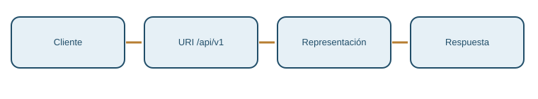
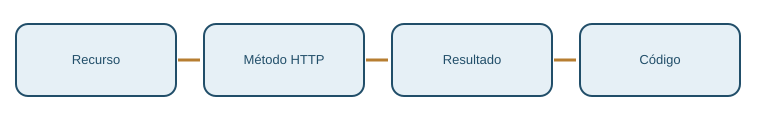
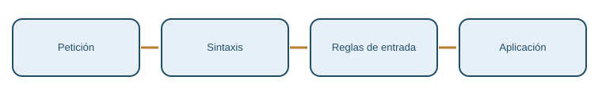
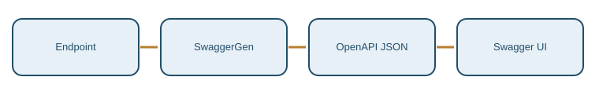

# M02 — Desarrollo de APIs REST con ASP.NET Core

**CURSO DE ARQUITECTURA HEXAGONAL Y MICROSERVICIOS AVANZADOS CON .NET 8**

**AUTOR: JAIME GALLO**

## Propósito del módulo
Diseñar contratos REST coherentes, validar peticiones con FluentValidation y comprobar mediante HTTP real la documentación OpenAPI generada por ASP.NET Core. Los cuatro puntos están vinculados a soluciones acumulativas de AceriaApp con EF Core 8 y SQL Server Express.

## Punto 2.1 — Diseño de APIs REST

### Bloque 1 — REST y restricciones

Restricciones separan cliente y servidor y reducen acoplamiento. Este principio debe describirse desde el comportamiento que observa un consumidor de AceriaApp y no exclusivamente desde la estructura interna del proyecto. En el contrato HTTP se distinguen la identificación del recurso, los datos intercambiados, las condiciones de éxito y los motivos de rechazo. La separación importa porque una migración de EF Core o una reorganización de carpetas no debería obligar a los clientes a conocer nuevas clases internas. Cada decisión del bloque se conecta con un archivo concreto, susceptible de inspección, una operación HTTP o una aserción automatizada. El lenguaje de la especificación debe diferenciar requisitos, convenciones y propiedades garantizadas por los protocolos.

En la acería, este conocimiento se aplica al ciclo de órdenes de producción, sus clientes y los materiales solicitados. Las operaciones existentes de la API monolítica permiten estudiar lecturas y altas, mientras los contratos de modificación y recursos anidados forman parte del diseño que podrán desarrollar puntos posteriores. La representación que recibe el consumidor no tiene por qué reproducir una tabla. El alumno examinará rutas, cuerpos JSON, métodos y códigos desde una perspectiva unificada: una acción correctamente nombrada no es suficiente si el servidor devuelve una respuesta contradictoria. Para tomar decisiones consistentes también es necesario considerar fallos, reintentos, versiones, seguridad y límites de tamaño. El bloque delimita exactamente qué se ha implementado y qué permanece como especificación.

Como criterio de verificación, consultar el archivo `docs/diseno-apis-rest.md` dentro del proyecto del punto 2.1. La explicación no considera válida una afirmación solo por aparecer en la documentación: debe existir una clase real, un test pertinente o una operación reproducible que proporcione evidencia. Restricciones separan cliente y servidor y reducen acoplamiento. Cuando esa capacidad dependa de un middleware, se comprobará su conexión al pipeline; cuando dependa de reglas de negocio, se distinguirá la validez superficial del dato de una comprobación de dominio. Este criterio evita confundir un esquema OpenAPI con lógica de aplicación, o una prueba de inicialización de objetos con un test de validación funcional. La consecuencia formativa es aprender a separar especificar, implementar y demostrar.

**Aspectos del diseño**

- **Principio:** Restricciones separan cliente y servidor y reducen acoplamiento.
- **Evidencia real:** `docs/diseno-apis-rest.md`.
- **Decisión:** conservar el contrato entre los proyectos sucesivos y justificar las excepciones en el arranque.

### Bloque 2 — Identificación de recursos

Las URIs representan recursos y no acciones. Este principio debe describirse desde el comportamiento que observa un consumidor de AceriaApp y no exclusivamente desde la estructura interna del proyecto. En el contrato HTTP se distinguen la identificación del recurso, los datos intercambiados, las condiciones de éxito y los motivos de rechazo. La separación importa porque una migración de EF Core o una reorganización de carpetas no debería obligar a los clientes a conocer nuevas clases internas. Cada decisión del bloque se conecta con un archivo concreto, susceptible de inspección, una operación HTTP o una aserción automatizada. El lenguaje de la especificación debe diferenciar requisitos, convenciones y propiedades garantizadas por los protocolos.

En la acería, este conocimiento se aplica al ciclo de órdenes de producción, sus clientes y los materiales solicitados. Las operaciones existentes de la API monolítica permiten estudiar lecturas y altas, mientras los contratos de modificación y recursos anidados forman parte del diseño que podrán desarrollar puntos posteriores. La representación que recibe el consumidor no tiene por qué reproducir una tabla. El alumno examinará rutas, cuerpos JSON, métodos y códigos desde una perspectiva unificada: una acción correctamente nombrada no es suficiente si el servidor devuelve una respuesta contradictoria. Para tomar decisiones consistentes también es necesario considerar fallos, reintentos, versiones, seguridad y límites de tamaño. El bloque delimita exactamente qué se ha implementado y qué permanece como especificación.

Como criterio de verificación, consultar el archivo `src/AceriaApp.Monolito.Api/DisenoRest/UriRest.cs` dentro del proyecto del punto 2.1. La explicación no considera válida una afirmación solo por aparecer en la documentación: debe existir una clase real, un test pertinente o una operación reproducible que proporcione evidencia. Las URIs representan recursos y no acciones. Cuando esa capacidad dependa de un middleware, se comprobará su conexión al pipeline; cuando dependa de reglas de negocio, se distinguirá la validez superficial del dato de una comprobación de dominio. Este criterio evita confundir un esquema OpenAPI con lógica de aplicación, o una prueba de inicialización de objetos con un test de validación funcional. La consecuencia formativa es aprender a separar especificar, implementar y demostrar.

**Aspectos del diseño**

- **Principio:** Las URIs representan recursos y no acciones.
- **Evidencia real:** `src/AceriaApp.Monolito.Api/DisenoRest/UriRest.cs`.
- **Decisión:** conservar el contrato entre los proyectos sucesivos y justificar las excepciones en el arranque.

| Contrato | Implementación | Evidencia |
|---|---|---|
| Identificación de recursos | AceriaApp, punto 2.1 | `src/AceriaApp.Monolito.Api/DisenoRest/UriRest.cs` |

### Bloque 3 — Representación y negociación de contenido

JSON es una representación; Accept no habilita XML automáticamente. Este principio debe describirse desde el comportamiento que observa un consumidor de AceriaApp y no exclusivamente desde la estructura interna del proyecto. En el contrato HTTP se distinguen la identificación del recurso, los datos intercambiados, las condiciones de éxito y los motivos de rechazo. La separación importa porque una migración de EF Core o una reorganización de carpetas no debería obligar a los clientes a conocer nuevas clases internas. Cada decisión del bloque se conecta con un archivo concreto, susceptible de inspección, una operación HTTP o una aserción automatizada. El lenguaje de la especificación debe diferenciar requisitos, convenciones y propiedades garantizadas por los protocolos.

En la acería, este conocimiento se aplica al ciclo de órdenes de producción, sus clientes y los materiales solicitados. Las operaciones existentes de la API monolítica permiten estudiar lecturas y altas, mientras los contratos de modificación y recursos anidados forman parte del diseño que podrán desarrollar puntos posteriores. La representación que recibe el consumidor no tiene por qué reproducir una tabla. El alumno examinará rutas, cuerpos JSON, métodos y códigos desde una perspectiva unificada: una acción correctamente nombrada no es suficiente si el servidor devuelve una respuesta contradictoria. Para tomar decisiones consistentes también es necesario considerar fallos, reintentos, versiones, seguridad y límites de tamaño. El bloque delimita exactamente qué se ha implementado y qué permanece como especificación.

Como criterio de verificación, consultar el archivo `docs/diseno-apis-rest.md` dentro del proyecto del punto 2.1. La explicación no considera válida una afirmación solo por aparecer en la documentación: debe existir una clase real, un test pertinente o una operación reproducible que proporcione evidencia. JSON es una representación; Accept no habilita XML automáticamente. Cuando esa capacidad dependa de un middleware, se comprobará su conexión al pipeline; cuando dependa de reglas de negocio, se distinguirá la validez superficial del dato de una comprobación de dominio. Este criterio evita confundir un esquema OpenAPI con lógica de aplicación, o una prueba de inicialización de objetos con un test de validación funcional. La consecuencia formativa es aprender a separar especificar, implementar y demostrar.

**Aspectos del diseño**

- **Principio:** JSON es una representación; Accept no habilita XML automáticamente.
- **Evidencia real:** `docs/diseno-apis-rest.md`.
- **Decisión:** conservar el contrato entre los proyectos sucesivos y justificar las excepciones en el arranque.

### Bloque 4 — Semántica de métodos HTTP

GET es seguro, PUT/DELETE idempotentes, PATCH depende del diseño. Este principio debe describirse desde el comportamiento que observa un consumidor de AceriaApp y no exclusivamente desde la estructura interna del proyecto. En el contrato HTTP se distinguen la identificación del recurso, los datos intercambiados, las condiciones de éxito y los motivos de rechazo. La separación importa porque una migración de EF Core o una reorganización de carpetas no debería obligar a los clientes a conocer nuevas clases internas. Cada decisión del bloque se conecta con un archivo concreto, susceptible de inspección, una operación HTTP o una aserción automatizada. El lenguaje de la especificación debe diferenciar requisitos, convenciones y propiedades garantizadas por los protocolos.

En la acería, este conocimiento se aplica al ciclo de órdenes de producción, sus clientes y los materiales solicitados. Las operaciones existentes de la API monolítica permiten estudiar lecturas y altas, mientras los contratos de modificación y recursos anidados forman parte del diseño que podrán desarrollar puntos posteriores. La representación que recibe el consumidor no tiene por qué reproducir una tabla. El alumno examinará rutas, cuerpos JSON, métodos y códigos desde una perspectiva unificada: una acción correctamente nombrada no es suficiente si el servidor devuelve una respuesta contradictoria. Para tomar decisiones consistentes también es necesario considerar fallos, reintentos, versiones, seguridad y límites de tamaño. El bloque delimita exactamente qué se ha implementado y qué permanece como especificación.

Como criterio de verificación, consultar el archivo `docs/diseno-apis-rest.md` dentro del proyecto del punto 2.1. La explicación no considera válida una afirmación solo por aparecer en la documentación: debe existir una clase real, un test pertinente o una operación reproducible que proporcione evidencia. GET es seguro, PUT/DELETE idempotentes, PATCH depende del diseño. Cuando esa capacidad dependa de un middleware, se comprobará su conexión al pipeline; cuando dependa de reglas de negocio, se distinguirá la validez superficial del dato de una comprobación de dominio. Este criterio evita confundir un esquema OpenAPI con lógica de aplicación, o una prueba de inicialización de objetos con un test de validación funcional. La consecuencia formativa es aprender a separar especificar, implementar y demostrar.

**Aspectos del diseño**

- **Principio:** GET es seguro, PUT/DELETE idempotentes, PATCH depende del diseño.
- **Evidencia real:** `docs/diseno-apis-rest.md`.
- **Decisión:** conservar el contrato entre los proyectos sucesivos y justificar las excepciones en el arranque.

### Bloque 5 — Códigos de estado HTTP

201 incluye la ubicación del creado; el estado no basta para definir caché. Este principio debe describirse desde el comportamiento que observa un consumidor de AceriaApp y no exclusivamente desde la estructura interna del proyecto. En el contrato HTTP se distinguen la identificación del recurso, los datos intercambiados, las condiciones de éxito y los motivos de rechazo. La separación importa porque una migración de EF Core o una reorganización de carpetas no debería obligar a los clientes a conocer nuevas clases internas. Cada decisión del bloque se conecta con un archivo concreto, susceptible de inspección, una operación HTTP o una aserción automatizada. El lenguaje de la especificación debe diferenciar requisitos, convenciones y propiedades garantizadas por los protocolos.

En la acería, este conocimiento se aplica al ciclo de órdenes de producción, sus clientes y los materiales solicitados. Las operaciones existentes de la API monolítica permiten estudiar lecturas y altas, mientras los contratos de modificación y recursos anidados forman parte del diseño que podrán desarrollar puntos posteriores. La representación que recibe el consumidor no tiene por qué reproducir una tabla. El alumno examinará rutas, cuerpos JSON, métodos y códigos desde una perspectiva unificada: una acción correctamente nombrada no es suficiente si el servidor devuelve una respuesta contradictoria. Para tomar decisiones consistentes también es necesario considerar fallos, reintentos, versiones, seguridad y límites de tamaño. El bloque delimita exactamente qué se ha implementado y qué permanece como especificación.

Como criterio de verificación, consultar el archivo `docs/diseno-apis-rest.md` dentro del proyecto del punto 2.1. La explicación no considera válida una afirmación solo por aparecer en la documentación: debe existir una clase real, un test pertinente o una operación reproducible que proporcione evidencia. 201 incluye la ubicación del creado; el estado no basta para definir caché. Cuando esa capacidad dependa de un middleware, se comprobará su conexión al pipeline; cuando dependa de reglas de negocio, se distinguirá la validez superficial del dato de una comprobación de dominio. Este criterio evita confundir un esquema OpenAPI con lógica de aplicación, o una prueba de inicialización de objetos con un test de validación funcional. La consecuencia formativa es aprender a separar especificar, implementar y demostrar.

**Aspectos del diseño**

- **Principio:** 201 incluye la ubicación del creado; el estado no basta para definir caché.
- **Evidencia real:** `docs/diseno-apis-rest.md`.
- **Decisión:** conservar el contrato entre los proyectos sucesivos y justificar las excepciones en el arranque.

### Bloque 6 — Diseño de URIs

Se adopta /api/v1 como convención, no como mandato REST. Este principio debe describirse desde el comportamiento que observa un consumidor de AceriaApp y no exclusivamente desde la estructura interna del proyecto. En el contrato HTTP se distinguen la identificación del recurso, los datos intercambiados, las condiciones de éxito y los motivos de rechazo. La separación importa porque una migración de EF Core o una reorganización de carpetas no debería obligar a los clientes a conocer nuevas clases internas. Cada decisión del bloque se conecta con un archivo concreto, susceptible de inspección, una operación HTTP o una aserción automatizada. El lenguaje de la especificación debe diferenciar requisitos, convenciones y propiedades garantizadas por los protocolos.

En la acería, este conocimiento se aplica al ciclo de órdenes de producción, sus clientes y los materiales solicitados. Las operaciones existentes de la API monolítica permiten estudiar lecturas y altas, mientras los contratos de modificación y recursos anidados forman parte del diseño que podrán desarrollar puntos posteriores. La representación que recibe el consumidor no tiene por qué reproducir una tabla. El alumno examinará rutas, cuerpos JSON, métodos y códigos desde una perspectiva unificada: una acción correctamente nombrada no es suficiente si el servidor devuelve una respuesta contradictoria. Para tomar decisiones consistentes también es necesario considerar fallos, reintentos, versiones, seguridad y límites de tamaño. El bloque delimita exactamente qué se ha implementado y qué permanece como especificación.

Como criterio de verificación, consultar el archivo `src/AceriaApp.Monolito.Api/DisenoRest/ValidadorUriRest.cs` dentro del proyecto del punto 2.1. La explicación no considera válida una afirmación solo por aparecer en la documentación: debe existir una clase real, un test pertinente o una operación reproducible que proporcione evidencia. Se adopta /api/v1 como convención, no como mandato REST. Cuando esa capacidad dependa de un middleware, se comprobará su conexión al pipeline; cuando dependa de reglas de negocio, se distinguirá la validez superficial del dato de una comprobación de dominio. Este criterio evita confundir un esquema OpenAPI con lógica de aplicación, o una prueba de inicialización de objetos con un test de validación funcional. La consecuencia formativa es aprender a separar especificar, implementar y demostrar.

**Aspectos del diseño**

- **Principio:** Se adopta /api/v1 como convención, no como mandato REST.
- **Evidencia real:** `src/AceriaApp.Monolito.Api/DisenoRest/ValidadorUriRest.cs`.
- **Decisión:** conservar el contrato entre los proyectos sucesivos y justificar las excepciones en el arranque.

| Contrato | Implementación | Evidencia |
|---|---|---|
| Diseño de URIs | AceriaApp, punto 2.1 | `src/AceriaApp.Monolito.Api/DisenoRest/ValidadorUriRest.cs` |

### Bloque 7 — Interfaz uniforme y Minimal API

MapGet y MapPost relacionan método, ruta y manejador. Este principio debe describirse desde el comportamiento que observa un consumidor de AceriaApp y no exclusivamente desde la estructura interna del proyecto. En el contrato HTTP se distinguen la identificación del recurso, los datos intercambiados, las condiciones de éxito y los motivos de rechazo. La separación importa porque una migración de EF Core o una reorganización de carpetas no debería obligar a los clientes a conocer nuevas clases internas. Cada decisión del bloque se conecta con un archivo concreto, susceptible de inspección, una operación HTTP o una aserción automatizada. El lenguaje de la especificación debe diferenciar requisitos, convenciones y propiedades garantizadas por los protocolos.

En la acería, este conocimiento se aplica al ciclo de órdenes de producción, sus clientes y los materiales solicitados. Las operaciones existentes de la API monolítica permiten estudiar lecturas y altas, mientras los contratos de modificación y recursos anidados forman parte del diseño que podrán desarrollar puntos posteriores. La representación que recibe el consumidor no tiene por qué reproducir una tabla. El alumno examinará rutas, cuerpos JSON, métodos y códigos desde una perspectiva unificada: una acción correctamente nombrada no es suficiente si el servidor devuelve una respuesta contradictoria. Para tomar decisiones consistentes también es necesario considerar fallos, reintentos, versiones, seguridad y límites de tamaño. El bloque delimita exactamente qué se ha implementado y qué permanece como especificación.

Como criterio de verificación, consultar el archivo `src/AceriaApp.Monolito.Api/Program.cs` dentro del proyecto del punto 2.1. La explicación no considera válida una afirmación solo por aparecer en la documentación: debe existir una clase real, un test pertinente o una operación reproducible que proporcione evidencia. MapGet y MapPost relacionan método, ruta y manejador. Cuando esa capacidad dependa de un middleware, se comprobará su conexión al pipeline; cuando dependa de reglas de negocio, se distinguirá la validez superficial del dato de una comprobación de dominio. Este criterio evita confundir un esquema OpenAPI con lógica de aplicación, o una prueba de inicialización de objetos con un test de validación funcional. La consecuencia formativa es aprender a separar especificar, implementar y demostrar.

**Aspectos del diseño**

- **Principio:** MapGet y MapPost relacionan método, ruta y manejador.
- **Evidencia real:** `src/AceriaApp.Monolito.Api/Program.cs`.
- **Decisión:** conservar el contrato entre los proyectos sucesivos y justificar las excepciones en el arranque.

### Bloque 8 — Relaciones y subrecursos

Anidamiento expresa contexto de identificación, sin límite normativo fijo. Este principio debe describirse desde el comportamiento que observa un consumidor de AceriaApp y no exclusivamente desde la estructura interna del proyecto. En el contrato HTTP se distinguen la identificación del recurso, los datos intercambiados, las condiciones de éxito y los motivos de rechazo. La separación importa porque una migración de EF Core o una reorganización de carpetas no debería obligar a los clientes a conocer nuevas clases internas. Cada decisión del bloque se conecta con un archivo concreto, susceptible de inspección, una operación HTTP o una aserción automatizada. El lenguaje de la especificación debe diferenciar requisitos, convenciones y propiedades garantizadas por los protocolos.

En la acería, este conocimiento se aplica al ciclo de órdenes de producción, sus clientes y los materiales solicitados. Las operaciones existentes de la API monolítica permiten estudiar lecturas y altas, mientras los contratos de modificación y recursos anidados forman parte del diseño que podrán desarrollar puntos posteriores. La representación que recibe el consumidor no tiene por qué reproducir una tabla. El alumno examinará rutas, cuerpos JSON, métodos y códigos desde una perspectiva unificada: una acción correctamente nombrada no es suficiente si el servidor devuelve una respuesta contradictoria. Para tomar decisiones consistentes también es necesario considerar fallos, reintentos, versiones, seguridad y límites de tamaño. El bloque delimita exactamente qué se ha implementado y qué permanece como especificación.

Como criterio de verificación, consultar el archivo `docs/diseno-apis-rest.md` dentro del proyecto del punto 2.1. La explicación no considera válida una afirmación solo por aparecer en la documentación: debe existir una clase real, un test pertinente o una operación reproducible que proporcione evidencia. Anidamiento expresa contexto de identificación, sin límite normativo fijo. Cuando esa capacidad dependa de un middleware, se comprobará su conexión al pipeline; cuando dependa de reglas de negocio, se distinguirá la validez superficial del dato de una comprobación de dominio. Este criterio evita confundir un esquema OpenAPI con lógica de aplicación, o una prueba de inicialización de objetos con un test de validación funcional. La consecuencia formativa es aprender a separar especificar, implementar y demostrar.

**Aspectos del diseño**

- **Principio:** Anidamiento expresa contexto de identificación, sin límite normativo fijo.
- **Evidencia real:** `docs/diseno-apis-rest.md`.
- **Decisión:** conservar el contrato entre los proyectos sucesivos y justificar las excepciones en el arranque.

### Bloque 9 — Paginación y filtrado

page y pageSize requieren implementación y pruebas. Este principio debe describirse desde el comportamiento que observa un consumidor de AceriaApp y no exclusivamente desde la estructura interna del proyecto. En el contrato HTTP se distinguen la identificación del recurso, los datos intercambiados, las condiciones de éxito y los motivos de rechazo. La separación importa porque una migración de EF Core o una reorganización de carpetas no debería obligar a los clientes a conocer nuevas clases internas. Cada decisión del bloque se conecta con un archivo concreto, susceptible de inspección, una operación HTTP o una aserción automatizada. El lenguaje de la especificación debe diferenciar requisitos, convenciones y propiedades garantizadas por los protocolos.

En la acería, este conocimiento se aplica al ciclo de órdenes de producción, sus clientes y los materiales solicitados. Las operaciones existentes de la API monolítica permiten estudiar lecturas y altas, mientras los contratos de modificación y recursos anidados forman parte del diseño que podrán desarrollar puntos posteriores. La representación que recibe el consumidor no tiene por qué reproducir una tabla. El alumno examinará rutas, cuerpos JSON, métodos y códigos desde una perspectiva unificada: una acción correctamente nombrada no es suficiente si el servidor devuelve una respuesta contradictoria. Para tomar decisiones consistentes también es necesario considerar fallos, reintentos, versiones, seguridad y límites de tamaño. El bloque delimita exactamente qué se ha implementado y qué permanece como especificación.

Como criterio de verificación, consultar el archivo `docs/diseno-apis-rest.md` dentro del proyecto del punto 2.1. La explicación no considera válida una afirmación solo por aparecer en la documentación: debe existir una clase real, un test pertinente o una operación reproducible que proporcione evidencia. page y pageSize requieren implementación y pruebas. Cuando esa capacidad dependa de un middleware, se comprobará su conexión al pipeline; cuando dependa de reglas de negocio, se distinguirá la validez superficial del dato de una comprobación de dominio. Este criterio evita confundir un esquema OpenAPI con lógica de aplicación, o una prueba de inicialización de objetos con un test de validación funcional. La consecuencia formativa es aprender a separar especificar, implementar y demostrar.

**Aspectos del diseño**

- **Principio:** page y pageSize requieren implementación y pruebas.
- **Evidencia real:** `docs/diseno-apis-rest.md`.
- **Decisión:** conservar el contrato entre los proyectos sucesivos y justificar las excepciones en el arranque.

### Bloque 10 — Contrato aplicado a AceriaApp

Un validador de URI verifica una convención, no las seis restricciones REST. Este principio debe describirse desde el comportamiento que observa un consumidor de AceriaApp y no exclusivamente desde la estructura interna del proyecto. En el contrato HTTP se distinguen la identificación del recurso, los datos intercambiados, las condiciones de éxito y los motivos de rechazo. La separación importa porque una migración de EF Core o una reorganización de carpetas no debería obligar a los clientes a conocer nuevas clases internas. Cada decisión del bloque se conecta con un archivo concreto, susceptible de inspección, una operación HTTP o una aserción automatizada. El lenguaje de la especificación debe diferenciar requisitos, convenciones y propiedades garantizadas por los protocolos.

En la acería, este conocimiento se aplica al ciclo de órdenes de producción, sus clientes y los materiales solicitados. Las operaciones existentes de la API monolítica permiten estudiar lecturas y altas, mientras los contratos de modificación y recursos anidados forman parte del diseño que podrán desarrollar puntos posteriores. La representación que recibe el consumidor no tiene por qué reproducir una tabla. El alumno examinará rutas, cuerpos JSON, métodos y códigos desde una perspectiva unificada: una acción correctamente nombrada no es suficiente si el servidor devuelve una respuesta contradictoria. Para tomar decisiones consistentes también es necesario considerar fallos, reintentos, versiones, seguridad y límites de tamaño. El bloque delimita exactamente qué se ha implementado y qué permanece como especificación.

Como criterio de verificación, consultar el archivo `src/AceriaApp.Monolito.Api/DisenoRest/CatalogoUris.cs` dentro del proyecto del punto 2.1. La explicación no considera válida una afirmación solo por aparecer en la documentación: debe existir una clase real, un test pertinente o una operación reproducible que proporcione evidencia. Un validador de URI verifica una convención, no las seis restricciones REST. Cuando esa capacidad dependa de un middleware, se comprobará su conexión al pipeline; cuando dependa de reglas de negocio, se distinguirá la validez superficial del dato de una comprobación de dominio. Este criterio evita confundir un esquema OpenAPI con lógica de aplicación, o una prueba de inicialización de objetos con un test de validación funcional. La consecuencia formativa es aprender a separar especificar, implementar y demostrar.

**Aspectos del diseño**

- **Principio:** Un validador de URI verifica una convención, no las seis restricciones REST.
- **Evidencia real:** `src/AceriaApp.Monolito.Api/DisenoRest/CatalogoUris.cs`.
- **Decisión:** conservar el contrato entre los proyectos sucesivos y justificar las excepciones en el arranque.

| Contrato | Implementación | Evidencia |
|---|---|---|
| Contrato aplicado a AceriaApp | AceriaApp, punto 2.1 | `src/AceriaApp.Monolito.Api/DisenoRest/CatalogoUris.cs` |

### Recapitulación del punto 2.1
El recorrido conecta los conceptos con una solución reproducible. La práctica debe verificar que las responsabilidades se separan correctamente y que la funcionalidad esperada se encuentra realmente conectada al proyecto.

---
## Punto 2.2 — Recursos, verbos HTTP y códigos de respuesta

### Bloque 1 — El recurso de negocio

El recurso refleja necesidades del consumidor, no una tabla EF. Este principio debe describirse desde el comportamiento que observa un consumidor de AceriaApp y no exclusivamente desde la estructura interna del proyecto. En el contrato HTTP se distinguen la identificación del recurso, los datos intercambiados, las condiciones de éxito y los motivos de rechazo. La separación importa porque una migración de EF Core o una reorganización de carpetas no debería obligar a los clientes a conocer nuevas clases internas. Cada decisión del bloque se conecta con un archivo concreto, susceptible de inspección, una operación HTTP o una aserción automatizada. El lenguaje de la especificación debe diferenciar requisitos, convenciones y propiedades garantizadas por los protocolos.

En la acería, este conocimiento se aplica al ciclo de órdenes de producción, sus clientes y los materiales solicitados. Las operaciones existentes de la API monolítica permiten estudiar lecturas y altas, mientras los contratos de modificación y recursos anidados forman parte del diseño que podrán desarrollar puntos posteriores. La representación que recibe el consumidor no tiene por qué reproducir una tabla. El alumno examinará rutas, cuerpos JSON, métodos y códigos desde una perspectiva unificada: una acción correctamente nombrada no es suficiente si el servidor devuelve una respuesta contradictoria. Para tomar decisiones consistentes también es necesario considerar fallos, reintentos, versiones, seguridad y límites de tamaño. El bloque delimita exactamente qué se ha implementado y qué permanece como especificación.

Como criterio de verificación, consultar el archivo `docs/catalogo-recursos.md` dentro del proyecto del punto 2.2. La explicación no considera válida una afirmación solo por aparecer en la documentación: debe existir una clase real, un test pertinente o una operación reproducible que proporcione evidencia. El recurso refleja necesidades del consumidor, no una tabla EF. Cuando esa capacidad dependa de un middleware, se comprobará su conexión al pipeline; cuando dependa de reglas de negocio, se distinguirá la validez superficial del dato de una comprobación de dominio. Este criterio evita confundir un esquema OpenAPI con lógica de aplicación, o una prueba de inicialización de objetos con un test de validación funcional. La consecuencia formativa es aprender a separar especificar, implementar y demostrar.

**Aspectos del diseño**

- **Principio:** El recurso refleja necesidades del consumidor, no una tabla EF.
- **Evidencia real:** `docs/catalogo-recursos.md`.
- **Decisión:** conservar el contrato entre los proyectos sucesivos y justificar las excepciones en el arranque.

### Bloque 2 — Representaciones y DTO

Un DTO público no debe confundirse con la entidad persistida. Este principio debe describirse desde el comportamiento que observa un consumidor de AceriaApp y no exclusivamente desde la estructura interna del proyecto. En el contrato HTTP se distinguen la identificación del recurso, los datos intercambiados, las condiciones de éxito y los motivos de rechazo. La separación importa porque una migración de EF Core o una reorganización de carpetas no debería obligar a los clientes a conocer nuevas clases internas. Cada decisión del bloque se conecta con un archivo concreto, susceptible de inspección, una operación HTTP o una aserción automatizada. El lenguaje de la especificación debe diferenciar requisitos, convenciones y propiedades garantizadas por los protocolos.

En la acería, este conocimiento se aplica al ciclo de órdenes de producción, sus clientes y los materiales solicitados. Las operaciones existentes de la API monolítica permiten estudiar lecturas y altas, mientras los contratos de modificación y recursos anidados forman parte del diseño que podrán desarrollar puntos posteriores. La representación que recibe el consumidor no tiene por qué reproducir una tabla. El alumno examinará rutas, cuerpos JSON, métodos y códigos desde una perspectiva unificada: una acción correctamente nombrada no es suficiente si el servidor devuelve una respuesta contradictoria. Para tomar decisiones consistentes también es necesario considerar fallos, reintentos, versiones, seguridad y límites de tamaño. El bloque delimita exactamente qué se ha implementado y qué permanece como especificación.

Como criterio de verificación, consultar el archivo `docs/catalogo-recursos.md` dentro del proyecto del punto 2.2. La explicación no considera válida una afirmación solo por aparecer en la documentación: debe existir una clase real, un test pertinente o una operación reproducible que proporcione evidencia. Un DTO público no debe confundirse con la entidad persistida. Cuando esa capacidad dependa de un middleware, se comprobará su conexión al pipeline; cuando dependa de reglas de negocio, se distinguirá la validez superficial del dato de una comprobación de dominio. Este criterio evita confundir un esquema OpenAPI con lógica de aplicación, o una prueba de inicialización de objetos con un test de validación funcional. La consecuencia formativa es aprender a separar especificar, implementar y demostrar.

**Aspectos del diseño**

- **Principio:** Un DTO público no debe confundirse con la entidad persistida.
- **Evidencia real:** `docs/catalogo-recursos.md`.
- **Decisión:** conservar el contrato entre los proyectos sucesivos y justificar las excepciones en el arranque.

| Contrato | Implementación | Evidencia |
|---|---|---|
| Representaciones y DTO | AceriaApp, punto 2.2 | `docs/catalogo-recursos.md` |

### Bloque 3 — Verbos HTTP: seguridad e idempotencia

POST puede ser cacheable bajo condiciones HTTP; PATCH puede ser idempotente. Este principio debe describirse desde el comportamiento que observa un consumidor de AceriaApp y no exclusivamente desde la estructura interna del proyecto. En el contrato HTTP se distinguen la identificación del recurso, los datos intercambiados, las condiciones de éxito y los motivos de rechazo. La separación importa porque una migración de EF Core o una reorganización de carpetas no debería obligar a los clientes a conocer nuevas clases internas. Cada decisión del bloque se conecta con un archivo concreto, susceptible de inspección, una operación HTTP o una aserción automatizada. El lenguaje de la especificación debe diferenciar requisitos, convenciones y propiedades garantizadas por los protocolos.

En la acería, este conocimiento se aplica al ciclo de órdenes de producción, sus clientes y los materiales solicitados. Las operaciones existentes de la API monolítica permiten estudiar lecturas y altas, mientras los contratos de modificación y recursos anidados forman parte del diseño que podrán desarrollar puntos posteriores. La representación que recibe el consumidor no tiene por qué reproducir una tabla. El alumno examinará rutas, cuerpos JSON, métodos y códigos desde una perspectiva unificada: una acción correctamente nombrada no es suficiente si el servidor devuelve una respuesta contradictoria. Para tomar decisiones consistentes también es necesario considerar fallos, reintentos, versiones, seguridad y límites de tamaño. El bloque delimita exactamente qué se ha implementado y qué permanece como especificación.

Como criterio de verificación, consultar el archivo `docs/catalogo-recursos.md` dentro del proyecto del punto 2.2. La explicación no considera válida una afirmación solo por aparecer en la documentación: debe existir una clase real, un test pertinente o una operación reproducible que proporcione evidencia. POST puede ser cacheable bajo condiciones HTTP; PATCH puede ser idempotente. Cuando esa capacidad dependa de un middleware, se comprobará su conexión al pipeline; cuando dependa de reglas de negocio, se distinguirá la validez superficial del dato de una comprobación de dominio. Este criterio evita confundir un esquema OpenAPI con lógica de aplicación, o una prueba de inicialización de objetos con un test de validación funcional. La consecuencia formativa es aprender a separar especificar, implementar y demostrar.

**Aspectos del diseño**

- **Principio:** POST puede ser cacheable bajo condiciones HTTP; PATCH puede ser idempotente.
- **Evidencia real:** `docs/catalogo-recursos.md`.
- **Decisión:** conservar el contrato entre los proyectos sucesivos y justificar las excepciones en el arranque.

### Bloque 4 — Colecciones y elementos concretos

No se implementa DELETE de colección sin requisito explícito. Este principio debe describirse desde el comportamiento que observa un consumidor de AceriaApp y no exclusivamente desde la estructura interna del proyecto. En el contrato HTTP se distinguen la identificación del recurso, los datos intercambiados, las condiciones de éxito y los motivos de rechazo. La separación importa porque una migración de EF Core o una reorganización de carpetas no debería obligar a los clientes a conocer nuevas clases internas. Cada decisión del bloque se conecta con un archivo concreto, susceptible de inspección, una operación HTTP o una aserción automatizada. El lenguaje de la especificación debe diferenciar requisitos, convenciones y propiedades garantizadas por los protocolos.

En la acería, este conocimiento se aplica al ciclo de órdenes de producción, sus clientes y los materiales solicitados. Las operaciones existentes de la API monolítica permiten estudiar lecturas y altas, mientras los contratos de modificación y recursos anidados forman parte del diseño que podrán desarrollar puntos posteriores. La representación que recibe el consumidor no tiene por qué reproducir una tabla. El alumno examinará rutas, cuerpos JSON, métodos y códigos desde una perspectiva unificada: una acción correctamente nombrada no es suficiente si el servidor devuelve una respuesta contradictoria. Para tomar decisiones consistentes también es necesario considerar fallos, reintentos, versiones, seguridad y límites de tamaño. El bloque delimita exactamente qué se ha implementado y qué permanece como especificación.

Como criterio de verificación, consultar el archivo `docs/catalogo-recursos.md` dentro del proyecto del punto 2.2. La explicación no considera válida una afirmación solo por aparecer en la documentación: debe existir una clase real, un test pertinente o una operación reproducible que proporcione evidencia. No se implementa DELETE de colección sin requisito explícito. Cuando esa capacidad dependa de un middleware, se comprobará su conexión al pipeline; cuando dependa de reglas de negocio, se distinguirá la validez superficial del dato de una comprobación de dominio. Este criterio evita confundir un esquema OpenAPI con lógica de aplicación, o una prueba de inicialización de objetos con un test de validación funcional. La consecuencia formativa es aprender a separar especificar, implementar y demostrar.

**Aspectos del diseño**

- **Principio:** No se implementa DELETE de colección sin requisito explícito.
- **Evidencia real:** `docs/catalogo-recursos.md`.
- **Decisión:** conservar el contrato entre los proyectos sucesivos y justificar las excepciones en el arranque.

### Bloque 5 — Matriz de verbos y estados

Un catálogo de estados es un subconjunto esperado y documentado. Este principio debe describirse desde el comportamiento que observa un consumidor de AceriaApp y no exclusivamente desde la estructura interna del proyecto. En el contrato HTTP se distinguen la identificación del recurso, los datos intercambiados, las condiciones de éxito y los motivos de rechazo. La separación importa porque una migración de EF Core o una reorganización de carpetas no debería obligar a los clientes a conocer nuevas clases internas. Cada decisión del bloque se conecta con un archivo concreto, susceptible de inspección, una operación HTTP o una aserción automatizada. El lenguaje de la especificación debe diferenciar requisitos, convenciones y propiedades garantizadas por los protocolos.

En la acería, este conocimiento se aplica al ciclo de órdenes de producción, sus clientes y los materiales solicitados. Las operaciones existentes de la API monolítica permiten estudiar lecturas y altas, mientras los contratos de modificación y recursos anidados forman parte del diseño que podrán desarrollar puntos posteriores. La representación que recibe el consumidor no tiene por qué reproducir una tabla. El alumno examinará rutas, cuerpos JSON, métodos y códigos desde una perspectiva unificada: una acción correctamente nombrada no es suficiente si el servidor devuelve una respuesta contradictoria. Para tomar decisiones consistentes también es necesario considerar fallos, reintentos, versiones, seguridad y límites de tamaño. El bloque delimita exactamente qué se ha implementado y qué permanece como especificación.

Como criterio de verificación, consultar el archivo `src/AceriaApp.Monolito.Api/CatalogoRecursos/ValidadorCombinacionVerboCodigo.cs` dentro del proyecto del punto 2.2. La explicación no considera válida una afirmación solo por aparecer en la documentación: debe existir una clase real, un test pertinente o una operación reproducible que proporcione evidencia. Un catálogo de estados es un subconjunto esperado y documentado. Cuando esa capacidad dependa de un middleware, se comprobará su conexión al pipeline; cuando dependa de reglas de negocio, se distinguirá la validez superficial del dato de una comprobación de dominio. Este criterio evita confundir un esquema OpenAPI con lógica de aplicación, o una prueba de inicialización de objetos con un test de validación funcional. La consecuencia formativa es aprender a separar especificar, implementar y demostrar.

**Aspectos del diseño**

- **Principio:** Un catálogo de estados es un subconjunto esperado y documentado.
- **Evidencia real:** `src/AceriaApp.Monolito.Api/CatalogoRecursos/ValidadorCombinacionVerboCodigo.cs`.
- **Decisión:** conservar el contrato entre los proyectos sucesivos y justificar las excepciones en el arranque.

### Bloque 6 — Códigos 4xx y sus causas

400,401,403,404,405,409 y 422 tienen significados diferentes. Este principio debe describirse desde el comportamiento que observa un consumidor de AceriaApp y no exclusivamente desde la estructura interna del proyecto. En el contrato HTTP se distinguen la identificación del recurso, los datos intercambiados, las condiciones de éxito y los motivos de rechazo. La separación importa porque una migración de EF Core o una reorganización de carpetas no debería obligar a los clientes a conocer nuevas clases internas. Cada decisión del bloque se conecta con un archivo concreto, susceptible de inspección, una operación HTTP o una aserción automatizada. El lenguaje de la especificación debe diferenciar requisitos, convenciones y propiedades garantizadas por los protocolos.

En la acería, este conocimiento se aplica al ciclo de órdenes de producción, sus clientes y los materiales solicitados. Las operaciones existentes de la API monolítica permiten estudiar lecturas y altas, mientras los contratos de modificación y recursos anidados forman parte del diseño que podrán desarrollar puntos posteriores. La representación que recibe el consumidor no tiene por qué reproducir una tabla. El alumno examinará rutas, cuerpos JSON, métodos y códigos desde una perspectiva unificada: una acción correctamente nombrada no es suficiente si el servidor devuelve una respuesta contradictoria. Para tomar decisiones consistentes también es necesario considerar fallos, reintentos, versiones, seguridad y límites de tamaño. El bloque delimita exactamente qué se ha implementado y qué permanece como especificación.

Como criterio de verificación, consultar el archivo `docs/catalogo-recursos.md` dentro del proyecto del punto 2.2. La explicación no considera válida una afirmación solo por aparecer en la documentación: debe existir una clase real, un test pertinente o una operación reproducible que proporcione evidencia. 400,401,403,404,405,409 y 422 tienen significados diferentes. Cuando esa capacidad dependa de un middleware, se comprobará su conexión al pipeline; cuando dependa de reglas de negocio, se distinguirá la validez superficial del dato de una comprobación de dominio. Este criterio evita confundir un esquema OpenAPI con lógica de aplicación, o una prueba de inicialización de objetos con un test de validación funcional. La consecuencia formativa es aprender a separar especificar, implementar y demostrar.

**Aspectos del diseño**

- **Principio:** 400,401,403,404,405,409 y 422 tienen significados diferentes.
- **Evidencia real:** `docs/catalogo-recursos.md`.
- **Decisión:** conservar el contrato entre los proyectos sucesivos y justificar las excepciones en el arranque.

| Contrato | Implementación | Evidencia |
|---|---|---|
| Códigos 4xx y sus causas | AceriaApp, punto 2.2 | `docs/catalogo-recursos.md` |

### Bloque 7 — Códigos 5xx e intermediarios

502 y 504 suelen proceder de un intermediario. Este principio debe describirse desde el comportamiento que observa un consumidor de AceriaApp y no exclusivamente desde la estructura interna del proyecto. En el contrato HTTP se distinguen la identificación del recurso, los datos intercambiados, las condiciones de éxito y los motivos de rechazo. La separación importa porque una migración de EF Core o una reorganización de carpetas no debería obligar a los clientes a conocer nuevas clases internas. Cada decisión del bloque se conecta con un archivo concreto, susceptible de inspección, una operación HTTP o una aserción automatizada. El lenguaje de la especificación debe diferenciar requisitos, convenciones y propiedades garantizadas por los protocolos.

En la acería, este conocimiento se aplica al ciclo de órdenes de producción, sus clientes y los materiales solicitados. Las operaciones existentes de la API monolítica permiten estudiar lecturas y altas, mientras los contratos de modificación y recursos anidados forman parte del diseño que podrán desarrollar puntos posteriores. La representación que recibe el consumidor no tiene por qué reproducir una tabla. El alumno examinará rutas, cuerpos JSON, métodos y códigos desde una perspectiva unificada: una acción correctamente nombrada no es suficiente si el servidor devuelve una respuesta contradictoria. Para tomar decisiones consistentes también es necesario considerar fallos, reintentos, versiones, seguridad y límites de tamaño. El bloque delimita exactamente qué se ha implementado y qué permanece como especificación.

Como criterio de verificación, consultar el archivo `docs/catalogo-recursos.md` dentro del proyecto del punto 2.2. La explicación no considera válida una afirmación solo por aparecer en la documentación: debe existir una clase real, un test pertinente o una operación reproducible que proporcione evidencia. 502 y 504 suelen proceder de un intermediario. Cuando esa capacidad dependa de un middleware, se comprobará su conexión al pipeline; cuando dependa de reglas de negocio, se distinguirá la validez superficial del dato de una comprobación de dominio. Este criterio evita confundir un esquema OpenAPI con lógica de aplicación, o una prueba de inicialización de objetos con un test de validación funcional. La consecuencia formativa es aprender a separar especificar, implementar y demostrar.

**Aspectos del diseño**

- **Principio:** 502 y 504 suelen proceder de un intermediario.
- **Evidencia real:** `docs/catalogo-recursos.md`.
- **Decisión:** conservar el contrato entre los proyectos sucesivos y justificar las excepciones en el arranque.

### Bloque 8 — Problem Details y RFC 9457

Problem Details es un contrato de error; RFC 9457 actualiza RFC 7807. Este principio debe describirse desde el comportamiento que observa un consumidor de AceriaApp y no exclusivamente desde la estructura interna del proyecto. En el contrato HTTP se distinguen la identificación del recurso, los datos intercambiados, las condiciones de éxito y los motivos de rechazo. La separación importa porque una migración de EF Core o una reorganización de carpetas no debería obligar a los clientes a conocer nuevas clases internas. Cada decisión del bloque se conecta con un archivo concreto, susceptible de inspección, una operación HTTP o una aserción automatizada. El lenguaje de la especificación debe diferenciar requisitos, convenciones y propiedades garantizadas por los protocolos.

En la acería, este conocimiento se aplica al ciclo de órdenes de producción, sus clientes y los materiales solicitados. Las operaciones existentes de la API monolítica permiten estudiar lecturas y altas, mientras los contratos de modificación y recursos anidados forman parte del diseño que podrán desarrollar puntos posteriores. La representación que recibe el consumidor no tiene por qué reproducir una tabla. El alumno examinará rutas, cuerpos JSON, métodos y códigos desde una perspectiva unificada: una acción correctamente nombrada no es suficiente si el servidor devuelve una respuesta contradictoria. Para tomar decisiones consistentes también es necesario considerar fallos, reintentos, versiones, seguridad y límites de tamaño. El bloque delimita exactamente qué se ha implementado y qué permanece como especificación.

Como criterio de verificación, consultar el archivo `docs/catalogo-recursos.md` dentro del proyecto del punto 2.2. La explicación no considera válida una afirmación solo por aparecer en la documentación: debe existir una clase real, un test pertinente o una operación reproducible que proporcione evidencia. Problem Details es un contrato de error; RFC 9457 actualiza RFC 7807. Cuando esa capacidad dependa de un middleware, se comprobará su conexión al pipeline; cuando dependa de reglas de negocio, se distinguirá la validez superficial del dato de una comprobación de dominio. Este criterio evita confundir un esquema OpenAPI con lógica de aplicación, o una prueba de inicialización de objetos con un test de validación funcional. La consecuencia formativa es aprender a separar especificar, implementar y demostrar.

**Aspectos del diseño**

- **Principio:** Problem Details es un contrato de error; RFC 9457 actualiza RFC 7807.
- **Evidencia real:** `docs/catalogo-recursos.md`.
- **Decisión:** conservar el contrato entre los proyectos sucesivos y justificar las excepciones en el arranque.

### Bloque 9 — Catálogo de recursos

Rutas, métodos y estados previstos forman un catálogo mantenible. Este principio debe describirse desde el comportamiento que observa un consumidor de AceriaApp y no exclusivamente desde la estructura interna del proyecto. En el contrato HTTP se distinguen la identificación del recurso, los datos intercambiados, las condiciones de éxito y los motivos de rechazo. La separación importa porque una migración de EF Core o una reorganización de carpetas no debería obligar a los clientes a conocer nuevas clases internas. Cada decisión del bloque se conecta con un archivo concreto, susceptible de inspección, una operación HTTP o una aserción automatizada. El lenguaje de la especificación debe diferenciar requisitos, convenciones y propiedades garantizadas por los protocolos.

En la acería, este conocimiento se aplica al ciclo de órdenes de producción, sus clientes y los materiales solicitados. Las operaciones existentes de la API monolítica permiten estudiar lecturas y altas, mientras los contratos de modificación y recursos anidados forman parte del diseño que podrán desarrollar puntos posteriores. La representación que recibe el consumidor no tiene por qué reproducir una tabla. El alumno examinará rutas, cuerpos JSON, métodos y códigos desde una perspectiva unificada: una acción correctamente nombrada no es suficiente si el servidor devuelve una respuesta contradictoria. Para tomar decisiones consistentes también es necesario considerar fallos, reintentos, versiones, seguridad y límites de tamaño. El bloque delimita exactamente qué se ha implementado y qué permanece como especificación.

Como criterio de verificación, consultar el archivo `src/AceriaApp.Monolito.Api/CatalogoRecursos/CatalogoCombinaciones.cs` dentro del proyecto del punto 2.2. La explicación no considera válida una afirmación solo por aparecer en la documentación: debe existir una clase real, un test pertinente o una operación reproducible que proporcione evidencia. Rutas, métodos y estados previstos forman un catálogo mantenible. Cuando esa capacidad dependa de un middleware, se comprobará su conexión al pipeline; cuando dependa de reglas de negocio, se distinguirá la validez superficial del dato de una comprobación de dominio. Este criterio evita confundir un esquema OpenAPI con lógica de aplicación, o una prueba de inicialización de objetos con un test de validación funcional. La consecuencia formativa es aprender a separar especificar, implementar y demostrar.

**Aspectos del diseño**

- **Principio:** Rutas, métodos y estados previstos forman un catálogo mantenible.
- **Evidencia real:** `src/AceriaApp.Monolito.Api/CatalogoRecursos/CatalogoCombinaciones.cs`.
- **Decisión:** conservar el contrato entre los proyectos sucesivos y justificar las excepciones en el arranque.

### Bloque 10 — Validación automática del catálogo

Las aserciones deben probar aceptados y rechazados. Este principio debe describirse desde el comportamiento que observa un consumidor de AceriaApp y no exclusivamente desde la estructura interna del proyecto. En el contrato HTTP se distinguen la identificación del recurso, los datos intercambiados, las condiciones de éxito y los motivos de rechazo. La separación importa porque una migración de EF Core o una reorganización de carpetas no debería obligar a los clientes a conocer nuevas clases internas. Cada decisión del bloque se conecta con un archivo concreto, susceptible de inspección, una operación HTTP o una aserción automatizada. El lenguaje de la especificación debe diferenciar requisitos, convenciones y propiedades garantizadas por los protocolos.

En la acería, este conocimiento se aplica al ciclo de órdenes de producción, sus clientes y los materiales solicitados. Las operaciones existentes de la API monolítica permiten estudiar lecturas y altas, mientras los contratos de modificación y recursos anidados forman parte del diseño que podrán desarrollar puntos posteriores. La representación que recibe el consumidor no tiene por qué reproducir una tabla. El alumno examinará rutas, cuerpos JSON, métodos y códigos desde una perspectiva unificada: una acción correctamente nombrada no es suficiente si el servidor devuelve una respuesta contradictoria. Para tomar decisiones consistentes también es necesario considerar fallos, reintentos, versiones, seguridad y límites de tamaño. El bloque delimita exactamente qué se ha implementado y qué permanece como especificación.

Como criterio de verificación, consultar el archivo `tests/AceriaApp.CatalogoRecursos.Tests/ValidadorCombinacionVerboCodigoTests.cs` dentro del proyecto del punto 2.2. La explicación no considera válida una afirmación solo por aparecer en la documentación: debe existir una clase real, un test pertinente o una operación reproducible que proporcione evidencia. Las aserciones deben probar aceptados y rechazados. Cuando esa capacidad dependa de un middleware, se comprobará su conexión al pipeline; cuando dependa de reglas de negocio, se distinguirá la validez superficial del dato de una comprobación de dominio. Este criterio evita confundir un esquema OpenAPI con lógica de aplicación, o una prueba de inicialización de objetos con un test de validación funcional. La consecuencia formativa es aprender a separar especificar, implementar y demostrar.

**Aspectos del diseño**

- **Principio:** Las aserciones deben probar aceptados y rechazados.
- **Evidencia real:** `tests/AceriaApp.CatalogoRecursos.Tests/ValidadorCombinacionVerboCodigoTests.cs`.
- **Decisión:** conservar el contrato entre los proyectos sucesivos y justificar las excepciones en el arranque.

| Contrato | Implementación | Evidencia |
|---|---|---|
| Validación automática del catálogo | AceriaApp, punto 2.2 | `tests/AceriaApp.CatalogoRecursos.Tests/ValidadorCombinacionVerboCodigoTests.cs` |

### Recapitulación del punto 2.2
El recorrido conecta los conceptos con una solución reproducible. La práctica debe verificar que las responsabilidades se separan correctamente y que la funcionalidad esperada se encuentra realmente conectada al proyecto.

---
## Punto 2.3 — Validación de peticiones

### Bloque 1 — Validación como contrato de entrada

Un contrato evita que datos erróneos atraviesen la aplicación. Este principio debe describirse desde el comportamiento que observa un consumidor de AceriaApp y no exclusivamente desde la estructura interna del proyecto. En el contrato HTTP se distinguen la identificación del recurso, los datos intercambiados, las condiciones de éxito y los motivos de rechazo. La separación importa porque una migración de EF Core o una reorganización de carpetas no debería obligar a los clientes a conocer nuevas clases internas. Cada decisión del bloque se conecta con un archivo concreto, susceptible de inspección, una operación HTTP o una aserción automatizada. El lenguaje de la especificación debe diferenciar requisitos, convenciones y propiedades garantizadas por los protocolos.

En la acería, este conocimiento se aplica al ciclo de órdenes de producción, sus clientes y los materiales solicitados. Las operaciones existentes de la API monolítica permiten estudiar lecturas y altas, mientras los contratos de modificación y recursos anidados forman parte del diseño que podrán desarrollar puntos posteriores. La representación que recibe el consumidor no tiene por qué reproducir una tabla. El alumno examinará rutas, cuerpos JSON, métodos y códigos desde una perspectiva unificada: una acción correctamente nombrada no es suficiente si el servidor devuelve una respuesta contradictoria. Para tomar decisiones consistentes también es necesario considerar fallos, reintentos, versiones, seguridad y límites de tamaño. El bloque delimita exactamente qué se ha implementado y qué permanece como especificación.

Como criterio de verificación, consultar el archivo `src/AceriaApp.Monolito.Api/Validacion/CrearOrdenRequest.cs` dentro del proyecto del punto 2.3. La explicación no considera válida una afirmación solo por aparecer en la documentación: debe existir una clase real, un test pertinente o una operación reproducible que proporcione evidencia. Un contrato evita que datos erróneos atraviesen la aplicación. Cuando esa capacidad dependa de un middleware, se comprobará su conexión al pipeline; cuando dependa de reglas de negocio, se distinguirá la validez superficial del dato de una comprobación de dominio. Este criterio evita confundir un esquema OpenAPI con lógica de aplicación, o una prueba de inicialización de objetos con un test de validación funcional. La consecuencia formativa es aprender a separar especificar, implementar y demostrar.

**Aspectos del diseño**

- **Principio:** Un contrato evita que datos erróneos atraviesen la aplicación.
- **Evidencia real:** `src/AceriaApp.Monolito.Api/Validacion/CrearOrdenRequest.cs`.
- **Decisión:** conservar el contrato entre los proyectos sucesivos y justificar las excepciones en el arranque.

### Bloque 2 — Análisis sintáctico y enlace

Nullability no garantiza por sí sola required en runtime Minimal API. Este principio debe describirse desde el comportamiento que observa un consumidor de AceriaApp y no exclusivamente desde la estructura interna del proyecto. En el contrato HTTP se distinguen la identificación del recurso, los datos intercambiados, las condiciones de éxito y los motivos de rechazo. La separación importa porque una migración de EF Core o una reorganización de carpetas no debería obligar a los clientes a conocer nuevas clases internas. Cada decisión del bloque se conecta con un archivo concreto, susceptible de inspección, una operación HTTP o una aserción automatizada. El lenguaje de la especificación debe diferenciar requisitos, convenciones y propiedades garantizadas por los protocolos.

En la acería, este conocimiento se aplica al ciclo de órdenes de producción, sus clientes y los materiales solicitados. Las operaciones existentes de la API monolítica permiten estudiar lecturas y altas, mientras los contratos de modificación y recursos anidados forman parte del diseño que podrán desarrollar puntos posteriores. La representación que recibe el consumidor no tiene por qué reproducir una tabla. El alumno examinará rutas, cuerpos JSON, métodos y códigos desde una perspectiva unificada: una acción correctamente nombrada no es suficiente si el servidor devuelve una respuesta contradictoria. Para tomar decisiones consistentes también es necesario considerar fallos, reintentos, versiones, seguridad y límites de tamaño. El bloque delimita exactamente qué se ha implementado y qué permanece como especificación.

Como criterio de verificación, consultar el archivo `src/AceriaApp.Monolito.Api/Validacion/CrearOrdenRequest.cs` dentro del proyecto del punto 2.3. La explicación no considera válida una afirmación solo por aparecer en la documentación: debe existir una clase real, un test pertinente o una operación reproducible que proporcione evidencia. Nullability no garantiza por sí sola required en runtime Minimal API. Cuando esa capacidad dependa de un middleware, se comprobará su conexión al pipeline; cuando dependa de reglas de negocio, se distinguirá la validez superficial del dato de una comprobación de dominio. Este criterio evita confundir un esquema OpenAPI con lógica de aplicación, o una prueba de inicialización de objetos con un test de validación funcional. La consecuencia formativa es aprender a separar especificar, implementar y demostrar.

**Aspectos del diseño**

- **Principio:** Nullability no garantiza por sí sola required en runtime Minimal API.
- **Evidencia real:** `src/AceriaApp.Monolito.Api/Validacion/CrearOrdenRequest.cs`.
- **Decisión:** conservar el contrato entre los proyectos sucesivos y justificar las excepciones en el arranque.

| Contrato | Implementación | Evidencia |
|---|---|---|
| Análisis sintáctico y enlace | AceriaApp, punto 2.3 | `src/AceriaApp.Monolito.Api/Validacion/CrearOrdenRequest.cs` |

### Bloque 3 — Validación semántica

Reglas sobre Cantidad, Cliente y Material describen el dato aceptado. Este principio debe describirse desde el comportamiento que observa un consumidor de AceriaApp y no exclusivamente desde la estructura interna del proyecto. En el contrato HTTP se distinguen la identificación del recurso, los datos intercambiados, las condiciones de éxito y los motivos de rechazo. La separación importa porque una migración de EF Core o una reorganización de carpetas no debería obligar a los clientes a conocer nuevas clases internas. Cada decisión del bloque se conecta con un archivo concreto, susceptible de inspección, una operación HTTP o una aserción automatizada. El lenguaje de la especificación debe diferenciar requisitos, convenciones y propiedades garantizadas por los protocolos.

En la acería, este conocimiento se aplica al ciclo de órdenes de producción, sus clientes y los materiales solicitados. Las operaciones existentes de la API monolítica permiten estudiar lecturas y altas, mientras los contratos de modificación y recursos anidados forman parte del diseño que podrán desarrollar puntos posteriores. La representación que recibe el consumidor no tiene por qué reproducir una tabla. El alumno examinará rutas, cuerpos JSON, métodos y códigos desde una perspectiva unificada: una acción correctamente nombrada no es suficiente si el servidor devuelve una respuesta contradictoria. Para tomar decisiones consistentes también es necesario considerar fallos, reintentos, versiones, seguridad y límites de tamaño. El bloque delimita exactamente qué se ha implementado y qué permanece como especificación.

Como criterio de verificación, consultar el archivo `src/AceriaApp.Monolito.Api/Validacion/CrearOrdenRequestValidator.cs` dentro del proyecto del punto 2.3. La explicación no considera válida una afirmación solo por aparecer en la documentación: debe existir una clase real, un test pertinente o una operación reproducible que proporcione evidencia. Reglas sobre Cantidad, Cliente y Material describen el dato aceptado. Cuando esa capacidad dependa de un middleware, se comprobará su conexión al pipeline; cuando dependa de reglas de negocio, se distinguirá la validez superficial del dato de una comprobación de dominio. Este criterio evita confundir un esquema OpenAPI con lógica de aplicación, o una prueba de inicialización de objetos con un test de validación funcional. La consecuencia formativa es aprender a separar especificar, implementar y demostrar.

**Aspectos del diseño**

- **Principio:** Reglas sobre Cantidad, Cliente y Material describen el dato aceptado.
- **Evidencia real:** `src/AceriaApp.Monolito.Api/Validacion/CrearOrdenRequestValidator.cs`.
- **Decisión:** conservar el contrato entre los proyectos sucesivos y justificar las excepciones en el arranque.

### Bloque 4 — Invariantes del dominio

Stock, existencias y concurrencia requieren servicios reales de negocio. Este principio debe describirse desde el comportamiento que observa un consumidor de AceriaApp y no exclusivamente desde la estructura interna del proyecto. En el contrato HTTP se distinguen la identificación del recurso, los datos intercambiados, las condiciones de éxito y los motivos de rechazo. La separación importa porque una migración de EF Core o una reorganización de carpetas no debería obligar a los clientes a conocer nuevas clases internas. Cada decisión del bloque se conecta con un archivo concreto, susceptible de inspección, una operación HTTP o una aserción automatizada. El lenguaje de la especificación debe diferenciar requisitos, convenciones y propiedades garantizadas por los protocolos.

En la acería, este conocimiento se aplica al ciclo de órdenes de producción, sus clientes y los materiales solicitados. Las operaciones existentes de la API monolítica permiten estudiar lecturas y altas, mientras los contratos de modificación y recursos anidados forman parte del diseño que podrán desarrollar puntos posteriores. La representación que recibe el consumidor no tiene por qué reproducir una tabla. El alumno examinará rutas, cuerpos JSON, métodos y códigos desde una perspectiva unificada: una acción correctamente nombrada no es suficiente si el servidor devuelve una respuesta contradictoria. Para tomar decisiones consistentes también es necesario considerar fallos, reintentos, versiones, seguridad y límites de tamaño. El bloque delimita exactamente qué se ha implementado y qué permanece como especificación.

Como criterio de verificación, consultar el archivo `docs/validacion-peticiones.md` dentro del proyecto del punto 2.3. La explicación no considera válida una afirmación solo por aparecer en la documentación: debe existir una clase real, un test pertinente o una operación reproducible que proporcione evidencia. Stock, existencias y concurrencia requieren servicios reales de negocio. Cuando esa capacidad dependa de un middleware, se comprobará su conexión al pipeline; cuando dependa de reglas de negocio, se distinguirá la validez superficial del dato de una comprobación de dominio. Este criterio evita confundir un esquema OpenAPI con lógica de aplicación, o una prueba de inicialización de objetos con un test de validación funcional. La consecuencia formativa es aprender a separar especificar, implementar y demostrar.

**Aspectos del diseño**

- **Principio:** Stock, existencias y concurrencia requieren servicios reales de negocio.
- **Evidencia real:** `docs/validacion-peticiones.md`.
- **Decisión:** conservar el contrato entre los proyectos sucesivos y justificar las excepciones en el arranque.

### Bloque 5 — FluentValidation y sus reglas

La integración DI usa FluentValidation.DependencyInjectionExtensions. Este principio debe describirse desde el comportamiento que observa un consumidor de AceriaApp y no exclusivamente desde la estructura interna del proyecto. En el contrato HTTP se distinguen la identificación del recurso, los datos intercambiados, las condiciones de éxito y los motivos de rechazo. La separación importa porque una migración de EF Core o una reorganización de carpetas no debería obligar a los clientes a conocer nuevas clases internas. Cada decisión del bloque se conecta con un archivo concreto, susceptible de inspección, una operación HTTP o una aserción automatizada. El lenguaje de la especificación debe diferenciar requisitos, convenciones y propiedades garantizadas por los protocolos.

En la acería, este conocimiento se aplica al ciclo de órdenes de producción, sus clientes y los materiales solicitados. Las operaciones existentes de la API monolítica permiten estudiar lecturas y altas, mientras los contratos de modificación y recursos anidados forman parte del diseño que podrán desarrollar puntos posteriores. La representación que recibe el consumidor no tiene por qué reproducir una tabla. El alumno examinará rutas, cuerpos JSON, métodos y códigos desde una perspectiva unificada: una acción correctamente nombrada no es suficiente si el servidor devuelve una respuesta contradictoria. Para tomar decisiones consistentes también es necesario considerar fallos, reintentos, versiones, seguridad y límites de tamaño. El bloque delimita exactamente qué se ha implementado y qué permanece como especificación.

Como criterio de verificación, consultar el archivo `src/AceriaApp.Monolito.Api/Validacion/CrearOrdenRequestValidator.cs` dentro del proyecto del punto 2.3. La explicación no considera válida una afirmación solo por aparecer en la documentación: debe existir una clase real, un test pertinente o una operación reproducible que proporcione evidencia. La integración DI usa FluentValidation.DependencyInjectionExtensions. Cuando esa capacidad dependa de un middleware, se comprobará su conexión al pipeline; cuando dependa de reglas de negocio, se distinguirá la validez superficial del dato de una comprobación de dominio. Este criterio evita confundir un esquema OpenAPI con lógica de aplicación, o una prueba de inicialización de objetos con un test de validación funcional. La consecuencia formativa es aprender a separar especificar, implementar y demostrar.

**Aspectos del diseño**

- **Principio:** La integración DI usa FluentValidation.DependencyInjectionExtensions.
- **Evidencia real:** `src/AceriaApp.Monolito.Api/Validacion/CrearOrdenRequestValidator.cs`.
- **Decisión:** conservar el contrato entre los proyectos sucesivos y justificar las excepciones en el arranque.

### Bloque 6 — IEndpointFilter en Minimal API

Un filtro solo actúa si se aplica a un endpoint compatible. Este principio debe describirse desde el comportamiento que observa un consumidor de AceriaApp y no exclusivamente desde la estructura interna del proyecto. En el contrato HTTP se distinguen la identificación del recurso, los datos intercambiados, las condiciones de éxito y los motivos de rechazo. La separación importa porque una migración de EF Core o una reorganización de carpetas no debería obligar a los clientes a conocer nuevas clases internas. Cada decisión del bloque se conecta con un archivo concreto, susceptible de inspección, una operación HTTP o una aserción automatizada. El lenguaje de la especificación debe diferenciar requisitos, convenciones y propiedades garantizadas por los protocolos.

En la acería, este conocimiento se aplica al ciclo de órdenes de producción, sus clientes y los materiales solicitados. Las operaciones existentes de la API monolítica permiten estudiar lecturas y altas, mientras los contratos de modificación y recursos anidados forman parte del diseño que podrán desarrollar puntos posteriores. La representación que recibe el consumidor no tiene por qué reproducir una tabla. El alumno examinará rutas, cuerpos JSON, métodos y códigos desde una perspectiva unificada: una acción correctamente nombrada no es suficiente si el servidor devuelve una respuesta contradictoria. Para tomar decisiones consistentes también es necesario considerar fallos, reintentos, versiones, seguridad y límites de tamaño. El bloque delimita exactamente qué se ha implementado y qué permanece como especificación.

Como criterio de verificación, consultar el archivo `src/AceriaApp.Monolito.Api/Validacion/ValidationFilter.cs` dentro del proyecto del punto 2.3. La explicación no considera válida una afirmación solo por aparecer en la documentación: debe existir una clase real, un test pertinente o una operación reproducible que proporcione evidencia. Un filtro solo actúa si se aplica a un endpoint compatible. Cuando esa capacidad dependa de un middleware, se comprobará su conexión al pipeline; cuando dependa de reglas de negocio, se distinguirá la validez superficial del dato de una comprobación de dominio. Este criterio evita confundir un esquema OpenAPI con lógica de aplicación, o una prueba de inicialización de objetos con un test de validación funcional. La consecuencia formativa es aprender a separar especificar, implementar y demostrar.

**Aspectos del diseño**

- **Principio:** Un filtro solo actúa si se aplica a un endpoint compatible.
- **Evidencia real:** `src/AceriaApp.Monolito.Api/Validacion/ValidationFilter.cs`.
- **Decisión:** conservar el contrato entre los proyectos sucesivos y justificar las excepciones en el arranque.

| Contrato | Implementación | Evidencia |
|---|---|---|
| IEndpointFilter en Minimal API | AceriaApp, punto 2.3 | `src/AceriaApp.Monolito.Api/Validacion/ValidationFilter.cs` |

### Bloque 7 — Mensajes de error comprensibles

WithMessage devuelve condiciones concretas al cliente. Este principio debe describirse desde el comportamiento que observa un consumidor de AceriaApp y no exclusivamente desde la estructura interna del proyecto. En el contrato HTTP se distinguen la identificación del recurso, los datos intercambiados, las condiciones de éxito y los motivos de rechazo. La separación importa porque una migración de EF Core o una reorganización de carpetas no debería obligar a los clientes a conocer nuevas clases internas. Cada decisión del bloque se conecta con un archivo concreto, susceptible de inspección, una operación HTTP o una aserción automatizada. El lenguaje de la especificación debe diferenciar requisitos, convenciones y propiedades garantizadas por los protocolos.

En la acería, este conocimiento se aplica al ciclo de órdenes de producción, sus clientes y los materiales solicitados. Las operaciones existentes de la API monolítica permiten estudiar lecturas y altas, mientras los contratos de modificación y recursos anidados forman parte del diseño que podrán desarrollar puntos posteriores. La representación que recibe el consumidor no tiene por qué reproducir una tabla. El alumno examinará rutas, cuerpos JSON, métodos y códigos desde una perspectiva unificada: una acción correctamente nombrada no es suficiente si el servidor devuelve una respuesta contradictoria. Para tomar decisiones consistentes también es necesario considerar fallos, reintentos, versiones, seguridad y límites de tamaño. El bloque delimita exactamente qué se ha implementado y qué permanece como especificación.

Como criterio de verificación, consultar el archivo `src/AceriaApp.Monolito.Api/Validacion/CrearOrdenRequestValidator.cs` dentro del proyecto del punto 2.3. La explicación no considera válida una afirmación solo por aparecer en la documentación: debe existir una clase real, un test pertinente o una operación reproducible que proporcione evidencia. WithMessage devuelve condiciones concretas al cliente. Cuando esa capacidad dependa de un middleware, se comprobará su conexión al pipeline; cuando dependa de reglas de negocio, se distinguirá la validez superficial del dato de una comprobación de dominio. Este criterio evita confundir un esquema OpenAPI con lógica de aplicación, o una prueba de inicialización de objetos con un test de validación funcional. La consecuencia formativa es aprender a separar especificar, implementar y demostrar.

**Aspectos del diseño**

- **Principio:** WithMessage devuelve condiciones concretas al cliente.
- **Evidencia real:** `src/AceriaApp.Monolito.Api/Validacion/CrearOrdenRequestValidator.cs`.
- **Decisión:** conservar el contrato entre los proyectos sucesivos y justificar las excepciones en el arranque.

### Bloque 8 — Distinción entre 400 y 422

400 y 422 son una convención de la API y no un mapeo obligatorio universal. Este principio debe describirse desde el comportamiento que observa un consumidor de AceriaApp y no exclusivamente desde la estructura interna del proyecto. En el contrato HTTP se distinguen la identificación del recurso, los datos intercambiados, las condiciones de éxito y los motivos de rechazo. La separación importa porque una migración de EF Core o una reorganización de carpetas no debería obligar a los clientes a conocer nuevas clases internas. Cada decisión del bloque se conecta con un archivo concreto, susceptible de inspección, una operación HTTP o una aserción automatizada. El lenguaje de la especificación debe diferenciar requisitos, convenciones y propiedades garantizadas por los protocolos.

En la acería, este conocimiento se aplica al ciclo de órdenes de producción, sus clientes y los materiales solicitados. Las operaciones existentes de la API monolítica permiten estudiar lecturas y altas, mientras los contratos de modificación y recursos anidados forman parte del diseño que podrán desarrollar puntos posteriores. La representación que recibe el consumidor no tiene por qué reproducir una tabla. El alumno examinará rutas, cuerpos JSON, métodos y códigos desde una perspectiva unificada: una acción correctamente nombrada no es suficiente si el servidor devuelve una respuesta contradictoria. Para tomar decisiones consistentes también es necesario considerar fallos, reintentos, versiones, seguridad y límites de tamaño. El bloque delimita exactamente qué se ha implementado y qué permanece como especificación.

Como criterio de verificación, consultar el archivo `docs/validacion-peticiones.md` dentro del proyecto del punto 2.3. La explicación no considera válida una afirmación solo por aparecer en la documentación: debe existir una clase real, un test pertinente o una operación reproducible que proporcione evidencia. 400 y 422 son una convención de la API y no un mapeo obligatorio universal. Cuando esa capacidad dependa de un middleware, se comprobará su conexión al pipeline; cuando dependa de reglas de negocio, se distinguirá la validez superficial del dato de una comprobación de dominio. Este criterio evita confundir un esquema OpenAPI con lógica de aplicación, o una prueba de inicialización de objetos con un test de validación funcional. La consecuencia formativa es aprender a separar especificar, implementar y demostrar.

**Aspectos del diseño**

- **Principio:** 400 y 422 son una convención de la API y no un mapeo obligatorio universal.
- **Evidencia real:** `docs/validacion-peticiones.md`.
- **Decisión:** conservar el contrato entre los proyectos sucesivos y justificar las excepciones en el arranque.

### Bloque 9 — ValidationProblem y errores por campo

Agrupar errores por propiedad ayuda a los consumidores. Este principio debe describirse desde el comportamiento que observa un consumidor de AceriaApp y no exclusivamente desde la estructura interna del proyecto. En el contrato HTTP se distinguen la identificación del recurso, los datos intercambiados, las condiciones de éxito y los motivos de rechazo. La separación importa porque una migración de EF Core o una reorganización de carpetas no debería obligar a los clientes a conocer nuevas clases internas. Cada decisión del bloque se conecta con un archivo concreto, susceptible de inspección, una operación HTTP o una aserción automatizada. El lenguaje de la especificación debe diferenciar requisitos, convenciones y propiedades garantizadas por los protocolos.

En la acería, este conocimiento se aplica al ciclo de órdenes de producción, sus clientes y los materiales solicitados. Las operaciones existentes de la API monolítica permiten estudiar lecturas y altas, mientras los contratos de modificación y recursos anidados forman parte del diseño que podrán desarrollar puntos posteriores. La representación que recibe el consumidor no tiene por qué reproducir una tabla. El alumno examinará rutas, cuerpos JSON, métodos y códigos desde una perspectiva unificada: una acción correctamente nombrada no es suficiente si el servidor devuelve una respuesta contradictoria. Para tomar decisiones consistentes también es necesario considerar fallos, reintentos, versiones, seguridad y límites de tamaño. El bloque delimita exactamente qué se ha implementado y qué permanece como especificación.

Como criterio de verificación, consultar el archivo `src/AceriaApp.Monolito.Api/Validacion/ValidationFilter.cs` dentro del proyecto del punto 2.3. La explicación no considera válida una afirmación solo por aparecer en la documentación: debe existir una clase real, un test pertinente o una operación reproducible que proporcione evidencia. Agrupar errores por propiedad ayuda a los consumidores. Cuando esa capacidad dependa de un middleware, se comprobará su conexión al pipeline; cuando dependa de reglas de negocio, se distinguirá la validez superficial del dato de una comprobación de dominio. Este criterio evita confundir un esquema OpenAPI con lógica de aplicación, o una prueba de inicialización de objetos con un test de validación funcional. La consecuencia formativa es aprender a separar especificar, implementar y demostrar.

**Aspectos del diseño**

- **Principio:** Agrupar errores por propiedad ayuda a los consumidores.
- **Evidencia real:** `src/AceriaApp.Monolito.Api/Validacion/ValidationFilter.cs`.
- **Decisión:** conservar el contrato entre los proyectos sucesivos y justificar las excepciones en el arranque.

### Bloque 10 — Registro de validadores con extensión

AddValidacion registra el validador, no activa por sí solo el filtro. Este principio debe describirse desde el comportamiento que observa un consumidor de AceriaApp y no exclusivamente desde la estructura interna del proyecto. En el contrato HTTP se distinguen la identificación del recurso, los datos intercambiados, las condiciones de éxito y los motivos de rechazo. La separación importa porque una migración de EF Core o una reorganización de carpetas no debería obligar a los clientes a conocer nuevas clases internas. Cada decisión del bloque se conecta con un archivo concreto, susceptible de inspección, una operación HTTP o una aserción automatizada. El lenguaje de la especificación debe diferenciar requisitos, convenciones y propiedades garantizadas por los protocolos.

En la acería, este conocimiento se aplica al ciclo de órdenes de producción, sus clientes y los materiales solicitados. Las operaciones existentes de la API monolítica permiten estudiar lecturas y altas, mientras los contratos de modificación y recursos anidados forman parte del diseño que podrán desarrollar puntos posteriores. La representación que recibe el consumidor no tiene por qué reproducir una tabla. El alumno examinará rutas, cuerpos JSON, métodos y códigos desde una perspectiva unificada: una acción correctamente nombrada no es suficiente si el servidor devuelve una respuesta contradictoria. Para tomar decisiones consistentes también es necesario considerar fallos, reintentos, versiones, seguridad y límites de tamaño. El bloque delimita exactamente qué se ha implementado y qué permanece como especificación.

Como criterio de verificación, consultar el archivo `src/AceriaApp.Monolito.Api/Validacion/ValidacionExtensions.cs` dentro del proyecto del punto 2.3. La explicación no considera válida una afirmación solo por aparecer en la documentación: debe existir una clase real, un test pertinente o una operación reproducible que proporcione evidencia. AddValidacion registra el validador, no activa por sí solo el filtro. Cuando esa capacidad dependa de un middleware, se comprobará su conexión al pipeline; cuando dependa de reglas de negocio, se distinguirá la validez superficial del dato de una comprobación de dominio. Este criterio evita confundir un esquema OpenAPI con lógica de aplicación, o una prueba de inicialización de objetos con un test de validación funcional. La consecuencia formativa es aprender a separar especificar, implementar y demostrar.

**Aspectos del diseño**

- **Principio:** AddValidacion registra el validador, no activa por sí solo el filtro.
- **Evidencia real:** `src/AceriaApp.Monolito.Api/Validacion/ValidacionExtensions.cs`.
- **Decisión:** conservar el contrato entre los proyectos sucesivos y justificar las excepciones en el arranque.

| Contrato | Implementación | Evidencia |
|---|---|---|
| Registro de validadores con extensión | AceriaApp, punto 2.3 | `src/AceriaApp.Monolito.Api/Validacion/ValidacionExtensions.cs` |

### Recapitulación del punto 2.3
El recorrido conecta los conceptos con una solución reproducible. La práctica debe verificar que las responsabilidades se separan correctamente y que la funcionalidad esperada se encuentra realmente conectada al proyecto.

---
## Punto 2.4 — Documentación mediante OpenAPI (Swagger)

### Bloque 1 — OpenAPI como contrato procesable

OpenAPI genera un contrato JSON desde rutas efectivas. Este principio debe describirse desde el comportamiento que observa un consumidor de AceriaApp y no exclusivamente desde la estructura interna del proyecto. En el contrato HTTP se distinguen la identificación del recurso, los datos intercambiados, las condiciones de éxito y los motivos de rechazo. La separación importa porque una migración de EF Core o una reorganización de carpetas no debería obligar a los clientes a conocer nuevas clases internas. Cada decisión del bloque se conecta con un archivo concreto, susceptible de inspección, una operación HTTP o una aserción automatizada. El lenguaje de la especificación debe diferenciar requisitos, convenciones y propiedades garantizadas por los protocolos.

En la acería, este conocimiento se aplica al ciclo de órdenes de producción, sus clientes y los materiales solicitados. Las operaciones existentes de la API monolítica permiten estudiar lecturas y altas, mientras los contratos de modificación y recursos anidados forman parte del diseño que podrán desarrollar puntos posteriores. La representación que recibe el consumidor no tiene por qué reproducir una tabla. El alumno examinará rutas, cuerpos JSON, métodos y códigos desde una perspectiva unificada: una acción correctamente nombrada no es suficiente si el servidor devuelve una respuesta contradictoria. Para tomar decisiones consistentes también es necesario considerar fallos, reintentos, versiones, seguridad y límites de tamaño. El bloque delimita exactamente qué se ha implementado y qué permanece como especificación.

Como criterio de verificación, consultar el archivo `docs/documentacion-openapi.md` dentro del proyecto del punto 2.4. La explicación no considera válida una afirmación solo por aparecer en la documentación: debe existir una clase real, un test pertinente o una operación reproducible que proporcione evidencia. OpenAPI genera un contrato JSON desde rutas efectivas. Cuando esa capacidad dependa de un middleware, se comprobará su conexión al pipeline; cuando dependa de reglas de negocio, se distinguirá la validez superficial del dato de una comprobación de dominio. Este criterio evita confundir un esquema OpenAPI con lógica de aplicación, o una prueba de inicialización de objetos con un test de validación funcional. La consecuencia formativa es aprender a separar especificar, implementar y demostrar.

**Aspectos del diseño**

- **Principio:** OpenAPI genera un contrato JSON desde rutas efectivas.
- **Evidencia real:** `docs/documentacion-openapi.md`.
- **Decisión:** conservar el contrato entre los proyectos sucesivos y justificar las excepciones en el arranque.

### Bloque 2 — SwaggerGen y Swagger UI

La documentación debe limitarse a Development según configuración. Este principio debe describirse desde el comportamiento que observa un consumidor de AceriaApp y no exclusivamente desde la estructura interna del proyecto. En el contrato HTTP se distinguen la identificación del recurso, los datos intercambiados, las condiciones de éxito y los motivos de rechazo. La separación importa porque una migración de EF Core o una reorganización de carpetas no debería obligar a los clientes a conocer nuevas clases internas. Cada decisión del bloque se conecta con un archivo concreto, susceptible de inspección, una operación HTTP o una aserción automatizada. El lenguaje de la especificación debe diferenciar requisitos, convenciones y propiedades garantizadas por los protocolos.

En la acería, este conocimiento se aplica al ciclo de órdenes de producción, sus clientes y los materiales solicitados. Las operaciones existentes de la API monolítica permiten estudiar lecturas y altas, mientras los contratos de modificación y recursos anidados forman parte del diseño que podrán desarrollar puntos posteriores. La representación que recibe el consumidor no tiene por qué reproducir una tabla. El alumno examinará rutas, cuerpos JSON, métodos y códigos desde una perspectiva unificada: una acción correctamente nombrada no es suficiente si el servidor devuelve una respuesta contradictoria. Para tomar decisiones consistentes también es necesario considerar fallos, reintentos, versiones, seguridad y límites de tamaño. El bloque delimita exactamente qué se ha implementado y qué permanece como especificación.

Como criterio de verificación, consultar el archivo `src/AceriaApp.Monolito.Api/Documentacion/DocumentacionExtensions.cs` dentro del proyecto del punto 2.4. La explicación no considera válida una afirmación solo por aparecer en la documentación: debe existir una clase real, un test pertinente o una operación reproducible que proporcione evidencia. La documentación debe limitarse a Development según configuración. Cuando esa capacidad dependa de un middleware, se comprobará su conexión al pipeline; cuando dependa de reglas de negocio, se distinguirá la validez superficial del dato de una comprobación de dominio. Este criterio evita confundir un esquema OpenAPI con lógica de aplicación, o una prueba de inicialización de objetos con un test de validación funcional. La consecuencia formativa es aprender a separar especificar, implementar y demostrar.

**Aspectos del diseño**

- **Principio:** La documentación debe limitarse a Development según configuración.
- **Evidencia real:** `src/AceriaApp.Monolito.Api/Documentacion/DocumentacionExtensions.cs`.
- **Decisión:** conservar el contrato entre los proyectos sucesivos y justificar las excepciones en el arranque.

| Contrato | Implementación | Evidencia |
|---|---|---|
| SwaggerGen y Swagger UI | AceriaApp, punto 2.4 | `src/AceriaApp.Monolito.Api/Documentacion/DocumentacionExtensions.cs` |

### Bloque 3 — Secciones del documento OpenAPI

info, paths, components y responses describen contrato; otros campos son opcionales. Este principio debe describirse desde el comportamiento que observa un consumidor de AceriaApp y no exclusivamente desde la estructura interna del proyecto. En el contrato HTTP se distinguen la identificación del recurso, los datos intercambiados, las condiciones de éxito y los motivos de rechazo. La separación importa porque una migración de EF Core o una reorganización de carpetas no debería obligar a los clientes a conocer nuevas clases internas. Cada decisión del bloque se conecta con un archivo concreto, susceptible de inspección, una operación HTTP o una aserción automatizada. El lenguaje de la especificación debe diferenciar requisitos, convenciones y propiedades garantizadas por los protocolos.

En la acería, este conocimiento se aplica al ciclo de órdenes de producción, sus clientes y los materiales solicitados. Las operaciones existentes de la API monolítica permiten estudiar lecturas y altas, mientras los contratos de modificación y recursos anidados forman parte del diseño que podrán desarrollar puntos posteriores. La representación que recibe el consumidor no tiene por qué reproducir una tabla. El alumno examinará rutas, cuerpos JSON, métodos y códigos desde una perspectiva unificada: una acción correctamente nombrada no es suficiente si el servidor devuelve una respuesta contradictoria. Para tomar decisiones consistentes también es necesario considerar fallos, reintentos, versiones, seguridad y límites de tamaño. El bloque delimita exactamente qué se ha implementado y qué permanece como especificación.

Como criterio de verificación, consultar el archivo `docs/documentacion-openapi.md` dentro del proyecto del punto 2.4. La explicación no considera válida una afirmación solo por aparecer en la documentación: debe existir una clase real, un test pertinente o una operación reproducible que proporcione evidencia. info, paths, components y responses describen contrato; otros campos son opcionales. Cuando esa capacidad dependa de un middleware, se comprobará su conexión al pipeline; cuando dependa de reglas de negocio, se distinguirá la validez superficial del dato de una comprobación de dominio. Este criterio evita confundir un esquema OpenAPI con lógica de aplicación, o una prueba de inicialización de objetos con un test de validación funcional. La consecuencia formativa es aprender a separar especificar, implementar y demostrar.

**Aspectos del diseño**

- **Principio:** info, paths, components y responses describen contrato; otros campos son opcionales.
- **Evidencia real:** `docs/documentacion-openapi.md`.
- **Decisión:** conservar el contrato entre los proyectos sucesivos y justificar las excepciones en el arranque.

### Bloque 4 — Metadatos de endpoints

WithName, WithSummary y WithTags enriquecen metadatos. Este principio debe describirse desde el comportamiento que observa un consumidor de AceriaApp y no exclusivamente desde la estructura interna del proyecto. En el contrato HTTP se distinguen la identificación del recurso, los datos intercambiados, las condiciones de éxito y los motivos de rechazo. La separación importa porque una migración de EF Core o una reorganización de carpetas no debería obligar a los clientes a conocer nuevas clases internas. Cada decisión del bloque se conecta con un archivo concreto, susceptible de inspección, una operación HTTP o una aserción automatizada. El lenguaje de la especificación debe diferenciar requisitos, convenciones y propiedades garantizadas por los protocolos.

En la acería, este conocimiento se aplica al ciclo de órdenes de producción, sus clientes y los materiales solicitados. Las operaciones existentes de la API monolítica permiten estudiar lecturas y altas, mientras los contratos de modificación y recursos anidados forman parte del diseño que podrán desarrollar puntos posteriores. La representación que recibe el consumidor no tiene por qué reproducir una tabla. El alumno examinará rutas, cuerpos JSON, métodos y códigos desde una perspectiva unificada: una acción correctamente nombrada no es suficiente si el servidor devuelve una respuesta contradictoria. Para tomar decisiones consistentes también es necesario considerar fallos, reintentos, versiones, seguridad y límites de tamaño. El bloque delimita exactamente qué se ha implementado y qué permanece como especificación.

Como criterio de verificación, consultar el archivo `src/AceriaApp.Monolito.Api/Program.cs` dentro del proyecto del punto 2.4. La explicación no considera válida una afirmación solo por aparecer en la documentación: debe existir una clase real, un test pertinente o una operación reproducible que proporcione evidencia. WithName, WithSummary y WithTags enriquecen metadatos. Cuando esa capacidad dependa de un middleware, se comprobará su conexión al pipeline; cuando dependa de reglas de negocio, se distinguirá la validez superficial del dato de una comprobación de dominio. Este criterio evita confundir un esquema OpenAPI con lógica de aplicación, o una prueba de inicialización de objetos con un test de validación funcional. La consecuencia formativa es aprender a separar especificar, implementar y demostrar.

**Aspectos del diseño**

- **Principio:** WithName, WithSummary y WithTags enriquecen metadatos.
- **Evidencia real:** `src/AceriaApp.Monolito.Api/Program.cs`.
- **Decisión:** conservar el contrato entre los proyectos sucesivos y justificar las excepciones en el arranque.

### Bloque 5 — Esquemas de recursos

Los modelos de petición y respuesta informan esquemas concretos. Este principio debe describirse desde el comportamiento que observa un consumidor de AceriaApp y no exclusivamente desde la estructura interna del proyecto. En el contrato HTTP se distinguen la identificación del recurso, los datos intercambiados, las condiciones de éxito y los motivos de rechazo. La separación importa porque una migración de EF Core o una reorganización de carpetas no debería obligar a los clientes a conocer nuevas clases internas. Cada decisión del bloque se conecta con un archivo concreto, susceptible de inspección, una operación HTTP o una aserción automatizada. El lenguaje de la especificación debe diferenciar requisitos, convenciones y propiedades garantizadas por los protocolos.

En la acería, este conocimiento se aplica al ciclo de órdenes de producción, sus clientes y los materiales solicitados. Las operaciones existentes de la API monolítica permiten estudiar lecturas y altas, mientras los contratos de modificación y recursos anidados forman parte del diseño que podrán desarrollar puntos posteriores. La representación que recibe el consumidor no tiene por qué reproducir una tabla. El alumno examinará rutas, cuerpos JSON, métodos y códigos desde una perspectiva unificada: una acción correctamente nombrada no es suficiente si el servidor devuelve una respuesta contradictoria. Para tomar decisiones consistentes también es necesario considerar fallos, reintentos, versiones, seguridad y límites de tamaño. El bloque delimita exactamente qué se ha implementado y qué permanece como especificación.

Como criterio de verificación, consultar el archivo `docs/documentacion-openapi.md` dentro del proyecto del punto 2.4. La explicación no considera válida una afirmación solo por aparecer en la documentación: debe existir una clase real, un test pertinente o una operación reproducible que proporcione evidencia. Los modelos de petición y respuesta informan esquemas concretos. Cuando esa capacidad dependa de un middleware, se comprobará su conexión al pipeline; cuando dependa de reglas de negocio, se distinguirá la validez superficial del dato de una comprobación de dominio. Este criterio evita confundir un esquema OpenAPI con lógica de aplicación, o una prueba de inicialización de objetos con un test de validación funcional. La consecuencia formativa es aprender a separar especificar, implementar y demostrar.

**Aspectos del diseño**

- **Principio:** Los modelos de petición y respuesta informan esquemas concretos.
- **Evidencia real:** `docs/documentacion-openapi.md`.
- **Decisión:** conservar el contrato entre los proyectos sucesivos y justificar las excepciones en el arranque.

### Bloque 6 — Ejemplos de petición y respuesta

Los ejemplos requieren configuración explícita para aparecer en Swagger. Este principio debe describirse desde el comportamiento que observa un consumidor de AceriaApp y no exclusivamente desde la estructura interna del proyecto. En el contrato HTTP se distinguen la identificación del recurso, los datos intercambiados, las condiciones de éxito y los motivos de rechazo. La separación importa porque una migración de EF Core o una reorganización de carpetas no debería obligar a los clientes a conocer nuevas clases internas. Cada decisión del bloque se conecta con un archivo concreto, susceptible de inspección, una operación HTTP o una aserción automatizada. El lenguaje de la especificación debe diferenciar requisitos, convenciones y propiedades garantizadas por los protocolos.

En la acería, este conocimiento se aplica al ciclo de órdenes de producción, sus clientes y los materiales solicitados. Las operaciones existentes de la API monolítica permiten estudiar lecturas y altas, mientras los contratos de modificación y recursos anidados forman parte del diseño que podrán desarrollar puntos posteriores. La representación que recibe el consumidor no tiene por qué reproducir una tabla. El alumno examinará rutas, cuerpos JSON, métodos y códigos desde una perspectiva unificada: una acción correctamente nombrada no es suficiente si el servidor devuelve una respuesta contradictoria. Para tomar decisiones consistentes también es necesario considerar fallos, reintentos, versiones, seguridad y límites de tamaño. El bloque delimita exactamente qué se ha implementado y qué permanece como especificación.

Como criterio de verificación, consultar el archivo `docs/documentacion-openapi.md` dentro del proyecto del punto 2.4. La explicación no considera válida una afirmación solo por aparecer en la documentación: debe existir una clase real, un test pertinente o una operación reproducible que proporcione evidencia. Los ejemplos requieren configuración explícita para aparecer en Swagger. Cuando esa capacidad dependa de un middleware, se comprobará su conexión al pipeline; cuando dependa de reglas de negocio, se distinguirá la validez superficial del dato de una comprobación de dominio. Este criterio evita confundir un esquema OpenAPI con lógica de aplicación, o una prueba de inicialización de objetos con un test de validación funcional. La consecuencia formativa es aprender a separar especificar, implementar y demostrar.

**Aspectos del diseño**

- **Principio:** Los ejemplos requieren configuración explícita para aparecer en Swagger.
- **Evidencia real:** `docs/documentacion-openapi.md`.
- **Decisión:** conservar el contrato entre los proyectos sucesivos y justificar las excepciones en el arranque.

| Contrato | Implementación | Evidencia |
|---|---|---|
| Ejemplos de petición y respuesta | AceriaApp, punto 2.4 | `docs/documentacion-openapi.md` |

### Bloque 7 — Versionado del contrato

v1 en la URI debe coincidir con info.version. Este principio debe describirse desde el comportamiento que observa un consumidor de AceriaApp y no exclusivamente desde la estructura interna del proyecto. En el contrato HTTP se distinguen la identificación del recurso, los datos intercambiados, las condiciones de éxito y los motivos de rechazo. La separación importa porque una migración de EF Core o una reorganización de carpetas no debería obligar a los clientes a conocer nuevas clases internas. Cada decisión del bloque se conecta con un archivo concreto, susceptible de inspección, una operación HTTP o una aserción automatizada. El lenguaje de la especificación debe diferenciar requisitos, convenciones y propiedades garantizadas por los protocolos.

En la acería, este conocimiento se aplica al ciclo de órdenes de producción, sus clientes y los materiales solicitados. Las operaciones existentes de la API monolítica permiten estudiar lecturas y altas, mientras los contratos de modificación y recursos anidados forman parte del diseño que podrán desarrollar puntos posteriores. La representación que recibe el consumidor no tiene por qué reproducir una tabla. El alumno examinará rutas, cuerpos JSON, métodos y códigos desde una perspectiva unificada: una acción correctamente nombrada no es suficiente si el servidor devuelve una respuesta contradictoria. Para tomar decisiones consistentes también es necesario considerar fallos, reintentos, versiones, seguridad y límites de tamaño. El bloque delimita exactamente qué se ha implementado y qué permanece como especificación.

Como criterio de verificación, consultar el archivo `src/AceriaApp.Monolito.Api/Documentacion/MetadatosApi.cs` dentro del proyecto del punto 2.4. La explicación no considera válida una afirmación solo por aparecer en la documentación: debe existir una clase real, un test pertinente o una operación reproducible que proporcione evidencia. v1 en la URI debe coincidir con info.version. Cuando esa capacidad dependa de un middleware, se comprobará su conexión al pipeline; cuando dependa de reglas de negocio, se distinguirá la validez superficial del dato de una comprobación de dominio. Este criterio evita confundir un esquema OpenAPI con lógica de aplicación, o una prueba de inicialización de objetos con un test de validación funcional. La consecuencia formativa es aprender a separar especificar, implementar y demostrar.

**Aspectos del diseño**

- **Principio:** v1 en la URI debe coincidir con info.version.
- **Evidencia real:** `src/AceriaApp.Monolito.Api/Documentacion/MetadatosApi.cs`.
- **Decisión:** conservar el contrato entre los proyectos sucesivos y justificar las excepciones en el arranque.

### Bloque 8 — Documentación de errores

ProducesProblem documenta, pero no genera lógica de errores. Este principio debe describirse desde el comportamiento que observa un consumidor de AceriaApp y no exclusivamente desde la estructura interna del proyecto. En el contrato HTTP se distinguen la identificación del recurso, los datos intercambiados, las condiciones de éxito y los motivos de rechazo. La separación importa porque una migración de EF Core o una reorganización de carpetas no debería obligar a los clientes a conocer nuevas clases internas. Cada decisión del bloque se conecta con un archivo concreto, susceptible de inspección, una operación HTTP o una aserción automatizada. El lenguaje de la especificación debe diferenciar requisitos, convenciones y propiedades garantizadas por los protocolos.

En la acería, este conocimiento se aplica al ciclo de órdenes de producción, sus clientes y los materiales solicitados. Las operaciones existentes de la API monolítica permiten estudiar lecturas y altas, mientras los contratos de modificación y recursos anidados forman parte del diseño que podrán desarrollar puntos posteriores. La representación que recibe el consumidor no tiene por qué reproducir una tabla. El alumno examinará rutas, cuerpos JSON, métodos y códigos desde una perspectiva unificada: una acción correctamente nombrada no es suficiente si el servidor devuelve una respuesta contradictoria. Para tomar decisiones consistentes también es necesario considerar fallos, reintentos, versiones, seguridad y límites de tamaño. El bloque delimita exactamente qué se ha implementado y qué permanece como especificación.

Como criterio de verificación, consultar el archivo `docs/documentacion-openapi.md` dentro del proyecto del punto 2.4. La explicación no considera válida una afirmación solo por aparecer en la documentación: debe existir una clase real, un test pertinente o una operación reproducible que proporcione evidencia. ProducesProblem documenta, pero no genera lógica de errores. Cuando esa capacidad dependa de un middleware, se comprobará su conexión al pipeline; cuando dependa de reglas de negocio, se distinguirá la validez superficial del dato de una comprobación de dominio. Este criterio evita confundir un esquema OpenAPI con lógica de aplicación, o una prueba de inicialización de objetos con un test de validación funcional. La consecuencia formativa es aprender a separar especificar, implementar y demostrar.

**Aspectos del diseño**

- **Principio:** ProducesProblem documenta, pero no genera lógica de errores.
- **Evidencia real:** `docs/documentacion-openapi.md`.
- **Decisión:** conservar el contrato entre los proyectos sucesivos y justificar las excepciones en el arranque.

### Bloque 9 — Herramientas consumidoras del documento

Postman, ReDoc y clientes generados consumen el mismo artefacto. Este principio debe describirse desde el comportamiento que observa un consumidor de AceriaApp y no exclusivamente desde la estructura interna del proyecto. En el contrato HTTP se distinguen la identificación del recurso, los datos intercambiados, las condiciones de éxito y los motivos de rechazo. La separación importa porque una migración de EF Core o una reorganización de carpetas no debería obligar a los clientes a conocer nuevas clases internas. Cada decisión del bloque se conecta con un archivo concreto, susceptible de inspección, una operación HTTP o una aserción automatizada. El lenguaje de la especificación debe diferenciar requisitos, convenciones y propiedades garantizadas por los protocolos.

En la acería, este conocimiento se aplica al ciclo de órdenes de producción, sus clientes y los materiales solicitados. Las operaciones existentes de la API monolítica permiten estudiar lecturas y altas, mientras los contratos de modificación y recursos anidados forman parte del diseño que podrán desarrollar puntos posteriores. La representación que recibe el consumidor no tiene por qué reproducir una tabla. El alumno examinará rutas, cuerpos JSON, métodos y códigos desde una perspectiva unificada: una acción correctamente nombrada no es suficiente si el servidor devuelve una respuesta contradictoria. Para tomar decisiones consistentes también es necesario considerar fallos, reintentos, versiones, seguridad y límites de tamaño. El bloque delimita exactamente qué se ha implementado y qué permanece como especificación.

Como criterio de verificación, consultar el archivo `docs/documentacion-openapi.md` dentro del proyecto del punto 2.4. La explicación no considera válida una afirmación solo por aparecer en la documentación: debe existir una clase real, un test pertinente o una operación reproducible que proporcione evidencia. Postman, ReDoc y clientes generados consumen el mismo artefacto. Cuando esa capacidad dependa de un middleware, se comprobará su conexión al pipeline; cuando dependa de reglas de negocio, se distinguirá la validez superficial del dato de una comprobación de dominio. Este criterio evita confundir un esquema OpenAPI con lógica de aplicación, o una prueba de inicialización de objetos con un test de validación funcional. La consecuencia formativa es aprender a separar especificar, implementar y demostrar.

**Aspectos del diseño**

- **Principio:** Postman, ReDoc y clientes generados consumen el mismo artefacto.
- **Evidencia real:** `docs/documentacion-openapi.md`.
- **Decisión:** conservar el contrato entre los proyectos sucesivos y justificar las excepciones en el arranque.

### Bloque 10 — Verificación real con WebApplicationFactory

WebApplicationFactory solicita el Swagger JSON y comprueba contenido y entorno. Este principio debe describirse desde el comportamiento que observa un consumidor de AceriaApp y no exclusivamente desde la estructura interna del proyecto. En el contrato HTTP se distinguen la identificación del recurso, los datos intercambiados, las condiciones de éxito y los motivos de rechazo. La separación importa porque una migración de EF Core o una reorganización de carpetas no debería obligar a los clientes a conocer nuevas clases internas. Cada decisión del bloque se conecta con un archivo concreto, susceptible de inspección, una operación HTTP o una aserción automatizada. El lenguaje de la especificación debe diferenciar requisitos, convenciones y propiedades garantizadas por los protocolos.

En la acería, este conocimiento se aplica al ciclo de órdenes de producción, sus clientes y los materiales solicitados. Las operaciones existentes de la API monolítica permiten estudiar lecturas y altas, mientras los contratos de modificación y recursos anidados forman parte del diseño que podrán desarrollar puntos posteriores. La representación que recibe el consumidor no tiene por qué reproducir una tabla. El alumno examinará rutas, cuerpos JSON, métodos y códigos desde una perspectiva unificada: una acción correctamente nombrada no es suficiente si el servidor devuelve una respuesta contradictoria. Para tomar decisiones consistentes también es necesario considerar fallos, reintentos, versiones, seguridad y límites de tamaño. El bloque delimita exactamente qué se ha implementado y qué permanece como especificación.

Como criterio de verificación, consultar el archivo `tests/AceriaApp.Documentacion.Tests/DocumentacionExtensionsTests.cs` dentro del proyecto del punto 2.4. La explicación no considera válida una afirmación solo por aparecer en la documentación: debe existir una clase real, un test pertinente o una operación reproducible que proporcione evidencia. WebApplicationFactory solicita el Swagger JSON y comprueba contenido y entorno. Cuando esa capacidad dependa de un middleware, se comprobará su conexión al pipeline; cuando dependa de reglas de negocio, se distinguirá la validez superficial del dato de una comprobación de dominio. Este criterio evita confundir un esquema OpenAPI con lógica de aplicación, o una prueba de inicialización de objetos con un test de validación funcional. La consecuencia formativa es aprender a separar especificar, implementar y demostrar.

**Aspectos del diseño**

- **Principio:** WebApplicationFactory solicita el Swagger JSON y comprueba contenido y entorno.
- **Evidencia real:** `tests/AceriaApp.Documentacion.Tests/DocumentacionExtensionsTests.cs`.
- **Decisión:** conservar el contrato entre los proyectos sucesivos y justificar las excepciones en el arranque.

| Contrato | Implementación | Evidencia |
|---|---|---|
| Verificación real con WebApplicationFactory | AceriaApp, punto 2.4 | `tests/AceriaApp.Documentacion.Tests/DocumentacionExtensionsTests.cs` |

### Recapitulación del punto 2.4
El recorrido conecta los conceptos con una solución reproducible. La práctica debe verificar que las responsabilidades se separan correctamente y que la funcionalidad esperada se encuentra realmente conectada al proyecto.

---
