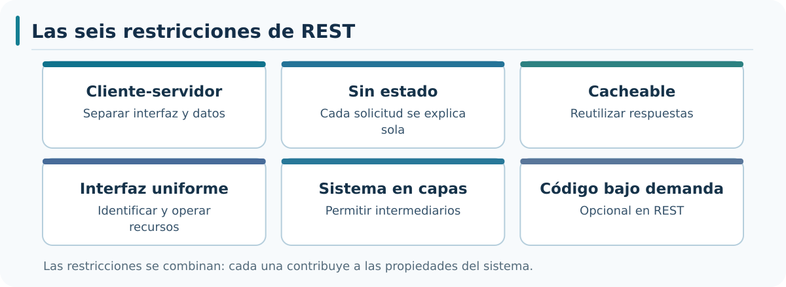
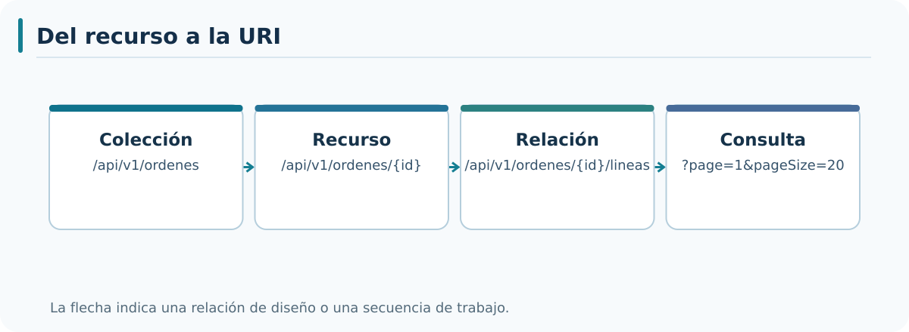
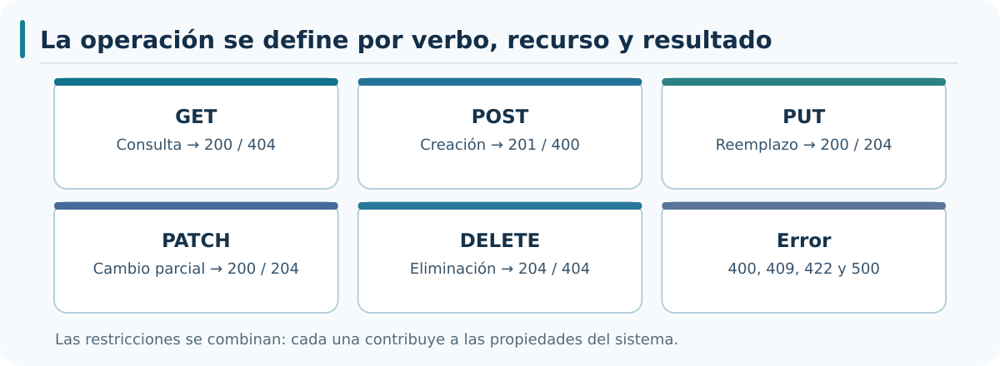
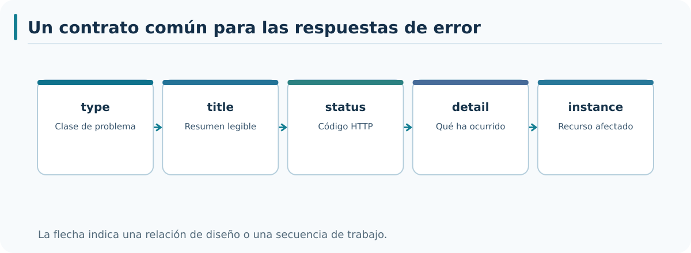
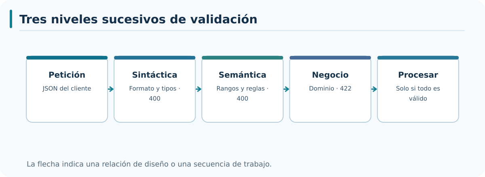
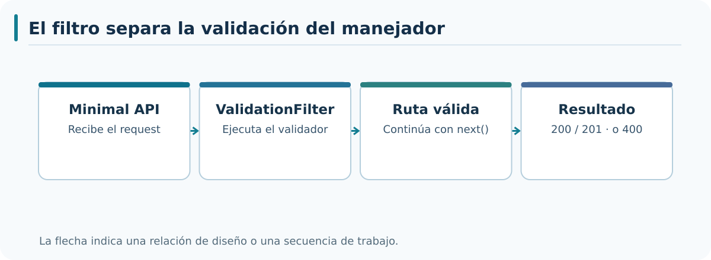
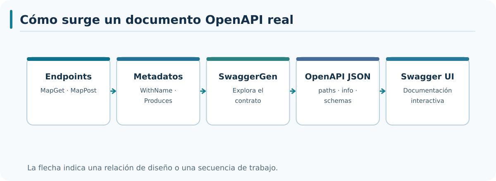
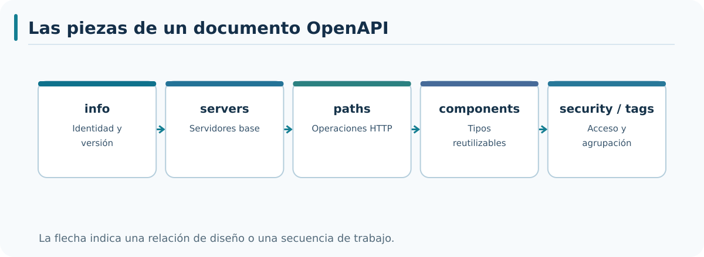

# M02 — Teoría completa: diseño REST e implementación con ASP.NET Core 8

**Autor: JAIME GALLO**


---

## Punto 2.1 — Diseño de APIs REST

Módulo 2: Desarrollo de APIs REST con ASP.NET Core
Objetivos de aprendizaje:

- Comprender los principios del estilo arquitectónico REST.
- Identificar los recursos como unidad central del diseño de una API REST.
- Comprender la relación entre recursos, URIs y representaciones.
- Comprender el principio de interfaz uniforme y su aplicación en ASP.NET Core.
- Implementar los dos endpoints GET reales de AceriaApp con DTO, persistencia EF Core y pruebas HTTP.


---


### Bloque 1 — Definición de REST

REST es un estilo arquitectónico definido por Roy Fielding en su tesis doctoral de 2000. No es un protocolo ni un estándar, sino un conjunto de restricciones que, aplicadas de forma conjunta, producen un sistema con propiedades específicas. Las restricciones son seis: cliente-servidor, sin estado, cacheable, interfaz uniforme, sistema en capas y código bajo demanda. Cada restricción aporta una propiedad al sistema. La restricción de cliente-servidor separa las responsabilidades de la interfaz de usuario y del almacenamiento de datos. La restricción de sin estado garantiza que cada petición contenga toda la información necesaria para ser procesada. La restricción de cacheable permite que las respuestas se almacenen para reducir la carga. La restricción de interfaz uniforme simplifica la arquitectura global.



*Figura M02.2.1.1 — Las seis restricciones de REST y su función.*

Restricciones de REST:  
  
1. Cliente-servidor  
2. Sin estado  
3. Cacheable  
4. Interfaz uniforme  
5. Sistema en capas  
6. Código bajo demanda (opcional)

- **Línea 1:** 1. Cliente-servidor → primera restricción, separa interfaz y almacenamiento.
- **Línea 2:** 2. Sin estado → segunda restricción, cada petición contiene toda la información.
- **Línea 3:** 3. Cacheable → tercera restricción, las respuestas se pueden almacenar.
- **Línea 4:** 4. Interfaz uniforme → cuarta restricción, simplifica la arquitectura.
- **Línea 5:** 5. Sistema en capas → quinta restricción, permite intermediarios.
- **Línea 6:** 6. Código bajo demanda → sexta restricción, opcional.

Las seis restricciones no son obligatorias por separado: son un conjunto. Un sistema que aplica cinco de las seis no es REST, es un sistema parcialmente REST. La restricción de interfaz uniforme es la que más impacto tiene en el diseño de una API. Se descompone en cuatro sub-restricciones: identificación de recursos, manipulación de recursos a través de representaciones, mensajes auto-descriptivos e hipermedia como motor del estado de la aplicación. Las cuatro sub-restricciones guían el diseño de las URIs y de los métodos HTTP. El curso aplica las cuatro sub-restricciones al diseño de la API de la acería.

La aplicación de las seis restricciones produce un sistema con propiedades medibles: escalabilidad, simplicidad, modificabilidad y visibilidad. La propiedad de escalabilidad se obtiene de la restricción sin estado y de la restricción cacheable. La propiedad de simplicidad se obtiene de la restricción de interfaz uniforme. La propiedad de modificabilidad se obtiene de la restricción de sistema en capas. La propiedad de visibilidad se obtiene de la restricción de mensajes auto-descriptivos. Las cuatro propiedades son las razones por las que REST se ha convertido en el estilo dominante para APIs web.


---

### Bloque 2 — Recursos como unidad central del diseño

Un recurso es cualquier entidad identificable que puede ser referenciada y manipulada. En una API REST, los recursos son la unidad central del diseño. Una orden es un recurso. Un material es un recurso. Un cliente es un recurso. La colección de órdenes también es un recurso. Cada recurso se identifica con una URI única. La URI no describe acciones, describe entidades. La diferencia entre una URI que describe acciones y una URI que describe entidades es la diferencia entre RPC y REST. Una URI como /api/crearOrden describe una acción. Una URI como /api/v1/ordenes describe una entidad.



*Figura M02.2.1.2 — De la colección al recurso y sus relaciones.*

URIs de recursos:  
  
- **/api/v1/ordenes** → colección de órdenes.
- **/api/v1/ordenes/{id}** → orden concreta.
- **/api/v1/ordenes/{id}/lineas** → líneas de una orden concreta.
- **/api/v1/materiales** → colección de materiales.
- **/api/v1/clientes** → colección de clientes.

- **Línea 1:** /api/v1/ordenes → recurso de colección de órdenes.
- **Línea 2:** /api/v1/ordenes/{id} → recurso de orden concreta.
- **Línea 3:** /api/v1/ordenes/{id}/lineas → recurso de líneas de una orden.
- **Línea 4:** /api/v1/materiales → recurso de colección de materiales.
- **Línea 5:** /api/v1/clientes → recurso de colección de clientes.

La identificación de recursos con URIs tiene tres consecuencias prácticas. La primera es que las URIs se construyen con sustantivos en plural para las colecciones. La segunda es que las relaciones entre recursos se expresan con anidamiento de URIs. La tercera es que las URIs no contienen verbos. Las tres consecuencias se aplican de forma uniforme en toda la API. La uniformidad es lo que permite que un cliente genérico pueda navegar la API sin conocerla de antemano. La uniformidad también facilita la documentación automática con OpenAPI.


---


#### Del concepto a ASP.NET Core 8: Recurso y representación

REST identifica órdenes mediante una URI estable. ASP.NET Core no pide implementar un validador de cadenas para disponer de enrutamiento: la llamada MapGet asocia un verbo y una plantilla de ruta al manejador real. Hay que distinguir la entidad Orden, que EF Core persiste, de la representación pública que recibe el consumidor. Conocer los atributos Id, Cliente, Material, Cantidad, Estado y FechaCreacion permite justificar después por qué no todos se aceptan como entrada.

**Aplicación en el proyecto real.** Este comportamiento está materializado en `Modelo/Orden.cs` del estado `2.1-diseno-apis-rest`. Busca la instrucción `Orden` y sigue su ejecución con un punto de interrupción. En las prácticas no se pedirá únicamente crear una clase: el alumno construirá el recurso, enviará la petición y observará el código HTTP y, cuando proceda, la escritura en SQL Server Express LocalDB.

**Qué debe saber explicar el alumno.** Qué parte del contrato REST se resuelve en ASP.NET Core, qué parte escribe el programador, qué objeto se inyecta, qué ocurre si la entrada falla y por qué la respuesta HTTP es la indicada. Esta comprobación enlaza la explicación teórica con las acciones posteriores.

### Bloque 3 — Representaciones y negociación de contenido

Un recurso es un concepto abstracto. Su representación es la forma concreta en la que se transmite. Un mismo recurso puede tener varias representaciones: JSON, XML, texto plano. La representación se selecciona mediante negociación de contenido. El cliente envía la cabecera Accept con los formatos que acepta. El servidor responde con el formato que puede generar. La negociación evita que el cliente tenga que especificar el formato en la URI. La representación JSON es la más común en APIs REST modernas. El curso usa JSON como representación por defecto.

```csharp
// El cliente envía:  
// Accept: application/json  
  
app.MapGet("/api/v1/ordenes", async (AceriaDbContext db) =>  
    await db.Ordenes.AsNoTracking().ToListAsync());

```

- **Línea 1:** // El cliente envía: → comentario que indica el ejemplo.
- **Línea 2:** // Accept: application/json → cabecera del cliente.
- **Línea 3:** app.MapGet("/api/v1/ordenes", async (AceriaDbContext db) => → declara el endpoint GET.
- **Línea 4:** await db.Ordenes.AsNoTracking().ToListAsync()); → devuelve la lista en JSON.

La representación tiene dos consecuencias prácticas. La primera es que la misma URI puede devolver formatos distintos según la cabecera Accept. La segunda es que el servidor puede devolver 406 Not Acceptable si no puede generar ningún formato solicitado. La negociación de contenido es una de las sub-restricciones de la interfaz uniforme. Su aplicación correcta evita que el cliente tenga que usar URIs distintas para formatos distintos.


---

### Bloque 4 — Métodos HTTP y su semántica

Los métodos HTTP expresan la operación que se realiza sobre el recurso. Cada método tiene una semántica definida por el estándar. Los métodos principales son cinco: GET, POST, PUT, PATCH y DELETE. GET recupera una representación del recurso. POST crea un recurso nuevo. PUT reemplaza un recurso existente. PATCH modifica parcialmente un recurso existente. DELETE elimina un recurso existente. Cada método tiene dos propiedades importantes: idempotencia y seguridad. Un método es seguro si no modifica el estado del servidor. Un método es idempotente si ejecutarlo varias veces produce el mismo resultado que ejecutarlo una vez.

Métodos HTTP:  
  
- **GET     /api/v1/ordenes** → lista de órdenes. Seguro, idempotente.
- **GET     /api/v1/ordenes/{id}** → orden concreta. Seguro, idempotente.
- **POST    /api/v1/ordenes** → crear orden. No seguro, no idempotente.
- **PUT     /api/v1/ordenes/{id}** → reemplazar orden. No seguro, idempotente.
- **PATCH   /api/v1/ordenes/{id}** → modificar orden. No seguro, no idempotente.
- **DELETE  /api/v1/ordenes/{id}** → eliminar orden. No seguro, idempotente.

- **Línea 1:** GET /api/v1/ordenes → recupera la colección. Seguro e idempotente.
- **Línea 2:** GET /api/v1/ordenes/{id} → recupera una orden. Seguro e idempotente.
- **Línea 3:** POST /api/v1/ordenes → crea una orden. No seguro, no idempotente.
- **Línea 4:** PUT /api/v1/ordenes/{id} → reemplaza una orden. No seguro, idempotente.
- **Línea 5:** PATCH /api/v1/ordenes/{id} → modifica parcialmente. No seguro, no idempotente.
- **Línea 6:** DELETE /api/v1/ordenes/{id} → elimina una orden. No seguro, idempotente.

La semántica de los métodos tiene dos consecuencias prácticas. La primera es que los métodos seguros pueden ser cacheados por intermediarios sin riesgo. La segunda es que los métodos idempotentes pueden ser reintentados sin riesgo de duplicación. La combinación de ambas propiedades determina qué métodos pueden reintentarse automáticamente. GET, PUT y DELETE pueden reintentarse. POST y PATCH no pueden reintentarse sin una clave de idempotencia. La semántica correcta de los métodos es la base de la comunicación fiable.


---


#### Del concepto a ASP.NET Core 8: DTO público

El record OrdenDto representa el JSON de salida. El método Desde transforma explícitamente la entidad a una representación. Esta distinción reduce el acoplamiento entre el esquema de la tabla y el contrato HTTP. Si se cambiara una propiedad interna de Orden no tendría por qué aparecer automáticamente en la respuesta; el método de conversión es precisamente el lugar donde decidir qué se publica.

**Aplicación en el proyecto real.** Este comportamiento está materializado en `Modelo/OrdenDto.cs` del estado `2.1-diseno-apis-rest`. Busca la instrucción `OrdenDto` y sigue su ejecución con un punto de interrupción. En las prácticas no se pedirá únicamente crear una clase: el alumno construirá el recurso, enviará la petición y observará el código HTTP y, cuando proceda, la escritura en SQL Server Express LocalDB.

**Código de referencia probado:** `src/AceriaApp.Api/Modelo/OrdenDto.cs`


```csharp
namespace AceriaApp.Api.Modelo;
// INICIO PASO 2.1.5
public sealed record OrdenDto(Guid Id, string Cliente, string Material,
    int Cantidad, string Estado, DateTime FechaCreacion)
{
    public static OrdenDto Desde(Orden x) =>
        new(x.Id,x.Cliente,x.Material,x.Cantidad,x.Estado,x.FechaCreacion);
}
// FIN PASO 2.1.5
```

**Qué debe saber explicar el alumno.** Qué parte del contrato REST se resuelve en ASP.NET Core, qué parte escribe el programador, qué objeto se inyecta, qué ocurre si la entrada falla y por qué la respuesta HTTP es la indicada. Esta comprobación enlaza la explicación teórica con las acciones posteriores.

### Bloque 5 — Códigos de estado HTTP

Los códigos de estado HTTP expresan el resultado de la operación. Se organizan en cinco familias: 1xx informativos, 2xx éxito, 3xx redirección, 4xx error del cliente, 5xx error del servidor. Cada familia tiene códigos específicos para situaciones concretas. Los códigos más usados en APIs REST son 200 OK, 201 Created, 204 No Content, 400 Bad Request, 401 Unauthorized, 403 Forbidden, 404 Not Found, 409 Conflict, 422 Unprocessable Entity y 500 Internal Server Error. La elección del código adecuado permite que el cliente distinga entre situaciones distintas sin analizar el cuerpo de la respuesta.

Códigos de estado habituales:  
  
- **200 OK** → operación exitosa con cuerpo.
- **201 Created** → recurso creado, con cabecera Location.
- **204 No Content** → operación exitosa sin cuerpo.
- **400 Bad Request** → error de validación o formato.
- **401 Unauthorized** → falta autenticación.
- **403 Forbidden** → autenticación correcta, sin permisos.
- **404 Not Found** → recurso no encontrado.
- **409 Conflict** → conflicto de estado.
- **422 Unprocessable Entity** → entidad semánticamente inválida.
- **500 Internal Server Error** → error del servidor.

- **Línea 1:** 200 OK → operación exitosa con cuerpo.
- **Línea 2:** 201 Created → recurso creado, con cabecera Location.
- **Línea 3:** 204 No Content → operación exitosa sin cuerpo.
- **Línea 4:** 400 Bad Request → error de validación o formato.
- **Línea 5:** 401 Unauthorized → falta autenticación.
- **Línea 6:** 403 Forbidden → sin permisos.
- **Línea 7:** 404 Not Found → recurso no encontrado.
- **Línea 8:** 409 Conflict → conflicto de estado.
- **Línea 9:** 422 Unprocessable Entity → entidad semánticamente inválida.
- **Línea 10:** 500 Internal Server Error → error del servidor.

La elección del código de estado tiene dos consecuencias prácticas. La primera es que el cliente puede reaccionar de forma distinta a cada código sin analizar el cuerpo. La segunda es que los intermediarios pueden cachear o no cachear según el código. Los códigos 2xx son cacheables según las cabeceras. Los códigos 4xx y 5xx no son cacheables por defecto. La elección correcta del código es la base de la comunicación predecible entre cliente y servidor.


---


#### Taller de diseño 2.1 — Estado persistente no equivale a sesión HTTP

La restricción **stateless** de REST suele interpretarse incorrectamente como «el servidor no puede guardar nada». Si fuese así, una API de órdenes de fabricación sería imposible: después de crear una orden no podríamos volver a consultarla. Lo que REST exige es que cada petición se comprenda sin depender de una sesión de conversación almacenada en el servidor. Los recursos, naturalmente, pueden tener estado persistente en una base de datos. En AceriaApp, el estado de una orden se guarda mediante EF Core; no se almacena como «última orden del navegador» en una variable de sesión.

Imaginemos dos clientes independientes. El primero consulta la colección y el segundo consulta el Id de una orden conocida. El servicio no necesita recordar qué pidió el primer cliente para resolver la solicitud del segundo. Ambos envían método y URI completos. Si mañana el navegador reinicia su proceso, puede volver a consultar una orden por su dirección; no debe reanudar una conversación de métodos C#.

La aplicación cumple de manera sencilla la separación cliente–servidor: un cliente HTTP envía mensajes, el servidor recibe, consulta EF Core y responde. Esa separación es comprobable en **GetTests.cs**, porque el test no necesita instanciar manualmente OrdenDto.Desde para consumir el endpoint. El cliente de pruebas llama GetAsync a una URI y lee el cuerpo. El hecho de utilizar el mismo lenguaje C# para el test y el servidor no elimina la frontera HTTP.

**Contraprueba útil.** Si el servidor respondiera a GET /api/v1/ordenes/{id} consultando una variable estática «UltimaOrdenSeleccionada», dos clientes que navegaran a la vez podrían interferir entre sí. El diseño real evita esa dependencia: el identificador viaja dentro de la solicitud. Eso no significa que la API ya solucione concurrencia o escalado horizontal; solo muestra una propiedad necesaria para acercarse al estilo REST.

También hay que distinguir entre un servicio «en capas» y una arquitectura hexagonal acabada. Ahora el recorrido es pequeño: el delegado Minimal API conoce AceriaDbContext. En el futuro será posible introducir puertos y adaptadores, pero no corresponde fingir que este endpoint ya usa repositorios abstractos o una capa de aplicación independiente. Esta honestidad estructural permite apreciar el progreso cuando llegue M03.

**Preguntas que deben responderse antes de programar:** ¿podría ejecutarse el mismo GET sin haber efectuado otro GET anterior? Sí. ¿Puede el servidor recordar órdenes en LocalDB? Sí. ¿Puede el cliente crear una orden simplemente escribiendo su Id en la URI? No, en 2.1 solo existen GET; POST se incorporará en 2.2. La teoría del protocolo y las capacidades de la etapa son dos niveles diferentes.

#### Taller de diseño 2.1 — Negociación de representaciones y límites reales del ejemplo

Un recurso no es su representación. La orden es el objeto identificado; el JSON es una manera de comunicarlo. El cliente puede expresar sus expectativas mediante cabeceras como **Accept** y enviar el formato de un cuerpo mediante **Content-Type**. Estas dos cabeceras cumplen funciones diferentes: Accept se refiere a la respuesta deseada; Content-Type describe el contenido que se está enviando.

En este proyecto, los resultados de lectura se serializan a JSON mediante el soporte predeterminado de ASP.NET Core 8. No se ha implementado representación XML, CSV ni Protobuf. Por ello, aunque comprender negociación de contenido forme parte del temario REST, **no deben inventarse respuestas XML de AceriaApp**. Un manual fiable distingue el concepto general de la capacidad demostrable de la versión actual.

La forma concreta del JSON está asociada a OrdenDto: Id, Cliente, Material, Cantidad, Estado y FechaCreacion. Una modificación de nombres de campos afecta a consumidores externos incluso cuando no cambia ninguna tabla SQL. Por ejemplo, si se renombrara una propiedad pública de OrdenDto y cambiase su serialización, un cliente JavaScript que lee el campo anterior podría dejar de interpretarlo. Es precisamente por eso por lo que la evolución contractual exige atención distinta a la evolución del modelo persistente.

La fecha ofrece un ejemplo más sutil. FechaCreacion nace en UTC; el cliente podría presentarla en su zona horaria, pero eso es una decisión de visualización. Una fecha en UTC no garantiza por sí sola que el consumidor conozca la cultura y la zona del operador. El contrato debería documentar cómo se representa y qué significado tiene. En esta etapa no se incorporan transformaciones adicionales de fecha ni un serializador personalizado; el alumno observa la salida real del framework.

**Prueba de coherencia:** genera una orden de test con un Id conocido y lee la respuesta mediante ReadFromJsonAsync<OrdenDto>. El test RecursoExistente_ExponeDto demuestra la correspondencia de identidad, aunque no prueba aún cada decisión de formato cultural. Si el consumidor puede recuperar el Id sin conocer el DbContext, la frontera HTTP cumple su objetivo básico; no debe afirmarse por ello que se han cubierto todos los escenarios de negociación.

El mismo razonamiento se aplica al contenido de errores. Results.NotFound de la etapa 2.1 no obliga a devolver el mismo cuerpo que Results.Problem de 2.2 o Results.ValidationProblem de 2.3. El código y las pruebas deben observarse para describir las respuestas; no se deben tomar por sentado objetos JSON ficticios.

#### Taller de diseño 2.1 — Caché, repetición y el peligro de prometer prestaciones inexistentes

REST incluye la restricción de respuestas cacheables cuando resulta apropiado. Sin embargo, eso no significa que todo endpoint GET sea automáticamente servido desde una caché compartida. AceriaApp 2.1 **no define Cache-Control, ETag, Last-Modified ni una política explícita de invalidación**. El cliente debe tratar los resultados según las cabeceras efectivamente recibidas y las reglas HTTP aplicables; el manual no puede prometer una aceleración que la aplicación no implementa.

¿Por qué estudiar entonces la caché desde el comienzo? Porque ayuda a comprender la importancia de la semántica del verbo. Un GET de lectura no debería crear una orden ni cambiar su Cantidad. Una petición segura es candidata a repetirse sin efectos de negocio; una operación de creación mediante POST cambia el estado y tiene otras necesidades. Si se escondiera una escritura dentro de GET por comodidad de prueba, tanto los navegadores como las herramientas automáticas podrían invocarla en momentos inesperados.

La aplicación inicial muestra esta propiedad mediante código real: el MapGet de colección usa AsNoTracking y ToListAsync para consultar; no contiene Add, Remove ni SaveChangesAsync. La ausencia de escritura en ese manejador hace visible la intención de lectura. No demuestra la inexistencia absoluta de efectos secundarios técnicos —por ejemplo, los servidores pueden registrar solicitudes—, pero sí que el caso de negocio no está creando órdenes durante una consulta.

Pensemos en una supuesta mejora de rendimiento: alguien propone guardar durante una hora cualquier lista de órdenes. Más tarde, otro cliente crea una orden nueva en 2.2. Si la caché no se invalida, el primer cliente podría continuar viendo una lista anterior. La pregunta importante no es solo «¿se puede cachear?» sino **qué validez tiene el dato, durante cuánto tiempo y quién invalida la representación**. Este módulo no implementa esas respuestas: las utiliza como criterio de diseño para entender por qué la caché necesita una política y pruebas propias.

Un ejercicio sin alterar el proyecto consiste en escribir el contraste entre dos comportamientos:

| Aspecto | Implementado en 2.1 | Posible evolución, todavía no implementada |
|:---|:---|:---|
| GET sin escritura de negocio | Sí | Conservar esta garantía |
| Consulta a SQL Server desde la API | Sí | Optimizar consultas o proyecciones |
| ETag o If-None-Match | No | Validación condicional de representación |
| Cache-Control explícito | No | Definir políticas según el recurso |
| Paginación por query string | No | Introducir límites y enlaces de navegación |

La tabla diferencia realidad y diseño futuro. No constituye una invitación a copiar cinco rutas ficticias en el taller. El objetivo operativo sigue siendo observar 200, 404, DTO y persistencia con los tests reales de 2.1.

#### Taller de diseño 2.1 — Inyección de dependencias y ciclo de vida de una consulta

El constructor de AceriaDbContext recibe DbContextOptions<AceriaDbContext>, y Program.cs registra el contexto mediante AddDbContext. Eso permite que el framework cree y gestione una instancia apropiada para la petición, en vez de exigir que cada endpoint construya manualmente una conexión. El código del proyecto es una forma compacta de mostrar dependencia explícita: el delegado declara AceriaDbContext db como parámetro y ASP.NET Core lo suministra.

La clase de contexto real contiene:

~~~csharp
public sealed class AceriaDbContext(
    DbContextOptions<AceriaDbContext> options) : DbContext(options)
{
    public DbSet<Orden> Ordenes => Set<Orden>();
    protected override void OnModelCreating(ModelBuilder b)
    {
        var e=b.Entity<Orden>();
        e.HasKey(x=>x.Id);
        e.Property(x=>x.Cliente).HasMaxLength(100).IsRequired();
        e.Property(x=>x.Material).HasMaxLength(100).IsRequired();
        e.Property(x=>x.Estado).HasMaxLength(24).IsRequired();
    }
}
~~~

**El constructor** transfiere las opciones preparadas por el contenedor al DbContext. **DbSet** indica la colección de entidades sobre las que el contexto puede consultar y guardar. **HasKey** señala la identidad persistente. **HasMaxLength** y **IsRequired** forman parte de la configuración de almacenamiento; no producen automáticamente mensajes FluentValidation para el cliente. Precisamente ese problema se abordará en 2.3.

El punto de confusión más común es suponer que un DbSet se comporta como una lista C# cargada completamente. En realidad, la consulta se traduce y ejecuta a través del proveedor al materializarla; en este proyecto se utiliza ToListAsync para la colección y FirstOrDefaultAsync para el recurso individual. El contexto es el coordinador de acceso a datos; no es una tabla en memoria por el mero hecho de que se vea como una propiedad.

**Caso de diagnóstico reproducible.** El alumno puede compilar la clase Orden y OrdenDto sin disponer de SQL Server, porque definir tipos no abre una conexión. Cuando inicia una aplicación Development que ejecuta EnsureCreatedAsync sí necesita la infraestructura de LocalDB configurada. Por último, cuando ejecuta GetTests, la factoría de prueba sustituye ese proveedor por InMemory. Son tres momentos distintos. Mezclarlos origina mensajes confusos como «el proyecto compila, por tanto la base de datos funciona», una conclusión incorrecta.

La prueba HTTP con WebApplicationFactory también ayuda a diferenciar el comportamiento del código y el entorno. Que los tests con InMemory pasen no demuestra que una instalación LocalDB esté correcta. Para completar la actividad del alumno se necesita enviar la petición contra la aplicación local y observar el funcionamiento real con SQL Server Express LocalDB. Este contraste no es una desventaja del test: significa que cada comprobación posee un alcance definido.

La secuencia didáctica se cierra con tres decisiones: qué contrato visible ofrece el endpoint, qué consulta realiza EF Core y en qué entorno se ejecuta esa consulta. Si el alumno puede contestarlas separadamente, está preparado para añadir las escrituras REST de 2.2 sin reducirlas a «más métodos de Program.cs».


### Bloque 6 — Diseño de URIs en APIs REST

Para diseñar URIs legibles conviene comenzar por las **colecciones de recursos** y mantener una estructura predecible. En AceriaApp, la colección se identifica mediante /api/v1/ordenes y cada miembro mediante /api/v1/ordenes/{id:guid}. El segmento v1 expresa la versión contractual de este ejemplo; no activa automáticamente un mecanismo de negociación de versiones. Las reglas «usar sustantivos» o «evitar verbos en las URIs» son pautas útiles, no prohibiciones absolutas: el endpoint real /api/v1/ordenes/{id:guid}/finalizar expresa una transición de negocio mediante POST. La decisión de ruta debe justificarse desde el cliente y comprobarse con el comportamiento del servicio.

**Reglas prácticas para razonar, no para copiar a ciegas:**

1. **Nombrar el recurso**, no una función interna de C#.
2. **Distinguir colección y miembro** usando un identificador estable.
3. **Conservar consistencia** en pluralización y segmentos.
4. **Representar relaciones** solo cuando aporten claridad, sin profundidad excesiva.
5. **Explicitar la versión** del contrato elegido y su estrategia de evolución.

La práctica 2.1 registra únicamente las dos rutas GET; la transición finalizar se incorpora en 2.2. No atribuyas a 2.1 las operaciones de los siguientes estados.

Reglas de diseño de URIs:  
  
- **1. Sustantivos en plural** → /ordenes, /materiales.
- **2. Identificador tras colección** → /ordenes/{id}.
- **3. Anidamiento de relaciones** → /ordenes/{id}/lineas.
- **4. Sin verbos** → no /crearOrden.
- **5. Versionado en la URI** → /api/v1/ordenes.

- **Línea 1:** 1. Sustantivos en plural → colecciones con sustantivo plural.
- **Línea 2:** 2. Identificador tras colección → identificador después de la colección.
- **Línea 3:** 3. Anidamiento de relaciones → sub-rutas para relaciones.
- **Línea 4:** 4. Sin verbos → las URIs no contienen verbos.
- **Línea 5:** 5. Versionado en la URI → la versión va en la URI.

Estas son **convenciones de diseño**, no las restricciones formales de REST formuladas por Fielding: una URI que contiene un verbo no convierte automáticamente la API en RPC, del mismo modo que un nombre plural no garantiza que la API sea REST. El contrato depende también de la semántica HTTP, el tratamiento de las representaciones y el comportamiento del servidor. AceriaApp usa la ruta de acción `/api/v1/ordenes/{id:guid}/finalizar` en 2.2 por expresar una transición de negocio concreta; el alumno debe razonar ese caso en lugar de memorizar una prohibición absoluta.


---


#### Del concepto a ASP.NET Core 8: Persistencia mediante EF Core

El contexto contiene DbSet<Orden> y las restricciones de las columnas. La API se ejecuta sobre SQL Server Express LocalDB en el ordenador del alumno. Registrar AddDbContext permite que los endpoints reciban el contexto mediante inyección de dependencias: no hay que crear el contexto con new dentro de cada manejador. En tests se sustituye solamente el proveedor por InMemory para evitar depender de Windows.

**Aplicación en el proyecto real.** Este comportamiento está materializado en `Datos/AceriaDbContext.cs` del estado `2.1-diseno-apis-rest`. Busca la instrucción `AceriaDbContext` y sigue su ejecución con un punto de interrupción. En las prácticas no se pedirá únicamente crear una clase: el alumno construirá el recurso, enviará la petición y observará el código HTTP y, cuando proceda, la escritura en SQL Server Express LocalDB.

**Qué debe saber explicar el alumno.** Qué parte del contrato REST se resuelve en ASP.NET Core, qué parte escribe el programador, qué objeto se inyecta, qué ocurre si la entrada falla y por qué la respuesta HTTP es la indicada. Esta comprobación enlaza la explicación teórica con las acciones posteriores.

### Bloque 7 — Interfaz uniforme en ASP.NET Core

La interfaz uniforme se materializa en ASP.NET Core con cuatro elementos. El primero es el enrutamiento, que asocia URIs a manejadores. El segundo es el enlace de parámetros, que asocia partes de la petición a parámetros del manejador. El tercero es la serialización, que convierte objetos a JSON y viceversa. El cuarto es la negociación de contenido, que selecciona el formato de la respuesta. Los cuatro elementos se configuran en el arranque de la aplicación. La configuración correcta produce una API uniforme sin código repetido en cada endpoint.

```csharp
var builder = WebApplication.CreateBuilder(args);  
builder.Services.AddEndpointsApiExplorer();  
builder.Services.AddSwaggerGen();  
  
var app = builder.Build();  
  
app.MapGet("/api/v1/ordenes", async (AceriaDbContext db) =>  
    await db.Ordenes.AsNoTracking().ToListAsync());  
  
app.MapGet("/api/v1/ordenes/{id:guid}", async (Guid id, AceriaDbContext db) =>  
{  
    var orden = await db.Ordenes.AsNoTracking().FirstOrDefaultAsync(o => o.Id == id);  
    return orden is not null ? Results.Ok(orden) : Results.NotFound();  
});  
  
app.Run();

```

- **Línea 1:** var builder = WebApplication.CreateBuilder(args); → crea el constructor de la aplicación.
- **Línea 2:** builder.Services.AddEndpointsApiExplorer(); → habilita la exploración de endpoints.
- **Línea 3:** builder.Services.AddSwaggerGen(); → registra el generador de Swagger.
- **Línea 4:** var app = builder.Build(); → construye la aplicación.
- **Línea 5:** app.MapGet("/api/v1/ordenes", async (AceriaDbContext db) => → declara el endpoint de colección.
- **Línea 6:** await db.Ordenes.AsNoTracking().ToListAsync()); → devuelve la lista.
- **Línea 7:** app.MapGet("/api/v1/ordenes/{id:guid}", async (Guid id, AceriaDbContext db) => → declara el endpoint de detalle.
- **Línea 8:** { → abre el cuerpo del lambda.
- **Línea 9:** var orden = await db.Ordenes.AsNoTracking().FirstOrDefaultAsync(o => o.Id == id); → consulta la orden.
- **Línea 10:** return orden is not null ? Results.Ok(orden) : Results.NotFound(); → devuelve 200 o 404.
- **Línea 11:** }); → cierra el lambda.
- **Línea 12:** app.Run(); → arranca el servidor.

La configuración de la interfaz uniforme tiene dos consecuencias prácticas. La primera es que los endpoints siguen un patrón común que facilita la lectura. La segunda es que la documentación OpenAPI se genera automáticamente a partir de los endpoints. La combinación de ambas reduce el coste de mantenimiento y mejora la experiencia del consumidor. La interfaz uniforme es una de las propiedades más valiosas de REST.


---

### Bloque 8 — Recursos anidados y relaciones

Los recursos relacionados pueden expresarse mediante una estructura de URIs que muestre su relación. Por ejemplo, un dominio industrial podría identificar las líneas de una orden con una ruta anidada. **AceriaApp no implementa /api/v1/ordenes/{id}/lineas ni un modelo de LineaOrden** en ninguno de los cuatro estados de este módulo; esas rutas sirven aquí solo como hipótesis de diseño. La API del curso sí muestra una ruta subordinada de acción específica: PATCH /api/v1/ordenes/{id:guid}/cantidad, que modifica una sola propiedad de la orden.

Una jerarquía excesivamente profunda complica la navegación y acopla al cliente a relaciones internas. Antes de diseñar una subruta conviene preguntar qué recurso identifica, qué verbo aceptará y qué contrato devolverá. La práctica utiliza las rutas existentes como evidencia, no endpoints anidados inventados.

Anidamiento de recursos:  
  
- **/api/v1/ordenes** → colección de órdenes.
- **/api/v1/ordenes/{id}** → orden concreta.
- **/api/v1/ordenes/{id}/lineas** → líneas de una orden.
- **/api/v1/ordenes/{id}/lineas/{lid}** → línea concreta.
  
Alternativa sin anidar:  
  
- **/api/v1/lineas?ordenId={id}** → líneas filtradas por orden.

- **Línea 1:** /api/v1/ordenes → colección de órdenes.
- **Línea 2:** /api/v1/ordenes/{id} → orden concreta.
- **Línea 3:** /api/v1/ordenes/{id}/lineas → líneas de una orden.
- **Línea 4:** /api/v1/ordenes/{id}/lineas/{lid} → línea concreta.
- **Línea 5:** /api/v1/lineas?ordenId={id} → alternativa sin anidar.

El anidamiento tiene dos consecuencias prácticas. La primera es que las relaciones se expresan de forma natural. La segunda es que las URIs pueden volverse largas si se anidan demasiados niveles. La regla práctica es anidar solo cuando la relación es de composición: la línea no existe sin la orden. Cuando la relación es de asociación, se usa un recurso independiente con parámetros de consulta. La distinción entre composición y asociación es la clave para decidir cuándo anidar.


---


#### Del concepto a ASP.NET Core 8: Endpoint GET de colección

El manejador obtiene AceriaDbContext, usa AsNoTracking para consultar sin seguimiento y devuelve Results.Ok con una secuencia de DTOs. En una colección vacía se responde 200 y una lista JSON vacía, pues la colección como recurso existe aunque no contenga elementos. La respuesta debe inspeccionarse desde AceriaApp.http, no deducirse de que el código compile.

**Aplicación en el proyecto real.** Este comportamiento está materializado en `Program.cs` del estado `2.1-diseno-apis-rest`. Busca la instrucción `MapGet` y sigue su ejecución con un punto de interrupción. En las prácticas no se pedirá únicamente crear una clase: el alumno construirá el recurso, enviará la petición y observará el código HTTP y, cuando proceda, la escritura en SQL Server Express LocalDB.

**Código de referencia probado:** `src/AceriaApp.Api/Program.cs`


```csharp
// INICIO PASO 2.1.8: colección de recursos, consulta real con EF Core.
app.MapGet("/api/v1/ordenes",async (AceriaDbContext db,CancellationToken ct)=>
{
    var ordenes=await db.Ordenes.AsNoTracking().OrderBy(x=>x.FechaCreacion).ToListAsync(ct);
    return Results.Ok(ordenes.Select(OrdenDto.Desde));
})
.WithName("ListarOrdenes").WithTags("Ordenes")

;
```

**Qué debe saber explicar el alumno.** Qué parte del contrato REST se resuelve en ASP.NET Core, qué parte escribe el programador, qué objeto se inyecta, qué ocurre si la entrada falla y por qué la respuesta HTTP es la indicada. Esta comprobación enlaza la explicación teórica con las acciones posteriores.

### Bloque 9 — Paginación, filtrado y ordenación

En una API con miles de recursos es necesario **diseñar una estrategia de paginación, filtrado y ordenación** para evitar transferencias enormes y resultados ambiguos. Es habitual utilizar parámetros de consulta como page, pageSize y sort, y devolver metadatos que permitan recorrer páginas. **La etapa 2.1 de AceriaApp todavía no implementa page, pageSize ni un filtro de cliente**: el GET de colección ejecuta una consulta ordenada por FechaCreacion y devuelve el conjunto obtenido. El contenido de este bloque explica una evolución deseable, no una prestación disponible. La actividad 2.1.24 invita a pensar cómo añadir un filtro sin alterar el contrato actual.

Paginación, filtrado y ordenación:  
  
GET /api/v1/ordenes?page=1&pageSize=20  
GET /api/v1/ordenes?filter=cliente:ACX-001  
GET /api/v1/ordenes?sort=fechaCreacion:desc  
  
Respuesta con metadatos:  
  
```json
{  
  "items": [ ... ],  
  "page": 1,  
  "pageSize": 20,  
  "totalItems": 145,  
  "totalPages": 8  
}

```

- **Línea 1:** GET /api/v1/ordenes?page=1&pageSize=20 → paginación.
- **Línea 2:** GET /api/v1/ordenes?filter=cliente:ACX-001 → filtrado.
- **Línea 3:** GET /api/v1/ordenes?sort=fechaCreacion:desc → ordenación.
- **Línea 4:** { → abre el objeto de respuesta.
- **Línea 5:** "items": [ ... ], → lista de elementos de la página.
- **Línea 6:** "page": 1, → número de página actual.
- **Línea 7:** "pageSize": 20, → tamaño de página.
- **Línea 8:** "totalItems": 145, → total de elementos.
- **Línea 9:** "totalPages": 8 → total de páginas.

La paginación tiene dos consecuencias prácticas. La primera es que las respuestas se mantienen pequeñas y predecibles. La segunda es que el cliente puede construir la interfaz de navegación con los metadatos. La ausencia de paginación en colecciones grandes produce respuestas lentas, consumo elevado de memoria y dificultad para el cliente. La paginación es una buena práctica obligatoria en cualquier API REST que exponga colecciones.


---

### Bloque 10 — Aplicación del diseño REST al proyecto del curso

**Qué se materializa al finalizar 2.1.** El alumno dispone de una Minimal API ASP.NET Core 8 con exactamente dos operaciones: `GET /api/v1/ordenes` para consultar la colección y `GET /api/v1/ordenes/{id:guid}` para consultar una orden concreta. La entidad `Orden` se almacena mediante `AceriaDbContext` y SQL Server Express LocalDB; la respuesta pública se construye con `OrdenDto`. La colección existente o vacía responde 200, una orden presente responde 200 y una orden inexistente responde 404. Un identificador que no encaja en `{id:guid}` no alcanza ese manejador.

| Decisión estudiada | Resultado observable en el proyecto 2.1 | Evidencia que deberá obtener el alumno |
|:---|:---|:---|
| Colección y recurso | Dos rutas GET bajo `/api/v1/ordenes` | Peticiones HTTP a ambas rutas |
| Modelo y representación | `Orden` y `OrdenDto.Desde` | JSON de salida con datos del contrato |
| Persistencia | `AceriaDbContext` registrado con proveedor SQL Server | Consulta a LocalDB en Development |
| Semántica HTTP | 200 para una consulta válida; 404 si no existe la orden | Comparación entre una URI válida existente y otra ausente |
| Comprobación aislada | `GetTests` con `WebApplicationFactory` y proveedor InMemory | Pruebas HTTP ejecutadas sin LocalDB en el entorno de test |

**Qué se analiza pero todavía no se implementa.** Paginación por `page`/`pageSize`, negociación de XML, `/api/v1/materiales`, `/api/v1/clientes`, líneas de una orden y validación automática del catálogo son posibilidades de diseño, no funcionalidades del código 2.1. Tampoco se deben anticipar aquí los endpoints de escritura, que llegan en 2.2. Esta distinción evita exigir al alumno que ejecute un ejemplo que no forma parte de su proyecto.

El criterio para avanzar a 2.2 no consiste en haber copiado las clases: el alumno debe explicar la relación entre ruta, DTO, consulta EF Core y respuesta HTTP, ejecutar las dos operaciones y justificar por qué una colección vacía no se trata como un recurso inexistente.


---


#### Estudio de caso 2.1.A — Una orden de fabricación vista desde tres fronteras

Antes de analizar la siguiente etapa, conviene detenerse ante un problema de diseño. El cliente de AceriaApp necesita saber cuántas unidades se han encargado, pero no necesita conocer el nombre de una tabla de SQL Server. Por otro lado, EF Core necesita una entidad con propiedades configurables para persistirla, mientras que ASP.NET Core necesita un contrato estable que pueda serializarse como JSON. **Recurso, entidad y representación no son sinónimos.** Esta distinción evita que cada cambio de almacenamiento se convierta en una ruptura de la API.

El archivo **Modelo/Orden.cs** de la etapa **2.1-diseno-apis-rest** contiene estos datos reales:

~~~csharp
public sealed class Orden
{
    public Guid Id { get; set; } = Guid.NewGuid();
    public string Cliente { get; set; } = string.Empty;
    public string Material { get; set; } = string.Empty;
    public int Cantidad { get; set; }
    public string Estado { get; set; } = "Pendiente";
    public DateTime FechaCreacion { get; set; } = DateTime.UtcNow;
}
~~~

El identificador representa la identidad de la orden, incluso cuando dos solicitudes tengan el mismo cliente y material. **Estado** forma parte del ciclo de negocio: desde el comienzo el valor predeterminado es «Pendiente», y la etapa 2.2 incorporará la transición a «Finalizada». **FechaCreacion** se calcula inicialmente en UTC, con independencia del idioma del usuario. Ninguna de estas propiedades obliga a publicar directamente la entidad.

El contrato HTTP se expresa mediante **Modelo/OrdenDto.cs**:

~~~csharp
public sealed record OrdenDto(Guid Id, string Cliente, string Material,
    int Cantidad, string Estado, DateTime FechaCreacion)
{
    public static OrdenDto Desde(Orden x) =>
        new(x.Id,x.Cliente,x.Material,x.Cantidad,x.Estado,x.FechaCreacion);
}
~~~

La palabra **record** permite definir un objeto que representa los datos transferidos. El método **Desde** convierte explícitamente la entidad al DTO. En este ejercicio los campos coinciden casi por completo, pero la separación sigue siendo esencial: una propiedad interna añadida en el futuro a Orden no aparecerá automáticamente en el JSON, porque no se incluye en el contrato OrdenDto. Tampoco debemos suponer que el nombre exacto de cada propiedad C# coincida con la propiedad enviada: la serialización JSON de ASP.NET Core aplica normalmente nombres camelCase.

**Lectura guiada de la conversión.** Al recibir una entidad, el método lee Id, Cliente, Material, Cantidad, Estado y FechaCreacion en ese orden. Construye un nuevo valor OrdenDto y lo entrega a la capa HTTP. No ejecuta otra consulta ni guarda nada. En el código de 2.1 esa conversión aparece tras la lectura de EF Core. Si el alumno obtiene en la respuesta un dato distinto al esperado, puede inspeccionar separadamente el objeto persistido, la proyección y la serialización; no tiene que atribuir todo el problema al servidor web.

**Error habitual.** Considerar que añadir una propiedad pública a Orden equivale a ampliar el contrato REST. No es así: el contrato lo define la representación, no la tabla. **Correspondencia práctica:** 2.1.4–2.1.7 construyen estas clases y 2.1.23 verifica el DTO a través de HTTP. El test real **RecursoExistente_ExponeDto** inserta una orden en la base aislada de pruebas y comprueba que el Id recibido coincide con el sembrado. Esta prueba no invoca directamente el método Desde, sino el endpoint completo.

#### Estudio de caso 2.1.B — Dos solicitudes GET y cuatro decisiones diferentes

El contrato público inicial ofrece exactamente dos rutas: **GET /api/v1/ordenes** y **GET /api/v1/ordenes/{id:guid}**. La primera pregunta qué elementos pertenecen a una colección; la segunda pide la representación de uno de sus miembros. La colección existe aunque no contenga ninguna orden, por eso la consulta vacía responde 200 con un array JSON vacío. En cambio, si se solicita un Id bien formado que no está persistido, falta el recurso individual y la decisión del manejador es 404.

El fragmento real para listar en **Program.cs** es:

~~~csharp
app.MapGet("/api/v1/ordenes",async (AceriaDbContext db,CancellationToken ct)=>
{
    var ordenes=await db.Ordenes.AsNoTracking().OrderBy(x=>x.FechaCreacion).ToListAsync(ct);
    return Results.Ok(ordenes.Select(OrdenDto.Desde));
})
.WithName("ListarOrdenes").WithTags("Ordenes");
~~~

**Paso 1.** MapGet asocia método y URI a un delegado. En el momento del arranque registra una ruta; no consulta todavía la base. **Paso 2.** ASP.NET Core obtiene AceriaDbContext mediante inyección de dependencias; su registro previo utiliza **UseSqlServer** y la cadena de conexión **AceriaApp**. **Paso 3.** El token de cancelación acompaña la operación asíncrona. **Paso 4.** AsNoTracking evita mantener entidades de lectura en el rastreador de cambios. **Paso 5.** OrderBy establece un orden por creación, aunque un sistema avanzado añadiría un criterio secundario para desempates. **Paso 6.** ToListAsync materializa la consulta; la conversión mediante Desde se realiza después en memoria. **Paso 7.** Results.Ok convierte la lista proyectada en respuesta HTTP 200.

Esta etapa **no dispone aún de paginación**, ni de filtros por cliente, ni de XML. Los principios teóricos permiten justificar esas extensiones, pero sería incorrecto mostrar como ejecutables parámetros page o size inexistentes. La base de aprendizaje es precisamente dominar el estado real antes de agregar posibilidades. Tampoco se debe confundir **WithName** con la ruta: el primero aporta un nombre lógico que, en 2.2, utilizará CreatedAtRoute para construir la cabecera Location.

En el endpoint individual se usa una restricción **{id:guid}**. Una URI que termina en **no-es-guid** no coincide con esa ruta y puede acabar en 404 antes de ejecutar el delegado. Una URI que termina en **00000000-0000-0000-0000-000000000001** sí puede coincidir, pero el manejador devuelve 404 si el Id no existe. Ambas producen el mismo código con causas de diagnóstico diferentes.

~~~http
GET /api/v1/ordenes HTTP/1.1
Host: localhost:5000

GET /api/v1/ordenes/00000000-0000-0000-0000-000000000001 HTTP/1.1
Host: localhost:5000
~~~

**Error habitual.** Interpretar cualquier 404 como una caída de SQL Server. Un error de conexión con LocalDB no equivale a Results.NotFound. El alumno debe observar primero si su petición coincide con la ruta, después si el delegado se ejecutó y finalmente si la consulta encontró entidad. **Correspondencia:** pasos 2.1.14–2.1.20; tests **ListaVacia_Es200** y **RecursoInexistente_Es404** del archivo **GetTests.cs**.

#### Estudio de caso 2.1.C — Quién hace qué cuando llega una petición

Una Minimal API es pequeña en forma, no necesariamente en responsabilidades. En el programa real la cadena de conexión se configura mediante **AddDbContext**, y el delegado recibe el contexto ya preparado. El ciclo completo es: el cliente prepara el método HTTP, Kestrel recibe la solicitud, el sistema de rutas elige MapGet, el contenedor de dependencias resuelve AceriaDbContext, EF Core ejecuta una consulta sobre SQL Server Express LocalDB, el delegado convierte entidades a DTO y el servidor serializa el resultado. Cada componente puede fallar de una manera distinta.

**Mapa de responsabilidades y síntomas observables:**

| Momento | Qué comprobar | Síntoma útil |
|:---|:---|:---|
| Arranque | SDK .NET 8 y perfil de ejecución | La aplicación no llega a escuchar |
| Conexión | Cadena AceriaApp y LocalDB disponible | Error de acceso a datos |
| Ruta | Verbo GET y URI exacta | 404 sin entrar al delegado |
| Búsqueda | Id Guid y existencia de la entidad | 404 devuelto por el manejador |
| Proyección | OrdenDto.Desde | Contenido JSON del recurso |
| Respuesta | Results.Ok | Estado 200 |

Un código 200 no demuestra que todos los datos sean correctos. Por eso **RecursoExistente_ExponeDto** verifica también el identificador devuelto. Una prueba que solo comprobara el estado HTTP podría pasar incluso si se serializara la orden equivocada. A su vez, una prueba unitaria directa de OrdenDto.Desde no detectaría que la ruta está mal escrita. Ambas clases de prueba son útiles, pero el objetivo de esta etapa es comprobar el contrato HTTP real.

En la etapa de desarrollo la base se inicializa con **EnsureCreatedAsync**, condicionada al entorno Development y a la opción SkipDatabaseInitialization. Es una simplificación de laboratorio, **no un ejemplo de estrategia de migraciones para producción**. Los tests sustituyen el proveedor por EF Core InMemory y crean una base aislada; el código de la aplicación del alumno continúa configurado para SQL Server, no para SQLite. Esto permite que las pruebas automatizadas se ejecuten en un agente sin LocalDB, pero no significa que las diferencias entre proveedores desaparezcan. Por ejemplo, una consulta SQL compleja, una restricción de clave o una transacción podrían comportarse de manera diferente.

**Secuencia de recuperación ante un fallo.** Si la API no arranca, comprueba SDK y configuración antes de revisar los DTO. Si arranca pero la colección falla, verifica la cadena AceriaApp, la existencia de LocalDB y el contexto. Si la colección funciona pero el recurso individual no aparece, verifica la forma Guid y la existencia del Id. Si el Id existe y el JSON es incompleto, revisa la conversión a OrdenDto. La práctica 2.1.21–2.1.23 añade pruebas que aíslan parte de estas decisiones.

#### Síntesis comprobable de 2.1: la API no es una tabla publicada

El alumno ya puede responder a cinco preguntas sin repetir definiciones: por qué Orden y OrdenDto son tipos separados; por qué GET de una colección vacía devuelve 200; cómo distingue un Id mal formado de uno ausente; qué hace AsNoTracking; y de dónde procede el AceriaDbContext inyectado. Para demostrarlo, basta reconstruir el ejemplo con datos conocidos y asociar cada conclusión a una observación HTTP, no a una suposición.

**Traza docente:** concepto de recurso → práctica 2.1.3–2.1.7 → archivos Modelo/Orden.cs y Modelo/OrdenDto.cs → **RecursoExistente_ExponeDto**; persistencia y DI → práctica 2.1.8–2.1.15 → Datos/AceriaDbContext.cs y Program.cs → **ListaVacia_Es200**; enrutamiento y semántica 404 → práctica 2.1.17–2.1.23 → MapGet individual → **RecursoInexistente_Es404**. La capa teórica y la capa práctica explican el mismo sistema desde perspectivas complementarias.


### Resumen rápido de la teoría

- REST es un estilo arquitectónico definido por seis restricciones: cliente-servidor, sin estado, cacheable, interfaz uniforme, sistema en capas y código bajo demanda.
- Los recursos son la unidad central del diseño y se identifican con URIs que siguen cinco reglas.
- Las representaciones se negocian con la cabecera Accept y el formato por defecto es JSON.
- Los métodos HTTP expresan la semántica de la operación y tienen dos propiedades: seguridad e idempotencia.
- Los códigos de estado expresan el resultado de la operación en cinco familias.
- Las colecciones se paginan con parámetros de consulta y las relaciones se anidan con sub-rutas.


---


---


#### Del concepto a ASP.NET Core 8: GET individual y pruebas HTTP

La plantilla {id:guid} restringe el parámetro de ruta a GUID válidos. El manejador consulta una orden específica y decide entre Results.Ok y Results.NotFound. Una petición a un GUID inexistente no debería convertirse en 500 ni en una respuesta 200 con contenido vacío. WebApplicationFactory inicia la aplicación en memoria y permite comprobar 200 y 404 sobre los endpoints auténticos.

**Aplicación en el proyecto real.** Este comportamiento está materializado en `Program.cs` del estado `2.1-diseno-apis-rest`. Busca la instrucción `ObtenerOrdenPorId` y sigue su ejecución con un punto de interrupción. En las prácticas no se pedirá únicamente crear una clase: el alumno construirá el recurso, enviará la petición y observará el código HTTP y, cuando proceda, la escritura en SQL Server Express LocalDB.

**Qué debe saber explicar el alumno.** Qué parte del contrato REST se resuelve en ASP.NET Core, qué parte escribe el programador, qué objeto se inyecta, qué ocurre si la entrada falla y por qué la respuesta HTTP es la indicada. Esta comprobación enlaza la explicación teórica con las acciones posteriores.

## Punto 2.2 — Recursos, verbos HTTP y códigos de respuesta

Módulo 2: Desarrollo de APIs REST con ASP.NET Core
Objetivos de aprendizaje:

- Comprender el concepto de recurso y su representación en una API REST.
- Aplicar los verbos HTTP con su semántica correcta.
- Seleccionar el código de respuesta adecuado a cada situación.
- Comprender la relación entre verbo, código de respuesta y estado del recurso.
- Implementar sobre los GET existentes los endpoints `POST`, `PUT`, `PATCH`, `DELETE` y la transición `POST /finalizar` en ASP.NET Core Minimal API.
- Persistir y consultar los cambios con EF Core 8 y SQL Server Express LocalDB, distinguiendo las respuestas 200, 201, 204, 400, 404, 409 y 422.
- Comprobar los contratos HTTP mediante peticiones reproducibles y pruebas de integración, incluyendo la cabecera `Location`, la máquina de estados y la idempotencia.


---


### Bloque 1 — El recurso como unidad de diseño

Un recurso es una entidad identificable que puede ser referenciada y manipulada a través de una API. No es lo mismo que una entidad de base de datos ni que una clase del dominio. Un recurso es una abstracción que agrupa los datos y las operaciones que el cliente puede realizar sobre ellos. Un recurso puede corresponder a una fila de una tabla, a una vista que combina varias tablas o a un agregado de negocio. La decisión de qué constituye un recurso se toma desde la perspectiva del cliente, no desde la perspectiva del modelo de datos. Un recurso bien definido expone solo los datos que el cliente necesita y solo las operaciones que el cliente puede realizar.

Recursos del dominio de la acería:  
  
- **Orden** → orden de producción.
- **LineaOrden** → línea de una orden.
- **Material** → materia prima.
- **Cliente** → empresa compradora.
- **Movimiento** → movimiento de inventario.

- **Línea 1:** Orden → recurso que representa una orden de producción.
- **Línea 2:** LineaOrden → recurso que representa una línea de una orden.
- **Línea 3:** Material → recurso que representa una materia prima.
- **Línea 4:** Cliente → recurso que representa una empresa compradora.
- **Línea 5:** Movimiento → recurso que representa un movimiento de inventario.

Cada recurso tiene una representación por defecto y puede tener representaciones alternativas. La representación por defecto es la que el servidor devuelve cuando el cliente no especifica ninguna preferencia. La representación alternativa se negocia con la cabecera Accept. El recurso también tiene un estado interno que el servidor gestiona, pero que no se expone directamente al cliente. El cliente solo ve la representación, no el estado. Esta separación entre recurso y representación es una de las propiedades más importantes del estilo REST y la que permite que el mismo recurso se consuma desde clientes con formatos distintos.

La identificación de recursos del dominio de la acería sigue un criterio de negocio, no de base de datos. La tabla Ordenes de la base de datos puede contener columnas internas que no forman parte del recurso Orden. La columna IdempotencyKey, por ejemplo, es un detalle de implementación que no se expone como parte del recurso. Del mismo modo, el recurso Orden puede combinar datos de varias tablas para formar una representación coherente desde la perspectiva del cliente. El recurso es una proyección diseñada para el consumo, no un reflejo de la estructura de persistencia.


---

### Bloque 2 — Representaciones del recurso

Una representación es la forma concreta en la que un recurso se transmite entre cliente y servidor. La representación por defecto en las APIs REST modernas es JSON. JSON es un formato de texto ligero, legible y ampliamente soportado. Otras representaciones posibles son XML, YAML, CSV o binario. La representación se selecciona mediante negociación de contenido. El cliente envía la cabecera Accept con los formatos que acepta, y el servidor responde con el formato que puede generar. Si el servidor no puede generar ninguno de los formatos solicitados, responde con el código 406 Not Acceptable.

```csharp
public record OrdenRepresentacion(  
    Guid Id,  
    string Cliente,  
    string Material,  
    int Cantidad,  
    DateTime FechaCreacion);

```

- **Línea 1:** public record OrdenRepresentacion( → declara la representación de una orden.
- **Línea 2:** Guid Id, → identificador de la orden.
- **Línea 3:** string Cliente, → nombre del cliente.
- **Línea 4:** string Material, → material solicitado.
- **Línea 5:** int Cantidad, → cantidad solicitada.
- **Línea 6:** DateTime FechaCreacion); → fecha de creación.

La representación no contiene toda la información del recurso: contiene solo la información que el cliente necesita. Si el recurso Orden tiene veinte propiedades internas, la representación puede exponer solo cinco. La selección de qué propiedades se exponen se realiza en función de los casos de uso del cliente. Una representación de colección puede exponer menos propiedades que una representación de detalle. La distinción entre representación de colección y representación de detalle es una práctica habitual para reducir el tamaño de las respuestas y mejorar el rendimiento.


---


#### Del concepto a ASP.NET Core 8: Contrato de entrada

El servidor debe recibir solamente Cliente, Material y Cantidad en CrearOrdenRequest. El ID, el Estado y la FechaCreacion pertenecen al control interno del servicio. Por eso no reutilizamos Orden como cuerpo de entrada. Este diseño protege el contrato público y delimita claramente los datos que el cliente puede modificar.

**Aplicación en el proyecto real.** Este comportamiento está materializado en `Contratos/ContratosOrden.cs` del estado `2.2-recursos-verbos-codigos`. Busca la instrucción `CrearOrdenRequest` y sigue su ejecución con un punto de interrupción. En las prácticas no se pedirá únicamente crear una clase: el alumno construirá el recurso, enviará la petición y observará el código HTTP y, cuando proceda, la escritura en SQL Server Express LocalDB.

**Qué debe saber explicar el alumno.** Qué parte del contrato REST se resuelve en ASP.NET Core, qué parte escribe el programador, qué objeto se inyecta, qué ocurre si la entrada falla y por qué la respuesta HTTP es la indicada. Esta comprobación enlaza la explicación teórica con las acciones posteriores.

### Bloque 3 — Verbos HTTP y su semántica completa

Los verbos HTTP tienen una semántica definida por el estándar y por las convenciones del ecosistema REST. El verbo GET recupera una representación del recurso. El verbo POST crea un recurso nuevo. El verbo PUT reemplaza un recurso existente. El verbo PATCH modifica parcialmente un recurso existente. El verbo DELETE elimina un recurso existente. Cada verbo tiene tres propiedades: seguridad, idempotencia y cacheabilidad. La seguridad indica si el verbo modifica el estado del servidor. La idempotencia indica si ejecutar el verbo varias veces produce el mismo resultado que ejecutarlo una vez. La cacheabilidad indica si la respuesta puede almacenarse en caché.



*Figura M02.2.2.3 — Cómo relacionar verbos HTTP con resultados.*

Propiedades de los verbos:  
  
Verbo   | Seguro | Idempotente | Cacheable  
--------|--------|-------------|----------  
GET     | Sí     | Sí          | Sí  
POST    | No     | No          | No  
PUT     | No     | Sí          | No  
PATCH   | No     | No          | No  
DELETE  | No     | Sí          | No

- **Línea 1:** GET → seguro, idempotente, cacheable.
- **Línea 2:** POST → no seguro, no idempotente, no cacheable.
- **Línea 3:** PUT → no seguro, idempotente, no cacheable.
- **Línea 4:** PATCH → no seguro, no idempotente, no cacheable.
- **Línea 5:** DELETE → no seguro, idempotente, no cacheable.

La elección del verbo correcto no es una cuestión de preferencia: es una cuestión de semántica. Si se usa POST para reemplazar un recurso, se pierde la idempotencia y los reintentos pueden duplicar la operación. Si se usa GET para crear un recurso, se pierde la seguridad y los rastreadores pueden crear recursos sin querer. La semántica correcta de los verbos es la base de la comunicación fiable entre cliente y servidor. Un endpoint que usa el verbo incorrecto es un endpoint que falla en producción de formas difíciles de diagnosticar.


---

### Bloque 4 — Verbos en colecciones y en recursos concretos

La combinación de **método HTTP y URI** determina qué operación se solicita. GET /api/v1/ordenes consulta una colección; POST a esa colección crea una orden desde 2.2; GET, PUT y DELETE sobre /api/v1/ordenes/{id:guid} consultan, modifican o eliminan un recurso concreto. El PATCH real utiliza el sufijo /cantidad y solo cambia esa propiedad. **DELETE de la colección completa no está implementado**, ni debe suponerse que todas las APIs permitan borrar una colección por HTTP. El diseño correcto documenta expresamente qué métodos admite cada ruta.

Combinaciones verbo-URI:  
  
- **GET    /api/v1/ordenes** → lista de órdenes.
- **POST   /api/v1/ordenes** → crear orden.
- **GET    /api/v1/ordenes/{id}** → orden concreta.
- **PUT    /api/v1/ordenes/{id}** → reemplazar orden.
- **PATCH  /api/v1/ordenes/{id}** → modificar orden.
- **DELETE /api/v1/ordenes/{id}** → eliminar orden.

- **Línea 1:** GET /api/v1/ordenes → recupera la colección.
- **Línea 2:** POST /api/v1/ordenes → crea un elemento nuevo.
- **Línea 3:** GET /api/v1/ordenes/{id} → recupera un recurso concreto.
- **Línea 4:** PUT /api/v1/ordenes/{id} → reemplaza el recurso concreto.
- **Línea 5:** PATCH /api/v1/ordenes/{id} → modifica parcialmente el recurso.
- **Línea 6:** DELETE /api/v1/ordenes/{id} → elimina el recurso concreto.

La combinación de verbo y URI también determina el código de respuesta adecuado. GET sobre una colección devuelve 200 con la lista. POST sobre una colección devuelve 201 con la cabecera Location y el recurso creado. GET sobre un recurso concreto devuelve 200 o 404. PUT y PATCH devuelven 200 con el recurso actualizado o 204 sin cuerpo. DELETE devuelve 204 o 404. La relación entre verbo, URI y código de respuesta es sistemática y predecible.


---


#### Del concepto a ASP.NET Core 8: POST y creación

MapPost convierte un cuerpo JSON en CrearOrdenRequest. Al construir Orden y añadirla al DbContext todavía no se ha confirmado una inserción; SaveChangesAsync ejecuta la escritura. CreatedAtRoute utiliza el nombre ObtenerOrdenPorId para incluir un vínculo al recurso y devolver 201 Created. En prácticas se enviará POST y se seguirá Location con GET para demostrar persistencia real.

**Aplicación en el proyecto real.** Este comportamiento está materializado en `Program.cs` del estado `2.2-recursos-verbos-codigos`. Busca la instrucción `MapPost` y sigue su ejecución con un punto de interrupción. En las prácticas no se pedirá únicamente crear una clase: el alumno construirá el recurso, enviará la petición y observará el código HTTP y, cuando proceda, la escritura en SQL Server Express LocalDB.

**Código de referencia probado:** `src/AceriaApp.Api/Program.cs`


```csharp
// INICIO PASO 2.2.5: crear una orden, persistirla, devolver 201 + Location.
app.MapPost("/api/v1/ordenes",async (CrearOrdenRequest request,AceriaDbContext db)=>
{
    if(string.IsNullOrWhiteSpace(request.Cliente)||string.IsNullOrWhiteSpace(request.Material)||request.Cantidad<=0)
        return Results.BadRequest(new {error="Cliente, material y cantidad son obligatorios."});
    if(request.Cantidad>500)
        return Results.Problem(title:"El taller solo admite lotes de hasta 500.",
            statusCode:StatusCodes.Status422UnprocessableEntity);
    var orden=new Orden{Cliente=request.Cliente,Material=request.Material,Cantidad=request.Cantidad};
    db.Ordenes.Add(orden);
    await db.SaveChangesAsync();
    return Results.CreatedAtRoute("ObtenerOrdenPorId",new{id=orden.Id},OrdenDto.Desde(orden));
})
.WithName("CrearOrden").WithTags("Ordenes")


;
```

**Qué debe saber explicar el alumno.** Qué parte del contrato REST se resuelve en ASP.NET Core, qué parte escribe el programador, qué objeto se inyecta, qué ocurre si la entrada falla y por qué la respuesta HTTP es la indicada. Esta comprobación enlaza la explicación teórica con las acciones posteriores.

### Bloque 5 — Códigos de respuesta y su relación con el verbo

Los códigos de respuesta expresan el resultado de la operación. La relación entre verbo y código de respuesta es sistemática. GET devuelve 200 si encuentra el recurso y 404 si no lo encuentra. POST devuelve 201 si crea el recurso y 400 si la petición es inválida. PUT devuelve 200 o 204 si reemplaza el recurso y 404 si no existe. PATCH devuelve 200 o 204 si modifica el recurso y 404 si no existe. DELETE devuelve 204 si elimina el recurso y 404 si no existe. La sistematicidad de la relación permite al cliente anticipar el código de respuesta.

Relación verbo-código:  
  
- **GET    /ordenes** → 200 OK
- **POST   /ordenes** → 201 Created
- **GET    /ordenes/{id}** → 200 OK | 404 Not Found
- **PUT    /ordenes/{id}** → 200 OK | 204 No Content | 404 Not Found
- **PATCH  /ordenes/{id}** → 200 OK | 204 No Content | 404 Not Found
- **DELETE /ordenes/{id}** → 204 No Content | 404 Not Found

- **Línea 1:** GET /ordenes → 200 OK → recuperación exitosa de la colección.
- **Línea 2:** POST /ordenes → 201 Created → creación exitosa del recurso.
- **Línea 3:** GET /ordenes/{id} → 200 OK | 404 → recuperación exitosa o recurso no encontrado.
- **Línea 4:** PUT /ordenes/{id} → 200 | 204 | 404 → reemplazo exitoso o recurso no encontrado.
- **Línea 5:** PATCH /ordenes/{id} → 200 | 204 | 404 → modificación exitosa o recurso no encontrado.
- **Línea 6:** DELETE /ordenes/{id} → 204 | 404 → eliminación exitosa o recurso no encontrado.

La elección entre 200 y 204 depende de si la respuesta incluye un cuerpo. 200 indica éxito con cuerpo. 204 indica éxito sin cuerpo. En un PUT o PATCH, si el servidor devuelve el recurso actualizado, usa 200. Si no devuelve nada, usa 204. En un DELETE, el servidor usa 204 porque el recurso ya no existe y no hay cuerpo que devolver. La elección entre 200 y 204 es una decisión de diseño que se documenta y se mantiene consistente en toda la API.


---

### Bloque 6 — Códigos de error del cliente

Los códigos de error del cliente se agrupan en la familia 4xx. Los más usados son 400 Bad Request, 401 Unauthorized, 403 Forbidden, 404 Not Found, 405 Method Not Allowed, 409 Conflict y 422 Unprocessable Entity. El código 400 indica que la petición está mal formada o tiene un error de sintaxis. El código 401 indica que falta autenticación. El código 403 indica que la autenticación es correcta pero el cliente no tiene permisos. El código 404 indica que el recurso no existe. El código 405 indica que el verbo no está permitido sobre el recurso. El código 409 indica un conflicto de estado. El código 422 indica que la entidad es sintácticamente correcta pero semánticamente inválida.

Códigos de error del cliente:  
  
- **400 Bad Request** → petición mal formada.
- **401 Unauthorized** → falta autenticación.
- **403 Forbidden** → sin permisos.
- **404 Not Found** → recurso no encontrado.
- **405 Method Not Allowed** → verbo no permitido.
- **409 Conflict** → conflicto de estado.
- **422 Unprocessable Entity** → entidad semánticamente inválida.

- **Línea 1:** 400 Bad Request → petición mal formada.
- **Línea 2:** 401 Unauthorized → falta autenticación.
- **Línea 3:** 403 Forbidden → autenticación correcta, sin permisos.
- **Línea 4:** 404 Not Found → recurso no encontrado.
- **Línea 5:** 405 Method Not Allowed → verbo no permitido.
- **Línea 6:** 409 Conflict → conflicto de estado.
- **Línea 7:** 422 Unprocessable Entity → entidad semánticamente inválida.

La distinción entre 400 y 422 es una de las más sutiles. El código 400 se usa cuando la petición no se puede procesar por un error de formato o de sintaxis. El código 422 se usa cuando la petición se puede procesar pero la entidad no cumple las reglas de negocio. Un JSON mal formado produce 400. Un JSON bien formado con un campo Cantidad negativo produce 422. La distinción permite al cliente distinguir entre un error de programación y un error de datos. La distinción también permite a las herramientas de monitorización separar los errores de infraestructura de los errores de negocio.


---


#### Del concepto a ASP.NET Core 8: PUT y sustitución

El ejemplo PUT reemplaza los campos editables de una orden ya existente, conservando los valores que controla el servidor. No debe inventar una nueva orden cuando el identificador no existe: en nuestro contrato responde 404. Cuando una orden ya está finalizada la regla del dominio impide editarla y se comunica un conflicto 409.

**Aplicación en el proyecto real.** Este comportamiento está materializado en `Program.cs` del estado `2.2-recursos-verbos-codigos`. Busca la instrucción `MapPut` y sigue su ejecución con un punto de interrupción. En las prácticas no se pedirá únicamente crear una clase: el alumno construirá el recurso, enviará la petición y observará el código HTTP y, cuando proceda, la escritura en SQL Server Express LocalDB.

**Qué debe saber explicar el alumno.** Qué parte del contrato REST se resuelve en ASP.NET Core, qué parte escribe el programador, qué objeto se inyecta, qué ocurre si la entrada falla y por qué la respuesta HTTP es la indicada. Esta comprobación enlaza la explicación teórica con las acciones posteriores.


#### Laboratorio razonado 2.2 — Diseñar la máquina de estados antes de escribir handlers

Los verbos HTTP no bastan para decidir si una operación es válida. Una orden se comporta como un recurso de negocio: nace Pendiente, puede modificarse mientras permanece en ese estado y puede pasar a Finalizada. La transición altera lo que el cliente tiene permitido hacer a continuación. Si se aprende POST, PUT, PATCH y DELETE como cinco fragmentos independientes, se pierde la causa que los relaciona: todos actúan sobre **el mismo estado persistente**.

La clase Orden define Estado con el valor inicial Pendiente. El endpoint de finalización de Program.cs encuentra una orden por Id y, si todavía no está finalizada, ejecuta:

~~~csharp
orden.Estado="Finalizada";
await db.SaveChangesAsync();
return Results.Ok(OrdenDto.Desde(orden));
~~~

Esa secuencia se inserta en un MapPost de ruta **/api/v1/ordenes/{id:guid}/finalizar**. La elección de POST para una transición nombrada no convierte a toda la API en RPC: el recurso sigue teniendo una URI identificable y la transición se expresa como una operación sobre él. Es una solución didáctica deliberada; existen otros modelos de diseño REST para transiciones de estado.

La máquina de estados observada se resume de forma más precisa que una lista de verbos:

| Estado inicial | Petición | Estado posterior | Resultado |
|:---|:---|:---|:---|
| Sin orden | POST colección válido | Pendiente | 201 y Location |
| Pendiente | PUT válido | Pendiente con datos sustituidos | 204 |
| Pendiente | PATCH cantidad válido | Pendiente con nueva cantidad | 200 |
| Pendiente | POST finalizar | Finalizada | 200 |
| Finalizada | PUT o PATCH | Finalizada, sin cambios | 409 |
| Finalizada | DELETE | Finalizada, sin cambios | 409 |
| Finalizada | POST finalizar | Finalizada, sin cambios | 409 |
| Pendiente | DELETE | Recurso ausente | 204 |
| Recurso ausente | GET individual | Recurso ausente | 404 |

La columna «estado posterior» es importante: un código de respuesta no permite ignorar qué quedó guardado. Por ejemplo, la rama de conflicto 409 debe ejecutarse **antes de cambiar la entidad**. Si alguien editara Cantidad y guardara, y solo después devolviera 409, el cliente recibiría una negación falsa: la operación rechazada sí habría alterado el sistema.

Un ejercicio de lectura consiste en recorrer el mismo Guid en cinco mensajes sucesivos: POST de creación, GET, PUT, POST finalizar y PUT otra vez. En cada momento el alumno puede anticipar el estado persistente y el código de respuesta. La API se comprende como una secuencia de observaciones, no como un conjunto de respuestas memorizadas.

**¿Dónde se comprueba?** En la práctica 2.2.18–2.2.20 se intenta operar sobre una orden Finalizada. En EscrituraTests.cs, OrdenFinalizada_NoSeEdita409 construye el estado inicial adecuado antes de verificar el conflicto. Una prueba de 409 sin finalizar primero la orden podría estar probando una causa completamente diferente.

#### Laboratorio razonado 2.2 — Persistencia y garantías que no ofrece SaveChangesAsync

EF Core proporciona un contexto de cambios y una operación explícita de guardado. Esto permite que POST, PUT y PATCH separen lectura, cambio y persistencia. Pero no debemos atribuir a SaveChangesAsync propiedades que el ejercicio todavía no implementa.

En un PUT, FindAsync recupera la orden; las asignaciones cambian campos de la entidad que el contexto rastrea; SaveChangesAsync envía los cambios; Results.NoContent entrega la respuesta 204. Si el alumno introduce AsNoTracking en la lectura destinada a modificación sin ajustar después el seguimiento, puede perder la escritura esperada. Por eso AsNoTracking es apropiado en los GET de consulta, mientras que el código de escritura utiliza una entidad cargada por FindAsync.

La capa HTTP decide cuándo comunicar éxito. Un guardado que falla por indisponibilidad de SQL Server no debería ocultarse tras un NoContent. En el código real, el retorno 204 está después de await db.SaveChangesAsync. El orden protege la veracidad de la respuesta: el servidor confirma solo cuando la operación de persistencia finaliza satisfactoriamente.

Sin embargo, el taller no incluye aún un token de concurrencia, una columna RowVersion ni un mecanismo If-Match. Consideremos el siguiente escenario posible, que **no es una prueba implementada**: dos operadores leen la misma orden Pendiente. Uno cambia Cantidad a 20 y el otro cambia Cantidad a 30. Si ambas escrituras se realizan sin coordinación, el resultado puede depender del orden de llegada. El hecho de que PUT sea idempotente cuando se repite con los mismos datos no resuelve el conflicto entre dos escrituras **diferentes**.

Del mismo modo, repetir POST de creación cuando el cliente perdió la respuesta puede crear dos órdenes. El método genera Guid nuevos en el servidor y no admite una clave de idempotencia suministrada por el cliente. Una API productiva podría incorporar un identificador único de operación, reglas de deduplicación o un mecanismo de consulta posterior; esos sistemas no se enseñan como si existieran en esta solución.

**Diagnóstico que sí corresponde a 2.2:**

1. Si la respuesta 201 incluye un Id pero el GET falla, comprobar el guardado y el uso de Location.
2. Si el PUT dice 204 pero GET muestra valores anteriores, revisar el seguimiento del contexto y SaveChangesAsync.
3. Si PATCH cambia Material inesperadamente, revisar las asignaciones: solo debe tocar Cantidad.
4. Si una orden finalizada cambia, revisar la posición de la comprobación Estado respecto del guardado.
5. Si dos pruebas independientes comparten datos, comprobar su aislamiento de base antes de atribuirlo a una carrera entre usuarios.

La distinción entre **garantías implementadas** y **riesgos estudiados** forma parte del aprendizaje de arquitectura. Una Minimal API real puede ser pequeña y correcta para su objetivo, sin pretender resolver de antemano todos los problemas de distribución.

#### Laboratorio razonado 2.2 — El test HTTP como contrato entre dos programas

En un test de integración HTTP el consumidor debe comportarse como cualquier cliente externo: preparar una petición, enviarla al host, recibir una respuesta y examinarla. Que servidor y test estén escritos en C# no permite saltarse ese límite. La factoría de pruebas levanta AceriaApp en memoria, pero las llamadas pasan por la infraestructura HTTP de ASP.NET Core.

La prueba CrearYConsultar_Es201Y200 muestra un modelo de contrato completo. Envía un cuerpo mediante PostAsJsonAsync, exige **HttpStatusCode.Created**, comprueba que **Headers.Location** tenga valor y ejecuta GetAsync sobre esa ubicación. El éxito requiere tanto creación como posibilidad posterior de lectura. Si se borrara por accidente el WithName del GET que usa CreatedAtRoute, el test permitiría descubrir una regresión contractual que un test de entidad no vería.

Otra prueba, EditarYEliminar_CambiaPersistencia, empieza por crear una orden y conservar su Id. Después usa PutAsJsonAsync y exige NoContent; PatchAsJsonAsync cambia Cantidad y exige Ok, inspeccionando el DTO; DeleteAsync elimina y el GET siguiente exige NotFound. Son varios mensajes pero una sola historia de negocio. Este orden es fundamental: un DELETE sobre un Guid aleatorio sin creación previa no ejercitaría realmente la rama de eliminación exitosa.

El contrato puede representarse en forma de tabla de pruebas de frontera:

| Preparación | Acción | Aserción mínima | Aserción complementaria |
|:---|:---|:---|:---|
| Base aislada | POST válido | 201 | Location no nulo y GET 200 |
| Orden Pendiente | PUT válido | 204 | GET con nuevos valores |
| Orden Pendiente | PATCH 12 | 200 | DTO con Cantidad 12 |
| Orden Pendiente | DELETE | 204 | GET posterior 404 |
| Orden Finalizada | PUT válido | 409 | Orden permanece intacta |
| Cualquier petición nueva de 501 | POST | 422 | No se inserta una orden |

La última aserción complementaria es una recomendación de ampliación de pruebas: los tests existentes verifican 422, pero no todos inspeccionan después la colección para demostrar ausencia de escritura. No debe declararse como comprobación automatizada ya incorporada. Justamente aprender a encontrar un hueco en los tests, sin inventar su cobertura, es parte de la formación avanzada.

El uso de EF Core InMemory en las pruebas elimina la dependencia de SQL Server Express LocalDB en el agente. No reproduce todos los comportamientos de SQL Server. Si se introdujera más adelante un índice único, un bloqueo o una consulta SQL dependiente del proveedor, habría que diseñar pruebas apropiadas contra una base relacional compatible. La práctica 2.2 se limita a operaciones de lectura y escritura cuyo contrato puede observarse en este entorno aislado, complementadas con la ejecución local del alumnado.

#### Laboratorio razonado 2.2 — Decidir qué información debe recibir el cliente

Un error HTTP es un mensaje entre sistemas. Un código 400 comunica una entrada inaceptable en el nivel de este contrato; 404 representa ausencia de recurso; 409 explica conflicto con el estado existente; 422 declara que la petición puede entenderse pero la política del taller rechaza su contenido. Lo más valioso es que esas decisiones sean **repetibles**: dos peticiones equivalentes en el mismo estado no deberían recibir códigos arbitrarios.

En 2.2, Results.BadRequest crea un pequeño objeto anónimo de error para campos obligatorios. Results.Problem genera una representación de problema para conflictos o capacidad. En 2.3 este primer camino será reemplazado por ValidationProblem, con errores agrupados por campo. La evolución didáctica muestra un contrato que se refina, sin negar que en 2.2 existe una forma provisional.

**Ejemplo de secuencia de diagnóstico:** un consumidor recibe 422 al crear una orden. No debería volver a intentar diez veces el mismo POST sin cambios: la limitación de 500 unidades seguirá vigente. En cambio, si recibe una falla transitoria de red después de enviar POST, no puede suponer automáticamente que no se creó nada; precisamente la falta de idempotencia automática aconseja comprobar el resultado antes de repetir la creación.

Otro consumidor recibe 409 al editar. La primera pregunta es si la orden sigue Pendiente. GET del mismo Id ayuda a inspeccionar el estado. No conviene cambiar el cuerpo de PUT al azar sin comprender que el recurso finalizado bloquea la operación independientemente de que los campos sean correctos. Este comportamiento conecta el diseño de API con los futuros conceptos de invariantes de dominio.

Un tercer consumidor recibe 404 tras eliminar y repetir GET. En ese caso 404 no es necesariamente un problema operativo: puede ser la prueba de que DELETE sí tuvo el efecto pretendido. La interpretación adecuada exige reconstruir la secuencia previa, no tratar cada respuesta de manera aislada.

**Criterio de suficiencia pedagógica:** al finalizar el punto 2.2, el alumno debe poder justificar cada resultado normal y alternativo a partir de estado, verbo, ruta y código real, y señalar qué test permite observarlo. Sin esa explicación, memorizar POST=201 y DELETE=204 sería una simplificación engañosa.


### Bloque 7 — Códigos de error del servidor

Los códigos de error del servidor se agrupan en la familia 5xx. Los más usados son 500 Internal Server Error, 501 Not Implemented, 502 Bad Gateway, 503 Service Unavailable y 504 Gateway Timeout. El código 500 indica un error no controlado del servidor. El código 501 indica que el servidor no implementa la funcionalidad solicitada. El código 502 indica que un servidor intermedio recibió una respuesta inválida del servidor destino. El código 503 indica que el servicio no está disponible temporalmente. El código 504 indica que un servidor intermedio no recibió respuesta del servidor destino a tiempo.

Códigos de error del servidor:  
  
- **500 Internal Server Error** → error no controlado.
- **501 Not Implemented** → funcionalidad no implementada.
- **502 Bad Gateway** → respuesta inválida del servidor destino.
- **503 Service Unavailable** → servicio no disponible.
- **504 Gateway Timeout** → timeout en servidor intermedio.

- **Línea 1:** 500 Internal Server Error → error no controlado.
- **Línea 2:** 501 Not Implemented → funcionalidad no implementada.
- **Línea 3:** 502 Bad Gateway → respuesta inválida del servidor destino.
- **Línea 4:** 503 Service Unavailable → servicio no disponible.
- **Línea 5:** 504 Gateway Timeout → timeout en servidor intermedio.

La elección del código 5xx adecuado es importante para la monitorización y para la comunicación con el cliente. Un 500 indica un error del servidor que requiere investigación. Un 503 indica que el servicio no está disponible temporalmente y que el cliente puede reintentar más tarde. Un 504 indica que un servidor intermedio no recibió respuesta a tiempo. La distinción permite a los sistemas de monitorización clasificar los errores y generar alertas específicas para cada tipo. La práctica de devolver siempre 500 para cualquier error del servidor oculta información valiosa.


---

### Bloque 8 — Problem details como formato de error

El formato problem details está definido en la RFC 7807 y describe la estructura de un error en una API REST. Los campos principales son type, title, status, detail e instance. El campo type identifica el tipo de error con una URI. El campo title es un resumen legible del error. El campo status es el código HTTP. El campo detail explica el error concreto. El campo instance identifica la instancia concreta del error. El formato se usa en todas las respuestas de error para que el cliente pueda procesarlas de forma uniforme.



*Figura M02.2.2.8 — Los campos principales de Problem Details.*

```json
{  
  "type": "https://acería.local/errores/validacion",  
  "title": "Error de validación",  
  "status": 400,  
  "detail": "El campo Cantidad debe ser mayor que cero.",  
  "instance": "/api/v1/ordenes"  
}

```

- **Línea 1:** { → abre el objeto de error.
- **Línea 2:** "type": "https://acería.local/errores/validacion", → identifica el tipo de error.
- **Línea 3:** "title": "Error de validación", → resumen legible del error.
- **Línea 4:** "status": 400, → código HTTP del error.
- **Línea 5:** "detail": "El campo Cantidad debe ser mayor que cero.", → detalle del error.
- **Línea 6:** "instance": "/api/v1/ordenes" → instancia concreta del error.
- **Línea 7:** } → cierra el objeto de error.

El formato problem details se implementa en ASP.NET Core con la clase Results.Problem. La clase acepta los campos title, detail, statusCode y otros opcionales. La implementación por defecto usa el tipo about:blank cuando no se especifica. La adopción del formato evita la duplicación de estructuras de error y facilita la integración con herramientas de monitorización. El formato se usa en todos los endpoints que devuelven errores.


---


#### Del concepto a ASP.NET Core 8: PATCH especializado

El endpoint PATCH de este curso cambia exclusivamente Cantidad. La elección de una ruta especializada para ese campo evita introducir JSON Patch en un módulo introductorio. El alumno comprobará que Cliente y Material no cambian después de aplicar la modificación parcial.

**Aplicación en el proyecto real.** Este comportamiento está materializado en `Program.cs` del estado `2.2-recursos-verbos-codigos`. Busca la instrucción `MapPatch` y sigue su ejecución con un punto de interrupción. En las prácticas no se pedirá únicamente crear una clase: el alumno construirá el recurso, enviará la petición y observará el código HTTP y, cuando proceda, la escritura en SQL Server Express LocalDB.

**Código de referencia probado:** `src/AceriaApp.Api/Program.cs`


```csharp
// INICIO PASO 2.2.8: cambiar SOLO la cantidad.
app.MapPatch("/api/v1/ordenes/{id:guid}/cantidad",
    async (Guid id,ActualizarCantidadRequest request,AceriaDbContext db)=>
{
    if(request.Cantidad<=0) return Results.BadRequest(new {error="Cantidad debe ser positiva."});
    var orden=await db.Ordenes.FindAsync(id);
    if(orden is null) return Results.NotFound();
    if(orden.Estado=="Finalizada") return Results.Problem(
        title:"No se puede modificar una orden finalizada.",statusCode:409);
    if(request.Cantidad>500) return Results.Problem(
        title:"El taller solo admite lotes de hasta 500.",statusCode:422);
    orden.Cantidad=request.Cantidad;
    await db.SaveChangesAsync();
    return Results.Ok(OrdenDto.Desde(orden));
})
.WithName("CambiarCantidad").WithTags("Ordenes")


;
```

**Qué debe saber explicar el alumno.** Qué parte del contrato REST se resuelve en ASP.NET Core, qué parte escribe el programador, qué objeto se inyecta, qué ocurre si la entrada falla y por qué la respuesta HTTP es la indicada. Esta comprobación enlaza la explicación teórica con las acciones posteriores.

### Bloque 9 — Catálogo de recursos y combinaciones válidas

Un catálogo de recursos permite contrastar las operaciones que anuncia la API con las que realmente admite. Como instrumento de **diseño**, puede describir el nombre del recurso, su URI, los métodos HTTP y las respuestas de éxito o error. Es importante distinguirlo de un validador ejecutable: escribir una tabla no crea ningún endpoint ni garantiza que las declaraciones coincidan con el servidor.

En AceriaApp 2.2 el catálogo que se debe comprobar es el siguiente:

| Operación | Ruta real | Resultado de éxito | Respuestas alternativas relevantes |
|:---|:---|:---|:---|
| Consultar órdenes | `GET /api/v1/ordenes` | 200 | — |
| Consultar una orden | `GET /api/v1/ordenes/{id:guid}` | 200 | 404 |
| Crear una orden | `POST /api/v1/ordenes` | 201 y `Location` | 400, 422 |
| Sustituir campos editables | `PUT /api/v1/ordenes/{id:guid}` | 204 | 400, 404, 409, 422 |
| Cambiar la cantidad | `PATCH /api/v1/ordenes/{id:guid}/cantidad` | 200 | 400, 404, 409, 422 |
| Eliminar una orden pendiente | `DELETE /api/v1/ordenes/{id:guid}` | 204 | 404, 409 |
| Finalizar una orden | `POST /api/v1/ordenes/{id:guid}/finalizar` | 200 | 404, 409 |

La tabla reúne los códigos previstos por los manejadores para los casos didácticos, no todos los errores que podría generar la infraestructura HTTP o una base de datos. Por ejemplo, para comprobar el 409 hay que crear y finalizar una orden antes de solicitar su modificación; enviar una ruta inventada solo comprobaría un 404. Para comprobar la persistencia de un POST no basta con observar el 201: debe seguirse `Location` con un GET.

**Alcance del proyecto:** la etapa 2.2 no contiene un archivo de catálogo generado ni una clase `ValidadorCatalogoRecursos`. La validación efectiva de las combinaciones se obtiene aquí contrastando la tabla con `Program.cs`, las peticiones `AceriaApp.http` y los tests HTTP de lectura y escritura. Las rutas hipotéticas de materiales y líneas de una orden se reservarán para ejercicios de diseño: no deben presentarse como endpoints ya operativos.


---

### Bloque 10 — Aplicación al proyecto del curso

La etapa 2.2 convierte la semántica HTTP en operaciones ejecutables y persistentes sobre órdenes. `POST` crea y devuelve 201 con `Location`; `PUT` sustituye los campos editables y responde 204; `PATCH` modifica la cantidad y devuelve 200 con DTO; `DELETE` elimina una orden pendiente y devuelve 204. El endpoint `POST /finalizar` cambia el estado, y las escrituras posteriores sobre una orden finalizada reciben 409. Una cantidad superior a la capacidad admitida se rechaza con 422.

La actividad no consiste en implementar una tabla de verbos: consiste en **construir cada ruta, ejecutar una petición, verificar la persistencia y contrastar el resultado con el contrato**. Las reglas de validación de entrada de esta etapa son provisionales. El 400 puede tener un cuerpo JSON simple, mientras el 409 y el 422 utilizan `Results.Problem`; el alumno comprobará esa diferencia antes de incorporar los filtros FluentValidation de 2.3.

| Secuencia de observación | Resultado que demuestra el contrato |
|:---|:---|
| POST correcto → leer `Location` → GET | La orden existe y conserva los valores guardados |
| PUT correcto → GET | Los campos editables se sustituyen, respuesta 204 |
| PATCH correcto → GET | Solo cambia la cantidad, respuesta 200 del PATCH |
| Finalizar → intentar PUT/PATCH/DELETE | La orden permanece finalizada y el servicio devuelve 409 |
| DELETE de una orden pendiente → GET | La eliminación responde 204 y la consulta posterior 404 |
| Repetir PUT o DELETE | Se razona la idempotencia por efecto final, no por igualdad de códigos HTTP |

Este conjunto de comportamientos constituye la base funcional que usará el punto 2.3: los validadores nuevos deberán impedir entradas incorrectas **sin alterar** las operaciones de lectura ni las reglas de estado ya demostradas.


---


#### Estudio de caso 2.2.A — Crear una orden cambia el estado, no solo el código HTTP

La diferencia entre una demostración de verbos y una API que se puede utilizar está en la **persistencia observable**. En 2.2 el alumno no se limita a escribir que POST suele devolver 201. Envía una representación, el servidor crea una Orden con identidad propia, ejecuta SaveChangesAsync y permite consultar después la entidad mediante GET. Esa cadena causal constituye el comportamiento que debe aprenderse a comprobar.

El contrato de entrada real vive en **Contratos/ContratosOrden.cs**:

~~~csharp
public sealed record CrearOrdenRequest(string Cliente,string Material,int Cantidad);
public sealed record ActualizarCantidadRequest(int Cantidad);
~~~

CrearOrdenRequest no contiene Id, Estado ni FechaCreacion. Es el servidor quien genera la identidad y los valores iniciales de negocio. No hay que confundir este contrato de entrada con OrdenDto: uno expresa lo que acepta la operación; el otro, lo que expone la representación de salida. Esta diferencia aparecerá de nuevo en 2.3, cuando FluentValidation valide los datos que llegan antes de construir la entidad.

La parte principal del POST en **Program.cs** de la etapa 2.2 es:

~~~csharp
var orden=new Orden{
    Cliente=request.Cliente,
    Material=request.Material,
    Cantidad=request.Cantidad
};
db.Ordenes.Add(orden);
await db.SaveChangesAsync();
return Results.CreatedAtRoute(
    "ObtenerOrdenPorId",new{id=orden.Id},OrdenDto.Desde(orden));
~~~

**Primera decisión:** no se copia el objeto recibido directamente al contexto; se crea una entidad con los campos permitidos. Así el cliente no decide por su cuenta que una orden nació Finalizada, ni impone la clave de otra entidad. **Segunda:** Add empieza a seguir una entidad nueva; la persistencia no debe darse por realizada hasta SaveChangesAsync. **Tercera:** CreatedAtRoute construye una respuesta HTTP 201 y una cabecera Location a partir del nombre lógico **ObtenerOrdenPorId** declarado en el GET. Se pasa el Id recién creado y se entrega el DTO de salida.

Una secuencia de peticiones deliberadamente sencilla es:

~~~http
POST /api/v1/ordenes HTTP/1.1
Host: localhost:5000
Content-Type: application/json

{"cliente":"ACX","material":"CHAPA","cantidad":10}
~~~

La respuesta esperada es **201 Created** con un cuerpo que representa la nueva orden y una cabecera **Location** apuntando a su recurso individual. El GUID concreto cambia entre ejecuciones; no debe copiarse un valor fijo del manual como si todas las órdenes compartieran Id.

~~~http
GET /api/v1/ordenes/{id-de-la-cabecera-location} HTTP/1.1
Host: localhost:5000
~~~

La segunda operación debe devolver 200 si la inserción fue persistida. El test **CrearYConsultar_Es201Y200** utiliza HttpClient, examina el estado Created, exige que Location no sea null y consulta la propia URI recibida. Ésta es una prueba de contrato: no basta con que el método C# retorne el objeto correcto; el protocolo debe anunciar la dirección que el cliente utilizará.

**Tres fallos que conviene distinguir:** una petición a una ruta inexistente no prueba nada del POST; una respuesta 201 sin Location pierde parte del contrato que se está enseñando; y devolver 201 antes de guardar podría hacer que el GET siguiente encontrara un recurso ausente. En las prácticas 2.2.5–2.2.8 se reproduce la cadena completa para separar estas causas.

#### Estudio de caso 2.2.B — PUT, PATCH y DELETE bajo una misma lupa

El sentido práctico de los verbos se comprende comparando qué cambia **y qué permanece**. El PUT de la etapa 2.2 recibe CrearOrdenRequest y reemplaza los tres campos editables: Cliente, Material y Cantidad. No reemplaza Id, Estado ni FechaCreacion. Por tanto, es una sustitución completa del **subconjunto editable** establecido por este contrato didáctico, no una promesa de aceptar cualquier propiedad imaginable del recurso.

~~~csharp
orden.Cliente=request.Cliente;
orden.Material=request.Material;
orden.Cantidad=request.Cantidad;
await db.SaveChangesAsync();
return Results.NoContent();
~~~

**NoContent** corresponde a 204: la modificación se produjo, pero la respuesta no incluye una representación actualizada. Para saber cómo quedó la orden, el alumno tiene que enviar un GET posterior. Si confunde el cuerpo vacío de 204 con una falta de ejecución, tenderá a repetir operaciones innecesariamente.

El PATCH está deliberadamente especializado en la propiedad Cantidad. Su ruta real es **PATCH /api/v1/ordenes/{id:guid}/cantidad**. No utiliza el formato JSON Patch definido por RFC 6902, ni acepta una lista arbitraria de operaciones. Recibe ActualizarCantidadRequest, sustituye una sola propiedad, guarda y devuelve **200 con OrdenDto**. La distinción es importante: PATCH significa cambio parcial, pero no obliga a escoger JSON Patch para todas las APIs.

~~~csharp
orden.Cantidad=request.Cantidad;
await db.SaveChangesAsync();
return Results.Ok(OrdenDto.Desde(orden));
~~~

En un recorrido verificable, el alumno crea una orden con Cliente ACX y Cantidad 10, ejecuta PUT con Cliente ACX2 y Cantidad 11, verifica por GET esos campos, y ejecuta PATCH con Cantidad 12. El DTO devuelto por PATCH debe mostrar 12 sin borrar Cliente ni Material. El test **EditarYEliminar_CambiaPersistencia** comprueba precisamente 204 para PUT, 200 para PATCH y el valor 12 en el DTO de PATCH.

DELETE utiliza el Id de la ruta. Cuando la orden existe y sigue pendiente, la elimina de la colección persistente con Remove y SaveChangesAsync y contesta 204. Un GET inmediato del mismo Id devuelve 404. Esa última consulta es la prueba más ilustrativa: no solo certifica que DELETE devolvió un código favorable, sino que el recurso ya no se representa. El mismo test ejecuta este ciclo y observa la ausencia posterior.

| Operación real | Campo o recurso afectado | Respuesta normal |
|:---|:---|:---|
| POST colección | Orden nueva, con Id de servidor | 201 y Location |
| PUT por Id | Cliente, Material y Cantidad | 204 sin cuerpo |
| PATCH de cantidad | Solo Cantidad | 200 con DTO |
| DELETE por Id | Elimina la orden pendiente | 204 sin cuerpo |
| GET tras DELETE | No encuentra la orden eliminada | 404 |

Es fácil confundir **idempotencia** con «todas las repeticiones devuelven el mismo código». Son cuestiones diferentes. Repetir un PUT con exactamente los mismos datos sobre una orden pendiente deja los mismos valores persistidos. Repetir un DELETE puede producir 404 la segunda vez y, aun así, no introducir nuevos efectos sobre el recurso que ya se eliminó. POST, por el contrario, crea un nuevo Id cada vez que se acepta; las peticiones repetidas no son idempotentes de forma automática.

**Límite visible:** el ejemplo no implementa claves de idempotencia, ETags, If-Match ni control de concurrencia optimista. Dos usuarios editando simultáneamente requieren una discusión adicional antes de trasladar el ejercicio a producción. La práctica 2.2.11–2.2.17 permite ver los cambios básicos; el reto 2.2.24 pide razonar sobre repeticiones.

#### Estudio de caso 2.2.C — Por qué 400, 409 y 422 no significan lo mismo

Tres peticiones podrían llevar JSON válido y aun así recibir respuestas distintas. Para interpretar el estado HTTP hay que preguntar **en qué regla falló la operación**.

En 2.2, antes de incorporar FluentValidation, el POST y el PUT verifican manualmente que Cliente y Material no estén vacíos y que Cantidad sea positiva. Cuando no se satisfacen estas condiciones se utiliza **Results.BadRequest**, que produce un 400 con un objeto de error simple. Esa forma provisional del error cambia en 2.3, cuando el filtro genérico produce ValidationProblem; no debe presentarse el objeto de 2.2 como si ya tuviera la estructura final.

El taller también impone un límite de negocio: no procesa lotes mayores de 500 unidades. El código incluye:

~~~csharp
if(request.Cantidad>500)
    return Results.Problem(
        title:"El taller solo admite lotes de hasta 500.",
        statusCode:StatusCodes.Status422UnprocessableEntity);
~~~

Un JSON con Cantidad 501 tiene una estructura correcta y expresa una cantidad numérica positiva, pero viola la capacidad del taller. En este contrato se comunica con **422 Unprocessable Entity**. Lo crucial no es memorizar que 422 siempre deba usarse para esa regla en todas las APIs: es aprender que el contrato debe elegir una política coherente y que la prueba debe comprobarla.

Otra orden puede tener Cantidad 10, que respeta la capacidad, pero estar en estado **Finalizada**. El PUT, el PATCH y el DELETE de este taller prohíben modificarla. El código responde con **409 Conflict**: la operación choca con el estado actual del recurso. La URI es válida y el JSON puede ser correcto, pero la transición solicitada ya no está permitida.

~~~csharp
if(orden.Estado=="Finalizada")
    return Results.Problem(
        title:"No se puede modificar una orden finalizada.",
        statusCode:409);
~~~

**Observación secuencial:** POST válido → recurso Pendiente → POST a **/api/v1/ordenes/{id}/finalizar** → recurso Finalizada → PUT sobre el mismo Id → 409. La etapa 2.2 implementa la transición explícita con MapPost y entrega 200 con DTO al finalizar correctamente. Finalizar una segunda vez también produce conflicto 409.

| Contexto de petición | Qué falla | Respuesta de 2.2 |
|:---|:---|:---|
| Cliente vacío al crear | Requisito de entrada | 400 |
| Cantidad 501 | Capacidad del taller | 422 |
| Editar una orden finalizada | Estado actual del recurso | 409 |
| Editar Id inexistente | Identidad no encontrada | 404 |
| GET colección sin datos | Nada falla: colección vacía | 200 |

**Error habitual:** documentar 422 como si significara que cualquier JSON incorrecto es semánticamente inválido. Un JSON mal formado puede ser rechazado en el propio enlace de modelos antes de llegar al delegado. La distinción se hará explícita en 2.3.

Los tests **ReglaCapacidad_Es422** y **OrdenFinalizada_NoSeEdita409** prueban estas condiciones por HTTP, incluyendo la transición de estado antes del conflicto. Se enlazan con los pasos 2.2.18–2.2.23.

#### Estudio de caso 2.2.D — Leer el contrato desde un cliente que no conoce C#

El consumidor no ve SaveChangesAsync, no conoce el DbContext y no debe construir a mano la cadena de acceso a SQL Server. Ve una secuencia de mensajes HTTP. Esto cambia la forma de razonar sobre la calidad de la API: lo público son método, URI, cabeceras, cuerpo y respuesta; el lenguaje y las clases del servidor son decisiones internas.

**Ruta de una operación completa.** El cliente envía un POST con Content-Type application/json. ASP.NET Core enlaza el JSON con CrearOrdenRequest. El delegado aplica las reglas básicas de 2.2, crea la entidad y la guarda. CreatedAtRoute determina Location usando la ruta GET con nombre ObtenerOrdenPorId. El cliente hace GET de ese Location. La respuesta incluye el DTO. Posteriormente PUT cambia los tres campos editables; PATCH cambia Cantidad; DELETE elimina el recurso si sigue pendiente.

Este recorrido exige entender que **Location no es una propiedad de OrdenDto**: es una cabecera HTTP. Si se pierde el cuerpo de 201, el cliente todavía puede conocer la URI de su recurso. Si se omite Location y solo se devuelve Id, algunos clientes podrán construir la URI por convenio, pero se habrá perdido la señal explícita que se busca enseñar.

**Diagnóstico por capas:**

1. Si POST responde 404, verificar método y ruta antes de revisar la validación.
2. Si responde 400, inspeccionar el JSON y los campos obligatorios de la etapa 2.2.
3. Si responde 422, comprobar la regla de capacidad 500, no tratar de modificar el nombre de la ruta.
4. Si responde 201, inspeccionar Location y ejecutar GET a esa ubicación.
5. Si PUT responde 204, hacer GET para verificar la persistencia, sin esperar cuerpo.
6. Si PUT responde 409, consultar el Estado de la orden y determinar si se finalizó.
7. Si DELETE responde 204 y el GET siguiente responde 404, la ausencia es precisamente el efecto esperado.

En esta versión no existe una protección contra dos clientes que envíen escrituras en carrera; tampoco autenticación, autorización ni mensajería distribuida. Este módulo estudia el contrato HTTP y el estado persistente de **un servicio**, preparando el terreno para arquitectura hexagonal y comunicación entre servicios. Explicar aquí mecanismos todavía no implementados sería confundir un itinerario progresivo con un producto final.

**Correspondencia cerrada del punto:** prácticas 2.2.3–2.2.8 → ContratosOrden.cs, POST y test CrearYConsultar_Es201Y200; prácticas 2.2.11–2.2.17 → PUT/PATCH/DELETE y test EditarYEliminar_CambiaPersistencia; prácticas 2.2.18–2.2.23 → transición Finalizada, 409 y 422, tests OrdenFinalizada_NoSeEdita409 y ReglaCapacidad_Es422. Cada resultado tiene una petición y una prueba real que lo respalda.


### Resumen rápido de la teoría

- Un recurso es una entidad identificable que agrupa datos y operaciones desde la perspectiva del cliente.
- Las representaciones transmiten los recursos y se negocian con la cabecera Accept.
- Los verbos HTTP tienen tres propiedades: seguridad, idempotencia y cacheabilidad.
- La combinación de verbo y URI define la operación con semántica clara.
- La relación entre verbo y código de respuesta es sistemática y predecible.
- Los códigos 4xx indican errores del cliente y los 5xx errores del servidor.
- El formato problem details estructura las respuestas de error de forma uniforme.
- El catálogo de recursos documenta y valida las combinaciones de verbo y código.


---


---


#### Del concepto a ASP.NET Core 8: DELETE, estado e idempotencia

DELETE busca el recurso y ejecuta Remove y SaveChangesAsync. La primera eliminación devuelve 204; la consulta posterior devuelve 404. La idempotencia describe el estado final del sistema, no la obligación de devolver exactamente el mismo código en peticiones repetidas. Para reproducir 409 se añade la transición POST finalizar y se intenta editar una orden cuyo estado ya no permite modificaciones.

**Aplicación en el proyecto real.** Este comportamiento está materializado en `Program.cs` del estado `2.2-recursos-verbos-codigos`. Busca la instrucción `MapDelete` y sigue su ejecución con un punto de interrupción. En las prácticas no se pedirá únicamente crear una clase: el alumno construirá el recurso, enviará la petición y observará el código HTTP y, cuando proceda, la escritura en SQL Server Express LocalDB.

**Qué debe saber explicar el alumno.** Qué parte del contrato REST se resuelve en ASP.NET Core, qué parte escribe el programador, qué objeto se inyecta, qué ocurre si la entrada falla y por qué la respuesta HTTP es la indicada. Esta comprobación enlaza la explicación teórica con las acciones posteriores.

## Punto 2.3 — Validación de peticiones

Módulo 2: Desarrollo de APIs REST con ASP.NET Core
Objetivos de aprendizaje:

- Comprender por qué la validación de peticiones es obligatoria en una API REST.
- Identificar los tres niveles de validación: sintáctica, semántica y de negocio.
- Comprender el papel de FluentValidation en ASP.NET Core.
- Comprender la relación entre validación fallida, código 400 y problem details.
- Implementar validadores FluentValidation para los contratos de entrada de las órdenes y un `IEndpointFilter` que impida ejecutar el manejador cuando los datos incumplan las reglas.
- Asociar los filtros a `POST`, `PUT` y `PATCH` sin romper los endpoints de consulta ya construidos.
- Comprobar con pruebas HTTP de integración las respuestas de validación 400, la regla de capacidad 422 y los conflictos por estado 409, diferenciando su causa.


---


### Bloque 1 — La validación como contrato de entrada

La validación de peticiones es el proceso de comprobar que los datos recibidos cumplen las reglas definidas por el servicio. Sin validación, el servicio procesa datos incorrectos y produce resultados incorrectos o falla de forma imprevisible. La validación es un contrato de entrada: define qué datos acepta el servicio y qué datos rechaza. El contrato se documenta y se verifica en cada petición. La validación no es una tarea opcional ni una capa de defensa secundaria: es la primera línea de defensa de la API. Un servicio sin validación es un servicio que delega la responsabilidad de los datos al cliente.



*Figura M02.2.3.1 — Recorrido de una petición por los tres niveles de validación.*

Flujo de la validación:  
  
- **Cliente** → Petición → Validación sintáctica → Validación semántica
       → Validación de negocio → Procesamiento → Respuesta

- **Línea 1:** Cliente → Petición → el cliente envía la petición al servidor.
- **Línea 2:** → Validación sintáctica → primera comprobación, formato correcto.
- **Línea 3:** → Validación semántica → segunda comprobación, significado correcto.
- **Línea 4:** → Validación de negocio → tercera comprobación, reglas del dominio.
- **Línea 5:** → Procesamiento → se procesa la petición si pasa las tres validaciones.
- **Línea 6:** → Respuesta → se devuelve el resultado al cliente.

La validación se organiza en tres niveles que se aplican de forma secuencial. El primer nivel es la validación sintáctica, que comprueba que el formato de la petición es correcto. El segundo nivel es la validación semántica, que comprueba que los valores tienen sentido en el contexto del recurso. El tercer nivel es la validación de negocio, que comprueba que los datos cumplen las reglas del dominio. Los tres niveles se aplican en orden: si falla el primero, no se aplican los siguientes. La aplicación secuencial evita procesar datos que no pueden ser válidos en ningún caso.

La ausencia de validación produce tres consecuencias medibles. La primera es el incremento de errores en producción, porque los datos incorrectos llegan al procesamiento. La segunda es la dificultad de diagnóstico, porque el error se manifiesta lejos de la causa. La tercera es la pérdida de confianza del consumidor, porque la API no garantiza un contrato estable. Las tres consecuencias se corrigen con la adopción sistemática de la validación en tres niveles. La validación no elimina todos los errores, pero garantiza que los datos procesados cumplen el contrato de entrada.


---

### Bloque 2 — Validación sintáctica

La validación sintáctica comprueba que la petición tiene el formato correcto. Se aplica antes de cualquier otra validación. En una API REST, la validación sintáctica incluye la comprobación del tipo de contenido, la comprobación del formato JSON, la comprobación de los tipos de datos de los campos y la comprobación de la presencia de los campos obligatorios. Un JSON mal formado produce un código 400 con un mensaje que indica el error de sintaxis. Un campo con un tipo incorrecto produce un código 400 con un mensaje que indica el campo y el tipo esperado. La validación sintáctica la realiza el framework en la mayoría de los casos.

```csharp
public record CrearOrdenRequest(  
    string Cliente,  
    string Material,  
    int Cantidad);

```

- **Línea 1:** public record CrearOrdenRequest( → declara el contrato de entrada.
- **Línea 2:** string Cliente, → campo obligatorio de tipo string.
- **Línea 3:** string Material, → campo obligatorio de tipo string.
- **Línea 4:** int Cantidad); → campo obligatorio de tipo entero.

La validación sintáctica se apoya en el sistema de tipos del lenguaje. Un record con tipos no anulables obliga al framework a rechazar peticiones que no incluyan los campos. Un record con tipos anulables permite que los campos sean opcionales. La elección entre tipos anulables y no anulables es una decisión de diseño que se documenta en el contrato. La validación sintáctica también se apoya en los atributos de enlace de parámetros, que indican de dónde se obtiene cada valor. La combinación de tipos y atributos define la primera línea de defensa de la API.


---


#### Del concepto a ASP.NET Core 8: Niveles de validación

ASP.NET Core comprueba aspectos de la deserialización del JSON, FluentValidation aplica reglas semánticas y el manejador aplica decisiones del dominio. Un cuerpo con cantidad 0 falla la semántica; cantidad 501 satisface el rango del contrato pero supera el límite de negocio de 500. El objetivo es demostrar por qué el primer caso produce 400 y el segundo 422.

**Aplicación en el proyecto real.** Este comportamiento está materializado en `Validacion/Validadores.cs` del estado `2.3-validacion-peticiones`. Busca la instrucción `RuleFor` y sigue su ejecución con un punto de interrupción. En las prácticas no se pedirá únicamente crear una clase: el alumno construirá el recurso, enviará la petición y observará el código HTTP y, cuando proceda, la escritura en SQL Server Express LocalDB.

**Qué debe saber explicar el alumno.** Qué parte del contrato REST se resuelve en ASP.NET Core, qué parte escribe el programador, qué objeto se inyecta, qué ocurre si la entrada falla y por qué la respuesta HTTP es la indicada. Esta comprobación enlaza la explicación teórica con las acciones posteriores.

### Bloque 3 — Validación semántica

La validación semántica comprueba que los valores de la petición tienen sentido en el contexto del recurso. Se aplica después de la validación sintáctica. En una API REST, la validación semántica incluye la comprobación de rangos, la comprobación de formatos específicos, la comprobación de longitudes máximas y mínimas y la comprobación de coherencia entre campos. Un campo Cantidad con valor negativo falla la validación semántica. Un campo Email con formato incorrecto falla la validación semántica. Un campo FechaFin anterior a FechaInicio falla la validación semántica. La validación semántica se implementa con reglas específicas para cada campo.

```csharp
public class CrearOrdenRequestValidator : AbstractValidator<CrearOrdenRequest>  
{  
    public CrearOrdenRequestValidator()  
    {  
        RuleFor(x => x.Cliente)  
            .NotEmpty().WithMessage("El cliente es obligatorio.")  
            .MaximumLength(100).WithMessage("El cliente no puede superar 100 caracteres.");  
  
        RuleFor(x => x.Material)  
            .NotEmpty().WithMessage("El material es obligatorio.")  
            .MaximumLength(100).WithMessage("El material no puede superar 100 caracteres.");  
  
        RuleFor(x => x.Cantidad)  
            .GreaterThan(0).WithMessage("La cantidad debe ser mayor que cero.")  
            .LessThanOrEqualTo(10000).WithMessage("La cantidad no puede superar 10000.");  
    }  
}

```

- **Línea 1:** public class CrearOrdenRequestValidator : AbstractValidator<CrearOrdenRequest> → declara el validador.
- **Línea 2:** { → abre el cuerpo de la clase.
- **Línea 3:** public CrearOrdenRequestValidator() → constructor del validador.
- **Línea 4:** { → abre el cuerpo del constructor.
- **Línea 5:** RuleFor(x => x.Cliente) → comienza la regla para el campo Cliente.
- **Línea 6:** .NotEmpty().WithMessage("El cliente es obligatorio.") → no puede estar vacío.
- **Línea 7:** .MaximumLength(100).WithMessage("El cliente no puede superar 100 caracteres."); → longitud máxima.
- **Línea 8:** RuleFor(x => x.Material) → comienza la regla para el campo Material.
- **Línea 9:** .NotEmpty().WithMessage("El material es obligatorio.") → no puede estar vacío.
- **Línea 10:** .MaximumLength(100).WithMessage("El material no puede superar 100 caracteres."); → longitud máxima.
- **Línea 11:** RuleFor(x => x.Cantidad) → comienza la regla para el campo Cantidad.
- **Línea 12:** .GreaterThan(0).WithMessage("La cantidad debe ser mayor que cero.") → mayor que cero.
- **Línea 13:** .LessThanOrEqualTo(10000).WithMessage("La cantidad no puede superar 10000."); → límite superior.
- **Línea 14:** } → cierra el constructor.
- **Línea 15:** } → cierra la clase.

La validación semántica tiene dos consecuencias prácticas. La primera es que cada campo tiene reglas explícitas y documentadas. La segunda es que los mensajes de error son específicos y útiles para el cliente. La combinación de ambas mejora la experiencia del consumidor y reduce el tiempo de integración. La validación semántica no comprueba reglas de negocio: comprueba que los valores son coherentes en el contexto del recurso. Las reglas de negocio se aplican en el siguiente nivel.


---

### Bloque 4 — Validación de negocio

Las reglas de negocio se refieren a decisiones que dependen del dominio y no solamente del tipo de dato. Por ejemplo, en la API real de AceriaApp una orden de más de 500 unidades se rechaza y una orden Finalizada ya no puede modificarse ni eliminarse. **No existe en este estado un catálogo de clientes válidos ni una operación para bloquear materiales**; esos otros posibles controles serían ampliaciones del dominio y necesitan código y datos propios. Para estudiar reglas de negocio conviene primero identificar las que efectivamente aparecen en Program.cs: capacidad y estado de la orden. Ambas pueden producir respuestas diferentes a los fallos de FluentValidation.

```csharp
public class OrdenServicio  
{  
    private readonly AceriaDbContext _db;  
  
    public OrdenServicio(AceriaDbContext db)  
    {  
        _db = db;  
    }  
  
    public async Task<bool> ClienteExisteAsync(string cliente)  
    {  
        return await _db.Clientes.AnyAsync(c => c.Nombre == cliente);  
    }  
  
    public async Task<bool> MaterialDisponibleAsync(string material, int cantidad)  
    {  
        var stock = await _db.Materiales  
            .Where(m => m.Nombre == material)  
            .Select(m => m.Stock)  
            .FirstOrDefaultAsync();  
        return stock >= cantidad;  
    }  
}

```

- **Línea 1:** public class OrdenServicio → declara el servicio de aplicación.
- **Línea 2:** { → abre el cuerpo de la clase.
- **Línea 3:** private readonly AceriaDbContext _db; → campo para el contexto de base de datos.
- **Línea 4:** public OrdenServicio(AceriaDbContext db) → constructor.
- **Línea 5:** { → abre el cuerpo del constructor.
- **Línea 6:** _db = db; → asigna el contexto al campo.
- **Línea 7:** } → cierra el constructor.
- **Línea 8:** public async Task<bool> ClienteExisteAsync(string cliente) → método de comprobación de cliente.
- **Línea 9:** { → abre el cuerpo del método.
- **Línea 10:** return await _db.Clientes.AnyAsync(c => c.Nombre == cliente); → comprueba existencia.
- **Línea 11:** } → cierra el método.
- **Línea 12:** public async Task<bool> MaterialDisponibleAsync(string material, int cantidad) → método de comprobación de stock.
- **Línea 13:** { → abre el cuerpo del método.
- **Línea 14:** var stock = await _db.Materiales → consulta el stock.
- **Línea 15:** .Where(m => m.Nombre == material) → filtra por nombre.
- **Línea 16:** .Select(m => m.Stock) → proyecta el stock.
- **Línea 17:** .FirstOrDefaultAsync(); → obtiene el primer resultado.
- **Línea 18:** return stock >= cantidad; → comprueba disponibilidad.
- **Línea 19:** } → cierra el método.
- **Línea 20:** } → cierra la clase.

La validación de negocio tiene dos consecuencias prácticas. La primera es que se separa de la validación sintáctica y semántica. La segunda es que requiere acceso a datos externos al propio validador. La separación permite que la validación de negocio se implemente en la capa de aplicación o en el dominio, donde tiene acceso a los repositorios y a los servicios necesarios. La validación de negocio no se realiza en el validador de la petición porque el validador no tiene acceso a la base de datos. La separación por niveles es la clave para mantener la validación como un contrato claro y mantenible.


---


#### Del concepto a ASP.NET Core 8: Validador semántico

CrearOrdenValidator deriva de AbstractValidator y declara reglas NotEmpty, MaximumLength e InclusiveBetween. El validador es código C# ejecutable, no una anotación narrativa. Permite reutilizar reglas en POST y PUT y establecer pruebas de frontera cuando la cantidad es 0, 1, 500, 501 y 10001.

**Aplicación en el proyecto real.** Este comportamiento está materializado en `Validacion/Validadores.cs` del estado `2.3-validacion-peticiones`. Busca la instrucción `CrearOrdenValidator` y sigue su ejecución con un punto de interrupción. En las prácticas no se pedirá únicamente crear una clase: el alumno construirá el recurso, enviará la petición y observará el código HTTP y, cuando proceda, la escritura en SQL Server Express LocalDB.

**Código de referencia probado:** `src/AceriaApp.Api/Validacion/Validadores.cs`


```csharp
using AceriaApp.Api.Contratos;
using FluentValidation;
namespace AceriaApp.Api.Validacion;
// INICIO PASO 2.3.3
public sealed class CrearOrdenValidator : AbstractValidator<CrearOrdenRequest>
{
    public CrearOrdenValidator()
    {
        RuleFor(x=>x.Cliente).NotEmpty().MaximumLength(100);
        RuleFor(x=>x.Material).NotEmpty().MaximumLength(100);
        RuleFor(x=>x.Cantidad).InclusiveBetween(1,10000);
    }
}
public sealed class ActualizarCantidadValidator : AbstractValidator<ActualizarCantidadRequest>
{
    public ActualizarCantidadValidator() => RuleFor(x=>x.Cantidad).InclusiveBetween(1,10000);
}
// FIN PASO 2.3.3
```

**Qué debe saber explicar el alumno.** Qué parte del contrato REST se resuelve en ASP.NET Core, qué parte escribe el programador, qué objeto se inyecta, qué ocurre si la entrada falla y por qué la respuesta HTTP es la indicada. Esta comprobación enlaza la explicación teórica con las acciones posteriores.

### Bloque 5 — FluentValidation en ASP.NET Core

FluentValidation es una biblioteca para definir reglas de validación de forma fluida y testeable. Se integra con ASP.NET Core mediante la clase AbstractValidator<T> y el método RuleFor. Cada regla se compone de una expresión lambda que selecciona el campo, un método de validación y un mensaje de error. La biblioteca ofrece más de treinta métodos de validación entre los que se incluyen NotEmpty, MaximumLength, GreaterThan, EmailAddress, RegularExpression, Must y Custom. La combinación de métodos permite expresar reglas complejas de forma legible.

```csharp
builder.Services.AddValidatorsFromAssemblyContaining<CrearOrdenRequestValidator>();

```

- **Línea 1:** builder.Services.AddValidatorsFromAssemblyContaining<CrearOrdenRequestValidator>(); → registra todos los validadores del ensamblado.

La integración con ASP.NET Core se realiza en el contenedor de dependencias. El método AddValidatorsFromAssemblyContaining registra todos los validadores del ensamblado que contiene el tipo especificado. Los validadores se inyectan en los endpoints o en los manejadores de MediatR. La validación se ejecuta antes de la lógica de negocio y devuelve una lista de errores si falla. La lista se transforma en una respuesta problem details con código 400. La integración con el contenedor y con el formato de error es la que permite que la validación sea transparente para la lógica de negocio.


---

### Bloque 6 — Integración de la validación con Minimal API

En Minimal API, la validación se integra con un filtro de endpoint o con un manejador de excepciones. El filtro se ejecuta antes del manejador del endpoint y devuelve una respuesta problem details si la validación falla. El manejador se ejecuta solo si la validación pasa. La integración con Minimal API requiere registrar el filtro o el manejador en el contenedor y aplicarlo a los endpoints que lo necesitan. La aplicación selectiva del filtro permite que solo los endpoints con validación lo usen.



*Figura M02.2.3.6 — Ejecución del filtro antes del manejador Minimal API.*

```csharp
public class ValidationFilter<T> : IEndpointFilter where T : class  
{  
    private readonly IValidator<T> _validator;  
  
    public ValidationFilter(IValidator<T> validator)  
    {  
        _validator = validator;  
    }  
  
    public async ValueTask<object?> InvokeAsync(  
        EndpointFilterInvocationContext context,  
        EndpointFilterDelegate next)  
    {  
        var request = context.Arguments.OfType<T>().FirstOrDefault();  
        if (request is null)  
        {  
            return Results.BadRequest();  
        }  
  
        var result = await _validator.ValidateAsync(request);  
        if (!result.IsValid)  
        {  
            var errores = result.Errors  
                .GroupBy(e => e.PropertyName)  
                .ToDictionary(g => g.Key, g => g.Select(e => e.ErrorMessage).ToArray());  
  
            return Results.ValidationProblem(errores);  
        }  
  
        return await next(context);  
    }  
}

```

- **Línea 1:** public class ValidationFilter<T> : IEndpointFilter where T : class → declara el filtro genérico.
- **Línea 2:** { → abre el cuerpo de la clase.
- **Línea 3:** private readonly IValidator<T> _validator; → campo para el validador.
- **Línea 4:** public ValidationFilter(IValidator<T> validator) → constructor.
- **Línea 5:** { → abre el cuerpo del constructor.
- **Línea 6:** _validator = validator; → asigna el validador.
- **Línea 7:** } → cierra el constructor.
- **Línea 8:** public async ValueTask<object?> InvokeAsync( → método de invocación del filtro.
- **Línea 9:** EndpointFilterInvocationContext context, → contexto de la petición.
- **Línea 10:** EndpointFilterDelegate next) → siguiente paso en la cadena.
- **Línea 11:** { → abre el cuerpo del método.
- **Línea 12:** var request = context.Arguments.OfType<T>().FirstOrDefault(); → obtiene la petición.
- **Línea 13:** if (request is null) → comprueba si la petición es nula.
- **Línea 14:** { → abre el bloque de error.
- **Línea 15:** return Results.BadRequest(); → devuelve 400.
- **Línea 16:** } → cierra el bloque de error.
- **Línea 17:** var result = await _validator.ValidateAsync(request); → ejecuta la validación.
- **Línea 18:** if (!result.IsValid) → comprueba si hay errores.
- **Línea 19:** { → abre el bloque de error.
- **Línea 20:** var errores = result.Errors → comienza la agrupación de errores.
- **Línea 21:** .GroupBy(e => e.PropertyName) → agrupa por nombre de propiedad.
- **Línea 22:** .ToDictionary(g => g.Key, g => g.Select(e => e.ErrorMessage).ToArray()); → construye el diccionario.
- **Línea 23:** return Results.ValidationProblem(errores); → devuelve 400 con problem details.
- **Línea 24:** } → cierra el bloque de error.
- **Línea 25:** return await next(context); → continúa la cadena.
- **Línea 26:** } → cierra el método.
- **Línea 27:** } → cierra la clase.

El filtro genérico se aplica a los endpoints que lo necesitan. La aplicación se realiza con la extensión AddEndpointFilter. El filtro obtiene el validador del contenedor de dependencias y ejecuta la validación. Si la validación falla, devuelve una respuesta problem details con código 400 y los errores agrupados por propiedad. Si la validación pasa, continúa la cadena y ejecuta el manejador del endpoint. La integración con Minimal API es transparente para la lógica de negocio.


---


#### Del concepto a ASP.NET Core 8: Filtro de endpoint

ValidationFilter recibe el argumento de la petición, ejecuta ValidateAsync y agrupa errores por propiedad. Si hay fallos devuelve Results.ValidationProblem con el campo errors; solo cuando IsValid es verdadero continúa mediante next(context). Omitir esa condición permitiría procesar datos rechazados.

**Aplicación en el proyecto real.** Este comportamiento está materializado en `Validacion/ValidationFilter.cs` del estado `2.3-validacion-peticiones`. Busca la instrucción `InvokeAsync` y sigue su ejecución con un punto de interrupción. En las prácticas no se pedirá únicamente crear una clase: el alumno construirá el recurso, enviará la petición y observará el código HTTP y, cuando proceda, la escritura en SQL Server Express LocalDB.

**Qué debe saber explicar el alumno.** Qué parte del contrato REST se resuelve en ASP.NET Core, qué parte escribe el programador, qué objeto se inyecta, qué ocurre si la entrada falla y por qué la respuesta HTTP es la indicada. Esta comprobación enlaza la explicación teórica con las acciones posteriores.

### Bloque 7 — Mensajes de error y localización

Los mensajes de error de la validación deben ser claros y útiles para el cliente. Un mensaje como "Valor inválido" no aporta información. Un mensaje como "La cantidad debe ser mayor que cero" aporta información concreta. Los mensajes se definen en el validador con el método WithMessage. La localización de los mensajes permite que la API devuelva mensajes en el idioma del cliente. La localización se implementa con recursos o con un proveedor de mensajes. La adopción de mensajes específicos y localizados mejora la experiencia del consumidor y reduce el tiempo de integración.

```csharp
RuleFor(x => x.Cantidad)  
    .GreaterThan(0).WithMessage("La cantidad debe ser mayor que cero.")  
    .LessThanOrEqualTo(10000).WithMessage("La cantidad no puede superar 10000.");

```

- **Línea 1:** RuleFor(x => x.Cantidad) → comienza la regla para el campo Cantidad.
- **Línea 2:** .GreaterThan(0).WithMessage("La cantidad debe ser mayor que cero.") → regla y mensaje.
- **Línea 3:** .LessThanOrEqualTo(10000).WithMessage("La cantidad no puede superar 10000."); → regla y mensaje.

La adopción de mensajes específicos tiene dos consecuencias prácticas. La primera es que el cliente sabe exactamente qué ha fallado. La segunda es que el soporte puede reproducir el error con el mensaje. La localización se aplica de forma opcional según los requisitos del proyecto. El curso usa mensajes en español sin localización porque el alcance no lo requiere. La adopción de mensajes específicos es independiente de la localización y se aplica en todos los casos.


---


#### Taller de diagnóstico 2.3 — La frontera de entrada tiene varias puertas

Un error de entrada no siempre llega a la misma instrucción del servidor. Si el cuerpo ni siquiera representa un JSON interpretable, ASP.NET Core puede rechazar la petición antes de invocar el delegado Minimal API y antes de que nuestro filtro tenga un objeto CrearOrdenRequest sobre el que operar. Si el JSON puede enlazarse al request pero Cliente está vacío, el filtro con FluentValidation reconoce la infracción. Si los campos son formalmente válidos pero Cantidad 501 supera la capacidad de taller, quien rechaza la operación es el delegado.

El alumno debería poder señalar estas **tres puertas** sin necesidad de ver la pantalla de otro ordenador:

1. **La entrada HTTP:** método, URI, cabecera Content-Type y bytes del cuerpo. Aquí puede fallar el enrutamiento o el análisis del contenido.
2. **El contrato enlazado:** el framework construye un request tipado y el filtro lo inspecciona según sus reglas declarativas.
3. **El estado y la política de negocio:** el manejador consulta la orden, comprueba capacidad o Estado y decide si procede guardar.

En el segundo nivel, la clase ValidationFilter<T> obtiene el objeto con context.Arguments.OfType<T>().FirstOrDefault(). Eso presupone que el enlace correspondiente llegó a ofrecer un argumento. No se debe utilizar esa línea como excusa para afirmar que todas las solicitudes con JSON mal formado producirán necesariamente el mensaje «Falta el cuerpo». Algunas entradas defectuosas no superarán siquiera el enlace del framework.

**Casos de predicción:** un cliente envía Cantidad como un texto que no pueda convertirse a entero; otro envía el entero 0; un tercero envía 501. El primero pone a prueba la conversión al tipo del contrato; el segundo llega al rango de FluentValidation si se enlaza; el tercero supera la validación genérica pero incumple la política 500. El código de estado y el cuerpo resultante deben observarse según la ruta concreta de error; no es correcto copiar el mismo JSON ficticio en los tres casos.

A través de este análisis se comprende por qué un 400 puede tener más de un origen. La API del taller usa Results.ValidationProblem cuando el filtro genera errores por campos, y la semántica observable del fallo de enlace pertenece al framework. Se trata de capas complementarias, no de alternativas entre las que el profesor puede escoger sin mirar la implementación.

En la práctica 2.3.2 se preparan peticiones diferentes para ubicar el fallo. En 2.3.8–2.3.17 se construye la segunda puerta. En 2.3.18–2.3.23 se verifica por HTTP qué puerta responde ante los valores elegidos. La comparación evita el problema pedagógico de introducir FluentValidation como si sustituyera a toda la infraestructura de ASP.NET Core.

#### Taller de diagnóstico 2.3 — Valores frontera que revelan el orden de validación

Los casos fáciles suelen esconder reglas incorrectas. Una cantidad 10 con Cliente y Material no vacíos es útil para demostrar el camino de éxito, pero por sí sola no dice nada del comportamiento en los límites. El contrato de AceriaApp define números enteros; por tanto, necesitamos observar al menos los valores que rodean cada umbral.

Consideremos la secuencia 0, 1, 500, 501, 10000 y 10001. Con FluentValidation, Cantidad debe estar entre 1 y 10000 inclusive. Dentro de ese rango, la política operativa solo admite hasta 500. Se deducen respuestas diferentes:

| Valor | ¿Pasa el rango genérico? | ¿Pasa el límite de negocio? | Resultado esperado de POST |
|:---|:---|:---|:---|
| 0 | No | No procede evaluar negocio | 400 |
| 1 | Sí | Sí | 201 |
| 500 | Sí | Sí | 201 |
| 501 | Sí | No | 422 |
| 10000 | Sí | No | 422 |
| 10001 | No | No se ejecuta manejador | 400 |

Esta matriz no debe leerse como una norma universal de códigos REST. Es el resultado de **estas reglas concretas en este orden concreto**. Otro proyecto podría concentrar validaciones o adoptar una convención diferente. En nuestro taller es valiosa porque obliga a demostrar que el filtro se conecta al endpoint y que la regla de negocio sigue existiendo.

La misma técnica debe aplicarse a Cliente y Material. NotEmpty impide valores vacíos y MaximumLength(100) fija un máximo. Con longitudes 100 y 101 se identifica la frontera. Pero un tipo string en C# no garantiza que cualquier representación externa sea válida, y un máximo en EF Core no sustituye a la respuesta HTTP de validación. La regla se ejecuta antes de persistir justamente para no trasladar al consumidor una excepción de almacenamiento como si fuera una explicación de campos incorrectos.

**Prueba negativa de persistencia.** Una mejora pedagógica razonable consiste en contar las órdenes antes y después de un POST inválido. Si el filtro rechaza con 400, la colección no debería aumentar por esa petición. Los tests actuales de la etapa 2.3 comprueban estados y errors; no contienen para todos los casos una aserción posterior de ausencia de inserción. Se propone como ejercicio complementario, no se declara cobertura ya existente.

También debe comprobarse el camino válido después de incorporar un filtro. Un error frecuente es escribir una implementación que devuelve 400 correctamente para los ejemplos inválidos, pero no llama a next(context) en la rama válida. En ese caso ningún POST nuevo funcionaría. La regresión se descubre ejecutando CrearYConsultar_Es201Y200 además de los tests de validación; ésa es la razón por la que se heredan pruebas de etapas anteriores.

#### Taller de diagnóstico 2.3 — Errores útiles sin filtrar detalles internos

Un consumidor necesita información accionable: qué campo está mal, qué operación fue rechazada y qué puede cambiar para reintentarla. No necesita una traza completa de SQL Server, una cadena de conexión ni los nombres internos de las clases de infraestructura. Esta distinción explica el valor de las respuestas Problem Details y ValidationProblem.

Results.ValidationProblem, utilizado por el filtro, recibe un diccionario agrupado por nombre de propiedad. Un cliente puede asociar cada conjunto de mensajes al control visual correspondiente de un formulario. Results.Problem, utilizado en las reglas 409 y 422, comunica una condición de negocio de la operación. Los mensajes concretos y la estructura deben contrastarse con los resultados reales; su semejanza conceptual no significa que posean las mismas propiedades JSON.

Si un equipo decide escribir tests que comparen palabra por palabra cada mensaje de error, una corrección ortográfica podría hacer fallar la batería sin cambiar el contrato esencial. En estos ejercicios se comprueba al menos status y presencia de errors para 400. El alumno puede ampliar los tests para verificar que un campo concreto aparece en errors sin acoplarse a un mensaje en idioma único.

**La localización no está implementada como una capa multilingüe completa.** FluentValidation puede generar mensajes a partir de su configuración y cultura, pero AceriaApp no dispone de un catálogo de traducciones específico para cada idioma del cliente. Presentarlo como un componente ya funcional induciría un error. La teoría debe explicar el desafío y la práctica debe comprobar el comportamiento efectivo de la instancia.

Hay una consecuencia arquitectónica: la API debe separar errores atribuibles a la petición, conflictos por el estado y fallos internos no recuperables mediante la simple corrección de campos. Un cliente que recibe 422 por límite de capacidad necesita dividir el lote o solicitar otra política; uno que recibe 409 necesita consultar el recurso actual; uno que recibe una excepción transitoria de infraestructura necesitaría una estrategia diferente. Hacer que todos estos casos devuelvan 200 con un texto «error» impediría a los clientes interpretar correctamente las situaciones.

En un sistema productivo también harían falta protección de datos sensibles, trazabilidad segura de incidencias y una política coherente de excepciones. El ejemplo del módulo no instala un middleware global para convertir absolutamente todos los fallos en Problem Details; enseña las respuestas explícitas que figuran en Program.cs y en ValidationFilter.cs. Esa delimitación protege la fiabilidad del aprendizaje.

#### Taller de diagnóstico 2.3 — Cómo demostrar que el filtro no rompe la aplicación

La dificultad no termina en escribir reglas correctas: hay que demostrar que quedaron insertadas en la ruta adecuada. El filtro genérico es una pieza reutilizable, pero solo interviene donde Program.cs lo encadena con AddEndpointFilter. Por eso el itinerario docente exige seguir el vínculo entre **tipo de request → validador → filtro → endpoint → prueba HTTP**.

Para el POST, el tipo es CrearOrdenRequest, el validador es CrearOrdenValidator y el endpoint añade ValidationFilter<CrearOrdenRequest>. Para PUT se reutiliza esa misma pareja; para PATCH de cantidad se emplea ActualizarCantidadRequest con ActualizarCantidadValidator. No se instala un filtro de creación en GET porque no recibe ese cuerpo. Tampoco se añade a DELETE, cuyo comportamiento gira alrededor de un Guid de ruta y del Estado persistido.

Imaginemos que por error se agregara ValidationFilter<ActualizarCantidadRequest> al POST de creación. El filtro buscaría un argumento del tipo equivocado y la petición podría ser rechazada con un error de body, aunque el cliente hubiera enviado Cliente, Material y Cantidad. Esta avería no se arregla ampliando el rango de Cantidad ni cambiando LocalDB: hay que revisar el tipo genérico asociado a la ruta.

Otro error consiste en confiar en que AddValidatorsFromAssemblyContaining ejecuta las reglas por sí solo. El registro aporta servicios al contenedor, pero cada endpoint debe utilizar el filtro. La prueba de control consiste en enviar un POST con un Cliente vacío y verificar que el manejador no llega a crear la orden. A continuación se envía otro válido para verificar que la operación continúa. Ambos resultados importan: bloquear peticiones incorrectas y permitir las correctas.

El contrato de regresión puede reconstruirse mediante pruebas concretas ya presentes. GetTests protege la lectura 200/404 y el DTO; EscrituraTests protege creación, edición, eliminación y conflictos; ValidacionHttpTests protege los errores 400, 422 y la propiedad errors. Ejecutar solo el test nuevo deja abierta la posibilidad de romper funciones anteriores. Ejecutar toda la etapa permite detectar una ruptura del comportamiento acumulativo.

**Conclusión operativa:** validar no es solo declarar atributos o instalar una biblioteca. Es interceptar la petición correcta, explicar el fallo con un contrato HTTP y dejar intacta la persistencia cuando la operación se rechaza. El alumno que puede seguir esa cadena y encontrar el primer punto de fallo está preparado para estudiar documentación de contratos en 2.4.


### Bloque 8 — Validación y códigos de respuesta

La validación fallida produce un código de respuesta específico. El código 400 Bad Request se usa cuando la petición no cumple el contrato de entrada. El código 422 Unprocessable Entity se usa cuando la petición es sintácticamente correcta pero semánticamente inválida. La elección entre 400 y 422 depende del nivel de validación que haya fallado. Si falla la validación sintáctica o semántica, se devuelve 400. Si falla la validación de negocio, se devuelve 422. La distinción permite al cliente distinguir entre un error de datos y un error de negocio.

Códigos de respuesta según el nivel de validación:  
  
- **Sintáctica fallida** → 400 Bad Request.
- **Semántica fallida** → 400 Bad Request.
- **Negocio fallida** → 422 Unprocessable Entity.

- **Línea 1:** Sintáctica fallida → error de formato, código 400.
- **Línea 2:** Semántica fallida → error de valores, código 400.
- **Línea 3:** Negocio fallida → error de reglas, código 422.

La distinción entre 400 y 422 tiene dos consecuencias prácticas. La primera es que el cliente puede reaccionar de forma distinta a cada código. La segunda es que las herramientas de monitorización pueden separar los errores de datos de los errores de negocio. La separación permite generar alertas específicas para cada tipo de error. El curso usa 400 para errores sintácticos y semánticos y 422 para errores de negocio.


---


#### Del concepto a ASP.NET Core 8: Registrar no es ejecutar

AddValidatorsFromAssemblyContaining registra servicios en el contenedor, pero no aplica reglas de manera automática a un endpoint. Para ejecutar la validación se utiliza AddEndpointFilter en POST, PUT y PATCH con el contrato correspondiente. Los tests deben comprobar el comportamiento HTTP, no limitarse a instanciar un validador.

**Aplicación en el proyecto real.** Este comportamiento está materializado en `Program.cs` del estado `2.3-validacion-peticiones`. Busca la instrucción `AddEndpointFilter` y sigue su ejecución con un punto de interrupción. En las prácticas no se pedirá únicamente crear una clase: el alumno construirá el recurso, enviará la petición y observará el código HTTP y, cuando proceda, la escritura en SQL Server Express LocalDB.

**Código de referencia probado:** `src/AceriaApp.Api/Validacion/ValidationFilter.cs`


```csharp
using FluentValidation;
namespace AceriaApp.Api.Validacion;
// INICIO PASO 2.3.4
public sealed class ValidationFilter<T>(IValidator<T> validator): IEndpointFilter where T:class
{
    public async ValueTask<object?> InvokeAsync(EndpointFilterInvocationContext context,
        EndpointFilterDelegate next)
    {
        var request=context.Arguments.OfType<T>().FirstOrDefault();
        if(request is null) return Results.ValidationProblem(
            new Dictionary<string,string[]> { ["body"]=new[]{"Falta el cuerpo."} });
        var result=await validator.ValidateAsync(request,context.HttpContext.RequestAborted);
        if(!result.IsValid)
        {
            var errors=result.Errors.GroupBy(x=>x.PropertyName)
                .ToDictionary(x=>x.Key,x=>x.Select(e=>e.ErrorMessage).ToArray());
            return Results.ValidationProblem(errors);
        }
        return await next(context);
    }
}
// FIN PASO 2.3.4
```

**Qué debe saber explicar el alumno.** Qué parte del contrato REST se resuelve en ASP.NET Core, qué parte escribe el programador, qué objeto se inyecta, qué ocurre si la entrada falla y por qué la respuesta HTTP es la indicada. Esta comprobación enlaza la explicación teórica con las acciones posteriores.

### Bloque 9 — Validación y problem details

La respuesta de validación fallida usa el formato problem details con el campo errors que contiene el diccionario de errores por propiedad. El campo errors no forma parte del estándar original de la RFC 7807, pero se ha convertido en una extensión ampliamente adoptada. La estructura del campo errors es un diccionario donde la clave es el nombre de la propiedad y el valor es una lista de mensajes de error. La estructura permite al cliente procesar los errores de forma uniforme.

```json
{  
  "type": "https://tools.ietf.org/html/rfc7231#section-6.5.1",  
  "title": "One or more validation errors occurred.",  
  "status": 400,  
  "errors": {  
    "Cliente": ["El cliente es obligatorio."],  
    "Cantidad": ["La cantidad debe ser mayor que cero."]  
  }  
}

```

- **Línea 1:** { → abre el objeto de error.
- **Línea 2:** "type": "https://tools.ietf.org/html/rfc7231#section-6.5.1", → tipo del error.
- **Línea 3:** "title": "One or more validation errors occurred.", → resumen.
- **Línea 4:** "status": 400, → código HTTP.
- **Línea 5:** "errors": { → abre el diccionario de errores.
- **Línea 6:** "Cliente": ["El cliente es obligatorio."], → error del campo Cliente.
- **Línea 7:** "Cantidad": ["La cantidad debe ser mayor que cero."] → error del campo Cantidad.
- **Línea 8:** } → cierra el diccionario de errores.
- **Línea 9:** } → cierra el objeto de error.

La estructura del campo errors tiene dos consecuencias prácticas. La primera es que el cliente puede mostrar los errores junto a los campos correspondientes. La segunda es que el cliente puede procesar los errores de forma uniforme sin analizar el mensaje. La adopción del formato problem details con el campo errors es la práctica más común en las APIs REST modernas. El curso usa este formato en todos los endpoints que devuelven errores de validación.


---

### Bloque 10 — Aplicación al proyecto del curso

En la etapa 2.3, la entrada JSON se enlaza a los records de petición de ASP.NET Core; FluentValidation define reglas de campos y un ValidationFilter<T> las ejecuta sobre los endpoints POST, PUT y PATCH. Después, **los propios delegados de Program.cs** comprueban la capacidad máxima de 500 unidades y el estado Finalizada. La solución de M02 no contiene todavía una capa de aplicación hexagonal independiente: atribuirle allí las reglas de negocio sería una representación incorrecta. Los fallos del filtro devuelven ValidationProblem 400; las reglas de capacidad y de estado utilizan Results.Problem con 422 y 409. Se comprueban por HTTP mediante ValidacionHttpTests y la batería heredada de lectura y escritura.

Aplicación al proyecto del curso:  
  
- **Sintáctica** → records con tipos no anulables.
- **Semántica** → FluentValidation.
- **Negocio** → capa de aplicación.
- **Integración** → filtro genérico.
- **Respuesta** → problem details 400 o 422.

- **Línea 1:** Sintáctica → tipos no anulables en los records.
- **Línea 2:** Semántica → reglas con FluentValidation.
- **Línea 3:** Negocio → comprobaciones en la capa de aplicación.
- **Línea 4:** Integración → filtro genérico en Minimal API.
- **Línea 5:** Respuesta → problem details con 400 o 422.

La aplicación de la validación prepara el proyecto para el punto 2.4, donde se estudiará la documentación OpenAPI de los endpoints validados. La documentación OpenAPI incluye los esquemas de petición y de respuesta, y los códigos de error. El punto 2.4 usará los validadores definidos en el punto 2.3 para generar la documentación automática. El punto 2.3 establece la base que se aplicará en el punto 2.4.


---


#### Estudio de caso 2.3.A — Recibir JSON no significa aceptar la petición

Una operación de escritura comienza cuando el servidor recibe bytes en una solicitud HTTP, no cuando ya dispone de una entidad Orden correcta. El cliente puede enviar un cuerpo que no sea JSON, un JSON sintácticamente inválido, una representación con propiedades omitidas, un valor fuera del rango permitido o una orden que contradiga el estado actual de la fábrica. Esos fallos no ocurren todos en la misma capa, aunque a menudo se agrupen indebidamente bajo la palabra «validación».

El recorrido didáctico de AceriaApp distingue **enlace de modelos**, **validación de campos** y **reglas del negocio**:

1. ASP.NET Core intenta asociar el cuerpo JSON al argumento CrearOrdenRequest o ActualizarCantidadRequest. Si no puede interpretar el cuerpo, el delegado puede no llegar a ejecutarse.
2. El filtro genérico del punto 2.3 ejecuta FluentValidation sobre el request ya enlazado. Un cliente vacío o una cantidad fuera del rango 1–10000 provoca 400 con un objeto ValidationProblem.
3. Si el filtro acepta la forma y rango general, el endpoint decide si Cantidad supera las 500 unidades que admite el taller. En ese caso responde 422.
4. Si la cantidad es válida pero una modificación afecta a una orden Finalizada, el manejador rechaza la operación con 409, por conflicto con el estado persistido.
5. Si no existe una orden identificada por el Guid solicitado, el manejador responde 404, aunque el JSON y su validación sean perfectos.

**La posición del control importa.** Con Cantidad 10001 el filtro corta la petición antes del manejador. Con Cantidad 501 el filtro autoriza continuar porque 501 pertenece al rango genérico 1–10000; es la regla de negocio de 500 la que responde después. Esta separación está implementada de forma deliberada para que el alumno pueda estudiar quién es responsable de cada diagnóstico. El valor 500 es la capacidad real definida en este ejemplo, no una constante universal de fabricación industrial.

El contrato de entrada real de la etapa 2.3 sigue siendo:

~~~csharp
public sealed record CrearOrdenRequest(string Cliente,string Material,int Cantidad);
public sealed record ActualizarCantidadRequest(int Cantidad);
~~~

No se ha cambiado mágicamente el tipo de datos al instalar FluentValidation. La biblioteca introduce reglas y mecanismos de ejecución, no transforma un record en una entidad persistente ni crea por sí sola un endpoint HTTP.

**Ejercicio de predicción con resultado contrastable:**

| Cuerpo del POST | Capa responsable | Estado previsto |
|:---|:---|:---|
| Cliente vacío, Cantidad 10 | FluentValidation | 400 |
| Cliente ACX, Cantidad 0 | FluentValidation | 400 |
| Cliente ACX, Cantidad 501 | Regla capacidad en POST | 422 |
| Cliente ACX, Cantidad 10001 | FluentValidation antes del POST | 400 |
| Cliente ACX, Cantidad 500 | Ninguna de estas reglas bloquea | 201 |

La tabla presupone Material no vacío y demás condiciones normales. Un JSON sintácticamente defectuoso requiere observar aparte el tratamiento de errores de enlace del framework. En la práctica 2.3.2 se clasifica cada fallo; en 2.3.18–2.3.21 se comprueban los efectos reales sobre la respuesta.

#### Estudio de caso 2.3.B — Las reglas son ejecutables solo cuando alguien las invoca

La clase real **Validacion/Validadores.cs** declara:

~~~csharp
public sealed class CrearOrdenValidator : AbstractValidator<CrearOrdenRequest>
{
    public CrearOrdenValidator()
    {
        RuleFor(x=>x.Cliente).NotEmpty().MaximumLength(100);
        RuleFor(x=>x.Material).NotEmpty().MaximumLength(100);
        RuleFor(x=>x.Cantidad).InclusiveBetween(1,10000);
    }
}
public sealed class ActualizarCantidadValidator : AbstractValidator<ActualizarCantidadRequest>
{
    public ActualizarCantidadValidator() =>
        RuleFor(x=>x.Cantidad).InclusiveBetween(1,10000);
}
~~~

El razonamiento de estas reglas tiene varias capas. **NotEmpty** protege frente a ausencia de contenido útil en el campo; **MaximumLength(100)** mantiene una longitud compatible con el modelo persistente, donde el DbContext define un límite de 100 para Cliente y Material. **InclusiveBetween(1,10000)** admite ambos extremos y rechaza valores por debajo de 1 y por encima de 10000. No debe confundirse el máximo 10000 del contrato genérico con las 500 unidades que la fábrica admite en una orden real.

¿Por qué no declarar simplemente InclusiveBetween(1,500) y terminar? Porque el ejercicio quiere mostrar dos tipos de restricciones. Una cantidad 501 tiene una forma numérica plausible, pero el taller del caso no puede aceptar ese lote. Es legítimo que una API combine validación del contrato y regla contextual de negocio. En otro diseño ambas capas podrían codificarse de otra manera, pero aquí la separación es visible y verificable.

Para que el sistema pueda proporcionar validadores mediante inyección de dependencias, **Program.cs** ejecuta:

~~~csharp
builder.Services.AddValidatorsFromAssemblyContaining<CrearOrdenValidator>();
~~~

Este registro busca validadores y los incorpora al contenedor. **No inserta automáticamente una fase de validación en todos los endpoints.** Si alguien elimina el filtro de un POST, el hecho de que el validador siga registrado no garantiza que el request sea validado. Ésta es una de las lecciones más importantes del punto 2.3: distinguir instalación, registro e invocación.

Las rutas de escritura que aceptan request con datos llevan una llamada como:

~~~csharp
.AddEndpointFilter<ValidationFilter<CrearOrdenRequest>>()
~~~

En POST y PUT se utiliza CrearOrdenRequest; en PATCH de cantidad se utiliza ValidationFilter con ActualizarCantidadRequest. GET y DELETE no reciben esos contratos de cuerpo y no se les agrega dicho filtro. La relación tipo–filtro–endpoint importa: aplicar el filtro del record equivocado provocaría que el filtro no encontrara el argumento que espera, o que se aplicaran reglas ajenas a la operación.

**Pregunta de laboratorio.** ¿Qué pasaría si se instalan los paquetes NuGet pero nunca se registra AddValidatorsFromAssemblyContaining? El contenedor no tendría necesariamente un servicio IValidator del tipo solicitado y la construcción del filtro fallaría. ¿Y si se registra el validador, pero no se llama a AddEndpointFilter? El endpoint perdería esta barrera, aunque la clase de reglas exista en el proyecto. Estas dos causas se diagnostican de forma diferente.

**Correspondencia:** pasos 2.3.3–2.3.7 → Validadores.cs; 2.3.14–2.3.17 → Program.cs y filtros conectados → tests HTTP de ValidacionHttpTests.

#### Estudio de caso 2.3.C — Leer un filtro de endpoint línea por línea

El componente central de la etapa 2.3 está en **Validacion/ValidationFilter.cs**. Se presenta completo porque cada línea participa en la semántica HTTP:

~~~csharp
public sealed class ValidationFilter<T>(IValidator<T> validator)
    : IEndpointFilter where T:class
{
    public async ValueTask<object?> InvokeAsync(
        EndpointFilterInvocationContext context,
        EndpointFilterDelegate next)
    {
        var request=context.Arguments.OfType<T>().FirstOrDefault();
        if(request is null) return Results.ValidationProblem(
            new Dictionary<string,string[]> {
                ["body"]=new[]{"Falta el cuerpo."}
            });

        var result=await validator.ValidateAsync(
            request,context.HttpContext.RequestAborted);
        if(!result.IsValid)
        {
            var errors=result.Errors.GroupBy(x=>x.PropertyName)
                .ToDictionary(x=>x.Key,
                    x=>x.Select(e=>e.ErrorMessage).ToArray());
            return Results.ValidationProblem(errors);
        }
        return await next(context);
    }
}
~~~

**Primero: el tipo genérico.** T representa el contrato que se va a inspeccionar; no es una orden almacenada ni un DTO de salida. Gracias a esta abstracción, la misma lógica puede atender tanto a CrearOrdenRequest como a ActualizarCantidadRequest.

**Segundo: la dependencia IValidator.** El constructor recibe un validador compatible con T. No se crea con new dentro del filtro, porque se espera que el contenedor lo resuelva a partir del registro previo.

**Tercero: los argumentos.** context.Arguments contiene los valores ya enlazados que recibirá el endpoint. OfType<T>().FirstOrDefault busca el del tipo esperado. Si no lo encuentra, la rama especial de body devuelve un ValidationProblem. Esta rama no debe confundirse con todas las posibilidades de error de deserialización: algunos JSON inválidos son rechazados antes de que el filtro llegue a ejecutarse.

**Cuarto: la operación asíncrona.** ValidateAsync evalúa reglas y recibe RequestAborted para que la validación pueda tener en cuenta la cancelación. El resultado contiene IsValid y una colección de errores; no se debe suponer que una ejecución sin excepción implique que todos los campos son válidos.

**Quinto: el agrupamiento.** GroupBy(PropertyName) agrupa los mensajes por propiedad. ToDictionary convierte esa estructura en un diccionario de nombre de campo a array de mensajes. Esto permite que el consumidor represente, por ejemplo, varios errores para la misma propiedad sin perder información.

**Sexto: la decisión HTTP.** Results.ValidationProblem(errors) devuelve una respuesta normalizada con estado **400** y la colección errors. Si no hay errores, **next(context)** continúa hacia el siguiente filtro o el manejador. Sin esta última llamada, ni siquiera las solicitudes válidas llegarían a la lógica que guarda la orden.

Un diagrama mental útil es: **JSON enlazado → filtro → validación → [inválido: 400 y fin] / [válido: next y lógica de negocio]**. Este punto permite explicar por qué una petición con Cantidad 10001 no debe persistirse: el filtro devuelve la respuesta antes de que el delegado ejecute db.Ordenes.Add.

**Error habitual:** invocar next antes de ValidateAsync y después construir un error. Si se persiste primero y se comunica un fallo más tarde, la respuesta engaña al cliente sobre la operación realizada. El filtro real se diseñó precisamente para impedir este orden incorrecto.

#### Estudio de caso 2.3.D — El JSON de error también es un contrato

Cuando una regla de FluentValidation falla, el consumidor no solo necesita saber que el estado fue 400. Necesita identificar los campos afectados y poder mostrar mensajes útiles. El cuerpo generado por ValidationProblem incluye una propiedad **errors** con grupos por campo; la forma exacta del objeto debe observarse mediante una petición real, no inventarse en el manual.

Una petición representativa es:

~~~http
POST /api/v1/ordenes HTTP/1.1
Host: localhost:5000
Content-Type: application/json

{"cliente":"","material":"CHAPA","cantidad":0}
~~~

El filtro evalúa reglas de Cliente y Cantidad. El resultado esperado es 400 con errors que permiten localizar ambas propiedades. Los textos de mensaje dependen de las reglas y de la configuración de la biblioteca; por ello no se enseña a los alumnos a comparar cadenas literales de un idioma como criterio único de validez. El test **DatosInvalidos_Es400ConErrors** comprueba por HTTP que la respuesta tiene BadRequest y contiene la propiedad errors.

El test es una prueba parametrizada con tres entradas: Cliente vacío, Material vacío y Cantidad 0. Además, **CantidadMasDe10000_Es400** comprueba el valor 10001 y **ReglaDeNegocio_501_Es422** comprueba 501. No son ejercicios sueltos: ilustran la frontera entre el filtro y el manejo de negocio. Si cualquiera de esas peticiones persiste una orden, la validación no está interceptando correctamente la operación.

**Cuidado con el tratamiento de errores.** Una respuesta 400 por sintaxis JSON mal formada puede proceder del propio binding del framework y diferir de ValidationProblem construido por nuestro filtro. Una respuesta 409 por recurso finalizado se produce en el manejador y utiliza Results.Problem. No es correcto asegurar que todos los errores HTTP de esta API comparten exactamente la propiedad errors, porque el propio código diferencia esos caminos.

Al explicar el caso conviene pensar desde dos posiciones. Para el desarrollador del servidor, la regla concreta está en Validadores.cs o en Program.cs. Para el consumidor, ambos archivos son invisibles: solo ve un número y un cuerpo. La coherencia de las respuestas reduce esfuerzo de integración, pero no se consigue prometiendo estructuras que el código aún no produce.

**Secuencia de observación:**

1. Ejecutar un POST válido y confirmar 201 con Location.
2. Repetir con Cliente vacío y confirmar 400 con errors.
3. Repetir con Cantidad 10001 y confirmar 400 con errors.
4. Repetir con Cantidad 501 y confirmar 422 por límite operativo.
5. Crear otra orden, finalizarla y comprobar que PUT posterior responde 409.
6. Volver a ejecutar GET de la colección para confirmar que los GET anteriores no sufren regresiones.

**Diagnóstico si no coincide.** Si un valor 0 alcanza el manejador, buscar AddEndpointFilter. Si al arranque falta un servicio IValidator, revisar AddValidatorsFromAssemblyContaining. Si Cantidad 501 produce 400, comprobar si alguien ha cambiado el rango genérico a 500 y ha perdido la distinción pedagógica. Si falla la deserialización antes de entrar en el filtro, no «arreglar» el problema moviendo la regla de negocio a otro endpoint.

**Traza docente:** 2.3.3–2.3.7 → Validadores.cs; 2.3.8–2.3.13 → ValidationFilter.cs; 2.3.14–2.3.17 → Program.cs; 2.3.18–2.3.23 → ValidacionHttpTests.cs y GET heredados. El resultado del punto se demuestra con solicitudes HTTP observables y persistencia no alterada cuando se rechazan entradas.


### Resumen rápido de la teoría

- La validación es el contrato de entrada de la API y se aplica en tres niveles: sintáctica, semántica y de negocio.
- La validación sintáctica comprueba el formato y los tipos.
- La validación semántica comprueba los valores y las longitudes.
- La validación de negocio comprueba las reglas del dominio con acceso a datos.
- FluentValidation permite definir reglas de validación de forma fluida y testeable.
- La integración con Minimal API se realiza con un filtro genérico.
- La validación fallida produce problem details con código 400 o 422 según el nivel.
- El campo errors de problem details contiene el diccionario de errores por propiedad.


---


---


#### Del concepto a ASP.NET Core 8: Problem Details y conflictos

Un error de validación 400 debe ofrecer mensajes por propiedad. Una capacidad de taller incumplida se documenta en el contrato como 422. Intentar modificar una orden finalizada genera un 409 porque depende del estado persistido. La diferencia permite a los clientes automatizar el tratamiento de errores.

**Aplicación en el proyecto real.** Este comportamiento está materializado en `Program.cs` del estado `2.3-validacion-peticiones`. Busca la instrucción `Results.Problem` y sigue su ejecución con un punto de interrupción. En las prácticas no se pedirá únicamente crear una clase: el alumno construirá el recurso, enviará la petición y observará el código HTTP y, cuando proceda, la escritura en SQL Server Express LocalDB.

**Qué debe saber explicar el alumno.** Qué parte del contrato REST se resuelve en ASP.NET Core, qué parte escribe el programador, qué objeto se inyecta, qué ocurre si la entrada falla y por qué la respuesta HTTP es la indicada. Esta comprobación enlaza la explicación teórica con las acciones posteriores.

## Punto 2.4 — Documentación mediante OpenAPI (Swagger)

Módulo 2: Desarrollo de APIs REST con ASP.NET Core
Objetivos de aprendizaje:

- Comprender el estándar OpenAPI y su relación con Swagger.
- Comprender la generación automática de documentación a partir del código.
- Comprender la estructura de un documento OpenAPI y sus secciones principales.
- Comprender las anotaciones de metadatos en Minimal API.
- Publicar el documento OpenAPI `v1` generado por ASP.NET Core y Swashbuckle, incorporando metadatos, esquemas, ejemplos y respuestas que reflejen el comportamiento implementado.
- Explorar el contrato generado desde Swagger UI y comprobarlo mediante pruebas HTTP de integración, incluida su disponibilidad en Development y su no publicación en Production.
- Distinguir la versión declarada del documento OpenAPI del versionado efectivo de rutas o del servicio, que no se implementa en esta unidad.

---


### Bloque 1 — El estándar OpenAPI

OpenAPI es una especificación para describir APIs REST de forma legible por máquinas y por personas. La especificación define la estructura de un documento que describe los endpoints, los parámetros, los cuerpos de petición, las respuestas y los esquemas de datos. El documento se escribe en JSON o en YAML. La especificación se originó en el proyecto Swagger y fue donada a la OpenAPI Initiative en 2015. La versión actual es la 3.1, aunque la 3.0 sigue siendo la más adoptada. OpenAPI no es un framework ni una biblioteca: es un formato de descripción. Las herramientas que lo consumen pueden generar documentación, clientes, servidores de prueba y tests automáticos.

```text
Estructura de un documento OpenAPI:

openapi: 3.0.3
info:
  title: AceriaApp.Ordenes.Api
  version: v1
paths:
  /api/v1/ordenes:
    get:
      summary: Lista las órdenes
      responses:
        '200':
          description: Lista de órdenes
```

- **Línea 1:** openapi: 3.0.3 → versión de la especificación.
- **Línea 2:** info: → sección de metadatos de la API.
- **Línea 3:** title: AceriaApp.Ordenes.Api → título de la API.
- **Línea 4:** version: v1 → versión del contrato.
- **Línea 5:** paths: → sección de endpoints.
- **Línea 6:** /api/v1/ordenes: → ruta del endpoint.
- **Línea 7:** get: → método HTTP.
- **Línea 8:** summary: Lista las órdenes → resumen del endpoint.
- **Línea 9:** responses: → sección de respuestas.
- **Línea 10:** '200': → código de respuesta.
- **Línea 11:** description: Lista de órdenes → descripción de la respuesta.

Un documento OpenAPI describe la API de forma completa y estructurada. La estructura permite que las herramientas generen documentación interactiva, clientes en distintos lenguajes y pruebas automáticas. La generación automática evita la documentación obsoleta porque el documento se deriva del código. La derivación del código no es automática por defecto: requiere que el código incluya los metadatos necesarios. Los metadatos se añaden con anotaciones, con atributos o con configuración explícita. El curso usa las anotaciones de Minimal API y la configuración de SwaggerGen.

---

### Bloque 2 — Swagger y Swagger UI

Swagger es el nombre original del proyecto que dio lugar a OpenAPI. En la práctica, el término Swagger se usa para referirse a tres cosas: el formato de descripción, las herramientas de generación y la interfaz de usuario. La interfaz de usuario se llama Swagger UI y permite explorar la API de forma interactiva. Swagger UI lee el documento OpenAPI generado por el servidor y construye una página web que muestra los endpoints, los parámetros y las respuestas. La página incluye un botón para probar cada endpoint directamente desde el navegador. La combinación de OpenAPI y Swagger UI proporciona documentación viva y ejecutable.



*Figura M02.2.4.2 — Del endpoint de ASP.NET Core al documento OpenAPI.*

```csharp
builder.Services.AddEndpointsApiExplorer();
builder.Services.AddSwaggerGen();

var app = builder.Build();

if (app.Environment.IsDevelopment())
{
    app.UseSwagger();
    app.UseSwaggerUI();
}
```

- **Línea 1:** builder.Services.AddEndpointsApiExplorer(); → habilita la exploración de endpoints.
- **Línea 2:** builder.Services.AddSwaggerGen(); → registra el generador de Swagger.
- **Línea 3:** var app = builder.Build(); → construye la aplicación.
- **Línea 4:** if (app.Environment.IsDevelopment()) → solo en desarrollo.
- **Línea 5:** { → abre el bloque.
- **Línea 6:** app.UseSwagger(); → habilita el endpoint del documento OpenAPI.
- **Línea 7:** app.UseSwaggerUI(); → habilita la interfaz gráfica.
- **Línea 8:** } → cierra el bloque.

La configuración de Swagger en ASP.NET Core se realiza en dos fases. La primera fase registra los servicios con AddEndpointsApiExplorer y AddSwaggerGen. La segunda fase habilita los middleware con UseSwagger y UseSwaggerUI. La primera fase se ejecuta antes de builder.Build(). La segunda fase se ejecuta después. La separación entre las dos fases es una consecuencia del modelo de arranque de ASP.NET Core. El curso configura Swagger solo en el entorno de desarrollo para no exponer la documentación en producción.

---


#### Del concepto a ASP.NET Core 8: Generación real

OpenAPI no es una cadena YAML fabricada para satisfacer un test superficial. Swashbuckle descubre los endpoints realmente declarados en ASP.NET Core y genera el documento JSON. AddEndpointsApiExplorer registra la exploración de rutas y SwaggerDoc aporta metadatos de la versión v1.

**Aplicación en el proyecto real.** Este comportamiento está materializado en `Documentacion/DocumentacionExtensions.cs` del estado `2.4-documentacion-openapi`. Busca la instrucción `AddSwaggerGen` y sigue su ejecución con un punto de interrupción. En las prácticas no se pedirá únicamente crear una clase: el alumno construirá el recurso, enviará la petición y observará el código HTTP y, cuando proceda, la escritura en SQL Server Express LocalDB.

**Qué debe saber explicar el alumno.** Qué parte del contrato REST se resuelve en ASP.NET Core, qué parte escribe el programador, qué objeto se inyecta, qué ocurre si la entrada falla y por qué la respuesta HTTP es la indicada. Esta comprobación enlaza la explicación teórica con las acciones posteriores.

### Bloque 3 — Estructura de un documento OpenAPI

Un documento OpenAPI se organiza en secciones. La sección info contiene los metadatos de la API: título, versión, descripción y contacto. La sección servers contiene las URL base de la API. La sección paths contiene los endpoints con sus métodos y parámetros. La sección components contiene los esquemas de datos reutilizables. La sección security contiene los esquemas de autenticación. La sección tags contiene las etiquetas que agrupan los endpoints. Cada sección tiene una estructura definida por la especificación. La estructura es la misma independientemente del lenguaje o del framework que genere el documento.



*Figura M02.2.4.3 — Secciones que componen el contrato OpenAPI.*

```yaml
openapi: 3.0.3
info:
  title: AceriaApp.Monolito.Api
  version: v1
  description: API del monolito de referencia.
servers:
  - url: https://localhost:7000
paths:
  /api/v1/ordenes:
    get:
      tags:
        - Ordenes
      summary: Lista las órdenes
      responses:
        '200':
          description: Lista de órdenes
components:
  schemas:
    OrdenDto:
      type: object
      properties:
        id:
          type: string
          format: uuid
        cliente:
          type: string
```

- **Línea 1:** openapi: 3.0.3 → versión de la especificación.
- **Línea 2:** info: → metadatos de la API.
- **Línea 3:** title: AceriaApp.Monolito.Api → título.
- **Línea 4:** version: v1 → versión del contrato.
- **Línea 5:** description: API del monolito de referencia. → descripción.
- **Línea 6:** servers: → URL base de la API.
- **Línea 7:** - url: https://localhost:7000 → URL del servidor.
- **Línea 8:** paths: → endpoints.
- **Línea 9:** /api/v1/ordenes: → ruta del endpoint.
- **Línea 10:** get: → método HTTP.
- **Línea 11:** tags: → etiquetas del endpoint.
- **Línea 12:** - Ordenes → etiqueta del endpoint.
- **Línea 13:** summary: Lista las órdenes → resumen.
- **Línea 14:** responses: → respuestas.
- **Línea 15:** '200': → código de respuesta.
- **Línea 16:** description: Lista de órdenes → descripción de la respuesta.
- **Línea 17:** components: → esquemas reutilizables.
- **Línea 18:** schemas: → esquemas de datos.
- **Línea 19:** OrdenDto: → nombre del esquema.
- **Línea 20:** type: object → tipo del esquema.
- **Línea 21:** properties: → propiedades del esquema.
- **Línea 22:** id: → primera propiedad.
- **Línea 23:** type: string → tipo de la propiedad.
- **Línea 24:** format: uuid → formato de la propiedad.
- **Línea 25:** cliente: → segunda propiedad.
- **Línea 26:** type: string → tipo de la propiedad.

La estructura del documento OpenAPI se organiza de forma jerárquica. La sección paths contiene un objeto por ruta. Cada ruta contiene un objeto por método. Cada método contiene los parámetros, el cuerpo de petición y las respuestas. La sección components contiene los esquemas reutilizables que se referencian desde los endpoints con $ref. La reutilización de esquemas evita la duplicación de definiciones. La estructura jerárquica del documento refleja la estructura de la API y facilita la navegación.

---

### Bloque 4 — Anotaciones de metadatos en Minimal API

Minimal API permite añadir metadatos a los endpoints con métodos de extensión. Los métodos más usados son WithName, WithSummary, WithDescription, WithTags, Produces y ProducesProblem. El método WithName asigna un nombre único al endpoint. El método WithSummary añade un resumen corto. El método WithDescription añade una descripción larga. El método WithTags agrupa el endpoint bajo una etiqueta. El método Produces declara el tipo de respuesta. El método ProducesProblem declara el tipo de respuesta de error.

```csharp
app.MapGet("/api/v1/ordenes", async (AceriaDbContext db) =>
    await db.Ordenes.AsNoTracking().ToListAsync())
    .WithName("ListarOrdenes")
    .WithSummary("Lista todas las órdenes")
    .WithDescription("Devuelve la lista completa de órdenes de producción.")
    .WithTags("Ordenes")
    .Produces<List<Orden>>(StatusCodes.Status200OK)
    .ProducesProblem(StatusCodes.Status500InternalServerError);
```

- **Línea 1:** app.MapGet("/api/v1/ordenes", async (AceriaDbContext db) => → declara el endpoint.
- **Línea 2:** await db.Ordenes.AsNoTracking().ToListAsync()) → devuelve la lista.
- **Línea 3:** .WithName("ListarOrdenes") → asigna un nombre único.
- **Línea 4:** .WithSummary("Lista todas las órdenes") → añade un resumen.
- **Línea 5:** .WithDescription("Devuelve la lista completa de órdenes de producción.") → añade una descripción.
- **Línea 6:** .WithTags("Ordenes") → agrupa el endpoint bajo la etiqueta.
- **Línea 7:** .Produces<List<Orden>>(StatusCodes.Status200OK) → declara el tipo de respuesta.
- **Línea 8:** .ProducesProblem(StatusCodes.Status500InternalServerError); → declara el tipo de error.

Las anotaciones tienen dos consecuencias prácticas. La primera es que el documento OpenAPI se genera con metadatos completos. La segunda es que Swagger UI muestra la información en la interfaz. La combinación de ambas mejora la experiencia del consumidor. Las anotaciones se aplican de forma consistente en todos los endpoints. La consistencia es lo que permite que la documentación sea uniforme y predecible.

---


#### Del concepto a ASP.NET Core 8: Conexión en Program.cs

La aplicación debe ejecutar AddDocumentacion antes de builder.Build y UseDocumentacion después. El primer método registra servicios y el segundo habilita el middleware. Definir una clase de extensión que nunca se invoca en Program.cs no documenta nada.

**Aplicación en el proyecto real.** Este comportamiento está materializado en `Program.cs` del estado `2.4-documentacion-openapi`. Busca la instrucción `AddDocumentacion` y sigue su ejecución con un punto de interrupción. En las prácticas no se pedirá únicamente crear una clase: el alumno construirá el recurso, enviará la petición y observará el código HTTP y, cuando proceda, la escritura en SQL Server Express LocalDB.

**Código de referencia probado:** `src/AceriaApp.Api/Documentacion/DocumentacionExtensions.cs`


```csharp
using AceriaApp.Api.Contratos;
using Microsoft.OpenApi.Any;
using Microsoft.OpenApi.Models;
using Swashbuckle.AspNetCore.SwaggerGen;
namespace AceriaApp.Api.Documentacion;
// INICIO PASO 2.4.3
public static class DocumentacionExtensions
{
    public static IServiceCollection AddDocumentacion(this IServiceCollection services)
    {
        services.AddEndpointsApiExplorer();
        services.AddSwaggerGen(options=>
        {
            options.SwaggerDoc("v1",new OpenApiInfo{
                Title="AceriaApp — Órdenes de producción",Version="v1",
                Description="API REST educativa creada con ASP.NET Core 8.",
                Contact=new OpenApiContact{Name="Equipo AceriaApp",Email="equipo@acerialocal"}
            });
            options.SchemaFilter<EjemploCrearOrden>();
        });
        return services;
    }
    public static WebApplication UseDocumentacion(this WebApplication app)
    {
        if(app.Environment.IsDevelopment())
        {
            app.UseSwagger();
            app.UseSwaggerUI(o=>o.SwaggerEndpoint("/swagger/v1/swagger.json","AceriaApp v1"));
        }
        return app;
    }
}
// FIN PASO 2.4.3
// INICIO PASO 2.4.5
public sealed class EjemploCrearOrden : ISchemaFilter
{
    public void Apply(OpenApiSchema schema,SchemaFilterContext context)
    {
        if(context.Type!=typeof(CrearOrdenRequest)) return;
        schema.Example=new OpenApiObject{
            ["cliente"]=new OpenApiString("ACX-001"),
            ["material"]=new OpenApiString("CHAPA-3MM"),
            ["cantidad"]=new OpenApiInteger(10)
        };
    }
}
// FIN PASO 2.4.5
```

**Qué debe saber explicar el alumno.** Qué parte del contrato REST se resuelve en ASP.NET Core, qué parte escribe el programador, qué objeto se inyecta, qué ocurre si la entrada falla y por qué la respuesta HTTP es la indicada. Esta comprobación enlaza la explicación teórica con las acciones posteriores.

### Bloque 5 — Esquemas de datos y DTOs

Los esquemas de datos se derivan de los tipos usados en los endpoints. Un record de respuesta produce un esquema con sus propiedades. Un record de petición produce un esquema con sus propiedades. Los esquemas se incluyen en la sección components del documento OpenAPI. Los endpoints referencian los esquemas con $ref. La referencia evita la duplicación de definiciones. La derivación de esquemas a partir de los tipos requiere que los tipos sean públicos y que sus propiedades sean accesibles. Los tipos anidados se incluyen como esquemas separados.

```csharp
public record OrdenDto(
    Guid Id,
    string Cliente,
    string Material,
    int Cantidad,
    DateTime FechaCreacion);

app.MapGet("/api/v1/ordenes", async (AceriaDbContext db) =>
    await db.Ordenes
        .Select(o => new OrdenDto(o.Id, o.Cliente, o.Material, o.Cantidad, o.FechaCreacion))
        .ToListAsync())
    .Produces<List<OrdenDto>>(StatusCodes.Status200OK);
```

- **Línea 1:** public record OrdenDto( → declara el esquema de respuesta.
- **Línea 2:** Guid Id, → identificador de la orden.
- **Línea 3:** string Cliente, → nombre del cliente.
- **Línea 4:** string Material, → material solicitado.
- **Línea 5:** int Cantidad, → cantidad solicitada.
- **Línea 6:** DateTime FechaCreacion); → fecha de creación.
- **Línea 7:** app.MapGet("/api/v1/ordenes", async (AceriaDbContext db) => → declara el endpoint.
- **Línea 8:** await db.Ordenes → consulta las órdenes.
- **Línea 9:** .Select(o => new OrdenDto(...)) → proyecta la entidad al DTO.
- **Línea 10:** .ToListAsync()) → materializa la lista.
- **Línea 11:** .Produces<List<OrdenDto>>(StatusCodes.Status200OK); → declara el tipo de respuesta.

La derivación de esquemas a partir de los tipos tiene dos consecuencias prácticas. La primera es que el contrato público está documentado de forma exacta. La segunda es que la evolución del contrato se refleja automáticamente en la documentación. La separación entre entidad y DTO del punto 2.1 se mantiene: los esquemas se derivan de los DTOs, no de las entidades. La separación garantiza que la documentación no expone la implementación interna del servicio.

---

### Bloque 6 — Ejemplos en la documentación

Los ejemplos en la documentación muestran al consumidor cómo usar la API. Los ejemplos se añaden con anotaciones o con configuración explícita. Un ejemplo puede ser de petición o de respuesta. Un ejemplo de petición muestra el JSON que el cliente debe enviar. Un ejemplo de respuesta muestra el JSON que el servidor devuelve. Los ejemplos facilitan la integración y reducen el tiempo de prueba. La adopción de ejemplos es una buena práctica de documentación.

```yaml
components:
  schemas:
    CrearOrdenRequest:
      type: object
      properties:
        cliente:
          type: string
          example: ACX-001
        material:
          type: string
          example: CHAPA-3MM
        cantidad:
          type: integer
          example: 10
```

- **Línea 1:** components: → sección de esquemas reutilizables.
- **Línea 2:** schemas: → esquemas de datos.
- **Línea 3:** CrearOrdenRequest: → esquema de petición.
- **Línea 4:** type: object → tipo del esquema.
- **Línea 5:** properties: → propiedades del esquema.
- **Línea 6:** cliente: → primera propiedad.
- **Línea 7:** type: string → tipo de la propiedad.
- **Línea 8:** example: ACX-001 → ejemplo del valor.
- **Línea 9:** material: → segunda propiedad.
- **Línea 10:** type: string → tipo de la propiedad.
- **Línea 11:** example: CHAPA-3MM → ejemplo del valor.
- **Línea 12:** cantidad: → tercera propiedad.
- **Línea 13:** type: integer → tipo de la propiedad.
- **Línea 14:** example: 10 → ejemplo del valor.

Los ejemplos tienen dos consecuencias prácticas. La primera es que el consumidor ve cómo se usa la API sin necesidad de leer toda la documentación. La segunda es que las herramientas pueden generar clientes con ejemplos precargados. La adopción de ejemplos es especialmente útil en APIs con contratos complejos. El curso usa ejemplos en los esquemas de petición y de respuesta.

---


#### Del concepto a ASP.NET Core 8: Metadatos y códigos

WithName, WithSummary, WithTags, Produces, ProducesProblem y ProducesValidationProblem describen operaciones reales. Declarar que un endpoint puede devolver 400 no hace que valide: la validación efectiva ya se incorporó en 2.3. La documentación debe corresponder a lo que el runtime responde.

**Aplicación en el proyecto real.** Este comportamiento está materializado en `Program.cs` del estado `2.4-documentacion-openapi`. Busca la instrucción `Produces` y sigue su ejecución con un punto de interrupción. En las prácticas no se pedirá únicamente crear una clase: el alumno construirá el recurso, enviará la petición y observará el código HTTP y, cuando proceda, la escritura en SQL Server Express LocalDB.

**Qué debe saber explicar el alumno.** Qué parte del contrato REST se resuelve en ASP.NET Core, qué parte escribe el programador, qué objeto se inyecta, qué ocurre si la entrada falla y por qué la respuesta HTTP es la indicada. Esta comprobación enlaza la explicación teórica con las acciones posteriores.

### Bloque 7 — Versionado de la documentación

La documentación de una API debe evolucionar junto con su contrato. SwaggerDoc permite declarar documentos con diferentes nombres o versiones; cada uno puede describir rutas y esquemas determinados. **AceriaApp publica solamente un documento v1**, accesible en Development desde /swagger/v1/swagger.json, y sus rutas reales contienen el segmento literal /api/v1. No hay aquí varios documentos entre los que seleccionar, ni negociación automática entre v1 y v2. Estudiar versionado sirve para anticipar cómo se comunicarían cambios incompatibles a los consumidores, sin fingir que ya existe una implementación multiversión.

```csharp
builder.Services.AddSwaggerGen(options =>
{
    options.SwaggerDoc("v1", new OpenApiInfo
    {
        Title = "AceriaApp.Monolito.Api",
        Version = "v1",
        Description = "API del monolito de referencia."
    });
});

app.UseSwaggerUI(options =>
{
    options.SwaggerEndpoint("/swagger/v1/swagger.json", "AceriaApp.Monolito.Api v1");
});
```

- **Línea 1:** builder.Services.AddSwaggerGen(options => → registra el generador.
- **Línea 2:** { → abre el bloque.
- **Línea 3:** options.SwaggerDoc("v1", new OpenApiInfo → registra la versión v1.
- **Línea 4:** { → abre el bloque de metadatos.
- **Línea 5:** Title = "AceriaApp.Monolito.Api", → título de la API.
- **Línea 6:** Version = "v1", → versión del contrato.
- **Línea 7:** Description = "API del monolito de referencia." → descripción.
- **Línea 8:** }); → cierra el bloque.
- **Línea 9:** }); → cierra la configuración.
- **Línea 10:** app.UseSwaggerUI(options => → configura Swagger UI.
- **Línea 11:** { → abre el bloque.
- **Línea 12:** options.SwaggerEndpoint("/swagger/v1/swagger.json", "AceriaApp.Monolito.Api v1"); → registra el endpoint del documento.
- **Línea 13:** }); → cierra el bloque.

En un sistema que soporte simultáneamente varias versiones, mantener documentación específica para cada contrato ayuda a evitar cambios incompatibles. **Esta etapa no demuestra coexistencia ni conservación de versiones anteriores**: solo publica `v1` y solo configura un documento Swagger. El segmento `/api/v1` es una convención explícita de ruta; la cadena `Version = "v1"` es metadato del documento. El alumno debe ser capaz de identificar ambos sin confundirlos con un mecanismo automático de versionado.

---


#### Taller de lectura contractual 2.4 — Los metadatos deben seguir a las ramas de ejecución

La documentación no debe elegirse por intuición. Si un endpoint responde 204, 404, 409 y 422 en caminos diferentes, un contrato que anuncie solo 204 engaña a los consumidores. AceriaApp permite verificar esta relación comparando **las ramas de Program.cs** con **las respuestas declaradas mediante Produces** y, finalmente, con **el documento JSON descargado**.

Tomemos el DELETE individual. El manejador busca una orden por Guid. Si no la encuentra, devuelve NotFound; si la encuentra Finalizada, devuelve Problem con 409; si está Pendiente, la elimina, guarda y devuelve NoContent. Por tanto, la declaración de OpenAPI debe incluir 404, 409 y 204. En la etapa 2.4 revisada, el metadato correspondiente termina así:

~~~csharp
.WithSummary("Elimina una orden pendiente")
.Produces(204).Produces(404).ProducesProblem(409)
~~~

La propia llamada ProducesProblem no decide qué pasa al ejecutar DELETE. El 409 procede de la condición dentro del delegado. El metadato declara ese posible resultado para herramientas de documentación y clientes. La separación permite corregir una omisión contractual sin alterar la política de eliminación.

El PUT admite otro conjunto de caminos: no encontrado 404, orden finalizada 409, entrada inválida 400, capacidad 422 y modificación válida 204. El PATCH especializado de cantidad devuelve normalmente 200 con OrdenDto, además de poder responder 400, 404, 409 y 422. La revisión de esta etapa añadió los metadatos alternativos que faltaban, en lugar de cambiar el código de negocio para que coincidiera con una documentación incompleta.

El test **OpenApi_DeclaraErroresDeOperacionesReales**, añadido a ContratoOpenApiTests.cs, descarga el JSON generado y comprueba, entre otras cosas, que POST declara 422, PUT declara 422 y DELETE declara 409. También comprueba los problemas 409 y 422 de PATCH. Esta prueba detecta una regresión concreta: que alguien elimine un metadato esencial aunque el endpoint siga compilando y funcionando.

**Límite del test.** Verificar que OpenAPI anuncia 409 no sustituye a una prueba que provoque de verdad ese conflicto. La prueba OrdenFinalizada_NoSeEdita409 es la que ejerce la transición y observa el estado HTTP. Ambas se necesitan para cubrir **comportamiento real** y **declaración contractual**.

El alumno puede aplicar el mismo razonamiento a una ruta nueva: identificar todos los retornos, elaborar una tabla de causas, documentar cada respuesta y construir una petición que pruebe los caminos relevantes. Ese itinerario es más fiable que copiar Produce(200) en todos los endpoints por comodidad.

#### Taller de lectura contractual 2.4 — Versionar el documento no versiona automáticamente el servicio

El documento se registra mediante SwaggerDoc("v1", ...) y las rutas de la API incluyen /api/v1. Es útil que el nombre del documento y la URI expresen la misma revisión lógica, pero son mecanismos distintos. El primero identifica un archivo de descripción; la segunda forma parte de la dirección que envía el cliente. Cambiar el texto de Version en OpenApiInfo no reescribe Program.cs ni duplica endpoints.

Una API que evoluciona tiene que distinguir **cambios compatibles** y **cambios que pueden romper clientes**. Modificar la descripción textual de una operación suele ser inocuo. Añadir un nuevo campo opcional al JSON puede ser compatible con algunos clientes y problemático para otros que hagan validación estricta. Eliminar una propiedad, cambiar su tipo, renombrar una ruta o reinterpretar un código HTTP son transformaciones que deben estudiarse con cuidado.

Consideremos tres decisiones hipotéticas, claramente **no implementadas** en este proyecto:

1. Se propone aceptar una nota opcional en CrearOrdenRequest. Antes de hacerlo habría que decidir qué hace la lógica de creación, si se persiste, cómo cambia el esquema y cómo lo interpretarán los clientes actuales.
2. Se propone sustituir Cantidad int por un objeto con unidades y valor. Cambia la forma del JSON; no bastaría con actualizar un texto de la UI.
3. Se propone renombrar /api/v1/ordenes a /api/v2/producciones. Los clientes que utilizan la ruta antigua seguirían enviándola mientras no migren.

En cada caso la pregunta correcta es **qué contrato consumen hoy las aplicaciones**. OpenAPI permite describirlo y compararlo, pero el generador no toma las decisiones de compatibilidad. En la etapa 2.4 solo se entrega el documento v1 correspondiente a los endpoints v1; no hay dos versiones ejecutables, negociación entre versiones ni estrategia de retirada de rutas.

Una matriz de mantenimiento puede ayudar:

| Cambio considerado | ¿Modifica comportamiento HTTP? | ¿Necesita prueba de contrato? |
|:---|:---|:---|
| Corregir Summary | No | Verificar JSON si Summary es parte de la revisión |
| Agregar código 409 declarado que ya existe | No | Sí, comprobar responses |
| Renombrar un campo JSON | Sí para consumidores | Sí, además de pruebas HTTP |
| Añadir nueva ruta de versión | Sí | Sí, rutas y operaciones nuevas |
| Ocultar Swagger en Production | Exposición del documento | Sí, prueba por entorno |

El último caso demuestra por qué el entorno forma parte del contrato operativo. Un cliente normal de la API puede consultar órdenes en Production sin que necesariamente deba exponerse la interfaz interactiva de documentación. La configuración de AceriaApp condiciona Swagger al entorno Development; esto es distinto de proteger el recurso de órdenes con autorización, función que no está implementada.

#### Taller de lectura contractual 2.4 — Una página Swagger bonita puede estar equivocada

En un aula es fácil caer en la tentación de valorar el resultado porque Swagger UI enumera varias operaciones y permite pulsar Execute. Es una señal útil, pero insuficiente. Para considerar correcto el contrato deben contrastarse al menos cuatro evidencias diferentes.

**Primera: el host devuelve el documento esperado.** GET /swagger/v1/swagger.json debe responder 200 en Development. La dirección la configura UseSwaggerUI para la UI y UseSwagger para el documento. Si la UI aparece en blanco, el diagnóstico empieza consultando directamente el JSON para separar problemas de exposición y problemas de visualización.

**Segunda: el documento anuncia las rutas reales.** El objeto paths debe contener /api/v1/ordenes con get y post, y otras rutas de recurso individual. El test OpenApi_ContieneRutasYVersion comprueba expresamente la colección con GET y POST y info.version v1. No afirma tener cobertura exhaustiva de cada operación; para ello se necesitan pruebas adicionales.

**Tercera: los esquemas representan los datos correctos.** CrearOrdenRequest posee Cliente, Material y Cantidad. OrdenDto posee además Id, Estado y FechaCreacion. Si el ejemplo del request incluyera un Id impuesto por el usuario, estaría enseñando algo que el POST real no admite. La clase EjemploCrearOrden utiliza el esquema del request y asigna un ejemplo válido; OpenApi_IncluyeEjemplo verifica que aparece dentro de components.schemas.

**Cuarta: lo documentado se ejecuta de verdad.** El alumno crea una orden desde Swagger UI y consulta la URI devuelta. Debe observar 201 con Location, después 200 con DTO y el mismo Id. La herramienta gráfica no modifica las reglas HTTP de AceriaApp; simplemente actúa como otro cliente. Si la creación responde 422 por usar Cantidad 501, el problema no se corrige reescribiendo el ejemplo de presentación, sino entendiendo el límite operativo.

Una tabla de observación ayuda a no mezclar síntomas:

| Observación | Hipótesis de fallo | Primer archivo a revisar |
|:---|:---|:---|
| /swagger devuelve 404 en Development | Exposición o entorno | DocumentacionExtensions.cs |
| UI carga sin rutas | Exploración o registro | AddEndpointsApiExplorer y Program.cs |
| Falta example del request | Filtro de esquema | EjemploCrearOrden |
| Falta 409 en DELETE | Metadato incompleto | Program.cs |
| POST documentado crea pero GET falla | Comportamiento y persistencia | Program.cs y DbContext |
| Swagger disponible en Production | Condición de exposición | UseDocumentacion |

La revisión debe basarse en el síntoma más cercano a la causa. Si la petición real responde 201 y el esquema está desactualizado, la solución principal no es editar los datos del DbContext; es corregir la documentación generada y añadir una prueba para conservar el contrato. Si el esquema es correcto pero el servidor falla en SaveChangesAsync, el problema es de ejecución, no de OpenAPI.

#### Taller de lectura contractual 2.4 — Desarrollo, producción y el alcance de las pruebas

El entorno de ejecución determina ciertas funciones disponibles. En esta solución, UseDocumentacion llama a UseSwagger y UseSwaggerUI únicamente cuando IsDevelopment es true. Por ello se espera que /swagger/v1/swagger.json exista en Development, y que la misma ruta no se publique en Production. El test correspondiente no necesita desplegar un servidor externo: WebApplicationFactory permite crear otro host con UseEnvironment("Production") y enviar una petición a ese host.

La comprobación enseña una idea importante: **una prueba de integración puede modificar el entorno sin cambiar el código de negocio**. Esto permite verificar decisiones de arranque y middleware que una prueba unitaria de EjemploCrearOrden jamás alcanzaría. A su vez, la respuesta 404 de Swagger en Production no debe confundirse con la protección completa del servicio. Los endpoints de órdenes permanecen sin un sistema de identidad o autorización en esta etapa.

También conviene identificar qué aspectos siguen sin cubrir los tests: no se comprueba todavía la compatibilidad entre dos documentos históricos, porque solo existe v1; no se ensaya cada combinación posible de Content-Type y Accept; no se prueba una política de seguridad en Production que el código no ha implementado. La cobertura presente se reconoce por sus aserciones concretas, no por el número de métodos de test.

El criterio de finalización del módulo es la correspondencia verificable entre tres superficies. **La teoría** debe explicar por qué un contrato HTTP se diseña de cierta manera. **La práctica** debe enseñar cómo implementarlo y observarlo. **El proyecto** debe contener el comportamiento y las pruebas que sostienen esa explicación. OpenAPI aporta una cuarta superficie: una descripción que otros programas podrán leer, generar o contrastar.

Cuando estas superficies coinciden, el alumno ya dispone de una base real sobre la que estudiar arquitectura hexagonal en M03. Antes de esa etapa no es necesario fingir adaptadores, buses de eventos o pasarelas entre servicios: el valor de M02 está en dejar consolidada una API comprensible, persistente, validada y documentada con pruebas de contrato.


### Bloque 8 — Documentación de errores y problem details

La documentación incluye los códigos de error y el formato problem details. El método ProducesProblem declara el tipo de error. El método ProducesValidationProblem declara el tipo de error de validación. La documentación muestra los códigos de error esperados para cada endpoint. La inclusión de los errores en la documentación permite al consumidor anticipar las respuestas. La anticipación reduce el tiempo de integración y mejora la experiencia del consumidor.

```csharp
app.MapPost("/api/v1/ordenes", async (CrearOrdenRequest request, AceriaDbContext db) =>
{
    // lógica del endpoint
})
.WithName("CrearOrden")
.WithSummary("Crea una orden")
.Produces<OrdenDto>(StatusCodes.Status201Created)
.ProducesValidationProblem(StatusCodes.Status400BadRequest)
.ProducesProblem(StatusCodes.Status500InternalServerError);
```

- **Línea 1:** app.MapPost("/api/v1/ordenes", async (CrearOrdenRequest request, AceriaDbContext db) => → declara el endpoint POST.
- **Línea 2:** { → abre el cuerpo del lambda.
- **Línea 3:** // lógica del endpoint → comentario del cuerpo.
- **Línea 4:** }) → cierra el lambda.
- **Línea 5:** .WithName("CrearOrden") → asigna un nombre único.
- **Línea 6:** .WithSummary("Crea una orden") → añade un resumen.
- **Línea 7:** .Produces<OrdenDto>(StatusCodes.Status201Created) → declara la respuesta exitosa.
- **Línea 8:** .ProducesValidationProblem(StatusCodes.Status400BadRequest) → declara el error de validación.
- **Línea 9:** .ProducesProblem(StatusCodes.Status500InternalServerError); → declara el error interno.

La documentación de errores tiene dos consecuencias prácticas. La primera es que el consumidor ve los códigos de error esperados. La segunda es que las herramientas pueden generar clientes que manejen cada código de forma específica. La adopción de la documentación de errores es una buena práctica que se aplica de forma uniforme en todos los endpoints. El curso documenta los códigos 400, 404, 409, 422 y 500 según corresponda.

---


#### Del concepto a ASP.NET Core 8: Ejemplos y contratos

SchemaFilter permite mostrar en components.schemas un ejemplo de CrearOrdenRequest con cliente, material y cantidad. El ejemplo no crea una fila en SQL Server; explica el cuerpo que puede enviar el consumidor. El DTO de salida, en cambio, describe la representación de una orden ya existente.

**Aplicación en el proyecto real.** Este comportamiento está materializado en `Documentacion/DocumentacionExtensions.cs` del estado `2.4-documentacion-openapi`. Busca la instrucción `EjemploCrearOrden` y sigue su ejecución con un punto de interrupción. En las prácticas no se pedirá únicamente crear una clase: el alumno construirá el recurso, enviará la petición y observará el código HTTP y, cuando proceda, la escritura en SQL Server Express LocalDB.

**Código de referencia probado:** `src/AceriaApp.Api/Program.cs`


```csharp
.WithName("ListarOrdenes").WithTags("Ordenes")
.WithSummary("Lista las órdenes de producción").Produces<IEnumerable<OrdenDto>>(200)
;
```

**Qué debe saber explicar el alumno.** Qué parte del contrato REST se resuelve en ASP.NET Core, qué parte escribe el programador, qué objeto se inyecta, qué ocurre si la entrada falla y por qué la respuesta HTTP es la indicada. Esta comprobación enlaza la explicación teórica con las acciones posteriores.

### Bloque 9 — Herramientas que consumen OpenAPI

El documento OpenAPI lo consumen varias herramientas. Swagger UI lo consume para generar la documentación interactiva. OpenAPI Generator lo consume para generar clientes en distintos lenguajes. Postman lo consume para importar la colección de endpoints. ReDoc lo consume para generar documentación de solo lectura. Las herramientas se integran con el documento sin modificar la API. La integración es posible porque el documento es un formato estándar. La estandarización es la que permite que la documentación se reutilice en múltiples herramientas.

```text
Herramientas que consumen OpenAPI:

Swagger UI           → documentación interactiva.
OpenAPI Generator    → clientes en varios lenguajes.
Postman              → colección de endpoints.
ReDoc                → documentación de solo lectura.
```

- **Línea 1:** Swagger UI → documentación interactiva.
- **Línea 2:** OpenAPI Generator → clientes en varios lenguajes.
- **Línea 3:** Postman → colección de endpoints.
- **Línea 4:** ReDoc → documentación de solo lectura.

La integración con herramientas tiene dos consecuencias prácticas. La primera es que la documentación se reutiliza en distintos contextos. La segunda es que el consumidor elige la herramienta que mejor se adapta a su flujo de trabajo. La combinación de ambas reduce el coste de integración y mejora la experiencia del consumidor. El curso usa Swagger UI como herramienta principal y menciona las demás como opciones.

---

### Bloque 10 — Aplicación al proyecto del curso

La etapa 2.4 configura Swashbuckle y Swagger UI para exponer **en Development** un documento OpenAPI de la Minimal API real. Los tipos DTO y request generan esquemas; EjemploCrearOrden añade un ejemplo al request; WithSummary, Produces y ProducesProblem comunican las respuestas de las operaciones existentes. El documento se comprueba mediante tests que consultan /swagger/v1/swagger.json, localizan rutas y ejemplos, verifican ciertos códigos alternativos y confirman que la ruta de documentación no se publica en Production. **El ejemplo no incorpora autenticación, versiones simultáneas ni pasarela de servicios.** La comprobación de contrato complementa las pruebas HTTP de comportamiento de los puntos anteriores.

```text
Aplicación al proyecto del curso:

Metadatos        → WithName, WithSummary, WithTags, Produces.
Esquemas         → derivados de los DTOs.
Ejemplos         → añadidos en los esquemas de petición.
Versionado       → v1 en URL y en documentación.
Errores          → ProducesProblem y ProducesValidationProblem.
Publicación      → Swagger UI en desarrollo.
Verificación     → test de generación del documento.
```

- **Línea 1:** Metadatos → anotaciones de Minimal API.
- **Línea 2:** Esquemas → derivados de los DTOs.
- **Línea 3:** Ejemplos → añadidos en los esquemas de petición.
- **Línea 4:** Versionado → v1 en URL y en documentación.
- **Línea 5:** Errores → documentados con ProducesProblem y ProducesValidationProblem.
- **Línea 6:** Publicación → Swagger UI en desarrollo.
- **Línea 7:** Verificación → test de generación del documento.

La aplicación de la documentación cierra el módulo 2 y prepara el terreno para el módulo 3. El módulo 3 estudiará la arquitectura hexagonal, que reorganizará el código en capas con puertos y adaptadores. La documentación OpenAPI seguirá generándose a partir de los endpoints, independientemente de la organización interna. El punto 2.4 cierra el módulo 2 con el resumen del estado del proyecto.

---


#### Estudio de caso 2.4.A — Swagger UI no sustituye al contrato OpenAPI

En la cuarta etapa la API ya puede leer, crear, modificar, finalizar y borrar órdenes pendientes. La documentación debe describir **ese sistema real**, no una muestra imaginaria. El estándar OpenAPI define un documento estructurado y legible por herramientas; Swagger UI es una interfaz web que interpreta el documento y facilita explorar y enviar peticiones. Que aparezca una página atractiva en el navegador no demuestra por sí solo que todos los endpoints y códigos estén bien documentados.

En la solución **2.4-documentacion-openapi**, el archivo **Documentacion/DocumentacionExtensions.cs** declara un método de extensión que registra los servicios:

~~~csharp
public static IServiceCollection AddDocumentacion(
    this IServiceCollection services)
{
    services.AddEndpointsApiExplorer();
    services.AddSwaggerGen(options=>
    {
        options.SwaggerDoc("v1",new OpenApiInfo{
            Title="AceriaApp — Órdenes de producción",
            Version="v1",
            Description="API REST educativa creada con ASP.NET Core 8.",
            Contact=new OpenApiContact{
                Name="Equipo AceriaApp",Email="equipo@acerialocal"
            }
        });
        options.SchemaFilter<EjemploCrearOrden>();
    });
    return services;
}
~~~

**AddEndpointsApiExplorer** incorpora la información de los endpoints Minimal API al mecanismo de descubrimiento. **AddSwaggerGen** configura la generación del documento. **SwaggerDoc** crea el documento denominado v1 y su bloque info. **SchemaFilter** permite enriquecer el esquema del contrato de entrada con un ejemplo. Nada de ello implica generar una segunda base de datos, modificar la lógica de pedidos o introducir un controlador MVC.

En **Program.cs**, antes de Build, se utiliza **builder.Services.AddDocumentacion()**. Al final, antes de Run, se invoca **app.UseDocumentacion()**. El primer método registra capacidades; el segundo instala el comportamiento de exposición. Esta diferencia entre **registro de servicios** y **configuración de la canalización** es análoga a la distinción hecha en 2.3 entre registrar validadores y ejecutar filtros.

~~~csharp
public static WebApplication UseDocumentacion(
    this WebApplication app)
{
    if(app.Environment.IsDevelopment())
    {
        app.UseSwagger();
        app.UseSwaggerUI(o=>o.SwaggerEndpoint(
            "/swagger/v1/swagger.json","AceriaApp v1"));
    }
    return app;
}
~~~

La condición Development tiene una función verificable: en producción este código no instala Swagger ni la UI. El test **Produccion_NoExponeSwagger** crea una aplicación de prueba con Environment Production y solicita **/swagger/v1/swagger.json**, esperando 404. No debe deducirse que esa sola condición convierte la API en segura. El control de acceso, la autenticación, la protección de secretos y la configuración de una aplicación productiva exigen otras medidas que no se implementan aquí.

**Experimento:** ejecuta la etapa 2.4 en Development, descarga **/swagger/v1/swagger.json** y localiza info.version. A continuación cambia el entorno del host de pruebas a Production; no basta con ocultar la página /swagger, también debe dejar de servirse el JSON. La diferencia se enseña en 2.4.4–2.4.10 y se comprueba en 2.4.23.

#### Estudio de caso 2.4.B — Qué puede y qué no puede descubrirse automáticamente

OpenAPI suele contener secciones **info**, **paths** y **components.schemas**. Info describe la propia API; paths agrupa rutas y operaciones; schemas presenta las formas de los datos que se intercambian. Los tipos de C# son la materia prima, pero una documentación clara exige metadatos intencionados por el autor.

En **Program.cs** de 2.4, un GET de colección se anota del modo siguiente:

~~~csharp
.WithName("ListarOrdenes")
.WithTags("Ordenes")
.WithSummary("Lista las órdenes de producción")
.Produces<IEnumerable<OrdenDto>>(200)
~~~

**WithName** nombra la operación dentro del servidor y participa en la generación de enlaces. **WithTags** agrupa visualmente endpoints de órdenes. **WithSummary** ofrece una frase breve para una persona que consulta Swagger UI. **Produces** declara el tipo y el código de la respuesta de éxito. Es importante notar que ese último metadato **no crea el comportamiento**: el resultado 200 lo devuelve el delegado MapGet con Results.Ok.

El GET individual incorpora **Produces(404)** porque su implementación tiene una rama que responde NotFound. Para POST se anuncian **201**, el error de validación **400** y el problema de capacidad **422**. Para PUT aparecen éxito 204, ausencia 404, conflicto 409 y validación 400. Los detalles del contrato deben contrastarse con las ramas del manejador, no extraerse solo de una lista de verbos HTTP.

Una tabla mental ayuda a leer un documento OpenAPI sin confundir sus secciones:

| Elemento | Pregunta que responde | Dónde se origina |
|:---|:---|:---|
| info.version | ¿Cómo se identifica esta revisión del contrato? | SwaggerDoc |
| paths | ¿Qué URIs y operaciones expone la API? | MapGet, MapPost y demás mapas |
| summary | ¿Cómo se explica una operación en una frase? | WithSummary |
| responses | ¿Qué códigos y representaciones se declaran? | Produces y metadatos relacionados |
| components.schemas | ¿Qué forma tienen los DTO y requests? | Tipos y generador de esquemas |
| example | ¿Qué datos orientativos se muestran? | EjemploCrearOrden |

**Diferencia entre descubrir y verificar.** Que Swagger encuentre un endpoint no demuestra que el endpoint funcione. Que encuentre un esquema no demuestra que todas las reglas de FluentValidation estén reflejadas en él. Y que aparezca un código 409 documentado no significa que exista una prueba de ese conflicto. El contrato publicado y el comportamiento ejecutado son dos objetos de comprobación complementarios.

Esta etapa no usa la API OpenAPI integrada de versiones posteriores de .NET para sustituir su solución original: utiliza **Swashbuckle.AspNetCore** y sus extensiones tal como figuran en los archivos .csproj y DocumentacionExtensions.cs de .NET 8. Tampoco implementa un sistema de negociación de versiones v1/v2. El nombre v1 coincide con el documento de Swagger y con el segmento literal /api/v1 en las rutas.

#### Estudio de caso 2.4.C — Ejemplo de petición, esquema y respuesta real

El registro de SchemaFilter permite añadir un ejemplo para **CrearOrdenRequest**. La clase concreta solo actúa cuando el tipo que se está describiendo coincide con ese contrato:

~~~csharp
public sealed class EjemploCrearOrden : ISchemaFilter
{
    public void Apply(OpenApiSchema schema,
        SchemaFilterContext context)
    {
        if(context.Type!=typeof(CrearOrdenRequest)) return;
        schema.Example=new OpenApiObject{
            ["cliente"]=new OpenApiString("ACX-001"),
            ["material"]=new OpenApiString("CHAPA-3MM"),
            ["cantidad"]=new OpenApiInteger(10)
        };
    }
}
~~~

La comparación de tipos impide aplicar el ejemplo a todas las respuestas. **OpenApiString** y **OpenApiInteger** expresan los tipos adecuados para las propiedades. El ejemplo usa nombres JSON camelCase y una cantidad 10 permitida por el servicio. No crea una orden hasta que un cliente envía una petición: el documento OpenAPI describe posibilidades, no materializa registros de negocio.

Desde Swagger UI el alumno puede seleccionar POST /api/v1/ordenes, observar la representación propuesta, pulsar la acción de ejecución y estudiar el resultado. Debe fijarse en **tres evidencias**: el cuerpo de request enviado, el estado 201 con Location y el GET de la ruta individual que confirma la existencia. Así descubre la utilidad de tener esquemas y ejemplos, pero también la importancia de comprobar que el ejemplo sigue siendo válido tras cambios del contrato.

La prueba **OpenApi_IncluyeEjemplo** descarga el JSON de documentación mediante HTTP, localiza **components.schemas**, exige la presencia de **CrearOrdenRequest** y comprueba que aparece **example**. No compara arbitrariamente toda la representación del documento, porque el generador puede reordenar campos o metadatos sin cambiar el comportamiento público.

**Error habitual:** suponer que un ejemplo equivale a una validación obligatoria. El documento puede mostrar Cantidad 10 y, sin embargo, la API sigue recibiendo 501 y 10001. La decisión real entre 422 y 400 se toma según lo aprendido en 2.3. Para que la documentación esté completa deben describirse esos códigos y, si se requiere, enriquecerse los esquemas y descripciones de reglas. El paso 2.4.16–2.4.19 contrasta el ejemplo escrito con la operación de creación real.

#### Estudio de caso 2.4.D — Una prueba de contrato observa el servidor, no su archivo fuente

Cuando una API se publica para otros equipos, una regresión puede consistir simplemente en cambiar una ruta, eliminar un response declarado o renombrar una propiedad del request. La aplicación quizá siga compilando; un consumidor existente, sin embargo, dejaría de funcionar. Las comprobaciones de OpenAPI complementan, sin sustituir, los tests de comportamiento HTTP.

El proyecto de test 2.4 contiene **ContratoOpenApiTests.cs**. El test **OpenApi_ContieneRutasYVersion** hace GET del documento generado, comprueba el estado 200, analiza su JSON, verifica que info.version sea v1 y localiza en paths la ruta **/api/v1/ordenes** con sus operaciones get y post. Es especialmente importante que descargue el JSON servido por **WebApplicationFactory**: no analiza una cadena pegada en un test ni un archivo de ejemplo ajeno al host.

El tercer test, **Produccion_NoExponeSwagger**, utiliza **WithWebHostBuilder** para especificar Production y comprobar el 404. Juntos demuestran dos caras del contrato: que en Development el documento existe con sus elementos mínimos y que en Production no se publica bajo esa ruta.

**Qué queda sin probar automáticamente.** Estos tests concretos no verifican todavía todos los métodos HTTP, todos los códigos de error alternativos ni la compatibilidad entre dos versiones históricas. No debe confundirse un test útil con una verificación exhaustiva. El desarrollo pedagógico puede enseñar al alumno a revisar manualmente los bloques de paths, así como a construir tests adicionales del documento, sin afirmar que ya existen en el repositorio.

Un itinerario de inspección fiable es:

1. Descargar el documento y comprobar que el servidor responde 200 en Development.
2. Leer info y reconocer el título y versión.
3. Buscar paths y comprobar las operaciones documentadas de órdenes.
4. Abrir la operación POST y comparar sus respuestas declaradas con los retornos reales de Program.cs.
5. Localizar CrearOrdenRequest entre los esquemas y estudiar el ejemplo JSON.
6. Repetir una petición real desde la UI y contrastar los resultados.
7. Cambiar el entorno de prueba a Production y comprobar que la URL del documento responde 404.
8. Volver a ejecutar los tests de lectura, escritura y validación de etapas anteriores para detectar regresiones ajenas a Swagger.

**Advertencia de alcance:** una API con documentación navegable no tiene por ello autenticación, negociación de caché o soporte completo de observabilidad. La rama de ejemplo enseña un mecanismo acotado y operativo. Es preferible documentar de forma exacta siete rutas existentes que inventar veinte endpoints para obtener una interfaz más vistosa.

**Traza docente:** 2.4.2–2.4.8 → DocumentacionExtensions.cs y Program.cs → Swagger JSON; 2.4.9–2.4.15 → metadatos y rutas existentes → OpenApi_ContieneRutasYVersion; 2.4.16–2.4.19 → EjemploCrearOrden → OpenApi_IncluyeEjemplo; 2.4.20–2.4.23 → ContratoOpenApiTests.cs → Produccion_NoExponeSwagger.


### Resumen rápido de la teoría

- OpenAPI es una especificación para describir APIs REST de forma legible por máquinas y personas.
- Swagger UI lee el documento OpenAPI y construye una interfaz interactiva.
- Un documento OpenAPI se organiza en secciones: info, servers, paths, components, security y tags.
- Minimal API permite añadir metadatos con WithName, WithSummary, WithDescription y WithTags.
- Los esquemas de datos se derivan de los DTOs y se referencian con $ref.
- Los ejemplos en los esquemas facilitan la integración del consumidor.
- En el proyecto se declara un único documento OpenAPI `v1` y se utilizan rutas con el segmento literal `/api/v1`; esto no implica implementar múltiples versiones.
- Los errores se documentan con ProducesProblem y ProducesValidationProblem.

---

#### Del concepto a ASP.NET Core 8: Comprobar OpenAPI por HTTP

Swagger UI facilita explorar las operaciones y ejecutarlas desde el navegador. WebApplicationFactory descarga /swagger/v1/swagger.json y contrasta versión, paths y schemas. Otra prueba establece Production y exige que el endpoint de documentación no se publique. Así se comprueba el documento generado y no una cadena aislada del servidor.

**Aplicación en el proyecto real.** Este comportamiento está materializado en `Program.cs` del estado `2.4-documentacion-openapi`. Busca la instrucción `UseDocumentacion` y sigue su ejecución con un punto de interrupción. En las prácticas no se pedirá únicamente crear una clase: el alumno construirá el recurso, enviará la petición y observará el código HTTP y, cuando proceda, la escritura en SQL Server Express LocalDB.

**Qué debe saber explicar el alumno.** Qué parte del contrato REST se resuelve en ASP.NET Core, qué parte escribe el programador, qué objeto se inyecta, qué ocurre si la entrada falla y por qué la respuesta HTTP es la indicada. Esta comprobación enlaza la explicación teórica con las acciones posteriores.


---

## Caso integrador del módulo — Seguir una orden desde la petición hasta el contrato publicado

Hasta este momento se han estudiado recursos, operaciones, validación y OpenAPI por separado. En una API real estas decisiones interactúan en cada petición. El caso integrador permite recorrer una orden de fabricación de principio a fin, **sin introducir código de ejemplo que no exista en los cuatro proyectos**. Su propósito es unir el razonamiento teórico con observaciones repetibles en las prácticas y con los tests de cada etapa.

El dominio continúa siendo el de AceriaApp: un taller recibe órdenes que indican Cliente, Material y Cantidad; cada orden tiene un identificador Guid, un Estado y una FechaCreacion. Una orden nace Pendiente y puede finalizarse. Las operaciones sobre órdenes finalizadas están restringidas. El recorrido comienza en la etapa 2.1 y va acumulando capacidades hasta 2.4. No se trata de cuatro servicios independientes de negocio ni de un sistema de microservicios desplegado: son **cuatro estados progresivos de una misma Minimal API docente**.

### I. La frontera exterior: qué sabe y qué ignora el cliente

El cliente de la API puede ser la herramienta de peticiones HTTP de Visual Studio, un test que utiliza HttpClient o la interfaz Swagger UI. Aunque se ejecuten en contextos diferentes, todos deben hablar el mismo contrato. En particular, ninguno necesita conocer cómo se construye AceriaDbContext ni el nombre interno de la clase que contiene el validador. Esos detalles quedan detrás de la frontera HTTP.

Partamos de esta intención humana: «necesito fabricar diez unidades de CHAPA para ACX». El cliente no debería construir por sí mismo una instancia persistente de Orden con Estado y FechaCreacion arbitrarios. Lo que debe enviar es la información que admite CrearOrdenRequest. Esta idea se traduce en el siguiente mensaje, que puede prepararse en AceriaApp.http de la etapa 2.2 o posterior:

~~~http
POST /api/v1/ordenes HTTP/1.1
Host: localhost:5000
Content-Type: application/json

{
  "cliente": "ACX",
  "material": "CHAPA",
  "cantidad": 10
}
~~~

La dirección de host y el puerto del ejemplo son ilustrativos: al ejecutarlo se utiliza la URL efectiva mostrada por Visual Studio. Los nombres de propiedades pertenecen al contrato serializado, mientras que la existencia del endpoint depende del estado del proyecto: **en 2.1 todavía no existe POST**. Intentar esta petición en 2.1 no es una prueba de un error de negocio, porque la operación no se ha incorporado.

Desde 2.2, cuando la petición es válida, el servidor crea una entidad Orden nueva, asigna un Id mediante Guid.NewGuid y conserva los valores predeterminados de Estado y FechaCreacion. El contexto EF Core sigue la entidad, y SaveChangesAsync hace efectiva la escritura. El endpoint utiliza CreatedAtRoute con el nombre del GET individual, de modo que la respuesta expresa **201 Created** y aporta una cabecera Location.

El Guid de una respuesta será distinto en cada ejecución. Por eso el procedimiento correcto del alumno consiste en **leer la cabecera Location recibida**, no copiar el identificador de una captura o de una respuesta antigua. La siguiente petición debe ir a esa URI real. Si devuelve 200 y un DTO correspondiente, el cliente habrá demostrado la relación entre la operación de creación y la identidad recuperable del nuevo recurso.

¿Qué ha aprendido el alumno sobre REST? Que la URI no es un adorno. Constituye un identificador público que sobrevive a la propia operación POST. El cliente puede consultar más tarde el recurso usando su nombre, y el servidor puede cambiar la organización interna de clases sin obligar a convertir cada petición en una llamada a un método específico de C#.

### II. La frontera de persistencia: entidad, contexto y representación

Cuando GET /api/v1/ordenes/{id:guid} recibe un identificador válido, el delegado de Program.cs ejecuta una búsqueda mediante EF Core. La consulta utiliza AsNoTracking porque no necesita mantener esa entidad bajo seguimiento para cambiarla. Si no encuentra la fila, devuelve NotFound; si la encuentra, transforma la Orden en OrdenDto y responde Ok.

La distinción puede dibujarse sin inventar capas de aplicación que no existen todavía:

~~~text
Cliente HTTP
  |
  | GET /api/v1/ordenes/{id:guid}
  v
Kestrel y enrutamiento ASP.NET Core
  |
  v
MapGet de Program.cs
  |
  | AceriaDbContext obtenido por DI
  v
EF Core: búsqueda por Id
  |
  +---- No existe ------> Results.NotFound() --> HTTP 404
  |
  +---- Existe
           |
           v
       OrdenDto.Desde(orden)
           |
           v
       Results.Ok(dto) -----------------------> HTTP 200 + JSON
~~~

Este diagrama refleja el comportamiento de la etapa de lectura. No pretende mostrar un adaptador hexagonal, un servicio de dominio separado o un repositorio abstracto: esas piezas se abordarán después. La función del dibujo es localizar las decisiones reales. En el caso ausente, EF Core devuelve null, pero el código HTTP **se decide en el delegado**; la base no envía directamente un 404 a Internet.

Hay dos errores que producen diagnósticos muy diferentes. Si el segmento de URI no puede enlazarse como Guid, la ruta con restricción guid puede no coincidir y devolver 404 sin ejecutar el delegado individual. Si la URI sí coincide, el delegado llega a EF Core y podría encontrar una ausencia. Para el cliente ambos casos comparten el número 404, pero para quien depura la aplicación el primer punto a observar es distinto.

El DTO cumple otra función independiente: limita el contrato de salida. No se devuelve automáticamente cualquier propiedad pública añadida a la entidad persistente. En el proyecto actual OrdenDto incluye todos los campos centrales; esta coincidencia no convierte en irrelevante la separación. Un cambio futuro en la base no debería revelar nuevos datos sin una decisión consciente sobre la representación HTTP.

**Ejercicio de observación.** Antes de enviar GET, escribe qué código esperas y qué campos debe contener el DTO. Ejecuta la petición, identifica el código y lee las propiedades serializadas. Si el código es correcto pero Cantidad no coincide con la entidad sembrada, la prueba no ha terminado: hay que revisar la selección de orden y el mapeo. Ésta es la razón de que RecursoExistente_ExponeDto compruebe no solo 200, sino también el identificador recibido.

### III. Una secuencia de escritura con comprobación del estado persistente

La etapa 2.2 incorpora PUT, PATCH, DELETE y la transición a Finalizada. El objetivo formativo no consiste en recitar una tabla de verbos, sino en observar cómo cada operación transforma —o preserva— la orden identificada por el Guid creado al comienzo.

Después de crear la orden de Cantidad 10, el alumno prepara PUT sobre su identificador. Envía un CrearOrdenRequest con Cliente ACX2, Material CHAPA y Cantidad 11. El endpoint busca la orden, verifica que existe y sigue Pendiente, actualiza los tres campos editables y guarda. Si todo va bien, devuelve **204 No Content**. El cuerpo vacío es correcto. La forma de verificar la persistencia es enviar un GET y comprobar que Cliente ahora vale ACX2 y Cantidad 11.

La siguiente operación modifica únicamente Cantidad mediante PATCH al subrecurso /cantidad. No se envía otro CrearOrdenRequest: el contrato es ActualizarCantidadRequest. Un cuerpo representativo es:

~~~http
PATCH /api/v1/ordenes/{id}/cantidad HTTP/1.1
Host: localhost:5000
Content-Type: application/json

{"cantidad": 12}
~~~

El marcador {id} debe sustituirse por el Guid real de la orden. En esta etapa no se implementa JSON Patch genérico; es un endpoint específico para la cantidad. El delegado sustituye solo esa propiedad, guarda y devuelve **200 con el DTO**. El alumno debe comparar Cliente y Material con los valores que tenía después de PUT para demostrar que no cambiaron durante PATCH.

La etapa incluye una decisión irreversible desde la perspectiva de este contrato: finalizar la orden. Para ello existe POST /api/v1/ordenes/{id:guid}/finalizar. Una vez ejecutada con éxito, el DTO refleja Estado Finalizada. Entonces PUT o PATCH intentados sobre el mismo Id ya no deberían cambiar los datos, aunque Cliente, Material y Cantidad sean formalmente aceptables. Devuelven **409 Conflict**.

La situación permite entender por qué validar un request no es lo mismo que validar una operación de negocio. Un request con Cantidad 12 cumple las reglas sintácticas y el rango genérico; aun así, aplicarlo a una orden Finalizada sería ilegal bajo la política del taller. La condición de Estado debe comprobarse en el contexto de la entidad existente.

Finalmente, DELETE sobre una orden Finalizada responde 409 en esta API; la orden debe seguir siendo consultable por GET. Para observar el camino exitoso de DELETE hay que utilizar una **orden distinta que permanezca Pendiente**. Se elimina y después GET responde 404. No se debe modificar artificialmente el Estado de la orden finalizada para hacer pasar el ejercicio: eso borraría la causa que se está intentando estudiar.

**Matriz de secuencia recomendada:**

| Orden | Operación | Observación de respuesta | Observación posterior |
|:---|:---|:---|:---|
| A, nueva | POST válido | 201, Location | GET de A: 200 |
| A, Pendiente | PUT | 204, cuerpo vacío | GET: campos actualizados |
| A, Pendiente | PATCH cantidad | 200 y DTO | GET: solo cambió Cantidad |
| A, Pendiente | POST finalizar | 200 y DTO Finalizada | GET: Estado Finalizada |
| A, Finalizada | PUT | 409 | GET: campos sin alterar |
| A, Finalizada | DELETE | 409 | GET: A sigue existiendo |
| B, Pendiente | DELETE | 204 | GET de B: 404 |

No se debe interpretar la tabla como siete tests unitarios independientes ya escritos. Es una **secuencia de laboratorio** construida a partir de las operaciones implementadas; la batería automatizada cubre partes relevantes de ese recorrido. El alumno podrá demostrar la historia entera con AceriaApp.http, y la teoría le proporciona las preguntas que debe responder.

### IV. Un límite de capacidad explica dos códigos de error

Supongamos que otro cliente intenta crear 501 unidades. El JSON es comprensible y representa una cantidad positiva, pero la política del taller limita el lote a 500. El manejador responde 422 mediante Results.Problem. Un cliente que recibe ese error puede comprender que no se trata necesariamente de un servidor caído: la petición contradice una regla de capacidad.

La etapa 2.3 introduce FluentValidation y una diferencia deliberada: su validador genérico acepta Cantidad entre 1 y 10000 inclusive. Por eso 501 supera el filtro y alcanza la comprobación de capacidad del delegado, mientras que 10001 se rechaza en el filtro con 400 y ValidationProblem. Los dos valores exceden 500, pero **el orden de ejecución y la responsabilidad de las reglas** determinan qué componente responde.

No basta con decir al alumno que 400 se usa para errores y 422 para datos imposibles. Debe estudiar el camino exacto. Ante una solicitud válida de Cantidad 10, el filtro ejecuta ValidateAsync y luego next(context), con lo que el delegado puede crear la orden. Ante Cantidad 10001, IsValid es false y el filtro devuelve ValidationProblem sin ejecutar el delegado. Ante Cantidad 501, la validación es satisfactoria, el delegado sí se ejecuta, pero devuelve 422 antes de Add y SaveChangesAsync.

Este recorrido sugiere un experimento de persistencia: consultar la colección antes y después de una creación rechazada. Una API debe evitar escribir una orden al mismo tiempo que informa de que no pudo aceptarla. Los tests de ValidacionHttpTests presentes verifican status y estructura errors para distintos valores; la comparación sistemática de la cantidad de órdenes antes y después de **todos** los fallos es un ejercicio adicional, no algo que ya se compruebe exhaustivamente.

El mismo principio se aplica a un Cliente vacío. CrearOrdenValidator ejecuta NotEmpty, y ValidationFilter produce una respuesta 400 con errors agrupados por propiedad. El cuerpo del mensaje puede variar según mensajes y cultura; el contrato relevante incluye el status y la relación entre el campo incorrecto y la respuesta de validación. En cambio, un 409 de orden Finalizada utiliza Results.Problem y representa un conflicto de estado, no un error del campo Cliente.

**Pregunta de diagnóstico 1.** El alumno recibe 400 al probar un caso que esperaba 422. ¿Qué comprobar? Primero el request exacto enviado. Después el rango del validador y la conexión del filtro. Si alguien cambió InclusiveBetween(1,10000) por InclusiveBetween(1,500), la regla de negocio ya no recibe Cantidad 501 y el contrato observable ha variado.

**Pregunta de diagnóstico 2.** El alumno recibe 201 al enviar Cliente vacío en 2.3. ¿Qué comprobar? Que el filtro se haya añadido realmente al MapPost; registrar solamente los validadores en DI no ejecuta automáticamente las reglas. También hay que comprobar que el tipo genérico del filtro corresponda al contrato de entrada esperado.

**Pregunta de diagnóstico 3.** La API falla antes de entrar en ValidationFilter al recibir un JSON roto. ¿Qué comprobar? El enlace realizado por ASP.NET Core, la cabecera Content-Type y la estructura del cuerpo. No se debe asumir que el filtro controla un objeto que nunca llegó a construirse correctamente.

Estas preguntas enseñan a **localizar el primer límite atravesado por la petición**, una habilidad que será igualmente valiosa al introducir puertos y adaptadores en arquitectura hexagonal.

### V. Del comportamiento al documento público de la etapa 2.4

Una vez construida y validada la API, un consumidor externo necesita conocer las rutas disponibles, los esquemas JSON y las respuestas esperadas. El documento OpenAPI se genera con Swashbuckle y se publica en Development bajo /swagger/v1/swagger.json. Swagger UI lo utiliza para presentar una interfaz interactiva. El documento no es el servidor de órdenes: describe su contrato.

Para este caso integrador, la comprobación de OpenAPI debe comenzar por dos preguntas: **¿aparece la ruta que acabo de ejecutar?** y **¿se documenta el código que acabo de observar?** Si DELETE de una orden Finalizada responde 409 pero OpenAPI solo publica 204 y 404, la interfaz informa de forma incompleta al consumidor. La revisión del proyecto 2.4 añadió explícitamente ProducesProblem(409) a los metadatos de DELETE y una prueba que verifica la presencia del código en el documento.

Otro ejemplo es PATCH de cantidad. Sus caminos reales incluyen 200 para éxito, 404 si no existe, 409 si Finalizada, 422 si el lote es demasiado grande y 400 para errores del contrato de entrada. La documentación revisada expresa esos casos mediante metadatos de endpoint. Es importante no invertir la causalidad: añadir ProducesProblem(422) no hace que el manejador devuelva 422; el delegado ya contiene esa regla y la anotación comunica que existe.

La prueba de contrato no debe basarse en un JSON escrito manualmente para «hacerlo coincidir» con las expectativas. ContratoOpenApiTests utiliza WebApplicationFactory para solicitar el documento real de la aplicación hospedada. OpenApi_ContieneRutasYVersion comprueba v1 y GET/POST de la colección. OpenApi_IncluyeEjemplo comprueba que CrearOrdenRequest tenga example. La nueva prueba OpenApi_DeclaraErroresDeOperacionesReales inspecciona respuestas alternativas. Produccion_NoExponeSwagger garantiza que la ruta de documentación no se publique al iniciar otro host en entorno Production.

Es posible que una de estas pruebas falle mientras los endpoints de negocio sigan funcionando. Eso no significa que el test sea inútil: indica que la **descripción que otros clientes consumirían** ha perdido información. A la inversa, todos los tests del documento podrían pasar mientras SaveChangesAsync deja de persistir; por eso las pruebas de creación y lectura siguen formando parte de la etapa 2.4.

El ejemplo definido mediante EjemploCrearOrden aporta Cliente ACX-001, Material CHAPA-3MM y Cantidad 10. Su presencia en el esquema no garantiza la creación de una fila: la orden solo nace cuando se ejecuta el POST real. Los alumnos deben comparar el ejemplo publicado, la petición que envía Swagger UI y la respuesta de la API. Ese contraste evita confundir documentación con simulación.

### VI. La matriz de trazabilidad de un sistema que sí se ejecuta

La teoría adquiere credibilidad cuando cada afirmación sobre lo implementado apunta a un archivo concreto, una actividad reproducible y una observación. En este módulo no se utiliza un proyecto ficticio como apéndice decorativo: la Minimal API del alumno progresa de una carpeta a la siguiente y conserva sus pruebas anteriores.

| Concepto aprendido | Actividad práctica | Archivo real de la etapa | Evidencia automatizada |
|:---|:---|:---|:---|
| Identidad y DTO | 2.1.4–2.1.7 | Modelo/Orden.cs y Modelo/OrdenDto.cs | RecursoExistente_ExponeDto |
| GET colección 200 | 2.1.14–2.1.16 | Program.cs de 2.1 | ListaVacia_Es200 |
| GET individual 404 | 2.1.17–2.1.19 | Program.cs de 2.1 | RecursoInexistente_Es404 |
| POST, 201 y Location | 2.2.5–2.2.8 | Program.cs de 2.2 | CrearYConsultar_Es201Y200 |
| PUT/PATCH/DELETE | 2.2.11–2.2.17 | Program.cs de 2.2 | EditarYEliminar_CambiaPersistencia |
| Capacidad máxima | 2.2.9–2.2.10 | Program.cs de 2.2 | ReglaCapacidad_Es422 |
| Estado Finalizada | 2.2.18–2.2.20 | Program.cs de 2.2 | OrdenFinalizada_NoSeEdita409 |
| Reglas de entrada | 2.3.3–2.3.7 | Validacion/Validadores.cs | DatosInvalidos_Es400ConErrors |
| Ejecución del filtro | 2.3.8–2.3.17 | Validacion/ValidationFilter.cs | CantidadMasDe10000_Es400 |
| Límite 501 | 2.3.20 | Program.cs de 2.3 | ReglaDeNegocio_501_Es422 |
| Documento OpenAPI real | 2.4.4–2.4.10 | DocumentacionExtensions.cs | OpenApi_ContieneRutasYVersion |
| Ejemplo del contrato | 2.4.16–2.4.19 | EjemploCrearOrden | OpenApi_IncluyeEjemplo |
| Respuestas alternativas | 2.4.12–2.4.15 | Program.cs de 2.4 | OpenApi_DeclaraErroresDeOperacionesReales |
| Ocultar documentación en Production | 2.4.23 | UseDocumentacion | Produccion_NoExponeSwagger |

Esta tabla describe las etapas y los tests presentes en la versión revisada del recorrido. No confunde las pruebas HTTP con una evaluación de seguridad ni interpreta el uso de InMemory como una demostración de que SQL Server LocalDB está instalado en cada máquina. Cada fila puede verificarse abriendo el archivo correspondiente y ejecutando el caso indicado.

### VII. Diagnóstico por evidencias, no por aproximaciones

Una forma útil de resolver un fallo durante el taller consiste en conservar el primer dato observable y buscar el componente responsable. Si la aplicación no escucha en el puerto esperado, aún no tiene sentido discutir si el validador acepta Cantidad 501. Si el servidor escucha pero una ruta no coincide, el primer objetivo es comparar método y URI con MapGet, MapPost o la operación correspondiente. Si la ruta coincide, se examina el enlace del request y, finalmente, la lógica de acceso a datos.

El alumno puede utilizar este itinerario:

1. **Confirmar el estado de proyecto.** ¿Está ejecutando 2.1, 2.2, 2.3 o 2.4? Un endpoint introducido en 2.2 no debe esperarse en 2.1, y Swagger no se publica en las etapas anteriores a 2.4.
2. **Confirmar host y entorno.** ¿Está usando la dirección real de Visual Studio? ¿El entorno es Development o Production? ¿Se trata del host local con SQL Server Express LocalDB o del host de WebApplicationFactory con base InMemory?
3. **Confirmar método y ruta.** Comparar el mensaje HTTP exacto con la cadena de MapGet, MapPost, MapPut, MapPatch o MapDelete. Una ruta con Guid no válido puede no invocar el delegado restringido.
4. **Confirmar el contrato JSON.** Comparar nombres y tipos del cuerpo con CrearOrdenRequest o ActualizarCantidadRequest. No enviar un DTO de salida completo como sustituto del request de creación.
5. **Confirmar reglas de validación.** Si devuelve 400 con errors, observar el campo y el rango; verificar que ValidationFilter está enlazado al endpoint adecuado.
6. **Confirmar reglas de negocio.** Si devuelve 422, revisar el límite 500; si devuelve 409, consultar Estado y la transición Finalizada.
7. **Confirmar persistencia.** Si recibe éxito, ejecutar GET para verificar lo guardado. Si se usó 204, no esperar un cuerpo en PUT o DELETE.
8. **Confirmar documentación.** Si el documento está incompleto, revisar los metadatos y las pruebas de OpenAPI; no alterar el resultado real solo para hacerlo parecerse a una descripción incorrecta.

Este método evita un problema frecuente: cambiar piezas que no participan en el fallo. Por ejemplo, modificar la cadena de conexión no corrige una URL con un verbo no registrado; cambiar InclusiveBetween no repara la ausencia de Location; agregar un Produce no convierte un DELETE 409 en uno exitoso. Cada componente debe evaluarse según su responsabilidad.

### VIII. Qué queda fuera de M02 y por qué importa conocer el límite

El taller ha creado una API HTTP real con persistencia, DTO, validación y documentación. Eso no equivale a tener lista una plataforma productiva de microservicios. En los cuatro estados del módulo no se implementan puertos hexagonales, mediadores, un bus de eventos, un API Gateway, autenticación, control de concurrencia optimista ni políticas distribuidas de resiliencia. Presentarlos como si ya estuvieran presentes dificultaría el aprendizaje de los módulos siguientes.

Se pueden identificar, sin implementarlas prematuramente, varias preguntas arquitectónicas que nacerán de este código. ¿Qué ocurre si el delegado conoce directamente demasiados detalles de EF Core? ¿Cómo podría probarse el dominio sin arrancar Kestrel? ¿Cómo separar un caso de uso de su adaptador de entrada HTTP y de un adaptador de persistencia? ¿Qué comportamiento debe conservarse si una futura arquitectura hexagonal redistribuye las responsabilidades entre capas?

La respuesta inicial es **mantener estable el contrato de comportamiento** mientras evoluciona la organización interna. Los GET deberán seguir diferenciando 200 y 404; POST continuará expresando creación y ubicación; las restricciones de estado seguirán impidiendo escrituras no permitidas; y el documento OpenAPI seguirá representando la API publicada. Las pruebas acumulativas son la primera defensa contra una refactorización que rompa esos compromisos.

Así se convierte M02 en un punto de partida para M03: el alumno no aprenderá arquitectura hexagonal como una colección de carpetas artificiales, sino como una evolución razonada de un servicio que ya entiende. Antes de esa transición debe poder reconstruir de memoria conceptual —no copiando líneas— el ciclo completo **petición → ruta → contrato → validación → regla de negocio → EF Core → DTO → respuesta → documento OpenAPI**, indicando qué etapas concretas de AceriaApp implementan cada parte.
