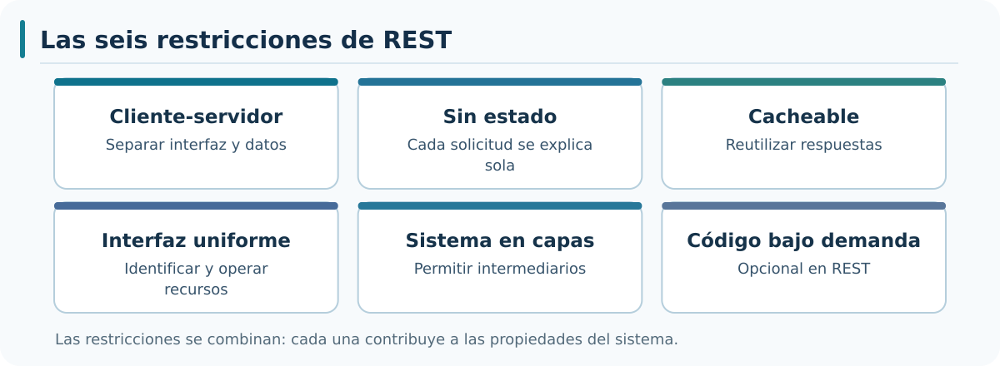
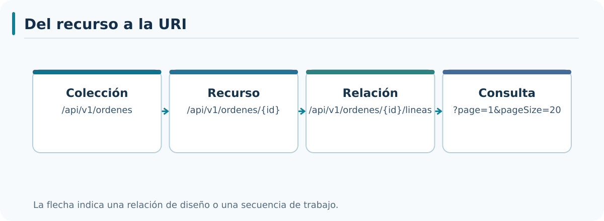
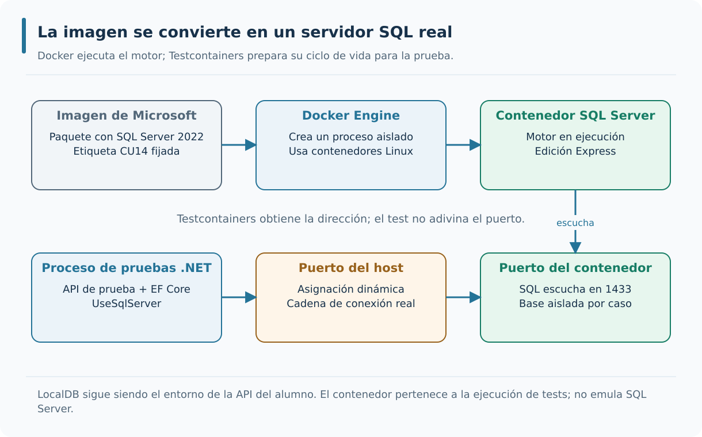
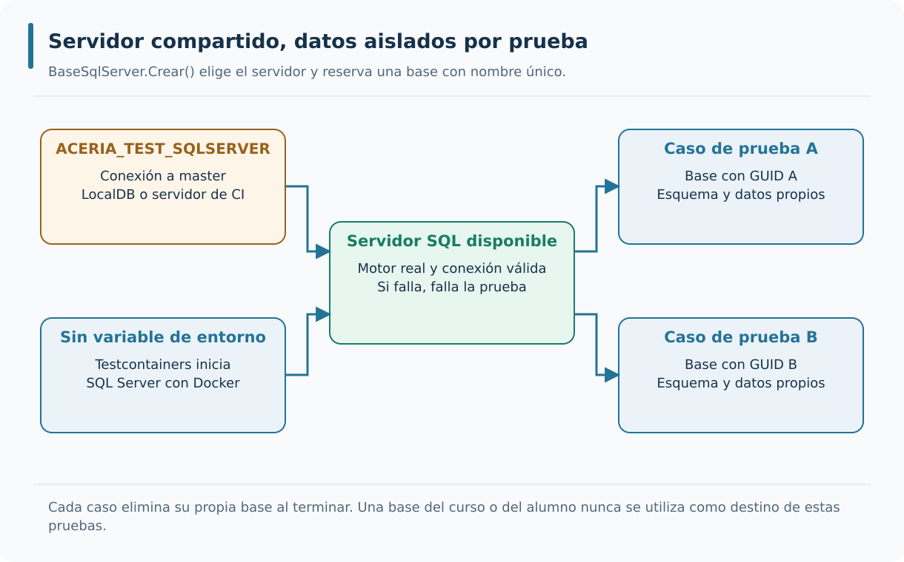
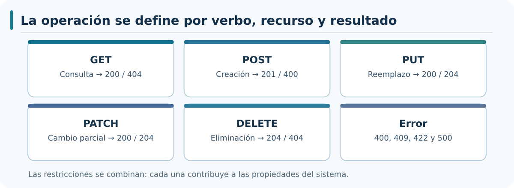
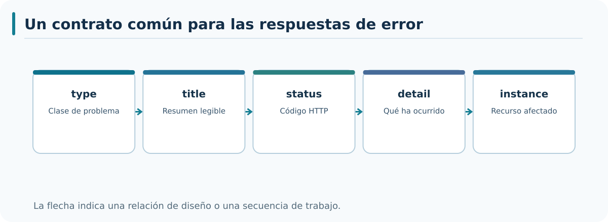
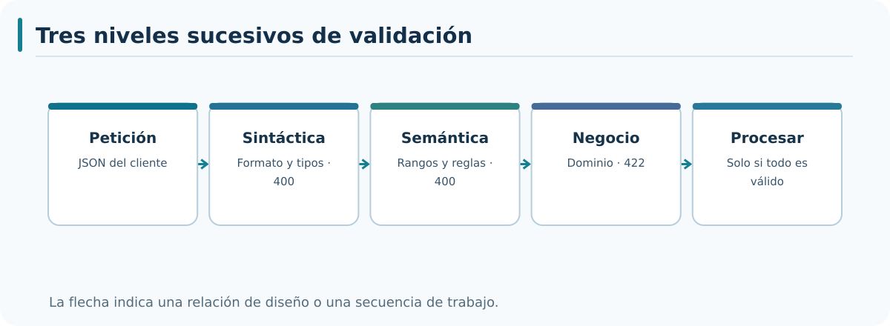
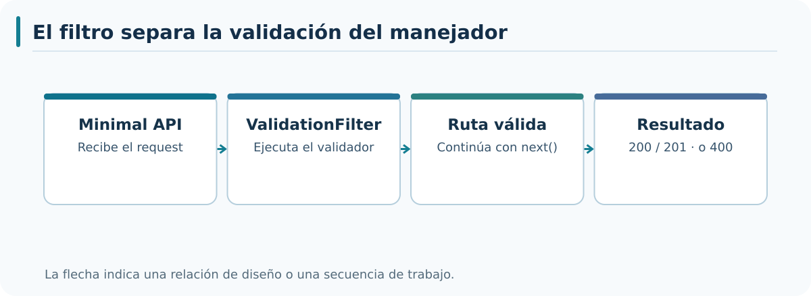
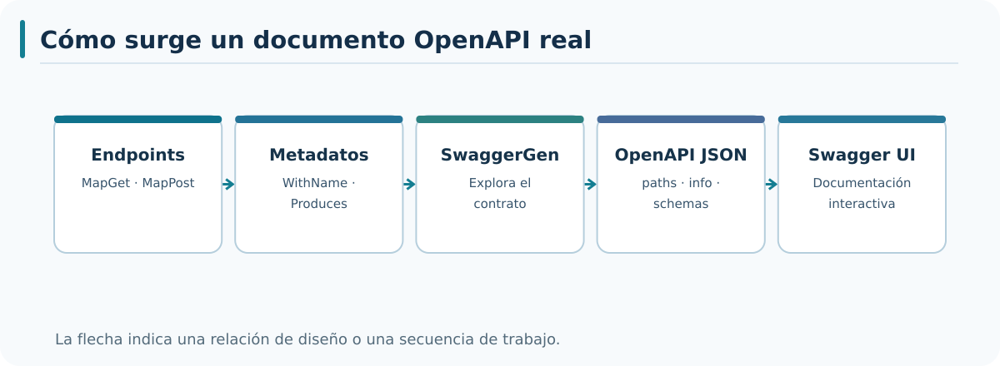
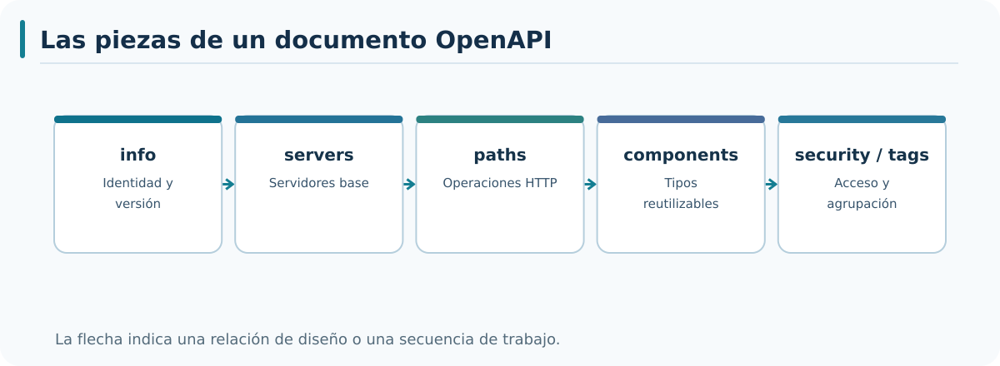

# M02 — Teoría completa: diseño REST e implementación con ASP.NET Core 8

**Autor: JAIME GALLO**


---

## Punto 2.1 — Diseño de APIs REST

Módulo 2: Desarrollo de APIs REST con ASP.NET Core
Objetivos de aprendizaje:

- Comprender los principios del estilo arquitectónico REST.
- Identificar los recursos como unidad central del diseño de una API REST.
- Comprender la relación entre recursos, URIs y representaciones.
- Comprender el principio de interfaz uniforme y su aplicación en ASP.NET Core.
- Añadir al proyecto AceriaApp un documento de diseño de APIs REST y una clase de validación de URIs REST.

### Definición de REST

Cuando una API ofrece información sobre las órdenes de una acería, lo primero que debe decidirse es qué recursos podrán conocer sus consumidores y cómo van a interactuar con ellos. REST aporta un conjunto de restricciones arquitectónicas para organizar esa interacción; no es un sinónimo de HTTP ni una biblioteca de ASP.NET Core. Una interfaz puede utilizar verbos y rutas HTTP sin satisfacer por ello todas las restricciones de REST. En este curso construiremos primero una API con recursos identificables, operaciones coherentes, representaciones JSON y ausencia de estado de sesión en el servidor; después examinaremos qué otras condiciones, como enlaces hipermedia, serían necesarias para aplicar el estilo de forma más completa. La cuestión docente no es memorizar una etiqueta, sino comprender qué garantías obtiene el consumidor al tratar las órdenes como recursos.



*Figura M02.2.1.1 — Las seis restricciones de REST y su función.*

Restricciones de REST:  
  
1. Cliente-servidor  
2. Sin estado  
3. Cacheable  
4. Interfaz uniforme  
5. Sistema en capas  
6. Código bajo demanda (opcional)


Las restricciones esenciales de REST incluyen separación cliente-servidor, ausencia de estado de sesión entre peticiones, caché declarativa, interfaz uniforme y sistema en capas. La transferencia de código ejecutable al cliente es una restricción **opcional**; no debe exigirse para considerar REST una arquitectura. Tampoco basta enumerar las restricciones para decir que nuestra API las aplica en su totalidad: el uso de hipermedia en las transiciones del cliente tiene implicaciones adicionales que este laboratorio no implementa completamente.


REST combina restricciones obligatorias con la posibilidad opcional de código bajo demanda; por tanto, la falta de esta última no impide que una arquitectura cumpla el estilo. En cambio, usar verbos HTTP y JSON no basta por sí solo para afirmar que una API implementa la interfaz uniforme completa. La restricción de interfaz uniforme es la que más impacto tiene en el diseño de una API. Se descompone en cuatro sub-restricciones: identificación de recursos, manipulación de recursos a través de representaciones, mensajes auto-descriptivos e hipermedia como motor del estado de la aplicación. Las cuatro sub-restricciones orientan el diseño, pero no se reducen a elegir URIs y verbos. La API de AceriaApp aplica especialmente identificación de recursos, representaciones y mensajes HTTP coherentes; no implementa un flujo completo de navegación hipermedia que permita afirmar el cumplimiento integral de HATEOAS.

La aplicación de las seis restricciones produce un sistema con propiedades medibles: escalabilidad, simplicidad, modificabilidad y visibilidad. La propiedad de escalabilidad se obtiene de la restricción sin estado y de la restricción cacheable. La propiedad de simplicidad se obtiene de la restricción de interfaz uniforme. La propiedad de modificabilidad se obtiene de la restricción de sistema en capas. La propiedad de visibilidad se obtiene de la restricción de mensajes auto-descriptivos. Las cuatro propiedades son las razones por las que REST se ha convertido en el estilo dominante para APIs web.


---

### Recursos como unidad central del diseño

Una orden de fabricación existe como concepto del negocio, pero la representación que recibe un cliente no tiene por qué ser idéntica a la entidad que EF Core almacena. La URI identifica el recurso; el DTO describe los datos de una respuesta concreta; y el estado interno puede incluir propiedades que no se exponen o que no deben modificarse desde fuera. Por ejemplo, `/api/v1/ordenes` identifica una colección y `/api/v1/ordenes/{id}` identifica una orden determinada. Esta separación permite modificar la persistencia sin cambiar innecesariamente el contrato público. También obliga a decidir qué significa que una orden no exista, quién puede cambiarla y qué relaciones merecen una ruta independiente. Un recurso no equivale automáticamente a una tabla, un controlador o una clase de C#.



*Figura M02.2.1.2 — De la colección al recurso y sus relaciones.*

URIs de recursos:  
  
- **/api/v1/ordenes** → colección de órdenes.
- **/api/v1/ordenes/{id}** → orden concreta.
- **/api/v1/ordenes/{id}/lineas** → líneas de una orden concreta.
- **/api/v1/materiales** → colección de materiales.
- **/api/v1/clientes** → colección de clientes.


La distinción entre colección y recurso individual organiza el contrato: el identificador pertenece a la ruta del recurso concreto, mientras que la colección permite descubrir o filtrar sus elementos. La ruta de líneas muestra una relación subordinada; `materiales` y `clientes` son dominios conceptuales que no se convierten automáticamente en APIs ejecutables en la primera etapa.


La identificación de recursos con URIs tiene tres consecuencias prácticas. La primera es que las URIs se construyen con sustantivos en plural para las colecciones. La segunda es que las relaciones entre recursos se expresan con anidamiento de URIs. La tercera es que las URIs no contienen verbos. Las tres consecuencias se aplican de forma uniforme en toda la API. La uniformidad es lo que permite que un cliente genérico pueda navegar la API sin conocerla de antemano. La uniformidad también facilita la documentación automática con OpenAPI.


---

#### Recurso y representación en AceriaApp

REST identifica órdenes mediante una URI estable. ASP.NET Core no pide implementar un validador de cadenas para disponer de enrutamiento: la llamada MapGet asocia un verbo y una plantilla de ruta al manejador real. Hay que distinguir la entidad Orden, que EF Core persiste, de la representación pública que recibe el consumidor. Conocer los atributos Id, Cliente, Material, Cantidad, Estado y FechaCreacion permite justificar después por qué no todos se aceptan como entrada.

La clase `Orden` define el objeto que EF Core puede persistir; su identidad y atributos no deben confundirse con el contrato HTTP completo. La teoría prepara la decisión sobre qué propiedades serán visibles al consultar o crear una orden, que se verificará sobre peticiones reales.


### Representaciones y negociación de contenido

El cliente y el servidor intercambian representaciones de recursos, no copias de sus objetos internos. JSON resulta una elección natural para esta API por su amplia compatibilidad con herramientas HTTP y ASP.NET Core, pero el diseño debe distinguir entre el dato del recurso y la forma de transmitirlo. Una cabecera `Accept` puede expresar formatos que el cliente comprende; el servidor decide cuáles ofrece realmente y puede responder que no existe una representación aceptable. En nuestro laboratorio la representación ordinaria será JSON y los DTO determinarán qué campos aparecen. Esta decisión mejora la estabilidad del contrato y evita que propiedades de navegación o detalles privados de EF Core pasen involuntariamente a la respuesta. La negociación de contenido no reemplaza el diseño de un modelo de salida adecuado.

```csharp
// El cliente envía:  
// Accept: application/json  
  
app.MapGet("/api/v1/ordenes", async (AceriaDbContext db) =>  
    await db.Ordenes.AsNoTracking().ToListAsync());

```


El ejemplo vincula una ruta GET con una consulta de EF Core sin seguimiento de cambios. Al devolver la colección el framework la serializa según la configuración de salida. La cabecera `Accept` solo influye si el servidor dispone de los formatos solicitados; no demuestra que el endpoint ofrezca negociación con varios serializadores.


Una representación puede ofrecer distintos formatos desde una misma URI si el servidor dispone de los serializadores correspondientes. El cliente expresa sus preferencias con `Accept` y, cuando ninguno de los formatos solicitados está disponible, la API puede devolver `406 Not Acceptable`. En AceriaApp el laboratorio utiliza JSON, de modo que no debemos confundir el mecanismo de negociación con la implementación efectiva de múltiples representaciones. La URI identifica el recurso; el formato describe cómo se intercambia su información.


---

### Métodos HTTP y su semántica

Los métodos HTTP tienen una semántica que los consumidores necesitan poder anticipar. GET recupera una representación sin solicitar cambios de estado; POST suele procesar una creación u otra acción definida por la colección; PUT expresa sustitución del estado del recurso; PATCH aplica un cambio parcial; y DELETE solicita eliminación. Las propiedades de seguridad e idempotencia son especialmente importantes: un GET debe ser seguro, mientras que PUT y DELETE son idempotentes respecto al efecto previsto, aunque la respuesta pueda variar entre llamadas. PATCH puede ser idempotente en algunos diseños y no en otros; no conviene asignarle una propiedad universal. Estas diferencias condicionan cachés, reintentos y pruebas. Al diseñar AceriaApp, el verbo tiene que corresponder con lo que la operación hace realmente.

Métodos HTTP:  
  
- **GET     /api/v1/ordenes** → lista de órdenes. Seguro, idempotente.
- **GET     /api/v1/ordenes/{id}** → orden concreta. Seguro, idempotente.
- **POST    /api/v1/ordenes** → crear orden. No seguro, no idempotente.
- **PUT     /api/v1/ordenes/{id}** → reemplazar orden. No seguro, idempotente.
- **PATCH   /api/v1/ordenes/{id}** → modificar orden. No seguro, no idempotente.
- **DELETE  /api/v1/ordenes/{id}** → eliminar orden. No seguro, idempotente.


La elección de método determina qué efecto puede esperar un cliente, con independencia del nombre del método C# que se ejecute internamente. La idempotencia de PUT y DELETE se refiere a su efecto sobre el recurso; un PATCH que asigna una cantidad concreta podría ser idempotente, mientras que uno que incrementa la cantidad no lo sería.


La seguridad y la idempotencia ayudan a razonar sobre cachés y reintentos, pero no significan que cualquier operación pueda repetirse sin condiciones. GET está definido como método seguro; PUT y DELETE son idempotentes respecto al efecto esperado, aunque distintas peticiones puedan recibir estados HTTP diferentes. Un POST de creación necesita protección adicional frente a duplicados, y PATCH debe analizarse según si establece un valor o aplica un cambio acumulativo. La caché, por otra parte, depende de la semántica HTTP y de cabeceras y políticas concretas, no solo del verbo.


---

#### DTO público en AceriaApp

El record OrdenDto representa el JSON de salida. El método Desde transforma explícitamente la entidad a una representación. Esta distinción reduce el acoplamiento entre el esquema de la tabla y el contrato HTTP. Si se cambiara una propiedad interna de Orden no tendría por qué aparecer automáticamente en la respuesta; el método de conversión es precisamente el lugar donde decidir qué se publica.

El DTO `OrdenDto` permite decidir qué campos expone una respuesta. El alumno podrá comparar su representación JSON con la entidad de persistencia y comprobar por qué un cambio interno no debería filtrarse automáticamente al consumidor.

**Código de referencia probado:** `src/AceriaApp.Api/Modelo/OrdenDto.cs`


```csharp
namespace AceriaApp.Api.Modelo;
// INICIO PASO 2.1.5
public sealed record OrdenDto(Guid Id, string Cliente, string Material,
    int Cantidad, string Estado, DateTime FechaCreacion)
{
    public static OrdenDto Desde(Orden x) =>
        new(x.Id,x.Cliente,x.Material,x.Cantidad,x.Estado,x.FechaCreacion);
}
// FIN PASO 2.1.5
```


### Códigos de estado HTTP

Un código HTTP informa al consumidor sobre el resultado de una interacción y debe ser coherente con el método y el estado del recurso. Cuando una creación tiene éxito puede devolverse `201 Created` y la URI del recurso; una lectura existente normalmente responde `200 OK`, mientras que una operación completada sin cuerpo puede utilizar `204 No Content`. Si el identificador no corresponde a ninguna orden, `404 Not Found` proporciona una señal distinta de una petición mal formada o de un conflicto de estado. Los códigos no son adornos del endpoint: permiten a un cliente decidir si debe corregir la solicitud, continuar o informar de un problema. Tampoco sustituyen un cuerpo de error claro y seguro cuando este sea útil. En el laboratorio probaremos explícitamente las respuestas esperadas.

Códigos de estado habituales:  
  
- **200 OK** → operación exitosa con cuerpo.
- **201 Created** → recurso creado, con cabecera Location.
- **204 No Content** → operación exitosa sin cuerpo.
- **400 Bad Request** → error de validación o formato.
- **401 Unauthorized** → falta autenticación.
- **403 Forbidden** → autenticación correcta, sin permisos.
- **404 Not Found** → recurso no encontrado.
- **409 Conflict** → conflicto de estado.
- **422 Unprocessable Entity** → entidad semánticamente inválida.
- **500 Internal Server Error** → error del servidor.


Los estados de éxito, error de cliente y error interno permiten distinguir una creación, una búsqueda sin resultado y un fallo inesperado. La regla de AceriaApp es seleccionar el código según la situación comprobada, no devolver un estado fijo para todos los caminos. Cuando existe un error describible, puede acompañarse de un cuerpo estructurado sin filtrar detalles del servidor.


El cliente utiliza el estado HTTP para distinguir resultados y decidir qué hacer después de una solicitud. Un 201 señala creación, un 404 informa de ausencia y un 409 puede expresar una transición incompatible con el estado actual. Las cachés intermedias interpretan también códigos y directivas de respuesta, pero sería incorrecto afirmar que todos los 2xx son cacheables o que los 4xx jamás pueden almacenarse. La política efectiva depende del código, las cabeceras y el método. Por eso la respuesta debe describir el hecho ocurrido y no una categoría elegida arbitrariamente.


---

### Diseño de URIs en APIs REST

Una URI debería ser estable, comprensible y expresar la identidad de un recurso sin describir cómo se implementa el servidor. En AceriaApp, `/api/v1/ordenes` comunica una colección; añadir un identificador permite consultar una orden concreta. Las relaciones pueden expresarse mediante subrecursos, por ejemplo las líneas de una orden, cuando esa estructura resulte útil para el consumidor. No existe una obligación universal de utilizar sustantivos plurales o anidamientos profundos: son convenciones prácticas que ayudan a producir interfaces predecibles. Conviene evitar rutas que expongan detalles internos o cambios de la estructura SQL. La versión del contrato en la ruta es también una decisión explícita, no una garantía automática de compatibilidad. La API será coherente cuando un consumidor pueda deducir las operaciones disponibles sin conocer el código C# que las atiende.

Reglas de diseño de URIs:  
  
- **1. Sustantivos en plural** → /ordenes, /materiales.
- **2. Identificador tras colección** → /ordenes/{id}.
- **3. Anidamiento de relaciones** → /ordenes/{id}/lineas.
- **4. Sin verbos** → no /crearOrden.
- **5. Versionado en la URI** → /api/v1/ordenes.


Las convenciones de rutas facilitan reconocer qué representa cada segmento, pero no deberían convertirse en un detector automático de «REST correcto». Una URI que anida líneas bajo una orden solo será útil si refleja las consultas y modificaciones que realmente necesita el cliente; la sintaxis no decide por sí sola dónde pertenecen las reglas de negocio.


Las cinco reglas se aplican de forma uniforme en toda la API. La uniformidad es lo que distingue una API REST de una API RPC. La uniformidad también facilita la documentación automática con OpenAPI, la generación de clientes y la integración con herramientas de monitorización. La violación de cualquiera de las cinco reglas rompe la uniformidad y obliga al cliente a conocer la API de antemano. El curso aplica las cinco reglas al diseño de la API de la acería.


---

#### Persistencia mediante EF Core en AceriaApp

El contexto contiene DbSet<Orden> y las restricciones de las columnas. La API se ejecuta sobre SQL Server Express LocalDB en el ordenador del alumno. Registrar AddDbContext permite que los endpoints reciban el contexto mediante inyección de dependencias: no hay que crear el contexto con new dentro de cada manejador. Los tests conservan el proveedor SQL Server y cambian la conexión por la de una base aislada. El motor puede ser una instancia LocalDB configurada para pruebas o SQL Server en un contenedor administrado por Testcontainers. El estudio integrador de este punto explica ese recorrido.

`AceriaDbContext` relaciona las entidades con SQL Server. La evidencia relevante es obtener una orden desde una base de pruebas real y conservar la separación entre la configuración del proveedor y los tipos que definen el contrato público.


### Interfaz uniforme en ASP.NET Core

Minimal APIs permite expresar con pocas instrucciones una interfaz HTTP completa, pero esa brevedad no garantiza por sí sola un diseño REST correcto. En `Program.cs`, una llamada como `MapGet` asocia una ruta a un manejador; la inyección de dependencias aporta los servicios necesarios y `Results.Ok` o `Results.NotFound` permiten construir respuestas precisas. Lo importante es que la configuración técnica permanezca alineada con la semántica del recurso. Un endpoint no debería devolver datos internos solo porque resulta cómodo serializar la entidad, ni debería convertir una orden ausente en una colección vacía. A medida que se añadan verbos y validación, mantendremos esta correspondencia entre propósito, entrada y resultado. El código será el mecanismo para realizar una decisión ya comprendida, no su sustituto.

```csharp
var builder = WebApplication.CreateBuilder(args);  
builder.Services.AddEndpointsApiExplorer();  
builder.Services.AddSwaggerGen();  
  
var app = builder.Build();  
  
app.MapGet("/api/v1/ordenes", async (AceriaDbContext db) =>  
    await db.Ordenes.AsNoTracking().ToListAsync());  
  
app.MapGet("/api/v1/ordenes/{id:guid}", async (Guid id, AceriaDbContext db) =>  
{  
    var orden = await db.Ordenes.AsNoTracking().FirstOrDefaultAsync(o => o.Id == id);  
    return orden is not null ? Results.Ok(orden) : Results.NotFound();  
});  
  
app.Run();

```


El arranque de Minimal API configura el host y mapea dos rutas. En el GET individual, EF Core busca una orden por identificador y el manejador elige `Ok` o `NotFound`. El comportamiento real de la ruta se comprueba enviando peticiones con un identificador existente y otro ausente, no contando llamadas a `MapGet`.


Una interfaz coherente permite que un consumidor comprenda el comportamiento de las rutas sin memorizar reglas diferentes para cada endpoint. En Minimal API, la definición de un manejador y sus metadatos puede utilizarse para generar documentación OpenAPI, siempre que estén registrados los servicios adecuados. Esta generación automática no garantiza que el documento describa correctamente cada resultado: si se declara un 201, las pruebas deben demostrar que la creación produce realmente ese código. La uniformidad de REST se construye con contratos y semántica, no con la apariencia similar de las funciones C#.


---

### Recursos anidados y relaciones

Una orden puede contener líneas, materiales asociados y otros elementos relacionados. La pregunta arquitectónica es si el consumidor necesita tratarlos como recursos por derecho propio o como parte de la representación de la orden. La ruta `/ordenes/{id}/lineas` comunica una relación subordinada útil cuando las líneas carecen de identidad práctica fuera de su orden. En otros escenarios puede resultar preferible una colección independiente con filtros. El anidamiento excesivo hace que el contrato dependa de la forma de recorrer el dominio y puede dificultar cambios posteriores. Por eso conviene diseñar relaciones a partir de operaciones de los consumidores y restricciones de negocio, no copiando todas las claves foráneas de SQL Server. El primer módulo de API utilizará relaciones sencillas y una representación pública controlada.

Anidamiento de recursos:  
  
- **/api/v1/ordenes** → colección de órdenes.
- **/api/v1/ordenes/{id}** → orden concreta.
- **/api/v1/ordenes/{id}/lineas** → líneas de una orden.
- **/api/v1/ordenes/{id}/lineas/{lid}** → línea concreta.
  
Alternativa sin anidar:  
  
- **/api/v1/lineas?ordenId={id}** → líneas filtradas por orden.


Una relación puede representarse en la URI, en un enlace de la representación o mediante una consulta filtrada. La elección afecta a la estabilidad del contrato cuando evoluciona el modelo interno. Por eso conviene comparar cómo consultaría un cliente las líneas de una orden sin obligarlo a conocer todas las tablas intermedias.


Anidar una ruta puede expresar con claridad que una línea pertenece a una orden de producción. La ventaja se pierde cuando la URI comienza a reflejar todas las relaciones del modelo interno y obliga al cliente a navegar por rutas excesivamente profundas. La composición fuerte puede justificar un subrecurso; una asociación independiente puede expresarse mejor mediante un recurso propio y filtros. La decisión debe responder a las operaciones que necesita el consumidor, no a copiar automáticamente la estructura de las claves foráneas de SQL Server.


---

#### Endpoint GET de colección en AceriaApp

El manejador obtiene AceriaDbContext, usa AsNoTracking para consultar sin seguimiento y devuelve Results.Ok con una secuencia de DTOs. En una colección vacía se responde 200 y una lista JSON vacía, pues la colección como recurso existe aunque no contenga elementos. La respuesta debe inspeccionarse desde AceriaApp.http, no deducirse de que el código compile.

En `Program.cs`, `MapGet` relaciona la colección de órdenes con una consulta. La comprobación consiste en llamar a la ruta, observar el estado HTTP y contrastar el contenido JSON con lo que se ha persistido.

**Código de referencia probado:** `src/AceriaApp.Api/Program.cs`


```csharp
// INICIO PASO 2.1.8: colección de recursos, consulta real con EF Core.
app.MapGet("/api/v1/ordenes",async (AceriaDbContext db,CancellationToken ct)=>
{
    var ordenes=await db.Ordenes.AsNoTracking().OrderBy(x=>x.FechaCreacion).ToListAsync(ct);
    return Results.Ok(ordenes.Select(OrdenDto.Desde));
})
.WithName("ListarOrdenes").WithTags("Ordenes")

;
```


### Paginación, filtrado y ordenación

Una colección de órdenes puede crecer mucho más allá de los ejemplos con dos o tres registros. Ofrecer siempre la colección completa incrementa tiempo de consulta, tráfico y memoria; por ello resulta conveniente introducir paginación y límites de tamaño desde el diseño del contrato. También necesitamos filtros que expresen búsquedas reales del usuario y reglas previsibles de ordenación. Los parámetros `page`, `pageSize` o `sort` son posibles decisiones de interfaz, no funciones que EF Core implemente automáticamente solo por aparecer en una URI. Hay que aplicar sus valores a una consulta SQL, validar rangos y definir qué sucede si el cliente pide una página inexistente. En AceriaApp distinguiremos entre una demostración del contrato y la implementación efectiva de esas opciones en una etapa concreta.

Paginación, filtrado y ordenación:  
  
GET /api/v1/ordenes?page=1&pageSize=20  
GET /api/v1/ordenes?filter=cliente:ACX-001  
GET /api/v1/ordenes?sort=fechaCreacion:desc  
  
Respuesta con metadatos:  
  
```json
{  
  "items": [ ... ],  
  "page": 1,  
  "pageSize": 20,  
  "totalItems": 145,  
  "totalPages": 8  
}

```


En la consulta paginada los parámetros deben terminar influyendo en `Skip`, `Take`, ordenación y filtros de la base. Si se devuelve un envoltorio con total de elementos y número de páginas, esos metadatos también deben corresponder a los datos realmente consultados. Dejar el ejemplo como simple cadena de URI no demuestra que exista paginación implementada.


La paginación evita enviar colecciones enormes en una sola respuesta y permite al cliente navegar por resultados con un coste previsible. Cuando la API devuelve metadatos de total, página y tamaño, esos valores deben proceder de la misma consulta lógica que produjo los elementos, no de números fijos del ejemplo. Las colecciones con límites pequeños pueden no requerir un mecanismo complejo, pero una API que espera crecer debería definir desde temprano un tamaño máximo y un orden estable. La necesidad se demuestra mediante uso y carga, no con la etiqueta REST.


---

### Aplicación del diseño REST al proyecto del curso

El diseño de REST se concreta cuando podemos seguir la petición de un cliente hasta la respuesta que observa. Para AceriaApp decidimos primero qué URI identifica cada orden, qué datos contiene `OrdenDto`, cómo se obtiene la información mediante EF Core y qué resultados HTTP corresponden a una lectura con o sin coincidencias. Esa secuencia conecta contrato y persistencia sin confundir ambas capas. El recorrido debe probarse contra SQL Server real cuando se afirma que existe persistencia y contra un servidor HTTP cuando se afirma que la ruta funciona. La etapa 2.1 conservará un alcance modesto: una colección GET y una consulta por identificador, suficientes para observar representación, enrutamiento y uso de la base. Los siguientes puntos ampliarán las operaciones sin redefinir arbitrariamente el recurso.

Aplicación al proyecto del curso:  
  
- **Recursos identificados** → /api/v1/ordenes, /api/v1/materiales.
- **Métodos HTTP con semántica** → GET, POST, PUT, PATCH, DELETE.
- **Códigos de estado** → 200, 201, 204, 400, 404, 409, 422, 500.
- **Representaciones** → JSON por defecto.
- **Paginación** → page, pageSize.
- **Relaciones anidadas** → /ordenes/{id}/lineas.


El catálogo resume los acuerdos visibles para un consumidor de AceriaApp: recursos, rutas, métodos, estados de respuesta y representación JSON. Su utilidad es detectar incoherencias, por ejemplo una ruta que devuelve un código de éxito cuando no encontró el recurso. El catálogo es una herramienta de diseño; solo las pruebas HTTP demuestran que el servidor sigue el acuerdo.


La aplicación del diseño REST prepara el proyecto para los puntos posteriores del módulo 2. El punto 2.2 estudiará los recursos, verbos y códigos con detalle. El punto 2.3 estudiará la validación de peticiones. El punto 2.4 estudiará la documentación OpenAPI. La base del diseño REST es el fundamento de los tres puntos siguientes. El punto 2.1 establece los conceptos que se aplicarán en los tres puntos siguientes.


---

### Resumen rápido de la teoría

- REST distingue cinco restricciones obligatorias —cliente-servidor, ausencia de estado, caché, interfaz uniforme y sistema en capas— y una opción de código bajo demanda. Utilizar JSON y verbos HTTP no demuestra, por sí solo, una aplicación completa de REST.
- Los recursos son la unidad central del diseño y se identifican con URIs que siguen cinco reglas.
- Las representaciones se negocian con la cabecera Accept y el formato por defecto es JSON.
- Los métodos HTTP expresan la semántica de la operación y tienen dos propiedades: seguridad e idempotencia.
- Los códigos de estado expresan el resultado de la operación en cinco familias.
- Las colecciones se paginan con parámetros de consulta y las relaciones se anidan con sub-rutas.


---


---


#### GET individual y pruebas HTTP en AceriaApp

La plantilla {id:guid} restringe el parámetro de ruta a GUID válidos. El manejador consulta una orden específica y decide entre Results.Ok y Results.NotFound. Una petición a un GUID inexistente no debería convertirse en 500 ni en una respuesta 200 con contenido vacío. WebApplicationFactory inicia la aplicación en memoria y permite comprobar 200 y 404 sobre los endpoints auténticos.

El GET individual asocia un identificador con una búsqueda real y trata expresamente la ausencia del recurso. La diferencia entre `200` y `404` debe aparecer en las pruebas, porque es una parte esencial del contrato y no solo de la implementación interna.


### Estudio integrador 2.1 — Probar HTTP y persistencia con SQL Server real

#### Por qué el proveedor forma parte del comportamiento

Una prueba que envía un POST y después recupera una orden mediante GET atraviesa varias piezas: enrutamiento, deserialización JSON, validación, contexto de EF Core y almacenamiento. Si cambia la pieza de almacenamiento, también puede cambiar lo que demuestra el resultado. En este curso la API usa `Microsoft.EntityFrameworkCore.SqlServer`; sus pruebas de integración conservan ese proveedor y ejecutan el SQL contra un motor SQL Server real.

EF Core InMemory guarda datos sin ser un motor relacional. SQLite sí es relacional, pero tiene su propio dialecto, tipos y reglas de ejecución. Ninguno demuestra por sí solo que una consulta o restricción funcionará igual en SQL Server. Los dobles siguen siendo útiles para comprobar una regla de dominio o la coordinación de un caso de uso. La pregunta «¿se guardan y recuperan correctamente estos datos con nuestro proveedor?» necesita una prueba que llegue al motor elegido. [Microsoft explica estas diferencias al comparar estrategias de prueba de EF Core](https://learn.microsoft.com/ef/core/testing/choosing-a-testing-strategy).

#### Cuatro conceptos de Docker sin cambiar la aplicación del alumno

**Docker** permite ejecutar procesos en entornos aislados y gestionar sus archivos, red y ciclo de vida. **Una imagen** contiene el programa y los archivos necesarios para arrancarlo. **Un contenedor** es una instancia en ejecución creada a partir de esa imagen. **Un puerto publicado** enlaza un puerto accesible desde el proceso de pruebas con el puerto donde escucha el servidor dentro del contenedor. La imagen es el paquete; el contenedor ejecuta el programa.



*Interpretación del gráfico:* La fila superior explica cómo aparece el servidor. La inferior muestra por dónde llega EF Core hasta él. El contenedor ejecuta SQL Server; Testcontainers no convierte SQL Server en una simulación. La figura también está disponible en PNG en la misma carpeta.

Para el curso se fija la imagen `mcr.microsoft.com/mssql/server:2022-CU14-ubuntu-22.04` y la variable `MSSQL_PID=Express`. La etiqueta identifica la versión utilizada por el laboratorio; no significa «la versión más reciente». La edición Express se configura dentro del contenedor. LocalDB es otra forma de ejecutar SQL Server Express, orientada al desarrollo en Windows: no es el programa que arranca dentro de esta imagen Linux.

La aplicación que el alumno abre en Visual Studio continúa utilizando LocalDB. Las pruebas pueden iniciar el contenedor con Docker Desktop en modo de contenedores Linux. Esta separación evita tener que modificar la conexión cotidiana de la API. El objetivo aquí es disponer de una dependencia real y desechable para probar persistencia, no empaquetar ni desplegar la API en Docker.

#### Qué automatiza Testcontainers y qué escribe el test

`Testcontainers.MsSql` es una biblioteca de .NET. Habla con Docker, prepara un contenedor de SQL Server, espera a que esté disponible y permite obtener su cadena de conexión. La versión fijada en el proyecto es **3.10.0**. El helper de pruebas `BaseSqlServer` encapsula esa preparación y el aislamiento de las bases. Conviene distinguirlo del `DbContext`: el helper consigue un destino de pruebas; el contexto mapea entidades y consulta ese destino.

Este fragmento explicativo resume la rama Docker del helper. Su código completo y su limpieza se construyen en las prácticas; no es un archivo adicional que deba copiarse sobre ellas.

```csharp
var contenedor = new MsSqlBuilder()
    .WithImage("mcr.microsoft.com/mssql/server:2022-CU14-ubuntu-22.04")
    .WithEnvironment("MSSQL_PID", "Express")
    .Build();
await contenedor.StartAsync();
var cadenaServidor = contenedor.GetConnectionString();
```


El constructor de Testcontainers prepara un SQL Server Express temporal para pruebas y permite aislar el entorno sin usar datos de la API cotidiana. Fijar la imagen evita variaciones accidentales; obtener la cadena de conexión después de iniciar el contenedor permite registrar un `DbContext` contra el servidor que realmente se ha levantado.


El puerto **1433** pertenece al servidor dentro del contenedor. Docker puede publicarlo en otro puerto libre del host. Dos ejecuciones no tienen que competir por un único puerto del ordenador. El alumno usa la cadena devuelta por el helper; modificar el puerto a mano rompe esa separación. [La documentación de Testcontainers detalla cómo obtener las direcciones y puertos asignados](https://dotnet.testcontainers.org/api/create_docker_network/).

#### La variable de entorno es una alternativa de servidor

`BaseSqlServer.Crear()` consulta `ACERIA_TEST_SQLSERVER`. Si existe, la interpreta como una conexión a `master` en un SQL Server disponible. Si no existe, usa Testcontainers. En ambos caminos crea una base de datos con nombre único basado en GUID y entrega la cadena de esa base mediante `ConnectionString`. La cuenta de pruebas necesita permisos para crear y eliminar sus bases aisladas. El helper no debe apuntar a una base de trabajo del alumno para vaciarla.



*Interpretación del gráfico:* Se puede compartir el proceso servidor sin compartir las filas de cada caso. La variable de entorno cambia cómo se obtiene el servidor; el contrato de aislamiento de `BaseSqlServer` permanece.

En PowerShell, esta alternativa usa la instancia LocalDB instalada en Windows:

```powershell
$env:ACERIA_TEST_SQLSERVER = 'Server=(localdb)\MSSQLLocalDB;Database=master;Trusted_Connection=True;TrustServerCertificate=True'
dotnet test
Remove-Item Env:ACERIA_TEST_SQLSERVER
```


La variable `ACERIA_TEST_SQLSERVER` permite utilizar SQL Server Express LocalDB en Windows en lugar de arrancar el contenedor. El valor de `master` se usa para crear bases de prueba independientes; no significa que las entidades del ejercicio se graben en la base `master`. Al terminar se retira la variable para no contaminar sesiones posteriores.


`TrustServerCertificate=True` corresponde aquí a una conexión de laboratorio. No describe por sí sola una política de certificados para producción. La alternativa LocalDB permite ejecutar estas pruebas en Windows sin arrancar Docker, pero sigue requiriendo un motor SQL Server operativo. Una configuración inválida, un servicio detenido o una descarga fallida no se transforman en pruebas omitidas ni activan InMemory como sustituto.

#### Recorrido de una prueba desde la factoría hasta la limpieza

La factoría hereda de `WebApplicationFactory<Program>`. Construye un host de ASP.NET Core para enviar solicitudes mediante `HttpClient`; no necesita abrir el navegador. Al configurar servicios reemplaza la conexión del contexto. El esquema se crea sobre la base de pruebas una vez aplicada esa configuración, nunca sobre la base local de la aplicación por accidente.

```csharp
private readonly BaseSqlServer _base = BaseSqlServer.Crear();
services.AddDbContext<AceriaDbContext>(options =>
    options.UseSqlServer(_base.ConnectionString));
```


La factoría de pruebas obtiene una base aislada a través del helper `BaseSqlServer.Crear()` y configura EF Core con su cadena. Así un test comprueba persistencia real y puede limpiar sus datos sin alterar otros casos. La duración de la factoría determina el ciclo de vida de los recursos de prueba, y una ejecución correcta debe verificar tanto los resultados como la limpieza.


| Momento | Qué sucede | Qué permite comprobar |
|---|---|---|
| Preparar | Obtener servidor y crear base con GUID | El caso empieza sin filas de otras pruebas. |
| Componer | Configurar `UseSqlServer` y crear esquema | Los endpoints reciben el contexto correcto. |
| Actuar | Enviar POST con datos válidos | La ruta y la escritura se ejecutan de extremo a extremo. |
| Observar | Enviar GET o abrir otro contexto | El resultado procede de datos persistidos y no solo del objeto recién creado. |
| Terminar | Liberar cliente, host y contextos; eliminar base | El siguiente caso no hereda datos ni conexiones del anterior. |

El aislamiento tiene un coste: arrancar SQL Server tarda más que crear una lista en memoria. La primera ejecución también puede descargar la imagen. Ese tiempo compra una comprobación distinta y necesaria. Una prueba del dominio que no usa persistencia puede seguir ejecutándose sin SQL; una prueba de integración que lo necesita debe demostrarlo con SQL disponible. Un resultado satisfactorio verifica los escenarios ejecutados, no certifica por sí solo carga, alta disponibilidad ni todas las diferencias entre versiones del servidor.

**Comprobación de comprensión.** Antes de continuar con los verbos HTTP, explica con tus palabras por qué imagen, contenedor y base de datos no son sinónimos; señala dónde cambia la conexión del test; y describe qué dato nuevo debería observar un GET después de un POST. Esa explicación enlaza el contrato REST con la persistencia que lo sostiene.

#### Documentación de consulta de este estudio

- [Imágenes de contenedor](https://docs.docker.com/get-started/docker-concepts/the-basics/what-is-an-image/) y [publicación de puertos](https://docs.docker.com/get-started/docker-concepts/running-containers/publishing-ports/): paquete, proceso y acceso desde el host.
- [Módulo SQL Server de Testcontainers](https://dotnet.testcontainers.org/modules/mssql/): configuración y ciclo de vida. Contrasta los ejemplos actuales con la versión 3.10.0 fijada en el curso.
- [Variables de SQL Server en Linux](https://learn.microsoft.com/sql/linux/sql-server-linux-configure-environment-variables?view=sql-server-ver16): significado de `MSSQL_PID`.
- [SQL Server Express LocalDB](https://learn.microsoft.com/sql/database-engine/configure-windows/sql-server-express-localdb?view=sql-server-ver16): entorno de desarrollo local en Windows.

---

## Punto 2.2 — Recursos, verbos HTTP y códigos de respuesta

Módulo 2: Desarrollo de APIs REST con ASP.NET Core
Objetivos de aprendizaje:

- Comprender el concepto de recurso y su representación en una API REST.
- Aplicar los verbos HTTP con su semántica correcta.
- Seleccionar el código de respuesta adecuado a cada situación.
- Comprender la relación entre verbo, código de respuesta y estado del recurso.
- Añadir al proyecto AceriaApp una clase de validación de combinaciones verbo-código y un catálogo de recursos del dominio.


Al ampliar el sistema con escrituras, cambia la responsabilidad del servidor: ya no basta con mostrar órdenes existentes. Cada verbo modifica expectativas sobre identidad, estado y persistencia, y por ello debe tener comprobaciones que el consumidor pueda observar.

### El recurso como unidad de diseño

Una API no se diseña sumando métodos a una clase, sino delimitando los recursos con los que puede trabajar un consumidor. En el caso de una acería, una orden de producción es una unidad reconocible: posee identidad, cambia de estado y contiene información que otras operaciones necesitan consultar. No obstante, el recurso REST no debe confundirse con una fila SQL ni con la entidad de dominio completa. La representación pública puede ocultar campos internos y ofrecer relaciones adecuadas para quien consulta. Identificar primero esa unidad evita que el contrato dependa accidentalmente de cómo EF Core organiza sus tablas. Cuando añadamos las líneas de una orden tendremos que decidir si conviene presentarlas dentro del recurso principal o mediante operaciones específicas, sin convertir cada relación de persistencia en una ruta.

Recursos del dominio de la acería:  
  
- **Orden** → orden de producción.
- **LineaOrden** → línea de una orden.
- **Material** → materia prima.
- **Cliente** → empresa compradora.
- **Movimiento** → movimiento de inventario.


En el esquema se distinguen Órdenes, Líneas, Materiales y Clientes como posibles recursos o relaciones de la acería. Lo importante es que cada uno tiene un significado funcional y puede necesitar contratos propios; su presencia en el análisis no significa que existan cuatro servicios programados en esta etapa.


Cada recurso tiene una representación por defecto y puede tener representaciones alternativas. La representación por defecto es la que el servidor devuelve cuando el cliente no especifica ninguna preferencia. La representación alternativa se negocia con la cabecera Accept. El recurso también tiene un estado interno que el servidor gestiona, pero que no se expone directamente al cliente. El cliente solo ve la representación, no el estado. Esta separación entre recurso y representación es una de las propiedades más importantes del estilo REST y la que permite que el mismo recurso se consuma desde clientes con formatos distintos.

La identificación de recursos del dominio de la acería sigue un criterio de negocio, no de base de datos. La tabla Ordenes de la base de datos puede contener columnas internas que no forman parte del recurso Orden. La columna IdempotencyKey, por ejemplo, es un detalle de implementación que no se expone como parte del recurso. Del mismo modo, el recurso Orden puede combinar datos de varias tablas para formar una representación coherente desde la perspectiva del cliente. El recurso es una proyección diseñada para el consumo, no un reflejo de la estructura de persistencia.


---

### Representaciones del recurso

La representación de un recurso debe responder a la pregunta del consumidor, no reflejar sin más todas las propiedades de la clase que se utiliza internamente. Al crear una orden, el cliente proporciona los datos necesarios para iniciar el proceso, mientras que el servidor es responsable de asignar identificador, fecha y estado inicial. Por eso conviene distinguir un `CrearOrdenRequest` de una representación `OrdenDto` destinada a consultas. La diferencia no es un formalismo: impide que una solicitud altere valores que deben estar protegidos por reglas del negocio. En ASP.NET Core, los records y la serialización JSON permiten describir ambos contratos de manera explícita, pero será el código quien convierta los datos de entrada en cambios válidos del modelo.

```csharp
public record OrdenRepresentacion(  
    Guid Id,  
    string Cliente,  
    string Material,  
    int Cantidad,  
    DateTime FechaCreacion);

```


La representación pública declara identificador y datos relevantes para el consumidor sin obligarlo a conocer la entidad de EF Core. Para crear una orden hace falta un contrato de entrada diferente: el cliente no debería decidir el identificador ni el estado final que asigna el negocio.


La representación no contiene toda la información del recurso: contiene solo la información que el cliente necesita. Si el recurso Orden tiene veinte propiedades internas, la representación puede exponer solo cinco. La selección de qué propiedades se exponen se realiza en función de los casos de uso del cliente. Una representación de colección puede exponer menos propiedades que una representación de detalle. La distinción entre representación de colección y representación de detalle es una práctica habitual para reducir el tamaño de las respuestas y mejorar el rendimiento.


---

#### Contrato de entrada en AceriaApp

El servidor debe recibir solamente Cliente, Material y Cantidad en CrearOrdenRequest. El ID, el Estado y la FechaCreacion pertenecen al control interno del servicio. Por eso no reutilizamos Orden como cuerpo de entrada. Este diseño protege el contrato público y delimita claramente los datos que el cliente puede modificar.

En `Contratos/ContratosOrden.cs`, `CrearOrdenRequest` separa la entrada del cliente de la representación de una orden almacenada. Así se evita que las decisiones del servidor sobre identidad, fecha y estado puedan manipularse desde el cuerpo de la petición.


### Verbos HTTP y su semántica completa

GET, POST, PUT, PATCH y DELETE expresan expectativas distintas. Un GET pide observar un recurso y no debe producir cambios de negocio; POST solicita una operación cuyo resultado puede ser la creación de una nueva identidad; PUT representa la sustitución de un recurso conocido; PATCH aplica una modificación parcial; DELETE pide retirarlo. Conviene comprender además dos propiedades de HTTP: una operación segura está destinada a no modificar el estado y una idempotente tiene el mismo efecto previsto si se repite. PUT y DELETE son idempotentes respecto al estado, aunque no deban devolver exactamente la misma respuesta cada vez. PATCH puede ser idempotente o no según la transformación elegida. Estas propiedades son fundamentales al decidir qué operaciones admite un reintento automático y cuáles necesitan protección adicional.



*Figura M02.2.2.3 — Cómo relacionar verbos HTTP con resultados.*

Propiedades de los verbos:  
  
Verbo   | Seguro | Idempotente | Cacheable  
--------|--------|-------------|----------  
GET     | Sí     | Sí          | Sí  
POST    | No     | No          | No  
PUT     | No     | Sí          | No  
PATCH   | No     | No          | No  
DELETE  | No     | Sí          | No


La tabla de métodos ayuda a separar seguridad de idempotencia. Una petición puede modificar el sistema y seguir siendo idempotente, como una sustitución PUT. En cambio, añadir una unidad de cantidad mediante PATCH se comporta de forma distinta a establecerla en un valor concreto, por lo que su semántica debe quedar definida en el contrato.


La elección del verbo correcto no es una cuestión de preferencia: es una cuestión de semántica. Si se usa POST para reemplazar un recurso, se pierde la idempotencia y los reintentos pueden duplicar la operación. Si se usa GET para crear un recurso, se pierde la seguridad y los rastreadores pueden crear recursos sin querer. La semántica correcta de los verbos es la base de la comunicación fiable entre cliente y servidor. Un endpoint que usa el verbo incorrecto es un endpoint que falla en producción de formas difíciles de diagnosticar.


---

### Verbos en colecciones y en recursos concretos

La combinación de URI y verbo identifica la intención de una petición. `GET /api/v1/ordenes` solicita una colección; `POST` sobre esa misma colección puede crear un elemento; un `GET` con identificador recupera una orden específica y `PUT` o `PATCH` operan sobre ella. Este diseño resulta predecible porque las rutas nombran recursos y los métodos expresan la acción. Sin embargo, no todas las operaciones del negocio caben naturalmente en una sustitución CRUD. Planificar una orden, por ejemplo, puede requerir una transición explícita que respete invariantes y genere eventos. Antes de elegir un verbo debemos precisar si la API modifica una representación, ejecuta una transición o inicia un proceso asíncrono. La semántica del negocio no desaparece detrás del método HTTP.

Combinaciones verbo-URI:  
  
- **GET    /api/v1/ordenes** → lista de órdenes.
- **POST   /api/v1/ordenes** → crear orden.
- **GET    /api/v1/ordenes/{id}** → orden concreta.
- **PUT    /api/v1/ordenes/{id}** → reemplazar orden.
- **PATCH  /api/v1/ordenes/{id}** → modificar orden.
- **DELETE /api/v1/ordenes/{id}** → eliminar orden.


Las rutas de colección y recurso individual permiten que el mismo recurso admita distintas operaciones sin incorporar verbos al nombre de la URI. Al probarlas, la decisión correcta depende de que el resultado HTTP corresponda a la operación real, y no de que el servidor acepte superficialmente el método elegido.


La combinación de verbo y URI también determina el código de respuesta adecuado. GET sobre una colección devuelve 200 con la lista. POST sobre una colección devuelve 201 con la cabecera Location y el recurso creado. GET sobre un recurso concreto devuelve 200 o 404. PUT y PATCH devuelven 200 con el recurso actualizado o 204 sin cuerpo. DELETE devuelve 204 o 404. La relación entre verbo, URI y código de respuesta es sistemática y predecible.


---

#### POST y creación en AceriaApp

MapPost convierte un cuerpo JSON en CrearOrdenRequest. Al construir Orden y añadirla al DbContext todavía no se ha confirmado una inserción; SaveChangesAsync ejecuta la escritura. CreatedAtRoute utiliza el nombre ObtenerOrdenPorId para incluir un vínculo al recurso y devolver 201 Created. En prácticas se enviará POST y se seguirá Location con GET para demostrar persistencia real.

`MapPost` incorpora la creación a `Program.cs`. Para considerar que funciona, no basta con encontrar la ruta: una petición válida debe modificar SQL Server y responder con el estado y la identidad de la nueva orden.

**Código de referencia probado:** `src/AceriaApp.Api/Program.cs`


```csharp
// INICIO PASO 2.2.5: crear una orden, persistirla, devolver 201 + Location.
app.MapPost("/api/v1/ordenes",async (CrearOrdenRequest request,AceriaDbContext db)=>
{
    if(string.IsNullOrWhiteSpace(request.Cliente)||string.IsNullOrWhiteSpace(request.Material)||request.Cantidad<=0)
        return Results.BadRequest(new {error="Cliente, material y cantidad son obligatorios."});
    if(request.Cantidad>500)
        return Results.Problem(title:"El taller solo admite lotes de hasta 500.",
            statusCode:StatusCodes.Status422UnprocessableEntity);
    var orden=new Orden{Cliente=request.Cliente,Material=request.Material,Cantidad=request.Cantidad};
    db.Ordenes.Add(orden);
    await db.SaveChangesAsync();
    return Results.CreatedAtRoute("ObtenerOrdenPorId",new{id=orden.Id},OrdenDto.Desde(orden));
})
.WithName("CrearOrden").WithTags("Ordenes")


;
```


### Códigos de respuesta y su relación con el verbo

El código de estado debe reflejar lo que ocurrió, no simplemente la intención del cliente. Si se crea una orden y el servidor devuelve su ubicación, `201 Created` es una respuesta apropiada. Una lectura correcta puede devolver `200 OK`; una eliminación completada sin representación puede utilizar `204 No Content`. La ausencia de un identificador puede traducirse a `404 Not Found`, mientras que una transición prohibida por el estado de la orden puede expresar un conflicto. La elección debe ser estable para que los consumidores sepan si necesitan corregir su petición, refrescar información o comunicar una incidencia. Las pruebas HTTP deben cubrir tanto el camino satisfactorio como los errores, porque una clase que compila no demuestra que la ruta publica el estado correcto.

Relación verbo-código:  
  
- **GET    /ordenes** → 200 OK
- **POST   /ordenes** → 201 Created
- **GET    /ordenes/{id}** → 200 OK | 404 Not Found
- **PUT    /ordenes/{id}** → 200 OK | 204 No Content | 404 Not Found
- **PATCH  /ordenes/{id}** → 200 OK | 204 No Content | 404 Not Found
- **DELETE /ordenes/{id}** → 204 No Content | 404 Not Found


La correspondencia entre verbo, situación y estado describe ejemplos frecuentes, no una tabla de valores válidos en cualquier contexto. El 201 exige una creación efectivamente realizada, el 404 una ausencia comprobada y el 409 un conflicto definido por las reglas del recurso. La prueba debe verificar la situación que origina cada código.


La elección entre 200 y 204 depende de si la respuesta incluye un cuerpo. 200 indica éxito con cuerpo. 204 indica éxito sin cuerpo. En un PUT o PATCH, si el servidor devuelve el recurso actualizado, usa 200. Si no devuelve nada, usa 204. En un DELETE, el servidor usa 204 porque el recurso ya no existe y no hay cuerpo que devolver. La elección entre 200 y 204 es una decisión de diseño que se documenta y se mantiene consistente en toda la API.


---

### Códigos de error del cliente

Los errores atribuibles a la solicitud del cliente requieren respuestas precisas. Un JSON que no puede interpretarse o un campo obligatorio que falta suele justificar un 400; una identidad no autenticada requiere 401 y una operación prohibida para una identidad conocida puede justificar 403. Si el recurso no existe, el 404 expresa algo distinto de un conflicto de versión o estado. El 422 puede resultar útil para determinados contenidos semánticamente inválidos, siempre que el contrato acuerde cuándo utilizarlo frente a 400. No conviene elegir códigos por comodidad o inventar estados personalizados que el cliente deba aprender desde cero. En AceriaApp diferenciaremos entre validación de entrada y reglas del negocio para que el consumidor reciba información suficiente sin exponer detalles internos.

Códigos de error del cliente:  
  
- **400 Bad Request** → petición mal formada.
- **401 Unauthorized** → falta autenticación.
- **403 Forbidden** → sin permisos.
- **404 Not Found** → recurso no encontrado.
- **405 Method Not Allowed** → verbo no permitido.
- **409 Conflict** → conflicto de estado.
- **422 Unprocessable Entity** → entidad semánticamente inválida.


Los estados 400, 401, 403, 404, 409 y 422 no son intercambiables. Distinguirlos permite a un cliente decidir si debe identificarse, corregir datos, abandonar una acción prohibida o actualizar una versión de recurso. La seguridad exige además no divulgar datos internos por medio del cuerpo de error.


La distinción entre 400 y 422 es una de las más sutiles. El código 400 se usa cuando la petición no se puede procesar por un error de formato o de sintaxis. El código 422 se usa cuando la petición se puede procesar pero la entidad no cumple las reglas de negocio. Un JSON mal formado produce 400. Un JSON bien formado con un campo Cantidad negativo produce 422. La distinción permite al cliente distinguir entre un error de programación y un error de datos. La distinción también permite a las herramientas de monitorización separar los errores de infraestructura de los errores de negocio.


---

#### PUT y sustitución en AceriaApp

El ejemplo PUT reemplaza los campos editables de una orden ya existente, conservando los valores que controla el servidor. No debe inventar una nueva orden cuando el identificador no existe: en nuestro contrato responde 404. Cuando una orden ya está finalizada la regla del dominio impide editarla y se comunica un conflicto 409.

`MapPut` permite estudiar la sustitución de un recurso concreto. La prueba debe comprobar qué sucede si existe la orden y qué respuesta se devuelve cuando el identificador no corresponde a ningún registro.


### Códigos de error del servidor

Un error del servidor no significa que el cliente haya construido mal la solicitud. Una conexión SQL caída, una excepción inesperada o una dependencia remota indisponible requieren tratamiento distinto de un recurso inexistente. Los estados 5xx sirven para indicar fallos del procesamiento o de la infraestructura, pero no deberían ser la respuesta genérica a cualquier validación fallida. También es importante no mostrar trazas, nombres de servidores ni cadenas de conexión al consumidor. La API debe registrar información diagnóstica adecuada para los operadores y publicar al exterior un error seguro y estable. Este criterio prepara la introducción posterior de observabilidad y resiliencia: devolver un código correcto es el comienzo, pero también tendremos que comprender por qué falló la operación.

Códigos de error del servidor:  
  
- **500 Internal Server Error** → error no controlado.
- **501 Not Implemented** → funcionalidad no implementada.
- **502 Bad Gateway** → respuesta inválida del servidor destino.
- **503 Service Unavailable** → servicio no disponible.
- **504 Gateway Timeout** → timeout en servidor intermedio.


Los códigos 5xx expresan problemas del procesamiento o de dependencias. Una incidencia de base de datos puede requerir un 500 o 503 según el comportamiento del servicio; un 501 tiene significado específico y no debería usarse para cualquier ruta que todavía no hayamos escrito. Es importante que los registros internos expliquen más que la respuesta pública.


La elección del código 5xx adecuado es importante para la monitorización y para la comunicación con el cliente. Un 500 indica un error del servidor que requiere investigación. Un 503 indica que el servicio no está disponible temporalmente y que el cliente puede reintentar más tarde. Un 504 indica que un servidor intermedio no recibió respuesta a tiempo. La distinción permite a los sistemas de monitorización clasificar los errores y generar alertas específicas para cada tipo. La práctica de devolver siempre 500 para cualquier error del servidor oculta información valiosa.


---

### Problem details como formato de error

El formato Problem Details proporciona una forma uniforme de describir errores HTTP con campos como `type`, `title`, `status` y `detail`. Esa estructura evita que cada endpoint improvise una respuesta diferente y ayuda a que los clientes interpreten incidencias con la misma lógica. No elimina la necesidad de seleccionar correctamente el estado ni de redactar mensajes adecuados. El campo `detail` debe explicar el problema al consumidor sin revelar información sensible de infraestructura; para errores de validación puede resultar útil incluir qué propiedad es incorrecta y qué condición se ha incumplido. En AceriaApp utilizaremos ese formato para demostrar que el contrato de error forma parte de la API tanto como la representación de una orden válida.



*Figura M02.2.2.8 — Los campos principales de Problem Details.*

```json
{  
  "type": "https://acería.local/errores/validacion",  
  "title": "Error de validación",  
  "status": 400,  
  "detail": "El campo Cantidad debe ser mayor que cero.",  
  "instance": "/api/v1/ordenes"  
}

```


El cuerpo Problem Details expresa de forma estructurada un error concreto. `title` facilita reconocerlo, `status` lo relaciona con HTTP y `detail` puede ofrecer información útil sobre la petición. No hay que confundir esa representación con el registro técnico completo de una excepción.


El formato problem details se implementa en ASP.NET Core con la clase Results.Problem. La clase acepta los campos title, detail, statusCode y otros opcionales. La implementación por defecto usa el tipo about:blank cuando no se especifica. La adopción del formato evita la duplicación de estructuras de error y facilita la integración con herramientas de monitorización. El formato se usa en todos los endpoints que devuelven errores.


---

#### PATCH especializado en AceriaApp

El endpoint PATCH de este curso cambia exclusivamente Cantidad. La elección de una ruta especializada para ese campo evita introducir JSON Patch en un módulo introductorio. El alumno comprobará que Cliente y Material no cambian después de aplicar la modificación parcial.

`MapPatch` ofrece un cambio parcial definido por el contrato del ejercicio, no una modificación arbitraria de toda propiedad del modelo. Conviene verificar tanto el dato que cambia como las reglas que protegen el resto del estado.

**Código de referencia probado:** `src/AceriaApp.Api/Program.cs`


```csharp
// INICIO PASO 2.2.8: cambiar SOLO la cantidad.
app.MapPatch("/api/v1/ordenes/{id:guid}/cantidad",
    async (Guid id,ActualizarCantidadRequest request,AceriaDbContext db)=>
{
    if(request.Cantidad<=0) return Results.BadRequest(new {error="Cantidad debe ser positiva."});
    var orden=await db.Ordenes.FindAsync(id);
    if(orden is null) return Results.NotFound();
    if(orden.Estado=="Finalizada") return Results.Problem(
        title:"No se puede modificar una orden finalizada.",statusCode:409);
    if(request.Cantidad>500) return Results.Problem(
        title:"El taller solo admite lotes de hasta 500.",statusCode:422);
    orden.Cantidad=request.Cantidad;
    await db.SaveChangesAsync();
    return Results.Ok(OrdenDto.Desde(orden));
})
.WithName("CambiarCantidad").WithTags("Ordenes")


;
```


### Catálogo de recursos y combinaciones válidas

Cuando el dominio ofrece varias rutas y verbos, es fácil introducir combinaciones contradictorias. Un catálogo de recursos permite revisar qué operaciones se aceptan y qué estados deberían devolver antes de implementar cada manejador. Su valor no está en construir un validador abstracto que apruebe una tabla de pares verbo-código, sino en contrastar esa tabla con el comportamiento real. Por ejemplo, un `POST` que declara creación pero nunca guarda la orden no se vuelve correcto por figurar junto al código 201. Del mismo modo, una ruta de borrado debe comprobar la identidad y las reglas de estado que correspondan. Los catálogos son útiles para discutir decisiones, pero las peticiones HTTP y SQL demuestran su ejecución.

Catálogo de recursos:  
  
Recurso      | URI base                  | Verbos permitidos  
-------------|---------------------------|------------------  
Orden        | /api/v1/ordenes           | GET, POST  
Orden        | /api/v1/ordenes/{id}      | GET, PUT, PATCH, DELETE  
LineaOrden   | /api/v1/ordenes/{id}/lineas | GET, POST  
Material     | /api/v1/materiales        | GET, POST


El catálogo relaciona recursos y verbos para revisar la superficie de la API antes de programarla. La tabla sirve como guía de implementación y pruebas, pero no demuestra automáticamente que las operaciones preserven las reglas de creación, edición o eliminación del dominio.


La validación automática del catálogo comprueba tres cosas: que los verbos permitidos sean coherentes con la URI, que los códigos de respuesta sean coherentes con los verbos y que las URIs sigan las reglas de diseño. La comprobación se realiza con una clase de validación que recorre el catálogo y devuelve la lista de incoherencias. La validación automática evita que un endpoint con un verbo incorrecto o un código de respuesta inadecuado llegue a producción. La validación se ejecuta en los tests y en el pipeline de compilación.


---

### Aplicación al proyecto del curso

En la etapa 2.2 ampliamos el recurso de órdenes con contratos explícitos de entrada y las operaciones de creación, sustitución, modificación parcial y eliminación. El recorrido debe conservar la coherencia con las dos consultas GET ya implementadas: una orden creada debería poder recuperarse, y los cambios posteriores deberían observarse en la misma persistencia. En cada verbo habrá que distinguir identificadores, validaciones, transiciones de estado y códigos HTTP. Así el alumno comprenderá por qué se devuelve un 201, un 404 o un 409 y podrá demostrarlo con una petición real. No se pretende generar una lista de endpoints por completar un catálogo, sino construir una interfaz que represente de forma coherente el ciclo de vida de una orden.

Aplicación al proyecto del curso:  
  
- **Recursos identificados** → Orden, LineaOrden, Material, Cliente.
- **Verbos por recurso** → GET, POST, PUT, PATCH, DELETE.
- **Códigos por verbo** → 200, 201, 204, 400, 404, 409, 422, 500.
- **Formato de error** → problem details.
- **Catálogo documentado** → docs/catalogo-recursos.md.
- **Validación automática** → clase ValidadorCatalogoRecursos.


La etapa incorpora contratos y manejadores REST sobre la misma persistencia que las consultas de 2.1. Las operaciones deben poder encadenarse en pruebas reales: crear, consultar, modificar, volver a consultar y eliminar según las reglas definidas. Esa secuencia proporciona más evidencia que una comprobación aislada del nombre del método.


La aplicación de estos conceptos prepara el proyecto para el punto 2.3, donde se estudiará la validación de peticiones con FluentValidation. La validación de peticiones se apoya en los recursos y en los códigos de respuesta definidos en el punto 2.2. El punto 2.3 usará los recursos del catálogo para validar las peticiones de creación y de modificación. El punto 2.2 establece la base que se aplicará en los dos puntos siguientes del módulo 2.


---

### Resumen rápido de la teoría

- Un recurso es una entidad identificable que agrupa datos y operaciones desde la perspectiva del cliente.
- Las representaciones transmiten los recursos y se negocian con la cabecera Accept.
- Los verbos HTTP tienen tres propiedades: seguridad, idempotencia y cacheabilidad.
- La combinación de verbo y URI define la operación con semántica clara.
- La relación entre verbo y código de respuesta es sistemática y predecible.
- Los códigos 4xx indican errores del cliente y los 5xx errores del servidor.
- El formato problem details estructura las respuestas de error de forma uniforme.
- El catálogo de recursos documenta y valida las combinaciones de verbo y código.


---


---


#### DELETE, estado e idempotencia en AceriaApp

DELETE busca el recurso y ejecuta Remove y SaveChangesAsync. La primera eliminación devuelve 204; la consulta posterior devuelve 404. La idempotencia describe el estado final del sistema, no la obligación de devolver exactamente el mismo código en peticiones repetidas. Para reproducir 409 se añade la transición POST finalizar y se intenta editar una orden cuyo estado ya no permite modificaciones.

`MapDelete` completa el ciclo del recurso, pero su semántica debe definirse con cuidado ante peticiones repetidas o identificadores inexistentes. La comprobación incluye la respuesta y la persistencia resultante, no solo el registro del endpoint.


## Punto 2.3 — Validación de peticiones

Módulo 2: Desarrollo de APIs REST con ASP.NET Core
Objetivos de aprendizaje:

- Comprender por qué la validación de peticiones es obligatoria en una API REST.
- Identificar los tres niveles de validación: sintáctica, semántica y de negocio.
- Comprender el papel de FluentValidation en ASP.NET Core.
- Comprender la relación entre validación fallida, código 400 y problem details.
- Añadir al proyecto AceriaApp una clase de validación de peticiones con FluentValidation y un test unitario que verifique la validación.


El recorrido de la validación debe entenderse desde la petición que llega a la API hasta el efecto que se permite o se rechaza. Cada comprobación tendrá sentido cuando podamos identificar quién la ejecuta y cuál es la respuesta que observa el cliente.

### La validación como contrato de entrada

Recibir una petición HTTP no significa que sus datos sean adecuados para modificar el negocio. El cliente puede enviar un JSON incompleto, números fuera de rango o una combinación de propiedades que contradiga el estado actual de una orden. La validación establece una frontera en la que la API convierte datos externos, necesariamente poco fiables, en solicitudes que la aplicación puede comprender y procesar. Para hacerlo bien debemos separar errores de formato, reglas sobre valores y condiciones del negocio. Estas capas no son pasos burocráticos: permiten responder con mensajes precisos y evitan que el dominio dependa de comprobaciones repetidas en cada endpoint. En AceriaApp utilizaremos `CrearOrdenRequest` como entrada y mantendremos diferenciada la representación que devuelve la consulta.



*Figura M02.2.3.1 — Recorrido de una petición por los tres niveles de validación.*

Flujo de la validación:  
  
- **Cliente** → Petición → Validación sintáctica → Validación semántica
       → Validación de negocio → Procesamiento → Respuesta


El recorrido de la petición diferencia deserialización, comprobación de valores y regla de negocio. Cada etapa puede detener la operación antes de la persistencia, pero sus responsabilidades son distintas. En particular, el dominio no debería depender de que el consumidor utilice siempre una determinada ruta HTTP.


La validación se organiza en tres niveles que se aplican de forma secuencial. El primer nivel es la validación sintáctica, que comprueba que el formato de la petición es correcto. El segundo nivel es la validación semántica, que comprueba que los valores tienen sentido en el contexto del recurso. El tercer nivel es la validación de negocio, que comprueba que los datos cumplen las reglas del dominio. Los tres niveles se aplican en orden: si falla el primero, no se aplican los siguientes. La aplicación secuencial evita procesar datos que no pueden ser válidos en ningún caso.

La ausencia de validación produce tres consecuencias medibles. La primera es el incremento de errores en producción, porque los datos incorrectos llegan al procesamiento. La segunda es la dificultad de diagnóstico, porque el error se manifiesta lejos de la causa. La tercera es la pérdida de confianza del consumidor, porque la API no garantiza un contrato estable. Las tres consecuencias se corrigen con la adopción sistemática de la validación en tres niveles. La validación no elimina todos los errores, pero garantiza que los datos procesados cumplen el contrato de entrada.


---

### Validación sintáctica

Antes de decidir si una orden puede crearse, el servidor debe poder interpretar la petición. Si se esperaba un número y llega una cadena, o el JSON no tiene una estructura válida, el procesamiento puede fallar sin haber alcanzado ninguna regla de la acería. Esta es la validación sintáctica. ASP.NET Core y el serializador contribuyen a esa comprobación, pero el programador debe conocer qué valores son obligatorios, qué sucede con los nulos y cómo se transforma el error en una respuesta HTTP. Declarar una propiedad como `int` no equivale a exigir que su valor sea estrictamente positivo. Por eso distinguimos la forma de la petición de su significado: las decisiones sobre cantidades, clientes o materiales pertenecen a comprobaciones posteriores.

```csharp
public record CrearOrdenRequest(  
    string Cliente,  
    string Material,  
    int Cantidad);

```


El `record CrearOrdenRequest` establece tipos de entrada, pero las restricciones del negocio no se deducen automáticamente de `string` o `int`. La conversión del JSON y las reglas sobre valores deben probarse por separado para que el cliente reciba el error correcto.


La validación sintáctica se apoya en el sistema de tipos del lenguaje. Un record con tipos no anulables obliga al framework a rechazar peticiones que no incluyan los campos. Un record con tipos anulables permite que los campos sean opcionales. La elección entre tipos anulables y no anulables es una decisión de diseño que se documenta en el contrato. La validación sintáctica también se apoya en los atributos de enlace de parámetros, que indican de dónde se obtiene cada valor. La combinación de tipos y atributos define la primera línea de defensa de la API.


---

#### Niveles de validación en AceriaApp

ASP.NET Core comprueba aspectos de la deserialización del JSON, FluentValidation aplica reglas semánticas y el manejador aplica decisiones del dominio. Un cuerpo con cantidad 0 falla la semántica; cantidad 501 satisface el rango del contrato pero supera el límite de negocio de 500. El objetivo es demostrar por qué el primer caso produce 400 y el segundo 422.

`Validacion/Validadores.cs` define reglas con `RuleFor`, pero el valor de la clase depende de que cada regla proteja un dato relevante. Las pruebas aisladas deben mostrar qué entradas acepta y rechaza.


### Validación semántica

Una solicitud sintácticamente correcta aún puede ser absurda desde el punto de vista de la operación. El número de unidades puede ser negativo, el identificador puede estar vacío o el nombre de cliente puede superar un límite publicado. Estas condiciones son semánticas porque interpretan el valor de propiedades ya convertidas a tipos válidos. FluentValidation permite expresar reglas legibles, asociar mensajes y componerlas en un validador dedicado al contrato de entrada. Eso facilita probarlas sin arrancar una API completa, pero no significa que reemplazará todas las invariantes del dominio. La aplicación todavía debe impedir que se registre una orden inválida si otro punto de entrada omite el validador HTTP. En AceriaApp convendrá contrastar tanto una petición válida como cada límite relevante de los datos.

```csharp
public class CrearOrdenRequestValidator : AbstractValidator<CrearOrdenRequest>  
{  
    public CrearOrdenRequestValidator()  
    {  
        RuleFor(x => x.Cliente)  
            .NotEmpty().WithMessage("El cliente es obligatorio.")  
            .MaximumLength(100).WithMessage("El cliente no puede superar 100 caracteres.");  
  
        RuleFor(x => x.Material)  
            .NotEmpty().WithMessage("El material es obligatorio.")  
            .MaximumLength(100).WithMessage("El material no puede superar 100 caracteres.");  
  
        RuleFor(x => x.Cantidad)  
            .GreaterThan(0).WithMessage("La cantidad debe ser mayor que cero.")  
            .LessThanOrEqualTo(10000).WithMessage("La cantidad no puede superar 10000.");  
    }  
}

```


El validador asocia condiciones a propiedades concretas del contrato y puede producir mensajes específicos. Una regla de longitud y otra de positividad son verificables con tests unitarios; las reglas que requieren conocer el estado persistido necesitan además un caso de uso o el dominio.


La validación semántica permite declarar condiciones concretas sobre valores ya deserializados: una cantidad positiva, un nombre de cliente con longitud admisible o un identificador con formato correcto. Esas reglas ofrecen mejores mensajes al consumidor que un rechazo genérico. Sin embargo, no hay una frontera absoluta entre «semántica» y «negocio»: algunas condiciones aparentemente simples son invariantes del dominio y deben protegerse también fuera de HTTP. En AceriaApp separaremos el tratamiento de datos de entrada de las decisiones que dependen del ciclo de vida de una orden.


---

### Validación de negocio

Existen reglas que solo pueden decidirse conociendo el estado o las políticas del negocio. Una orden puede tener una cantidad formalmente válida y, aun así, superar la capacidad permitida o intentar una transición que el proceso de producción no admite. A diferencia de la sintaxis y de muchas validaciones del contrato, estas condiciones deben protegerse en el modelo o en el caso de uso, porque también pueden activarse desde procesos internos, tareas o mensajería. Duplicarlas de forma inconexa en el endpoint y en el dominio genera resultados contradictorios. El adaptador HTTP debe traducir un rechazo de negocio a una respuesta comprensible, sin convertirse en propietario de la regla. La etapa 2.3 permite reconocer esta diferencia antes de ampliar el comportamiento de DDD en los módulos posteriores.

```csharp
public class OrdenServicio  
{  
    private readonly AceriaDbContext _db;  
  
    public OrdenServicio(AceriaDbContext db)  
    {  
        _db = db;  
    }  
  
    public async Task<bool> ClienteExisteAsync(string cliente)  
    {  
        return await _db.Clientes.AnyAsync(c => c.Nombre == cliente);  
    }  
  
    public async Task<bool> MaterialDisponibleAsync(string material, int cantidad)  
    {  
        var stock = await _db.Materiales  
            .Where(m => m.Nombre == material)  
            .Select(m => m.Stock)  
            .FirstOrDefaultAsync();  
        return stock >= cantidad;  
    }  
}

```


El servicio de aplicación representa el lugar donde debe resolverse la operación con sus invariantes. Rechazar una cantidad o estado prohibido no debería depender exclusivamente de que una petición haya atravesado un filtro de ASP.NET Core.


Las reglas del negocio deben mantenerse aunque cambie el canal de entrada. Un caso de uso puede necesitar consultar el estado persistido o coordinar repositorios, pero eso no significa que cualquier validación deba acceder directamente a la base de datos ni que un validador nunca pueda realizar una comprobación asíncrona. Lo relevante es decidir quién posee la regla y evitar duplicarla de manera inconsistente en filtros HTTP. La aplicación y el dominio protegen las invariantes; el adaptador traduce sus rechazos a respuestas comprensibles para el consumidor.


---

#### Validador semántico en AceriaApp

CrearOrdenValidator deriva de AbstractValidator y declara reglas NotEmpty, MaximumLength e InclusiveBetween. El validador es código C# ejecutable, no una anotación narrativa. Permite reutilizar reglas en POST y PUT y establecer pruebas de frontera cuando la cantidad es 0, 1, 500, 501 y 10001.

`CrearOrdenValidator` concentra la validación de la solicitud de creación sin obligar al endpoint a repetir cada condición. El alcance de esa clase debe quedar diferenciado de las invariantes que protege el dominio.

**Código de referencia probado:** `src/AceriaApp.Api/Validacion/Validadores.cs`


```csharp
using AceriaApp.Api.Contratos;
using FluentValidation;
namespace AceriaApp.Api.Validacion;
// INICIO PASO 2.3.3
public sealed class CrearOrdenValidator : AbstractValidator<CrearOrdenRequest>
{
    public CrearOrdenValidator()
    {
        RuleFor(x=>x.Cliente).NotEmpty().MaximumLength(100);
        RuleFor(x=>x.Material).NotEmpty().MaximumLength(100);
        RuleFor(x=>x.Cantidad).InclusiveBetween(1,10000);
    }
}
public sealed class ActualizarCantidadValidator : AbstractValidator<ActualizarCantidadRequest>
{
    public ActualizarCantidadValidator() => RuleFor(x=>x.Cantidad).InclusiveBetween(1,10000);
}
// FIN PASO 2.3.3
```


### FluentValidation en ASP.NET Core

FluentValidation ofrece una manera expresiva de declarar condiciones sobre los objetos que recibe la API. A través de `AbstractValidator<T>` y `RuleFor`, la validación de cantidad, longitud o formato queda separada de la lógica de enrutamiento. Sus reglas pueden ejecutarse de manera aislada durante las pruebas y reutilizarse cuando el mismo contrato llega desde diferentes endpoints. Pero registrar el validador en el contenedor de ASP.NET Core no hace que se invoque automáticamente en cualquier Minimal API: alguien debe integrarlo en el recorrido de petición. Tampoco resulta prudente utilizarlo como reemplazo de todas las reglas del dominio, en especial aquellas que necesitan información de persistencia o transiciones de estado. Cada validación debe tener una justificación y un resultado concreto.

```csharp
builder.Services.AddValidatorsFromAssemblyContaining<CrearOrdenRequestValidator>();

```


El registro mediante `AddValidatorsFromAssemblyContaining` permite que el contenedor encuentre validadores, pero no implica automáticamente que cada endpoint los ejecute. Es esencial distinguir disponibilidad de la dependencia y activación efectiva del comportamiento.


La integración con ASP.NET Core se realiza en el contenedor de dependencias. El método AddValidatorsFromAssemblyContaining registra todos los validadores del ensamblado que contiene el tipo especificado. Los validadores se inyectan en los endpoints o en los manejadores de MediatR. La validación se ejecuta antes de la lógica de negocio y devuelve una lista de errores si falla. La lista se transforma en una respuesta problem details con código 400. La integración con el contenedor y con el formato de error es la que permite que la validación sea transparente para la lógica de negocio.


---

### Integración de la validación con Minimal API

Los filtros de endpoint permiten intervenir antes y después de que una Minimal API ejecute su manejador. Un filtro de validación puede resolver el validador correspondiente, comprobar el cuerpo ya enlazado y detener la ejecución cuando detecta errores, evitando que el endpoint persista una orden inválida. La ubicación de ese filtro importa: debe ejecutarse antes de realizar el efecto, y su resultado debe mantener el contrato HTTP acordado. La reutilización mediante un filtro genérico evita copiar reglas en todas las rutas, pero exige comprobar que los tipos y parámetros se corresponden con la petición efectiva. El alumno deberá seguir una llamada de creación válida y otra inválida para observar cuándo se invoca el filtro y si el manejador llega realmente a ejecutarse.



*Figura M02.2.3.6 — Ejecución del filtro antes del manejador Minimal API.*

```csharp
public class ValidationFilter<T> : IEndpointFilter where T : class  
{  
    private readonly IValidator<T> _validator;  
  
    public ValidationFilter(IValidator<T> validator)  
    {  
        _validator = validator;  
    }  
  
    public async ValueTask<object?> InvokeAsync(  
        EndpointFilterInvocationContext context,  
        EndpointFilterDelegate next)  
    {  
        var request = context.Arguments.OfType<T>().FirstOrDefault();  
        if (request is null)  
        {  
            return Results.BadRequest();  
        }  
  
        var result = await _validator.ValidateAsync(request);  
        if (!result.IsValid)  
        {  
            var errores = result.Errors  
                .GroupBy(e => e.PropertyName)  
                .ToDictionary(g => g.Key, g => g.Select(e => e.ErrorMessage).ToArray());  
  
            return Results.ValidationProblem(errores);  
        }  
  
        return await next(context);  
    }  
}

```


El filtro genérico recibe el contexto de invocación, localiza los datos de entrada y llama al validador antes del siguiente paso de la canalización. Si aparecen errores, debe devolver una respuesta HTTP sin ejecutar el manejador; la prueba debe demostrar precisamente esa ausencia de efecto.


El filtro genérico se aplica a los endpoints que lo necesitan. La aplicación se realiza con la extensión AddEndpointFilter. El filtro obtiene el validador del contenedor de dependencias y ejecuta la validación. Si la validación falla, devuelve una respuesta problem details con código 400 y los errores agrupados por propiedad. Si la validación pasa, continúa la cadena y ejecuta el manejador del endpoint. La integración con Minimal API es transparente para la lógica de negocio.


---

#### Filtro de endpoint en AceriaApp

ValidationFilter recibe el argumento de la petición, ejecuta ValidateAsync y agrupa errores por propiedad. Si hay fallos devuelve Results.ValidationProblem con el campo errors; solo cuando IsValid es verdadero continúa mediante next(context). Omitir esa condición permitiría procesar datos rechazados.

`ValidationFilter.cs` ejecuta `InvokeAsync` durante el recorrido HTTP. La prueba decisiva consiste en comprobar que no se llama al manejador cuando el cuerpo es inválido y que se devuelve un error estructurado.


### Mensajes de error y localización

Una validación útil no solo rechaza una petición: explica qué puede corregir el consumidor. Decir «datos incorrectos» resulta insuficiente cuando el cliente necesita saber si faltó el nombre, si una cantidad es demasiado grande o si el formato no era aceptable. Los mensajes deben asociarse a campos y reglas específicas, con términos comprensibles para quien utiliza el contrato. La localización del texto puede formar parte del diseño cuando los consumidores operan en varios idiomas, pero no debe modificar el significado de las condiciones ni volver inestables los códigos de error. Conviene separar mensajes para personas de identificadores o tipos de error que un programa pueda manejar. En AceriaApp comprobaremos mensajes concretos para entradas inválidas, sin convertirlos en sustitutos de las pruebas del comportamiento.

```csharp
RuleFor(x => x.Cantidad)  
    .GreaterThan(0).WithMessage("La cantidad debe ser mayor que cero.")  
    .LessThanOrEqualTo(10000).WithMessage("La cantidad no puede superar 10000.");

```


Las reglas sobre cantidad producen mensajes útiles solo si se asocian a la condición concreta. Un consumidor debe poder comprender el límite y corregir la petición; un mensaje genérico impide distinguir una cantidad negativa de otra que exceda el máximo permitido.


Un mensaje de error específico reduce la incertidumbre del cliente: permite saber qué propiedad corregir o qué transición no está permitida. También facilita reproducir incidencias, siempre que el mensaje no publique datos sensibles ni sustituya a los registros técnicos internos. La localización es una decisión aparte. En esta edición los mensajes de la API se explican en español para el laboratorio, sin afirmar que el sistema implementa un mecanismo general de traducción. El contrato debe mantener tipos o códigos estables incluso cuando cambia el idioma del texto.


---

### Validación y códigos de respuesta

La respuesta HTTP depende del tipo de rechazo. Si el cuerpo no puede deserializarse o una propiedad incumple una condición declarada del contrato, suele utilizarse un 400. Si se intenta una acción incompatible con el estado actual del recurso, un 409 puede expresar mejor el conflicto. No todas las fallas son culpa del cliente: una base inaccesible o una excepción de infraestructura pertenece a otro grupo de respuestas. La precisión importa porque un consumidor puede corregir y repetir una solicitud mal formada, pero no resolver un fallo del servidor cambiando el nombre del cliente. Por ello los tests deben cubrir ruta, estado y cuerpo de error. La coherencia se evalúa sobre una petición real, no únicamente sobre la tabla de códigos del manual.

Códigos de respuesta según el nivel de validación:  
  
- **Sintáctica fallida** → 400 Bad Request.
- **Semántica fallida** → 400 Bad Request.
- **Negocio fallida** → 422 Unprocessable Entity.


Los ejemplos de 400, 409 y 500 muestran distintos orígenes del fallo. Conviene mantener una correspondencia estable entre validación de entrada, conflicto de reglas de negocio y error del servidor, en lugar de traducir toda excepción al mismo estado.


Elegir entre 400 y 422 requiere una convención explícita para el contrato. El 400 sirve para rechazar peticiones que el servidor considera inválidas y el 422 puede reservarse para contenidos cuyo formato se comprende pero no pueden procesarse según ciertas condiciones semánticas. No existe una obligación universal de mapear todos los errores de negocio a 422: un conflicto de estado puede expresarse mejor con 409. AceriaApp debe documentar qué responde en cada caso y demostrarlo mediante peticiones; las métricas operativas podrán agrupar los resultados sin inventar una equivalencia rígida.


---

#### Registrar no es ejecutar en AceriaApp

AddValidatorsFromAssemblyContaining registra servicios en el contenedor, pero no aplica reglas de manera automática a un endpoint. Para ejecutar la validación se utiliza AddEndpointFilter en POST, PUT y PATCH con el contrato correspondiente. Los tests deben comprobar el comportamiento HTTP, no limitarse a instanciar un validador.

Registrar `AddEndpointFilter` en `Program.cs` conecta la validación con los endpoints correspondientes. No es suficiente que el validador exista en DI; debe observarse su efecto sobre peticiones reales.

**Código de referencia probado:** `src/AceriaApp.Api/Validacion/ValidationFilter.cs`


```csharp
using FluentValidation;
namespace AceriaApp.Api.Validacion;
// INICIO PASO 2.3.4
public sealed class ValidationFilter<T>(IValidator<T> validator): IEndpointFilter where T:class
{
    public async ValueTask<object?> InvokeAsync(EndpointFilterInvocationContext context,
        EndpointFilterDelegate next)
    {
        var request=context.Arguments.OfType<T>().FirstOrDefault();
        if(request is null) return Results.ValidationProblem(
            new Dictionary<string,string[]> { ["body"]=new[]{"Falta el cuerpo."} });
        var result=await validator.ValidateAsync(request,context.HttpContext.RequestAborted);
        if(!result.IsValid)
        {
            var errors=result.Errors.GroupBy(x=>x.PropertyName)
                .ToDictionary(x=>x.Key,x=>x.Select(e=>e.ErrorMessage).ToArray());
            return Results.ValidationProblem(errors);
        }
        return await next(context);
    }
}
// FIN PASO 2.3.4
```


### Validación y problem details

Problem Details ofrece una representación estructurada para explicar por qué una solicitud no se ha podido completar. Un error de validación puede incluir el estado 400, un título y detalles de los campos afectados, mientras que un conflicto del dominio necesita una descripción diferente. Lo importante es que el cuerpo no contradiga el código HTTP ni revele excepciones internas. También debe definirse cómo se combinan varias reglas fallidas: devolver solo el primer problema, agrupar campos o proporcionar un conjunto de errores, según el contrato. La integración con ASP.NET Core permite producir esta información de forma coherente entre endpoints, siempre que los filtros y manejadores compartan criterios. En AceriaApp compararemos entradas válidas y fallidas para demostrar esa uniformidad.

```json
{  
  "type": "https://tools.ietf.org/html/rfc7231#section-6.5.1",  
  "title": "One or more validation errors occurred.",  
  "status": 400,  
  "errors": {  
    "Cliente": ["El cliente es obligatorio."],  
    "Cantidad": ["La cantidad debe ser mayor que cero."]  
  }  
}

```


El objeto Problem Details conserva una estructura que los clientes pueden interpretar. Su valor reside en la coherencia entre `type`, `title`, `status` y los detalles, no en el número de campos que se envían. Evitar la divulgación de excepciones internas sigue siendo esencial.


Un cuerpo con errores asociados a campos permite que la interfaz de un cliente muestre cada problema junto a la propiedad correspondiente. En ASP.NET Core puede adoptarse una extensión `errors` dentro de una representación de problemas de validación, pero ese campo no debe presentarse como obligatorio en todos los Problem Details. La estructura debe ser estable y documentada, y los mensajes deben corresponder a condiciones que el servidor comprueba realmente. Con ello se evitan consumidores que necesiten analizar texto libre para reconocer qué ha fallado.


---

### Aplicación al proyecto del curso

La etapa 2.3 incorpora validadores, una integración con Minimal APIs y pruebas del recorrido de creación. Partiremos de la versión REST anterior y añadiremos el tratamiento de entradas sin duplicar lógica en todos los endpoints. La prueba relevante es que una orden válida llegue a persistirse y una inválida devuelva un error coherente sin alterar la base; también debe quedar claro cuándo se ha incumplido una regla de dominio y no una condición de formato. Los catálogos de validación pueden ayudar a discutir reglas, pero no acreditan por sí solos que el filtro se haya ejecutado. Debemos comprobarlo mediante HTTP, xUnit y SQL Server. Solo así la validación dejará de ser una lista de funciones para convertirse en una garantía observable para el consumidor.

Aplicación al proyecto del curso:  
  
- **Sintáctica** → records con tipos no anulables.
- **Semántica** → FluentValidation.
- **Negocio** → capa de aplicación.
- **Integración** → filtro genérico.
- **Respuesta** → problem details 400 o 422.


El esquema final conecta sintaxis, validación semántica, reglas de negocio y respuestas estructuradas. A partir de aquí la evidencia es una petición real cuyo resultado puede contrastarse con el estado de SQL Server y con las aserciones de los tests.


La aplicación de la validación prepara el proyecto para el punto 2.4, donde se estudiará la documentación OpenAPI de los endpoints validados. La documentación OpenAPI incluye los esquemas de petición y de respuesta, y los códigos de error. El punto 2.4 usará los validadores definidos en el punto 2.3 para generar la documentación automática. El punto 2.3 establece la base que se aplicará en el punto 2.4.


---

### Resumen rápido de la teoría

- La validación es el contrato de entrada de la API y se aplica en tres niveles: sintáctica, semántica y de negocio.
- La validación sintáctica comprueba el formato y los tipos.
- La validación semántica comprueba los valores y las longitudes.
- La validación de negocio comprueba las reglas del dominio con acceso a datos.
- FluentValidation permite definir reglas de validación de forma fluida y testeable.
- La integración con Minimal API se realiza con un filtro genérico.
- La validación fallida produce problem details con código 400 o 422 según el nivel.
- El campo errors de problem details contiene el diccionario de errores por propiedad.


---


---


#### Problem Details y conflictos en AceriaApp

Un error de validación 400 debe ofrecer mensajes por propiedad. Una capacidad de taller incumplida se documenta en el contrato como 422. Intentar modificar una orden finalizada genera un 409 porque depende del estado persistido. La diferencia permite a los clientes automatizar el tratamiento de errores.

La construcción de `Results.Problem` proporciona una respuesta de error con estado y campos coherentes. La prueba debe comprobar el resultado HTTP exacto y descartar que el servidor haya persistido una orden inválida.


## Punto 2.4 — Documentación mediante OpenAPI (Swagger)

Módulo 2: Desarrollo de APIs REST con ASP.NET Core
Objetivos de aprendizaje:

- Comprender el estándar OpenAPI y su relación con Swagger.
- Comprender la generación automática de documentación a partir del código.
- Comprender la estructura de un documento OpenAPI y sus secciones principales.
- Comprender las anotaciones de metadatos en Minimal API.
- Añadir al proyecto AceriaApp la documentación OpenAPI con metadatos, ejemplos y versionado, y un test unitario que verifique la documentación. Cerrar el módulo 2 con el resumen del estado del proyecto.


El contrato que ahora documentamos es el mismo que acabamos de construir. Leeremos la especificación como lo haría un consumidor externo y comprobaremos que cada ruta, esquema y respuesta describe una capacidad que la API puede demostrar.

### El estándar OpenAPI

Cuando una API empieza a ser utilizada por otros equipos, la explicación de su contrato no puede depender de mirar el código fuente o de preguntar al autor de cada endpoint. OpenAPI ofrece una descripción estructurada de las rutas, operaciones, parámetros, respuestas y esquemas de datos que un consumidor necesita conocer. No es un servidor ni una biblioteca de validación; es una especificación que distintas herramientas pueden producir, mostrar y analizar. Su utilidad depende de que refleje lo que realmente atiende la aplicación. En AceriaApp utilizaremos la especificación para documentar las operaciones sobre órdenes, pero también para comprobar que la descripción no promete estados HTTP o campos que el servidor no devuelve. Este criterio conecta el documento con las decisiones REST de los puntos anteriores.

```text
Estructura de un documento OpenAPI:

openapi: 3.0.3
info:
  title: AceriaApp.Ordenes.Api
  version: v1
paths:
  /api/v1/ordenes:
    get:
      summary: Lista las órdenes
      responses:
        '200':
          description: Lista de órdenes
```


El documento comienza indicando la versión de la especificación, los metadatos de la API y sus rutas. La relación entre `paths` y los esquemas reutilizables permite describir un contrato sin repetirlo en cada operación. Los nombres del ejemplo solo serán útiles si coinciden con las rutas que el servidor ofrece realmente.


Un documento OpenAPI describe la API de forma completa y estructurada. La estructura permite que las herramientas generen documentación interactiva, clientes en distintos lenguajes y pruebas automáticas. La generación automática evita la documentación obsoleta porque el documento se deriva del código. La derivación del código no es automática por defecto: requiere que el código incluya los metadatos necesarios. Los metadatos se añaden con anotaciones, con atributos o con configuración explícita. El curso usa las anotaciones de Minimal API y la configuración de SwaggerGen.

---

### Swagger y Swagger UI

Swagger es un conjunto histórico de herramientas relacionado con OpenAPI; Swagger UI es una interfaz web que permite explorar una especificación y realizar peticiones de prueba. Conviene no utilizar «Swagger» como sinónimo de todo el estándar. En ASP.NET Core se pueden registrar servicios de exploración de endpoints y generar un documento que represente la API publicada. La interfaz interactiva facilita probar una ruta y observar sus respuestas, pero no sustituye los tests automatizados ni acredita que la persistencia funcione. Tampoco conviene exponer sin criterio todas esas herramientas en producción: la configuración del entorno debe determinar qué documentación es pública y qué información podría facilitar ataques. En el laboratorio veremos el documento generado y lo contrastaremos con peticiones HTTP.



*Figura M02.2.4.2 — Del endpoint de ASP.NET Core al documento OpenAPI.*

```csharp
builder.Services.AddEndpointsApiExplorer();
builder.Services.AddSwaggerGen();

var app = builder.Build();

if (app.Environment.IsDevelopment())
{
    app.UseSwagger();
    app.UseSwaggerUI();
}
```


El registro de exploración de endpoints y SwaggerGen habilita la generación del documento, mientras que Swagger UI proporciona la interfaz para consultarlo. Es necesario distinguir la generación del contrato de su exposición web y determinar en qué entornos deben estar disponibles.


La configuración de Swagger en ASP.NET Core se realiza en dos fases. La primera fase registra los servicios con AddEndpointsApiExplorer y AddSwaggerGen. La segunda fase habilita los middleware con UseSwagger y UseSwaggerUI. La primera fase se ejecuta antes de builder.Build(). La segunda fase se ejecuta después. La separación entre las dos fases es una consecuencia del modelo de arranque de ASP.NET Core. El curso configura Swagger solo en el entorno de desarrollo para no exponer la documentación en producción.

---

#### Generación real en AceriaApp

OpenAPI no es una cadena YAML fabricada para satisfacer un test superficial. Swashbuckle descubre los endpoints realmente declarados en ASP.NET Core y genera el documento JSON. AddEndpointsApiExplorer registra la exploración de rutas y SwaggerDoc aporta metadatos de la versión v1.

En `DocumentacionExtensions.cs`, `AddSwaggerGen` organiza la generación de OpenAPI. La configuración tiene sentido cuando identifica la versión real y no confunde datos internos con contratos de salida.


### Estructura de un documento OpenAPI

Un documento OpenAPI contiene varias piezas que se relacionan entre sí. `info` identifica la API y su versión; `paths` describe las operaciones; `components.schemas` permite reutilizar definiciones de datos; las respuestas indican estados y contenidos esperados. Esta estructura evita duplicaciones y puede ser consumida por herramientas de generación de clientes. Sin embargo, un documento sintácticamente válido puede resultar incorrecto si refleja modelos internos que la API no expone o si ignora condiciones de error relevantes. Para AceriaApp, el esquema de creación debe mostrar el contrato de entrada y el de consulta debe representar el DTO de salida. Una documentación útil permite construir una llamada correcta sin tener que conocer las clases de persistencia.



*Figura M02.2.4.3 — Secciones que componen el contrato OpenAPI.*

```yaml
openapi: 3.0.3
info:
  title: AceriaApp.Monolito.Api
  version: v1
  description: API del monolito de referencia.
servers:
  - url: https://localhost:7000
paths:
  /api/v1/ordenes:
    get:
      tags:
        - Ordenes
      summary: Lista las órdenes
      responses:
        '200':
          description: Lista de órdenes
components:
  schemas:
    OrdenDto:
      type: object
      properties:
        id:
          type: string
          format: uuid
        cliente:
          type: string
```


Las secciones `paths`, `responses` y `components.schemas` tienen funciones complementarias: identifican operaciones, estados y formatos de datos. Un error común es declarar la ruta de una orden sin describir la representación que devuelve o los estados de ausencia y validación.


La estructura del documento OpenAPI se organiza de forma jerárquica. La sección paths contiene un objeto por ruta. Cada ruta contiene un objeto por método. Cada método contiene los parámetros, el cuerpo de petición y las respuestas. La sección components contiene los esquemas reutilizables que se referencian desde los endpoints con $ref. La reutilización de esquemas evita la duplicación de definiciones. La estructura jerárquica del documento refleja la estructura de la API y facilita la navegación.

---

### Anotaciones de metadatos en Minimal API

Minimal APIs asocia metadatos a los endpoints para describir sus nombres, parámetros, esquemas y respuestas. Métodos como `WithName`, `WithTags` o `Produces` proporcionan pistas al generador, pero la obligación importante es mantenerlas coherentes con el comportamiento. Si una ruta declara `201 Created` y en ejecución responde `200`, el documento no queda validado por el mero hecho de generarse. La documentación debería incluir también los resultados de ausencia y validación que ya se han estudiado, y evitar que una excepción técnica se presente como un resultado de negocio. Por tanto, el alumno debe recorrer el mismo endpoint de dos formas: leyendo su operación en el documento OpenAPI y enviando peticiones que comprueben los estados declarados.

```csharp
app.MapGet("/api/v1/ordenes", async (AceriaDbContext db) =>
    await db.Ordenes.AsNoTracking().ToListAsync())
    .WithName("ListarOrdenes")
    .WithSummary("Lista todas las órdenes")
    .WithDescription("Devuelve la lista completa de órdenes de producción.")
    .WithTags("Ordenes")
    .Produces<List<Orden>>(StatusCodes.Status200OK)
    .ProducesProblem(StatusCodes.Status500InternalServerError);
```


Los metadatos asociados a una Minimal API enriquecen su documentación, pero no cambian automáticamente el comportamiento del manejador. Declarar `Produces(201)` solo es fiable si una petición real de creación devuelve efectivamente ese estado y la representación prevista.


Las anotaciones tienen dos consecuencias prácticas. La primera es que el documento OpenAPI se genera con metadatos completos. La segunda es que Swagger UI muestra la información en la interfaz. La combinación de ambas mejora la experiencia del consumidor. Las anotaciones se aplican de forma consistente en todos los endpoints. La consistencia es lo que permite que la documentación sea uniforme y predecible.

---

#### Conexión en Program.cs en AceriaApp

La aplicación debe ejecutar AddDocumentacion antes de builder.Build y UseDocumentacion después. El primer método registra servicios y el segundo habilita el middleware. Definir una clase de extensión que nunca se invoca en Program.cs no documenta nada.

La llamada `AddDocumentacion` en `Program.cs` centraliza el registro de las herramientas de documentación, mientras que el código del endpoint sigue siendo responsable de atender las peticiones.

**Código de referencia probado:** `src/AceriaApp.Api/Documentacion/DocumentacionExtensions.cs`


```csharp
using AceriaApp.Api.Contratos;
using Microsoft.OpenApi.Any;
using Microsoft.OpenApi.Models;
using Swashbuckle.AspNetCore.SwaggerGen;
namespace AceriaApp.Api.Documentacion;
// INICIO PASO 2.4.3
public static class DocumentacionExtensions
{
    public static IServiceCollection AddDocumentacion(this IServiceCollection services)
    {
        services.AddEndpointsApiExplorer();
        services.AddSwaggerGen(options=>
        {
            options.SwaggerDoc("v1",new OpenApiInfo{
                Title="AceriaApp — Órdenes de producción",Version="v1",
                Description="API REST educativa creada con ASP.NET Core 8.",
                Contact=new OpenApiContact{Name="Equipo AceriaApp",Email="equipo@acerialocal"}
            });
            options.SchemaFilter<EjemploCrearOrden>();
        });
        return services;
    }
    public static WebApplication UseDocumentacion(this WebApplication app)
    {
        if(app.Environment.IsDevelopment())
        {
            app.UseSwagger();
            app.UseSwaggerUI(o=>o.SwaggerEndpoint("/swagger/v1/swagger.json","AceriaApp v1"));
        }
        return app;
    }
}
// FIN PASO 2.4.3
// INICIO PASO 2.4.5
public sealed class EjemploCrearOrden : ISchemaFilter
{
    public void Apply(OpenApiSchema schema,SchemaFilterContext context)
    {
        if(context.Type!=typeof(CrearOrdenRequest)) return;
        schema.Example=new OpenApiObject{
            ["cliente"]=new OpenApiString("ACX-001"),
            ["material"]=new OpenApiString("CHAPA-3MM"),
            ["cantidad"]=new OpenApiInteger(10)
        };
    }
}
// FIN PASO 2.4.5
```


### Esquemas de datos y DTOs

Los esquemas de OpenAPI representan formas de datos: tipos, propiedades, restricciones y referencias reutilizables. Son especialmente importantes cuando una misma API admite contratos de entrada y salida diferentes. `CrearOrdenRequest` puede contener cliente, material y cantidad; `OrdenDto` añade identificador y datos asignados por el servidor. Documentar ambos correctamente impide que un consumidor suponga que puede enviar el estado interno de la entidad o que todos los campos de salida son editables. Aunque las herramientas pueden inferir parte del esquema desde tipos C#, algunas reglas semánticas necesitan descripciones adicionales y pruebas. En AceriaApp comprobaremos qué información obtiene un cliente a partir del documento y qué reglas deben explicarse con palabras.

```csharp
public record OrdenDto(
    Guid Id,
    string Cliente,
    string Material,
    int Cantidad,
    DateTime FechaCreacion);

app.MapGet("/api/v1/ordenes", async (AceriaDbContext db) =>
    await db.Ordenes
        .Select(o => new OrdenDto(o.Id, o.Cliente, o.Material, o.Cantidad, o.FechaCreacion))
        .ToListAsync())
    .Produces<List<OrdenDto>>(StatusCodes.Status200OK);
```


Los `record` utilizados como DTO proporcionan una base clara para los esquemas de datos; los campos públicos y tipos deben corresponderse con los valores JSON reales. Conviene separar la estructura de `CrearOrdenRequest` de la de `OrdenDto` para no prometer al cliente permisos de escritura que no posee.


Los esquemas de OpenAPI generados a partir de DTOs facilitan mantener próximos código y documentación. Aun así, la generación no garantiza exactitud semántica: reglas de negocio, respuestas de error y determinados ejemplos necesitan anotaciones y comprobaciones adicionales. Mantener separadas las entidades de persistencia y las representaciones públicas reduce la posibilidad de filtrar detalles internos, siempre que los endpoints usen efectivamente esos DTOs. Una prueba de contrato puede comparar el documento publicado con los estados y cuerpos HTTP reales.

---

### Ejemplos en la documentación

Los ejemplos de peticiones y respuestas convierten una especificación formal en una ayuda práctica para el consumidor. Un JSON de ejemplo debe tener campos coherentes con el esquema y representar un caso plausible del negocio. Si mostramos una creación de orden, el alumno debería poder identificar qué datos aporta el cliente y cuáles asigna el servidor, qué resultado HTTP espera y dónde puede consultar el recurso creado. También hay que evitar ejemplos que incluyan identificadores, claves o datos personales reales. Un ejemplo no demuestra que la operación funcione: debe contrastarse con la API ejecutada y mantenerse actualizado cuando cambian contratos. La documentación sirve para reducir ambigüedades, no para fabricar la apariencia de una funcionalidad inexistente.

```yaml
components:
  schemas:
    CrearOrdenRequest:
      type: object
      properties:
        cliente:
          type: string
          example: ACX-001
        material:
          type: string
          example: CHAPA-3MM
        cantidad:
          type: integer
          example: 10
```


Los ejemplos dentro de `components` ayudan a que otra persona construya una petición plausible, pero deben ser coherentes con el esquema publicado. Si cambia una propiedad obligatoria o una regla de validación, hay que revisar tanto el ejemplo como la prueba del endpoint.


Los ejemplos tienen dos consecuencias prácticas. La primera es que el consumidor ve cómo se usa la API sin necesidad de leer toda la documentación. La segunda es que las herramientas pueden generar clientes con ejemplos precargados. La adopción de ejemplos es especialmente útil en APIs con contratos complejos. El curso usa ejemplos en los esquemas de petición y de respuesta.

---

#### Metadatos y códigos en AceriaApp

WithName, WithSummary, WithTags, Produces, ProducesProblem y ProducesValidationProblem describen operaciones reales. Declarar que un endpoint puede devolver 400 no hace que valide: la validación efectiva ya se incorporó en 2.3. La documentación debe corresponder a lo que el runtime responde.

Los metadatos `Produces` declaran respuestas esperadas para los consumidores. Las pruebas HTTP deben demostrar que la implementación devuelve realmente esos estados y cuerpos.


### Versionado de la documentación

Versionar una API y versionar su documentación son decisiones relacionadas, pero distintas. Un cliente que consulta `/api/v1/ordenes` necesita una especificación que describa exactamente ese contrato. Si algún día conviven versiones 1 y 2, sus documentos deben permitir reconocer diferencias y plazos de migración. Añadir un número al archivo OpenAPI sin mantener endpoints compatibles no resuelve ese problema. También conviene saber qué partes cambian durante una actualización del generador y cuáles responden a decisiones funcionales. En AceriaApp mantendremos una identificación clara de la versión publicada y utilizaremos pruebas que permitan detectar diferencias entre el documento y el comportamiento observable. La compatibilidad se demuestra desde los consumidores, no desde el nombre del documento.

```csharp
builder.Services.AddSwaggerGen(options =>
{
    options.SwaggerDoc("v1", new OpenApiInfo
    {
        Title = "AceriaApp.Monolito.Api",
        Version = "v1",
        Description = "API del monolito de referencia."
    });
});

app.UseSwaggerUI(options =>
{
    options.SwaggerEndpoint("/swagger/v1/swagger.json", "AceriaApp.Monolito.Api v1");
});
```


La configuración de la versión del documento y sus metadatos debe estar alineada con las rutas públicas. OpenAPI no gestiona por sí solo la convivencia de versiones ni las migraciones de clientes; esas decisiones requieren contratos y pruebas adicionales.


Mantener documentos asociados a distintas versiones permite que cada consumidor consulte el contrato que utiliza. Esa convivencia solo es útil si el servidor continúa ofreciendo las operaciones prometidas y se conoce la política de retirada de versiones anteriores. El identificador de versión del documento y el de las rutas deben ser coherentes, pero no basta con cambiar ambos nombres para asegurar compatibilidad. En AceriaApp la especificación describe la versión pública que se está ejecutando y se contrasta mediante pruebas de API.

---

### Documentación de errores y problem details

Los errores son parte del contrato y no deben desaparecer de la documentación por resultar menos vistosos que los ejemplos de éxito. Un endpoint que valida una petición necesita describir los estados que puede devolver y, cuando resulte apropiado, el formato Problem Details que recibirá el cliente. Un 400 por entrada inválida es distinto de un 404 por orden ausente y de un 409 por una transición incompatible con el estado. Las descripciones deberían permitir a un consumidor decidir si puede corregir la petición, volver a consultar o informar de un problema. No hace falta publicar trazas ni detalles de infraestructura para lograrlo. En AceriaApp verificaremos que los estados de error que declaramos coinciden con los que las rutas devuelven realmente.

```csharp
app.MapPost("/api/v1/ordenes", async (CrearOrdenRequest request, AceriaDbContext db) =>
{
    // lógica del endpoint
})
.WithName("CrearOrden")
.WithSummary("Crea una orden")
.Produces<OrdenDto>(StatusCodes.Status201Created)
.ProducesValidationProblem(StatusCodes.Status400BadRequest)
.ProducesProblem(StatusCodes.Status500InternalServerError);
```


La descripción del POST debe contemplar respuestas correctas y condiciones de error. Si el cuerpo produce un `ProblemDetails`, la documentación necesita expresar ese formato y los estados HTTP pertinentes, sin limitarse a mostrar el caso satisfactorio.


Documentar errores ayuda a que un consumidor comprenda condiciones de entrada inválida, ausencia de recursos y conflictos de estado sin tener que experimentar a ciegas. La especificación puede declarar códigos 400, 404, 409 o 422 cuando sus endpoints realmente los producen, junto con el esquema Problem Details que corresponda. No es útil declarar una lista fija de códigos idéntica para todas las rutas: cada operación tiene fallos posibles diferentes. La comprobación se completa con tests que envían peticiones para provocar esos resultados.

---

#### Ejemplos y contratos en AceriaApp

SchemaFilter permite mostrar en components.schemas un ejemplo de CrearOrdenRequest con cliente, material y cantidad. El ejemplo no crea una fila en SQL Server; explica el cuerpo que puede enviar el consumidor. El DTO de salida, en cambio, describe la representación de una orden ya existente.

El ejemplo `EjemploCrearOrden` ayuda a mostrar un cuerpo de solicitud coherente con el esquema de entrada. No basta con crear una clase de ejemplos: su contenido debe ser utilizable en la API real.

**Código de referencia probado:** `src/AceriaApp.Api/Program.cs`


```csharp
.WithName("ListarOrdenes").WithTags("Ordenes")
.WithSummary("Lista las órdenes de producción").Produces<IEnumerable<OrdenDto>>(200)
;
```


### Herramientas que consumen OpenAPI

Una especificación OpenAPI bien mantenida puede servir a varios tipos de consumidores: interfaces interactivas, herramientas de prueba, generadores de clientes y comprobadores de contratos. Cada herramienta tiene límites. Swagger UI facilita exploración manual; un generador de cliente ahorra escritura repetitiva, pero puede convertir un error de esquema en código incorrecto; Postman u otros clientes permiten ejecutar peticiones, pero no sustituyen el diseño ni la prueba del contrato. Conviene comprobar cómo cada herramienta interpreta los tipos, errores y versiones que declaramos. Para el alumno, el objetivo no es instalar el mayor número de herramientas, sino ser capaz de leer el documento, formular una petición y comprobar que su resultado corresponde con la API de AceriaApp.

```text
Herramientas que consumen OpenAPI:

Swagger UI           → documentación interactiva.
OpenAPI Generator    → clientes en varios lenguajes.
Postman              → colección de endpoints.
ReDoc                → documentación de solo lectura.
```


Swagger UI, los generadores de clientes y las herramientas de prueba consumen la misma especificación con finalidades distintas. Su correcto funcionamiento depende de la precisión del documento; una representación errónea puede propagarse a varios consumidores simultáneamente.


Una especificación OpenAPI bien conservada puede consultarse en Swagger UI, utilizarse para generar clientes o importarse en herramientas de pruebas. Cada herramienta aprovecha una parte distinta del contrato y puede propagar sus errores si la descripción no coincide con la implementación. En AceriaApp utilizamos Swagger UI para explorar la API y efectuar peticiones manuales, sin confundir esa comodidad con la certificación del comportamiento. La evidencia de funcionamiento procede de endpoints y pruebas HTTP ejecutadas sobre el servicio real.

---

### Aplicación al proyecto del curso

El cierre de M02 debe relacionar el contrato público con el código que lo implementa. En AceriaApp las operaciones de órdenes ya tienen rutas, métodos, validación y respuestas HTTP; ahora se documentan de forma que un consumidor pueda descubrirlas y utilizarlas. La evidencia exigible no es que `swagger.json` exista, sino que sus paths, esquemas y estados reflejen el servidor real y que las pruebas permitan detectar desviaciones. La implementación seguirá siendo una Minimal API con EF Core y SQL Server Express; OpenAPI no crea nuevas reglas de negocio. Esta separación prepara el trabajo posterior con arquitectura hexagonal, donde los contratos HTTP deberán mantenerse al tiempo que se reorganiza el código interno en puertos, casos de uso y adaptadores.

```text
Aplicación al proyecto del curso:

Metadatos        → WithName, WithSummary, WithDescription, WithTags.
Esquemas         → derivados de los DTOs.
Ejemplos         → añadidos en los esquemas de petición.
Versionado       → v1 en URL y en documentación.
Errores          → ProducesProblem y ProducesValidationProblem.
Publicación      → Swagger UI en desarrollo.
Verificación     → test de generación del documento.
```


Los elementos de documentación de AceriaApp se incorporan al mismo servicio que ya atiende las operaciones REST. La comprobación final debe enlazar `Program.cs`, la especificación OpenAPI y las respuestas HTTP reales, incluida la lectura de una orden que no existe.


La aplicación de la documentación cierra el módulo 2 y prepara el terreno para el módulo 3. El módulo 3 estudiará la arquitectura hexagonal, que reorganizará el código en capas con puertos y adaptadores. La documentación OpenAPI seguirá generándose a partir de los endpoints, independientemente de la organización interna. El punto 2.4 cierra el módulo 2 con el resumen del estado del proyecto.

---

### Resumen rápido de la teoría

- OpenAPI es una especificación para describir APIs REST de forma legible por máquinas y personas.
- Swagger UI lee el documento OpenAPI y construye una interfaz interactiva.
- Un documento OpenAPI se organiza en secciones: info, servers, paths, components, security y tags.
- Minimal API permite añadir metadatos con WithName, WithSummary, WithDescription y WithTags.
- Los esquemas de datos se derivan de los DTOs y se referencian con $ref.
- Los ejemplos en los esquemas facilitan la integración del consumidor.
- El versionado de la documentación coincide con el versionado del contrato en la URL.
- Los errores se documentan con ProducesProblem y ProducesValidationProblem.

---

#### Comprobar OpenAPI por HTTP en AceriaApp

Swagger UI facilita explorar las operaciones y ejecutarlas desde el navegador. WebApplicationFactory descarga /swagger/v1/swagger.json y contrasta versión, paths y schemas. Otra prueba establece Production y exige que el endpoint de documentación no se publique. Así se comprueba el documento generado y no una cadena aislada del servidor.

`UseDocumentacion` determina cuándo se expone la interfaz y el documento; la comprobación por HTTP debe confirmar que la especificación está disponible en el entorno previsto y que sus rutas reflejan la aplicación.


