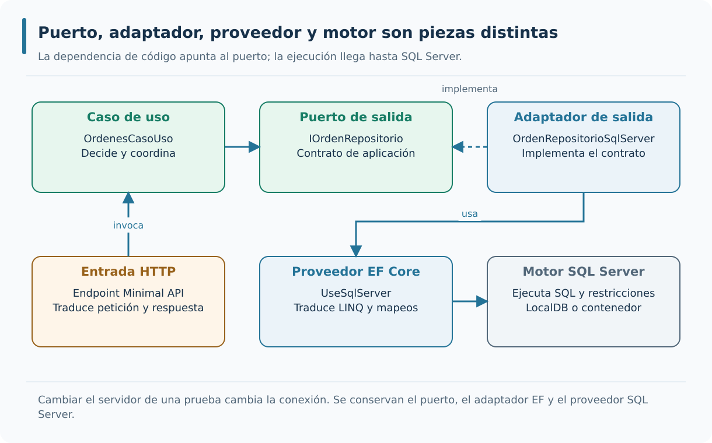

# M03 — Arquitectura hexagonal con ASP.NET Core 8 · Teoría

**Autor del curso: JAIME GALLO**

## Cómo estudiar el módulo

Los cuatro puntos desarrollan la organización por capas, los puertos y adaptadores, la separación en proyectos y la composición de dependencias. Cada punto contiene diez bloques con explicaciones, ejemplos de código y su aplicación a AceriaApp.

El punto de partida es `M02_APIS_REST_ASPNET_CORE/PROYECTO/2.4-documentacion-openapi`: una Minimal API ASP.NET Core 8 con EF Core SQL Server, FluentValidation y OpenAPI. Los ejemplos breves permiten estudiar cada concepto por separado; los apartados aplicados a AceriaApp y las prácticas muestran su incorporación al proyecto del curso. Los catálogos de relaciones arquitectónicas se distinguen de los adaptadores conectados a la API.


---
# Punto 3.1 — Capas de la aplicación

**Módulo 3:** Arquitectura hexagonal

**Objetivos de aprendizaje:**

- Comprender el concepto de capa en una arquitectura de software.
- Diferenciar las capas de dominio, aplicación, infraestructura y presentación.
- Comprender la regla de dependencia entre capas.
- Comprender la relación entre capas y arquitectura hexagonal.
- Añadir al proyecto `AceriaApp` una clase de validación de la regla de dependencia entre capas y un test unitario que verifique la validación.

---

## Comprender las responsabilidades antes de separar proyectos


Partiremos del recorrido de una orden en la API del módulo anterior. Cada frontera aparecerá cuando podamos explicar qué decisión pertenece a su núcleo, qué tarea corresponde al adaptador y qué test demostraría que ambas partes conservan su contrato.

### El concepto de capa

Hablar de capas significa organizar el código según la responsabilidad de cada componente y controlar cómo se relacionan esas responsabilidades. En AceriaApp ya disponemos de una Minimal API que atiende peticiones y utiliza EF Core, pero en ese primer diseño algunas decisiones de negocio conviven con el transporte y la persistencia. Antes de separarlas, conviene comprender qué debe permanecer estable si cambiamos un endpoint, introducimos otra base o reutilizamos el mismo caso de uso desde una tarea interna. Presentación, aplicación, dominio e infraestructura son nombres útiles para describir esas funciones, pero no imponen una estructura física única. Una carpeta denominada `Dominio` no garantiza que sus clases sean independientes de ASP.NET Core: la prueba está en sus referencias, sus tipos y las reglas que realmente contienen.

```text
Capas habituales en una aplicación:

1. Presentación  → interfaz con el usuario o con otros sistemas.
2. Aplicación    → casos de uso y orquestación.
3. Dominio       → entidades y reglas de negocio.
4. Infraestructura → persistencia, mensajería, servicios externos.
```


La representación habitual de cuatro capas es una forma de clasificar responsabilidades: presentación interpreta el exterior, aplicación organiza acciones, dominio mantiene las reglas e infraestructura conecta con tecnologías. No debe confundirse el orden gráfico con una obligación de referencias desde cada capa hacia otra inmediatamente inferior. La frontera real se determina por los contratos y el sentido de sus dependencias.


Separar responsabilidades hace que sea más sencillo localizar una regla y comprender qué efectos tendría cambiarla. Esa organización favorece pruebas específicas del dominio, reutilización cuando está justificada y mantenimiento de piezas con ciclos de cambio distintos. Ninguna de estas ventajas aparece automáticamente por dibujar cuatro rectángulos o crear varias carpetas: se obtiene cuando los componentes realmente preservan sus límites y sus referencias no arrastran detalles externos. En AceriaApp comprobaremos la separación observando qué clases necesitan HTTP, cuáles necesitan SQL y cuáles pueden ejecutarse sin ninguno de ellos.

La organización por capas no es una garantía automática de calidad. Una organización por capas mal aplicada produce capas que se conocen entre sí de forma desordenada, con dependencias cíclicas y con lógica duplicada. La calidad de la organización depende de la disciplina con la que se aplique la regla de dependencia. La regla de dependencia establece que las capas se conocen en una única dirección: las capas exteriores conocen a las interiores, pero las interiores no conocen a las exteriores. La aplicación estricta de la regla es lo que produce los beneficios de la organización por capas.


Una carpeta denominada «Dominio» no demuestra por sí misma que exista una capa de dominio. La capa se define por su responsabilidad y por el sentido de sus dependencias. En AceriaApp podemos colocar clases en cuatro carpetas y, aun así, seguir acoplando las reglas a una solicitud HTTP. La primera comprobación consiste en leer sus tipos públicos: ¿quién conoce `HttpContext`, quién usa `DbContext` y quién puede ejecutarse sin arrancar un servidor? La respuesta distingue una división estética de una frontera arquitectónica.

En M02 el manejador de POST valida datos, decide si la cantidad excede 500, instancia la entidad y persiste con EF Core. Es útil para aprender Minimal APIs, pero junta responsabilidades distintas. En M03 proponemos que el adaptador HTTP traduzca el JSON, que `OrdenesCasoUso` coordine la operación, que `OrdenHexagonal` conserve invariantes y que `OrdenRepositorioSqlServer` ejecute la persistencia. Sigue habiendo un único proceso web; cambia la organización del código, no necesariamente la infraestructura de despliegue.

Se suele dibujar una arquitectura de cuatro rectángulos y asumir que los cuatro son obligatorios. No lo son: una capa tiene sentido cuando expresa un límite cuyo coste de mantenimiento compensa la complejidad. Separar por nombres de clase no mejora la sustitución de tecnología; separar por dependencias y contratos sí permite comprobarla. En una aplicación minúscula un servicio adicional puede ser más costoso que un método bien cohesionado.

El alumno debe localizar en la solución `AceriaApp.Api`, `AceriaApp.Hexagonal.Aplicacion`, `AceriaApp.Hexagonal.Dominio` e `AceriaApp.Hexagonal.Infraestructura`. La evidencia no es solo que existan los nombres, sino que la referencia desde dominio hacia infraestructura sea inexistente y que el proyecto de dominio compile por separado.

### Capa de dominio

El dominio contiene conceptos y reglas que seguirían siendo válidos aunque desapareciera la API HTTP. Una orden de fabricación tiene identidad, cliente, material, cantidad y estados permitidos; no debe aceptar una transición imposible simplemente porque el endpoint no la haya validado. Para lograrlo, la entidad debe mantener las invariantes mediante su propio comportamiento y ofrecer operaciones que expresen el lenguaje del negocio, en lugar de exponer setters indiscriminados. En AceriaApp, `OrdenHexagonal` permitirá representar esa idea con un estado controlado y una transición de finalización. La independencia del dominio se demuestra al ejecutar sus tests sin iniciar Kestrel ni disponer de una cadena SQL. Esta separación reduce la posibilidad de que otro canal de entrada pase por alto las reglas esenciales.

```csharp
namespace AceriaApp.Monolito.Api.Dominio;

public class Orden
{
    public Guid Id { get; private set; }
    public string Cliente { get; private set; } = string.Empty;
    public int Cantidad { get; private set; }

    public Orden(Guid id, string cliente, int cantidad)
    {
        if (string.IsNullOrWhiteSpace(cliente))
        {
            throw new ArgumentException("El cliente es obligatorio.", nameof(cliente));
        }
        if (cantidad <= 0)
        {
            throw new ArgumentException("La cantidad debe ser mayor que cero.", nameof(cantidad));
        }

        Id = id;
        Cliente = cliente;
        Cantidad = cantidad;
    }
}
```


En la entidad de ejemplo destacan el identificador y los cambios controlados por métodos, en vez de un objeto que cualquier consumidor pueda modificar libremente. La validación del constructor permite crear una orden válida desde distintos canales sin copiar esa condición en cada endpoint. El test del dominio debe comprobar tanto el caso satisfactorio como el intento de construir un estado imposible.


Una entidad de dominio debe expresar invariantes de negocio sin depender de una API ni de un proveedor de base de datos. En AceriaApp, el constructor de `OrdenHexagonal` y sus operaciones controladas sirven para impedir estados inválidos desde cualquier canal. Eso permite comprobar la regla con tests rápidos que no necesitan levantar Kestrel ni crear tablas. Esta independencia no exige ausencia absoluta de bibliotecas: exige no introducir dependencias que impongan decisiones de transporte o persistencia sobre el modelo.


El dominio expresa hechos y reglas de la acería, no el protocolo por el que alguien solicita una orden. `OrdenHexagonal` contiene Id, cliente, material, cantidad y estado porque son conceptos de negocio. Cuando su método `Finalizar()` impide repetir la transición, la entidad garantiza una condición independientemente de si la llamada procede de HTTP, de una tarea programada o de una cola. Esto es más fiable que esconder el mismo `if` en cada controlador.

La construcción de una orden exige cliente y material no vacíos y una cantidad positiva. El constructor también asigna el GUID y la fecha UTC, reservando esos datos al servidor. La capacidad máxima de 500 que comprueba el caso de uso es otra decisión: puede variar según contexto de operación, por lo que no todas las restricciones deben concentrarse obligatoriamente en la entidad. Diferenciamos invariantes propios del objeto de políticas de proceso.

El riesgo central es filtrar dependencias externas hacia las clases del núcleo. Si una entidad recibe `DbContext`, implementa métodos `SaveChanges` o devuelve `IResult`, la regla de negocio necesita un servidor o un motor SQL incluso para ser probada. En el dominio tampoco deberían aparecer atributos cuyo único objetivo sea serializar JSON para una respuesta específica; el adaptador se encarga de esa transformación.

Una prueba del dominio puede crear `new OrdenHexagonal("ACX", "CHAPA", 10)`, llamar a `Finalizar()` y comprobar que el siguiente intento provoca `InvalidOperationException`. No requiere `WebApplicationFactory`, puerto HTTP, base de datos ni el contenedor de DI. Ese aislamiento es la señal práctica del valor de la capa.


identifica las referencias de código que admite el diseño y distingue esas relaciones de las llamadas en ejecución. La figura está disponible como SVG vectorial y como PNG para consulta externa.

### Capa de aplicación

La capa de aplicación coordina un caso de uso sin apropiarse de las reglas internas del dominio ni de los detalles técnicos de persistencia. Crear una orden puede requerir construir una entidad válida, solicitar su almacenamiento y devolver un identificador, pero no debería obligar al caso de uso a saber cómo EF Core abre una conexión. Una interfaz como `IOrdenRepositorio` expresa qué necesita la aplicación del exterior, mientras su implementación concreta pertenece a otra capa. Esta decisión facilita pruebas con dobles de repositorio que permitan comprobar el orden de las operaciones y el tratamiento de errores. En AceriaApp, `OrdenesCasoUso` representa esa coordinación: conoce el modelo y la abstracción de persistencia, pero no necesita clases de ASP.NET Core para funcionar.

```csharp
namespace AceriaApp.Monolito.Api.Aplicacion;

public class OrdenServicio
{
    private readonly IOrdenRepositorio _repositorio;

    public OrdenServicio(IOrdenRepositorio repositorio)
    {
        _repositorio = repositorio;
    }

    public async Task<Guid> CrearOrdenAsync(string cliente, int cantidad)
    {
        var orden = new Orden(Guid.NewGuid(), cliente, cantidad);
        await _repositorio.AddAsync(orden);
        return orden.Id;
    }
}
```


El servicio de aplicación recibe un repositorio mediante una abstracción y organiza una operación sobre `Orden`. Esta dependencia hace que el caso de uso pueda probarse con un doble y después ejecutarse con SQL Server sin cambiar su lógica. La tarea de la aplicación es coordinar; el repositorio se encarga de cómo se guardan los cambios.


El caso de uso conoce las operaciones del dominio y necesita colaboradores definidos mediante contratos. Puede coordinar la creación de una orden y su guardado sin utilizar directamente `HexagonalDbContext`. Gracias a esa separación se prueba su coordinación con un repositorio controlado y se reserva la integración SQL para otra batería de tests. La interfaz no debe convertirse en una copia de toda la API de EF Core; tiene que expresar las necesidades reales de la aplicación.


La aplicación coordina una intención del usuario y decide qué operaciones del dominio deben ejecutarse en qué secuencia. `OrdenesCasoUso.CrearAsync` no debería interpretar cabeceras HTTP ni formular consultas SQL; recibe cliente, material y cantidad como valores de negocio. Comprueba la capacidad admitida, construye una `OrdenHexagonal` y solicita guardar a través de `IOrdenRepositorio`. La coordinación es una responsabilidad distinta de la validación intrínseca de la entidad.

Cuando el usuario solicita finalizar, el caso de uso debe buscar la orden por identificador, distinguir ausencia y presencia, invocar `orden.Finalizar()` y pedir al puerto que persista el cambio. Si el repositorio devuelve `null`, el caso de uso no inventa una entidad. El traductor HTTP convertirá ese resultado en 404. Si el dominio lanza un conflicto de transición, el adaptador HTTP puede convertirlo en 409 sin obligar al dominio a mencionar los códigos 404 o 409.

Un caso de uso demasiado amplio termina siendo un nuevo monolito escondido en una sola clase; uno demasiado pequeño y trivial solo reenvía llamadas sin aportar coordinación. El criterio no es su longitud, sino si representa una capacidad coherente y hace explícitos los efectos que necesita. El caso de uso debe ser determinista en sus decisiones para los mismos datos, dejando persistencia e infraestructura detrás de contratos.

La comprobación útil es construir un repositorio falso que registre cuándo se llama a `AgregarAsync` o `GuardarAsync`. Si `CrearAsync` puede ejercitarse sin EF Core y devuelve la entidad esperada, el caso de uso usa correctamente el puerto. Los tests HTTP posteriores aportan una evidencia distinta: que la composición real lo conecta con el servidor.

### Capa de infraestructura

La infraestructura reúne adaptadores que convierten necesidades abstractas de la aplicación en operaciones sobre tecnologías concretas. Un repositorio SQL Server recibe una petición de guardar una orden y la traduce a cambios de EF Core, conexiones y confirmación en la base. Esta capa puede depender de los contratos definidos por la aplicación, pero el núcleo no debería importar tipos de Entity Framework para declarar sus reglas. La dirección de la dependencia es importante: aunque una operación se invoque desde el caso de uso hacia el repositorio, la interfaz que describe esa operación sigue perteneciendo al núcleo. En AceriaApp, `OrdenRepositorioSqlServer` y el `HexagonalDbContext` permitirán observar esa separación de forma efectiva. Cambiar el adaptador no debe obligar a reescribir la entidad de dominio.

```csharp
namespace AceriaApp.Monolito.Api.Infraestructura;

public class OrdenRepositorio : IOrdenRepositorio
{
    private readonly AceriaDbContext _db;

    public OrdenRepositorio(AceriaDbContext db)
    {
        _db = db;
    }

    public async Task AddAsync(Orden orden)
    {
        _db.Ordenes.Add(orden);
        await _db.SaveChangesAsync();
    }
}
```


El repositorio concreto conoce `AceriaDbContext` porque su tarea es traducir operaciones del puerto a EF Core. Lo relevante es que el caso de uso no declara una dependencia a ese contexto y no necesita usar `SaveChangesAsync` para expresar una regla de negocio. Esa separación se verifica leyendo las referencias de proyecto y ejecutando una prueba de integración.


La infraestructura implementa las operaciones que la aplicación solicita a través de los puertos. Conoce EF Core y SQL Server porque su responsabilidad es adaptar esas tecnologías, pero ese conocimiento no debería propagarse al dominio. Sustituir el adaptador puede ser posible sin reescribir el caso de uso siempre que ambos proveedores cumplan el mismo contrato; no debe suponerse que un cambio importante de semántica o transacciones sea completamente gratuito.


La infraestructura es la parte del sistema que sabe cómo se ejecutan efectos concretos. En AceriaApp, `HexagonalDbContext` conoce EF Core, asigna la entidad `OrdenHexagonal` a `OrdenesHexagonales` y configura tipos y restricciones de columnas. `OrdenRepositorioSqlServer` usa las operaciones `AsNoTracking`, `FirstOrDefaultAsync`, `AddAsync` y `SaveChangesAsync`. Nada de eso debería ser una obligación de la capa de aplicación.

El adaptador realiza el contrato definido por la aplicación. Cuando `IOrdenRepositorio.ListarAsync` devuelve una lista de órdenes, el adaptador EF Core puede ordenar por fecha y materializar el resultado, sin entregar al caso de uso un `IQueryable` que permitiría construir consultas dependientes de EF. Esto impide que los detalles de seguimiento y proveedor invadan la orquestación del negocio.

Un error frecuente es suponer que separar la infraestructura consiste en mover el mismo `DbContext` a otro proyecto y referenciarlo desde todos. Si los casos de uso consumen el contexto directamente, la dependencia sigue orientada al detalle externo. La separación real requiere que la aplicación solo dependa de `IOrdenRepositorio`; la infraestructura debe implementar esa interfaz y referenciar el contrato.

Inspecciona los `.csproj`: el proyecto de infraestructura contiene `Microsoft.EntityFrameworkCore.SqlServer` y referencias a aplicación y dominio. Ni dominio ni aplicación deben declarar el paquete SQL Server. Un test de infraestructura necesita comprobar que el adaptador devuelve y guarda datos, mientras que una prueba de aplicación puede utilizar una implementación simulada.

### Capa de presentación

La presentación es la frontera que entiende cómo llega una petición y cómo se responde por un protocolo determinado. En una API ASP.NET Core le corresponde leer rutas, parámetros y cuerpos JSON, llamar a la aplicación y traducir el resultado a respuestas HTTP. No debería decidir si una orden puede finalizar según reglas del negocio ni gestionar directamente tablas SQL. Esta distinción no obliga a construir controladores extensos: Minimal APIs puede funcionar perfectamente como adaptador de entrada cuando sus handlers son delgados y las dependencias expresan casos de uso. En AceriaApp conservaremos los endpoints existentes de M02 y añadiremos un grupo hexagonal para comparar ambos recorridos sin presentar las rutas antiguas como si ya se hubieran refactorizado.

```csharp
app.MapPost("/api/v1/ordenes", async (
    CrearOrdenRequest request,
    OrdenServicio servicio) =>
{
    var id = await servicio.CrearOrdenAsync(request.Cliente, request.Cantidad);
    return Results.Created($"/api/v1/ordenes/{id}", new { id });
});
```


El endpoint recibe una petición HTTP y la convierte en una llamada al caso de uso. El método conserva responsabilidades de transporte y respuesta, sin reimplementar la política de construcción de la orden. Si el manejador vuelve a decidir todas las reglas de fabricación, el cambio de carpeta no habrá conseguido una frontera real.


La presentación convierte HTTP en operaciones de aplicación y transforma sus resultados en respuestas apropiadas. Mantener los handlers sin reglas de negocio permite exponer un mismo caso de uso desde otro protocolo sin copiar esas reglas. La adaptación de gRPC o de mensajería requeriría componentes nuevos, pero el núcleo puede permanecer estable si sus puertos fueron definidos sin tipos HTTP.


La presentación no es necesariamente una interfaz visual: una Minimal API también es una capa de entrada. Sus rutas traducen HTTP en llamadas al sistema y resultados del sistema en respuestas HTTP. En M03 el grupo `/api/v1/hexagonal/ordenes` recibe `CrearOrdenHexagonalRequest`, invoca `OrdenesCasoUso.CrearAsync` y produce `CreatedAtRoute`, sin conocer la conexión a SQL Server ni una entidad `DbContext`.

La separación exige modelos de contrato externos. Un cliente envía `cliente`, `material` y `cantidad`; el adaptador convierte esos datos a argumentos del caso de uso. El DTO de salida incorpora Id, estado y fecha. Estos modelos se diseñan para la API, no deben añadirse como propiedades serializadas forzosamente a la entidad de dominio. El adaptador puede cambiar el formato HTTP sin reescribir la política de finalización.

No es correcto asumir que toda validación pertenece a la presentación. La presentación controla forma y requisitos del contrato recibido; el dominio protege invariantes; la aplicación aplica políticas de proceso como la capacidad de 500. Si una solicitud contiene cantidad 501, HTTP traduce una restricción de negocio en 422. Ese número HTTP es responsabilidad de entrada, no de la entidad.

En una prueba con `WebApplicationFactory`, envía POST al endpoint hexagonal y sigue la cabecera `Location` con GET. La creación 201 no es evidencia suficiente de persistencia. Comprueba después el valor del DTO, el código 200 y que la ruta invoca el caso de uso, no EF Core directamente.

### Regla de dependencia

La regla de dependencia orienta las referencias del código hacia las piezas más estables del sistema. El dominio no conoce presentación, infraestructura ni el contenedor de ASP.NET Core. La aplicación conoce el dominio y define las abstracciones que necesita; la infraestructura implementa esas abstracciones desde fuera. En una solución .NET esta relación puede comprobarse leyendo los `ProjectReference` de cada `.csproj`, porque una referencia invertida permite dependencias que acabarán introduciendo detalles externos en las reglas. La dirección de las llamadas en tiempo de ejecución no tiene por qué coincidir con la dirección de las referencias de compilación: la aplicación invoca una interfaz, pero es la infraestructura la que conoce esa interfaz para implementarla. Este matiz es fundamental para entender la arquitectura hexagonal.

```text
Dirección de las dependencias:

Presentación → Aplicación → Dominio
Infraestructura → Aplicación → Dominio
Infraestructura → Dominio

Dominio no depende de nadie.
```


El diagrama muestra cómo las referencias deben apuntar hacia abstracciones del núcleo aunque los datos se muevan durante la ejecución entre presentación, aplicación y almacenamiento. Una referencia circular entre proyectos impide razonar con claridad sobre la autonomía de cada componente.


La regla de dependencia busca mantener las referencias de compilación dirigidas hacia el núcleo. Al cumplirla, el dominio no necesita conocer ASP.NET Core ni EF Core y disminuye el riesgo de ciclos entre proyectos. Es posible escribir código que viole esta regla, así que las dependencias cíclicas no son «imposibles» por definición: deben prevenirse con referencias adecuadas, revisión y pruebas automatizadas. El beneficio es hacer visible una restricción arquitectónica que el compilador puede ayudar a verificar.


La regla de dependencia habla de referencias de código: las políticas internas no deben importar detalles externos. Un proyecto independiente de dominio que compilase solo cuando se instala `Microsoft.AspNetCore.Http` violaría esa independencia, aunque no iniciara un servidor. La herramienta decisiva en .NET es la dirección de `ProjectReference` y también los `using` que se permiten en cada biblioteca.

En la solución vigente, Aplicación referencia Dominio; Infraestructura referencia Aplicación y Dominio; API referencia Aplicación e Infraestructura para componer el sistema. La referencia de API hacia Infraestructura es admisible en el extremo de composición. Lo prohibido es que el dominio conozca `AceriaApp.Api` o que `OrdenesCasoUso` requiera una clase concreta `OrdenRepositorioSqlServer`.

Esta regla no debe confundirse con el orden de las llamadas en tiempo de ejecución. El caso de uso invoca al repositorio, que vive físicamente en infraestructura; eso no obliga a compilar Aplicación contra Infraestructura. Se produce precisamente porque la interfaz del puerto está definida dentro de Aplicación y el adaptador implementa el contrato. El sentido de la llamada y el sentido de la importación no tienen por qué coincidir.

El control es automático: examina el `.csproj` de dominio y exige cero `ProjectReference`; examina el de aplicación y exige referencia exclusiva a dominio. Un cambio posterior que incorpore infraestructura dentro de Aplicación debe hacer fallar el control arquitectónico, aunque el resto de los tests HTTP continúe pasando.


identifica las referencias de código que admite el diseño y distingue esas relaciones de las llamadas en ejecución. La figura está disponible como SVG vectorial y como PNG para consulta externa.

### Inversión de dependencias

La inversión de dependencias permite que una política de negocio utilice una capacidad técnica sin conocer su implementación. La aplicación declara que necesita recuperar y guardar órdenes mediante un puerto; el adaptador de SQL Server implementa ese puerto y el host decide qué instancia proporcionar al arrancar. El mecanismo suele apoyarse en inyección de dependencias, pero el principio arquitectónico es anterior al contenedor: el núcleo posee la abstracción y el detalle tecnológico depende de ella. Esta separación permite escribir un test del caso de uso con una implementación controlada del repositorio, mientras otro test comprueba las operaciones SQL reales. La primera prueba protege la coordinación y la segunda la persistencia; ambas son necesarias si queremos afirmar que AceriaApp funciona de principio a fin.

```csharp
// Definido en la capa de aplicación
public interface IOrdenRepositorio
{
    Task AddAsync(Orden orden);
}

// Implementado en la capa de infraestructura
public class OrdenRepositorio : IOrdenRepositorio
{
    public async Task AddAsync(Orden orden)
    {
        // implementación
    }
}
```


La interfaz de repositorio pertenece al núcleo mientras su implementación pertenece a infraestructura. La inyección de dependencias decide qué implementación utilizar, pero no cambia quién es propietario del contrato. Esa relación hace posible sustituir el almacenamiento en una prueba sin incorporar EF Core al modelo.


Cuando la aplicación depende de una interfaz definida cerca del núcleo, la infraestructura puede proporcionar una implementación sin obligar a cambiar el caso de uso. Así se utiliza un doble durante las pruebas o un repositorio SQL Server en ejecución. La sustitución exige respetar el mismo contrato y sus garantías; no basta con que dos clases implementen la interfaz para demostrar equivalencia funcional.


El principio de inversión de dependencias no significa que se invoque infraestructura desde el dominio mediante magia. Significa que ambos lados relevantes dependen de una abstracción situada donde conviene a la política del sistema. `IOrdenRepositorio` describe operaciones que la aplicación necesita, como listar, obtener, agregar y guardar, y no menciona el nombre de EF Core, SQL Server ni la forma de establecer una conexión.

El caso de uso declara un parámetro de constructor de tipo `IOrdenRepositorio`. En el borde de arranque de ASP.NET Core se registra `services.AddScoped<IOrdenRepositorio, OrdenRepositorioSqlServer>()`. El contenedor crea el adaptador concreto y lo entrega donde se solicitó la interfaz. El caso de uso no usa `new OrdenRepositorioSqlServer`, de modo que se prueba sin SQL Server y el proveedor podría cambiar si otro adaptador respetase el contrato.

No debemos crear interfaces para cada clase sin una razón. Una interfaz puramente decorativa que reproduce cien métodos de EF Core no desacopla nada útil. Un buen puerto define las capacidades que usa el negocio, devuelve tipos del dominio y evita exponer tipos del proveedor. Cambiar un repositorio por otro no debería obligar a modificar los métodos de caso de uso.

La evidencia combina dos verificaciones: inspección de dependencias (`AceriaApp.Hexagonal.Aplicacion.csproj` no referencia infraestructura) y prueba funcional (el endpoint POST resuelve el puerto por DI y consigue guardar la entidad). Una sin la otra deja un riesgo sin probar.


identifica las referencias de código que admite el diseño y distingue esas relaciones de las llamadas en ejecución. La figura está disponible como SVG vectorial y como PNG para consulta externa.

### Capas y arquitectura hexagonal

La arquitectura hexagonal reorganiza esas responsabilidades alrededor de un núcleo y de sus fronteras, no alrededor de una pila de tecnologías. Un adaptador HTTP y un adaptador de consola podrían llamar al mismo caso de uso; un repositorio EF Core y una implementación de prueba podrían responder al mismo puerto de salida. Esto no significa que todas las aplicaciones requieran seis proyectos o que cualquier interfaz merezca un nombre de puerto. El valor aparece cuando una responsabilidad puede probarse y modificarse sin arrastrar dependencias innecesarias. En AceriaApp mantendremos el proceso web como unidad desplegable durante M03; lo que cambia es la organización de sus componentes y la posibilidad de incorporar otro canal o proveedor sin alterar las reglas de órdenes.

```text
Arquitectura hexagonal:

         [Adaptador HTTP]     [Adaptador CLI]
                |                    |
                v                    v
        [Puerto de entrada]  [Puerto de entrada]
                    \          /
                     v        v
                  [Núcleo]
                (Dominio + Aplicación)
                     |        |
                     v        v
        [Puerto de salida]  [Puerto de salida]
                |                    |
                v                    v
      [Adaptador BD]        [Adaptador mensajería]
```


El hexágono representa un núcleo al que pueden llegar distintos adaptadores de entrada y del que pueden salir dependencias hacia diversos proveedores. El propósito no es multiplicar entradas artificiales, sino conservar la misma regla de órdenes cuando cambia el mecanismo que la invoca o la persiste.


El núcleo hexagonal puede recibir operaciones desde distintos adaptadores de entrada y utilizar implementaciones diferentes para sus puertos de salida. Esa flexibilidad resulta valiosa cuando cambia un protocolo o un proveedor, pero no obliga a crear todas las variantes imaginables desde el principio. La arquitectura se justifica porque permite aislar y probar las reglas del negocio con menos dependencias, y porque las implementaciones tecnológicas permanecen localizadas.


Los diagramas de capas organizan responsabilidades en niveles; la arquitectura hexagonal pone el énfasis en los límites de interacción y en la sustituibilidad de adaptadores. Son modelos complementarios: en nuestro diseño, Dominio y Aplicación constituyen el núcleo, mientras HTTP y SQL Server viven fuera como adaptadores. No existe obligación de dibujar físicamente un hexágono en cada clase.

Observa el recorrido de creación: un cliente HTTP entrega JSON, el adaptador lo interpreta, el caso de uso aplica la capacidad, la entidad verifica su invariantes y el puerto solicita guardar; por último, la implementación EF Core persiste. El diagrama muestra dos interfaces distintas de interacción y una entidad central; el código demuestra el aislamiento cuando las referencias hacia el núcleo no incluyen librerías de entrada o salida.

Una arquitectura puede ser de capas y continuar acoplada al servidor de datos; también puede usar puertos sin organizar bien responsabilidades de dominio. Por eso los nombres de carpeta no bastan y los proyectos de M03 incluyen tanto modelos ilustrativos de capas como un puerto real usado por una ruta. No deben confundirse las clases que catalogan reglas con la implementación de los casos de uso.

Representa en un diagrama las dependencias de compilación y, separadamente, el flujo de una petición HTTP. Identifica qué flechas cambian de sentido entre ambas vistas. Si ambos diagramas se parecen demasiado, comprueba que no has dibujado llamadas en lugar de referencias.

### Cuándo aplicar la organización por capas

Separar capas tiene un coste: aparecen interfaces, proyectos, registros de dependencias y decisiones sobre qué datos cruzan cada frontera. En un prototipo diminuto puede ser suficiente un solo proyecto con funciones claras; la separación física resulta más útil cuando el dominio incorpora reglas duraderas o existen varias infraestructuras posibles. Conviene no confundir la calidad arquitectónica con el número de carpetas. Para AceriaApp la necesidad es pedagógica y técnica: queremos demostrar que una regla de producción puede probarse sin HTTP ni SQL, y que una API real sigue funcionando mediante adaptadores. Si crear una abstracción no mejora ninguna de esas propiedades, probablemente se está añadiendo complejidad accidental. La decisión debe revisarse conforme evolucionen los casos de uso.

```text
Aplicación de la organización por capas:

Sistema pequeño     → capas mínimas o sin capas.
Sistema mediano      → capas de dominio, aplicación e infraestructura.
Sistema grande       → capas completas con presentación separada.
Sistema con múltiples protocolos → arquitectura hexagonal.
```


La comparación entre sistemas pequeños, medianos y complejos ayuda a decidir cuánto aislamiento merece cada responsabilidad. No existe un número de capas obligatorio ni una proporción universal de proyectos y tests. El criterio es si una frontera permite localizar cambios y detectar errores con menor esfuerzo.


La organización por capas no es una decisión binaria: es un espectro. Un sistema puede empezar con una sola capa y evolucionar hacia varias a medida que crece. La evolución se realiza extrayendo responsabilidades a medida que se identifican. El curso aplica este enfoque: el monolito de los módulos 1 y 2 tiene una organización mínima y en el módulo 3 se refactoriza hacia una organización por capas completa con arquitectura hexagonal.


Aplicar cuatro capas introduce costes: nuevos proyectos, tipos de contrato, registros en DI y pruebas de integración. Ese coste se justifica cuando cambian con frecuencia interfaces externas, proveedores de persistencia o reglas del negocio y necesitamos controlar el impacto. En AceriaApp la separación permite explicar de forma observable cómo un servicio HTTP evoluciona sin mezclar cada regla con EF Core.

Antes de extraer una capa pregunta qué variación estamos protegiendo. ¿Podría cambiar la forma de exponer órdenes sin cambiar la política de finalización? ¿Podría utilizarse otro almacén sin rehacer el caso de uso? ¿Es necesario probar una transición de estado sin levantar el host? Si la respuesta es afirmativa, el límite aporta valor. Si nunca hay variación ni equipo responsable, quizá baste una organización modular más sencilla.

Las capas no reducen por sí mismas la latencia, no convierten una API en distribuida y no sustituyen la observabilidad. Si el repositorio realiza consultas ineficientes seguirá siendo lento; si el caso de uso no gestiona errores, seguirá fallando. El beneficio de la separación es la claridad de responsabilidad y el coste acotado de cambiar un detalle, no una garantía de escalabilidad automática.

Como ejercicio de decisión, compara la versión M02, donde `Program.cs` orquesta mucha lógica, con M03, donde `OrdenesCasoUso` coordina y el endpoint traduce. Anota qué archivo tocarías ante un cambio en formato JSON, un nuevo estado de negocio y un nuevo proveedor SQL.

### Aplicación al proyecto del curso

El punto 3.1 establece el lenguaje con el que leeremos el código de M03, pero todavía no equivale a disponer de una aplicación hexagonal completa. Partimos de la etapa 2.4, que conserva las operaciones REST, validación y OpenAPI. Primero identificaremos qué responsabilidades tienen sus clases y después introduciremos el diseño que permite separarlas. En la secuencia del curso, las interfaces, los proyectos físicos y los endpoints hexagonales llegarán de manera progresiva; no eliminaremos el comportamiento anterior para simular una migración ya terminada. Al finalizar, el alumno debe poder señalar qué parte de la solución representa una regla de negocio, cuál coordina una operación, cuál traduce HTTP y cuál utiliza SQL Server. Esa explicación preparará pruebas verificables, no solo un dibujo de capas.

```text
Aplicación al proyecto del curso:

Dominio           → entidades y reglas de negocio.
Aplicación        → casos de uso e interfaces de repositorio.
Infraestructura   → implementaciones de repositorio y EF Core.
Presentación      → endpoints de Minimal API.
Regla             → dependencias hacia el interior.
Inversión         → interfaces en aplicación, implementación en infraestructura.
```


El mapa final relaciona los tipos de componente con sus responsabilidades en AceriaApp. Más adelante deberán existir referencias concretas, registros de DI y pruebas que demuestren esa relación; un catálogo de capas, por sí solo, solo sirve para describir la decisión que se desea implementar.


La aplicación de la organización por capas prepara el proyecto para los puntos 3.2, 3.3 y 3.4. El punto 3.2 estudiará los puertos y adaptadores con detalle. El punto 3.3 estudiará la separación entre dominio, aplicación e infraestructura. El punto 3.4 estudiará la implementación en ASP.NET Core. El punto 3.1 establece los conceptos que se aplicarán en los tres puntos siguientes.

---

### Lo esencial para continuar

- Una capa es una unidad de organización del código con una responsabilidad común.
- Las capas habituales son presentación, aplicación, dominio e infraestructura.
- El dominio contiene entidades y reglas de negocio y no depende de ninguna otra capa.
- La aplicación contiene casos de uso y depende del dominio.
- La infraestructura implementa las interfaces definidas por la aplicación.
- La presentación traduce entre el protocolo y los casos de uso.
- La regla de dependencia establece que las dependencias se dirigen hacia el interior.
- La inversión de dependencias permite que la aplicación dependa de interfaces y la infraestructura las implemente.
- La arquitectura hexagonal sustituye las capas apiladas por un núcleo central rodeado de puertos y adaptadores.


M03 comienza sobre la etapa 2.4 de M02. Ese punto de partida conserva GET, POST, PUT, PATCH, DELETE, FluentValidation, OpenAPI y los tests del módulo anterior. La operación de enseñanza es aditiva: antes de introducir una frontera se demuestra que la API funciona, y después se conserva su comportamiento mientras se desarrolla el diseño hexagonal.

La primera etapa M03 no reemplaza los endpoints existentes. Añade un catálogo de capas y reglas de referencia, que ayuda a comprender por qué no deben existir dependencias circulares. En la etapa 3.3 se crean de verdad los proyectos de Dominio, Aplicación e Infraestructura; la etapa 3.4 agrega un grupo nuevo de rutas HTTP hexagonales para no destruir las rutas M02 que ya eran parte del contrato del curso.

Esta convivencia permite una migración por incorporación: la API antigua sigue sirviendo sus rutas mientras una nueva capacidad demuestra el patrón arquitectónico. No afirmamos que las rutas antiguas sean hexagonales simplemente por coexistir en la solución. La distinción es útil para una modernización progresiva de aplicaciones existentes, donde reescribir todo en un solo cambio aumentaría el riesgo.

Verifica al final que los tests heredados de M02 continúan en verde y que los nuevos comprueban el diseño M03. El progreso del curso se mide por evidencia acumulada y no por sustituir artificialmente el proyecto anterior.


## Estudio integrador 3.1 — De una Minimal API compacta a responsabilidades explícitas

### Escenario de partida

Imaginemos una orden de producción de 15 unidades de chapa para un cliente ACX. El cliente POST de M02 contiene `cliente`, `material` y `cantidad` y el servidor recibe ese JSON por una ruta estable. Al leer la implementación M02, un alumno encuentra juntas la validación provisional del contrato, la creación de la entidad, una consulta del contexto, la persistencia y la construcción de la respuesta HTTP. Ninguna de esas operaciones es por sí misma incorrecta. El problema es que evolucionan por motivos diferentes: el contrato REST podría incorporar una nueva versión, la política de capacidad puede variar por taller y SQL Server puede migrar a otro proveedor.

Separaremos el proceso en cuatro decisiones y examinaremos dónde deberían vivir. **Primera decisión:** el JSON debe contener Cliente y Material y una cantidad positiva; la presentación es quien interpreta el contrato entrante. **Segunda decisión:** el objeto del dominio no debe permitir un estado inválido; la entidad se responsabiliza de sus invariantes y ofrece transiciones como `Finalizar()`. **Tercera decisión:** crear una orden implica coordinar una regla de capacidad y solicitar persistencia; la aplicación representa esa intención mediante un caso de uso. **Cuarta decisión:** para almacenar una entidad hay que interactuar con EF Core, configurar tabla y conexión y confirmar los cambios; infraestructura implementa ese detalle detrás de un contrato.

### Dos cambios que permiten comprobar la frontera

Supongamos que el equipo cambia el nombre externo del campo `cliente` por `razonSocial`, pero el dominio sigue almacenando el mismo concepto. Si la frontera HTTP está bien diseñada, deberíamos cambiar el contrato de entrada y su mapeo, no toda la entidad ni las consultas del repositorio. Supongamos ahora que el negocio prohíbe finalizar una orden dos veces. Esa regla debe aplicarse tanto en HTTP como en un posible consumidor de mensajes; colocarla exclusivamente dentro de `MapPost` haría divergir las entradas. La operación `OrdenHexagonal.Finalizar()` ofrece un lugar estable para la regla.

A continuación supongamos un cambio de persistencia. Los casos de uso necesitan las mismas operaciones, pero la implementación de `IOrdenRepositorio` puede variar. La capa de aplicación no debería importar `Microsoft.EntityFrameworkCore`; si lo hace, el cambio de proveedor exige modificarla. Ese hecho se comprueba inspeccionando los archivos `.csproj`, no leyendo un dibujo.

### Condiciones que el alumno debe poder explicar

- Una clase del dominio puede construirse y probarse sin levantar ASP.NET Core.
- Un caso de uso puede simular su repositorio sin tener SQL Server instalado.
- La API traduce estados de negocio a códigos HTTP sin declarar ese protocolo dentro de la entidad.
- Infraestructura puede conocer el puerto y la entidad; dominio y aplicación no conocen la clase concreta `OrdenRepositorioSqlServer`.
- La aplicación puede continuar desplegándose como un único proceso; las capas no son microservicios independientes por el mero hecho de existir.

Esta clasificación guiará 3.2 y 3.3: primero definiremos puertos como contratos, después los haremos observables en los proyectos .NET y finalmente conectaremos el adaptador HTTP. El criterio de cierre del estudio no es repetir nombres de capas, sino justificar a qué archivo iría cada cambio y qué tests detectarían una asignación incorrecta.

### De la arquitectura conceptual a la solución existente

El punto 3.1 permite reconocer qué responsabilidades deberían pertenecer a dominio, aplicación, infraestructura y presentación. La API de órdenes heredada de M02 continúa funcionando durante este análisis: sus rutas, validaciones y contratos no cambian por dibujar un nuevo esquema. Los primeros modelos de capas ayudan a razonar sobre dependencias, pero todavía no convierten esos endpoints en hexagonales. La evidencia de una separación real llegará cuando el código incorpore bibliotecas, puertos y adaptadores que puedan ejecutarse y probarse con la dirección de dependencia prevista.


---

# Punto 3.2 — Puertos y adaptadores

**Módulo 3:** Arquitectura hexagonal

**Objetivos de aprendizaje:**

- Comprender el concepto de puerto en arquitectura hexagonal.
- Comprender el concepto de adaptador y su relación con los puertos.
- Diferenciar entre puertos de entrada y puertos de salida.
- Comprender la relación entre puertos, adaptadores e inversión de dependencias.
- Añadir al proyecto `AceriaApp` una clase de validación de puertos y adaptadores y un test unitario que verifique la validación.

---

## Puertos como contratos, adaptadores como decisiones externas


Para comprender una operación hexagonal seguiremos qué necesita la aplicación, qué ofrece hacia fuera y dónde quedan las decisiones sobre HTTP o SQL. Esa dirección es más reveladora que el número de interfaces presentes en la solución.

### El puerto como frontera del núcleo

Una arquitectura hexagonal necesita expresar qué operaciones ofrece su núcleo y qué capacidades necesita obtener de tecnologías externas. Los puertos describen esos contratos en términos comprensibles para la aplicación, antes de decidir quién los implementará. Por ejemplo, un caso de uso de AceriaApp puede necesitar guardar una orden y recuperarla por identificador, pero ese contrato no debería exigir EF Core ni una conexión SQL. Al situar la abstracción cerca de la lógica que la necesita, podemos comprender y probar el comportamiento sin arrancar toda la infraestructura. La dificultad no está en escribir una interfaz C#, sino en escoger sus métodos y tipos para que reflejen necesidades estables del dominio. Si el puerto publica tablas, transacciones o estructuras específicas de un proveedor, la tecnología ya habrá invadido la frontera que pretendíamos preservar.

```text
Puertos del núcleo:

Puertos de entrada (lo que el núcleo ofrece):
- IOrdenServicio
- IInventarioServicio

Puertos de salida (lo que el núcleo necesita):
- IOrdenRepositorio
- IInventarioRepositorio
- IPublicadorEventos
```


En el esquema los puertos de entrada describen acciones que un actor puede pedir al núcleo y los de salida describen dependencias que este necesita utilizar. La clasificación es útil para discutir responsabilidades, pero solo se materializa cuando las interfaces tienen operaciones significativas y el código respeta su dirección de dependencia.


El puerto es una frontera del núcleo. Su definición establece qué operaciones se ofrecen y qué operaciones se requieren. La frontera no depende del protocolo ni de la tecnología: un mismo puerto de entrada puede ser invocado desde HTTP, desde gRPC o desde una cola de mensajes. Un mismo puerto de salida puede ser implementado por un repositorio de base de datos, por un cliente HTTP o por un repositorio en memoria. La independencia entre puerto y tecnología es la que permite que el núcleo sea estable a lo largo del tiempo.

La definición de puertos se realiza en las capas interiores. Los puertos de entrada se definen en la capa de aplicación, que es la que expone los casos de uso. Los puertos de salida también se definen en la capa de aplicación, porque son las operaciones que los casos de uso necesitan del exterior. El dominio no define puertos: el dominio solo contiene entidades, value objects y reglas de negocio. La separación entre dominio y puertos es la que garantiza que el dominio sea independiente de cualquier contrato de comunicación.


Un puerto expresa una capacidad que el núcleo necesita ofrecer o consumir. Su principal propiedad es la estabilidad semántica: los nombres y tipos describen el lenguaje de operaciones de órdenes, no la tecnología del consumidor. En nuestro ejemplo `IOrdenRepositorio` es un puerto de salida porque los casos de uso necesitan recuperar y guardar órdenes sin decidir el proveedor de almacenamiento.

Definir el puerto desde la aplicación permite preguntar qué operaciones usa realmente el caso de uso: `ListarAsync`, `ObtenerAsync`, `AgregarAsync`, `GuardarAsync`. No añadimos consultas SQL arbitrarias ni `IQueryable`, porque eso trasladaría el modelo de consulta del adaptador a la aplicación. Los tipos de entrada y salida son `OrdenHexagonal`, `Guid` y `CancellationToken`, todos utilizables sin EF Core.

Un puerto no es necesariamente una interfaz de C#: puede representarse con mensajes, contratos o funciones. En este curso utilizamos interfaces porque .NET y su contenedor de DI facilitan comprobar implementaciones. El puerto tampoco garantiza automáticamente un buen dominio; podría ser técnicamente estable y, sin embargo, exponer una operación que no tiene sentido para una orden.

Identifica las operaciones que el caso de uso invoca. Si suprimes un método no utilizado y el caso de uso no cambia, probablemente el contrato tenía más superficie de la necesaria. Si debes introducir `DbSet<OrdenHexagonal>` en la interfaz, la abstracción dejó de ser tecnológica-neutral.


identifica las referencias de código que admite el diseño y distingue esas relaciones de las llamadas en ejecución. La figura está disponible como SVG vectorial y como PNG para consulta externa.

### El adaptador como implementación del puerto

El adaptador traduce las operaciones de un puerto al lenguaje de una tecnología o de un protocolo concreto. `OrdenRepositorioSqlServer`, por ejemplo, puede implementar `IOrdenRepositorio` utilizando `HexagonalDbContext`, mientras el caso de uso permanece ajeno a EF Core. La implementación decide cómo consultar, guardar y confirmar datos, y debe respetar las garantías que anuncia el contrato. El mismo principio se aplica a una entrada HTTP: un handler transforma una petición en una llamada a aplicación y convierte su resultado en una respuesta. En AceriaApp distinguiremos ambas direcciones, porque aunque los adaptadores compartan el objetivo de conectar sistemas, sus responsabilidades y sus pruebas no son idénticas. Una interfaz solo aporta desacoplamiento si el consumidor puede utilizarla sin conocer la implementación.

```csharp
// Puerto de salida definido en la aplicación
public interface IOrdenRepositorio
{
    Task AddAsync(Orden orden);
}

// Adaptador de salida en la infraestructura
public class OrdenRepositorioSqlServer : IOrdenRepositorio
{
    private readonly AceriaDbContext _db;

    public OrdenRepositorioSqlServer(AceriaDbContext db)
    {
        _db = db;
    }

    public async Task AddAsync(Orden orden)
    {
        _db.Ordenes.Add(orden);
        await _db.SaveChangesAsync();
    }
}
```


La interfaz del repositorio y su implementación EF Core muestran dos piezas distintas. El caso de uso se compila contra la primera, mientras el adaptador contiene las operaciones concretas de SQL Server. Para comprobar el límite hay que revisar sus referencias y no limitarse a reconocer el uso de `interface` y `class`.


El adaptador es la única pieza del sistema que conoce la tecnología concreta. El adaptador de base de datos conoce EF Core. El adaptador HTTP conoce HttpClient. El adaptador de mensajería conoce el broker. El núcleo no conoce ninguna de estas tecnologías. La separación permite que el núcleo se pruebe sin infraestructura y que la infraestructura se sustituya sin modificar el núcleo. La separación también permite que un mismo puerto tenga varios adaptadores según el contexto de ejecución.


Un adaptador implementa o consume un puerto usando un protocolo o tecnología. `OrdenRepositorioSqlServer` es el adaptador de salida real: aplica el contrato y conoce `HexagonalDbContext`, que a su vez conoce EF Core. La implementación no cambia la idea de «obtener una orden», pero sí define cómo traducir esa petición a una consulta y cómo confirmar los cambios con `SaveChangesAsync`.

También existe un adaptador de entrada: `HexagonalOrdenesEndpoints`. Este recibe rutas HTTP, interpreta DTOs y convierte el resultado de los casos de uso en `Results.Ok`, `Results.NotFound`, `Results.CreatedAtRoute` y `Results.Problem`. La capa de aplicación no contiene rutas ni códigos de respuesta; por eso el mismo caso de uso podría servir a un consumidor de consola o a un proceso de integración.

No conviene convertir el adaptador en dueño de las reglas de negocio. Si el repositorio SQL decide que una orden finalizada puede editarse, tendríamos una segunda política escondida en infraestructura; si el endpoint HTTP repite reglas del dominio en cada ruta, las futuras interfaces divergirían. Adaptar formato y protocolo no es equivalente a gobernar el ciclo de vida de la entidad.

El criterio de aceptación consiste en verificar que `OrdenRepositorioSqlServer : IOrdenRepositorio` y que los endpoints usan `OrdenesCasoUso`. El adaptador HTTP no debe inyectar `HexagonalDbContext` para realizar búsquedas; eso haría saltar el puerto.

### Puertos de entrada

Los puertos de entrada representan acciones que la aplicación ofrece al exterior. Crear una orden, obtenerla o finalizar su proceso son capacidades del negocio que podrían invocarse desde HTTP, una consola o una tarea programada. Un puerto de entrada debe describir esas operaciones con tipos y nombres vinculados al caso de uso, no con `HttpContext`, códigos de estado ni objetos de controladores. Así, la decisión sobre si una orden puede finalizar permanece en el núcleo y no se duplica en cada adaptador. En AceriaApp la separación permitirá comparar una ruta Minimal API con una llamada directa al caso de uso desde una prueba. Ambas deben observar las mismas invariantes aunque sus mecanismos de entrada sean distintos.

```csharp
public interface IOrdenServicio
{
    Task<Guid> CrearOrdenAsync(string cliente, string material, int cantidad);
    Task<OrdenDto?> ObtenerOrdenAsync(Guid id);
    Task CancelarOrdenAsync(Guid id);
}
```


El puerto de entrada define las operaciones de órdenes sin parámetros HTTP. El adaptador que lo invoque decidirá cómo obtener los datos y presentar la respuesta; el caso de uso conservará la misma semántica de creación, consulta o finalización.


Los puertos de entrada se caracterizan por tres propiedades. La primera es que describen operaciones en términos del negocio. La segunda es que no dependen del protocolo de comunicación. La tercera es que agrupan los casos de uso de una misma capacidad de negocio. Las tres propiedades permiten que el núcleo se exponga en distintos protocolos sin modificar su código. La definición de puertos de entrada es el primer paso para desacoplar el núcleo del exterior.


Los puertos de entrada permiten invocar capacidades del sistema sin obligarlo a conocer el canal. En una versión más elaborada podríamos declarar `ICrearOrden`, `IConsultarOrdenes` o un mediador de comandos. La decisión debe responder a necesidades de reutilización y prueba; no es correcto afirmar que todo caso de uso requiera obligatoriamente una interfaz adicional.

En M03 mostramos `OrdenesCasoUso` como servicio de aplicación invocado por el adaptador HTTP. Esta clase es una superficie de entrada suficientemente explícita para el alcance del taller: expone `CrearAsync`, `ListarAsync`, `ObtenerAsync` y `FinalizarAsync`. La tecnología HTTP solo aparece en la capa que traduce las peticiones, no en las firmas de esos métodos.

Un error habitual es trasladar `HttpContext`, `IResult` o el objeto de `HttpRequest` a los parámetros del caso de uso. Esto simplifica temporalmente el mapeo en el endpoint, pero bloquea cualquier cliente no HTTP y vuelve frágiles los tests de aplicación. Un contrato de entrada recibe valores de negocio y ofrece resultados interpretables por distintos adaptadores.

Diseña una segunda entrada hipotética desde un proceso de importación CSV: ¿qué datos usaría para llamar a `CrearAsync`? Debería utilizar cliente, material y cantidad, no construir artificialmente una petición HTTP. Esta prueba mental verifica la calidad del límite.

### Puertos de salida

Los puertos de salida expresan dependencias que el núcleo necesita para realizar un trabajo: obtener una orden persistida, confirmar cambios o consultar información ofrecida por otro sistema. La aplicación decide qué operación requiere, pero no cómo se ejecuta sobre SQL Server o un servicio HTTP. Eso no significa que todas las llamadas al exterior necesiten una interfaz independiente; conviene agrupar operaciones que pertenecen a la misma responsabilidad y evitar contratos tan genéricos que filtren detalles tecnológicos. `IOrdenRepositorio` es útil si declara acciones propias del caso de uso de órdenes; una interfaz que solo replica todos los métodos de `DbContext` no habrá ganado autonomía. El puerto debe ser lo bastante pequeño para probarlo y lo bastante expresivo para describir una capacidad completa.

```csharp
public interface IOrdenRepositorio
{
    Task AddAsync(Orden orden);
    Task<Orden?> GetByIdAsync(Guid id);
    Task UpdateAsync(Orden orden);
    Task DeleteAsync(Guid id);
}

public interface IPublicadorEventos
{
    Task PublicarAsync(string tipo, object contenido);
}
```


El contrato de salida describe qué necesita la aplicación para recuperar y guardar órdenes. Si incluyera tipos de EF Core o una conexión SQL, el cambio de proveedor afectaría al núcleo y debilitaría la frontera que la interfaz pretende proteger.


Los puertos de salida se caracterizan por tres propiedades. La primera es que describen operaciones técnicas que el núcleo necesita. La segunda es que no dependen de la tecnología concreta. La tercera es que agrupan las operaciones sobre un mismo recurso externo. Las tres propiedades permiten que el núcleo se pruebe con adaptadores en memoria y que la infraestructura se sustituya sin modificar el núcleo.


Los puertos de salida corresponden a efectos que el núcleo solicita pero que no debe ejecutar directamente. Persistencia, mensajería, correo, reloj del sistema y archivos pueden necesitar puertos cuando sus implementaciones son variables y significativas. En el caso de órdenes, necesitamos almacenar datos, por eso presentamos `IOrdenRepositorio` en la aplicación y un adaptador EF Core externo.

La interfaz debe usar términos del negocio y ser lo bastante pequeña para expresar las necesidades del proceso. `GuardarAsync` significa confirmar el estado de una orden existente, no exponer `SaveChangesAsync` de EF Core como un detalle de transacción arbitrario. El adaptador decidirá si utiliza tracking, `Update` o un patrón de unidad de trabajo, siempre manteniendo el resultado comprometido.

No todas las dependencias necesitan puerto. Si una función pura de cálculo opera exclusivamente sobre tipos de dominio, introducir una interfaz puede añadir ceremonia sin beneficio. La decisión sobre un puerto debe justificarse por el efecto externo, la sustituibilidad y la facilidad de prueba, no por la regla mecánica «una interfaz por clase».

Para comprobar el diseño, sustituye conceptualmente `OrdenRepositorioSqlServer` por un repositorio en memoria que conserva datos por GUID. Si el servicio de aplicación ni siquiera necesita recompilar porque la interfaz permanece idéntica, el límite ha hecho su trabajo.


identifica las referencias de código que admite el diseño y distingue esas relaciones de las llamadas en ejecución. La figura está disponible como SVG vectorial y como PNG para consulta externa.

### Adaptadores de entrada

Un adaptador de entrada conoce el protocolo por el que llega la operación y prepara los datos para el núcleo. En ASP.NET Core esto implica resolver una ruta, interpretar el identificador o JSON de la solicitud, invocar el caso de uso y construir la respuesta HTTP adecuada. Ese trabajo técnico es importante, pero no debería convertir el handler en propietario de reglas de fabricación o persistencia. Si mañana añadimos una consola administrativa, su adaptador podría reutilizar el mismo caso de uso sin copiar las validaciones de estado. En AceriaApp el grupo `HexagonalOrdenesEndpoints` mostrará esta separación: para responder a una petición depende de una capacidad de aplicación, no de `HexagonalDbContext`. La prueba HTTP comprobará la traducción y la prueba de dominio protegerá las reglas.

```csharp
app.MapPost("/api/v1/ordenes", async (
    CrearOrdenRequest request,
    IOrdenServicio servicio) =>
{
    var id = await servicio.CrearOrdenAsync(request.Cliente, request.Material, request.Cantidad);
    return Results.Created($"/api/v1/ordenes/{id}", new { id });
});
```


La ruta de creación recibe una solicitud HTTP y llama a la aplicación. Su responsabilidad es transformar datos y resultados, no duplicar el estado interno del agregado. Una prueba de integración debe comprobar que la operación conserva el comportamiento que garantiza el dominio.


Los adaptadores de entrada se caracterizan por tres propiedades. La primera es que traducen entre el protocolo y los puertos de entrada. La segunda es que no contienen reglas de negocio. La tercera es que pueden coexistir varios adaptadores para el mismo puerto. Las tres propiedades permiten que el mismo caso de uso se exponga en HTTP, gRPC y mensajería sin modificar el núcleo.


El adaptador de entrada ASP.NET Core debe ser estrecho: recibe una petición, identifica una operación y responde. En M03 `MapGroup("/api/v1/hexagonal/ordenes")` agrupa los endpoints de órdenes; `MapGet`, `MapPost` y la ruta `/finalizar` no implementan consultas SQL. Se apoyan en `OrdenesCasoUso`, inyectado automáticamente por DI.

En creación, el request público `CrearOrdenHexagonalRequest` representa el JSON que entiende el consumidor. El adaptador comprueba que no faltan datos y traduce el error de contrato a 400; un exceso de capacidad se traduce a 422. Cuando la aplicación devuelve una nueva entidad, `CreatedAtRoute` genera `Location` para recuperar esa misma orden. La cabecera forma parte del contrato REST y debe mantenerse al migrar la implementación.

En el límite HTTP puede haber decisiones sobre autenticación, negociación de contenido, versión de ruta y serialización. Ninguna de ellas debe obligar a la entidad a conocer el framework. Si se desea exponer un mismo caso de uso por gRPC, crearemos otro adaptador que comprenda el contrato gRPC pero preserve la lógica de aplicación.

La prueba específica debe comprobar 201 y cabecera `Location`, después GET 200. Una prueba que solo afirma que el endpoint aparece en Swagger demuestra documentación, no que la dependencia con la aplicación esté conectada.


identifica las referencias de código que admite el diseño y distingue esas relaciones de las llamadas en ejecución. La figura está disponible como SVG vectorial y como PNG para consulta externa.

### Adaptadores de salida

Un adaptador de salida conoce una tecnología y utiliza sus APIs para cumplir una necesidad declarada por el núcleo. El repositorio SQL Server es el ejemplo que se construirá realmente en M03: mapea entidades del dominio a EF Core y ejecuta operaciones de persistencia. Un publicador de eventos o un cliente HTTP podrían ser otros adaptadores en etapas posteriores, pero no debemos afirmar que existen simplemente porque aparecen como ejemplo en la teoría. La ventaja del puerto aparece cuando el caso de uso conserva su lógica mientras sustituimos la implementación real por un doble en una prueba. El coste de esa flexibilidad es mantener bien definidos los contratos y comprobar que ambas implementaciones cumplen lo que prometen. El adaptador no debe modificar silenciosamente las reglas del agregado.

```csharp
public class PublicadorEventosRabbitMq : IPublicadorEventos
{
    private readonly IConnection _connection;

    public PublicadorEventosRabbitMq(IConnection connection)
    {
        _connection = connection;
    }

    public async Task PublicarAsync(string tipo, object contenido)
    {
        using var canal = _connection.CreateModel();
        var cuerpo = Encoding.UTF8.GetBytes(JsonSerializer.Serialize(contenido));
        canal.BasicPublish(
            exchange: "acería.eventos",
            routingKey: tipo,
            basicProperties: null,
            body: cuerpo);
        await Task.CompletedTask;
    }
}
```


El publicador RabbitMQ mostrado es una posible implementación de un puerto de salida, no una funcionalidad que M03 ya haya desplegado. Su valor conceptual es mostrar que la publicación de un hecho puede definirse sin que el caso de uso conozca el SDK del broker.


Los adaptadores de salida se caracterizan por tres propiedades. La primera es que implementan un puerto de salida. La segunda es que conocen la tecnología concreta. La tercera es que pueden sustituirse sin modificar el núcleo. Las tres propiedades permiten que la infraestructura evolucione con independencia del núcleo y que el núcleo se pruebe con adaptadores en memoria.


El adaptador de salida proporciona una realización concreta del puerto. EF Core convierte los objetos del dominio en operaciones de almacenamiento; los métodos del repositorio traducen los requisitos de la aplicación a consultas y modificaciones. Esa traducción tiene aspectos importantes: lectura sin seguimiento cuando no se modificarán entidades, persistencia explícita cuando cambie el estado y tratamiento correcto de la cancelación.

El contrato `IOrdenRepositorio.ObtenerAsync` devuelve una orden o `null`; la implementación usa `FirstOrDefaultAsync`. Un `null` no significa un error de infraestructura, sino ausencia de un elemento concreto. El caso de uso decide si continuar o detenerse; el adaptador HTTP lo traduce en un código 404. Esta distribución de responsabilidades impide que el repositorio incluya detalles del protocolo externo.

Evita que el puerto exponga `DbContextOptions`, `EntityEntry` o `IQueryable`. Sería una abstracción nominal: las pruebas de aplicación volverían a requerir EF Core y el diseño no podría sustituir el motor SQL sin una revisión en cascada. El repositorio implementa el contrato, no lo define.

Para verificar el adaptador, el test de integración configura `HexagonalDbContext` con `UseSqlServer` y una base aislada obtenida mediante `BaseSqlServer`. El recorrido POST→GET une ruta, caso de uso, puerto, adaptador y motor SQL Server real. El entorno puede obtener el servidor mediante Testcontainers o mediante `ACERIA_TEST_SQLSERVER`; ninguno de esos caminos sustituye el proveedor por uno en memoria.

### Relación entre puertos, adaptadores e inversión de dependencias

La inversión de dependencias determina quién conoce a quién en el código compilado. El caso de uso puede llamar al repositorio, pero su proyecto depende de la interfaz `IOrdenRepositorio`; es `OrdenRepositorioSqlServer` el que implementa y, por tanto, conoce ese contrato. ASP.NET Core enlaza ambas piezas al construir el grafo de objetos mediante DI. Esta dirección permite que aplicación y dominio permanezcan independientes de SQL Server incluso cuando la ejecución normal termina almacenando datos en ese motor. No conviene confundir el sentido de la llamada con la referencia de proyecto: durante la operación se invoca el adaptador, pero en la arquitectura el adaptador depende de la definición del puerto. Las pruebas y los `.csproj` permiten demostrar esta propiedad.

```csharp
builder.Services.AddScoped<IOrdenRepositorio, OrdenRepositorioSqlServer>();
builder.Services.AddScoped<IOrdenServicio, OrdenServicio>();
```


El registro de `IOrdenRepositorio` con una implementación concreta demuestra dónde se elige el adaptador en el host. La inversión de dependencias no consiste en que la interfaz «cree» el repositorio; consiste en que el núcleo no necesita referenciar a su implementación.


Definir interfaces en el núcleo permite utilizar adaptadores reales y dobles de prueba sin modificar el caso de uso. La ventaja depende de que el contrato describa una operación estable, como guardar una orden, y no copie detalles de un framework. La inversión de dependencias favorece pruebas aisladas y cambios de proveedor, aunque las pruebas de integración siguen siendo necesarias para comprobar EF Core y SQL Server.


La inversión de dependencias se ve claramente cuando dibujamos dos diagramas: uno de llamadas y otro de referencias. Durante una petición el caso de uso invoca un método implementado por infraestructura, por lo que parece que «aplicación llama a SQL». Pero en el `.csproj` de aplicación no hay referencia a infraestructura. Esto es posible porque la interfaz del puerto está declarada en aplicación, y el código de infraestructura depende de ese contrato.

El ensamblado `AceriaApp.Hexagonal.Infraestructura` conoce `IOrdenRepositorio` y lo implementa; el proyecto `AceriaApp.Hexagonal.Aplicacion` solo conoce la interfaz y la entidad. El proyecto de arranque `AceriaApp.Api` referencia ambos para establecer el enlace con `AddScoped<IOrdenRepositorio, OrdenRepositorioSqlServer>()`. Esta dependencia del extremo de composición está justificada y no invierte la regla hacia el dominio.

A veces se crea la interfaz dentro de infraestructura «porque allí está la clase concreta» y después se hace que aplicación la referencie. Esto deja el contrato en el lado equivocado: para cambiar detalles externos hay que tocar la capa que debía permanecer estable. La ubicación de la interfaz es por tanto una decisión arquitectónica y no una preferencia de organización de archivos.

Ejecuta la comprobación estructural: dominio sin referencias y aplicación sin infraestructura. A continuación confirma por HTTP que el adaptador EF Core realmente puede obtener y guardar. Solo la combinación de ambas evidencias certifica que no estamos ante una arquitectura dibujada sin uso.

### Puertos primarios y secundarios

La terminología de puertos primarios o secundarios intenta describir desde qué lado se inicia una interacción y qué dependencia necesita resolver el núcleo. Los puertos primarios suelen expresar operaciones que actores externos solicitan a la aplicación; los secundarios representan servicios técnicos o externos que esta utiliza para completar esas operaciones. No siempre conviene convertir esta distinción en una taxonomía rígida: la misma aplicación puede recibir comandos de HTTP, CLI o mensajería, y consumir repositorios o clientes remotos. Lo decisivo es que el contrato permanezca en la frontera adecuada y que su propósito sea claro. En AceriaApp las operaciones de órdenes deberían definirse independientemente de quién las invoca, mientras la recuperación y almacenamiento se expresan mediante un puerto de salida.

```text
Clasificación de puertos:

Puertos primarios (driving):
- IOrdenServicio (el exterior lo invoca).
- IInventarioServicio (el exterior lo invoca).

Puertos secundarios (driven):
- IOrdenRepositorio (el núcleo lo invoca).
- IPublicadorEventos (el núcleo lo invoca).
```


La distinción entre primarios y secundarios refleja qué operación ofrece el núcleo y qué servicio externo necesita. No fija la tecnología de entrada ni obliga a utilizar un controlador por caso de uso. Una misma operación puede ser llamada por HTTP o por otra entrada legítima.


Distinguir puertos primarios y secundarios puede ayudar a explicar quién inicia una operación y qué servicios necesita el núcleo. Las entradas HTTP o de consola invocan capacidades de aplicación, mientras los repositorios y clientes externos resuelven necesidades de salida. Esa clasificación mejora la conversación arquitectónica, pero la ubicación de las interfaces debe responder al diseño de responsabilidades, no a una regla universal de carpetas.


La nomenclatura primario/secundario describe quién inicia la interacción respecto al núcleo, no la importancia comercial del componente. Un puerto primario permite entrar para ejecutar una capacidad; un secundario representa un recurso externo que el núcleo solicita. Un endpoint HTTP es un adaptador de entrada, mientras un repositorio de SQL Server es un adaptador de salida.

Para una petición de creación, el cliente inicia la llamada al adaptador HTTP. Este invoca `CrearAsync`, que solicita almacenamiento mediante el puerto secundario. La dirección de llamadas va del exterior a aplicación y de aplicación al exterior, pero el núcleo no depende de las implementaciones. El puerto define el contrato que deben cumplir los colaboradores.

Un error común es definir como primario cualquier componente con tráfico de red o llamar secundario al que tenga menos código. La clasificación depende de la función de la frontera, no del tamaño ni del protocolo. Una cola de mensajes podría ser entrada si recibe órdenes externas y salida si publica eventos generados por el sistema.

Dibuja dos casos: HTTP POST para recibir una orden y una hipotética publicación `OrdenFinalizada` hacia un bus de eventos. El primero exige adaptador de entrada; el segundo requiere un puerto de salida para publicar, si realmente forma parte del proceso de negocio.

### Cuándo definir un puerto

Una interfaz tiene coste de diseño y mantenimiento, por lo que no deberíamos introducir un puerto por cada llamada de biblioteca. Resulta útil definirlo cuando protege una regla estable frente a una dependencia cambiante, permite ejecutar un caso de uso desde varias entradas o facilita pruebas significativas. Si una clase utilitaria no representa una frontera relevante, envolverla automáticamente en una interfaz puede añadir navegación sin desacoplar nada. Para decidir, estudiamos qué necesita el núcleo, qué alternativas de implementación existen y qué errores queremos poder simular. En AceriaApp el repositorio tiene sentido porque la persistencia es una dependencia real y el modelo de órdenes debe poder probarse sin SQL. Un simple catálogo de puertos hipotéticos no demuestra esa separación hasta que el código los utiliza.

```text
Cuándo definir un puerto:

Base de datos           → puerto de salida.
Cliente HTTP            → puerto de salida.
Publicador de eventos   → puerto de salida.
Servicio de archivos    → puerto de salida.
Reloj del sistema       → puerto de salida.
Clase interna del dominio → no se define puerto.
```


La tabla de posibles puertos ayuda a reconocer fronteras tecnológicas que podrían variar. No todas ellas merecen una interfaz en el proyecto actual: su introducción debe justificarse por necesidades reales de prueba, sustitución o claridad del diseño.


Crear un puerto introduce una interfaz y una nueva frontera que habrá que mantener. Tiene sentido cuando esa frontera protege reglas frente a cambios de tecnología, permite probar una capacidad sin infraestructura o admite varias entradas legítimas. Si no existe una necesidad así, añadir interfaces genéricas por costumbre puede dificultar la lectura. En AceriaApp justificamos el repositorio porque el caso de uso debe persistir órdenes sin depender del proveedor EF Core.


Antes de introducir un puerto hay que saber qué problema resuelve. En el taller, el repositorio de órdenes es un puerto justificado porque persiste datos fuera de la memoria del caso de uso y queremos probar la coordinación sin levantar SQL Server. Una interfaz adicional para un cálculo trivial y puro no aporta el mismo valor. La calidad se aprecia por los cambios que deja de propagar.

Imagina que el equipo cambia SQL Server por PostgreSQL. Si las firmas de `IOrdenRepositorio` no contienen expresiones SQL específicas, el caso de uso puede conservar su código y solo cambiar el adaptador, su configuración y sus pruebas. En cambio, si el puerto devuelve `DbSet` o exige operaciones de `SaveChanges`, el cambio de proveedor afectará a los consumidores.

Un puerto tampoco debe ser un contrato genérico de base de datos que permita cualquier consulta. Esa flexibilidad aparente obliga a los casos de uso a conocer detalles de persistencia. Es preferible agrupar operaciones relacionadas con las necesidades de órdenes y mantener invariantes del dominio dentro del propio dominio.

Para cada interfaz propuesta escribe: quién la utiliza, qué tecnología oculta, qué caso de uso la necesita, qué operación no debería exponer y cómo la simularías en un test. Si no hay una respuesta concreta, considera posponer su creación.

### Aplicación al proyecto del curso

La etapa 3.2 permite pasar del vocabulario arquitectónico a contratos concretos. Identificaremos operaciones ofrecidas por los casos de uso y necesidades de persistencia, dibujaremos qué adaptadores interactuarán con cada puerto y comprobaremos con tests las relaciones que declaramos. Sin embargo, en esta etapa las clases de catálogo son todavía un apoyo didáctico; la separación en proyectos y la conexión del repositorio real se incorporarán en 3.3 y 3.4. Esta progresión mantiene el funcionamiento de la API REST anterior y permite comparar su enfoque directo con una ruta hexagonal adicional, sin afirmar que todos sus endpoints ya han sido refactorizados. Al terminar, la pregunta importante será qué contrato conoce el núcleo y qué tecnología permanece fuera.

```text
Aplicación al proyecto del curso:

Puertos de entrada   → IOrdenServicio, IInventarioServicio.
Puertos de salida    → IOrdenRepositorio, IInventarioRepositorio, IPublicadorEventos.
Adaptadores entrada  → endpoints de Minimal API.
Adaptadores salida   → repositorios SQL Server, publicador de eventos.
Inversión            → registro en el contenedor de dependencias.
```


El mapa final reúne los puertos y adaptadores que la solución pretende conectar. El objetivo de aprendizaje no es enumerarlos, sino explicar qué clase posee cada contrato, qué proyecto conoce a quién y qué prueba detectaría una dependencia invertida.


La aplicación de los puertos y adaptadores prepara el proyecto para los puntos 3.3 y 3.4. El punto 3.3 estudiará la separación entre dominio, aplicación e infraestructura con detalle. El punto 3.4 estudiará la implementación de la arquitectura hexagonal en ASP.NET Core. El punto 3.2 establece los conceptos que se aplicarán en los dos puntos siguientes.

---

### Qué hemos separado en el diseño

- Un puerto es una interfaz que define cómo el núcleo se comunica con el exterior.
- Un adaptador es una clase que implementa un puerto y conecta el núcleo con una tecnología concreta.
- Los puertos de entrada definen lo que el núcleo ofrece al exterior.
- Los puertos de salida definen lo que el núcleo necesita del exterior.
- Los adaptadores de entrada traducen entre el protocolo y los puertos de entrada.
- Los adaptadores de salida traducen entre los puertos de salida y la tecnología concreta.
- La inversión de dependencias permite que el núcleo dependa de los puertos y que los adaptadores los implementen.
- Los puertos se definen en el núcleo y los adaptadores en el exterior.


Al final de 3.2, el alumno habrá catalogado puertos y adaptadores y comprobado sus reglas mediante tests. Eso refuerza la comprensión, pero no debemos confundir el catálogo con la implementación final de una API hexagonal. En la secuencia de este curso, los proyectos físicos llegan en 3.3, y la ruta real que utiliza un repositorio a través de un puerto se registra en 3.4.

La transición de M02 a M03 debe respetar los contratos ya publicados. M02 mantiene `/api/v1/ordenes`; M03 expone un grupo adicional `/api/v1/hexagonal/ordenes`. Esta decisión didáctica evita atribuir a las rutas existentes una refactorización que todavía no realizamos y permite comparar dos estilos de implementación en una solución real.

Un ejercicio valioso consiste en comparar la firma de un GET M02 con la del GET hexagonal. En M02 se inyecta `AceriaDbContext`; en M03 se inyecta `OrdenesCasoUso`. Las respuestas a los clientes pueden ser equivalentes, pero las dependencias y los lugares de prueba han cambiado. Esta es la evidencia de que el puerto no es únicamente un nombre.

Al evaluar la etapa, exige que todos los tests acumulados del curso sigan pasando y que las dos carpetas de proyectos se correspondan con sus pasos de laboratorio. No marques 3.2 «hexagonal completa» hasta conectar los adaptadores reales en la etapa 3.4.


## Estudio integrador 3.2 — Un mismo caso de uso, dos entradas posibles

### De HTTP al núcleo sin arrastrar el protocolo

Un consumidor de AceriaApp envía POST a `/api/v1/hexagonal/ordenes` con un JSON de entrada. El adaptador HTTP recibe el cuerpo, comprueba datos obligatorios y llama a `OrdenesCasoUso.CrearAsync`. Este método no recibe `HttpRequest`, `IResult` ni una ruta: recibe tres valores del dominio y el token de cancelación. El mismo caso de uso sería invocable desde un comando de consola o desde una tarea de integración que leyera un CSV con pedidos, sin necesidad de fabricar peticiones HTTP artificiales.

La diferencia entre interfaces se ve al proponer una entrada alternativa. Un archivo CSV aporta columnas Cliente, Material y Cantidad y un adaptador de importación las transforma en llamadas a `CrearAsync`. Al final del procesamiento puede registrar un informe de éxito por fila, mientras HTTP emite 201 o 400. Si el caso de uso devolviera directamente un objeto `Results.Created`, la importación tendría que referenciar ASP.NET Core sin necesidad. Por eso los puertos de entrada y las superficies de aplicación no deben arrastrar tipos tecnológicos cuando no aportan significado de negocio.

### De la aplicación al almacenamiento con un contrato mínimo

Para guardar la orden, el caso de uso solicita `IOrdenRepositorio.AgregarAsync`. Este contrato no expone métodos de EF Core. La implementación real `OrdenRepositorioSqlServer` conoce DbContext, tabla y conexión; una implementación de prueba puede conservar las órdenes en memoria. Ambas pueden usar GUID como identidad de la entidad. La aplicación no necesita decidir cómo se traduce una consulta a SQL.

Conviene distinguir semántica y tecnología. Un repositorio de prueba puede guardar un objeto en una lista y uno SQL puede necesitar transacciones. Los dos deben cumplir que una orden agregada sea recuperable por su Id. No tienen por qué tener idénticas características de consistencia o de ejecución de consultas. Por eso las pruebas del adaptador elegido en el curso usan SQL Server real. La arquitectura desacopla, pero no suprime la obligación de comprobar el comportamiento de la infraestructura.

### Contratos que no deben crecer accidentalmente

Hay dos señales claras de fuga de infraestructura: devolver `IQueryable<OrdenHexagonal>` desde el puerto o pedir `DbContextOptions` como argumento del caso de uso. En ambos casos, la aplicación termina conociendo cómo se construye una consulta o un contexto EF. La abstracción deja de protegernos cuando se convierte en un espejo de la biblioteca externa.

Como actividad de razonamiento, prepara una tabla de cuatro columnas: **operación de negocio**, **método del puerto**, **implementación EF**, **prueba independiente**. Para «obtener una orden» el puerto se llama `ObtenerAsync`, el adaptador puede usar `FirstOrDefaultAsync` y la prueba independiente utiliza un fake del puerto. Para «finalizar» el caso de uso invoca `Finalizar()` y después `GuardarAsync`; el adaptador debe guardar el estado cambiado. El endpoint HTTP únicamente traduce el resultado a 200, 404 o 409.

Con esta tabla resulta más claro por qué un adaptador de entrada y uno de salida son distintos: el primero traduce una conversación con el consumidor; el segundo realiza un efecto solicitado por el núcleo. Ambos se pueden modificar sin desplazar la lógica de negocio a sus respectivos protocolos.

### El contrato diseñado todavía necesita un adaptador

En el punto 3.2 ya podemos explicar qué operaciones requiere la aplicación de órdenes y qué dependencias deberían satisfacerse mediante puertos. Sin embargo, un catálogo de interfaces no demuestra que exista una ruta HTTP utilizando esas abstracciones. En 3.3 se crearán proyectos y referencias verificables; en 3.4, el grupo de endpoints hexagonales y el repositorio SQL Server completarán el recorrido. Conservar las rutas de M02 permite comparar ambas variantes sin atribuir a la aplicación antigua una transformación que aún no se ha ejecutado.


---

# Punto 3.3 — Separación entre dominio, aplicación e infraestructura

**Módulo 3:** Arquitectura hexagonal

**Objetivos de aprendizaje:**

- Comprender la separación física entre dominio, aplicación e infraestructura.
- Comprender las ventajas de la separación en proyectos independientes.
- Comprender la relación entre la separación física y la regla de dependencia.
- Comprender la configuración de referencias entre proyectos.
- Añadir al proyecto `AceriaApp` una clase de validación de la separación entre proyectos y un test unitario que verifique la validación.

---

## Convertir responsabilidades en referencias verificables


El objetivo del punto no es aumentar el número de bibliotecas de la solución. Es demostrar que una regla puede mantenerse en su núcleo mientras HTTP y SQL Server se integran mediante referencias y contratos controlados.

### Separación física frente a separación lógica

Separar responsabilidades dentro de una carpeta ayuda a leer el código, pero no impide que cualquier clase utilice un tipo situado en otra carpeta del mismo proyecto. La separación física mediante proyectos .NET permite expresar límites adicionales: un ensamblado solo puede acceder directamente a tipos de otro cuando existe una referencia que lo permite. Esa diferencia hace visible una parte de la arquitectura para el compilador, no solo para quien lee el diagrama. En AceriaApp queremos que Dominio y Aplicación puedan compilarse sin depender de ASP.NET Core ni de Entity Framework, mientras Infraestructura conoce las abstracciones necesarias para implementar almacenamiento. Esta organización exige diseñar bien los contratos y evitar referencias circulares. El objetivo es localizar cambios y probar reglas, no acumular bibliotecas vacías que aparenten desacoplamiento.

```text
Separación lógica:
AceriaApp.Monolito.Api/
├── Dominio/
├── Aplicacion/
└── Infraestructura/

Separación física:
AceriaApp.Monolito.Dominio/
AceriaApp.Monolito.Aplicacion/
AceriaApp.Monolito.Infraestructura/
AceriaApp.Monolito.Api/
```


El esquema contrapone carpetas internas de una solución con proyectos que el compilador trata como ensamblados diferentes. El límite físico facilita detectar referencias no permitidas, aunque no garantiza que la responsabilidad de cada proyecto esté bien definida. El análisis de dependencias debe acompañarse de lectura del código.


La separación física tiene tres ventajas medibles. La primera es que el compilador impide las violaciones de la regla de dependencia: si el dominio intenta referenciar la infraestructura, el proyecto no compila. La segunda es que las dependencias son visibles en el archivo `.csproj` de cada proyecto. La tercera es que los tests pueden referenciar solo los proyectos que necesitan. La separación lógica no ofrece estas ventajas porque todas las capas comparten el mismo proyecto y las violaciones solo se detectan con revisión manual.


La separación lógica existe cuando el código se organiza por responsabilidades aunque permanezca en un único ensamblado. La separación física aparece cuando distintos proyectos .NET y sus referencias controlan qué conoce cada módulo. La segunda ofrece un límite verificable por el compilador: un tipo no está disponible si su proyecto no se referencia. Ese límite hace visibles las violaciones antes del despliegue.

En AceriaApp pasamos de carpetas ilustrativas `Capas` y `PuertosAdaptadores` dentro de la API a tres proyectos nuevos en 3.3. Dominio contiene la entidad; Aplicación contiene puerto y casos de uso; Infraestructura implementa EF Core. La API permanece como host y composición. Así el alumno puede abrir los `.csproj` y comprobar qué referencia cada proyecto.

No debemos concluir que dividir una solución en varios ensamblados es siempre mejor. El aumento de proyectos añade un coste de compilación, publicación y comprensión. La separación resulta útil cuando ayuda a prevenir dependencias de alto impacto, permite probar en aislamiento o organiza un sistema donde distintas responsabilidades cambian a ritmos distintos.

La evidencia mínima de una separación física consiste en compilar `AceriaApp.Hexagonal.Dominio.csproj` sin la API, después compilar Aplicación y finalmente toda la solución. Si dominio necesita instalar EF Core o ASP.NET Core, se ha introducido un acoplamiento que el nombre de proyecto no soluciona.

### Proyecto de dominio

El proyecto de dominio representa aquello que el negocio necesita mantener verdadero. Para una acería, una orden de fabricación tiene identidad, datos esenciales y transiciones válidas que no deberían quedar a merced de un endpoint. `AceriaApp.Hexagonal.Dominio` permite aislar esas reglas en una biblioteca que puede ejecutarse sin web, SQL Server ni un contenedor de dependencias. Esta independencia debe ser observable: los tests de entidad crean órdenes y ejercen sus métodos sin levantar servicios externos. Tener el dominio en un proyecto distinto no basta si sus clases reciben `DbContext` o utilizan directamente `HttpContext`. Por ello revisaremos qué paquetes y referencias aparecen en su `.csproj` y qué tipos importan sus clases.

```text
AceriaApp.Monolito.Dominio/
├── Orden.cs
├── LineaOrden.cs
├── Material.cs
└── Cliente.cs
```


La biblioteca de dominio contiene entidades, reglas y tipos de negocio, sin referencias a HTTP ni a EF Core. Una prueba que crea y finaliza una orden puede ejecutarse sin servidor web y ofrece evidencia de que el modelo no necesita infraestructura para mantener sus invariantes.


El proyecto de dominio se mantiene pequeño desde el punto de vista de dependencias: contiene entidades y reglas, y no importa referencias de ASP.NET Core o de EF Core. Eso hace posible ejecutar sus tests sin arrancar la aplicación completa. La ausencia de referencias externas es una condición que podemos inspeccionar en `.csproj`; el significado y la corrección de las reglas necesitan además pruebas de comportamiento.


El proyecto de dominio debe poder explicarse sin decir «endpoint», «SQL» o «Swagger». En la acería contiene una entidad orden y sus reglas de identidad, datos mínimos y estado de producción. La clase concreta `OrdenHexagonal` mantiene sus propiedades con acceso controlado y ofrece `Finalizar()` como operación de negocio. La decisión de cómo exponer esa orden públicamente no se codifica aquí.

Un dominio independiente admite pruebas baratas y rápidas. Crear una entidad, terminarla y probar que no puede terminarse dos veces es una prueba de reglas, no de conectividad. Cuando una excepción o un resultado de negocio emerge de esa operación, el adaptador externo decide qué respuesta corresponde. De ese modo, una futura interfaz distinta puede reutilizar la misma regla.

Se debe evitar que el proyecto de dominio importe bibliotecas EF Core o tipos ASP.NET. La infraestructura puede mapear la entidad desde `OnModelCreating` y configurarle propiedades; el dominio no debe incorporar atributos de tabla solo para complacer al ORM. Excepciones por invariantes del propio objeto son legítimas si expresan un estado del negocio.

Inspecciona el archivo `AceriaApp.Hexagonal.Dominio.csproj`: no contiene `ProjectReference` ni paquete EF. Intenta compilar solo ese proyecto y verifica que no depende de la configuración de LocalDB. Esta prueba tiene más significado arquitectónico que contar cuántas clases contiene la carpeta.

### Proyecto de aplicación

La aplicación organiza acciones del negocio sobre entidades y puertos. Una operación de creación puede validar una entrada de caso de uso, construir una `OrdenHexagonal`, pedir a un repositorio que la almacene y devolver su identificador. Ese recorrido pertenece a `AceriaApp.Hexagonal.Aplicacion`, mientras la tecnología que realiza el guardado debe quedar fuera. El proyecto referencia el dominio y declara necesidades mediante interfaces, pero no debería referenciar directamente una biblioteca de EF Core para ejecutar su lógica. La prueba significativa consiste en proporcionar un repositorio controlado y observar que el caso de uso coordina correctamente las operaciones. Si una modificación de SQL requiere reescribir la política de creación, esa frontera no estará cumpliendo su función.

```text
AceriaApp.Monolito.Aplicacion/
├── Puertos/
│   ├── Entrada/
│   │   └── IOrdenServicio.cs
│   └── Salida/
│       ├── IOrdenRepositorio.cs
│       └── IPublicadorEventos.cs
└── Servicios/
    └── OrdenServicio.cs
```


La aplicación conoce operaciones del dominio y las necesidades expresadas mediante puertos. El esquema separa esa responsabilidad de la construcción de un contexto SQL o de la selección del código HTTP; tales decisiones corresponden a otros componentes.


La biblioteca de aplicación puede referenciar el dominio y definir interfaces para operaciones que realizará infraestructura. Sus casos de uso no deberían depender de implementaciones de repositorio ni de la presentación HTTP, lo que permite suministrar colaboradores controlados durante un test. La separación es útil cuando una operación puede comprobarse sin inicializar bases ni abrir puertos de red.


El proyecto de aplicación requiere el vocabulario del dominio, pero no los detalles técnicos de almacenamiento. `IOrdenRepositorio` declara lo que la aplicación necesita del exterior, y `OrdenesCasoUso` coordina las intenciones de listar, obtener, crear y finalizar. Por eso el `.csproj` de aplicación solo referencia Dominio. El compilador hace cumplir esa frontera cuando los tipos concretos de infraestructura no están disponibles.

En creación, el caso de uso limita la capacidad a 500 y construye la entidad. En finalización, obtiene la orden mediante el puerto, invoca la regla del dominio y solicita guardar. Si no encuentra el identificador, devuelve `null` para que un adaptador de entrada traduzca ese hecho. No es responsabilidad del caso de uso construir un `Results.NotFound()` ni obtener el host de ASP.NET Core.

Un error de diseño es usar `new SqlConnection` o `new HexagonalDbContext` dentro de `OrdenesCasoUso`; el servicio pasaría a depender de infraestructura y sería difícil de probar sin base. Otro error es usar un «servicio de aplicación» para agrupar todas las clases sin respetar capacidades: la separación quedaría en una sola fachada que no expresa flujos coherentes.

Para demostrar la independencia, un test puede implementar un `IOrdenRepositorio` falso con una lista y comprobar qué métodos invoca el caso de uso. El resultado no depende de SQL Server. Además, el proyecto de aplicación compila sin referenciar Infraestructura.

### Proyecto de infraestructura

La infraestructura introduce las clases que dependen de bibliotecas y servicios externos. En el ejemplo del curso, `AceriaApp.Hexagonal.Infraestructura` utiliza EF Core para convertir operaciones del repositorio en consultas y escrituras SQL Server. Por eso puede referenciar a la aplicación y al dominio: necesita conocer el puerto y las entidades que persiste. Lo que no debería ocurrir es la relación inversa, en la que el dominio importe el `HexagonalDbContext` para completar una transición de estado. La infraestructura puede contener configuración, mapeos y adaptadores; su diseño debe garantizar que la persistencia real cumpla lo que el puerto promete. Una prueba con SQL Server verifica esa parte que un doble de repositorio no puede acreditar.

```text
AceriaApp.Monolito.Infraestructura/
├── Persistencia/
│   ├── AceriaDbContext.cs
│   └── OrdenRepositorioSqlServer.cs
├── Mensajeria/
│   └── PublicadorEventosRabbitMq.cs
└── Clientes/
    └── ClienteInventarioHttp.cs
```


La infraestructura es la única parte del recorrido que necesita conocer el proveedor EF Core para almacenar una orden. Su referencia al puerto es esperable; una referencia inversa desde el caso de uso al repositorio concreto sería una señal de acoplamiento que hay que corregir.


Infraestructura conoce las entidades y contratos que debe implementar, además de las tecnologías necesarias para hacerlo. Esa dirección permite que `OrdenRepositorioSqlServer` utilice EF Core sin trasladar sus detalles a la aplicación. Si se sustituye el proveedor será necesario adaptar su implementación y volver a pasar las pruebas de integración; el núcleo no tendría que cambiar mientras el contrato mantenga su semántica.


El proyecto de infraestructura contiene implementaciones y se permite que dependa de las interfaces de aplicación y los tipos de dominio. En nuestro ejemplo hay cuatro piezas: `HexagonalDbContext`, `OrdenRepositorioSqlServer`, `ServiciosHexagonales` para registros DI y el `.csproj` con EF Core SQL Server. No hay necesidad de copiar todas esas clases en la aplicación.

El contexto hace el mapeo `OrdenHexagonal` a `OrdenesHexagonales`. El repositorio traduce `AgregarAsync` a `AddAsync` y `SaveChangesAsync`, y `GuardarAsync` a una actualización confirmada. En la lectura se utiliza `AsNoTracking` para listados, mientras que una operación que cambia estado requiere el objeto rastreado o una actualización adecuada. Estas diferencias afectan a persistencia, no al contrato del caso de uso.

El riesgo es introducir en infraestructura reglas que deberían ser del núcleo, como permitir finalizar dos veces una orden. Si el repositorio decide transiciones de estado, quedaría un comportamiento diferente entre SQL Server e InMemory. Los adaptadores deben mantener el significado del contrato y los tests deben cubrir qué pasa cuando cambian los efectos.

Comprueba que el `.csproj` de infraestructura referencia aplicación y dominio y contiene EF Core. Después busca en dominio y aplicación cualquier referencia a `AceriaApp.Hexagonal.Infraestructura`: no debería existir. Ese análisis convierte el diagrama en una regla que el E2E puede ejecutar.

### Proyecto de presentación

El proyecto de presentación conoce la tecnología de entrada y debe traducir sus solicitudes a operaciones del núcleo. En ASP.NET Core encontramos rutas, binding de parámetros, serialización, códigos de respuesta y configuración del host. `AceriaApp.Monolito.Api` seguirá alojando los endpoints de M02 mientras incorpora el nuevo grupo hexagonal; esta convivencia permite comparar el recorrido antiguo con otro que inyecta `OrdenesCasoUso` y no conoce la implementación SQL directamente. La presentación puede necesitar acceso a registros de infraestructura para componer el sistema durante el arranque, pero ese conocimiento no debe filtrarse a los métodos de dominio ni a las reglas de negocio. El criterio de calidad es que el transporte pueda cambiar sin cambiar el significado de una operación.

```text
AceriaApp.Monolito.Api/
├── Program.cs
├── Endpoints/
│   └── OrdenesEndpoints.cs
└── appsettings.json
```


La presentación adapta peticiones a casos de uso. Los proyectos de API, dominio e infraestructura pueden compilarse en una misma solución y publicarse juntos, pero los handlers deben evitar trasladar la lógica de negocio al punto de entrada.


La presentación conoce las rutas HTTP y registra en el host las dependencias que necesitan los endpoints. Puede referenciar componentes externos para construir la aplicación, pero no debería introducir esos tipos en las clases de dominio. Un cambio de protocolo exigiría otro adaptador de entrada, no una reescritura de las reglas de órdenes; esta es la independencia que la distribución de proyectos pretende hacer visible.


La presentación decide cómo habla el exterior con el sistema. En M03 se conserva la aplicación ASP.NET Core de M02 y se incorpora una carpeta `Hexagonal` con rutas nuevas. Esa elección permite comparar los endpoints clásicos que inyectan `AceriaDbContext` con los nuevos que inyectan `OrdenesCasoUso`. La diferencia central es quién conoce el mecanismo de persistencia.

Los DTOs de presentación `CrearOrdenHexagonalRequest` y `OrdenHexagonalDto` existen para el contrato público. La entidad de dominio no debe serializarse directamente sin valorar sus invariantes y los datos que queremos exponer. En la respuesta al POST, `CreatedAtRoute` construye una URL pública; su nombre de ruta corresponde al GET por GUID de la misma API.

No confundas el hecho de tener un servidor web con disponer de una arquitectura de entrada bien separada. Una Minimal API puede crecer de manera acoplada si incorpora consultas SQL dentro de cada handler. La función de esta capa es traducir, validar forma y delegar el proceso. Las decisiones de negocio deben permanecer más adentro.

Una prueba de HTTP puede enviar un JSON válido, recibir 201, extraer `Location` y llamar al GET. También puede enviar un cliente vacío y observar 400. Esos hechos demuestran que el adaptador funciona, no que el dominio conozca HTTP.

### Configuración de referencias entre proyectos

Las referencias entre proyectos son un instrumento práctico para impedir ciertas violaciones de arquitectura. El dominio no necesita conocer aplicación; aplicación puede conocer dominio; infraestructura conoce los contratos y entidades que implementa; presentación utiliza la composición y los casos de uso. Si añadimos una referencia desde dominio hacia infraestructura, aunque el código siga compilando, habremos debilitado el aislamiento que necesitamos. Es útil revisar el grafo mediante los `.csproj` o herramientas de arquitectura, pero también hay que interpretar el motivo de cada dependencia: una biblioteca común con tipos de negocio ajenos puede esconder un acoplamiento importante. En AceriaApp la revisión de referencias complementará los tests funcionales y hará visible cuándo el compilador puede proteger una frontera.

```text
Referencias entre proyectos:

AceriaApp.Monolito.Dominio/         → sin referencias.
AceriaApp.Monolito.Aplicacion/      → referencia Dominio.
AceriaApp.Monolito.Infraestructura/ → referencia Aplicacion y Dominio.
AceriaApp.Monolito.Api/             → referencia Aplicacion e Infraestructura.
```


El diagrama de referencias muestra el grafo que debería permitir la solución. El dominio permanece independiente; aplicación depende de él; infraestructura implementa sus contratos; y presentación construye los componentes que participarán en una petición. Una referencia circular rompe esa lectura.


Los `ProjectReference` permiten que una solución .NET exprese qué dependencias están autorizadas. Si dominio no referencia infraestructura, el compilador detectará intentos directos de utilizar sus tipos. Sin embargo, referencias permitidas pueden esconder dependencias semánticas innecesarias; por ello la comprobación del grafo complementa, y no sustituye, la revisión de responsabilidades. Presentación puede conocer infraestructura en el punto de composición sin obligar al núcleo a conocerla.


Las referencias de proyecto son reglas arquitectónicas que podemos inspeccionar. Un conjunto sano es: Aplicación → Dominio; Infraestructura → Aplicación y Dominio; API → Aplicación e Infraestructura para componer. No aparece ninguna flecha saliente desde Dominio. Esta topología permite que el núcleo sobreviva a un cambio tecnológico de entrada o salida.

En `.csproj` el `ProjectReference` es una decisión concreta de compilación. Si añadimos accidentalmente Infraestructura como dependencia de Aplicación, quizá el proyecto compile y todos los tests funcionales pasen, pero la arquitectura habrá dejado de cumplir el objetivo. Por eso necesitamos un segundo tipo de prueba: examinar los XML de proyecto y rechazar referencias prohibidas.

Una referencia circular no suele ser admitida por MSBuild, pero muchos errores relevantes no crean ciclos. Por ejemplo, Aplicación → Infraestructura → Dominio no es un ciclo y puede compilar, aunque viole la regla. No debemos confundir ausencia de ciclos con independencia del núcleo. Las fronteras deben describirse explícitamente.

Dibuja el grafo de los cuatro proyectos y señala el ensamblado que podría reemplazarse para migrar de SQL Server a otro proveedor. Si para hacerlo debes editar Aplicación, revisa la ubicación o el diseño del puerto.


identifica las referencias de código que admite el diseño y distingue esas relaciones de las llamadas en ejecución. La figura está disponible como SVG vectorial y como PNG para consulta externa.

### El contenedor de dependencias como punto de unión

La inyección de dependencias permite ensamblar los objetos que participan en una petición sin exigir que cada clase construya manualmente a sus colaboradores. El caso de uso declara que necesita `IOrdenRepositorio`, la infraestructura ofrece una implementación SQL Server y el host ASP.NET Core decide cómo registrarla. Esta elección se realiza fuera del núcleo, en el punto de composición. El contenedor no transforma un diseño acoplado en hexagonal por el mero hecho de invocar `AddScoped`; la separación proviene de las interfaces y de que las referencias apuntan en la dirección correcta. Una configuración errónea puede provocar fallos en tiempo de ejecución aun cuando todos los proyectos compilan, por lo que necesitaremos pruebas que resuelvan realmente el grafo y ejecuten una petición.

```csharp
// Program.cs del proyecto de presentación
builder.Services.AddScoped<IOrdenRepositorio, OrdenRepositorioSqlServer>();
builder.Services.AddScoped<IOrdenServicio, OrdenServicio>();
builder.Services.AddDbContext<AceriaDbContext>(options =>
    options.UseSqlServer(builder.Configuration.GetConnectionString("AceriaDb")));
```


El registro de DI en `Program.cs` relaciona una interfaz con su implementación concreta. La construcción del grafo es responsabilidad del host; la aplicación no debería usar un contenedor de servicios para decidir cómo obtener el repositorio.


El contenedor de dependencias permite seleccionar qué adaptador cumple un puerto, por ejemplo qué implementación de `IOrdenRepositorio` recibe el caso de uso. Esa decisión se configura en el host y no se incorpora al núcleo. Durante las pruebas puede registrarse una implementación controlada; en ejecución se utiliza SQL Server. El mecanismo funciona si los contratos ya estaban bien diseñados y los ciclos de vida de los objetos son compatibles.


El contenedor de DI realiza en ejecución la composición que los `.csproj` permiten en compilación. En `AddServiciosHexagonales` se registra el contexto SQL Server y la equivalencia `IOrdenRepositorio → OrdenRepositorioSqlServer`. También se registra `OrdenesCasoUso`, de manera que un endpoint puede solicitarlo por parámetro sin crear manualmente el repositorio. Ese enlace se sitúa deliberadamente cerca del arranque.

DI no es una arquitectura por sí mismo: registrar clases acopladas no corrige sus responsabilidades. El valor aparece cuando el caso de uso solicita un contrato, y el host decide la implementación en un borde sustituible. Un test puede reemplazar el registro por otro adaptador sin recompilar los casos de uso.

Si se registra una implementación con un ciclo de vida incompatible con las dependencias internas, pueden surgir errores incluso cuando todas las interfaces están bien definidas. Un `DbContext` normalmente vive en scope de petición; el repositorio que lo utiliza no debería almacenarse en un singleton global. La elección Scoped para servicio y repositorio alinea sus ciclos de vida.

Comprueba primero los registros en código y luego una petición HTTP real. Un test de DI que solo resuelve `IOrdenRepositorio` detecta fallos de configuración; uno de POST→GET añade evidencia de que las dependencias resueltas ejecutan correctamente el flujo completo.

### Separación física y tests

Las pruebas deben seguir la frontera que intentan comprobar. Para una entidad de dominio, basta con ejecutar reglas e invariantes sin infraestructura. Para un caso de uso, resulta útil un doble del puerto que registre operaciones o devuelva situaciones controladas. Para el repositorio de EF Core, en cambio, necesitamos un proveedor SQL Server real si afirmamos que su persistencia funciona de esa manera. Finalmente, una prueba HTTP comprueba la traducción de rutas, estados y respuestas de la aplicación. Separar proyectos ayuda a organizar esas baterías y a diagnosticar fallos con precisión. La suma de pruebas no se interpreta solo por cantidad: importa saber qué propiedad de la arquitectura protege cada una y cuáles dependencias participan realmente.

```text
Proyectos de tests y sus referencias:

AceriaApp.Dominio.Tests/         → referencia Dominio.
AceriaApp.Aplicacion.Tests/      → referencia Aplicacion y Dominio.
AceriaApp.Infraestructura.Tests/ → referencia Infraestructura.
AceriaApp.Api.Tests/             → referencia Api.
```


Los proyectos de tests se orientan a distintos niveles: dominio, aplicación, persistencia e HTTP. La existencia de carpetas distintas ayuda a encontrarlos, pero las aserciones deben demostrar qué parte del comportamiento está realmente aislada o integrada.


Separar físicamente los proyectos facilita que cada batería de tests tenga dependencias concretas y permite ejecutar el dominio sin preparar una base SQL. No obstante, que un proyecto de tests compile solo demuestra que puede resolver sus referencias; son las aserciones las que acreditan reglas correctas. Los tests de aplicación con dobles y las pruebas de persistencia real aportan evidencias diferentes, que conviene mantener explícitas en el laboratorio.


La separación física multiplica las fronteras que podemos probar. La entidad se verifica de forma aislada; el caso de uso se prueba con un repositorio falso; el adaptador EF Core se prueba con base controlada; el servidor se verifica con `WebApplicationFactory`. No todos los tests deben iniciar ASP.NET Core, porque eso haría las pruebas más lentas y dificultaría localizar el origen de un fallo.

En este módulo conservamos las pruebas HTTP de M02, añadimos pruebas de catálogos de 3.1–3.4 y pruebas de los endpoints hexagonales. `HexagonalFactory` obtiene dos bases SQL Server aisladas: una para `AceriaDbContext`, que atiende las rutas antiguas, y otra para `HexagonalDbContext`, que atiende las nuevas. Así comprobamos su convivencia sin mezclar sus datos ni sus esquemas.

La cobertura debe medirse por propiedades verificadas y no solo por número de tests. Tres pruebas que llaman al mismo GET no compensan la falta de comprobación de dirección de referencias. Necesitamos pruebas de flujo, de estado, de errores y de arquitectura. El E2E también debe construir los proyectos desde el manual del alumno en lugar de compilar únicamente un resultado terminado.

Cuando un test falle, determina primero a qué frontera pertenece. Un 500 en POST puede venir de DI o de persistencia; un error de compilación en dominio suele indicar un problema de tipos o dependencias; un 409 inesperado puede revelar una transición aplicada dos veces.


identifica las referencias de código que admite el diseño y distingue esas relaciones de las llamadas en ejecución. La figura está disponible como SVG vectorial y como PNG para consulta externa.

### Separación física y despliegue

La separación en ensamblados no exige automáticamente desplegar varios procesos. Podemos publicar un único host ASP.NET Core que cargue las bibliotecas de dominio, aplicación e infraestructura y continuar teniendo un monolito modular desde el punto de vista operativo. Esto es lo que ocurre en el recorrido de M03: la diferencia arquitectónica se observa en el código y los tests, no en que cada biblioteca se convierta en un microservicio independiente. Más adelante, si Producción e Inventario requieren despliegues separados, los mismos principios ayudarán a decidir qué partes pertenecen a cada servicio. Confundir proyecto .NET con unidad de despliegue suele conducir a soluciones artificialmente distribuidas. Antes de añadir procesos conviene demostrar que el límite lógico ya está bien diseñado.

```text
Publicación de proyectos:

Dominio/         → biblioteca reutilizable.
Aplicacion/      → biblioteca reutilizable.
Infraestructura/ → biblioteca reutilizable.
Api/             → aplicación ejecutable.
```


El esquema conserva un único despliegue aunque el código compile varias bibliotecas. Esto permite evolucionar hacia arquitectura hexagonal sin comprometer desde el comienzo la operación del sistema con varios procesos remotos.


Las bibliotecas de dominio, aplicación e infraestructura pueden compilarse por separado y alojarse en distintos hosts si el diseño lo permite. Pero esa posibilidad no implica que el artefacto final sea automáticamente más pequeño ni que cada biblioteca deba desplegarse como proceso independiente. En M03 seguimos publicando una API ASP.NET Core que utiliza esas bibliotecas: el beneficio de la separación aparece primero en el código y las pruebas.


Separar cuatro proyectos .NET dentro de una solución no obliga a desplegarlos como cuatro microservicios. Si `AceriaApp.Api` publica todo el código como un solo proceso, seguimos teniendo un monolito modular con fronteras explícitas. Las capas facilitan reorganizar responsabilidades, pero no introducen automáticamente colas, balances de carga ni contratos entre procesos.

Para crear servicios independientes harían falta decisiones adicionales sobre comunicación, ownership de datos, transacciones distribuidas, autenticación y observabilidad. Nada de eso se obtiene con `ProjectReference`. Un solo proceso con una base puede resultar más eficiente para una acería pequeña o un primer proyecto de formación; distribuirlo por obligación aumentaría el coste operativo.

La hexagonal ayuda a elegir dónde insertar un adaptador de eventos, pero no resuelve cómo se entregan mensajes o cómo se recupera una transacción fallida. Dejar claras estas limitaciones evita vender al alumno una propiedad que el código del curso no demuestra. El objetivo M03 es aislar dependencias y verificar una nueva ruta hexagonal, no construir un despliegue de microservicios de producción.

Pide al alumno una decisión con dos escenarios: evolución en un único equipo y necesidad de que varios equipos desplieguen dominios diferentes. En el primero puede bastar un monolito modular; en el segundo la separación física es una ayuda para una extracción futura, no una evidencia de que ya ocurrió.


identifica las referencias de código que admite el diseño y distingue esas relaciones de las llamadas en ejecución. La figura está disponible como SVG vectorial y como PNG para consulta externa.

### Aplicación al proyecto del curso

La etapa 3.3 da forma física a lo que antes aparecía como una clasificación conceptual. Creamos proyectos para Dominio, Aplicación e Infraestructura y configuramos sus referencias, conservando la API REST existente de M02. `OrdenHexagonal` protegerá reglas, un caso de uso conocerá `IOrdenRepositorio` y el adaptador SQL Server dependerá de esa abstracción. Todavía faltará conectar todas las piezas al host y exponer un recorrido HTTP nuevo, algo que se completará en 3.4. Por eso la evidencia de 3.3 incluye compilación y pruebas del grafo de dependencias, sin afirmar que la arquitectura ya recibe peticiones hexagonales reales. El alumno debe poder distinguir «estructura preparada» de «comportamiento conectado y ejecutado».

```text
Aplicación al proyecto del curso:

Dominio/         → entidades y reglas de negocio.
Aplicacion/      → puertos y servicios.
Infraestructura/ → repositorios y adaptadores.
Api/             → endpoints y configuración.
Regla            → referencias hacia el interior.
Validación       → test de referencias entre proyectos.
```


La organización final facilita localizar reglas, contratos, adaptadores y pruebas en la misma solución. Para que sea algo más que un diagrama, las referencias deben corresponder al sentido de dependencia descrito y los casos de uso deben utilizar las interfaces declaradas.


La aplicación de la separación física prepara el proyecto para el punto 3.4. El punto 3.4 estudiará la implementación de la arquitectura hexagonal en ASP.NET Core con proyectos separados. El punto 3.3 establece la base que se aplicará en el punto 3.4. La separación física es la estructura que soporta la arquitectura hexagonal.

---

### Lo que debe demostrar la separación física

- La separación entre capas puede ser lógica o física.
- La separación física agrupa cada capa en un proyecto independiente.
- El proyecto de dominio no referencia otros proyectos del sistema.
- El proyecto de aplicación referencia el dominio y define los puertos.
- El proyecto de infraestructura referencia la aplicación y el dominio e implementa los puertos.
- El proyecto de presentación referencia la aplicación y la infraestructura.
- La separación física facilita los tests y el despliegue.
- La separación física se verifica con tests que comprueban las referencias del archivo `.csproj`.


La etapa 3.3 es el punto donde el ejemplo deja de ser únicamente un catálogo de conceptos y crea ensamblados reales. Se añaden `AceriaApp.Hexagonal.Dominio`, `AceriaApp.Hexagonal.Aplicacion` y `AceriaApp.Hexagonal.Infraestructura`, que se compilan por separado y tienen un grafo de referencias controlado. El código de M02 permanece en su proyecto API para preservar el itinerario anterior.

La entidad `OrdenHexagonal` representa una orden con identidad y estado. El puerto de aplicación permite listar, obtener, agregar y guardar. El caso de uso conoce ese contrato. La infraestructura implementa el repositorio con EF Core y configura una tabla independiente. Esta estructura prepara 3.4, donde el host REST registrará adaptadores y expondrá endpoints que la utilicen.

El alumno debe comprender que declarar un proyecto no significa ejecutar su comportamiento. Hasta que se registre `AddServiciosHexagonales` y se llame a `MapHexagonalOrdenes`, los nuevos ensamblados pueden compilar pero no recibir peticiones. Esa distinción es importante para no dar por cerrada una arquitectura cuando solo se han creado carpetas.

Como hito, ejecuta los tests acumulados y verifica el grafo de dependencias. El siguiente punto no debería reescribir las clases del dominio para incorporar HTTP: solo añadirá el adaptador de entrada y la composición.


## Estudio integrador 3.3 — La solución .NET como control arquitectónico

### De las carpetas al grafo de proyectos

En la versión M02, casi todo el servicio vive dentro del proyecto web. Podemos ordenarlo en carpetas sin que el compilador impida que una clase de dominio importe otro namespace de infraestructura. En M03 creamos tres bibliotecas independientes y mantenemos el host web: `AceriaApp.Hexagonal.Dominio`, `AceriaApp.Hexagonal.Aplicacion`, `AceriaApp.Hexagonal.Infraestructura` y `AceriaApp.Api`. Cada proyecto contiene un `.csproj` que expresa qué otros ensamblados necesita. El límite se vuelve verificable al compilar.

Empecemos por Dominio: su `.csproj` solo declara `net8.0`. Al no tener referencia a otros proyectos, el compilador no puede resolver `AceriaApp.Api` ni una clase de infraestructura. La entidad `OrdenHexagonal` contiene la transición `Finalizar()` y puede probarse sin conocer el adaptador HTTP. Esta restricción no elimina toda posibilidad de diseño incorrecto, pero impide una clase importante de acoplamientos.

Aplicación referencia únicamente Dominio. Declara `IOrdenRepositorio` y el servicio `OrdenesCasoUso`. Es deliberado que el contrato de repositorio esté en Aplicación: si se declarara en Infraestructura, los casos de uso tendrían que referenciar ese proyecto, invirtiendo la dependencia en el sentido equivocado. Infraestructura referencia Aplicación y Dominio para implementar el puerto y mapear la entidad con EF Core. Finalmente API referencia las bibliotecas necesarias para registrar servicios y exponer rutas. Estas referencias son asimétricas.

### Tres cambios y su impacto esperable

**Cambio de formato externo:** si una respuesta HTTP debe incluir un enlace adicional, el adaptador o DTO de presentación cambia. La entidad de dominio no necesita conocer rutas. **Cambio de política de finalización:** si una orden no puede finalizarse antes de tener un material asignado, `Finalizar()` o un servicio de dominio debe proteger esa regla; las pruebas del dominio detectan su modificación sin iniciar Kestrel. **Cambio de almacenamiento:** si SQL Server se sustituye por otro proveedor, debe cambiar el adaptador y el registro DI, mientras el puerto conserva su significado y el caso de uso mantiene su contrato.

Esta separación también mejora el diagnóstico. Un error de compilación del proyecto Dominio no puede depender del servidor HTTP, puesto que éste no es una dependencia. Un fallo de inyección DI aparece al levantar el host y resolver el puerto. Un problema de mapeo de columnas aparece en las pruebas de infraestructura o en un flujo de guardado. Al asignar responsabilidades, reducimos el universo de causas que hay que investigar ante un fallo.

### Regla y contraprueba

No es suficiente comprobar que el grafo no contiene ciclos: una referencia de Aplicación a Infraestructura puede no crear un ciclo y, sin embargo, violar la dirección esperada. La regla debe declarar de manera positiva qué referencias se permiten. El E2E debe comprobar en los `.csproj` que Dominio no referencia ningún proyecto, Aplicación solo referencia Dominio y la implementación SQL vive exclusivamente en Infraestructura.

Además, compara el resultado final de la carpeta 3.3 con la base M02. Los endpoints antiguos no desaparecen y la solución sigue siendo un proceso web. El hecho de que existan cuatro ensamblados no significa que se hayan creado cuatro microservicios. La separación física ayuda a encapsular responsabilidades y puede facilitar una extracción futura, pero no sustituye decisiones sobre datos distribuidos, despliegue, red ni operaciones.

### Qué queda preparado y qué falta conectar

La etapa 3.3 incorpora bibliotecas de dominio, aplicación e infraestructura y permite comprobar que sus referencias respetan el núcleo. La entidad `OrdenHexagonal` y el puerto de repositorio ya tienen responsabilidades distintas, mientras el adaptador de EF Core contiene decisiones de persistencia. No obstante, el host todavía necesita registrar esas implementaciones y exponer un adaptador HTTP. El siguiente punto conectará las piezas y comprobará que una solicitud real puede crear y recuperar órdenes sin que el caso de uso conozca directamente la base de datos.


---

# Punto 3.4 — Implementación en ASP.NET Core

**Módulo 3:** Arquitectura hexagonal

**Objetivos de aprendizaje:**

- Comprender cómo se implementa la arquitectura hexagonal en ASP.NET Core.
- Comprender la configuración del contenedor de dependencias con puertos y adaptadores.
- Comprender la organización de los endpoints como adaptadores de entrada.
- Comprender la organización de los repositorios como adaptadores de salida.
- Añadir al proyecto `AceriaApp` una clase de validación de la configuración del contenedor de dependencias y un test unitario que verifique la validación. Cerrar el módulo 3 con el resumen del estado del proyecto.

---

## Conectar HTTP, casos de uso y persistencia


El objetivo será comprender una petición real y el recorrido de sus dependencias: el endpoint recibe, el caso de uso coordina y el adaptador guarda. Al probar cada frontera podremos distinguir una arquitectura efectiva de un simple catálogo de clases.

### ASP.NET Core como adaptador de entrada

En ASP.NET Core podemos implementar una arquitectura hexagonal sin abandonar las Minimal APIs. La diferencia reside en qué hace el endpoint: recibe HTTP, interpreta la entrada, llama al caso de uso y devuelve una respuesta, mientras las reglas de una orden permanecen en el dominio. Si el manejador modifica directamente un DbContext y decide allí todas las transiciones, el nombre de una carpeta no cambia ese acoplamiento. AceriaApp conservará las rutas de M02 y añadirá rutas hexagonales que permiten comparar ambos recorridos dentro del mismo host. Así se comprueba una mejora de organización sin confundirla con la creación de un nuevo microservicio.

```csharp
app.MapPost("/api/v1/ordenes", async (
    CrearOrdenRequest request,
    IOrdenServicio servicio) =>
{
    var id = await servicio.CrearOrdenAsync(request.Cliente, request.Material, request.Cantidad);
    return Results.Created($"/api/v1/ordenes/{id}", new { id });
});
```


La ruta ASP.NET Core convierte datos HTTP en una llamada de aplicación. La diferencia importante es que el manejador deja de conocer el contexto SQL y no decide dentro de la función de transporte las reglas del agregado.


El adaptador HTTP recibe los datos de una solicitud, los traduce a una operación y convierte el resultado en una respuesta del protocolo. Si incorpora reglas de fabricación o SQL directamente, la frontera pierde parte de su sentido. La misma operación de aplicación podría ser invocada desde gRPC o un consumidor de mensajes mediante otros adaptadores, siempre que el contrato del núcleo no dependa de HTTP.


ASP.NET Core es el marco externo que recibe peticiones y entrega respuestas. En arquitectura hexagonal actúa como adaptador de entrada: traduce rutas, parámetros y cuerpos JSON en llamadas a casos de uso. En el grupo hexagonal `MapGet`, `MapPost` y el POST de finalización son deliberadamente pequeños y no reciben `HexagonalDbContext` como parámetro.

Esta decisión permite mantener una API mínima y comprensible sin sacrificar la separación. La facilidad de escribir EF Core directamente dentro de una lambda fue útil para M02, pero en M03 servimos el mismo dominio mediante `OrdenesCasoUso`. La infraestructura sigue existiendo; simplemente se resuelve detrás del puerto cuando el caso de uso la necesita.

El adaptador traduce entradas incompletas en 400 y exceso de capacidad en 422, pero no debe decidir que una orden ya finalizada vuelva a `Pendiente`. Esa regla vive en dominio y una excepción correspondiente se convierte en 409. Cambiar el protocolo externo podría cambiar la forma de transportar un conflicto, pero no el significado de intentar finalizar dos veces.

La verificación debe recorrer el servidor real en un host de pruebas y confirmar 201→Location→GET, 400, 422 y 409. Abrir Swagger muestra documentación, pero no garantiza que todos los casos de uso hayan sido conectados.

### ASP.NET Core como contenedor de dependencias

El contenedor de dependencias ayuda a conectar las piezas, pero no diseña sus contratos. El caso de uso declara que necesita `IOrdenRepositorio` y el adaptador de infraestructura lo implementa con SQL Server. En el arranque, ASP.NET Core registra qué implementación corresponde al puerto y cómo debe construirse. Esa elección pertenece al borde de la aplicación: el núcleo no necesita importar EF Core ni consultar el contenedor para resolver sus colaboradores. La prueba de calidad consiste en poder sustituir el repositorio por un doble durante un test de aplicación, manteniendo intacta la lógica que crea o finaliza órdenes.

```csharp
builder.Services.AddScoped<IOrdenRepositorio, OrdenRepositorioSqlServer>();
builder.Services.AddScoped<IOrdenServicio, OrdenServicio>();
builder.Services.AddDbContext<AceriaDbContext>(options =>
    options.UseSqlServer(builder.Configuration.GetConnectionString("AceriaDb")));
```


`AddScoped` relaciona un puerto con su implementación y permite al contenedor resolver el caso de uso. La inversión de dependencias proviene del contrato definido por la aplicación, no del método de registro.


El contenedor selecciona implementaciones concretas durante el arranque y permite sustituirlas en pruebas mediante otros registros. Sin embargo, un cambio de registro no demuestra que el nuevo adaptador cumpla el mismo contrato; eso requiere pruebas propias. El caso de uso permanece independiente cuando sus colaboradores se expresan a través de puertos y no de tipos tecnológicos.


El contenedor de dependencias no crea la lógica de negocio; solo construye un grafo de objetos según registros explícitos. En `ServiciosHexagonales.AddServiciosHexagonales`, el `IOrdenRepositorio` se asocia con `OrdenRepositorioSqlServer`, y `OrdenesCasoUso` recibe la interfaz. Cuando ASP.NET Core construye una petición, resuelve el caso de uso y sus dependencias con el scope correspondiente.

El host es el lugar apropiado para elegir conexiones, proveedor de datos y adaptadores. Por eso la API puede referenciar infraestructura como raíz de composición; esa relación no autoriza que el dominio o los casos de uso importen los mismos tipos externos. En el código de inicio se utiliza `builder.Services.AddServiciosHexagonales(builder.Configuration)` antes de `builder.Build()`.

Hay que distinguir registrar un servicio de invocarlo. Si olvidamos la llamada `AddServiciosHexagonales`, el endpoint podrá compilar y aparecer en la tabla de rutas, pero la primera petición fallará al no resolverse `OrdenesCasoUso` o `IOrdenRepositorio`. Un test de construcción de host puede detectar este error antes del despliegue.

Inspecciona la colección de servicios o realiza una prueba que resuelva `IOrdenRepositorio` dentro de un scope. Después ejecuta POST→GET: la primera prueba demuestra que DI conoce el registro y la segunda que las dependencias construidas producen el comportamiento esperado.


identifica las referencias de código que admite el diseño y distingue esas relaciones de las llamadas en ejecución. La figura está disponible como SVG vectorial y como PNG para consulta externa.

### Ciclos de vida en el contenedor

Las dependencias deben registrarse con una duración compatible con su comportamiento. Una instancia `Transient` se crea por resolución, una `Scoped` se mantiene durante un ámbito y una `Singleton` suele compartirse durante la vida del host. EF Core registra habitualmente DbContext como scoped porque representa una unidad de trabajo y no se debe utilizar simultáneamente desde varios hilos. Un repositorio que depende de ese contexto no debería registrarse como singleton. El objetivo del ejemplo es reconocer por qué esas decisiones tienen consecuencias reales en concurrencia, pruebas y recursos, no memorizar tres etiquetas.

```text
Ciclos de vida:

Transient → nueva instancia en cada resolución.
Scoped    → una instancia por ámbito de petición.
Singleton → una instancia por aplicación.
```


La comparación entre Transient, Scoped y Singleton debe interpretarse teniendo en cuenta los colaboradores de cada objeto. Un repositorio que utiliza DbContext scoped necesita un ciclo compatible para no compartir una instancia inadecuadamente.


La duración de los servicios debe corresponder al uso de sus recursos. Una configuración equivocada puede compartir un `DbContext` entre peticiones concurrentes o retener recursos más tiempo del adecuado. `Scoped` suele ser apropiado para repositorios que utilizan EF Core; `Singleton` requiere especial atención a estado compartido y colaboradores. No hay una regla que convierta automáticamente cualquier clase «sin estado» en singleton correcto.


Los ciclos de vida de DI determinan durante cuánto tiempo se reutiliza un objeto. `Transient` crea instancias en cada resolución; `Scoped` mantiene la misma instancia dentro de un scope HTTP; `Singleton` reutiliza una instancia durante la vida del host. La elección afecta a estado compartido, rendimiento y seguridad frente a concurrencia, especialmente al utilizar objetos no diseñados como thread-safe.

EF Core `DbContext` se registra normalmente como Scoped. El repositorio que conserva una referencia a ese contexto también debería ser Scoped, y el caso de uso que lo recibe puede utilizar el mismo alcance. No es correcto registrar un repositorio que contiene `DbContext` como Singleton: el host podría intentar combinar una instancia global con un contexto de petición, provocando errores de ciclo de vida.

Un caso de uso sin estado propio podría ser Transient o Scoped según cómo se componga; aquí se elige Scoped por coherencia del flujo y sencillez didáctica. Tampoco debemos usar Singleton solo porque parece más rápido: reutilizar estado accidental entre solicitudes HTTP introduce comportamientos que un test aislado no siempre detecta.

Para comprobar el alcance, crea dos scopes y resuelve el mismo servicio dos veces dentro de cada uno. Debe reutilizarse en el mismo scope cuando se registra Scoped, mientras otro scope recibe una instancia distinta. Completa con la prueba HTTP para demostrar que la configuración soporta peticiones normales.

### Registro de adaptadores de salida

Registrar los adaptadores de salida significa proporcionar al núcleo capacidades técnicas sin introducirlas en sus proyectos. `OrdenRepositorioSqlServer` utiliza `HexagonalDbContext` para persistir órdenes, pero el caso de uso conoce únicamente `IOrdenRepositorio`. El host configura ambos, incluida la conexión a SQL Server, y los entrega a cada petición. Este diseño permite comprobar el caso de uso con una implementación controlada y comprobar el repositorio con el motor relacional real. Son pruebas diferentes: una protege la orquestación y otra demuestra que se conservan datos.

```csharp
builder.Services.AddScoped<IOrdenRepositorio, OrdenRepositorioSqlServer>();
builder.Services.AddScoped<IInventarioRepositorio, InventarioRepositorioSqlServer>();
builder.Services.AddSingleton<IPublicadorEventos, PublicadorEventosRabbitMq>();
builder.Services.AddHttpClient<IClienteInventario, ClienteInventarioHttp>(client =>
{
    client.BaseAddress = new Uri("http://acería-inventario");
});
```


Registrar el repositorio y el contexto permite que el núcleo obtenga persistencia sin conocer EF Core. Si falta el registro de cualquiera de ellos, los tests del grafo deben detectar que el host no puede resolver la operación.


Registrar un adaptador permite que ASP.NET Core construya el caso de uso con la implementación esperada. El registro también debe respetar la duración de sus dependencias. Sustituir un repositorio por otro proveedor será una decisión localizada en composición e infraestructura, pero su comportamiento seguirá necesitando pruebas con el motor real utilizado.


Registrar el adaptador de salida significa elegir una implementación concreta para el puerto que conoce la aplicación. `AddScoped<IOrdenRepositorio, OrdenRepositorioSqlServer>()` en `ServiciosHexagonales` proporciona esa correspondencia. El caso de uso no contiene esa línea: su constructor permanece independiente de la tecnología, y el host decide qué adaptador se utilizará.

La configuración incluye además `HexagonalDbContext` con `UseSqlServer` y la cadena `AceriaHexagonal`. Esta segunda conexión se mantiene separada de `AceriaApp` de M02 para que el ejercicio hexagonal no reescriba las tablas anteriores. La opción es didáctica, no una obligación de que cada arquitectura hexagonal tenga su propia base de datos.

Si el equipo introdujera un adaptador de mensajería en lugar de repositorio, debería definir otro puerto y registrarlo sin obligar a `OrdenesCasoUso` a conocer la biblioteca del bus. No debemos registrar cualquier clase externa en dominio por comodidad: la raíz de composición es una frontera de infraestructura.

La evidencia de corrección incluye resolver `IOrdenRepositorio` y comprobar que se obtiene `OrdenRepositorioSqlServer`, además de validar que los tests pueden dirigir el contexto a otra base SQL Server sin recompilar el puerto. Un doble de repositorio puede comprobar orquestación, pero la prueba de infraestructura conserva el adaptador y su proveedor reales.

### Endpoints como adaptadores de entrada

Un endpoint HTTP debe tener una responsabilidad de traducción. Recibe una ruta, un cuerpo o un identificador, los transforma en argumentos de aplicación, invoca una operación y decide qué respuesta HTTP corresponde a su resultado. El dominio es quien protege los estados válidos de una orden; la infraestructura es quien guarda los cambios. Si todo eso se concentra otra vez en `MapPost`, habremos reproducido el diseño anterior con nombres nuevos. Los endpoints hexagonales de AceriaApp permitirán mostrar la diferencia mediante pruebas de creación, consulta y finalización.

```csharp
public static class OrdenesEndpoints
{
    public static void MapOrdenesEndpoints(this WebApplication app)
    {
        app.MapGet("/api/v1/ordenes", async (IOrdenServicio servicio) =>
            await servicio.ListarOrdenesAsync());

        app.MapPost("/api/v1/ordenes", async (
            CrearOrdenRequest request,
            IOrdenServicio servicio) =>
        {
            var id = await servicio.CrearOrdenAsync(request.Cliente, request.Material, request.Cantidad);
            return Results.Created($"/api/v1/ordenes/{id}", new { id });
        });
    }
}
```


La clase de endpoints mapea rutas y construye respuestas HTTP, delegando la creación y recuperación de órdenes al caso de uso. Un test funcional debe demostrar que la petición llega a la lógica correcta.


Agrupar endpoints por recurso puede mejorar la lectura de la API y dejar `Program.cs` centrado en la composición del sistema. Esa organización tiene sentido si las rutas mantienen contratos coherentes y delegan reglas en aplicación. Mover un handler grande a un archivo diferente sin separar sus responsabilidades apenas aportaría una mejora arquitectónica.


Un endpoint expresivo muestra con claridad verbo, recurso, entradas y resultado. En la API hexagonal la colección se publica en `/api/v1/hexagonal/ordenes`, un miembro se consulta por `/api/v1/hexagonal/ordenes/{id:guid}` y la transición se expone como POST a `/{id:guid}/finalizar`. Esta última representa un cambio de estado específico, no una operación CRUD genérica.

El adaptador HTTP convierte `CrearOrdenHexagonalRequest` en argumentos del caso de uso y después transforma la entidad mediante `OrdenHexagonalDto.Desde`. Esto evita publicar directamente todos los detalles internos y permite conservar un contrato estable si cambian invariantes o persistencia. Las respuestas posibles —201, 400, 422 y 409— deben documentarse según el flujo real.

Un error es repetir consultas EF Core dentro de los endpoints «por eficiencia». A corto plazo parece menos código, pero reintroduce la dependencia que pretendíamos aislar. También es un error crear rutas duplicadas con el mismo verbo y patrón al introducir el nuevo adaptador; por eso M03 utiliza un prefijo propio que no compite con las rutas M02.

Ejecuta con el cliente HTTP un POST válido, extrae la cabecera Location y realiza el GET correspondiente. Prueba a continuación una cantidad no positiva, una cantidad superior a 500 y dos finalizaciones del mismo GUID; así se recorren los principales contratos de error.


identifica las referencias de código que admite el diseño y distingue esas relaciones de las llamadas en ejecución. La figura está disponible como SVG vectorial y como PNG para consulta externa.

### Repositorios como adaptadores de salida

El repositorio de salida traduce las operaciones del puerto a EF Core. Cuando una orden se guarda, el adaptador conoce qué DbSet usar, cómo gestionar el contexto y cuándo confirmar cambios. El núcleo no necesita recibir una consulta IQueryable ni construir SQL: necesita una operación con significado de negocio. Para afirmar que el adaptador cumple su contrato, hay que crear la entidad, persistirla y recuperarla desde otro contexto, evitando que una caché local dé una falsa impresión de éxito. Esa evidencia complementa los tests rápidos del dominio.

```csharp
public class OrdenRepositorioSqlServer : IOrdenRepositorio
{
    private readonly AceriaDbContext _db;

    public OrdenRepositorioSqlServer(AceriaDbContext db)
    {
        _db = db;
    }

    public async Task AddAsync(Orden orden)
    {
        _db.Ordenes.Add(orden);
        await _db.SaveChangesAsync();
    }

    public async Task<Orden?> GetByIdAsync(Guid id)
    {
        return await _db.Ordenes.AsNoTracking().FirstOrDefaultAsync(o => o.Id == id);
    }

    public async Task<List<Orden>> ListarAsync()
    {
        return await _db.Ordenes.AsNoTracking().ToListAsync();
    }
}
```


El adaptador EF Core implementa operaciones del puerto y conoce el contexto relacional. Para validar su comportamiento, se deben comprobar escrituras y lecturas desde contextos independientes contra SQL Server real.


Un repositorio hexagonal implementa un puerto de salida y utiliza EF Core para consultar o guardar las entidades. La aplicación no debería conocer ese proveedor, de modo que puede probarse con una implementación controlada. Sin embargo, confirmar datos reales en SQL Server introduce garantías y fallos que un doble no reproduce; las pruebas de integración del repositorio siguen siendo imprescindibles.


Un repositorio no es toda la infraestructura: es una implementación concreta de un contrato de persistencia definido por la aplicación. `OrdenRepositorioSqlServer` usa EF Core para listar y obtener órdenes, agregarlas y guardar su estado. El caso de uso no elige consultas, tabla ni motor SQL, y eso le permite mantener una interfaz de operación de negocio en lugar de programación de datos.

Para una búsqueda por GUID, el adaptador devuelve una entidad o `null` sin decidir que debe responder 404. Para la finalización, una entidad recuperada desde el contexto cambia de estado por `OrdenHexagonal.Finalizar()` y después se confirma con `GuardarAsync`. Los detalles de seguimiento, mapeo y transacción quedan en el adaptador externo.

La semántica del contrato importa: un repositorio que devuelve datos obsoletos o no persiste los cambios aunque complete el `Task` rompe las expectativas de aplicación. Por eso conviene probar con un almacén temporal que se crea una orden y que sigue accesible en otra petición del mismo host. El contrato `IOrdenRepositorio` no puede garantizar por sí solo esa propiedad.

Una prueba de infraestructura comprueba el mapeo y el comportamiento de guardado con el proveedor SQL Server y una base controlada por el test. Una lectura desde un contexto nuevo verifica la persistencia. El éxito de esos casos no sustituye pruebas específicas de concurrencia, rendimiento o configuración de producción cuando sean necesarias.

### Configuración del arranque

La configuración de arranque reúne decisiones técnicas que la aplicación debe poder cambiar sin reescribir sus reglas. `Program.cs` registra servicios, conexiones, rutas y, cuando corresponda, la documentación HTTP. Los métodos de extensión ayudan a mantenerlo legible, pero no convierten automáticamente la solución en hexagonal. Importa que los tipos de infraestructura permanezcan en el exterior del núcleo y que los endpoints dependan de capacidades de aplicación. En AceriaApp el arranque incorpora la nueva funcionalidad sin desactivar las rutas de M02, que siguen formando parte del contrato docente.

```csharp
var builder = WebApplication.CreateBuilder(args);

builder.Services.AddDocumentacionOpenApi(new MetadatosApi());
builder.Services.AddValidacion();
builder.Services.AddPersistencia(builder.Configuration);
builder.Services.AddRepositorios();
builder.Services.AddServiciosAplicacion();

var app = builder.Build();

app.UseDocumentacionOpenApi(new ConfiguracionOpenApi());
app.MapOrdenesEndpoints();

app.Run();
```


Las llamadas de configuración del arranque componen el host, registran los adaptadores y publican los endpoints. La arquitectura no se demuestra por el número de métodos de extensión, sino por las dependencias efectivas.


El arranque de ASP.NET Core puede organizarse en registros y métodos de extensión que expresen qué capacidades se incorporan. Eso facilita localizar configuraciones y comprobarlas por separado, siempre que el código no esconda decisiones de dominio dentro de utilidades de infraestructura. El host es el lugar de composición; las reglas de negocio deben continuar independientes de él.


El arranque de una aplicación bien organizada concentra las decisiones que necesitan conocer detalles concretos. En `Program.cs` los registros de servicios ocurren antes de `builder.Build()`, la configuración de middleware y endpoints después y finalmente `app.Run()` inicia el servidor. Este orden no es estilístico: el contenedor se construye al realizar `Build` y no admite añadir servicios del modo habitual después.

La incorporación de M03 es incremental. Se conservan los registros de M02, se llama a `AddServiciosHexagonales` y se mapea un grupo adicional de rutas. En Development, la inicialización de la base hexagonal se condiciona al entorno y a `SkipDatabaseInitialization`. En los tests esta opción deja la creación del esquema a la factoría, después de configurar sus conexiones SQL Server aisladas. En producción usaríamos migraciones y una política de despliegue controlada, no `EnsureCreated` en cada arranque.

Hay dos configuraciones de persistencia con fines didácticos, `AceriaApp` y `AceriaHexagonal`. Sus nombres deben coincidir exactamente con las claves de `appsettings.json`. Confundirlas puede causar errores de conexión o la creación de objetos en el almacén equivocado. La elección de conexiones no debe filtrarse al dominio ni a los puertos.

La comprobación de arranque incluye compilar sin duplicar `app.Run`, resolver las dependencias del grupo hexagonal y ejecutar una petición real. Un endpoint visible sin contexto inicializado o un servicio sin registro DI no cumple el criterio de integración.

### Pruebas de la configuración

Una solución puede compilar aunque un puerto no tenga implementación registrada, aunque un DbContext esté configurado con un valor incorrecto o aunque el host no pueda construir un caso de uso. Por eso las pruebas de configuración deben ir más allá del análisis estático de proyectos: necesitan resolver el servicio y, cuando corresponde, enviar peticiones HTTP reales. También se requieren pruebas de persistencia para comprobar SQL Server. Al separar niveles podemos localizar si el fallo proviene de una regla, del registro de DI, del adaptador o del protocolo.

```csharp
[Fact]
public void Contenedor_TieneRegistradoIOrdenServicio()
{
    var services = new ServiceCollection();
    services.AddServiciosAplicacion();

    var descriptor = services.FirstOrDefault(s => s.ServiceType == typeof(IOrdenServicio));

    descriptor.Should().NotBeNull();
    descriptor!.Lifetime.Should().Be(ServiceLifetime.Scoped);
}
```


Un test del registro de dependencias comprueba que el contenedor construye lo que el caso de uso necesita. La prueba HTTP posterior demuestra que esa composición sirve una operación y no solo un objeto resoluble.


Los tests de configuración tienen dos consecuencias prácticas. La primera es que la configuración se verifica de forma automática. La segunda es que los errores de registro se detectan en la suite de tests. La combinación de ambas permite que la configuración evolucione con seguridad y que los errores se detecten antes de producción.


Un test de configuración confirma que el sistema puede construir su grafo de dependencias y que se expone el adaptador esperado. Sin embargo, registrar servicios no garantiza que sus operaciones hagan lo correcto. Por eso el diseño de prueba debe combinar la validación de DI, la dirección de referencias y las peticiones HTTP que recorren aplicación y persistencia.

En los tests de M03 `HexagonalFactory` hereda de `WebApplicationFactory<Program>`, utiliza Development y asume la inicialización del esquema. Configura los dos contextos EF Core con `UseSqlServer` y conexiones a bases diferentes, evitando que los datos de rutas antiguas y hexagonales se mezclen. Con esa composición se verifica GET vacío, POST→GET, entrada inválida, capacidad y finalización doble.

La prueba HTTP sobre SQL Server comprueba un recorrido funcional, pero no todas las propiedades de la arquitectura. Los tests HTTP podrían pasar aunque alguien añadiera una referencia indebida en un `.csproj`; por eso el E2E también inspecciona las dependencias de ensamblados. La cobertura se define por preguntas independientes y no solo por el contador xUnit.

La condición de aceptación del laboratorio es reproducir los proyectos desde fragmentos del manual y ejecutar las mismas pruebas sobre ese resultado. Si solo se compila el proyecto final del repositorio, no habremos demostrado que el alumno puede construirlo siguiendo la guía.


identifica las referencias de código que admite el diseño y distingue esas relaciones de las llamadas en ejecución. La figura está disponible como SVG vectorial y como PNG para consulta externa.

### Organización de archivos en ASP.NET Core

La distribución de archivos facilita que el lector encuentre qué pertenece a un caso de uso y qué se limita a traducir HTTP o acceder a SQL. Agrupar rutas por recursos, interfaces por capacidad y adaptadores por tecnología puede ayudar, siempre que no cree una jerarquía más compleja que la propia aplicación. Los nombres de carpetas no sustituyen la revisión de referencias entre proyectos. En AceriaApp resulta más revelador seguir una orden desde el endpoint hasta el dominio y el repositorio que observar un árbol de directorios aparentemente perfecto.

```text
Estructura del proyecto de presentación:

AceriaApp.Monolito.Api/
├── Program.cs
├── Endpoints/
│   └── OrdenesEndpoints.cs
├── Configuracion/
│   ├── PersistenciaExtensions.cs
│   ├── RepositoriosExtensions.cs
│   └── ServiciosAplicacionExtensions.cs
└── appsettings.json
```


El árbol de proyectos ayuda a encontrar dominio, aplicación, infraestructura y API. Sin revisar las referencias de compilación, un nombre de carpeta no garantiza que la dirección de las dependencias sea la adecuada.


La distribución de archivos ayuda a encontrar endpoints, casos de uso, entidades y repositorios sin recorrer una clase central enorme. Su valor reside en que los nombres y carpetas coincidan con responsabilidades reales. Un `Program.cs` breve es deseable cuando permite comprender el arranque, no cuando se ha ocultado su complejidad en capas de extensiones innecesarias.


Organizar carpetas mejora la orientación del alumno, pero la arquitectura depende del contenido y de las referencias. En la API existe una carpeta `Hexagonal` con el adaptador HTTP y se mantienen las carpetas anteriores de contratos, validación y documentación. Fuera de la API viven las bibliotecas de Dominio, Aplicación e Infraestructura, que expresan fronteras reales por proyecto.

Cada fichero debe tener un destino preciso en las prácticas. `IOrdenRepositorio.cs` pertenece a Aplicación, `HexagonalDbContext.cs` a Infraestructura, `OrdenHexagonal.cs` a Dominio y `HexagonalOrdenesEndpoints.cs` al proyecto web. Situar una interfaz dentro del proyecto web para «tener todo cerca» impediría que el caso de uso dependiera de ella sin conocer el host.

Una carpeta llamada `PuertosAdaptadores` que contiene clases para catalogar puertos es útil en el punto 3.2, pero no reemplaza la interfaz real que se crea en 3.3. Si la documentación confunde ambos niveles, el alumno puede creer que un diagrama es una implementación. El archivo y el `.csproj` deben confirmar qué responsabilidad se incorporó en cada paso.

El E2E compara las rutas de código generadas desde el Markdown con las previstas para cada etapa. Una referencia en el manual a un archivo inexistente debe fallar, porque obligaría al alumno a adivinar dónde crear o modificar la pieza.

### Aplicación al proyecto del curso

El cierre de M03 exige demostrar el recorrido completo. Los endpoints anteriores de M02 deben continuar funcionando mientras el nuevo grupo hexagonal permite crear, consultar y finalizar una orden usando un caso de uso, su puerto y un adaptador EF Core. El dominio conserva sus reglas sin conocer HTTP ni SQL; el host compone el sistema; las pruebas comprueban dependencias y persistencia real. Esta evidencia permite afirmar que hemos implementado una parte hexagonal de AceriaApp. No implicaría que todas las rutas antiguas se han transformado ni que las bibliotecas sean ya microservicios independientes.

```text
Aplicación al proyecto del curso:

Endpoints         → clases de extensión por recurso.
Repositorios      → adaptadores de salida.
Servicios         → puertos de entrada.
Contenedor        → configuración con métodos de extensión.
Validación        → tests de registros.
Cierre del módulo → resumen del estado en docs.
```


La distribución final permite seguir una orden desde HTTP hasta su confirmación SQL, mientras las clases del núcleo siguen siendo independientes de ambos mecanismos. Esa secuencia es la que debe demostrar el alumno.


La implementación de la arquitectura hexagonal cierra el módulo 3 y prepara el terreno para el módulo 4. El módulo 4 estudiará los patrones de arquitectura: Repository, Unit of Work, Mediator y Result Pattern. La arquitectura hexagonal es la base sobre la que se aplican los patrones. El punto 3.4 cierra el módulo 3 con el resumen del estado del proyecto.

---

### Comprobaciones para cerrar el módulo

- ASP.NET Core actúa como adaptador de entrada y como contenedor de dependencias.
- El contenedor registra las implementaciones de los puertos y las inyecta en los endpoints.
- Los ciclos de vida `Transient`, `Scoped` y `Singleton` determinan la duración de las instancias.
- Los adaptadores de salida se registran con el ciclo adecuado según el recurso que gestionan.
- Los endpoints se agrupan por recurso en clases de extensión.
- Los repositorios se implementan como adaptadores de salida que conocen EF Core.
- La configuración del arranque se organiza con métodos de extensión.
- La configuración se valida con tests que verifican los registros.


El resultado que queremos al finalizar M03 es una aplicación que conserva M02 y demuestra una ruta nueva verdaderamente hexagonal. La solución final contiene una entidad independiente de HTTP/SQL, un caso de uso de aplicación, un puerto de repositorio, un adaptador EF Core y endpoints Minimal API que consumen el caso de uso. La composición se establece por DI y los tests verifican su funcionamiento.

El alumno debe poder recorrer la teoría de los cuatro puntos para entender cada decisión y seguir las prácticas para escribir las piezas en su orden. Por eso cada fragmento del laboratorio tiene una ruta, un tipo de operación —crear, insertar o reemplazar— y un paso. El E2E aplica esos fragmentos sin copiar los archivos C# terminados y confirma compilación y pruebas. Solo entonces se publica la carpeta de referencia correspondiente.

El número de proyectos y pruebas debe comprobarse sobre la solución de cada etapa. Un catálogo que enumera componentes no demuestra que estén implementados ni registrados. Ejecutar las pruebas y revisar las referencias permite identificar qué componentes incorpora cada punto y cuáles participan realmente en la aplicación.

Como cierre, solicita tres demostraciones: ejecutar el GET viejo de M02, crear y recuperar una orden por el nuevo endpoint hexagonal, y explicar por qué `OrdenesCasoUso` no referencia `HexagonalDbContext`. Esa triangulación enlaza compatibilidad, comportamiento y arquitectura sin declarar terminado algo que solo compila.


## Estudio integrador 3.4 — Una orden de principio a fin y la evidencia E2E

### Composición al arrancar

La API recibe una solicitud para crear una orden de chapa. Antes de que exista ninguna petición, `Program.cs` debe registrar `AddServiciosHexagonales`. Ese método configura `HexagonalDbContext` con `AceriaHexagonal`, asocia `IOrdenRepositorio` con `OrdenRepositorioSqlServer` y registra `OrdenesCasoUso`. Si falta cualquiera de esos registros, el compilador puede generar el ensamblado y Swagger puede incluso descubrir una ruta, pero el primer request fallará porque el contenedor no puede construir la dependencia. Por eso el E2E debe levantar el host y ejecutar operaciones reales.

Durante la petición, ASP.NET Core crea un scope. El endpoint recibe `CrearOrdenHexagonalRequest` y solicita al contenedor `OrdenesCasoUso`, que a su vez recibe `IOrdenRepositorio`. El adaptador de infraestructura utiliza un contexto EF Core del mismo scope. El endpoint comprueba forma y requisitos del contrato de entrada y transmite los valores al caso de uso. No construye `SqlConnection` ni invoca `SaveChangesAsync` directamente.

### Camino satisfactorio y caminos alternativos

Con datos válidos y cantidad 10, `CrearAsync` aplica el límite de capacidad, construye la entidad y solicita agregarla al puerto. El adaptador EF Core confirma el cambio. De vuelta en el endpoint, `CreatedAtRoute` emite **201** y la cabecera `Location` con el GUID de la orden. El consumidor usa esa URL para ejecutar GET y recibe **200** con los valores de la entidad traducidos a DTO. Esa secuencia comprueba más que la existencia de un endpoint: comprueba integración entre HTTP, caso de uso, puerto, adaptador y almacenamiento.

Con Cliente vacío o Cantidad no positiva, el adaptador HTTP devuelve **400** y evita invocar el caso de uso. Con cantidad **501**, la regla de capacidad impide crear la orden y el adaptador traduce el rechazo a **422**. Si el consumidor solicita un GUID que no existe, `ObtenerAsync` devuelve `null` y la respuesta es **404**. Para una orden existente, `FinalizarAsync` obtiene la entidad, invoca `Finalizar()` y solicita guardar. Repetir la finalización no debe producir otra transición: el dominio señala conflicto y la API devuelve **409**.

### Dos modos de probar lo mismo

En el puesto de trabajo del alumno, la API utiliza SQL Server Express LocalDB y puede comprobarse desde `AceriaApp.http`, Swagger UI y el Explorador de objetos de SQL Server. En las pruebas automáticas, `HexagonalFactory` conserva el proveedor SQL Server y usa bases aisladas mediante `BaseSqlServer.Crear()`. El helper conecta al servidor indicado en `ACERIA_TEST_SQLSERVER` o inicia SQL Server con Testcontainers cuando la variable no está configurada. El recorrido necesita un motor real disponible; no cambia de proveedor para esconder un fallo del entorno.

Existe otro eje de prueba: la guía pedagógica. Un CI que compila los cuatro proyectos finales puede demostrar que el software funciona y, aun así, dejar un manual imposible de seguir. En M03 el comprobador recorre los **96 pasos**, aplica los fragmentos de código marcados en las prácticas a una copia de M02 y construye sucesivamente las carpetas de 3.1 a 3.4. Después ejecuta los tests xUnit acumulados. No copia de antemano los `.cs` finales de M03, porque el objetivo es comprobar exactamente lo que el alumno debe escribir.

### Separar puerto, adaptador, proveedor y motor

El nombre `OrdenRepositorioSqlServer` puede llevar a pensar que el repositorio es la base de datos. Conviene separar cuatro responsabilidades. El **puerto** expresa lo que necesita la aplicación. El **adaptador** implementa ese contrato mediante EF Core. El **proveedor** de EF Core traduce el modelo y las consultas a operaciones de SQL Server. El **motor** es el proceso que ejecuta esas operaciones y conserva las filas. Docker y Testcontainers preparan ese último recurso para las pruebas; no forman parte del dominio.



La flecha discontinua representa la implementación del contrato. El recorrido de ejecución parte de HTTP y alcanza el motor mediante el adaptador. El dominio no necesita una referencia a Docker, Testcontainers, EF Core ni SQL Server. La figura está disponible en SVG y PNG.

| Pieza de AceriaApp | Responsabilidad | Qué cambia al usar un servidor de pruebas |
|---|---|---|
| `IOrdenRepositorio` | Operaciones que necesita el caso de uso | Su contrato permanece. |
| `OrdenRepositorioSqlServer` | Mapeo del puerto a operaciones de EF Core | Sigue siendo el adaptador utilizado. |
| `HexagonalDbContext` + `UseSqlServer` | Modelo relacional y proveedor | Reciben otra cadena de conexión. |
| LocalDB o contenedor de SQL Server | Ejecución de SQL y almacenamiento | Cambian instancia, dirección y bases aisladas. |
| `HexagonalFactory` + `BaseSqlServer` | Composición y limpieza de la prueba | Controlan los recursos del caso. |

Esta distinción evita una conclusión errónea: que poder sustituir una implementación elimina la necesidad de probarla. Un test de aplicación puede entregar un doble de `IOrdenRepositorio` para provocar «orden inexistente» sin abrir SQL. Ese test comprueba qué decide `OrdenesCasoUso` ante la respuesta del puerto. Un test del adaptador debe comprobar además que una consulta se traduce, que se guarda el estado correcto y que un contexto nuevo lo recupera. Ambos tests tienen valor y responden a preguntas diferentes.

### Por qué la factoría reserva dos bases

En M03 conviven el modelo heredado de M02 y el modelo hexagonal. Se conservan las rutas anteriores para que la reorganización sea incremental. Cada contexto controla su esquema, de modo que la factoría utiliza dos instancias del helper. Son dos bases, no necesariamente dos procesos de SQL Server. El aislamiento evita que un `EnsureCreated` de un contexto dé por preparado un destino que solo contiene las tablas del otro.

El siguiente fragmento reúne los miembros y registros relevantes de `HexagonalFactory`. Los métodos completos, la retirada de registros anteriores y la inicialización están en las prácticas.

```csharp
private readonly BaseSqlServer _legacy = BaseSqlServer.Crear();
private readonly BaseSqlServer _hexagonal = BaseSqlServer.Crear();
services.AddDbContext<AceriaDbContext>(options =>
    options.UseSqlServer(_legacy.ConnectionString));
services.AddDbContext<HexagonalDbContext>(options =>
    options.UseSqlServer(_hexagonal.ConnectionString));
```


La factoría de tests prepara bases SQL independientes para la API heredada y la nueva parte hexagonal. Así pueden comprobarse ambos recorridos sin compartir accidentalmente el mismo conjunto de datos.


La opción `SkipDatabaseInitialization` no significa «ejecutar sin base de datos». Significa que la factoría asume la preparación del esquema sobre sus conexiones de pruebas. Primero se configura el host; después se resuelven los contextos correctos y se crean sus tablas. Al terminar, se liberan los contextos y el host antes de eliminar las bases. Ese orden permite que la limpieza encuentre recursos que ya no están en uso.

### Evidencia que corresponde a cada frontera

| Pregunta | Prueba pertinente | Observación que tiene valor |
|---|---|---|
| ¿El dominio rechaza una transición inválida? | Test de `OrdenHexagonal` sin infraestructura | La regla rechaza la operación y conserva el estado esperado. |
| ¿El caso de uso consume su puerto? | Test de aplicación con un doble controlado | Se solicita la operación correcta y se trata su resultado. |
| ¿El adaptador persiste con SQL Server? | Test con `UseSqlServer` y base aislada | Otro contexto recupera el valor confirmado. |
| ¿La API está bien compuesta? | POST→GET mediante `HexagonalFactory` | Código HTTP, DTO y persistencia concuerdan. |
| ¿Las referencias respetan las capas? | Inspección de proyectos y ensamblados | Dominio y aplicación no dependen de infraestructura. |

Una respuesta **201** obtenida con un repositorio falso no demuestra que una restricción SQL sea correcta. Una fila guardada correctamente tampoco demuestra que el dominio esté libre de referencias a EF Core. El curso necesita ambas clases de evidencia. El diagrama de dependencias explica la decisión; la lectura de la base y la inspección de proyectos comprueban que se ha implementado.

Para revisar el soporte técnico de estas decisiones, consulta [las estrategias de prueba de EF Core](https://learn.microsoft.com/ef/core/testing/choosing-a-testing-strategy) y [el módulo SQL Server de Testcontainers](https://dotnet.testcontainers.org/modules/mssql/). El estudio 2.1 introduce imagen, contenedor, puertos y la alternativa `ACERIA_TEST_SQLSERVER`; aquí esos conceptos se sitúan en la frontera de infraestructura.

### Cómo comprobar que la arquitectura funciona

La organización hexagonal solo merece ese nombre cuando sus límites se reflejan en el código ejecutado. El alumno debería poder crear una orden a través de HTTP, demostrar que sus reglas se protegen en el dominio, identificar el caso de uso que coordina la operación y comprobar que un adaptador conserva los datos en SQL Server. También debe distinguir qué pruebas se ejecutan sin infraestructura, cuáles necesitan una base real y qué aporta recorrer la API completa. Esta evidencia complementa los diagramas: un nombre de proyecto o una interfaz no acredita por sí solo que exista una frontera efectiva.

### La prueba decisiva es seguir una orden real

Al completar 3.4, la solución debe conservar las operaciones anteriores de M02 y ofrecer un recorrido adicional en el que HTTP llama a `OrdenesCasoUso`, el caso de uso utiliza un puerto y `OrdenRepositorioSqlServer` ejecuta EF Core. Un test del dominio demuestra reglas aisladas; uno de aplicación, coordinación de colaboradores; una prueba HTTP con SQL Server real acredita composición y persistencia. Esta combinación permite explicar qué parte de AceriaApp se ha reorganizado de forma hexagonal sin confundir bibliotecas separadas con microservicios desplegados independientemente.
