# M03 — Arquitectura hexagonal con ASP.NET Core 8 · Teoría

**Autor del curso: JAIME GALLO**

## Cómo estudiar el módulo

Los cuatro puntos desarrollan la organización por capas, los puertos y adaptadores, la separación en proyectos y la composición de dependencias. Cada punto contiene diez bloques con explicaciones, ejemplos de código y su aplicación a AceriaApp.

El punto de partida es `M02_APIS_REST_ASPNET_CORE/PROYECTO/2.4-documentacion-openapi`: una Minimal API ASP.NET Core 8 con EF Core SQL Server, FluentValidation y OpenAPI. Los ejemplos breves permiten estudiar cada concepto por separado; los apartados aplicados a AceriaApp y las prácticas muestran su incorporación al proyecto del curso. Los catálogos de relaciones arquitectónicas se distinguen de los adaptadores conectados a la API.

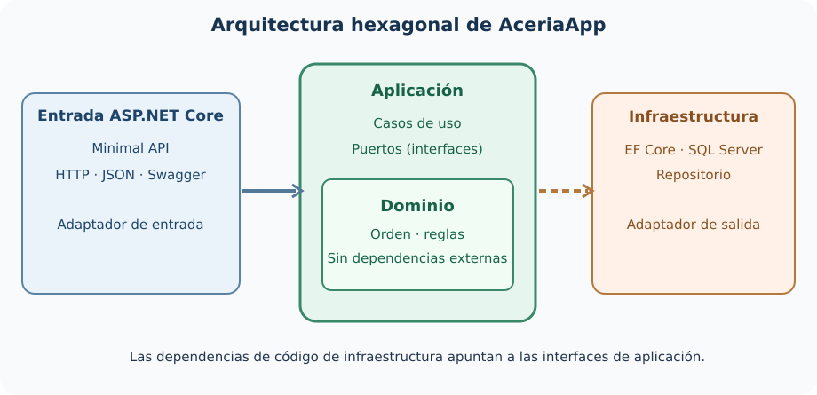

---
# Punto 3.1 — Capas de la aplicación

**Módulo 3:** Arquitectura hexagonal

**Objetivos de aprendizaje:**

- Comprender el concepto de capa en una arquitectura de software.
- Diferenciar las capas de dominio, aplicación, infraestructura y presentación.
- Comprender la regla de dependencia entre capas.
- Comprender la relación entre capas y arquitectura hexagonal.
- Añadir al proyecto `AceriaApp` una clase de validación de la regla de dependencia entre capas y un test unitario que verifique la validación.

---

## Desarrollo teórico

### Bloque 1 — El concepto de capa

Una capa es una unidad de organización del código que agrupa elementos con una responsabilidad común. La organización por capas es una de las técnicas más antiguas y más extendidas en el diseño de software. Su objetivo es separar las responsabilidades para reducir el acoplamiento y facilitar la evolución. Cada capa expone una interfaz estable al resto del sistema y oculta su implementación interna. La separación permite que una capa cambie sin afectar a las demás, siempre que se respete la interfaz. Las capas no son un fin en sí mismas: son un medio para gestionar la complejidad.

```text
Capas habituales en una aplicación:

1. Presentación  → interfaz con el usuario o con otros sistemas.
2. Aplicación    → casos de uso y orquestación.
3. Dominio       → entidades y reglas de negocio.
4. Infraestructura → persistencia, mensajería, servicios externos.
```

- **Línea 1:** `1. Presentación` → capa de interfaz con el exterior.
- **Línea 2:** `2. Aplicación` → capa de casos de uso y orquestación.
- **Línea 3:** `3. Dominio` → capa de entidades y reglas de negocio.
- **Línea 4:** `4. Infraestructura` → capa de persistencia y servicios externos.

La organización por capas produce cuatro beneficios medibles. El primero es la separación de responsabilidades: cada capa tiene una responsabilidad clara y delimitada. El segundo es la reutilización: una capa puede reutilizarse en distintos contextos. El tercero es la testabilidad: cada capa se puede probar de forma aislada. El cuarto es la mantenibilidad: los cambios se localizan en la capa correspondiente. Los cuatro beneficios justifican la adopción de la organización por capas en cualquier proyecto de tamaño medio o grande.

La organización por capas no es una garantía automática de calidad. Una organización por capas mal aplicada produce capas que se conocen entre sí de forma desordenada, con dependencias cíclicas y con lógica duplicada. La calidad de la organización depende de la disciplina con la que se aplique la regla de dependencia. La regla de dependencia establece que las capas se conocen en una única dirección: las capas exteriores conocen a las interiores, pero las interiores no conocen a las exteriores. La aplicación estricta de la regla es lo que produce los beneficios de la organización por capas.

---


#### Ampliación didáctica aplicada a AceriaApp

**La decisión arquitectónica.** Una carpeta denominada «Dominio» no demuestra por sí misma que exista una capa de dominio. La capa se define por su responsabilidad y por el sentido de sus dependencias. En AceriaApp podemos colocar clases en cuatro carpetas y, aun así, seguir acoplando las reglas a una solicitud HTTP. La primera comprobación consiste en leer sus tipos públicos: ¿quién conoce `HttpContext`, quién usa `DbContext` y quién puede ejecutarse sin arrancar un servidor? La respuesta distingue una división estética de una frontera arquitectónica.

**Ejemplo concreto en AceriaApp.** En M02 el manejador de POST valida datos, decide si la cantidad excede 500, instancia la entidad y persiste con EF Core. Es útil para aprender Minimal APIs, pero junta responsabilidades distintas. En M03 proponemos que el adaptador HTTP traduzca el JSON, que `OrdenesCasoUso` coordine la operación, que `OrdenHexagonal` conserve invariantes y que `OrdenRepositorioSqlServer` ejecute la persistencia. Sigue habiendo un único proceso web; cambia la organización del código, no necesariamente la infraestructura de despliegue.

**Riesgo, alternativa y límite.** Se suele dibujar una arquitectura de cuatro rectángulos y asumir que los cuatro son obligatorios. No lo son: una capa tiene sentido cuando expresa un límite cuyo coste de mantenimiento compensa la complejidad. Separar por nombres de clase no mejora la sustitución de tecnología; separar por dependencias y contratos sí permite comprobarla. En una aplicación minúscula un servicio adicional puede ser más costoso que un método bien cohesionado.

**Comprobación técnica y aprendizaje.** El alumno debe localizar en la solución `AceriaApp.Api`, `AceriaApp.Hexagonal.Aplicacion`, `AceriaApp.Hexagonal.Dominio` e `AceriaApp.Hexagonal.Infraestructura`. La evidencia no es solo que existan los nombres, sino que la referencia desde dominio hacia infraestructura sea inexistente y que el proyecto de dominio compile por separado.

### Bloque 2 — Capa de dominio

La capa de dominio contiene las entidades, los value objects, los agregados y las reglas de negocio. Es la capa más interna y la que tiene menos dependencias externas. Las entidades representan conceptos del negocio con identidad propia. Los value objects representan conceptos del negocio sin identidad propia. Los agregados agrupan entidades y value objects bajo una raíz común. Las reglas de negocio se expresan como invariantes que deben cumplirse en todo momento. La capa de dominio no conoce la base de datos, ni el framework web, ni la mensajería.

```csharp
namespace AceriaApp.Monolito.Api.Dominio;

public class Orden
{
    public Guid Id { get; private set; }
    public string Cliente { get; private set; } = string.Empty;
    public int Cantidad { get; private set; }

    public Orden(Guid id, string cliente, int cantidad)
    {
        if (string.IsNullOrWhiteSpace(cliente))
        {
            throw new ArgumentException("El cliente es obligatorio.", nameof(cliente));
        }
        if (cantidad <= 0)
        {
            throw new ArgumentException("La cantidad debe ser mayor que cero.", nameof(cantidad));
        }

        Id = id;
        Cliente = cliente;
        Cantidad = cantidad;
    }
}
```

- **Línea 1:** `namespace AceriaApp.Monolito.Api.Dominio;` → espacio de nombres de la capa de dominio.
- **Línea 2:** `public class Orden` → entidad del dominio.
- **Línea 3:** `{` → abre el cuerpo de la clase.
- **Línea 4:** `public Guid Id { get; private set; }` → identificador con setter privado.
- **Línea 5:** `public string Cliente { get; private set; } = string.Empty;` → cliente con setter privado.
- **Línea 6:** `public int Cantidad { get; private set; }` → cantidad con setter privado.
- **Línea 7:** `public Orden(Guid id, string cliente, int cantidad)` → constructor con validación.
- **Línea 8:** `{` → abre el cuerpo del constructor.
- **Línea 9:** `if (string.IsNullOrWhiteSpace(cliente))` → valida el cliente.
- **Línea 10:** `{` → abre el bloque de error.
- **Línea 11:** `throw new ArgumentException("El cliente es obligatorio.", nameof(cliente));` → lanza excepción.
- **Línea 12:** `}` → cierra el bloque de error.
- **Línea 13:** `if (cantidad <= 0)` → valida la cantidad.
- **Línea 14:** `{` → abre el bloque de error.
- **Línea 15:** `throw new ArgumentException("La cantidad debe ser mayor que cero.", nameof(cantidad));` → lanza excepción.
- **Línea 16:** `}` → cierra el bloque de error.
- **Línea 17:** `Id = id;` → asigna el identificador.
- **Línea 18:** `Cliente = cliente;` → asigna el cliente.
- **Línea 19:** `Cantidad = cantidad;` → asigna la cantidad.
- **Línea 20:** `}` → cierra el constructor.
- **Línea 21:** `}` → cierra la clase.

La capa de dominio se caracteriza por tres propiedades. La primera es que no tiene dependencias externas: no referencia ningún paquete de infraestructura. La segunda es que expone sus invariantes: las reglas de negocio se validan en el constructor o en métodos específicos. La tercera es que es testeable de forma aislada: los tests no necesitan base de datos ni framework web. Las tres propiedades son la base para que el dominio sea estable y reutilizable en distintos contextos.

---


#### Ampliación didáctica aplicada a AceriaApp

**La decisión arquitectónica.** El dominio expresa hechos y reglas de la acería, no el protocolo por el que alguien solicita una orden. `OrdenHexagonal` contiene Id, cliente, material, cantidad y estado porque son conceptos de negocio. Cuando su método `Finalizar()` impide repetir la transición, la entidad garantiza una condición independientemente de si la llamada procede de HTTP, de una tarea programada o de una cola. Esto es más fiable que esconder el mismo `if` en cada controlador.

**Ejemplo concreto en AceriaApp.** La construcción de una orden exige cliente y material no vacíos y una cantidad positiva. El constructor también asigna el GUID y la fecha UTC, reservando esos datos al servidor. La capacidad máxima de 500 que comprueba el caso de uso es otra decisión: puede variar según contexto de operación, por lo que no todas las restricciones deben concentrarse obligatoriamente en la entidad. Diferenciamos invariantes propios del objeto de políticas de proceso.

**Riesgo, alternativa y límite.** El riesgo central es filtrar dependencias externas hacia las clases del núcleo. Si una entidad recibe `DbContext`, implementa métodos `SaveChanges` o devuelve `IResult`, la regla de negocio necesita un servidor o un motor SQL incluso para ser probada. En el dominio tampoco deberían aparecer atributos cuyo único objetivo sea serializar JSON para una respuesta específica; el adaptador se encarga de esa transformación.

**Comprobación técnica y aprendizaje.** Una prueba del dominio puede crear `new OrdenHexagonal("ACX", "CHAPA", 10)`, llamar a `Finalizar()` y comprobar que el siguiente intento provoca `InvalidOperationException`. No requiere `WebApplicationFactory`, puerto HTTP, base de datos ni el contenedor de DI. Ese aislamiento es la señal práctica del valor de la capa.

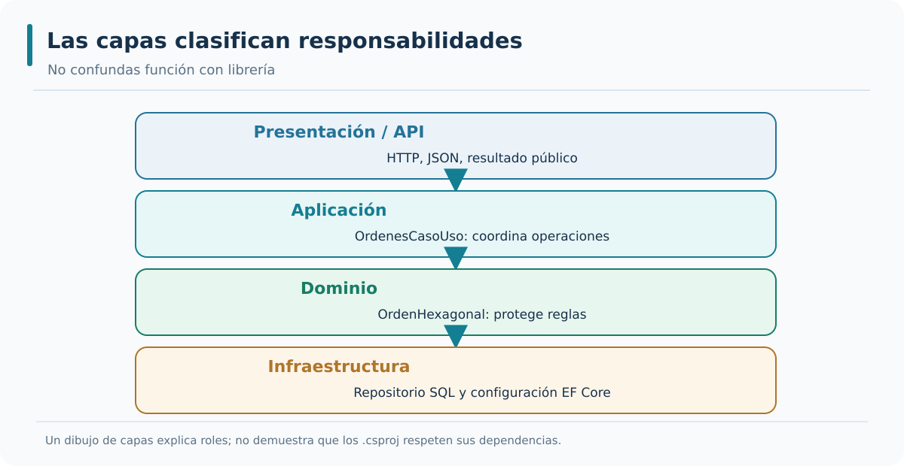

*Interpretación del gráfico:* identifica las referencias de código que admite el diseño y distingue esas relaciones de las llamadas en ejecución. La figura está disponible como SVG vectorial y como PNG para consulta externa.

### Bloque 3 — Capa de aplicación

La capa de aplicación contiene los casos de uso y la orquestación. Los casos de uso representan las operaciones que el sistema ofrece al exterior. La capa de aplicación conoce la capa de dominio y coordina sus operaciones. No contiene reglas de negocio: las reglas de negocio residen en el dominio. La capa de aplicación se encarga de recibir la petición, invocar el dominio y devolver la respuesta. También se encarga de la transacción, de la validación de entrada y de la traducción entre los DTOs y las entidades del dominio.

```csharp
namespace AceriaApp.Monolito.Api.Aplicacion;

public class OrdenServicio
{
    private readonly IOrdenRepositorio _repositorio;

    public OrdenServicio(IOrdenRepositorio repositorio)
    {
        _repositorio = repositorio;
    }

    public async Task<Guid> CrearOrdenAsync(string cliente, int cantidad)
    {
        var orden = new Orden(Guid.NewGuid(), cliente, cantidad);
        await _repositorio.AddAsync(orden);
        return orden.Id;
    }
}
```

- **Línea 1:** `namespace AceriaApp.Monolito.Api.Aplicacion;` → espacio de nombres de la capa de aplicación.
- **Línea 2:** `public class OrdenServicio` → servicio de aplicación.
- **Línea 3:** `{` → abre el cuerpo de la clase.
- **Línea 4:** `private readonly IOrdenRepositorio _repositorio;` → dependencia del repositorio.
- **Línea 5:** `public OrdenServicio(IOrdenRepositorio repositorio)` → constructor con inyección.
- **Línea 6:** `{` → abre el cuerpo del constructor.
- **Línea 7:** `_repositorio = repositorio;` → asigna el repositorio.
- **Línea 8:** `}` → cierra el constructor.
- **Línea 9:** `public async Task<Guid> CrearOrdenAsync(string cliente, int cantidad)` → caso de uso.
- **Línea 10:** `{` → abre el cuerpo del método.
- **Línea 11:** `var orden = new Orden(Guid.NewGuid(), cliente, cantidad);` → crea la entidad.
- **Línea 12:** `await _repositorio.AddAsync(orden);` → persiste la entidad.
- **Línea 13:** `return orden.Id;` → devuelve el identificador.
- **Línea 14:** `}` → cierra el método.
- **Línea 15:** `}` → cierra la clase.

La capa de aplicación se caracteriza por tres propiedades. La primera es que conoce la capa de dominio y depende de ella. La segunda es que no conoce la capa de infraestructura: depende de interfaces que la infraestructura implementa. La tercera es que es testeable con dobles de prueba: los tests pueden sustituir el repositorio por un mock. Las tres propiedades permiten que la lógica de orquestación se pruebe sin base de datos y sin framework web.

---


#### Ampliación didáctica aplicada a AceriaApp

**La decisión arquitectónica.** La aplicación coordina una intención del usuario y decide qué operaciones del dominio deben ejecutarse en qué secuencia. `OrdenesCasoUso.CrearAsync` no debería interpretar cabeceras HTTP ni formular consultas SQL; recibe cliente, material y cantidad como valores de negocio. Comprueba la capacidad admitida, construye una `OrdenHexagonal` y solicita guardar a través de `IOrdenRepositorio`. La coordinación es una responsabilidad distinta de la validación intrínseca de la entidad.

**Ejemplo concreto en AceriaApp.** Cuando el usuario solicita finalizar, el caso de uso debe buscar la orden por identificador, distinguir ausencia y presencia, invocar `orden.Finalizar()` y pedir al puerto que persista el cambio. Si el repositorio devuelve `null`, el caso de uso no inventa una entidad. El traductor HTTP convertirá ese resultado en 404. Si el dominio lanza un conflicto de transición, el adaptador HTTP puede convertirlo en 409 sin obligar al dominio a mencionar los códigos 404 o 409.

**Riesgo, alternativa y límite.** Un caso de uso demasiado amplio termina siendo un nuevo monolito escondido en una sola clase; uno demasiado pequeño y trivial solo reenvía llamadas sin aportar coordinación. El criterio no es su longitud, sino si representa una capacidad coherente y hace explícitos los efectos que necesita. El caso de uso debe ser determinista en sus decisiones para los mismos datos, dejando persistencia e infraestructura detrás de contratos.

**Comprobación técnica y aprendizaje.** La comprobación útil es construir un repositorio falso que registre cuándo se llama a `AgregarAsync` o `GuardarAsync`. Si `CrearAsync` puede ejercitarse sin EF Core y devuelve la entidad esperada, el caso de uso usa correctamente el puerto. Los tests HTTP posteriores aportan una evidencia distinta: que la composición real lo conecta con el servidor.

### Bloque 4 — Capa de infraestructura

La capa de infraestructura contiene las implementaciones concretas de las interfaces definidas en las capas interiores. Incluye los repositorios, los clientes HTTP, los publicadores de eventos y los adaptadores a servicios externos. La capa de infraestructura conoce el framework, la base de datos y los servicios externos. Depende de las interfaces definidas en el dominio y en la aplicación. No contiene reglas de negocio: solo implementa los contratos definidos por las capas interiores.

```csharp
namespace AceriaApp.Monolito.Api.Infraestructura;

public class OrdenRepositorio : IOrdenRepositorio
{
    private readonly AceriaDbContext _db;

    public OrdenRepositorio(AceriaDbContext db)
    {
        _db = db;
    }

    public async Task AddAsync(Orden orden)
    {
        _db.Ordenes.Add(orden);
        await _db.SaveChangesAsync();
    }
}
```

- **Línea 1:** `namespace AceriaApp.Monolito.Api.Infraestructura;` → espacio de nombres de la capa de infraestructura.
- **Línea 2:** `public class OrdenRepositorio : IOrdenRepositorio` → implementación del repositorio.
- **Línea 3:** `{` → abre el cuerpo de la clase.
- **Línea 4:** `private readonly AceriaDbContext _db;` → dependencia del contexto de EF Core.
- **Línea 5:** `public OrdenRepositorio(AceriaDbContext db)` → constructor con inyección.
- **Línea 6:** `{` → abre el cuerpo del constructor.
- **Línea 7:** `_db = db;` → asigna el contexto.
- **Línea 8:** `}` → cierra el constructor.
- **Línea 9:** `public async Task AddAsync(Orden orden)` → método del contrato.
- **Línea 10:** `{` → abre el cuerpo del método.
- **Línea 11:** `_db.Ordenes.Add(orden);` → añade la orden al contexto.
- **Línea 12:** `await _db.SaveChangesAsync();` → persiste los cambios.
- **Línea 13:** `}` → cierra el método.
- **Línea 14:** `}` → cierra la clase.

La capa de infraestructura se caracteriza por tres propiedades. La primera es que implementa las interfaces definidas en las capas interiores. La segunda es que conoce el framework y la base de datos. La tercera es que puede sustituirse sin afectar a las capas interiores: la interfaz es la que garantiza el desacoplamiento. Las tres propiedades permiten que el sistema cambie de base de datos o de proveedor de servicios externos sin modificar el dominio ni la aplicación.

---


#### Ampliación didáctica aplicada a AceriaApp

**La decisión arquitectónica.** La infraestructura es la parte del sistema que sabe cómo se ejecutan efectos concretos. En AceriaApp, `HexagonalDbContext` conoce EF Core, asigna la entidad `OrdenHexagonal` a `OrdenesHexagonales` y configura tipos y restricciones de columnas. `OrdenRepositorioSqlServer` usa las operaciones `AsNoTracking`, `FirstOrDefaultAsync`, `AddAsync` y `SaveChangesAsync`. Nada de eso debería ser una obligación de la capa de aplicación.

**Ejemplo concreto en AceriaApp.** El adaptador realiza el contrato definido por la aplicación. Cuando `IOrdenRepositorio.ListarAsync` devuelve una lista de órdenes, el adaptador EF Core puede ordenar por fecha y materializar el resultado, sin entregar al caso de uso un `IQueryable` que permitiría construir consultas dependientes de EF. Esto impide que los detalles de seguimiento y proveedor invadan la orquestación del negocio.

**Riesgo, alternativa y límite.** Un error frecuente es suponer que separar la infraestructura consiste en mover el mismo `DbContext` a otro proyecto y referenciarlo desde todos. Si los casos de uso consumen el contexto directamente, la dependencia sigue orientada al detalle externo. La separación real requiere que la aplicación solo dependa de `IOrdenRepositorio`; la infraestructura debe implementar esa interfaz y referenciar el contrato.

**Comprobación técnica y aprendizaje.** Inspecciona los `.csproj`: el proyecto de infraestructura contiene `Microsoft.EntityFrameworkCore.SqlServer` y referencias a aplicación y dominio. Ni dominio ni aplicación deben declarar el paquete SQL Server. Un test de infraestructura necesita comprobar que el adaptador devuelve y guarda datos, mientras que una prueba de aplicación puede utilizar una implementación simulada.

### Bloque 5 — Capa de presentación

La capa de presentación contiene los endpoints, los controladores y los puntos de entrada al sistema. En una API REST, la capa de presentación contiene los endpoints de Minimal API o los controladores. La capa de presentación conoce la capa de aplicación y depende de ella. Convierte las peticiones HTTP en llamadas a los casos de uso y las respuestas de los casos de uso en respuestas HTTP. No contiene reglas de negocio: solo traduce entre el protocolo HTTP y los casos de uso.

```csharp
app.MapPost("/api/v1/ordenes", async (
    CrearOrdenRequest request,
    OrdenServicio servicio) =>
{
    var id = await servicio.CrearOrdenAsync(request.Cliente, request.Cantidad);
    return Results.Created($"/api/v1/ordenes/{id}", new { id });
});
```

- **Línea 1:** `app.MapPost("/api/v1/ordenes", async (` → declara el endpoint.
- **Línea 2:** `CrearOrdenRequest request,` → recibe la petición.
- **Línea 3:** `OrdenServicio servicio) =>` → inyecta el servicio de aplicación.
- **Línea 4:** `{` → abre el cuerpo del lambda.
- **Línea 5:** `var id = await servicio.CrearOrdenAsync(request.Cliente, request.Cantidad);` → invoca el caso de uso.
- **Línea 6:** `return Results.Created($"/api/v1/ordenes/{id}", new { id });` → devuelve 201 con la ubicación.
- **Línea 7:** `});` → cierra el lambda.

La capa de presentación se caracteriza por tres propiedades. La primera es que traduce entre HTTP y los casos de uso. La segunda es que no contiene reglas de negocio: delega en la capa de aplicación. La tercera es que puede cambiar de protocolo sin afectar a las capas interiores. Las tres propiedades permiten que el mismo sistema se exponga como API REST, como gRPC o como cola de mensajes sin modificar el dominio ni la aplicación.

---


#### Ampliación didáctica aplicada a AceriaApp

**La decisión arquitectónica.** La presentación no es necesariamente una interfaz visual: una Minimal API también es una capa de entrada. Sus rutas traducen HTTP en llamadas al sistema y resultados del sistema en respuestas HTTP. En M03 el grupo `/api/v1/hexagonal/ordenes` recibe `CrearOrdenHexagonalRequest`, invoca `OrdenesCasoUso.CrearAsync` y produce `CreatedAtRoute`, sin conocer la conexión a SQL Server ni una entidad `DbContext`.

**Ejemplo concreto en AceriaApp.** La separación exige modelos de contrato externos. Un cliente envía `cliente`, `material` y `cantidad`; el adaptador convierte esos datos a argumentos del caso de uso. El DTO de salida incorpora Id, estado y fecha. Estos modelos se diseñan para la API, no deben añadirse como propiedades serializadas forzosamente a la entidad de dominio. El adaptador puede cambiar el formato HTTP sin reescribir la política de finalización.

**Riesgo, alternativa y límite.** No es correcto asumir que toda validación pertenece a la presentación. La presentación controla forma y requisitos del contrato recibido; el dominio protege invariantes; la aplicación aplica políticas de proceso como la capacidad de 500. Si una solicitud contiene cantidad 501, HTTP traduce una restricción de negocio en 422. Ese número HTTP es responsabilidad de entrada, no de la entidad.

**Comprobación técnica y aprendizaje.** En una prueba con `WebApplicationFactory`, envía POST al endpoint hexagonal y sigue la cabecera `Location` con GET. La creación 201 no es evidencia suficiente de persistencia. Comprueba después el valor del DTO, el código 200 y que la ruta invoca el caso de uso, no EF Core directamente.

### Bloque 6 — Regla de dependencia

La regla de dependencia establece que las dependencias entre capas se dirigen hacia el interior. Las capas exteriores conocen a las interiores. Las capas interiores no conocen a las exteriores. La capa de presentación conoce a la capa de aplicación. La capa de aplicación conoce a la capa de dominio. La capa de infraestructura conoce a la capa de dominio y a la capa de aplicación. La capa de dominio no conoce a ninguna otra capa. La regla garantiza que el núcleo del sistema sea independiente de los detalles de implementación.

```text
Dirección de las dependencias:

Presentación → Aplicación → Dominio
Infraestructura → Aplicación → Dominio
Infraestructura → Dominio

Dominio no depende de nadie.
```

- **Línea 1:** `Presentación → Aplicación → Dominio` → la presentación conoce a la aplicación y esta al dominio.
- **Línea 2:** `Infraestructura → Aplicación → Dominio` → la infraestructura conoce a la aplicación y esta al dominio.
- **Línea 3:** `Infraestructura → Dominio` → la infraestructura conoce directamente al dominio.
- **Línea 4:** `Dominio no depende de nadie.` → el dominio es la capa más interna.

La regla de dependencia tiene dos consecuencias prácticas. La primera es que el dominio es independiente del framework y de la base de datos. La segunda es que las dependencias cíclicas entre capas son imposibles: si el dominio no conoce a la aplicación, la aplicación no puede depender del dominio y del dominio de la aplicación a la vez. La regla se aplica con revisiones de código y con tests automáticos que verifican las dependencias entre ensamblados.

---


#### Ampliación didáctica aplicada a AceriaApp

**La decisión arquitectónica.** La regla de dependencia habla de referencias de código: las políticas internas no deben importar detalles externos. Un proyecto independiente de dominio que compilase solo cuando se instala `Microsoft.AspNetCore.Http` violaría esa independencia, aunque no iniciara un servidor. La herramienta decisiva en .NET es la dirección de `ProjectReference` y también los `using` que se permiten en cada biblioteca.

**Ejemplo concreto en AceriaApp.** En la solución vigente, Aplicación referencia Dominio; Infraestructura referencia Aplicación y Dominio; API referencia Aplicación e Infraestructura para componer el sistema. La referencia de API hacia Infraestructura es admisible en el extremo de composición. Lo prohibido es que el dominio conozca `AceriaApp.Api` o que `OrdenesCasoUso` requiera una clase concreta `OrdenRepositorioSqlServer`.

**Riesgo, alternativa y límite.** Esta regla no debe confundirse con el orden de las llamadas en tiempo de ejecución. El caso de uso invoca al repositorio, que vive físicamente en infraestructura; eso no obliga a compilar Aplicación contra Infraestructura. Se produce precisamente porque la interfaz del puerto está definida dentro de Aplicación y el adaptador implementa el contrato. El sentido de la llamada y el sentido de la importación no tienen por qué coincidir.

**Comprobación técnica y aprendizaje.** El control es automático: examina el `.csproj` de dominio y exige cero `ProjectReference`; examina el de aplicación y exige referencia exclusiva a dominio. Un cambio posterior que incorpore infraestructura dentro de Aplicación debe hacer fallar el control arquitectónico, aunque el resto de los tests HTTP continúe pasando.

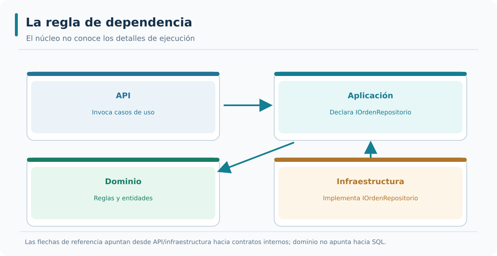

*Interpretación del gráfico:* identifica las referencias de código que admite el diseño y distingue esas relaciones de las llamadas en ejecución. La figura está disponible como SVG vectorial y como PNG para consulta externa.

### Bloque 7 — Inversión de dependencias

La inversión de dependencias es el mecanismo que permite que la capa de aplicación dependa de la infraestructura sin violar la regla de dependencia. La inversión se materializa en interfaces definidas en las capas interiores e implementadas en las capas exteriores. La capa de aplicación define la interfaz `IOrdenRepositorio`. La capa de infraestructura implementa `OrdenRepositorio` que cumple la interfaz. La capa de aplicación depende de la interfaz, no de la implementación. El contenedor de dependencias inyecta la implementación en tiempo de ejecución.

```csharp
// Definido en la capa de aplicación
public interface IOrdenRepositorio
{
    Task AddAsync(Orden orden);
}

// Implementado en la capa de infraestructura
public class OrdenRepositorio : IOrdenRepositorio
{
    public async Task AddAsync(Orden orden)
    {
        // implementación
    }
}
```

- **Línea 1:** `// Definido en la capa de aplicación` → comentario de ubicación.
- **Línea 2:** `public interface IOrdenRepositorio` → interfaz del contrato.
- **Línea 3:** `{` → abre el cuerpo de la interfaz.
- **Línea 4:** `Task AddAsync(Orden orden);` → método del contrato.
- **Línea 5:** `}` → cierra la interfaz.
- **Línea 6:** `// Implementado en la capa de infraestructura` → comentario de ubicación.
- **Línea 7:** `public class OrdenRepositorio : IOrdenRepositorio` → implementación.
- **Línea 8:** `{` → abre el cuerpo de la clase.
- **Línea 9:** `public async Task AddAsync(Orden orden)` → implementación del método.
- **Línea 10:** `{` → abre el cuerpo del método.
- **Línea 11:** `// implementación` → comentario del cuerpo.
- **Línea 12:** `}` → cierra el método.
- **Línea 13:** `}` → cierra la clase.

La inversión de dependencias tiene dos consecuencias prácticas. La primera es que la capa de aplicación no conoce la implementación concreta: solo conoce la interfaz. La segunda es que la implementación puede sustituirse sin modificar la aplicación: por ejemplo, un repositorio en memoria para los tests. La inversión es la técnica que permite que la regla de dependencia se cumpla incluso cuando la aplicación necesita servicios de infraestructura.

---


#### Ampliación didáctica aplicada a AceriaApp

**La decisión arquitectónica.** El principio de inversión de dependencias no significa que se invoque infraestructura desde el dominio mediante magia. Significa que ambos lados relevantes dependen de una abstracción situada donde conviene a la política del sistema. `IOrdenRepositorio` describe operaciones que la aplicación necesita, como listar, obtener, agregar y guardar, y no menciona el nombre de EF Core, SQL Server ni la forma de establecer una conexión.

**Ejemplo concreto en AceriaApp.** El caso de uso declara un parámetro de constructor de tipo `IOrdenRepositorio`. En el borde de arranque de ASP.NET Core se registra `services.AddScoped<IOrdenRepositorio, OrdenRepositorioSqlServer>()`. El contenedor crea el adaptador concreto y lo entrega donde se solicitó la interfaz. El caso de uso no usa `new OrdenRepositorioSqlServer`, de modo que se prueba sin SQL Server y el proveedor podría cambiar si otro adaptador respetase el contrato.

**Riesgo, alternativa y límite.** No debemos crear interfaces para cada clase sin una razón. Una interfaz puramente decorativa que reproduce cien métodos de EF Core no desacopla nada útil. Un buen puerto define las capacidades que usa el negocio, devuelve tipos del dominio y evita exponer tipos del proveedor. Cambiar un repositorio por otro no debería obligar a modificar los métodos de caso de uso.

**Comprobación técnica y aprendizaje.** La evidencia combina dos verificaciones: inspección de dependencias (`AceriaApp.Hexagonal.Aplicacion.csproj` no referencia infraestructura) y prueba funcional (el endpoint POST resuelve el puerto por DI y consigue guardar la entidad). Una sin la otra deja un riesgo sin probar.

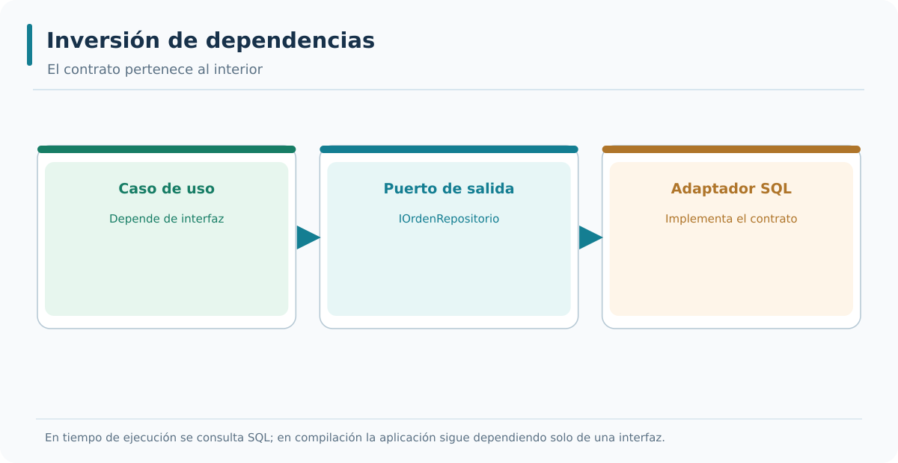

*Interpretación del gráfico:* identifica las referencias de código que admite el diseño y distingue esas relaciones de las llamadas en ejecución. La figura está disponible como SVG vectorial y como PNG para consulta externa.

### Bloque 8 — Capas y arquitectura hexagonal

La arquitectura hexagonal aplica la organización por capas con un giro: en lugar de capas apiladas, propone un núcleo central rodeado de puertos y adaptadores. El núcleo contiene el dominio y la aplicación. Los puertos son las interfaces que el núcleo expone al exterior. Los adaptadores son las implementaciones concretas que conectan el núcleo con el mundo exterior. La arquitectura hexagonal mantiene la regla de dependencia: el núcleo no conoce a los adaptadores. La diferencia con las capas apiladas es que la arquitectura hexagonal permite múltiples adaptadores del mismo puerto, lo que facilita la exposición del mismo caso de uso en distintos protocolos.

```text
Arquitectura hexagonal:

         [Adaptador HTTP]     [Adaptador CLI]
                |                    |
                v                    v
        [Puerto de entrada]  [Puerto de entrada]
                    \          /
                     v        v
                  [Núcleo]
                (Dominio + Aplicación)
                     |        |
                     v        v
        [Puerto de salida]  [Puerto de salida]
                |                    |
                v                    v
      [Adaptador BD]        [Adaptador mensajería]
```

- **Línea 1:** `[Adaptador HTTP]     [Adaptador CLI]` → dos adaptadores de entrada.
- **Línea 2:** `v                    v` → flechas hacia los puertos.
- **Línea 3:** `[Puerto de entrada]  [Puerto de entrada]` → puertos de entrada.
- **Línea 4:** `\          /` → convergencia hacia el núcleo.
- **Línea 5:** `v        v` → flechas hacia el núcleo.
- **Línea 6:** `[Núcleo]` → núcleo con dominio y aplicación.
- **Línea 7:** `(Dominio + Aplicación)` → contenido del núcleo.
- **Línea 8:** `|        |` → bifurcación hacia los puertos de salida.
- **Línea 9:** `v        v` → flechas hacia los puertos.
- **Línea 10:** `[Puerto de salida]  [Puerto de salida]` → puertos de salida.
- **Línea 11:** `|                    |` → flechas hacia los adaptadores.
- **Línea 12:** `v                    v` → flechas hacia los adaptadores.
- **Línea 13:** `[Adaptador BD]        [Adaptador mensajería]` → dos adaptadores de salida.

La arquitectura hexagonal se caracteriza por tres propiedades. La primera es que el núcleo es independiente de los adaptadores. La segunda es que un mismo puerto puede tener varios adaptadores. La tercera es que los adaptadores se pueden sustituir sin modificar el núcleo. Las tres propiedades hacen que la arquitectura hexagonal sea especialmente adecuada para sistemas que deben exponerse en múltiples protocolos o que deben soportar múltiples mecanismos de persistencia.

---


#### Ampliación didáctica aplicada a AceriaApp

**La decisión arquitectónica.** Los diagramas de capas organizan responsabilidades en niveles; la arquitectura hexagonal pone el énfasis en los límites de interacción y en la sustituibilidad de adaptadores. Son modelos complementarios: en nuestro diseño, Dominio y Aplicación constituyen el núcleo, mientras HTTP y SQL Server viven fuera como adaptadores. No existe obligación de dibujar físicamente un hexágono en cada clase.

**Ejemplo concreto en AceriaApp.** Observa el recorrido de creación: un cliente HTTP entrega JSON, el adaptador lo interpreta, el caso de uso aplica la capacidad, la entidad verifica su invariantes y el puerto solicita guardar; por último, la implementación EF Core persiste. El diagrama muestra dos interfaces distintas de interacción y una entidad central; el código demuestra el aislamiento cuando las referencias hacia el núcleo no incluyen librerías de entrada o salida.

**Riesgo, alternativa y límite.** Una arquitectura puede ser de capas y continuar acoplada al servidor de datos; también puede usar puertos sin organizar bien responsabilidades de dominio. Por eso los nombres de carpeta no bastan y los proyectos de M03 incluyen tanto modelos ilustrativos de capas como un puerto real usado por una ruta. No deben confundirse las clases que catalogan reglas con la implementación de los casos de uso.

**Comprobación técnica y aprendizaje.** Representa en un diagrama las dependencias de compilación y, separadamente, el flujo de una petición HTTP. Identifica qué flechas cambian de sentido entre ambas vistas. Si ambos diagramas se parecen demasiado, comprueba que no has dibujado llamadas en lugar de referencias.

### Bloque 9 — Cuándo aplicar la organización por capas

La organización por capas se aplica cuando el sistema tiene una complejidad que justifica la separación. Un sistema pequeño con una sola funcionalidad no se beneficia de la separación en cuatro capas: añade complejidad sin aportar valor. Un sistema mediano o grande con varias funcionalidades se beneficia de la separación porque reduce el acoplamiento y facilita la evolución. La decisión de aplicar la organización por capas se basa en el tamaño del dominio, el número de equipos y la vida esperada del sistema.

```text
Aplicación de la organización por capas:

Sistema pequeño     → capas mínimas o sin capas.
Sistema mediano      → capas de dominio, aplicación e infraestructura.
Sistema grande       → capas completas con presentación separada.
Sistema con múltiples protocolos → arquitectura hexagonal.
```

- **Línea 1:** `Sistema pequeño` → capas mínimas o sin capas.
- **Línea 2:** `Sistema mediano` → tres capas: dominio, aplicación e infraestructura.
- **Línea 3:** `Sistema grande` → capas completas con presentación separada.
- **Línea 4:** `Sistema con múltiples protocolos` → arquitectura hexagonal.

La organización por capas no es una decisión binaria: es un espectro. Un sistema puede empezar con una sola capa y evolucionar hacia varias a medida que crece. La evolución se realiza extrayendo responsabilidades a medida que se identifican. El curso aplica este enfoque: el monolito de los módulos 1 y 2 tiene una organización mínima y en el módulo 3 se refactoriza hacia una organización por capas completa con arquitectura hexagonal.

---


#### Ampliación didáctica aplicada a AceriaApp

**La decisión arquitectónica.** Aplicar cuatro capas introduce costes: nuevos proyectos, tipos de contrato, registros en DI y pruebas de integración. Ese coste se justifica cuando cambian con frecuencia interfaces externas, proveedores de persistencia o reglas del negocio y necesitamos controlar el impacto. En AceriaApp la separación permite explicar de forma observable cómo un servicio HTTP evoluciona sin mezclar cada regla con EF Core.

**Ejemplo concreto en AceriaApp.** Antes de extraer una capa pregunta qué variación estamos protegiendo. ¿Podría cambiar la forma de exponer órdenes sin cambiar la política de finalización? ¿Podría utilizarse otro almacén sin rehacer el caso de uso? ¿Es necesario probar una transición de estado sin levantar el host? Si la respuesta es afirmativa, el límite aporta valor. Si nunca hay variación ni equipo responsable, quizá baste una organización modular más sencilla.

**Riesgo, alternativa y límite.** Las capas no reducen por sí mismas la latencia, no convierten una API en distribuida y no sustituyen la observabilidad. Si el repositorio realiza consultas ineficientes seguirá siendo lento; si el caso de uso no gestiona errores, seguirá fallando. El beneficio de la separación es la claridad de responsabilidad y el coste acotado de cambiar un detalle, no una garantía de escalabilidad automática.

**Comprobación técnica y aprendizaje.** Como ejercicio de decisión, compara la versión M02, donde `Program.cs` orquesta mucha lógica, con M03, donde `OrdenesCasoUso` coordina y el endpoint traduce. Anota qué archivo tocarías ante un cambio en formato JSON, un nuevo estado de negocio y un nuevo proveedor SQL.

### Bloque 10 — Aplicación al proyecto del curso

El proyecto del curso aplica la organización por capas en el módulo 3. La capa de dominio contiene las entidades y las reglas de negocio. La capa de aplicación contiene los casos de uso y la orquestación. La capa de infraestructura contiene los repositorios y los adaptadores. La capa de presentación contiene los endpoints. La regla de dependencia se aplica de forma estricta: el dominio no conoce a las demás capas. La inversión de dependencias permite que la aplicación dependa de interfaces y que la infraestructura las implemente. La arquitectura hexagonal se aplica con puertos y adaptadores.

```text
Aplicación al proyecto del curso:

Dominio           → entidades y reglas de negocio.
Aplicación        → casos de uso e interfaces de repositorio.
Infraestructura   → implementaciones de repositorio y EF Core.
Presentación      → endpoints de Minimal API.
Regla             → dependencias hacia el interior.
Inversión         → interfaces en aplicación, implementación en infraestructura.
```

- **Línea 1:** `Dominio` → capa más interna con las entidades.
- **Línea 2:** `Aplicación` → casos de uso e interfaces.
- **Línea 3:** `Infraestructura` → implementaciones concretas.
- **Línea 4:** `Presentación` → endpoints de la API.
- **Línea 5:** `Regla` → dependencias hacia el interior.
- **Línea 6:** `Inversión` → interfaces en aplicación, implementación en infraestructura.

La aplicación de la organización por capas prepara el proyecto para los puntos 3.2, 3.3 y 3.4. El punto 3.2 estudiará los puertos y adaptadores con detalle. El punto 3.3 estudiará la separación entre dominio, aplicación e infraestructura. El punto 3.4 estudiará la implementación en ASP.NET Core. El punto 3.1 establece los conceptos que se aplicarán en los tres puntos siguientes.

---

### Resumen rápido de la teoría

- Una capa es una unidad de organización del código con una responsabilidad común.
- Las capas habituales son presentación, aplicación, dominio e infraestructura.
- El dominio contiene entidades y reglas de negocio y no depende de ninguna otra capa.
- La aplicación contiene casos de uso y depende del dominio.
- La infraestructura implementa las interfaces definidas por la aplicación.
- La presentación traduce entre el protocolo y los casos de uso.
- La regla de dependencia establece que las dependencias se dirigen hacia el interior.
- La inversión de dependencias permite que la aplicación dependa de interfaces y la infraestructura las implemente.
- La arquitectura hexagonal sustituye las capas apiladas por un núcleo central rodeado de puertos y adaptadores.

---


#### Ampliación didáctica aplicada a AceriaApp

**La decisión arquitectónica.** M03 comienza sobre la etapa 2.4 de M02. Ese punto de partida conserva GET, POST, PUT, PATCH, DELETE, FluentValidation, OpenAPI y los tests del módulo anterior. La operación de enseñanza es aditiva: antes de introducir una frontera se demuestra que la API funciona, y después se conserva su comportamiento mientras se desarrolla el diseño hexagonal.

**Ejemplo concreto en AceriaApp.** La primera etapa M03 no reemplaza los endpoints existentes. Añade un catálogo de capas y reglas de referencia, que ayuda a comprender por qué no deben existir dependencias circulares. En la etapa 3.3 se crean de verdad los proyectos de Dominio, Aplicación e Infraestructura; la etapa 3.4 agrega un grupo nuevo de rutas HTTP hexagonales para no destruir las rutas M02 que ya eran parte del contrato del curso.

**Riesgo, alternativa y límite.** Esta convivencia permite una migración por incorporación: la API antigua sigue sirviendo sus rutas mientras una nueva capacidad demuestra el patrón arquitectónico. No afirmamos que las rutas antiguas sean hexagonales simplemente por coexistir en la solución. La distinción es útil para una modernización progresiva de aplicaciones existentes, donde reescribir todo en un solo cambio aumentaría el riesgo.

**Comprobación técnica y aprendizaje.** Verifica al final que los tests heredados de M02 continúan en verde y que los nuevos comprueban el diseño M03. El progreso del curso se mide por evidencia acumulada y no por sustituir artificialmente el proyecto anterior.


## Estudio integrador 3.1 — De una Minimal API compacta a responsabilidades explícitas

### Escenario de partida

Imaginemos una orden de producción de 15 unidades de chapa para un cliente ACX. El cliente POST de M02 contiene `cliente`, `material` y `cantidad` y el servidor recibe ese JSON por una ruta estable. Al leer la implementación M02, un alumno encuentra juntas la validación provisional del contrato, la creación de la entidad, una consulta del contexto, la persistencia y la construcción de la respuesta HTTP. Ninguna de esas operaciones es por sí misma incorrecta. El problema es que evolucionan por motivos diferentes: el contrato REST podría incorporar una nueva versión, la política de capacidad puede variar por taller y SQL Server puede migrar a otro proveedor.

Separaremos el proceso en cuatro decisiones y examinaremos dónde deberían vivir. **Primera decisión:** el JSON debe contener Cliente y Material y una cantidad positiva; la presentación es quien interpreta el contrato entrante. **Segunda decisión:** el objeto del dominio no debe permitir un estado inválido; la entidad se responsabiliza de sus invariantes y ofrece transiciones como `Finalizar()`. **Tercera decisión:** crear una orden implica coordinar una regla de capacidad y solicitar persistencia; la aplicación representa esa intención mediante un caso de uso. **Cuarta decisión:** para almacenar una entidad hay que interactuar con EF Core, configurar tabla y conexión y confirmar los cambios; infraestructura implementa ese detalle detrás de un contrato.

### Dos cambios que permiten comprobar la frontera

Supongamos que el equipo cambia el nombre externo del campo `cliente` por `razonSocial`, pero el dominio sigue almacenando el mismo concepto. Si la frontera HTTP está bien diseñada, deberíamos cambiar el contrato de entrada y su mapeo, no toda la entidad ni las consultas del repositorio. Supongamos ahora que el negocio prohíbe finalizar una orden dos veces. Esa regla debe aplicarse tanto en HTTP como en un posible consumidor de mensajes; colocarla exclusivamente dentro de `MapPost` haría divergir las entradas. La operación `OrdenHexagonal.Finalizar()` ofrece un lugar estable para la regla.

A continuación supongamos un cambio de persistencia. Los casos de uso necesitan las mismas operaciones, pero la implementación de `IOrdenRepositorio` puede variar. La capa de aplicación no debería importar `Microsoft.EntityFrameworkCore`; si lo hace, el cambio de proveedor exige modificarla. Ese hecho se comprueba inspeccionando los archivos `.csproj`, no leyendo un dibujo.

### Condiciones que el alumno debe poder explicar

- Una clase del dominio puede construirse y probarse sin levantar ASP.NET Core.
- Un caso de uso puede simular su repositorio sin tener SQL Server instalado.
- La API traduce estados de negocio a códigos HTTP sin declarar ese protocolo dentro de la entidad.
- Infraestructura puede conocer el puerto y la entidad; dominio y aplicación no conocen la clase concreta `OrdenRepositorioSqlServer`.
- La aplicación puede continuar desplegándose como un único proceso; las capas no son microservicios independientes por el mero hecho de existir.

Esta clasificación guiará 3.2 y 3.3: primero definiremos puertos como contratos, después los haremos observables en los proyectos .NET y finalmente conectaremos el adaptador HTTP. El criterio de cierre del estudio no es repetir nombres de capas, sino justificar a qué archivo iría cada cambio y qué tests detectarían una asignación incorrecta.

#### Aplicación al repositorio vigente y corrección de alcance

El contenido del punto 3.1 se aplica al servicio de órdenes que ya funciona en M02. Se parte de la Minimal API construida en el módulo anterior. Los modelos que representan relaciones arquitectónicas son útiles para razonar y probar reglas; por sí solos no convierten el código en una arquitectura hexagonal. Por eso, las prácticas de este módulo también construyen interfaces de aplicación, implementaciones de infraestructura y conexión HTTP real. El proyecto compilado y los tests demuestran la diferencia entre declarar un puerto y utilizarlo en ejecución.


---

# Punto 3.2 — Puertos y adaptadores

**Módulo 3:** Arquitectura hexagonal

**Objetivos de aprendizaje:**

- Comprender el concepto de puerto en arquitectura hexagonal.
- Comprender el concepto de adaptador y su relación con los puertos.
- Diferenciar entre puertos de entrada y puertos de salida.
- Comprender la relación entre puertos, adaptadores e inversión de dependencias.
- Añadir al proyecto `AceriaApp` una clase de validación de puertos y adaptadores y un test unitario que verifique la validación.

---

## Desarrollo teórico

### Bloque 1 — El puerto como frontera del núcleo

Un puerto es una interfaz que define cómo el núcleo de la aplicación se comunica con el exterior. El puerto no es una clase concreta: es un contrato que especifica las operaciones que el núcleo ofrece o requiere. Los puertos se definen en las capas interiores, donde reside el núcleo, y se implementan en las capas exteriores, donde residen los adaptadores. Un puerto puede ser de entrada o de salida. Los puertos de entrada describen lo que el núcleo ofrece al exterior. Los puertos de salida describen lo que el núcleo necesita del exterior. La separación entre puertos de entrada y de salida es una de las propiedades que distingue la arquitectura hexagonal de las capas apiladas.

```text
Puertos del núcleo:

Puertos de entrada (lo que el núcleo ofrece):
- IOrdenServicio
- IInventarioServicio

Puertos de salida (lo que el núcleo necesita):
- IOrdenRepositorio
- IInventarioRepositorio
- IPublicadorEventos
```

- **Línea 1:** `Puertos de entrada (lo que el núcleo ofrece):` → título de los puertos de entrada.
- **Línea 2:** `- IOrdenServicio` → puerto de entrada del servicio de órdenes.
- **Línea 3:** `- IInventarioServicio` → puerto de entrada del servicio de inventario.
- **Línea 4:** `Puertos de salida (lo que el núcleo necesita):` → título de los puertos de salida.
- **Línea 5:** `- IOrdenRepositorio` → puerto de salida del repositorio de órdenes.
- **Línea 6:** `- IInventarioRepositorio` → puerto de salida del repositorio de inventario.
- **Línea 7:** `- IPublicadorEventos` → puerto de salida del publicador de eventos.

El puerto es una frontera del núcleo. Su definición establece qué operaciones se ofrecen y qué operaciones se requieren. La frontera no depende del protocolo ni de la tecnología: un mismo puerto de entrada puede ser invocado desde HTTP, desde gRPC o desde una cola de mensajes. Un mismo puerto de salida puede ser implementado por un repositorio de base de datos, por un cliente HTTP o por un repositorio en memoria. La independencia entre puerto y tecnología es la que permite que el núcleo sea estable a lo largo del tiempo.

La definición de puertos se realiza en las capas interiores. Los puertos de entrada se definen en la capa de aplicación, que es la que expone los casos de uso. Los puertos de salida también se definen en la capa de aplicación, porque son las operaciones que los casos de uso necesitan del exterior. El dominio no define puertos: el dominio solo contiene entidades, value objects y reglas de negocio. La separación entre dominio y puertos es la que garantiza que el dominio sea independiente de cualquier contrato de comunicación.

---


#### Ampliación didáctica aplicada a AceriaApp

**La decisión arquitectónica.** Un puerto expresa una capacidad que el núcleo necesita ofrecer o consumir. Su principal propiedad es la estabilidad semántica: los nombres y tipos describen el lenguaje de operaciones de órdenes, no la tecnología del consumidor. En nuestro ejemplo `IOrdenRepositorio` es un puerto de salida porque los casos de uso necesitan recuperar y guardar órdenes sin decidir el proveedor de almacenamiento.

**Ejemplo concreto en AceriaApp.** Definir el puerto desde la aplicación permite preguntar qué operaciones usa realmente el caso de uso: `ListarAsync`, `ObtenerAsync`, `AgregarAsync`, `GuardarAsync`. No añadimos consultas SQL arbitrarias ni `IQueryable`, porque eso trasladaría el modelo de consulta del adaptador a la aplicación. Los tipos de entrada y salida son `OrdenHexagonal`, `Guid` y `CancellationToken`, todos utilizables sin EF Core.

**Riesgo, alternativa y límite.** Un puerto no es necesariamente una interfaz de C#: puede representarse con mensajes, contratos o funciones. En este curso utilizamos interfaces porque .NET y su contenedor de DI facilitan comprobar implementaciones. El puerto tampoco garantiza automáticamente un buen dominio; podría ser técnicamente estable y, sin embargo, exponer una operación que no tiene sentido para una orden.

**Comprobación técnica y aprendizaje.** Identifica las operaciones que el caso de uso invoca. Si suprimes un método no utilizado y el caso de uso no cambia, probablemente el contrato tenía más superficie de la necesaria. Si debes introducir `DbSet<OrdenHexagonal>` en la interfaz, la abstracción dejó de ser tecnológica-neutral.

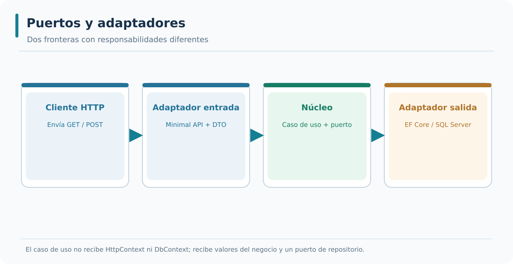

*Interpretación del gráfico:* identifica las referencias de código que admite el diseño y distingue esas relaciones de las llamadas en ejecución. La figura está disponible como SVG vectorial y como PNG para consulta externa.

### Bloque 2 — El adaptador como implementación del puerto

Un adaptador es una clase que implementa un puerto y conecta el núcleo con una tecnología concreta. Los adaptadores se sitúan en las capas exteriores y dependen de las interfaces definidas en el núcleo. Un adaptador de entrada recibe peticiones del exterior y las traduce en llamadas a los puertos de entrada. Un adaptador de salida implementa un puerto de salida y traduce las llamadas del núcleo en operaciones sobre la tecnología concreta. Los adaptadores son intercambiables: se puede sustituir un adaptador de base de datos por un adaptador en memoria sin modificar el núcleo.

```csharp
// Puerto de salida definido en la aplicación
public interface IOrdenRepositorio
{
    Task AddAsync(Orden orden);
}

// Adaptador de salida en la infraestructura
public class OrdenRepositorioSqlServer : IOrdenRepositorio
{
    private readonly AceriaDbContext _db;

    public OrdenRepositorioSqlServer(AceriaDbContext db)
    {
        _db = db;
    }

    public async Task AddAsync(Orden orden)
    {
        _db.Ordenes.Add(orden);
        await _db.SaveChangesAsync();
    }
}
```

- **Línea 1:** `// Puerto de salida definido en la aplicación` → comentario de ubicación.
- **Línea 2:** `public interface IOrdenRepositorio` → puerto de salida.
- **Línea 3:** `{` → abre el cuerpo.
- **Línea 4:** `Task AddAsync(Orden orden);` → método del puerto.
- **Línea 5:** `}` → cierra el cuerpo.
- **Línea 6:** `// Adaptador de salida en la infraestructura` → comentario de ubicación.
- **Línea 7:** `public class OrdenRepositorioSqlServer : IOrdenRepositorio` → adaptador concreto.
- **Línea 8:** `{` → abre el cuerpo.
- **Línea 9:** `private readonly AceriaDbContext _db;` → dependencia del contexto.
- **Línea 10:** `public OrdenRepositorioSqlServer(AceriaDbContext db)` → constructor.
- **Línea 11:** `{` → abre el cuerpo del constructor.
- **Línea 12:** `_db = db;` → asigna el contexto.
- **Línea 13:** `}` → cierra el constructor.
- **Línea 14:** `public async Task AddAsync(Orden orden)` → implementación del método.
- **Línea 15:** `{` → abre el cuerpo del método.
- **Línea 16:** `_db.Ordenes.Add(orden);` → añade al contexto.
- **Línea 17:** `await _db.SaveChangesAsync();` → persiste los cambios.
- **Línea 18:** `}` → cierra el método.
- **Línea 19:** `}` → cierra la clase.

El adaptador es la única pieza del sistema que conoce la tecnología concreta. El adaptador de base de datos conoce EF Core. El adaptador HTTP conoce HttpClient. El adaptador de mensajería conoce el broker. El núcleo no conoce ninguna de estas tecnologías. La separación permite que el núcleo se pruebe sin infraestructura y que la infraestructura se sustituya sin modificar el núcleo. La separación también permite que un mismo puerto tenga varios adaptadores según el contexto de ejecución.

---


#### Ampliación didáctica aplicada a AceriaApp

**La decisión arquitectónica.** Un adaptador implementa o consume un puerto usando un protocolo o tecnología. `OrdenRepositorioSqlServer` es el adaptador de salida real: aplica el contrato y conoce `HexagonalDbContext`, que a su vez conoce EF Core. La implementación no cambia la idea de «obtener una orden», pero sí define cómo traducir esa petición a una consulta y cómo confirmar los cambios con `SaveChangesAsync`.

**Ejemplo concreto en AceriaApp.** También existe un adaptador de entrada: `HexagonalOrdenesEndpoints`. Este recibe rutas HTTP, interpreta DTOs y convierte el resultado de los casos de uso en `Results.Ok`, `Results.NotFound`, `Results.CreatedAtRoute` y `Results.Problem`. La capa de aplicación no contiene rutas ni códigos de respuesta; por eso el mismo caso de uso podría servir a un consumidor de consola o a un proceso de integración.

**Riesgo, alternativa y límite.** No conviene convertir el adaptador en dueño de las reglas de negocio. Si el repositorio SQL decide que una orden finalizada puede editarse, tendríamos una segunda política escondida en infraestructura; si el endpoint HTTP repite reglas del dominio en cada ruta, las futuras interfaces divergirían. Adaptar formato y protocolo no es equivalente a gobernar el ciclo de vida de la entidad.

**Comprobación técnica y aprendizaje.** El criterio de aceptación consiste en verificar que `OrdenRepositorioSqlServer : IOrdenRepositorio` y que los endpoints usan `OrdenesCasoUso`. El adaptador HTTP no debe inyectar `HexagonalDbContext` para realizar búsquedas; eso haría saltar el puerto.

### Bloque 3 — Puertos de entrada

Un puerto de entrada define una operación que el núcleo ofrece al exterior. Los puertos de entrada se definen como interfaces en la capa de aplicación. Cada método de la interfaz corresponde a un caso de uso. El nombre del método describe la operación en términos del negocio. Los parámetros de entrada son los datos necesarios para ejecutar la operación. El valor de retorno es el resultado de la operación. Los adaptadores de entrada implementan los puertos de entrada y los invocan desde el protocolo correspondiente.

```csharp
public interface IOrdenServicio
{
    Task<Guid> CrearOrdenAsync(string cliente, string material, int cantidad);
    Task<OrdenDto?> ObtenerOrdenAsync(Guid id);
    Task CancelarOrdenAsync(Guid id);
}
```

- **Línea 1:** `public interface IOrdenServicio` → puerto de entrada.
- **Línea 2:** `{` → abre el cuerpo.
- **Línea 3:** `Task<Guid> CrearOrdenAsync(string cliente, string material, int cantidad);` → caso de uso de creación.
- **Línea 4:** `Task<OrdenDto?> ObtenerOrdenAsync(Guid id);` → caso de uso de consulta.
- **Línea 5:** `Task CancelarOrdenAsync(Guid id);` → caso de uso de cancelación.
- **Línea 6:** `}` → cierra el cuerpo.

Los puertos de entrada se caracterizan por tres propiedades. La primera es que describen operaciones en términos del negocio. La segunda es que no dependen del protocolo de comunicación. La tercera es que agrupan los casos de uso de una misma capacidad de negocio. Las tres propiedades permiten que el núcleo se exponga en distintos protocolos sin modificar su código. La definición de puertos de entrada es el primer paso para desacoplar el núcleo del exterior.

---


#### Ampliación didáctica aplicada a AceriaApp

**La decisión arquitectónica.** Los puertos de entrada permiten invocar capacidades del sistema sin obligarlo a conocer el canal. En una versión más elaborada podríamos declarar `ICrearOrden`, `IConsultarOrdenes` o un mediador de comandos. La decisión debe responder a necesidades de reutilización y prueba; no es correcto afirmar que todo caso de uso requiera obligatoriamente una interfaz adicional.

**Ejemplo concreto en AceriaApp.** En M03 mostramos `OrdenesCasoUso` como servicio de aplicación invocado por el adaptador HTTP. Esta clase es una superficie de entrada suficientemente explícita para el alcance del taller: expone `CrearAsync`, `ListarAsync`, `ObtenerAsync` y `FinalizarAsync`. La tecnología HTTP solo aparece en la capa que traduce las peticiones, no en las firmas de esos métodos.

**Riesgo, alternativa y límite.** Un error habitual es trasladar `HttpContext`, `IResult` o el objeto de `HttpRequest` a los parámetros del caso de uso. Esto simplifica temporalmente el mapeo en el endpoint, pero bloquea cualquier cliente no HTTP y vuelve frágiles los tests de aplicación. Un contrato de entrada recibe valores de negocio y ofrece resultados interpretables por distintos adaptadores.

**Comprobación técnica y aprendizaje.** Diseña una segunda entrada hipotética desde un proceso de importación CSV: ¿qué datos usaría para llamar a `CrearAsync`? Debería utilizar cliente, material y cantidad, no construir artificialmente una petición HTTP. Esta prueba mental verifica la calidad del límite.

### Bloque 4 — Puertos de salida

Un puerto de salida define una operación que el núcleo necesita del exterior. Los puertos de salida se definen como interfaces en la capa de aplicación. Cada método de la interfaz corresponde a una operación sobre el exterior. El nombre del método describe la operación en términos técnicos. Los parámetros de entrada son los datos que el núcleo envía al exterior. El valor de retorno es la respuesta del exterior. Los adaptadores de salida implementan los puertos de salida y los invocan desde la tecnología correspondiente.

```csharp
public interface IOrdenRepositorio
{
    Task AddAsync(Orden orden);
    Task<Orden?> GetByIdAsync(Guid id);
    Task UpdateAsync(Orden orden);
    Task DeleteAsync(Guid id);
}

public interface IPublicadorEventos
{
    Task PublicarAsync(string tipo, object contenido);
}
```

- **Línea 1:** `public interface IOrdenRepositorio` → puerto de salida del repositorio.
- **Línea 2:** `{` → abre el cuerpo.
- **Línea 3:** `Task AddAsync(Orden orden);` → añadir una orden.
- **Línea 4:** `Task<Orden?> GetByIdAsync(Guid id);` → obtener una orden por identificador.
- **Línea 5:** `Task UpdateAsync(Orden orden);` → actualizar una orden.
- **Línea 6:** `Task DeleteAsync(Guid id);` → eliminar una orden.
- **Línea 7:** `}` → cierra el cuerpo.
- **Línea 8:** `public interface IPublicadorEventos` → puerto de salida del publicador.
- **Línea 9:** `{` → abre el cuerpo.
- **Línea 10:** `Task PublicarAsync(string tipo, object contenido);` → publicar un evento.
- **Línea 11:** `}` → cierra el cuerpo.

Los puertos de salida se caracterizan por tres propiedades. La primera es que describen operaciones técnicas que el núcleo necesita. La segunda es que no dependen de la tecnología concreta. La tercera es que agrupan las operaciones sobre un mismo recurso externo. Las tres propiedades permiten que el núcleo se pruebe con adaptadores en memoria y que la infraestructura se sustituya sin modificar el núcleo.

---


#### Ampliación didáctica aplicada a AceriaApp

**La decisión arquitectónica.** Los puertos de salida corresponden a efectos que el núcleo solicita pero que no debe ejecutar directamente. Persistencia, mensajería, correo, reloj del sistema y archivos pueden necesitar puertos cuando sus implementaciones son variables y significativas. En el caso de órdenes, necesitamos almacenar datos, por eso presentamos `IOrdenRepositorio` en la aplicación y un adaptador EF Core externo.

**Ejemplo concreto en AceriaApp.** La interfaz debe usar términos del negocio y ser lo bastante pequeña para expresar las necesidades del proceso. `GuardarAsync` significa confirmar el estado de una orden existente, no exponer `SaveChangesAsync` de EF Core como un detalle de transacción arbitrario. El adaptador decidirá si utiliza tracking, `Update` o un patrón de unidad de trabajo, siempre manteniendo el resultado comprometido.

**Riesgo, alternativa y límite.** No todas las dependencias necesitan puerto. Si una función pura de cálculo opera exclusivamente sobre tipos de dominio, introducir una interfaz puede añadir ceremonia sin beneficio. La decisión sobre un puerto debe justificarse por el efecto externo, la sustituibilidad y la facilidad de prueba, no por la regla mecánica «una interfaz por clase».

**Comprobación técnica y aprendizaje.** Para comprobar el diseño, sustituye conceptualmente `OrdenRepositorioSqlServer` por un repositorio en memoria que conserva datos por GUID. Si el servicio de aplicación ni siquiera necesita recompilar porque la interfaz permanece idéntica, el límite ha hecho su trabajo.

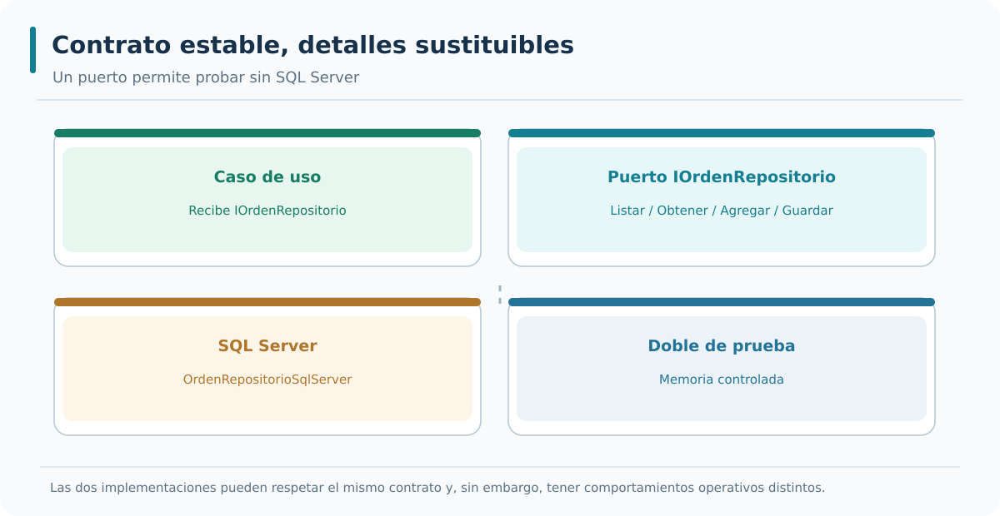

*Interpretación del gráfico:* identifica las referencias de código que admite el diseño y distingue esas relaciones de las llamadas en ejecución. La figura está disponible como SVG vectorial y como PNG para consulta externa.

### Bloque 5 — Adaptadores de entrada

Un adaptador de entrada recibe peticiones del exterior y las traduce en llamadas a los puertos de entrada. Los adaptadores de entrada se sitúan en la capa de presentación. Cada adaptador de entrada corresponde a un protocolo de comunicación. El adaptador HTTP recibe peticiones HTTP y las traduce en llamadas a los métodos del puerto de entrada. El adaptador de mensajería recibe mensajes y los traduce en llamadas a los métodos del puerto de entrada. El adaptador de consola recibe argumentos y los traduce en llamadas a los métodos del puerto de entrada.

```csharp
app.MapPost("/api/v1/ordenes", async (
    CrearOrdenRequest request,
    IOrdenServicio servicio) =>
{
    var id = await servicio.CrearOrdenAsync(request.Cliente, request.Material, request.Cantidad);
    return Results.Created($"/api/v1/ordenes/{id}", new { id });
});
```

- **Línea 1:** `app.MapPost("/api/v1/ordenes", async (` → declara el endpoint HTTP.
- **Línea 2:** `CrearOrdenRequest request,` → recibe la petición.
- **Línea 3:** `IOrdenServicio servicio) =>` → inyecta el puerto de entrada.
- **Línea 4:** `{` → abre el cuerpo del lambda.
- **Línea 5:** `var id = await servicio.CrearOrdenAsync(request.Cliente, request.Material, request.Cantidad);` → invoca el caso de uso.
- **Línea 6:** `return Results.Created($"/api/v1/ordenes/{id}", new { id });` → devuelve 201 con la ubicación.
- **Línea 7:** `});` → cierra el lambda.

Los adaptadores de entrada se caracterizan por tres propiedades. La primera es que traducen entre el protocolo y los puertos de entrada. La segunda es que no contienen reglas de negocio. La tercera es que pueden coexistir varios adaptadores para el mismo puerto. Las tres propiedades permiten que el mismo caso de uso se exponga en HTTP, gRPC y mensajería sin modificar el núcleo.

---


#### Ampliación didáctica aplicada a AceriaApp

**La decisión arquitectónica.** El adaptador de entrada ASP.NET Core debe ser estrecho: recibe una petición, identifica una operación y responde. En M03 `MapGroup("/api/v1/hexagonal/ordenes")` agrupa los endpoints de órdenes; `MapGet`, `MapPost` y la ruta `/finalizar` no implementan consultas SQL. Se apoyan en `OrdenesCasoUso`, inyectado automáticamente por DI.

**Ejemplo concreto en AceriaApp.** En creación, el request público `CrearOrdenHexagonalRequest` representa el JSON que entiende el consumidor. El adaptador comprueba que no faltan datos y traduce el error de contrato a 400; un exceso de capacidad se traduce a 422. Cuando la aplicación devuelve una nueva entidad, `CreatedAtRoute` genera `Location` para recuperar esa misma orden. La cabecera forma parte del contrato REST y debe mantenerse al migrar la implementación.

**Riesgo, alternativa y límite.** En el límite HTTP puede haber decisiones sobre autenticación, negociación de contenido, versión de ruta y serialización. Ninguna de ellas debe obligar a la entidad a conocer el framework. Si se desea exponer un mismo caso de uso por gRPC, crearemos otro adaptador que comprenda el contrato gRPC pero preserve la lógica de aplicación.

**Comprobación técnica y aprendizaje.** La prueba específica debe comprobar 201 y cabecera `Location`, después GET 200. Una prueba que solo afirma que el endpoint aparece en Swagger demuestra documentación, no que la dependencia con la aplicación esté conectada.

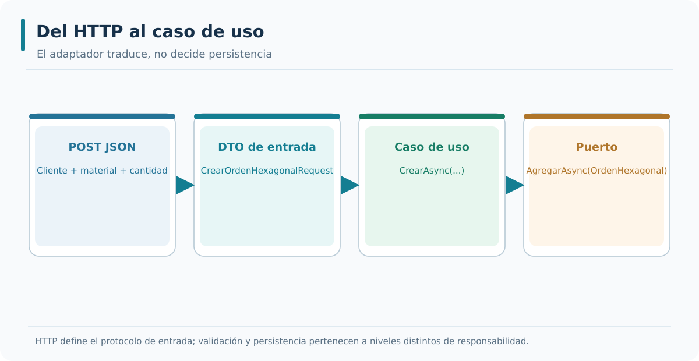

*Interpretación del gráfico:* identifica las referencias de código que admite el diseño y distingue esas relaciones de las llamadas en ejecución. La figura está disponible como SVG vectorial y como PNG para consulta externa.

### Bloque 6 — Adaptadores de salida

Un adaptador de salida implementa un puerto de salida y traduce las llamadas del núcleo en operaciones sobre la tecnología concreta. Los adaptadores de salida se sitúan en la capa de infraestructura. Cada adaptador de salida corresponde a una tecnología concreta. El adaptador de base de datos traduce las llamadas del repositorio en consultas SQL. El adaptador HTTP traduce las llamadas del cliente en peticiones HTTP. El adaptador de mensajería traduce las llamadas del publicador en mensajes al broker. Los adaptadores de salida son intercambiables.

```csharp
public class PublicadorEventosRabbitMq : IPublicadorEventos
{
    private readonly IConnection _connection;

    public PublicadorEventosRabbitMq(IConnection connection)
    {
        _connection = connection;
    }

    public async Task PublicarAsync(string tipo, object contenido)
    {
        using var canal = _connection.CreateModel();
        var cuerpo = Encoding.UTF8.GetBytes(JsonSerializer.Serialize(contenido));
        canal.BasicPublish(
            exchange: "acería.eventos",
            routingKey: tipo,
            basicProperties: null,
            body: cuerpo);
        await Task.CompletedTask;
    }
}
```

- **Línea 1:** `public class PublicadorEventosRabbitMq : IPublicadorEventos` → adaptador concreto.
- **Línea 2:** `{` → abre el cuerpo.
- **Línea 3:** `private readonly IConnection _connection;` → dependencia de la conexión.
- **Línea 4:** `public PublicadorEventosRabbitMq(IConnection connection)` → constructor.
- **Línea 5:** `{` → abre el cuerpo del constructor.
- **Línea 6:** `_connection = connection;` → asigna la conexión.
- **Línea 7:** `}` → cierra el constructor.
- **Línea 8:** `public async Task PublicarAsync(string tipo, object contenido)` → implementación del método.
- **Línea 9:** `{` → abre el cuerpo del método.
- **Línea 10:** `using var canal = _connection.CreateModel();` → crea un canal.
- **Línea 11:** `var cuerpo = Encoding.UTF8.GetBytes(JsonSerializer.Serialize(contenido));` → serializa el contenido.
- **Línea 12:** `canal.BasicPublish(` → publica el mensaje.
- **Línea 13:** `exchange: "acería.eventos",` → nombre del exchange.
- **Línea 14:** `routingKey: tipo,` → clave de enrutamiento.
- **Línea 15:** `basicProperties: null,` → propiedades por defecto.
- **Línea 16:** `body: cuerpo);` → cuerpo del mensaje.
- **Línea 17:** `await Task.CompletedTask;` → completa la tarea.
- **Línea 18:** `}` → cierra el método.
- **Línea 19:** `}` → cierra la clase.

Los adaptadores de salida se caracterizan por tres propiedades. La primera es que implementan un puerto de salida. La segunda es que conocen la tecnología concreta. La tercera es que pueden sustituirse sin modificar el núcleo. Las tres propiedades permiten que la infraestructura evolucione con independencia del núcleo y que el núcleo se pruebe con adaptadores en memoria.

---


#### Ampliación didáctica aplicada a AceriaApp

**La decisión arquitectónica.** El adaptador de salida proporciona una realización concreta del puerto. EF Core convierte los objetos del dominio en operaciones de almacenamiento; los métodos del repositorio traducen los requisitos de la aplicación a consultas y modificaciones. Esa traducción tiene aspectos importantes: lectura sin seguimiento cuando no se modificarán entidades, persistencia explícita cuando cambie el estado y tratamiento correcto de la cancelación.

**Ejemplo concreto en AceriaApp.** El contrato `IOrdenRepositorio.ObtenerAsync` devuelve una orden o `null`; la implementación usa `FirstOrDefaultAsync`. Un `null` no significa un error de infraestructura, sino ausencia de un elemento concreto. El caso de uso decide si continuar o detenerse; el adaptador HTTP lo traduce en un código 404. Esta distribución de responsabilidades impide que el repositorio incluya detalles del protocolo externo.

**Riesgo, alternativa y límite.** Evita que el puerto exponga `DbContextOptions`, `EntityEntry` o `IQueryable`. Sería una abstracción nominal: las pruebas de aplicación volverían a requerir EF Core y el diseño no podría sustituir el motor SQL sin una revisión en cascada. El repositorio implementa el contrato, no lo define.

**Comprobación técnica y aprendizaje.** Para verificar el adaptador, el test de integración levanta `HexagonalDbContext` con un proveedor InMemory en un host aislado y realiza POST→GET a través de la API. Esa prueba comprueba que la ruta, el caso de uso, el puerto y el adaptador se unen, aunque no sustituye una prueba específica de SQL Server en un entorno real.

### Bloque 7 — Relación entre puertos, adaptadores e inversión de dependencias

La relación entre puertos, adaptadores e inversión de dependencias es directa. El puerto se define en el núcleo. El adaptador se define en el exterior. La inversión de dependencias permite que el núcleo dependa del puerto y que el adaptador lo implemente. Sin inversión, el núcleo dependería del adaptador y la regla de dependencia se violaría. La inversión se materializa con la inyección de dependencias: el contenedor resuelve la implementación concreta en tiempo de ejecución y la inyecta en el núcleo.

```csharp
builder.Services.AddScoped<IOrdenRepositorio, OrdenRepositorioSqlServer>();
builder.Services.AddScoped<IOrdenServicio, OrdenServicio>();
```

- **Línea 1:** `builder.Services.AddScoped<IOrdenRepositorio, OrdenRepositorioSqlServer>();` → registra el adaptador de salida.
- **Línea 2:** `builder.Services.AddScoped<IOrdenServicio, OrdenServicio>();` → registra el puerto de entrada.

La inversión de dependencias tiene dos consecuencias prácticas. La primera es que el núcleo no conoce la implementación concreta. La segunda es que la implementación puede sustituirse sin modificar el núcleo. La combinación de ambas permite que el núcleo se pruebe con adaptadores en memoria y que la infraestructura evolucione con independencia del núcleo. La inversión es la técnica que hace posible la arquitectura hexagonal en la práctica.

---


#### Ampliación didáctica aplicada a AceriaApp

**La decisión arquitectónica.** La inversión de dependencias se ve claramente cuando dibujamos dos diagramas: uno de llamadas y otro de referencias. Durante una petición el caso de uso invoca un método implementado por infraestructura, por lo que parece que «aplicación llama a SQL». Pero en el `.csproj` de aplicación no hay referencia a infraestructura. Esto es posible porque la interfaz del puerto está declarada en aplicación, y el código de infraestructura depende de ese contrato.

**Ejemplo concreto en AceriaApp.** El ensamblado `AceriaApp.Hexagonal.Infraestructura` conoce `IOrdenRepositorio` y lo implementa; el proyecto `AceriaApp.Hexagonal.Aplicacion` solo conoce la interfaz y la entidad. El proyecto de arranque `AceriaApp.Api` referencia ambos para establecer el enlace con `AddScoped<IOrdenRepositorio, OrdenRepositorioSqlServer>()`. Esta dependencia del extremo de composición está justificada y no invierte la regla hacia el dominio.

**Riesgo, alternativa y límite.** A veces se crea la interfaz dentro de infraestructura «porque allí está la clase concreta» y después se hace que aplicación la referencie. Esto deja el contrato en el lado equivocado: para cambiar detalles externos hay que tocar la capa que debía permanecer estable. La ubicación de la interfaz es por tanto una decisión arquitectónica y no una preferencia de organización de archivos.

**Comprobación técnica y aprendizaje.** Ejecuta la comprobación estructural: dominio sin referencias y aplicación sin infraestructura. A continuación confirma por HTTP que el adaptador EF Core realmente puede obtener y guardar. Solo la combinación de ambas evidencias certifica que no estamos ante una arquitectura dibujada sin uso.

### Bloque 8 — Puertos primarios y secundarios

Los puertos se clasifican en primarios y secundarios según la dirección de la comunicación. Los puertos primarios son los que el exterior invoca para usar el núcleo. Coinciden con los puertos de entrada. Los puertos secundarios son los que el núcleo invoca para usar el exterior. Coinciden con los puertos de salida. La terminología varía según los autores: algunos usan "driving" y "driven", otros usan "entrada" y "salida". En el curso se usan "puertos de entrada" y "puertos de salida" de forma consistente.

```text
Clasificación de puertos:

Puertos primarios (driving):
- IOrdenServicio (el exterior lo invoca).
- IInventarioServicio (el exterior lo invoca).

Puertos secundarios (driven):
- IOrdenRepositorio (el núcleo lo invoca).
- IPublicadorEventos (el núcleo lo invoca).
```

- **Línea 1:** `Puertos primarios (driving):` → título de los puertos primarios.
- **Línea 2:** `- IOrdenServicio (el exterior lo invoca).` → puerto de entrada.
- **Línea 3:** `- IInventarioServicio (el exterior lo invoca).` → puerto de entrada.
- **Línea 4:** `Puertos secundarios (driven):` → título de los puertos secundarios.
- **Línea 5:** `- IOrdenRepositorio (el núcleo lo invoca).` → puerto de salida.
- **Línea 6:** `- IPublicadorEventos (el núcleo lo invoca).` → puerto de salida.

La clasificación en primarios y secundarios tiene dos consecuencias prácticas. La primera es que ayuda a identificar qué puertos son invocados por el exterior y qué puertos son invocados por el núcleo. La segunda es que facilita la organización del código: los puertos primarios se agrupan con los casos de uso y los secundarios con los servicios externos. La clasificación es útil para comunicar la arquitectura entre los miembros del equipo.

---


#### Ampliación didáctica aplicada a AceriaApp

**La decisión arquitectónica.** La nomenclatura primario/secundario describe quién inicia la interacción respecto al núcleo, no la importancia comercial del componente. Un puerto primario permite entrar para ejecutar una capacidad; un secundario representa un recurso externo que el núcleo solicita. Un endpoint HTTP es un adaptador de entrada, mientras un repositorio de SQL Server es un adaptador de salida.

**Ejemplo concreto en AceriaApp.** Para una petición de creación, el cliente inicia la llamada al adaptador HTTP. Este invoca `CrearAsync`, que solicita almacenamiento mediante el puerto secundario. La dirección de llamadas va del exterior a aplicación y de aplicación al exterior, pero el núcleo no depende de las implementaciones. El puerto define el contrato que deben cumplir los colaboradores.

**Riesgo, alternativa y límite.** Un error común es definir como primario cualquier componente con tráfico de red o llamar secundario al que tenga menos código. La clasificación depende de la función de la frontera, no del tamaño ni del protocolo. Una cola de mensajes podría ser entrada si recibe órdenes externas y salida si publica eventos generados por el sistema.

**Comprobación técnica y aprendizaje.** Dibuja dos casos: HTTP POST para recibir una orden y una hipotética publicación `OrdenFinalizada` hacia un bus de eventos. El primero exige adaptador de entrada; el segundo requiere un puerto de salida para publicar, si realmente forma parte del proceso de negocio.

### Bloque 9 — Cuándo definir un puerto

La definición de un puerto no es obligatoria para todas las dependencias. Se define un puerto cuando la dependencia debe poder sustituirse sin modificar el núcleo. Se define un puerto cuando la dependencia es externa al núcleo: base de datos, servicios HTTP, mensajería, sistema de archivos. Se define un puerto cuando la dependencia requiere pruebas con dobles. No se define un puerto para dependencias internas del núcleo, como las clases del dominio o los servicios internos de la aplicación. La decisión de definir un puerto se basa en la necesidad de sustituir la dependencia.

```text
Cuándo definir un puerto:

Base de datos           → puerto de salida.
Cliente HTTP            → puerto de salida.
Publicador de eventos   → puerto de salida.
Servicio de archivos    → puerto de salida.
Reloj del sistema       → puerto de salida.
Clase interna del dominio → no se define puerto.
```

- **Línea 1:** `Base de datos` → puerto de salida.
- **Línea 2:** `Cliente HTTP` → puerto de salida.
- **Línea 3:** `Publicador de eventos` → puerto de salida.
- **Línea 4:** `Servicio de archivos` → puerto de salida.
- **Línea 5:** `Reloj del sistema` → puerto de salida.
- **Línea 6:** `Clase interna del dominio` → no se define puerto.

La decisión de definir un puerto tiene dos consecuencias prácticas. La primera es que añade una interfaz y una indirección. La segunda es que facilita la sustitución y las pruebas. La combinación de ambas permite que el núcleo sea testeable y que la infraestructura evolucione con independencia del núcleo. La decisión se revisa al final de cada módulo para asegurar que los puertos siguen siendo necesarios.

---


#### Ampliación didáctica aplicada a AceriaApp

**La decisión arquitectónica.** Antes de introducir un puerto hay que saber qué problema resuelve. En el taller, el repositorio de órdenes es un puerto justificado porque persiste datos fuera de la memoria del caso de uso y queremos probar la coordinación sin levantar SQL Server. Una interfaz adicional para un cálculo trivial y puro no aporta el mismo valor. La calidad se aprecia por los cambios que deja de propagar.

**Ejemplo concreto en AceriaApp.** Imagina que el equipo cambia SQL Server por PostgreSQL. Si las firmas de `IOrdenRepositorio` no contienen expresiones SQL específicas, el caso de uso puede conservar su código y solo cambiar el adaptador, su configuración y sus pruebas. En cambio, si el puerto devuelve `DbSet` o exige operaciones de `SaveChanges`, el cambio de proveedor afectará a los consumidores.

**Riesgo, alternativa y límite.** Un puerto tampoco debe ser un contrato genérico de base de datos que permita cualquier consulta. Esa flexibilidad aparente obliga a los casos de uso a conocer detalles de persistencia. Es preferible agrupar operaciones relacionadas con las necesidades de órdenes y mantener invariantes del dominio dentro del propio dominio.

**Comprobación técnica y aprendizaje.** Para cada interfaz propuesta escribe: quién la utiliza, qué tecnología oculta, qué caso de uso la necesita, qué operación no debería exponer y cómo la simularías en un test. Si no hay una respuesta concreta, considera posponer su creación.

### Bloque 10 — Aplicación al proyecto del curso

El proyecto del curso aplica los puertos y adaptadores en el módulo 3. Los puertos de entrada se definen en la capa de aplicación y agrupan los casos de uso de cada capacidad de negocio. Los puertos de salida se definen en la capa de aplicación y agrupan las operaciones sobre recursos externos. Los adaptadores de entrada se sitúan en la capa de presentación y traducen entre el protocolo y los puertos de entrada. Los adaptadores de salida se sitúan en la capa de infraestructura y traducen entre los puertos de salida y la tecnología concreta. La inversión de dependencias se aplica con el contenedor de dependencias.

```text
Aplicación al proyecto del curso:

Puertos de entrada   → IOrdenServicio, IInventarioServicio.
Puertos de salida    → IOrdenRepositorio, IInventarioRepositorio, IPublicadorEventos.
Adaptadores entrada  → endpoints de Minimal API.
Adaptadores salida   → repositorios SQL Server, publicador de eventos.
Inversión            → registro en el contenedor de dependencias.
```

- **Línea 1:** `Puertos de entrada` → interfaces de casos de uso.
- **Línea 2:** `Puertos de salida` → interfaces de operaciones sobre recursos externos.
- **Línea 3:** `Adaptadores entrada` → endpoints de Minimal API.
- **Línea 4:** `Adaptadores salida` → repositorios SQL Server, publicador de eventos.
- **Línea 5:** `Inversión` → registro en el contenedor.

La aplicación de los puertos y adaptadores prepara el proyecto para los puntos 3.3 y 3.4. El punto 3.3 estudiará la separación entre dominio, aplicación e infraestructura con detalle. El punto 3.4 estudiará la implementación de la arquitectura hexagonal en ASP.NET Core. El punto 3.2 establece los conceptos que se aplicarán en los dos puntos siguientes.

---

### Resumen rápido de la teoría

- Un puerto es una interfaz que define cómo el núcleo se comunica con el exterior.
- Un adaptador es una clase que implementa un puerto y conecta el núcleo con una tecnología concreta.
- Los puertos de entrada definen lo que el núcleo ofrece al exterior.
- Los puertos de salida definen lo que el núcleo necesita del exterior.
- Los adaptadores de entrada traducen entre el protocolo y los puertos de entrada.
- Los adaptadores de salida traducen entre los puertos de salida y la tecnología concreta.
- La inversión de dependencias permite que el núcleo dependa de los puertos y que los adaptadores los implementen.
- Los puertos se definen en el núcleo y los adaptadores en el exterior.

---


#### Ampliación didáctica aplicada a AceriaApp

**La decisión arquitectónica.** Al final de 3.2, el alumno habrá catalogado puertos y adaptadores y comprobado sus reglas mediante tests. Eso refuerza la comprensión, pero no debemos confundir el catálogo con la implementación final de una API hexagonal. En la secuencia de este curso, los proyectos físicos llegan en 3.3, y la ruta real que utiliza un repositorio a través de un puerto se registra en 3.4.

**Ejemplo concreto en AceriaApp.** La transición de M02 a M03 debe respetar los contratos ya publicados. M02 mantiene `/api/v1/ordenes`; M03 expone un grupo adicional `/api/v1/hexagonal/ordenes`. Esta decisión didáctica evita atribuir a las rutas existentes una refactorización que todavía no realizamos y permite comparar dos estilos de implementación en una solución real.

**Riesgo, alternativa y límite.** Un ejercicio valioso consiste en comparar la firma de un GET M02 con la del GET hexagonal. En M02 se inyecta `AceriaDbContext`; en M03 se inyecta `OrdenesCasoUso`. Las respuestas a los clientes pueden ser equivalentes, pero las dependencias y los lugares de prueba han cambiado. Esta es la evidencia de que el puerto no es únicamente un nombre.

**Comprobación técnica y aprendizaje.** Al evaluar la etapa, exige que todos los tests acumulados del curso sigan pasando y que las dos carpetas de proyectos se correspondan con sus pasos de laboratorio. No marques 3.2 «hexagonal completa» hasta conectar los adaptadores reales en la etapa 3.4.


## Estudio integrador 3.2 — Un mismo caso de uso, dos entradas posibles

### De HTTP al núcleo sin arrastrar el protocolo

Un consumidor de AceriaApp envía POST a `/api/v1/hexagonal/ordenes` con un JSON de entrada. El adaptador HTTP recibe el cuerpo, comprueba datos obligatorios y llama a `OrdenesCasoUso.CrearAsync`. Este método no recibe `HttpRequest`, `IResult` ni una ruta: recibe tres valores del dominio y el token de cancelación. El mismo caso de uso sería invocable desde un comando de consola o desde una tarea de integración que leyera un CSV con pedidos, sin necesidad de fabricar peticiones HTTP artificiales.

La diferencia entre interfaces se ve al proponer una entrada alternativa. Un archivo CSV aporta columnas Cliente, Material y Cantidad y un adaptador de importación las transforma en llamadas a `CrearAsync`. Al final del procesamiento puede registrar un informe de éxito por fila, mientras HTTP emite 201 o 400. Si el caso de uso devolviera directamente un objeto `Results.Created`, la importación tendría que referenciar ASP.NET Core sin necesidad. Por eso los puertos de entrada y las superficies de aplicación no deben arrastrar tipos tecnológicos cuando no aportan significado de negocio.

### De la aplicación al almacenamiento con un contrato mínimo

Para guardar la orden, el caso de uso solicita `IOrdenRepositorio.AgregarAsync`. Este contrato no expone métodos de EF Core. La implementación real `OrdenRepositorioSqlServer` conoce DbContext, tabla y conexión; una implementación de prueba puede conservar las órdenes en memoria. Ambas pueden usar GUID como identidad de la entidad. La aplicación no necesita decidir cómo se traduce una consulta a SQL.

Conviene distinguir semántica y tecnología. Un repositorio InMemory puede guardar un objeto en una lista y uno SQL puede necesitar transacciones. Los dos deben cumplir que una orden agregada sea recuperable por su Id. No tienen por qué tener idénticas características de consistencia distribuida o de ejecución de consultas; una prueba de integración con SQL Server sería necesaria para validar particularidades del motor. La arquitectura desacopla, pero no suprime la obligación de probar el adaptador elegido.

### Contratos que no deben crecer accidentalmente

Hay dos señales claras de fuga de infraestructura: devolver `IQueryable<OrdenHexagonal>` desde el puerto o pedir `DbContextOptions` como argumento del caso de uso. En ambos casos, la aplicación termina conociendo cómo se construye una consulta o un contexto EF. La abstracción deja de protegernos cuando se convierte en un espejo de la biblioteca externa.

Como actividad de razonamiento, prepara una tabla de cuatro columnas: **operación de negocio**, **método del puerto**, **implementación EF**, **prueba independiente**. Para «obtener una orden» el puerto se llama `ObtenerAsync`, el adaptador puede usar `FirstOrDefaultAsync` y la prueba independiente utiliza un fake del puerto. Para «finalizar» el caso de uso invoca `Finalizar()` y después `GuardarAsync`; el adaptador debe guardar el estado cambiado. El endpoint HTTP únicamente traduce el resultado a 200, 404 o 409.

Con esta tabla resulta más claro por qué un adaptador de entrada y uno de salida son distintos: el primero traduce una conversación con el consumidor; el segundo realiza un efecto solicitado por el núcleo. Ambos se pueden modificar sin desplazar la lógica de negocio a sus respectivos protocolos.

#### Aplicación al repositorio vigente y corrección de alcance

El contenido del punto 3.2 se aplica al servicio de órdenes que ya funciona en M02. Se parte de la Minimal API construida en el módulo anterior. Los modelos que representan relaciones arquitectónicas son útiles para razonar y probar reglas; por sí solos no convierten el código en una arquitectura hexagonal. Por eso, las prácticas de este módulo también construyen interfaces de aplicación, implementaciones de infraestructura y conexión HTTP real. El proyecto compilado y los tests demuestran la diferencia entre declarar un puerto y utilizarlo en ejecución.


---

# Punto 3.3 — Separación entre dominio, aplicación e infraestructura

**Módulo 3:** Arquitectura hexagonal

**Objetivos de aprendizaje:**

- Comprender la separación física entre dominio, aplicación e infraestructura.
- Comprender las ventajas de la separación en proyectos independientes.
- Comprender la relación entre la separación física y la regla de dependencia.
- Comprender la configuración de referencias entre proyectos.
- Añadir al proyecto `AceriaApp` una clase de validación de la separación entre proyectos y un test unitario que verifique la validación.

---

## Desarrollo teórico

### Bloque 1 — Separación física frente a separación lógica

La separación entre dominio, aplicación e infraestructura se puede realizar de dos formas: lógica o física. La separación lógica agrupa las capas en carpetas dentro de un mismo proyecto. La separación física agrupa las capas en proyectos independientes. Ambas formas respetan la regla de dependencia, pero tienen consecuencias distintas. La separación lógica es más sencilla de mantener porque no requiere configurar referencias entre proyectos. La separación física es más estricta porque el compilador impide las violaciones de la regla de dependencia. La elección entre ambas depende del tamaño del sistema y de la disciplina del equipo.

```text
Separación lógica:
AceriaApp.Monolito.Api/
├── Dominio/
├── Aplicacion/
└── Infraestructura/

Separación física:
AceriaApp.Monolito.Dominio/
AceriaApp.Monolito.Aplicacion/
AceriaApp.Monolito.Infraestructura/
AceriaApp.Monolito.Api/
```

- **Línea 1:** `Separación lógica:` → título de la primera forma.
- **Línea 2:** `AceriaApp.Monolito.Api/` → proyecto único.
- **Línea 3:** `├── Dominio/` → carpeta de dominio.
- **Línea 4:** `├── Aplicacion/` → carpeta de aplicación.
- **Línea 5:** `└── Infraestructura/` → carpeta de infraestructura.
- **Línea 6:** `Separación física:` → título de la segunda forma.
- **Línea 7:** `AceriaApp.Monolito.Dominio/` → proyecto de dominio.
- **Línea 8:** `AceriaApp.Monolito.Aplicacion/` → proyecto de aplicación.
- **Línea 9:** `AceriaApp.Monolito.Infraestructura/` → proyecto de infraestructura.
- **Línea 10:** `AceriaApp.Monolito.Api/` → proyecto de presentación.

La separación física tiene tres ventajas medibles. La primera es que el compilador impide las violaciones de la regla de dependencia: si el dominio intenta referenciar la infraestructura, el proyecto no compila. La segunda es que las dependencias son visibles en el archivo `.csproj` de cada proyecto. La tercera es que los tests pueden referenciar solo los proyectos que necesitan. La separación lógica no ofrece estas ventajas porque todas las capas comparten el mismo proyecto y las violaciones solo se detectan con revisión manual.

---


#### Ampliación didáctica aplicada a AceriaApp

**La decisión arquitectónica.** La separación lógica existe cuando el código se organiza por responsabilidades aunque permanezca en un único ensamblado. La separación física aparece cuando distintos proyectos .NET y sus referencias controlan qué conoce cada módulo. La segunda ofrece un límite verificable por el compilador: un tipo no está disponible si su proyecto no se referencia. Ese límite hace visibles las violaciones antes del despliegue.

**Ejemplo concreto en AceriaApp.** En AceriaApp pasamos de carpetas ilustrativas `Capas` y `PuertosAdaptadores` dentro de la API a tres proyectos nuevos en 3.3. Dominio contiene la entidad; Aplicación contiene puerto y casos de uso; Infraestructura implementa EF Core. La API permanece como host y composición. Así el alumno puede abrir los `.csproj` y comprobar qué referencia cada proyecto.

**Riesgo, alternativa y límite.** No debemos concluir que dividir una solución en varios ensamblados es siempre mejor. El aumento de proyectos añade un coste de compilación, publicación y comprensión. La separación resulta útil cuando ayuda a prevenir dependencias de alto impacto, permite probar en aislamiento o organiza un sistema donde distintas responsabilidades cambian a ritmos distintos.

**Comprobación técnica y aprendizaje.** La evidencia mínima de una separación física consiste en compilar `AceriaApp.Hexagonal.Dominio.csproj` sin la API, después compilar Aplicación y finalmente toda la solución. Si dominio necesita instalar EF Core o ASP.NET Core, se ha introducido un acoplamiento que el nombre de proyecto no soluciona.

### Bloque 2 — Proyecto de dominio

El proyecto de dominio contiene las entidades, los value objects, los agregados y las reglas de negocio. No referencia ningún otro proyecto del sistema. No referencia paquetes de infraestructura ni de framework web. El único paquete que puede referenciar es el propio framework base de .NET. El proyecto de dominio es el más estable del sistema y el que cambia con menos frecuencia. Los cambios en el dominio se propagan al resto del sistema.

```text
AceriaApp.Monolito.Dominio/
├── Orden.cs
├── LineaOrden.cs
├── Material.cs
└── Cliente.cs
```

- **Línea 1:** `AceriaApp.Monolito.Dominio/` → proyecto de dominio.
- **Línea 2:** `Orden.cs` → entidad de orden.
- **Línea 3:** `LineaOrden.cs` → entidad de línea de orden.
- **Línea 4:** `Material.cs` → entidad de material.
- **Línea 5:** `Cliente.cs` → entidad de cliente.

El proyecto de dominio se caracteriza por tres propiedades. La primera es que no referencia otros proyectos del sistema. La segunda es que no referencia paquetes de infraestructura. La tercera es que sus entidades no tienen dependencias externas. Las tres propiedades garantizan que el dominio sea independiente y reutilizable. La independencia permite que el dominio se pruebe sin base de datos ni framework web.

---


#### Ampliación didáctica aplicada a AceriaApp

**La decisión arquitectónica.** El proyecto de dominio debe poder explicarse sin decir «endpoint», «SQL» o «Swagger». En la acería contiene una entidad orden y sus reglas de identidad, datos mínimos y estado de producción. La clase concreta `OrdenHexagonal` mantiene sus propiedades con acceso controlado y ofrece `Finalizar()` como operación de negocio. La decisión de cómo exponer esa orden públicamente no se codifica aquí.

**Ejemplo concreto en AceriaApp.** Un dominio independiente admite pruebas baratas y rápidas. Crear una entidad, terminarla y probar que no puede terminarse dos veces es una prueba de reglas, no de conectividad. Cuando una excepción o un resultado de negocio emerge de esa operación, el adaptador externo decide qué respuesta corresponde. De ese modo, una futura interfaz distinta puede reutilizar la misma regla.

**Riesgo, alternativa y límite.** Se debe evitar que el proyecto de dominio importe bibliotecas EF Core o tipos ASP.NET. La infraestructura puede mapear la entidad desde `OnModelCreating` y configurarle propiedades; el dominio no debe incorporar atributos de tabla solo para complacer al ORM. Excepciones por invariantes del propio objeto son legítimas si expresan un estado del negocio.

**Comprobación técnica y aprendizaje.** Inspecciona el archivo `AceriaApp.Hexagonal.Dominio.csproj`: no contiene `ProjectReference` ni paquete EF. Intenta compilar solo ese proyecto y verifica que no depende de la configuración de LocalDB. Esta prueba tiene más significado arquitectónico que contar cuántas clases contiene la carpeta.

### Bloque 3 — Proyecto de aplicación

El proyecto de aplicación contiene los casos de uso, los puertos y las interfaces de los repositorios. Referencia el proyecto de dominio. No referencia el proyecto de infraestructura. No referencia el proyecto de presentación. Define las interfaces que la infraestructura implementa y los contratos que la presentación consume. El proyecto de aplicación es el orquestador del sistema.

```text
AceriaApp.Monolito.Aplicacion/
├── Puertos/
│   ├── Entrada/
│   │   └── IOrdenServicio.cs
│   └── Salida/
│       ├── IOrdenRepositorio.cs
│       └── IPublicadorEventos.cs
└── Servicios/
    └── OrdenServicio.cs
```

- **Línea 1:** `AceriaApp.Monolito.Aplicacion/` → proyecto de aplicación.
- **Línea 2:** `Puertos/` → carpeta de puertos.
- **Línea 3:** `Entrada/` → puertos de entrada.
- **Línea 4:** `IOrdenServicio.cs` → puerto de entrada del servicio de órdenes.
- **Línea 5:** `Salida/` → puertos de salida.
- **Línea 6:** `IOrdenRepositorio.cs` → puerto de salida del repositorio.
- **Línea 7:** `IPublicadorEventos.cs` → puerto de salida del publicador.
- **Línea 8:** `Servicios/` → carpeta de servicios.
- **Línea 9:** `OrdenServicio.cs` → implementación del puerto de entrada.

El proyecto de aplicación se caracteriza por tres propiedades. La primera es que referencia solo el proyecto de dominio. La segunda es que define las interfaces que la infraestructura implementa. La tercera es que no conoce la tecnología concreta. Las tres propiedades garantizan que la aplicación sea independiente de la infraestructura y de la presentación. La independencia permite que la aplicación se pruebe con adaptadores en memoria.

---


#### Ampliación didáctica aplicada a AceriaApp

**La decisión arquitectónica.** El proyecto de aplicación requiere el vocabulario del dominio, pero no los detalles técnicos de almacenamiento. `IOrdenRepositorio` declara lo que la aplicación necesita del exterior, y `OrdenesCasoUso` coordina las intenciones de listar, obtener, crear y finalizar. Por eso el `.csproj` de aplicación solo referencia Dominio. El compilador hace cumplir esa frontera cuando los tipos concretos de infraestructura no están disponibles.

**Ejemplo concreto en AceriaApp.** En creación, el caso de uso limita la capacidad a 500 y construye la entidad. En finalización, obtiene la orden mediante el puerto, invoca la regla del dominio y solicita guardar. Si no encuentra el identificador, devuelve `null` para que un adaptador de entrada traduzca ese hecho. No es responsabilidad del caso de uso construir un `Results.NotFound()` ni obtener el host de ASP.NET Core.

**Riesgo, alternativa y límite.** Un error de diseño es usar `new SqlConnection` o `new HexagonalDbContext` dentro de `OrdenesCasoUso`; el servicio pasaría a depender de infraestructura y sería difícil de probar sin base. Otro error es usar un «servicio de aplicación» para agrupar todas las clases sin respetar capacidades: la separación quedaría en una sola fachada que no expresa flujos coherentes.

**Comprobación técnica y aprendizaje.** Para demostrar la independencia, un test puede implementar un `IOrdenRepositorio` falso con una lista y comprobar qué métodos invoca el caso de uso. El resultado no depende de SQL Server. Además, el proyecto de aplicación compila sin referenciar Infraestructura.

### Bloque 4 — Proyecto de infraestructura

El proyecto de infraestructura contiene las implementaciones concretas de los puertos de salida. Referencia el proyecto de aplicación y el proyecto de dominio. No referencia el proyecto de presentación. Implementa los repositorios, los clientes HTTP, los publicadores de eventos y los adaptadores a servicios externos. El proyecto de infraestructura es el que conoce la tecnología concreta.

```text
AceriaApp.Monolito.Infraestructura/
├── Persistencia/
│   ├── AceriaDbContext.cs
│   └── OrdenRepositorioSqlServer.cs
├── Mensajeria/
│   └── PublicadorEventosRabbitMq.cs
└── Clientes/
    └── ClienteInventarioHttp.cs
```

- **Línea 1:** `AceriaApp.Monolito.Infraestructura/` → proyecto de infraestructura.
- **Línea 2:** `Persistencia/` → carpeta de persistencia.
- **Línea 3:** `AceriaDbContext.cs` → contexto de EF Core.
- **Línea 4:** `OrdenRepositorioSqlServer.cs` → adaptador de repositorio.
- **Línea 5:** `Mensajeria/` → carpeta de mensajería.
- **Línea 6:** `PublicadorEventosRabbitMq.cs` → adaptador de publicador.
- **Línea 7:** `Clientes/` → carpeta de clientes HTTP.
- **Línea 8:** `ClienteInventarioHttp.cs` → adaptador de cliente HTTP.

El proyecto de infraestructura se caracteriza por tres propiedades. La primera es que referencia los proyectos de aplicación y dominio. La segunda es que implementa las interfaces definidas en la aplicación. La tercera es que conoce la tecnología concreta. Las tres propiedades permiten que la infraestructura se sustituya sin modificar el núcleo. La sustitución se realiza cambiando la implementación y el registro en el contenedor de dependencias.

---


#### Ampliación didáctica aplicada a AceriaApp

**La decisión arquitectónica.** El proyecto de infraestructura contiene implementaciones y se permite que dependa de las interfaces de aplicación y los tipos de dominio. En nuestro ejemplo hay cuatro piezas: `HexagonalDbContext`, `OrdenRepositorioSqlServer`, `ServiciosHexagonales` para registros DI y el `.csproj` con EF Core SQL Server. No hay necesidad de copiar todas esas clases en la aplicación.

**Ejemplo concreto en AceriaApp.** El contexto hace el mapeo `OrdenHexagonal` a `OrdenesHexagonales`. El repositorio traduce `AgregarAsync` a `AddAsync` y `SaveChangesAsync`, y `GuardarAsync` a una actualización confirmada. En la lectura se utiliza `AsNoTracking` para listados, mientras que una operación que cambia estado requiere el objeto rastreado o una actualización adecuada. Estas diferencias afectan a persistencia, no al contrato del caso de uso.

**Riesgo, alternativa y límite.** El riesgo es introducir en infraestructura reglas que deberían ser del núcleo, como permitir finalizar dos veces una orden. Si el repositorio decide transiciones de estado, quedaría un comportamiento diferente entre SQL Server e InMemory. Los adaptadores deben mantener el significado del contrato y los tests deben cubrir qué pasa cuando cambian los efectos.

**Comprobación técnica y aprendizaje.** Comprueba que el `.csproj` de infraestructura referencia aplicación y dominio y contiene EF Core. Después busca en dominio y aplicación cualquier referencia a `AceriaApp.Hexagonal.Infraestructura`: no debería existir. Ese análisis convierte el diagrama en una regla que el E2E puede ejecutar.

### Bloque 5 — Proyecto de presentación

El proyecto de presentación contiene los endpoints, los controladores y los puntos de entrada al sistema. Referencia el proyecto de aplicación. No referencia el proyecto de infraestructura directamente: la infraestructura se registra en el contenedor de dependencias del proyecto de presentación. El proyecto de presentación es el que arranca la aplicación y configura los servicios.

```text
AceriaApp.Monolito.Api/
├── Program.cs
├── Endpoints/
│   └── OrdenesEndpoints.cs
└── appsettings.json
```

- **Línea 1:** `AceriaApp.Monolito.Api/` → proyecto de presentación.
- **Línea 2:** `Program.cs` → punto de entrada y configuración.
- **Línea 3:** `Endpoints/` → carpeta de endpoints.
- **Línea 4:** `OrdenesEndpoints.cs` → endpoints de órdenes.
- **Línea 5:** `appsettings.json` → configuración.

El proyecto de presentación se caracteriza por tres propiedades. La primera es que referencia el proyecto de aplicación. La segunda es que registra la infraestructura en el contenedor de dependencias. La tercera es que expone los endpoints. Las tres propiedades permiten que el sistema se exponga en distintos protocolos sin modificar el núcleo. La presentación es el único proyecto que conoce el protocolo HTTP.

---


#### Ampliación didáctica aplicada a AceriaApp

**La decisión arquitectónica.** La presentación decide cómo habla el exterior con el sistema. En M03 se conserva la aplicación ASP.NET Core de M02 y se incorpora una carpeta `Hexagonal` con rutas nuevas. Esa elección permite comparar los endpoints clásicos que inyectan `AceriaDbContext` con los nuevos que inyectan `OrdenesCasoUso`. La diferencia central es quién conoce el mecanismo de persistencia.

**Ejemplo concreto en AceriaApp.** Los DTOs de presentación `CrearOrdenHexagonalRequest` y `OrdenHexagonalDto` existen para el contrato público. La entidad de dominio no debe serializarse directamente sin valorar sus invariantes y los datos que queremos exponer. En la respuesta al POST, `CreatedAtRoute` construye una URL pública; su nombre de ruta corresponde al GET por GUID de la misma API.

**Riesgo, alternativa y límite.** No confundas el hecho de tener un servidor web con disponer de una arquitectura de entrada bien separada. Una Minimal API puede crecer de manera acoplada si incorpora consultas SQL dentro de cada handler. La función de esta capa es traducir, validar forma y delegar el proceso. Las decisiones de negocio deben permanecer más adentro.

**Comprobación técnica y aprendizaje.** Una prueba de HTTP puede enviar un JSON válido, recibir 201, extraer `Location` y llamar al GET. También puede enviar un cliente vacío y observar 400. Esos hechos demuestran que el adaptador funciona, no que el dominio conozca HTTP.

### Bloque 6 — Configuración de referencias entre proyectos

La configuración de referencias entre proyectos se realiza con el comando `dotnet add reference` o con el panel de Visual Studio. Cada proyecto referencia solo los proyectos que necesita según la regla de dependencia. La configuración se verifica con un test que comprueba las referencias del archivo `.csproj`. La verificación automática evita que se añadan referencias que violan la regla.

```text
Referencias entre proyectos:

AceriaApp.Monolito.Dominio/         → sin referencias.
AceriaApp.Monolito.Aplicacion/      → referencia Dominio.
AceriaApp.Monolito.Infraestructura/ → referencia Aplicacion y Dominio.
AceriaApp.Monolito.Api/             → referencia Aplicacion e Infraestructura.
```

- **Línea 1:** `AceriaApp.Monolito.Dominio/` → sin referencias.
- **Línea 2:** `AceriaApp.Monolito.Aplicacion/` → referencia Dominio.
- **Línea 3:** `AceriaApp.Monolito.Infraestructura/` → referencia Aplicacion y Dominio.
- **Línea 4:** `AceriaApp.Monolito.Api/` → referencia Aplicacion e Infraestructura.

La configuración de referencias tiene dos consecuencias prácticas. La primera es que el compilador impide las violaciones de la regla. La segunda es que las dependencias son visibles en el archivo `.csproj`. La combinación de ambas permite que la separación física sea verificable de forma automática. El proyecto de presentación referencia la infraestructura porque necesita registrar las implementaciones en el contenedor de dependencias.

---


#### Ampliación didáctica aplicada a AceriaApp

**La decisión arquitectónica.** Las referencias de proyecto son reglas arquitectónicas que podemos inspeccionar. Un conjunto sano es: Aplicación → Dominio; Infraestructura → Aplicación y Dominio; API → Aplicación e Infraestructura para componer. No aparece ninguna flecha saliente desde Dominio. Esta topología permite que el núcleo sobreviva a un cambio tecnológico de entrada o salida.

**Ejemplo concreto en AceriaApp.** En `.csproj` el `ProjectReference` es una decisión concreta de compilación. Si añadimos accidentalmente Infraestructura como dependencia de Aplicación, quizá el proyecto compile y todos los tests funcionales pasen, pero la arquitectura habrá dejado de cumplir el objetivo. Por eso necesitamos un segundo tipo de prueba: examinar los XML de proyecto y rechazar referencias prohibidas.

**Riesgo, alternativa y límite.** Una referencia circular no suele ser admitida por MSBuild, pero muchos errores relevantes no crean ciclos. Por ejemplo, Aplicación → Infraestructura → Dominio no es un ciclo y puede compilar, aunque viole la regla. No debemos confundir ausencia de ciclos con independencia del núcleo. Las fronteras deben describirse explícitamente.

**Comprobación técnica y aprendizaje.** Dibuja el grafo de los cuatro proyectos y señala el ensamblado que podría reemplazarse para migrar de SQL Server a otro proveedor. Si para hacerlo debes editar Aplicación, revisa la ubicación o el diseño del puerto.

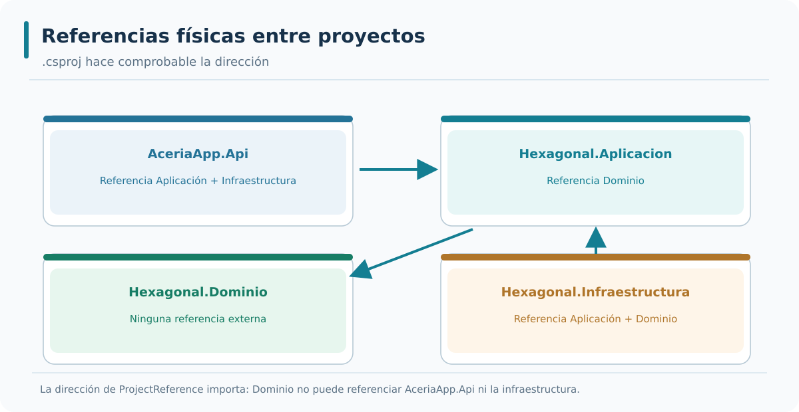

*Interpretación del gráfico:* identifica las referencias de código que admite el diseño y distingue esas relaciones de las llamadas en ejecución. La figura está disponible como SVG vectorial y como PNG para consulta externa.

### Bloque 7 — El contenedor de dependencias como punto de unión

El contenedor de dependencias es el punto de unión entre el núcleo y los adaptadores. La aplicación define las interfaces. La infraestructura implementa las interfaces. La presentación registra las implementaciones en el contenedor. El contenedor resuelve las dependencias en tiempo de ejecución. La configuración del contenedor se realiza en el arranque del proyecto de presentación.

```csharp
// Program.cs del proyecto de presentación
builder.Services.AddScoped<IOrdenRepositorio, OrdenRepositorioSqlServer>();
builder.Services.AddScoped<IOrdenServicio, OrdenServicio>();
builder.Services.AddDbContext<AceriaDbContext>(options =>
    options.UseSqlServer(builder.Configuration.GetConnectionString("AceriaDb")));
```

- **Línea 1:** `// Program.cs del proyecto de presentación` → comentario de ubicación.
- **Línea 2:** `builder.Services.AddScoped<IOrdenRepositorio, OrdenRepositorioSqlServer>();` → registra el adaptador de salida.
- **Línea 3:** `builder.Services.AddScoped<IOrdenServicio, OrdenServicio>();` → registra el puerto de entrada.
- **Línea 4:** `builder.Services.AddDbContext<AceriaDbContext>(options =>` → registra el contexto de EF Core.
- **Línea 5:** `options.UseSqlServer(builder.Configuration.GetConnectionString("AceriaDb")));` → configura SQL Server Express.

El contenedor de dependencias tiene dos consecuencias prácticas. La primera es que el núcleo no conoce la implementación concreta. La segunda es que la implementación puede sustituirse cambiando el registro. La combinación de ambas permite que el núcleo se pruebe con adaptadores en memoria y que la infraestructura evolucione con independencia del núcleo. El contenedor es la pieza que materializa la inversión de dependencias.

---


#### Ampliación didáctica aplicada a AceriaApp

**La decisión arquitectónica.** El contenedor de DI realiza en ejecución la composición que los `.csproj` permiten en compilación. En `AddServiciosHexagonales` se registra el contexto SQL Server y la equivalencia `IOrdenRepositorio → OrdenRepositorioSqlServer`. También se registra `OrdenesCasoUso`, de manera que un endpoint puede solicitarlo por parámetro sin crear manualmente el repositorio. Ese enlace se sitúa deliberadamente cerca del arranque.

**Ejemplo concreto en AceriaApp.** DI no es una arquitectura por sí mismo: registrar clases acopladas no corrige sus responsabilidades. El valor aparece cuando el caso de uso solicita un contrato, y el host decide la implementación en un borde sustituible. Un test puede reemplazar el registro por otro adaptador sin recompilar los casos de uso.

**Riesgo, alternativa y límite.** Si se registra una implementación con un ciclo de vida incompatible con las dependencias internas, pueden surgir errores incluso cuando todas las interfaces están bien definidas. Un `DbContext` normalmente vive en scope de petición; el repositorio que lo utiliza no debería almacenarse en un singleton global. La elección Scoped para servicio y repositorio alinea sus ciclos de vida.

**Comprobación técnica y aprendizaje.** Comprueba primero los registros en código y luego una petición HTTP real. Un test de DI que solo resuelve `IOrdenRepositorio` detecta fallos de configuración; uno de POST→GET añade evidencia de que las dependencias resueltas ejecutan correctamente el flujo completo.

### Bloque 8 — Separación física y tests

La separación física facilita los tests porque cada proyecto de tests referencia solo los proyectos que necesita. Los tests del dominio referencian solo el proyecto de dominio. Los tests de la aplicación referencian el proyecto de aplicación y el de dominio. Los tests de la infraestructura referencian el proyecto de infraestructura. Los tests de la presentación referencian el proyecto de presentación. La separación permite aislar cada capa en sus pruebas.

```text
Proyectos de tests y sus referencias:

AceriaApp.Dominio.Tests/         → referencia Dominio.
AceriaApp.Aplicacion.Tests/      → referencia Aplicacion y Dominio.
AceriaApp.Infraestructura.Tests/ → referencia Infraestructura.
AceriaApp.Api.Tests/             → referencia Api.
```

- **Línea 1:** `AceriaApp.Dominio.Tests/` → referencia el proyecto de dominio.
- **Línea 2:** `AceriaApp.Aplicacion.Tests/` → referencia aplicación y dominio.
- **Línea 3:** `AceriaApp.Infraestructura.Tests/` → referencia infraestructura.
- **Línea 4:** `AceriaApp.Api.Tests/` → referencia la API.

La separación física tiene dos consecuencias prácticas para los tests. La primera es que cada proyecto de tests solo compila si sus dependencias están correctamente referenciadas. La segunda es que los tests del dominio no necesitan base de datos ni framework web. La combinación de ambas reduce el tiempo de ejecución de los tests y facilita su mantenimiento. La separación es una inversión que se recupera en cada ejecución de la suite.

---


#### Ampliación didáctica aplicada a AceriaApp

**La decisión arquitectónica.** La separación física multiplica las fronteras que podemos probar. La entidad se verifica de forma aislada; el caso de uso se prueba con un repositorio falso; el adaptador EF Core se prueba con base controlada; el servidor se verifica con `WebApplicationFactory`. No todos los tests deben iniciar ASP.NET Core, porque eso haría las pruebas más lentas y dificultaría localizar el origen de un fallo.

**Ejemplo concreto en AceriaApp.** En este módulo conservamos las pruebas HTTP de M02, añadimos pruebas de catálogos de 3.1–3.4 y cuatro pruebas nuevas de endpoints hexagonales. Los tests HTTP usan un `HexagonalFactory` con dos contextos InMemory independientes: uno para las rutas antiguas y otro para las nuevas. Así podemos comprobar la convivencia sin exigir un SQL Server externo en el runner.

**Riesgo, alternativa y límite.** La cobertura debe medirse por propiedades verificadas y no solo por número de tests. Tres pruebas que llaman al mismo GET no compensan la falta de comprobación de dirección de referencias. Necesitamos pruebas de flujo, de estado, de errores y de arquitectura. El E2E también debe construir los proyectos desde el manual del alumno en lugar de compilar únicamente un resultado terminado.

**Comprobación técnica y aprendizaje.** Cuando un test falle, determina primero a qué frontera pertenece. Un 500 en POST puede venir de DI o de persistencia; un error de compilación en dominio suele indicar un problema de tipos o dependencias; un 409 inesperado puede revelar una transición aplicada dos veces.

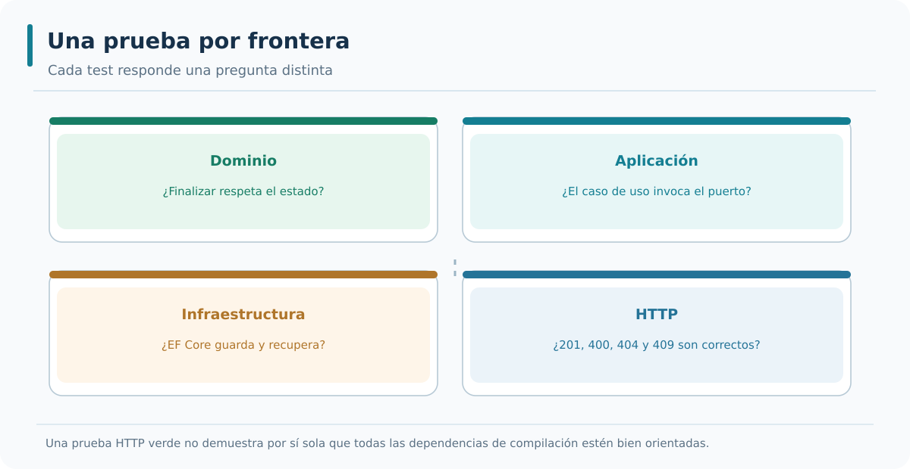

*Interpretación del gráfico:* identifica las referencias de código que admite el diseño y distingue esas relaciones de las llamadas en ejecución. La figura está disponible como SVG vectorial y como PNG para consulta externa.

### Bloque 9 — Separación física y despliegue

La separación física facilita el despliegue porque cada proyecto puede publicarse de forma independiente. El proyecto de dominio se publica como una biblioteca reutilizable. El proyecto de aplicación se publica como una biblioteca. El proyecto de infraestructura se publica como una biblioteca. El proyecto de presentación se publica como una aplicación ejecutable. La separación permite que la presentación se sustituya sin modificar las bibliotecas.

```text
Publicación de proyectos:

Dominio/         → biblioteca reutilizable.
Aplicacion/      → biblioteca reutilizable.
Infraestructura/ → biblioteca reutilizable.
Api/             → aplicación ejecutable.
```

- **Línea 1:** `Dominio/` → biblioteca reutilizable.
- **Línea 2:** `Aplicacion/` → biblioteca reutilizable.
- **Línea 3:** `Infraestructura/` → biblioteca reutilizable.
- **Línea 4:** `Api/` → aplicación ejecutable.

La separación física tiene dos consecuencias prácticas para el despliegue. La primera es que las bibliotecas pueden reutilizarse en distintas aplicaciones. La segunda es que la aplicación ejecutable solo contiene el código de arranque. La combinación de ambas reduce el tamaño del artefacto desplegable y facilita el despliegue. La separación es una inversión que se recupera en cada despliegue.

---


#### Ampliación didáctica aplicada a AceriaApp

**La decisión arquitectónica.** Separar cuatro proyectos .NET dentro de una solución no obliga a desplegarlos como cuatro microservicios. Si `AceriaApp.Api` publica todo el código como un solo proceso, seguimos teniendo un monolito modular con fronteras explícitas. Las capas facilitan reorganizar responsabilidades, pero no introducen automáticamente colas, balances de carga ni contratos entre procesos.

**Ejemplo concreto en AceriaApp.** Para crear servicios independientes harían falta decisiones adicionales sobre comunicación, ownership de datos, transacciones distribuidas, autenticación y observabilidad. Nada de eso se obtiene con `ProjectReference`. Un solo proceso con una base puede resultar más eficiente para una acería pequeña o un primer proyecto de formación; distribuirlo por obligación aumentaría el coste operativo.

**Riesgo, alternativa y límite.** La hexagonal ayuda a elegir dónde insertar un adaptador de eventos, pero no resuelve cómo se entregan mensajes o cómo se recupera una transacción fallida. Dejar claras estas limitaciones evita vender al alumno una propiedad que el código del curso no demuestra. El objetivo M03 es aislar dependencias y verificar una nueva ruta hexagonal, no construir un despliegue de microservicios de producción.

**Comprobación técnica y aprendizaje.** Pide al alumno una decisión con dos escenarios: evolución en un único equipo y necesidad de que varios equipos desplieguen dominios diferentes. En el primero puede bastar un monolito modular; en el segundo la separación física es una ayuda para una extracción futura, no una evidencia de que ya ocurrió.

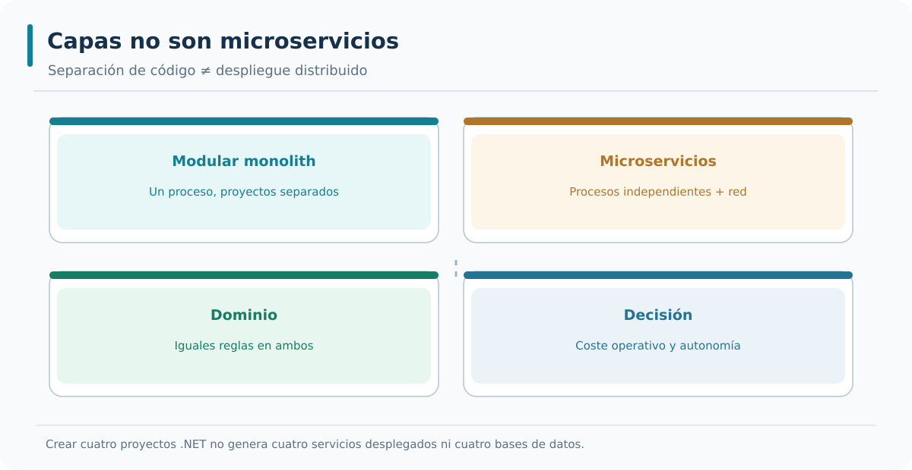

*Interpretación del gráfico:* identifica las referencias de código que admite el diseño y distingue esas relaciones de las llamadas en ejecución. La figura está disponible como SVG vectorial y como PNG para consulta externa.

### Bloque 10 — Aplicación al proyecto del curso

El proyecto del curso aplica la separación física entre dominio, aplicación e infraestructura. El proyecto de dominio contiene las entidades. El proyecto de aplicación contiene los puertos y los servicios. El proyecto de infraestructura contiene los repositorios y los adaptadores. El proyecto de presentación contiene los endpoints y la configuración. Las referencias entre proyectos respetan la regla de dependencia. La separación se valida con un test que comprueba las referencias del archivo `.csproj`.

```text
Aplicación al proyecto del curso:

Dominio/         → entidades y reglas de negocio.
Aplicacion/      → puertos y servicios.
Infraestructura/ → repositorios y adaptadores.
Api/             → endpoints y configuración.
Regla            → referencias hacia el interior.
Validación       → test de referencias entre proyectos.
```

- **Línea 1:** `Dominio/` → entidades y reglas de negocio.
- **Línea 2:** `Aplicacion/` → puertos y servicios.
- **Línea 3:** `Infraestructura/` → repositorios y adaptadores.
- **Línea 4:** `Api/` → endpoints y configuración.
- **Línea 5:** `Regla` → referencias hacia el interior.
- **Línea 6:** `Validación` → test de referencias entre proyectos.

La aplicación de la separación física prepara el proyecto para el punto 3.4. El punto 3.4 estudiará la implementación de la arquitectura hexagonal en ASP.NET Core con proyectos separados. El punto 3.3 establece la base que se aplicará en el punto 3.4. La separación física es la estructura que soporta la arquitectura hexagonal.

---

### Resumen rápido de la teoría

- La separación entre capas puede ser lógica o física.
- La separación física agrupa cada capa en un proyecto independiente.
- El proyecto de dominio no referencia otros proyectos del sistema.
- El proyecto de aplicación referencia el dominio y define los puertos.
- El proyecto de infraestructura referencia la aplicación y el dominio e implementa los puertos.
- El proyecto de presentación referencia la aplicación y la infraestructura.
- La separación física facilita los tests y el despliegue.
- La separación física se verifica con tests que comprueban las referencias del archivo `.csproj`.

---


#### Ampliación didáctica aplicada a AceriaApp

**La decisión arquitectónica.** La etapa 3.3 es el punto donde el ejemplo deja de ser únicamente un catálogo de conceptos y crea ensamblados reales. Se añaden `AceriaApp.Hexagonal.Dominio`, `AceriaApp.Hexagonal.Aplicacion` y `AceriaApp.Hexagonal.Infraestructura`, que se compilan por separado y tienen un grafo de referencias controlado. El código de M02 permanece en su proyecto API para preservar el itinerario anterior.

**Ejemplo concreto en AceriaApp.** La entidad `OrdenHexagonal` representa una orden con identidad y estado. El puerto de aplicación permite listar, obtener, agregar y guardar. El caso de uso conoce ese contrato. La infraestructura implementa el repositorio con EF Core y configura una tabla independiente. Esta estructura prepara 3.4, donde el host REST registrará adaptadores y expondrá endpoints que la utilicen.

**Riesgo, alternativa y límite.** El alumno debe comprender que declarar un proyecto no significa ejecutar su comportamiento. Hasta que se registre `AddServiciosHexagonales` y se llame a `MapHexagonalOrdenes`, los nuevos ensamblados pueden compilar pero no recibir peticiones. Esa distinción es importante para no dar por cerrada una arquitectura cuando solo se han creado carpetas.

**Comprobación técnica y aprendizaje.** Como hito, ejecuta los tests acumulados y verifica el grafo de dependencias. El siguiente punto no debería reescribir las clases del dominio para incorporar HTTP: solo añadirá el adaptador de entrada y la composición.


## Estudio integrador 3.3 — La solución .NET como control arquitectónico

### De las carpetas al grafo de proyectos

En la versión M02, casi todo el servicio vive dentro del proyecto web. Podemos ordenarlo en carpetas sin que el compilador impida que una clase de dominio importe otro namespace de infraestructura. En M03 creamos tres bibliotecas independientes y mantenemos el host web: `AceriaApp.Hexagonal.Dominio`, `AceriaApp.Hexagonal.Aplicacion`, `AceriaApp.Hexagonal.Infraestructura` y `AceriaApp.Api`. Cada proyecto contiene un `.csproj` que expresa qué otros ensamblados necesita. El límite se vuelve verificable al compilar.

Empecemos por Dominio: su `.csproj` solo declara `net8.0`. Al no tener referencia a otros proyectos, el compilador no puede resolver `AceriaApp.Api` ni una clase de infraestructura. La entidad `OrdenHexagonal` contiene la transición `Finalizar()` y puede probarse sin conocer el adaptador HTTP. Esta restricción no elimina toda posibilidad de diseño incorrecto, pero impide una clase importante de acoplamientos.

Aplicación referencia únicamente Dominio. Declara `IOrdenRepositorio` y el servicio `OrdenesCasoUso`. Es deliberado que el contrato de repositorio esté en Aplicación: si se declarara en Infraestructura, los casos de uso tendrían que referenciar ese proyecto, invirtiendo la dependencia en el sentido equivocado. Infraestructura referencia Aplicación y Dominio para implementar el puerto y mapear la entidad con EF Core. Finalmente API referencia las bibliotecas necesarias para registrar servicios y exponer rutas. Estas referencias son asimétricas.

### Tres cambios y su impacto esperable

**Cambio de formato externo:** si una respuesta HTTP debe incluir un enlace adicional, el adaptador o DTO de presentación cambia. La entidad de dominio no necesita conocer rutas. **Cambio de política de finalización:** si una orden no puede finalizarse antes de tener un material asignado, `Finalizar()` o un servicio de dominio debe proteger esa regla; las pruebas del dominio detectan su modificación sin iniciar Kestrel. **Cambio de almacenamiento:** si SQL Server se sustituye por otro proveedor, debe cambiar el adaptador y el registro DI, mientras el puerto conserva su significado y el caso de uso mantiene su contrato.

Esta separación también mejora el diagnóstico. Un error de compilación del proyecto Dominio no puede depender del servidor HTTP, puesto que éste no es una dependencia. Un fallo de inyección DI aparece al levantar el host y resolver el puerto. Un problema de mapeo de columnas aparece en las pruebas de infraestructura o en un flujo de guardado. Al asignar responsabilidades, reducimos el universo de causas que hay que investigar ante un fallo.

### Regla y contraprueba

No es suficiente comprobar que el grafo no contiene ciclos: una referencia de Aplicación a Infraestructura puede no crear un ciclo y, sin embargo, violar la dirección esperada. La regla debe declarar de manera positiva qué referencias se permiten. El E2E debe comprobar en los `.csproj` que Dominio no referencia ningún proyecto, Aplicación solo referencia Dominio y la implementación SQL vive exclusivamente en Infraestructura.

Además, compara el resultado final de la carpeta 3.3 con la base M02. Los endpoints antiguos no desaparecen y la solución sigue siendo un proceso web. El hecho de que existan cuatro ensamblados no significa que se hayan creado cuatro microservicios. La separación física ayuda a encapsular responsabilidades y puede facilitar una extracción futura, pero no sustituye decisiones sobre datos distribuidos, despliegue, red ni operaciones.

#### Aplicación al repositorio vigente y corrección de alcance

El contenido del punto 3.3 se aplica al servicio de órdenes que ya funciona en M02. Se parte de la Minimal API construida en el módulo anterior. Los modelos que representan relaciones arquitectónicas son útiles para razonar y probar reglas; por sí solos no convierten el código en una arquitectura hexagonal. Por eso, las prácticas de este módulo también construyen interfaces de aplicación, implementaciones de infraestructura y conexión HTTP real. El proyecto compilado y los tests demuestran la diferencia entre declarar un puerto y utilizarlo en ejecución.


---

# Punto 3.4 — Implementación en ASP.NET Core

**Módulo 3:** Arquitectura hexagonal

**Objetivos de aprendizaje:**

- Comprender cómo se implementa la arquitectura hexagonal en ASP.NET Core.
- Comprender la configuración del contenedor de dependencias con puertos y adaptadores.
- Comprender la organización de los endpoints como adaptadores de entrada.
- Comprender la organización de los repositorios como adaptadores de salida.
- Añadir al proyecto `AceriaApp` una clase de validación de la configuración del contenedor de dependencias y un test unitario que verifique la validación. Cerrar el módulo 3 con el resumen del estado del proyecto.

---

## Desarrollo teórico

### Bloque 1 — ASP.NET Core como adaptador de entrada

ASP.NET Core actúa como adaptador de entrada en la arquitectura hexagonal. Los endpoints de Minimal API reciben peticiones HTTP y las traducen en llamadas a los puertos de entrada del núcleo. El adaptador de entrada no contiene reglas de negocio: solo traduce entre el protocolo HTTP y los casos de uso. La traducción incluye el enlace de parámetros, la validación de la petición y la construcción de la respuesta. El núcleo no conoce ASP.NET Core ni HTTP. La separación permite que el mismo núcleo se exponga en otros protocolos.

```csharp
app.MapPost("/api/v1/ordenes", async (
    CrearOrdenRequest request,
    IOrdenServicio servicio) =>
{
    var id = await servicio.CrearOrdenAsync(request.Cliente, request.Material, request.Cantidad);
    return Results.Created($"/api/v1/ordenes/{id}", new { id });
});
```

- **Línea 1:** `app.MapPost("/api/v1/ordenes", async (` → declara el endpoint HTTP.
- **Línea 2:** `CrearOrdenRequest request,` → recibe la petición.
- **Línea 3:** `IOrdenServicio servicio) =>` → inyecta el puerto de entrada.
- **Línea 4:** `{` → abre el cuerpo del lambda.
- **Línea 5:** `var id = await servicio.CrearOrdenAsync(request.Cliente, request.Material, request.Cantidad);` → invoca el caso de uso.
- **Línea 6:** `return Results.Created($"/api/v1/ordenes/{id}", new { id });` → devuelve 201 con la ubicación.
- **Línea 7:** `});` → cierra el lambda.

El adaptador de entrada se caracteriza por tres propiedades. La primera es que traduce entre HTTP y los puertos de entrada. La segunda es que no contiene reglas de negocio. La tercera es que puede sustituirse por otro adaptador sin modificar el núcleo. Las tres propiedades permiten que el mismo caso de uso se exponga en HTTP, gRPC o mensajería.

---


#### Ampliación didáctica aplicada a AceriaApp

**La decisión arquitectónica.** ASP.NET Core es el marco externo que recibe peticiones y entrega respuestas. En arquitectura hexagonal actúa como adaptador de entrada: traduce rutas, parámetros y cuerpos JSON en llamadas a casos de uso. En el grupo hexagonal `MapGet`, `MapPost` y el POST de finalización son deliberadamente pequeños y no reciben `HexagonalDbContext` como parámetro.

**Ejemplo concreto en AceriaApp.** Esta decisión permite mantener una API mínima y comprensible sin sacrificar la separación. La facilidad de escribir EF Core directamente dentro de una lambda fue útil para M02, pero en M03 servimos el mismo dominio mediante `OrdenesCasoUso`. La infraestructura sigue existiendo; simplemente se resuelve detrás del puerto cuando el caso de uso la necesita.

**Riesgo, alternativa y límite.** El adaptador traduce entradas incompletas en 400 y exceso de capacidad en 422, pero no debe decidir que una orden ya finalizada vuelva a `Pendiente`. Esa regla vive en dominio y una excepción correspondiente se convierte en 409. Cambiar el protocolo externo podría cambiar la forma de transportar un conflicto, pero no el significado de intentar finalizar dos veces.

**Comprobación técnica y aprendizaje.** La verificación debe recorrer el servidor real en un host de pruebas y confirmar 201→Location→GET, 400, 422 y 409. Abrir Swagger muestra documentación, pero no garantiza que todos los casos de uso hayan sido conectados.

### Bloque 2 — ASP.NET Core como contenedor de dependencias

ASP.NET Core incluye un contenedor de dependencias integrado. El contenedor registra las implementaciones de los puertos y las inyecta en los endpoints. La configuración del contenedor se realiza en el arranque del proyecto de presentación. Cada puerto se asocia con una implementación concreta. La asociación se realiza con los métodos `AddScoped`, `AddTransient` y `AddSingleton`. La elección del ciclo de vida depende del estado que mantiene la implementación.

```csharp
builder.Services.AddScoped<IOrdenRepositorio, OrdenRepositorioSqlServer>();
builder.Services.AddScoped<IOrdenServicio, OrdenServicio>();
builder.Services.AddDbContext<AceriaDbContext>(options =>
    options.UseSqlServer(builder.Configuration.GetConnectionString("AceriaDb")));
```

- **Línea 1:** `builder.Services.AddScoped<IOrdenRepositorio, OrdenRepositorioSqlServer>();` → registra el adaptador de salida con ciclo scoped.
- **Línea 2:** `builder.Services.AddScoped<IOrdenServicio, OrdenServicio>();` → registra el puerto de entrada con ciclo scoped.
- **Línea 3:** `builder.Services.AddDbContext<AceriaDbContext>(options =>` → registra el contexto de EF Core.
- **Línea 4:** `options.UseSqlServer(builder.Configuration.GetConnectionString("AceriaDb")));` → configura SQL Server Express.

El contenedor de dependencias tiene dos consecuencias prácticas. La primera es que el núcleo no conoce la implementación concreta. La segunda es que la implementación puede sustituirse cambiando el registro. La combinación de ambas permite que el núcleo se pruebe con adaptadores en memoria y que la infraestructura evolucione con independencia del núcleo.

---


#### Ampliación didáctica aplicada a AceriaApp

**La decisión arquitectónica.** El contenedor de dependencias no crea la lógica de negocio; solo construye un grafo de objetos según registros explícitos. En `ServiciosHexagonales.AddServiciosHexagonales`, el `IOrdenRepositorio` se asocia con `OrdenRepositorioSqlServer`, y `OrdenesCasoUso` recibe la interfaz. Cuando ASP.NET Core construye una petición, resuelve el caso de uso y sus dependencias con el scope correspondiente.

**Ejemplo concreto en AceriaApp.** El host es el lugar apropiado para elegir conexiones, proveedor de datos y adaptadores. Por eso la API puede referenciar infraestructura como raíz de composición; esa relación no autoriza que el dominio o los casos de uso importen los mismos tipos externos. En el código de inicio se utiliza `builder.Services.AddServiciosHexagonales(builder.Configuration)` antes de `builder.Build()`.

**Riesgo, alternativa y límite.** Hay que distinguir registrar un servicio de invocarlo. Si olvidamos la llamada `AddServiciosHexagonales`, el endpoint podrá compilar y aparecer en la tabla de rutas, pero la primera petición fallará al no resolverse `OrdenesCasoUso` o `IOrdenRepositorio`. Un test de construcción de host puede detectar este error antes del despliegue.

**Comprobación técnica y aprendizaje.** Inspecciona la colección de servicios o realiza una prueba que resuelva `IOrdenRepositorio` dentro de un scope. Después ejecuta POST→GET: la primera prueba demuestra que DI conoce el registro y la segunda que las dependencias construidas producen el comportamiento esperado.

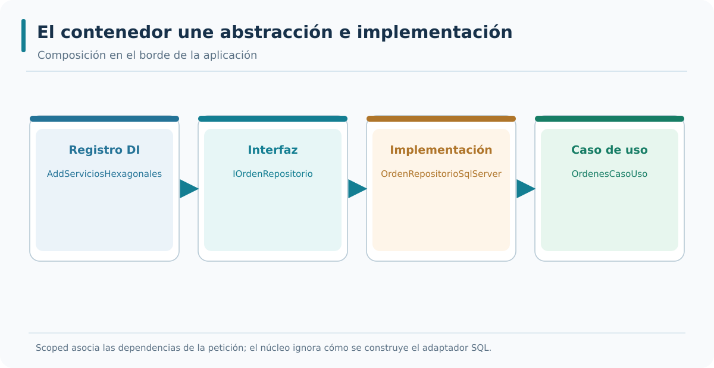

*Interpretación del gráfico:* identifica las referencias de código que admite el diseño y distingue esas relaciones de las llamadas en ejecución. La figura está disponible como SVG vectorial y como PNG para consulta externa.

### Bloque 3 — Ciclos de vida en el contenedor

El contenedor de ASP.NET Core ofrece tres ciclos de vida: `Transient`, `Scoped` y `Singleton`. `Transient` crea una instancia nueva en cada resolución. `Scoped` crea una instancia nueva por ámbito de petición. `Singleton` crea una única instancia para toda la aplicación. La elección del ciclo depende del estado que mantiene la implementación. Los repositorios y los servicios de aplicación usan `Scoped` porque comparten el contexto de base de datos de la petición. Los adaptadores sin estado pueden usar `Singleton`.

```text
Ciclos de vida:

Transient → nueva instancia en cada resolución.
Scoped    → una instancia por ámbito de petición.
Singleton → una instancia por aplicación.
```

- **Línea 1:** `Transient` → nueva instancia en cada resolución.
- **Línea 2:** `Scoped` → una instancia por ámbito de petición.
- **Línea 3:** `Singleton` → una instancia por aplicación.

La elección del ciclo tiene dos consecuencias prácticas. La primera es que el ciclo incorrecto produce errores de concurrencia o de memoria. La segunda es que el ciclo correcto mantiene el rendimiento y la coherencia. La combinación de ambas permite que el contenedor gestione los recursos de forma eficiente. El curso usa `Scoped` para la mayoría de los servicios y `Singleton` para los adaptadores sin estado.

---


#### Ampliación didáctica aplicada a AceriaApp

**La decisión arquitectónica.** Los ciclos de vida de DI determinan durante cuánto tiempo se reutiliza un objeto. `Transient` crea instancias en cada resolución; `Scoped` mantiene la misma instancia dentro de un scope HTTP; `Singleton` reutiliza una instancia durante la vida del host. La elección afecta a estado compartido, rendimiento y seguridad frente a concurrencia, especialmente al utilizar objetos no diseñados como thread-safe.

**Ejemplo concreto en AceriaApp.** EF Core `DbContext` se registra normalmente como Scoped. El repositorio que conserva una referencia a ese contexto también debería ser Scoped, y el caso de uso que lo recibe puede utilizar el mismo alcance. No es correcto registrar un repositorio que contiene `DbContext` como Singleton: el host podría intentar combinar una instancia global con un contexto de petición, provocando errores de ciclo de vida.

**Riesgo, alternativa y límite.** Un caso de uso sin estado propio podría ser Transient o Scoped según cómo se componga; aquí se elige Scoped por coherencia del flujo y sencillez didáctica. Tampoco debemos usar Singleton solo porque parece más rápido: reutilizar estado accidental entre solicitudes HTTP introduce comportamientos que un test aislado no siempre detecta.

**Comprobación técnica y aprendizaje.** Para comprobar el alcance, crea dos scopes y resuelve el mismo servicio dos veces dentro de cada uno. Debe reutilizarse en el mismo scope cuando se registra Scoped, mientras otro scope recibe una instancia distinta. Completa con la prueba HTTP para demostrar que la configuración soporta peticiones normales.

### Bloque 4 — Registro de adaptadores de salida

Los adaptadores de salida se registran en el contenedor de dependencias con el ciclo adecuado. El repositorio de base de datos se registra con `Scoped` porque comparte el `DbContext` de la petición. El cliente HTTP se registra con `Scoped` o `Singleton` según el uso. El publicador de eventos se registra con `Scoped` o `Singleton` según la conexión al broker. La elección del ciclo depende del recurso que gestiona el adaptador.

```csharp
builder.Services.AddScoped<IOrdenRepositorio, OrdenRepositorioSqlServer>();
builder.Services.AddScoped<IInventarioRepositorio, InventarioRepositorioSqlServer>();
builder.Services.AddSingleton<IPublicadorEventos, PublicadorEventosRabbitMq>();
builder.Services.AddHttpClient<IClienteInventario, ClienteInventarioHttp>(client =>
{
    client.BaseAddress = new Uri("http://acería-inventario");
});
```

- **Línea 1:** `builder.Services.AddScoped<IOrdenRepositorio, OrdenRepositorioSqlServer>();` → repositorio con ciclo scoped.
- **Línea 2:** `builder.Services.AddScoped<IInventarioRepositorio, InventarioRepositorioSqlServer>();` → repositorio con ciclo scoped.
- **Línea 3:** `builder.Services.AddSingleton<IPublicadorEventos, PublicadorEventosRabbitMq>();` → publicador con ciclo singleton.
- **Línea 4:** `builder.Services.AddHttpClient<IClienteInventario, ClienteInventarioHttp>(client =>` → cliente HTTP tipado.
- **Línea 5:** `{` → abre el bloque de configuración.
- **Línea 6:** `client.BaseAddress = new Uri("http://acería-inventario");` → URL base del cliente.
- **Línea 7:** `});` → cierra el bloque.

El registro de adaptadores tiene dos consecuencias prácticas. La primera es que cada adaptador tiene su ciclo adecuado. La segunda es que los adaptadores pueden sustituirse cambiando el registro. La combinación de ambas permite que la infraestructura evolucione con independencia del núcleo.

---


#### Ampliación didáctica aplicada a AceriaApp

**La decisión arquitectónica.** Registrar el adaptador de salida significa elegir una implementación concreta para el puerto que conoce la aplicación. `AddScoped<IOrdenRepositorio, OrdenRepositorioSqlServer>()` en `ServiciosHexagonales` proporciona esa correspondencia. El caso de uso no contiene esa línea: su constructor permanece independiente de la tecnología, y el host decide qué adaptador se utilizará.

**Ejemplo concreto en AceriaApp.** La configuración incluye además `HexagonalDbContext` con `UseSqlServer` y la cadena `AceriaHexagonal`. Esta segunda conexión se mantiene separada de `AceriaApp` de M02 para que el ejercicio hexagonal no reescriba las tablas anteriores. La opción es didáctica, no una obligación de que cada arquitectura hexagonal tenga su propia base de datos.

**Riesgo, alternativa y límite.** Si el equipo introdujera un adaptador de mensajería en lugar de repositorio, debería definir otro puerto y registrarlo sin obligar a `OrdenesCasoUso` a conocer la biblioteca del bus. No debemos registrar cualquier clase externa en dominio por comodidad: la raíz de composición es una frontera de infraestructura.

**Comprobación técnica y aprendizaje.** La evidencia de corrección incluye resolver `IOrdenRepositorio` y comprobar que se obtiene `OrdenRepositorioSqlServer` en el host de producción, además de validar que los tests pueden sustituir el `DbContext` por InMemory sin recompilar el puerto.

### Bloque 5 — Endpoints como adaptadores de entrada

Los endpoints de Minimal API se agrupan por recurso en clases estáticas de extensión. Cada clase agrupa los endpoints de un recurso y los registra con un método de extensión. La agrupación facilita la lectura y el mantenimiento. La separación entre endpoints y lógica de negocio se mantiene: los endpoints solo invocan los puertos de entrada. La organización por recurso sigue la organización del catálogo de recursos del punto 2.2.

```csharp
public static class OrdenesEndpoints
{
    public static void MapOrdenesEndpoints(this WebApplication app)
    {
        app.MapGet("/api/v1/ordenes", async (IOrdenServicio servicio) =>
            await servicio.ListarOrdenesAsync());

        app.MapPost("/api/v1/ordenes", async (
            CrearOrdenRequest request,
            IOrdenServicio servicio) =>
        {
            var id = await servicio.CrearOrdenAsync(request.Cliente, request.Material, request.Cantidad);
            return Results.Created($"/api/v1/ordenes/{id}", new { id });
        });
    }
}
```

- **Línea 1:** `public static class OrdenesEndpoints` → clase estática de endpoints.
- **Línea 2:** `{` → abre el cuerpo.
- **Línea 3:** `public static void MapOrdenesEndpoints(this WebApplication app)` → método de extensión.
- **Línea 4:** `{` → abre el cuerpo del método.
- **Línea 5:** `app.MapGet("/api/v1/ordenes", async (IOrdenServicio servicio) =>` → endpoint GET.
- **Línea 6:** `await servicio.ListarOrdenesAsync());` → invoca el puerto de entrada.
- **Línea 7:** `app.MapPost("/api/v1/ordenes", async (` → endpoint POST.
- **Línea 8:** `CrearOrdenRequest request,` → recibe la petición.
- **Línea 9:** `IOrdenServicio servicio) =>` → inyecta el puerto de entrada.
- **Línea 10:** `{` → abre el cuerpo del lambda.
- **Línea 11:** `var id = await servicio.CrearOrdenAsync(request.Cliente, request.Material, request.Cantidad);` → invoca el caso de uso.
- **Línea 12:** `return Results.Created($"/api/v1/ordenes/{id}", new { id });` → devuelve 201.
- **Línea 13:** `});` → cierra el lambda.
- **Línea 14:** `}` → cierra el método.
- **Línea 15:** `}` → cierra la clase.

La agrupación de endpoints tiene dos consecuencias prácticas. La primera es que la lectura del código mejora. La segunda es que la configuración del arranque se simplifica con una llamada por recurso. La combinación de ambas reduce el coste de mantenimiento y facilita la incorporación de nuevos miembros al equipo.

---


#### Ampliación didáctica aplicada a AceriaApp

**La decisión arquitectónica.** Un endpoint expresivo muestra con claridad verbo, recurso, entradas y resultado. En la API hexagonal la colección se publica en `/api/v1/hexagonal/ordenes`, un miembro se consulta por `/api/v1/hexagonal/ordenes/{id:guid}` y la transición se expone como POST a `/{id:guid}/finalizar`. Esta última representa un cambio de estado específico, no una operación CRUD genérica.

**Ejemplo concreto en AceriaApp.** El adaptador HTTP convierte `CrearOrdenHexagonalRequest` en argumentos del caso de uso y después transforma la entidad mediante `OrdenHexagonalDto.Desde`. Esto evita publicar directamente todos los detalles internos y permite conservar un contrato estable si cambian invariantes o persistencia. Las respuestas posibles —201, 400, 422 y 409— deben documentarse según el flujo real.

**Riesgo, alternativa y límite.** Un error es repetir consultas EF Core dentro de los endpoints «por eficiencia». A corto plazo parece menos código, pero reintroduce la dependencia que pretendíamos aislar. También es un error crear rutas duplicadas con el mismo verbo y patrón al introducir el nuevo adaptador; por eso M03 utiliza un prefijo propio que no compite con las rutas M02.

**Comprobación técnica y aprendizaje.** Ejecuta con el cliente HTTP un POST válido, extrae la cabecera Location y realiza el GET correspondiente. Prueba a continuación una cantidad no positiva, una cantidad superior a 500 y dos finalizaciones del mismo GUID; así se recorren los principales contratos de error.

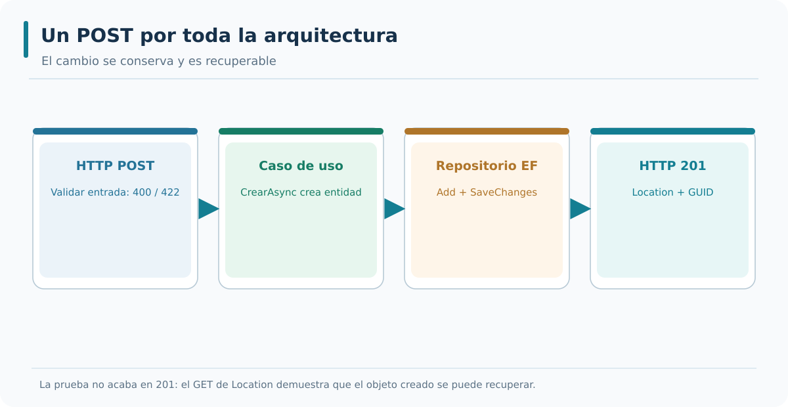

*Interpretación del gráfico:* identifica las referencias de código que admite el diseño y distingue esas relaciones de las llamadas en ejecución. La figura está disponible como SVG vectorial y como PNG para consulta externa.

### Bloque 6 — Repositorios como adaptadores de salida

Los repositorios se implementan como adaptadores de salida en el proyecto de infraestructura. Cada repositorio implementa un puerto de salida definido en la aplicación. La implementación usa el `DbContext` para acceder a la base de datos. El repositorio traduce las operaciones del puerto en consultas de EF Core. La traducción mantiene el núcleo independiente de EF Core.

```csharp
public class OrdenRepositorioSqlServer : IOrdenRepositorio
{
    private readonly AceriaDbContext _db;

    public OrdenRepositorioSqlServer(AceriaDbContext db)
    {
        _db = db;
    }

    public async Task AddAsync(Orden orden)
    {
        _db.Ordenes.Add(orden);
        await _db.SaveChangesAsync();
    }

    public async Task<Orden?> GetByIdAsync(Guid id)
    {
        return await _db.Ordenes.AsNoTracking().FirstOrDefaultAsync(o => o.Id == id);
    }

    public async Task<List<Orden>> ListarAsync()
    {
        return await _db.Ordenes.AsNoTracking().ToListAsync();
    }
}
```

- **Línea 1:** `public class OrdenRepositorioSqlServer : IOrdenRepositorio` → adaptador de salida.
- **Línea 2:** `{` → abre el cuerpo.
- **Línea 3:** `private readonly AceriaDbContext _db;` → dependencia del contexto.
- **Línea 4:** `public OrdenRepositorioSqlServer(AceriaDbContext db)` → constructor.
- **Línea 5:** `{` → abre el cuerpo del constructor.
- **Línea 6:** `_db = db;` → asigna el contexto.
- **Línea 7:** `}` → cierra el constructor.
- **Línea 8:** `public async Task AddAsync(Orden orden)` → implementación del método.
- **Línea 9:** `{` → abre el cuerpo.
- **Línea 10:** `_db.Ordenes.Add(orden);` → añade la orden.
- **Línea 11:** `await _db.SaveChangesAsync();` → persiste los cambios.
- **Línea 12:** `}` → cierra el método.
- **Línea 13:** `public async Task<Orden?> GetByIdAsync(Guid id)` → consulta por identificador.
- **Línea 14:** `{` → abre el cuerpo.
- **Línea 15:** `return await _db.Ordenes.AsNoTracking().FirstOrDefaultAsync(o => o.Id == id);` → devuelve la orden o null.
- **Línea 16:** `}` → cierra el método.
- **Línea 17:** `public async Task<List<Orden>> ListarAsync()` → lista todas las órdenes.
- **Línea 18:** `{` → abre el cuerpo.
- **Línea 19:** `return await _db.Ordenes.AsNoTracking().ToListAsync();` → devuelve la lista.
- **Línea 20:** `}` → cierra el método.
- **Línea 21:** `}` → cierra la clase.

El repositorio se caracteriza por tres propiedades. La primera es que implementa un puerto de salida. La segunda es que conoce EF Core y la base de datos. La tercera es que puede sustituirse por otro adaptador. Las tres propiedades permiten que el núcleo se pruebe con adaptadores en memoria y que la base de datos evolucione con independencia del núcleo.

---


#### Ampliación didáctica aplicada a AceriaApp

**La decisión arquitectónica.** Un repositorio no es toda la infraestructura: es una implementación concreta de un contrato de persistencia definido por la aplicación. `OrdenRepositorioSqlServer` usa EF Core para listar y obtener órdenes, agregarlas y guardar su estado. El caso de uso no elige consultas, tabla ni motor SQL, y eso le permite mantener una interfaz de operación de negocio en lugar de programación de datos.

**Ejemplo concreto en AceriaApp.** Para una búsqueda por GUID, el adaptador devuelve una entidad o `null` sin decidir que debe responder 404. Para la finalización, una entidad recuperada desde el contexto cambia de estado por `OrdenHexagonal.Finalizar()` y después se confirma con `GuardarAsync`. Los detalles de seguimiento, mapeo y transacción quedan en el adaptador externo.

**Riesgo, alternativa y límite.** La semántica del contrato importa: un repositorio que devuelve datos obsoletos o no persiste los cambios aunque complete el `Task` rompe las expectativas de aplicación. Por eso conviene probar con un almacén temporal que se crea una orden y que sigue accesible en otra petición del mismo host. El contrato `IOrdenRepositorio` no puede garantizar por sí solo esa propiedad.

**Comprobación técnica y aprendizaje.** Una prueba de infraestructura debe comprobar el mapeo y el comportamiento de guardado con un proveedor controlado. Si se desea certificar la compatibilidad con SQL Server real, también hay que ejecutar una prueba contra ese proveedor; InMemory no reproduce todos los comportamientos de un motor relacional.

### Bloque 7 — Configuración del arranque

La configuración del arranque se organiza con métodos de extensión. Cada grupo de servicios se registra con un método de extensión específico. Los métodos de extensión se agrupan en archivos separados. La organización reduce el tamaño del archivo `Program.cs` y facilita el mantenimiento. La configuración se compone con llamadas encadenadas.

```csharp
var builder = WebApplication.CreateBuilder(args);

builder.Services.AddDocumentacionOpenApi(new MetadatosApi());
builder.Services.AddValidacion();
builder.Services.AddPersistencia(builder.Configuration);
builder.Services.AddRepositorios();
builder.Services.AddServiciosAplicacion();

var app = builder.Build();

app.UseDocumentacionOpenApi(new ConfiguracionOpenApi());
app.MapOrdenesEndpoints();

app.Run();
```

- **Línea 1:** `var builder = WebApplication.CreateBuilder(args);` → crea el constructor.
- **Línea 2:** `builder.Services.AddDocumentacionOpenApi(new MetadatosApi());` → registra la documentación.
- **Línea 3:** `builder.Services.AddValidacion();` → registra los validadores.
- **Línea 4:** `builder.Services.AddPersistencia(builder.Configuration);` → registra la persistencia.
- **Línea 5:** `builder.Services.AddRepositorios();` → registra los repositorios.
- **Línea 6:** `builder.Services.AddServiciosAplicacion();` → registra los servicios de aplicación.
- **Línea 7:** `var app = builder.Build();` → construye la aplicación.
- **Línea 8:** `app.UseDocumentacionOpenApi(new ConfiguracionOpenApi());` → habilita la documentación.
- **Línea 9:** `app.MapOrdenesEndpoints();` → registra los endpoints de órdenes.
- **Línea 10:** `app.Run();` → arranca el servidor.

La configuración del arranque tiene dos consecuencias prácticas. La primera es que el archivo `Program.cs` se mantiene corto y legible. La segunda es que cada grupo de servicios se registra en un método de extensión que puede probarse de forma aislada. La combinación de ambas reduce el coste de mantenimiento y facilita la incorporación de nuevos servicios.

---


#### Ampliación didáctica aplicada a AceriaApp

**La decisión arquitectónica.** El arranque de una aplicación bien organizada concentra las decisiones que necesitan conocer detalles concretos. En `Program.cs` los registros de servicios ocurren antes de `builder.Build()`, la configuración de middleware y endpoints después y finalmente `app.Run()` inicia el servidor. Este orden no es estilístico: el contenedor se construye al realizar `Build` y no admite añadir servicios del modo habitual después.

**Ejemplo concreto en AceriaApp.** La incorporación de M03 es incremental. Se conservan los registros de M02, se llama a `AddServiciosHexagonales` y se mapea un grupo adicional de rutas. En Development, la inicialización de la base hexagonal se condiciona al entorno y a `SkipDatabaseInitialization` para no forzar SQL Server en las pruebas. En producción usaríamos migraciones y una política de despliegue controlada, no `EnsureCreated` en cada arranque.

**Riesgo, alternativa y límite.** Hay dos configuraciones de persistencia con fines didácticos, `AceriaApp` y `AceriaHexagonal`. Sus nombres deben coincidir exactamente con las claves de `appsettings.json`. Confundirlas puede causar errores de conexión o la creación de objetos en el almacén equivocado. La elección de conexiones no debe filtrarse al dominio ni a los puertos.

**Comprobación técnica y aprendizaje.** La comprobación de arranque incluye compilar sin duplicar `app.Run`, resolver las dependencias del grupo hexagonal y ejecutar una petición real. Un endpoint visible sin contexto inicializado o un servicio sin registro DI no cumple el criterio de integración.

### Bloque 8 — Pruebas de la configuración

La configuración del contenedor se prueba con tests que verifican los registros. Los tests comprueban que cada puerto tiene una implementación registrada. Los tests también comprueban que el ciclo de vida es el adecuado. La verificación automática evita que se olvide un registro o que se use un ciclo incorrecto. La verificación se integra en la suite de tests del proyecto.

```csharp
[Fact]
public void Contenedor_TieneRegistradoIOrdenServicio()
{
    var services = new ServiceCollection();
    services.AddServiciosAplicacion();

    var descriptor = services.FirstOrDefault(s => s.ServiceType == typeof(IOrdenServicio));

    descriptor.Should().NotBeNull();
    descriptor!.Lifetime.Should().Be(ServiceLifetime.Scoped);
}
```

- **Línea 1:** `[Fact]` → marca el método como test.
- **Línea 2:** `public void Contenedor_TieneRegistradoIOrdenServicio()` → declara el test.
- **Línea 3:** `{` → abre el cuerpo.
- **Línea 4:** `var services = new ServiceCollection();` → crea una colección de servicios.
- **Línea 5:** `services.AddServiciosAplicacion();` → registra los servicios.
- **Línea 6:** `var descriptor = services.FirstOrDefault(s => s.ServiceType == typeof(IOrdenServicio));` → busca el descriptor.
- **Línea 7:** `descriptor.Should().NotBeNull();` → verifica que existe.
- **Línea 8:** `descriptor!.Lifetime.Should().Be(ServiceLifetime.Scoped);` → verifica el ciclo de vida.
- **Línea 9:** `}` → cierra el cuerpo.

Los tests de configuración tienen dos consecuencias prácticas. La primera es que la configuración se verifica de forma automática. La segunda es que los errores de registro se detectan en la suite de tests. La combinación de ambas permite que la configuración evolucione con seguridad y que los errores se detecten antes de producción.

---


#### Ampliación didáctica aplicada a AceriaApp

**La decisión arquitectónica.** Un test de configuración confirma que el sistema puede construir su grafo de dependencias y que se expone el adaptador esperado. Sin embargo, registrar servicios no garantiza que sus operaciones hagan lo correcto. Por eso el diseño de prueba debe combinar la validación de DI, la dirección de referencias y las peticiones HTTP que recorren aplicación y persistencia.

**Ejemplo concreto en AceriaApp.** En los tests de M03 `HexagonalFactory` hereda de `WebApplicationFactory<Program>`, utiliza Development y desactiva la creación automática de bases reales. Sustituye los contextos EF Core por proveedores InMemory diferentes, evitando que los datos de rutas antiguas y hexagonales se mezclen. Con esa composición se verifica GET vacío, POST→GET, entrada inválida, capacidad y finalización doble.

**Riesgo, alternativa y límite.** La prueba de InMemory es una prueba funcional de integración del host, no una certificación completa de SQL Server. También puede ocurrir que todos los tests HTTP pasen aunque alguien añada una referencia indebida en un `.csproj`; por eso el E2E inspecciona las dependencias de ensamblados. La cobertura se define por preguntas independientes y no solo por el contador xUnit.

**Comprobación técnica y aprendizaje.** La condición de aceptación del laboratorio es reproducir los proyectos desde fragmentos del manual y ejecutar las mismas pruebas sobre ese resultado. Si solo se compila el proyecto final del repositorio, no habremos demostrado que el alumno puede construirlo siguiendo la guía.

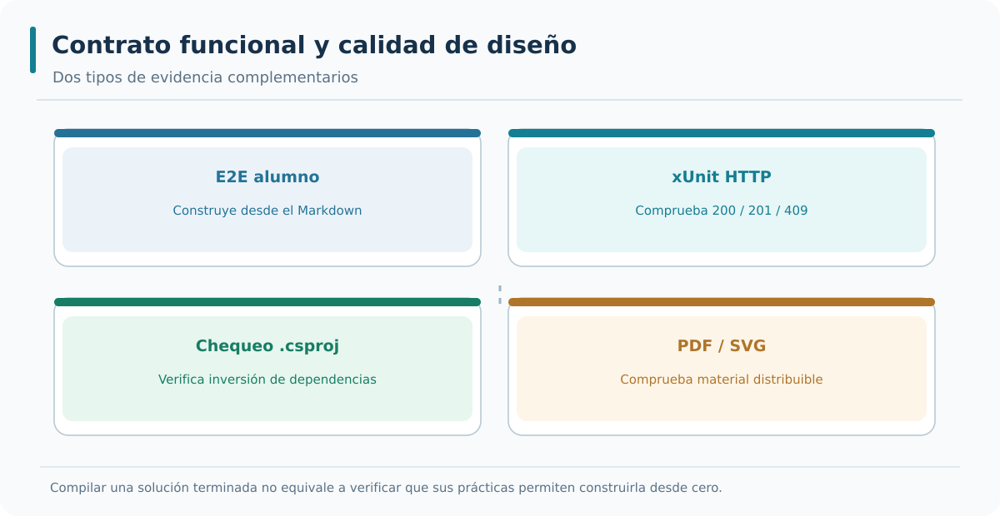

*Interpretación del gráfico:* identifica las referencias de código que admite el diseño y distingue esas relaciones de las llamadas en ejecución. La figura está disponible como SVG vectorial y como PNG para consulta externa.

### Bloque 9 — Organización de archivos en ASP.NET Core

La organización de archivos en ASP.NET Core sigue la arquitectura hexagonal. Los endpoints se agrupan en clases de extensión por recurso. Los repositorios se agrupan en clases por recurso. Los métodos de extensión se agrupan por área de configuración. La organización facilita la lectura y el mantenimiento del proyecto. La organización se refleja en la estructura de carpetas del proyecto.

```text
Estructura del proyecto de presentación:

AceriaApp.Monolito.Api/
├── Program.cs
├── Endpoints/
│   └── OrdenesEndpoints.cs
├── Configuracion/
│   ├── PersistenciaExtensions.cs
│   ├── RepositoriosExtensions.cs
│   └── ServiciosAplicacionExtensions.cs
└── appsettings.json
```

- **Línea 1:** `AceriaApp.Monolito.Api/` → proyecto de presentación.
- **Línea 2:** `Program.cs` → punto de entrada.
- **Línea 3:** `Endpoints/` → carpeta de endpoints.
- **Línea 4:** `OrdenesEndpoints.cs` → endpoints de órdenes.
- **Línea 5:** `Configuracion/` → carpeta de configuración.
- **Línea 6:** `PersistenciaExtensions.cs` → extensión de persistencia.
- **Línea 7:** `RepositoriosExtensions.cs` → extensión de repositorios.
- **Línea 8:** `ServiciosAplicacionExtensions.cs` → extensión de servicios.
- **Línea 9:** `appsettings.json` → configuración.

La organización de archivos tiene dos consecuencias prácticas. La primera es que cada grupo de funcionalidad tiene su archivo. La segunda es que el archivo `Program.cs` se mantiene corto. La combinación de ambas reduce el coste de mantenimiento y facilita la incorporación de nuevos miembros al equipo.

---


#### Ampliación didáctica aplicada a AceriaApp

**La decisión arquitectónica.** Organizar carpetas mejora la orientación del alumno, pero la arquitectura depende del contenido y de las referencias. En la API existe una carpeta `Hexagonal` con el adaptador HTTP y se mantienen las carpetas anteriores de contratos, validación y documentación. Fuera de la API viven las bibliotecas de Dominio, Aplicación e Infraestructura, que expresan fronteras reales por proyecto.

**Ejemplo concreto en AceriaApp.** Cada fichero debe tener un destino preciso en las prácticas. `IOrdenRepositorio.cs` pertenece a Aplicación, `HexagonalDbContext.cs` a Infraestructura, `OrdenHexagonal.cs` a Dominio y `HexagonalOrdenesEndpoints.cs` al proyecto web. Situar una interfaz dentro del proyecto web para «tener todo cerca» impediría que el caso de uso dependiera de ella sin conocer el host.

**Riesgo, alternativa y límite.** Una carpeta llamada `PuertosAdaptadores` que contiene clases para catalogar puertos es útil en el punto 3.2, pero no reemplaza la interfaz real que se crea en 3.3. Si la documentación confunde ambos niveles, el alumno puede creer que un diagrama es una implementación. El archivo y el `.csproj` deben confirmar qué responsabilidad se incorporó en cada paso.

**Comprobación técnica y aprendizaje.** El E2E compara las rutas de código generadas desde el Markdown con las previstas para cada etapa. Una referencia en el manual a un archivo inexistente debe fallar, porque obligaría al alumno a adivinar dónde crear o modificar la pieza.

### Bloque 10 — Aplicación al proyecto del curso

El proyecto del curso aplica la implementación de la arquitectura hexagonal en ASP.NET Core. Los endpoints se agrupan en clases de extensión. Los repositorios se implementan como adaptadores de salida. Los servicios de aplicación se implementan como puertos de entrada. El contenedor de dependencias se configura con métodos de extensión. La configuración se valida con tests que verifican los registros. El módulo 3 se cierra con el resumen del estado del proyecto.

```text
Aplicación al proyecto del curso:

Endpoints         → clases de extensión por recurso.
Repositorios      → adaptadores de salida.
Servicios         → puertos de entrada.
Contenedor        → configuración con métodos de extensión.
Validación        → tests de registros.
Cierre del módulo → resumen del estado en docs.
```

- **Línea 1:** `Endpoints` → clases de extensión por recurso.
- **Línea 2:** `Repositorios` → adaptadores de salida.
- **Línea 3:** `Servicios` → puertos de entrada.
- **Línea 4:** `Contenedor` → configuración con métodos de extensión.
- **Línea 5:** `Validación` → tests de registros.
- **Línea 6:** `Cierre del módulo` → resumen del estado en `docs`.

La implementación de la arquitectura hexagonal cierra el módulo 3 y prepara el terreno para el módulo 4. El módulo 4 estudiará los patrones de arquitectura: Repository, Unit of Work, Mediator y Result Pattern. La arquitectura hexagonal es la base sobre la que se aplican los patrones. El punto 3.4 cierra el módulo 3 con el resumen del estado del proyecto.

---

### Resumen rápido de la teoría

- ASP.NET Core actúa como adaptador de entrada y como contenedor de dependencias.
- El contenedor registra las implementaciones de los puertos y las inyecta en los endpoints.
- Los ciclos de vida `Transient`, `Scoped` y `Singleton` determinan la duración de las instancias.
- Los adaptadores de salida se registran con el ciclo adecuado según el recurso que gestionan.
- Los endpoints se agrupan por recurso en clases de extensión.
- Los repositorios se implementan como adaptadores de salida que conocen EF Core.
- La configuración del arranque se organiza con métodos de extensión.
- La configuración se valida con tests que verifican los registros.

---


#### Ampliación didáctica aplicada a AceriaApp

**La decisión arquitectónica.** El resultado que queremos al finalizar M03 es una aplicación que conserva M02 y demuestra una ruta nueva verdaderamente hexagonal. La solución final contiene una entidad independiente de HTTP/SQL, un caso de uso de aplicación, un puerto de repositorio, un adaptador EF Core y endpoints Minimal API que consumen el caso de uso. La composición se establece por DI y los tests verifican su funcionamiento.

**Ejemplo concreto en AceriaApp.** El alumno debe poder recorrer la teoría de los cuatro puntos para entender cada decisión y seguir las prácticas para escribir las piezas en su orden. Por eso cada fragmento del laboratorio tiene una ruta, un tipo de operación —crear, insertar o reemplazar— y un paso. El E2E aplica esos fragmentos sin copiar los archivos C# terminados y confirma compilación y pruebas. Solo entonces se publica la carpeta de referencia correspondiente.

**Riesgo, alternativa y límite.** El número de proyectos y pruebas debe comprobarse sobre la solución de cada etapa. Un catálogo que enumera componentes no demuestra que estén implementados ni registrados. Ejecutar las pruebas y revisar las referencias permite identificar qué componentes incorpora cada punto y cuáles participan realmente en la aplicación.

**Comprobación técnica y aprendizaje.** Como cierre, solicita tres demostraciones: ejecutar el GET viejo de M02, crear y recuperar una orden por el nuevo endpoint hexagonal, y explicar por qué `OrdenesCasoUso` no referencia `HexagonalDbContext`. Esa triangulación enlaza compatibilidad, comportamiento y arquitectura sin declarar terminado algo que solo compila.


## Estudio integrador 3.4 — Una orden de principio a fin y la evidencia E2E

### Composición al arrancar

La API recibe una solicitud para crear una orden de chapa. Antes de que exista ninguna petición, `Program.cs` debe registrar `AddServiciosHexagonales`. Ese método configura `HexagonalDbContext` con `AceriaHexagonal`, asocia `IOrdenRepositorio` con `OrdenRepositorioSqlServer` y registra `OrdenesCasoUso`. Si falta cualquiera de esos registros, el compilador puede generar el ensamblado y Swagger puede incluso descubrir una ruta, pero el primer request fallará porque el contenedor no puede construir la dependencia. Por eso el E2E debe levantar el host y ejecutar operaciones reales.

Durante la petición, ASP.NET Core crea un scope. El endpoint recibe `CrearOrdenHexagonalRequest` y solicita al contenedor `OrdenesCasoUso`, que a su vez recibe `IOrdenRepositorio`. El adaptador de infraestructura utiliza un contexto EF Core del mismo scope. El endpoint comprueba forma y requisitos del contrato de entrada y transmite los valores al caso de uso. No construye `SqlConnection` ni invoca `SaveChangesAsync` directamente.

### Camino satisfactorio y caminos alternativos

Con datos válidos y cantidad 10, `CrearAsync` aplica el límite de capacidad, construye la entidad y solicita agregarla al puerto. El adaptador EF Core confirma el cambio. De vuelta en el endpoint, `CreatedAtRoute` emite **201** y la cabecera `Location` con el GUID de la orden. El consumidor usa esa URL para ejecutar GET y recibe **200** con los valores de la entidad traducidos a DTO. Esa secuencia comprueba más que la existencia de un endpoint: comprueba integración entre HTTP, caso de uso, puerto, adaptador y almacenamiento.

Con Cliente vacío o Cantidad no positiva, el adaptador HTTP devuelve **400** y evita invocar el caso de uso. Con cantidad **501**, la regla de capacidad impide crear la orden y el adaptador traduce el rechazo a **422**. Si el consumidor solicita un GUID que no existe, `ObtenerAsync` devuelve `null` y la respuesta es **404**. Para una orden existente, `FinalizarAsync` obtiene la entidad, invoca `Finalizar()` y solicita guardar. Repetir la finalización no debe producir otra transición: el dominio señala conflicto y la API devuelve **409**.

### Dos modos de probar lo mismo

En el puesto de trabajo del alumno, la API utiliza SQL Server Express LocalDB y puede comprobarse desde `AceriaApp.http`, Swagger UI y el Explorador de objetos de SQL Server. En GitHub Actions, la factoría de tests `HexagonalFactory` sustituye los contextos por bases InMemory aisladas para que el flujo HTTP sea reproducible sin un motor externo. Esta sustitución es útil, pero no prueba todas las características de SQL Server; para ello harían falta pruebas adicionales con el proveedor real.

Existe otro eje de prueba: la guía pedagógica. Un CI que compila los cuatro proyectos finales puede demostrar que el software funciona y, aun así, dejar un manual imposible de seguir. En M03 el comprobador recorre los **96 pasos**, aplica los fragmentos de código marcados en las prácticas a una copia de M02 y construye sucesivamente las carpetas de 3.1 a 3.4. Después ejecuta los tests xUnit acumulados. No copia de antemano los `.cs` finales de M03, porque el objetivo es comprobar exactamente lo que el alumno debe escribir.

### Cierre para el profesor y el alumno

Un módulo puede darse por reproducible cuando se cumplen cuatro condiciones independientes: **los cuatro puntos teóricos siguen presentes**, **cada paso del laboratorio identifica sus operaciones y archivos**, **el E2E construye y verifica la solución desde los fragmentos del manual** y **los PDF con los diagramas SVG reproducen el mismo contenido que los Markdown**. Las operaciones exclusivamente manuales del IDE se documentan y se verifican por inspección; no se afirma que GitHub Actions haya hecho clic físicamente en Visual Studio. Esa honestidad en la evidencia es parte del método de formación.

#### Aplicación al repositorio vigente y corrección de alcance

El contenido del punto 3.4 se aplica al servicio de órdenes que ya funciona en M02. Se parte de la Minimal API construida en el módulo anterior. Los modelos que representan relaciones arquitectónicas son útiles para razonar y probar reglas; por sí solos no convierten el código en una arquitectura hexagonal. Por eso, las prácticas de este módulo también construyen interfaces de aplicación, implementaciones de infraestructura y conexión HTTP real. El proyecto compilado y los tests demuestran la diferencia entre declarar un puerto y utilizarlo en ejecución.
