# M04 — Patrones de arquitectura con ASP.NET Core 8 · Teoría

**Autor del curso: JAIME GALLO**

## Cómo estudiar el módulo

Los cinco puntos desarrollan Repository, Unit of Work, Mediator con MediatR, Result Pattern e inyección de dependencias. Cada punto contiene diez bloques, ejemplos explicados línea a línea, ampliaciones aplicadas a AceriaApp, diagramas y un resumen de conceptos. Las explicaciones **Línea N** cuentan las líneas no vacías de cada ejemplo; cada explicación ocupa su propia viñeta.

El punto de partida es `M03_ARQUITECTURA_HEXAGONAL/PROYECTO/3.4-implementacion-aspnet-core`: la API `AceriaApp.Api` y las capas `AceriaApp.Hexagonal.Dominio`, `AceriaApp.Hexagonal.Aplicacion` y `AceriaApp.Hexagonal.Infraestructura`. La entidad de referencia es `OrdenHexagonal` y el contexto es `HexagonalDbContext`. Los ejemplos breves de cada bloque son variantes que se estudian por separado; las prácticas indican los archivos y nombres exactos de cada snapshot acumulativo.

**Recorrido funcional del módulo.** El repositorio de trabajo `IOrdenTrabajoRepositorio` expone `ObtenerAsync` y `AgregarAsync` sin confirmar; `IUnitOfWork.CommitAsync` se implementa mediante `EfUnitOfWork`; `OrdenesTransaccionales` coordina operaciones; MediatR 12.4.1 conecta `CrearOrdenCommand`, `ObtenerOrdenQuery` y `LoggingBehavior`; `OrdenesConResultado` expresa fallos de negocio y `AddPatronesOrdenes` reúne los registros. El repositorio inmediato de M3 se conserva como una capacidad distinta. Un catálogo arquitectónico explica decisiones; las pruebas funcionales verifican además lo que ejecutan los adaptadores.

**Convenciones de los ejemplos.** Los fragmentos usan los namespaces habituales de .NET, EF Core, MediatR, FluentValidation y xUnit/Moq según el concepto. Las interfaces breves de repositorio son alternativas de diseño, no definiciones para pegar todas juntas. Los ejemplos simples de `Result<T>` usan `IsSuccess`, `Value`, `Success` y `Failure`; la implementación de las prácticas usa `EsExito`, `Valor`, `Exito` y `Fallo`, además de `Error` y `TipoError`. La semántica es la misma y la API concreta se distingue al aplicarla al proyecto. La ruta funcional final es `/api/v1/patrones/ordenes`, con consulta `/{id:guid}` y transición `/{id:guid}/finalizar`.

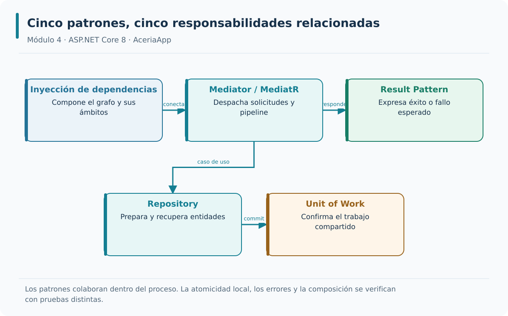

---

# Punto 4.1 — Repository

**Módulo 4:** Patrones de arquitectura

**Objetivos de aprendizaje:**

- Comprender el patrón Repository y su propósito en una arquitectura hexagonal.
- Identificar las responsabilidades de un repositorio y las que no le corresponden.
- Comprender la diferencia entre un repositorio específico y un repositorio genérico.
- Comprender la relación entre Repository, puertos de salida y adaptadores.
- Añadir al proyecto `AceriaApp` las clases de validación de repositorios y un test unitario que verifique la validación.

---

## Encapsular persistencia sin esconder el dominio


Partiremos del caso de uso que necesita guardar y recuperar una orden. Su contrato deberá expresar esa intención sin filtrar EF Core, y su implementación deberá demostrarla en SQL Server. Sobre esa operación examinaremos el límite de Repository.

### Definición del patrón Repository

El patrón Repository pretende que un caso de uso trabaje con órdenes del negocio sin conocer las consultas ni las clases del proveedor de datos. La aplicación necesita expresar operaciones como recuperar una orden o incorporar una nueva; la infraestructura decidirá cómo realizarlas con EF Core y SQL Server. En una arquitectura hexagonal esa necesidad se plasma en un puerto de salida, por ejemplo `IOrdenRepositorio`, cuya implementación puede cambiar sin que las reglas de producción importen dependencias de persistencia. El patrón no consiste en crear una clase denominada Repository por convención, sino en diseñar un contrato que mantenga juntas las operaciones relacionadas y que no exponga detalles del almacenamiento. Para AceriaApp resulta especialmente útil porque permite comparar una prueba del caso de uso con un doble del puerto y una prueba real del adaptador SQL.

```text
Patrón Repository:

Aplicación → IOrdenRepositorio (puerto)
                    ↑
                    | implementa
                    |
Infraestructura → OrdenRepositorioSqlServer (adaptador)
```


El diagrama sitúa la interfaz del repositorio entre la aplicación y el adaptador SQL Server. Las flechas muestran qué componente define el contrato y quién lo implementa, no el orden temporal de una petición. La aplicación se mantiene libre de los tipos de EF Core porque su dependencia es el puerto.


El contrato debe explicar qué necesita la aplicación antes de describir cómo guarda SQL Server. La palabra Repository nombra el patrón; IOrdenRepositorio nombra un puerto concreto.

M3 ya contiene IOrdenRepositorio y OrdenRepositorioSqlServer. M4 añade un puerto de trabajo que permite estudiar por separado la preparación de cambios y su confirmación.

Un repositorio no convierte automáticamente dos motores distintos en intercambiables. La paginación, las transacciones y la concurrencia siguen requiriendo decisiones explícitas.

Localiza la interfaz en aplicación y el adaptador en infraestructura. El proyecto de dominio debe compilar sin referenciar EF Core ni ASP.NET Core.

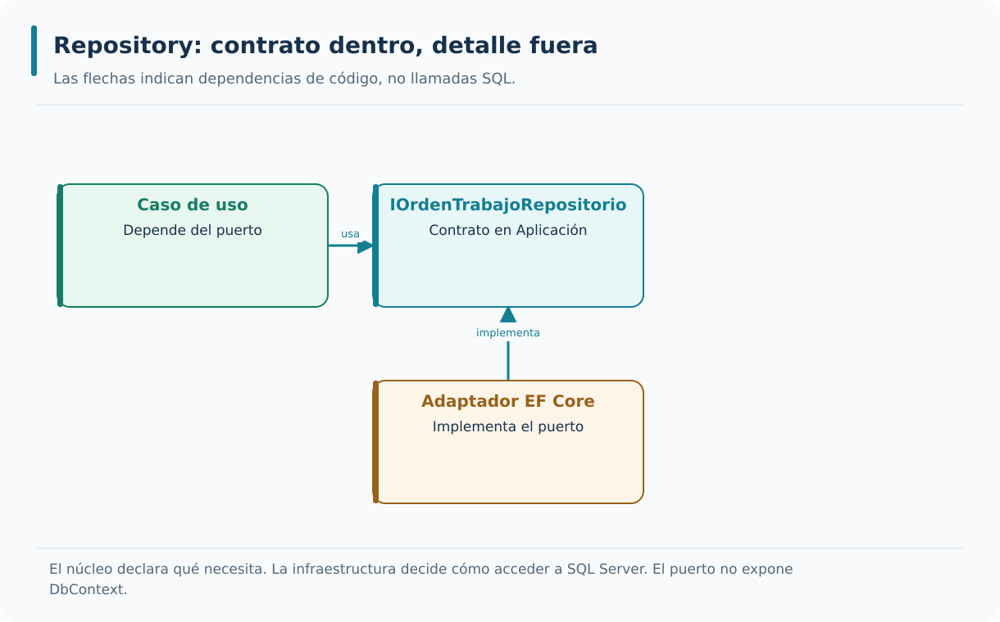

El puerto se define dentro y el adaptador apunta hacia su contrato. Las flechas muestran dependencias de código. La figura se distribuye en SVG vectorial y PNG.

### Responsabilidades de un repositorio

Un repositorio tiene que mantener un contrato coherente sobre cómo se obtienen y guardan las entidades que controla. Recuperar por identidad, agregar o actualizar una orden pueden ser operaciones necesarias de la aplicación, mientras la traducción a consultas SQL corresponde al adaptador. La interfaz no debería devolver tipos propios de EF Core si los consumidores no necesitan conocerlos, ni permitir que el resto de la solución modifique directamente la base. Este diseño obliga a pensar qué significa guardar una orden, cómo se tratan las ausencias y quién confirma una transacción. No todos los métodos de un CRUD genérico forman parte automáticamente del negocio: se deben publicar las capacidades que de verdad necesita el caso de uso. Así el contrato permanece estable aunque cambien tablas y relaciones.

```csharp
public interface IOrdenRepositorio
{
    Task<Orden?> GetByIdAsync(Guid id);
    Task<List<Orden>> ListarAsync();
    Task AddAsync(Orden orden);
    Task UpdateAsync(Orden orden);
    Task DeleteAsync(Guid id);
}
```


La interfaz enumera operaciones de lectura y escritura que el caso de uso podría necesitar. La conveniencia de cada método debe contrastarse con las reglas de Órdenes: añadir un `DeleteAsync` no significa que el negocio permita borrar cualquier orden en cualquier estado.


Las tres responsabilidades se expresan con cinco métodos típicos. El método `GetByIdAsync` recupera una entidad concreta. El método `ListarAsync` recupera la colección. El método `AddAsync` inserta una entidad nueva. El método `UpdateAsync` actualiza una entidad existente. El método `DeleteAsync` elimina una entidad. Son cinco operaciones habituales, no una plantilla obligatoria. Un repositorio puede omitir actualización o eliminación si el dominio no permite esas acciones y añadir las búsquedas que necesita.


Los métodos se eligen por necesidades de negocio. No añadas Delete solo porque aparece en una plantilla CRUD si la orden debe conservarse por trazabilidad.

El puerto heredado ofrece ListarAsync, ObtenerAsync, AgregarAsync y GuardarAsync. El puerto de trabajo de M4 usa ObtenerAsync y AgregarAsync para los casos desarrollados.

Actualizar un objeto seguido por EF Core no siempre requiere un método Update. Un contrato debe aclarar quién sigue la entidad y cuándo se confirma.

Comprueba ausencia con null, altas con una entidad válida y listas vacías con una colección vacía. Son contratos distintos que no deben confundirse con errores de SQL.

### Lo que un repositorio no debe hacer

La frontera de Repository se desdibuja cuando la clase empieza a tomar decisiones que pertenecen al dominio. Determinar si puede cancelarse una orden finalizada, validar una capacidad de fabricación o elegir el estado siguiente no son responsabilidades de acceso a datos. Tampoco debería el repositorio construir respuestas HTTP ni decidir qué código devolver a un cliente. Su trabajo consiste en cumplir operaciones de almacenamiento con las garantías previstas por el puerto; el caso de uso organiza la secuencia y las entidades protegen las invariantes. En AceriaApp evitaremos convertir el repositorio en un «servicio universal» que conoce todas las capacidades de la acería. Si una consulta de informes necesita una proyección específica, podemos diseñarla como contrato de lectura sin contaminar el repositorio de agregados.

```text
Lo que un repositorio no debe hacer:

- Contener reglas de negocio.
- Validar invariantes.
- Diseñar respuestas HTTP desde persistencia.
- Exponer consultas ajenas al propósito del contrato.
- Gestionar transacciones de múltiples repositorios.
```


La lista marca fronteras negativas importantes: ni validación de invariantes, ni composición de respuestas HTTP, ni decisiones de transacción entre varios repositorios pertenecen automáticamente a la clase que consulta SQL. Esas tareas necesitan propietarios explícitos en dominio o aplicación.


La frontera se define por responsabilidad, no por el número de JOINs. Recuperar un agregado puede exigir varias tablas sin incorporar reglas de negocio al repositorio.

La regla Cantidad mayor que cero pertenece a OrdenHexagonal. El repositorio puede traducir sus propiedades a columnas, pero no decidir otra capacidad máxima diferente a aplicación.

Un índice único y una validación de negocio pueden proteger aspectos relacionados. La comprobación previa no elimina carreras; las restricciones de almacenamiento también deben tratarse adecuadamente.

Revisa si el adaptador decide HTTP 400, 404 o 409. Si lo hace, devuelve al adaptador de entrada esa traducción y conserva información suficiente sobre el resultado.

### Repositorio específico frente a repositorio genérico

Un repositorio genérico suele ofrecer métodos comunes para distintos tipos de entidad, mientras uno específico utiliza operaciones y nombres del dominio de Órdenes. La alternativa genérica parece ahorrar código, pero puede hacer difícil expresar consultas, reglas de identidad o transacciones particulares sin añadir parámetros técnicos. Una interfaz `IOrdenRepositorio` puede explicar mejor qué necesita un caso de uso que `IRepositorio<T>`, especialmente cuando el agregado tiene un ciclo de vida complejo. Eso no vuelve incorrecta toda abstracción genérica: cuando las operaciones son realmente uniformes y el contrato no pierde significado, compartir infraestructura puede resultar razonable. La elección debe basarse en claridad y estabilidad de la frontera, no en disminuir artificialmente el número de interfaces.

```csharp
// Repositorio específico
public interface IOrdenRepositorio
{
    Task<Orden?> GetByIdAsync(Guid id);
    Task AddAsync(Orden orden);
}

// Repositorio genérico
public interface IRepositorio<T> where T : class
{
    Task<T?> GetByIdAsync(Guid id);
    Task AddAsync(T entidad);
}
```


El contraste entre `IOrdenRepositorio` e `IRepositorio<T>` muestra cómo cambia la expresividad del contrato. Una interfaz genérica puede reutilizarse, pero la específica permite explicar necesidades del agregado sin filtrar operaciones que no tienen sentido para ese recurso.


Un repositorio específico usa vocabulario del agregado; uno genérico comparte operaciones estructurales. Ambos pueden ser útiles y ambos pueden volverse demasiado amplios.

IOrdenTrabajoRepositorio permite expresar necesidades de órdenes sin obligar a todas las entidades futuras a tener el mismo identificador, paginación o política de borrado.

Una interfaz `IRepositorio<T>` con decenas de métodos y parámetros para incluir tablas puede terminar filtrando el ORM. Ahorrar clases no justifica perder el contrato.

Describe una operación válida para órdenes y otra prohibida. Verifica si la interfaz elegida permite distinguirlas o si ofrece accidentalmente operaciones que el dominio no admite.

### Repositorio y puertos de salida

En arquitectura hexagonal el repositorio es un adaptador de salida que implementa una interfaz definida hacia el núcleo. La aplicación invoca `IOrdenRepositorio` porque necesita guardar una orden; la clase SQL Server referencia ese contrato y utiliza `AceriaDbContext`. Es importante distinguir dos direcciones: durante la ejecución la llamada llega al adaptador, pero en las referencias de compilación es la infraestructura la que depende de la abstracción. Esta inversión permite sustituir la implementación durante los tests de aplicación y también mantener un repositorio de producción con EF Core. El registro de dependencias, y no el caso de uso, selecciona qué adaptador se utiliza. Su correcto funcionamiento necesita probar tanto la composición como las consultas reales.

```csharp
// Puerto de salida en la capa de aplicación
public interface IOrdenRepositorio
{
    Task AddAsync(Orden orden);
}

// Adaptador de salida en la capa de infraestructura
public class OrdenRepositorioSqlServer : IOrdenRepositorio
{
    private readonly AceriaDbContext _db;

    public OrdenRepositorioSqlServer(AceriaDbContext db)
    {
        _db = db;
    }

    public async Task AddAsync(Orden orden)
    {
        _db.Ordenes.Add(orden);
        await _db.SaveChangesAsync();
    }
}
```


`OrdenRepositorioSqlServer` implementa el puerto utilizando `AceriaDbContext`. El caso de uso no debería construir esa clase: el host resuelve la dependencia y la prueba de integración verifica que la implementación cumple la operación de guardado.


El puerto pertenece al núcleo; el adaptador implementa el acceso. La inversión de dependencias se comprueba leyendo referencias de proyectos, no el recorrido de una petición.

OrdenRepositorioSqlServer de M3 confirma cada alta. El adaptador de trabajo de M4 prepara el alta y deja que IUnitOfWork confirme el mismo HexagonalDbContext.

El ejemplo breve que guarda dentro del repositorio es una variante útil para una operación autónoma. No debe mezclarse con la confirmación conjunta de varios repositorios.

Al componer M4, comprueba que todos los participantes reciben la misma instancia scoped del contexto. Dos contextos independientes no forman una transacción por compartir una interfaz.

### Repositorio y consultas de lectura

La lectura de información no siempre necesita materializar un agregado completo con todas sus relaciones. Una consulta destinada a presentar el resumen de una orden puede requerir un DTO proyectado con pocos campos, mientras una operación de negocio necesita una entidad capaz de proteger invariantes. Esa diferencia plantea una decisión de diseño: utilizar un contrato de lectura específico o adaptar un repositorio de agregados para cubrir consultas sencillas. Lo importante es no exponer `IQueryable` de EF Core al consumidor si eso permite que la aplicación construya consultas ligadas a la tecnología. En AceriaApp se puede mantener `GetByIdAsync` para recuperar la entidad y definir una proyección `GetResumenAsync` cuando exista una necesidad real. El módulo de CQRS profundizará en esta separación.

```csharp
public interface IOrdenRepositorio
{
    Task<Orden?> GetByIdAsync(Guid id);
    Task<OrdenResumenDto?> GetResumenAsync(Guid id);
}
```


La interfaz distingue una lectura de la entidad de una proyección resumida. El DTO de consulta debe contener solo lo que el consumidor necesita y evitar que las reglas de presentación se conviertan en consultas sobre entidades fuera de su contexto.


Una proyección de lectura expresa los datos que necesita la pantalla o consumidor. No obliga a materializar una entidad con todas sus relaciones.

Una lista de órdenes puede seleccionar identificador, cliente y estado. La operación Finalizar necesita recuperar la entidad sobre la que ejecuta la regla de transición.

Si el contrato está en dominio no debe depender de un DTO definido en API. Ubica proyecciones en aplicación o en un puerto de lectura separado.

Comprueba que la paginación se ejecuta antes de materializar grandes colecciones y que las lecturas sin edición usan AsNoTracking cuando no necesitan seguimiento.

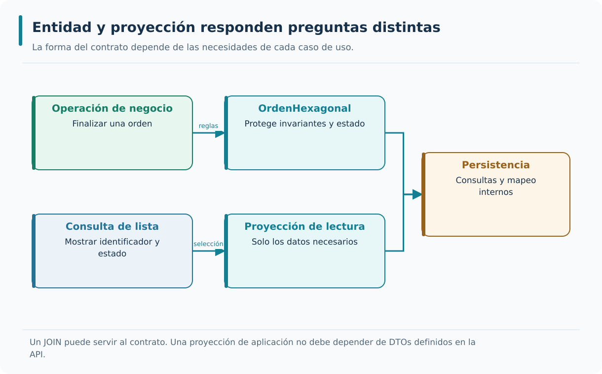

Distingue el modelo necesario para ejecutar reglas de una proyección de lectura; cada contrato tiene un propósito. La figura se distribuye en SVG vectorial y PNG.

### Repositorio y pruebas con dobles

Los dobles de prueba permiten comprobar cómo utiliza la aplicación un repositorio sin iniciar una base de datos. Si `OrdenesCasoUso` recibe `IOrdenRepositorio`, un mock puede devolver una orden conocida y registrar que se solicitó exactamente el identificador esperado. Esa prueba aporta evidencia sobre la coordinación del caso de uso y sobre la frontera de dependencias; no demuestra por sí sola que la implementación EF Core consulte correctamente SQL Server. Para esa garantía necesitaremos otro test que use el motor real y verifique lo persistido con un contexto independiente. El valor del patrón aparece precisamente en poder probar de forma distinta la decisión de negocio y el mecanismo tecnológico, sin duplicar la misma lógica.

```csharp
var esperada = new OrdenHexagonal("ACX-001", "CHAPA", 10);
var repositorioMock = new Mock<IOrdenRepositorio>();
repositorioMock
    .Setup(r => r.ObtenerAsync(esperada.Id, It.IsAny<CancellationToken>()))
    .ReturnsAsync(esperada);
var servicio = new OrdenesCasoUso(repositorioMock.Object);
var orden = await servicio.ObtenerAsync(esperada.Id);
Assert.Same(esperada, orden);
repositorioMock.Verify(
    r => r.ObtenerAsync(esperada.Id, It.IsAny<CancellationToken>()), Times.Once);
```


El mock devuelve una orden conocida y permite comprobar que el caso de uso solicitó el identificador previsto exactamente una vez. Esa comprobación protege la coordinación, pero no certifica materialización, consultas ni escritura de datos reales en SQL Server.


Un mock comprueba interacciones; un stub fija respuestas; un fake ofrece una implementación reducida. Elegir el doble depende de la pregunta que responde la prueba.

El ejemplo usa el identificador de la misma OrdenHexagonal que devuelve el doble. Así detecta una consulta con una identidad incorrecta en lugar de aceptar cualquier GUID.

Una prueba del caso de uso no demuestra que SQL traduzca un filtro, respete claves foráneas o haga rollback. Para eso se necesita una prueba del adaptador.

Comprueba tanto el resultado como las interacciones relevantes. Evita verificar cada detalle interno: exigir un orden accidental de llamadas vuelve frágil la prueba sin mejorar el contrato.

### Repositorio y unidad de trabajo

Un repositorio prepara o registra operaciones sobre determinadas entidades, mientras una unidad de trabajo decide cuándo se confirman conjuntamente. Esta distinción importa cuando una operación del negocio modifica más de un agregado o cuando varias operaciones de repositorio deben constituir un único resultado atómico. Si cada método guarda inmediatamente con `SaveChangesAsync`, quizá resulte imposible coordinar todos los cambios dentro de la misma transacción. Por eso examinaremos la diferencia entre añadir una entidad al contexto y confirmar las escrituras. EF Core ya aporta seguimiento de cambios y mecanismos transaccionales, de modo que una abstracción adicional solo tiene sentido si clarifica el límite de confirmación del caso de uso. En el punto siguiente estudiaremos Unit of Work sobre esa base.

```text
Relación entre Repository y Unit of Work:

Repositorio A → operaciones sobre entidad A.
Repositorio B → operaciones sobre entidad B.
Unidad de trabajo → coordina las operaciones de A y B en una transacción.
```


Dos repositorios pueden compartir una unidad de trabajo cuando sus cambios deben confirmarse atómicamente en la misma frontera SQL. El diagrama no significa que una transacción distribuida entre servicios se obtenga automáticamente por registrar una clase con ese nombre.


Separar preparación y confirmación permite agrupar cambios. El requisito crucial es compartir un ámbito transaccional real, no añadir una clase llamada UnitOfWork.

IOrdenTrabajoRepositorio.AgregarAsync prepara la entidad; IUnitOfWork.CommitAsync confirma. OrdenesTransaccionales coordina esas dos acciones sin depender directamente de EF Core.

Si AgregarAsync ejecutara SaveChanges antes de otro paso que falla, aparecería persistencia parcial. Cambiar nombres de clases no corrige esa frontera equivocada.

Comprueba que antes del commit una consulta desde otro contexto no ve la nueva orden, y que después del commit sí aparece. Ese test observa persistencia real.

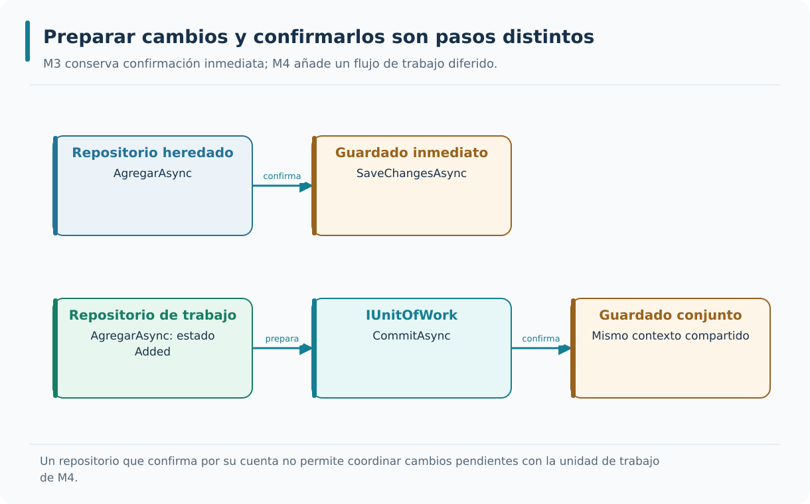

Compara confirmación inmediata con preparación de cambios. El flujo transaccional de M4 usa el segundo recorrido. La figura se distribuye en SVG vectorial y PNG.

### Cuándo usar el patrón Repository

Repository aporta valor cuando la aplicación necesita independizar reglas de negocio del proveedor de datos, organizar consultas de agregados o probar casos de uso con colaboradores controlados. En un CRUD muy pequeño que utiliza directamente EF Core desde un único punto, introducir interfaces y adaptadores puede añadir complejidad sin un beneficio claro. Lo mismo sucede si el repositorio se limita a copiar, método por método, todas las operaciones de `DbContext`. Para decidir conviene observar si una regla cambia por motivos de negocio, si existen varios consumidores y qué tipos no deberían conocer SQL Server. AceriaApp dispone de un dominio que crecerá a lo largo del curso, por lo que el patrón nos ayuda a hacer explícita la frontera sin comprometer futuras decisiones de persistencia.

```text
Cuándo usar Repository:

Sistema con dominio complejo     → suele aportar valor.
Sistema con varios repositorios  → revisar coordinación.
Sistema con pruebas unitarias    → facilita dobles.
Sistema con CRUD simple          → evaluar coste.
Sistema sin lógica de dominio    → puede no compensar.
```


La tabla plantea situaciones en las que Repository facilita pruebas y desacoplamiento, así como otras donde su coste puede superar el beneficio. La pregunta adecuada es qué decisión del negocio deja de depender del almacenamiento gracias a esta abstracción.


Repository compensa cuando el contrato protege una frontera útil. En un CRUD pequeño, usar DbContext directamente en una aplicación acoplada a EF Core puede ser una decisión consciente.

AceriaApp lo usa para estudiar puertos y pruebas aisladas. Ese objetivo pedagógico explica la abstracción sin afirmar que todo proyecto necesite la misma cantidad de capas.

La posibilidad teórica de cambiar de base de datos no basta para justificar cualquier envoltorio. Valora las necesidades actuales y el coste de conservar dos APIs equivalentes.

Escribe qué dependencia desaparece del caso de uso y qué pruebas habilita el puerto. Si no puedes explicar ninguno de esos beneficios, revisa la abstracción.

### Aplicación al proyecto del curso

La implementación de Repository en AceriaApp debe interpretarse como una evolución del diseño hexagonal del módulo anterior. Las interfaces de órdenes definen lo que necesitan los casos de uso, mientras sus adaptadores materializan las operaciones con el proveedor SQL elegido. Se incorporan pruebas de coherencia y escenarios con dobles para comprobar los contratos; la persistencia real debe verificarse aparte mediante SQL Server. También se introduce la posibilidad de diferir la confirmación de cambios para coordinar varias operaciones. Este punto no trata de multiplicar clases, sino de demostrar por qué el código de aplicación puede crear y consultar órdenes sin conocer cómo están almacenadas. Esa separación prepara el siguiente estudio de transacciones y unidad de trabajo.

```text
Aplicación al proyecto del curso:

Puertos activos      → IOrdenRepositorio e IOrdenTrabajoRepositorio.
Adaptadores activos  → repositorio inmediato y repositorio de trabajo de órdenes.
Operaciones posibles → GetById, Listar, Add, Update, Delete.
Consultas complejas  → servicios específicos.
Validación           → test de coherencia de repositorios.
```


El catálogo del curso reúne interfaces, adaptadores y operaciones para orientar la implementación. Su presencia en una lista no demuestra que cada método esté conectado a un endpoint real; la evidencia llega cuando los tests ejercen contratos y acceso a SQL Server.


La aplicación del patrón Repository prepara el proyecto para los puntos 4.2, 4.3, 4.4 y 4.5. El punto 4.2 estudiará la unidad de trabajo. El punto 4.3 estudiará el patrón Mediator. El punto 4.4 estudiará el Result Pattern. El punto 4.5 estudiará la inyección de dependencias. El punto 4.1 establece la base que se aplicará en los cuatro puntos siguientes.


El punto mantiene dos evidencias complementarias: el catálogo describe decisiones arquitectónicas y el código ejecuta operaciones que deben respetarlas.

El baseline es M3, punto 3.4, con AceriaApp.Api y las tres capas hexagonales. Los tipos de inventario del catálogo son ejemplos de extensión, no un adaptador conectado automáticamente.

Un test que valida nombres o metadatos no prueba almacenamiento. Tampoco una respuesta 201 demuestra que la orden pueda consultarse desde una sesión nueva.

Relaciona cada puerto activo con su registro DI, adaptador y prueba. Usa los nombres y rutas de la práctica para ejecutar la versión concreta del punto.

### Comprender la frontera del repositorio

- El patrón Repository es una abstracción que media entre la capa de dominio o aplicación y la capa de persistencia.
- Un repositorio tiene tres responsabilidades: recuperar, añadir y modificar entidades.
- El repositorio no decide reglas de negocio ni respuestas HTTP; puede usar consultas complejas y proyecciones acordes con su contrato. La confirmación compartida corresponde a la unidad de trabajo.
- La elección entre repositorio específico y genérico depende de la semántica de los contratos y del coste de mantenerlos.
- La interfaz del repositorio es el puerto de salida de persistencia; su implementación concreta es el adaptador.
- Los repositorios se prueban con dobles en la capa de aplicación.
- El repositorio y la unidad de trabajo se complementan: el repositorio gestiona una entidad, la unidad de trabajo coordina varias.
- El patrón Repository se usa cuando el dominio es complejo y debe permanecer independiente de la tecnología de persistencia.

---


# Punto 4.2 — Unit of Work

**Módulo 4:** Patrones de arquitectura

**Objetivos de aprendizaje:**

- Comprender el patrón Unit of Work y su propósito en una arquitectura hexagonal.
- Identificar la relación entre Unit of Work y Repository.
- Comprender la gestión de transacciones como responsabilidad de la unidad de trabajo.
- Comprender el seguimiento de cambios y la coordinación de repositorios.
- Añadir al proyecto `AceriaApp` las clases de validación de la unidad de trabajo y un test unitario que verifique la validación.

---

## De los cambios preparados a la confirmación real


Utilizaremos el recorrido de una orden para distinguir el estado que conoce EF Core de lo que SQL Server ha confirmado. Desde ahí podremos evaluar qué valor aporta coordinar repositorios y cómo demostrar atomicidad ante un fallo.

### Definición del patrón Unit of Work

Una unidad de trabajo sirve para delimitar qué modificaciones deben confirmarse como una sola operación de persistencia. Cuando un caso de uso incorpora una orden y registra un movimiento asociado, no debería aceptar que una de las escrituras quede guardada y la otra desaparezca si ambas forman parte de una misma decisión del negocio. Unit of Work expresa esa frontera de confirmación y permite coordinar repositorios sin convertir cada uno en dueño del momento del commit. En AceriaApp utilizaremos un puerto de aplicación y una implementación de infraestructura que se apoya en EF Core. Esto no significa inventar un gestor de transacciones desde cero: `DbContext` ya conoce cambios y puede confirmarlos con `SaveChangesAsync`. La abstracción añadida tiene sentido cuando ayuda al caso de uso a expresar explícitamente cuándo una operación está completa.

```text
Patrón Unit of Work:

Aplicación → IUnitOfWork (puerto)
                    ↑
                    | implementa
                    |
Infraestructura → EfUnitOfWork (adaptador)
```


La interfaz `IUnitOfWork` pertenece a la aplicación, y su implementación EF Core reside en infraestructura. Ese dibujo muestra dónde se define la necesidad de confirmar cambios y dónde se decide cómo hacerlo. No supone que cualquier base remota participe en la misma transacción.


Una unidad de trabajo reúne cambios relacionados durante un caso de uso. Atomicidad significa que la operación confirmada se aplica completa dentro del recurso transaccional cubierto.

OrdenesTransaccionales registra órdenes mediante el puerto de trabajo y confirma por IUnitOfWork. Ambos adaptadores comparten HexagonalDbContext dentro del ámbito de DI.

Una transacción no garantiza por sí sola idempotencia de reintentos ni evita todas las carreras. Aislamiento, concurrencia y repetición son decisiones diferentes.

Formula una operación con dos cambios y provoca el fallo del segundo. Comprueba la base de datos desde un contexto nuevo para detectar cualquier escritura parcial.

### Relación entre Unit of Work y Repository

Repository y Unit of Work resuelven preguntas diferentes. El repositorio responde a qué entidad o agregado se consulta o modifica; la unidad de trabajo responde a cuándo se confirma el conjunto de cambios preparados. Si un repositorio llama a `SaveChangesAsync` en cada método, el caso de uso pierde parte del control sobre la atomicidad cuando necesita coordinar varias operaciones. Al definir `CommitAsync` en un contrato de aplicación podemos declarar que la confirmación es un acto separado de agregar una orden al contexto. No obstante, hay que diseñar bien la frontera: un único `DbContext` con seguimiento de cambios ya funciona como unidad de trabajo para muchas aplicaciones. La interfaz adicional es útil si hace más claras las transacciones y las pruebas, no por cumplir una regla formal.

```csharp
public interface IUnitOfWork
{
    Task<int> CommitAsync(CancellationToken ct = default);
}
```


`CommitAsync` expresa el momento de confirmación del conjunto de modificaciones preparadas. La semántica debe acordarse con los métodos de Repository: si cada uno confirma por su cuenta, el puerto de unidad de trabajo aporta poco control adicional.


La ausencia de la unidad de trabajo produce tres síntomas reconocibles. El primero es la duplicación de la gestión de transacciones en cada repositorio. El segundo es la dificultad de coordinar varias operaciones en una única transacción. El tercero es el riesgo de confirmar cambios parciales. Los tres síntomas motivan revisar el límite transaccional; un DbContext compartido ya puede cubrirlo sin otra clase. La corrección se aplica en la capa de aplicación, donde se compone la operación compleja.


El repositorio expresa acceso a un agregado y la unidad expresa el límite de confirmación. La aplicación decide dónde termina la operación de negocio.

El repositorio de trabajo no llama a SaveChanges. Su método AgregarAsync deja una entrada Added, y CommitAsync envía al proveedor todos los cambios del contexto compartido.

Un DbContext ya ofrece estas responsabilidades. El puerto adicional aporta independencia a aplicación; no debe duplicar manualmente el seguimiento que el ORM resuelve.

Busca SaveChanges en los adaptadores de M4 y verifica que la confirmación del flujo transaccional está centralizada. El repositorio heredado de M3 es una variante distinta.

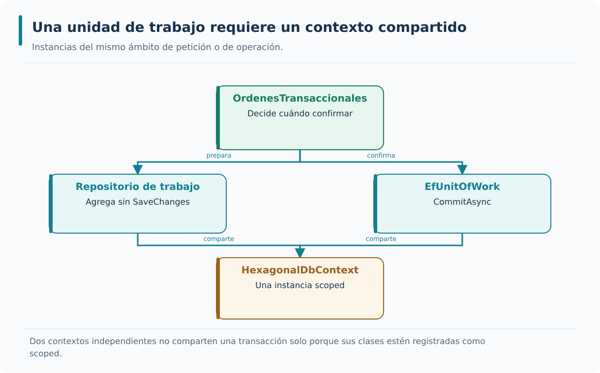

Los dos puertos comparten una misma instancia de contexto y una misma frontera de confirmación. La figura se distribuye en SVG vectorial y PNG.

### Responsabilidades de la unidad de trabajo

La unidad de trabajo debe confirmar o descartar un conjunto coherente de cambios en su ámbito de persistencia. En EF Core esa responsabilidad se apoya en el contexto y, cuando se necesita una secuencia de operaciones o varias llamadas de guardado, en una transacción explícita del proveedor. Una interfaz puede ofrecer `CommitAsync` y, si está justificado, una forma de cancelar una operación, pero eso no garantiza por sí mismo que todo rollback sea posible después de confirmar. La semántica depende de cuándo se materializaron las escrituras, qué conexión se utiliza y qué excepciones ocurrieron. En AceriaApp el alumno deberá distinguir cambios pendientes del `ChangeTracker` de filas realmente confirmadas y luego comprobar con otro contexto qué quedó almacenado.

Ejemplo de una **variante con reversión explícita**. Para implementarla se debe definir y conservar la transacción abierta; no se usa como sustituto del puerto mínimo de los bloques 5 y 7.

```csharp
public interface IUnidadTransaccional
{
    Task<int> CommitAsync(CancellationToken ct = default);
    Task RollbackAsync();
}
```


El contrato de confirmación y cancelación obliga a precisar cuándo puede realizarse un rollback. Descartar cambios pendientes antes de escribir no equivale a revertir una transacción ya confirmada; el comportamiento de cada operación depende del proveedor y de la frontera temporal.


La confirmación se expresa con `CommitAsync`. Algunas interfaces añaden `RollbackAsync`, pero ese nombre exige definir si revierte una transacción abierta o descarta cambios que todavía no se han enviado. No son equivalentes. Una interfaz mínima puede exponer solo confirmación y dejar que la eliminación del ámbito descarte el trabajo no confirmado.


Confirmar, deshacer una transacción abierta y abandonar cambios en memoria son operaciones diferentes. El contrato debe decir cuál ofrece, especialmente si usa la palabra Rollback.

El puerto mínimo de M4 expone CommitAsync(ct). Si no se confirma y se desecha el ámbito, los cambios preparados desaparecen con el contexto sin haberse persistido.

Un RollbackAsync que solo espera Task.CompletedTask promete un efecto que no realiza. Marcar entradas Unchanged tampoco deshace escrituras ya confirmadas en SQL Server.

Comprueba por separado el estado del objeto y el estado almacenado. Después de una reversión, no reutilices ciegamente objetos que todavía contienen valores del intento fallido.

### Lo que una unidad de trabajo no debe hacer

La unidad de trabajo no debe apropiarse de reglas de una orden ni de consultas que pertenecen a sus repositorios. Su función no es decidir si un lote supera una capacidad, construir DTOs ni transformar un fallo de SQL en una respuesta HTTP de negocio. Esas decisiones necesitan fronteras claras: dominio para invariantes, aplicación para coordinación y adaptadores para tecnología y protocolo. El diseño pierde claridad cuando `IUnitOfWork` se convierte en una interfaz enorme que contiene un método por cada entidad. En AceriaApp se busca un contrato de confirmación que colabore con los repositorios del mismo contexto, conservando la posibilidad de probar la coordinación por separado y de observar el commit real contra SQL Server.

```text
Lo que una unidad de trabajo no debe hacer:

- Contener reglas de negocio.
- Exponer detalles de cada entidad en el puerto de confirmación.
- Transformar entidades en DTOs.
- Ejecutar consultas complejas.
- Gestionar la lógica de los repositorios.
```


La lista delimita responsabilidades: la unidad de trabajo no debería validar el negocio ni decidir respuestas HTTP, sino coordinar la persistencia. Al mantener estas tareas en dominio, aplicación y adaptadores se evita que una sola clase concentre todas las decisiones.


La unidad debe coordinar persistencia; no decidir precios, cantidades máximas ni respuestas HTTP. La política de cuándo confirmar corresponde al caso de uso.

OrdenHexagonal protege cantidad positiva; OrdenesTransaccionales coordina el alta; el adaptador EfUnitOfWork delega la escritura en EF Core. Son responsabilidades distintas aunque compartan una petición.

El contexto conoce el modelo y las relaciones. Eso no vulnera por sí mismo el patrón: la abstracción del núcleo puede seguir siendo una operación de confirmación pequeña.

Lee los parámetros de CommitAsync. No debería recibir HttpContext ni instrucciones de negocio ajenas a persistencia; sí puede recibir un CancellationToken.

### Seguimiento de cambios

El seguimiento de cambios de EF Core permite registrar operaciones sobre entidades sin enviarlas inmediatamente a SQL Server. `Add` o una modificación de propiedades deja el contexto en un estado preparado; `SaveChangesAsync` calcula y ejecuta las operaciones que deben persistirse. Esta separación ayuda a comprender por qué el código puede parecer correcto en memoria antes de que exista ninguna fila en la base. Un adaptador `EfUnitOfWork` que llama a `SaveChangesAsync` centraliza ese momento, pero su robustez depende del mismo proveedor, las restricciones y la transacción que use el contexto. La comprobación didáctica debe leer desde otra instancia de `DbContext` después de confirmar, porque consultar entidades ya seguidas por el primer contexto puede ocultar una escritura que nunca ocurrió.

```csharp
public sealed class EfUnitOfWork(HexagonalDbContext db) : IUnitOfWork
{
    public Task<int> CommitAsync(CancellationToken ct = default) =>
        db.SaveChangesAsync(ct);
}
```


El ejemplo `EfUnitOfWork` delega `CommitAsync` a `SaveChangesAsync`. La diferencia didáctica es que el caso de uso conoce una operación de confirmación y no el método concreto de EF Core. La base real sigue siendo quien determina las garantías transaccionales.


El seguimiento compara valores y estados para producir las operaciones necesarias. No es una lista artesanal de SQL que la aplicación deba mantener.

Una OrdenHexagonal nueva se añade al contexto y queda pendiente. Una entidad recuperada con seguimiento puede modificarse mediante un método de dominio y guardarse en el siguiente commit.

AsNoTracking evita ese seguimiento normal. Además, DbContext no permite operaciones concurrentes: no ejecutes consultas paralelas con la misma instancia por usar métodos asíncronos.

Inspecciona ChangeTracker.Entries durante una prueba y contrasta el estado antes y después de SaveChanges. No confundas ese estado de memoria con la durabilidad de una transacción externa.

### EF Core como unidad de trabajo

EF Core proporciona mecanismos transaccionales que deben analizarse sobre el motor real. Cuando una llamada a `SaveChangesAsync` ejecuta varias modificaciones con un proveedor relacional, su comportamiento de transacción depende de las opciones configuradas y del conjunto de operaciones. Si necesitamos coordinar varias llamadas de guardado dentro de una única operación de negocio, podemos abrir una transacción explícita y confirmar al final. El ejemplo de AceriaApp muestra precisamente el uso de `BeginTransactionAsync`, `CommitAsync` y `RollbackAsync`. Debemos verificar qué sucede cuando una restricción SQL impide una de las escrituras y comprobar con una conexión nueva si los cambios anteriores se han revertido. Un `catch` que lanza de nuevo la excepción no es prueba de atomicidad.

**Contexto del ejemplo:** se supone un modelo didáctico con conjuntos `Ordenes` y `Movimientos`. Ilustra cambios en dos agregados; el contexto de órdenes de la práctica no incorpora automáticamente un `DbSet` de movimientos. `_db`, `orden` y `movimiento` son el contexto y los objetos preparados por el caso de uso.

```csharp
await using var tx = await _db.Database.BeginTransactionAsync();
try
{
    _db.Ordenes.Add(orden);
    _db.Movimientos.Add(movimiento);
    await _db.SaveChangesAsync();
    await tx.CommitAsync();
}
catch
{
    await tx.RollbackAsync();
    throw;
}
```


La transacción explícita rodea las escrituras y se confirma solo cuando todas han terminado satisfactoriamente. Ante una excepción se solicita rollback y se propaga el error. Para demostrarlo hay que leer filas desde una nueva conexión, no quedarse en la estructura del `try/catch`.


Una llamada a SaveChanges usa atomicidad del proveedor relacional por defecto. Una transacción explícita es útil si necesitas cubrir varias llamadas u otras operaciones compatibles.

El ejemplo muestra begin, guardado y commit explícitos. Con una sola llamada de guardado, suele bastar la transacción implícita del proveedor de EF Core.

SaveChanges dentro de una transacción abierta todavía no equivale a commit final. Reintentos configurados requieren ejecutar la transacción completa mediante la estrategia correspondiente.

La práctica usa `UseSqlServer` y un motor SQL Server real para comprobar restricciones y persistencia. EF Core InMemory no reproduce transacciones relacionales ni demuestra que el rollback SQL funcione; SQLite tiene transacciones, pero no valida el comportamiento específico de SQL Server.

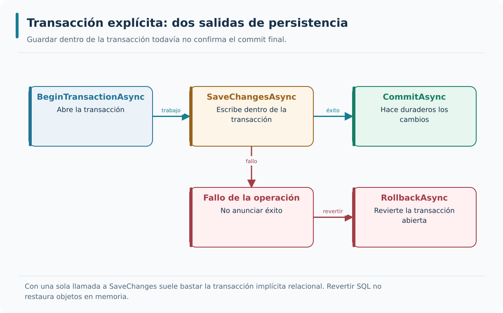

Guardar dentro de una transacción abierta y confirmar esa transacción son pasos distintos. La rama de fallo cancela su persistencia. La figura se distribuye en SVG vectorial y PNG.

### Unidad de trabajo personalizada

Una unidad de trabajo personalizada puede ofrecer un contrato ajustado a las necesidades de la aplicación, por ejemplo confirmar cambios sin exponer métodos de EF Core a los casos de uso. Su implementación puede delegar en el contexto y proporcionar operaciones auxiliares de limpieza para escenarios muy concretos. Sin embargo, métodos como `ChangeTracker.Clear` no son un rollback de SQL: descartan entidades seguidas por ese contexto y no deshacen datos ya confirmados en el servidor. Esa distinción importa cuando un flujo falla después de preparar cambios. Una implementación propia debe documentar con precisión qué garantiza y qué deja en manos del proveedor de almacenamiento. En el proyecto las pruebas deben demostrar la frontera y evitar presentar una clase envoltorio como si añadiera automáticamente transacciones distribuidas.

```csharp
public interface IUnitOfWork
{
    Task<int> CommitAsync(CancellationToken ct = default);
}
public sealed class EfUnitOfWork(HexagonalDbContext db) : IUnitOfWork
{
    public Task<int> CommitAsync(CancellationToken ct = default) =>
        db.SaveChangesAsync(ct);
    public void DescartarCambiosPendientes() => db.ChangeTracker.Clear();
}
```


La clase personalizada incluye confirmación y limpieza del seguimiento. `ChangeTracker.Clear` puede liberar entidades pendientes o seguidas, pero no revierte una escritura que SQL Server haya confirmado. El alumno debe reconocer el límite exacto de cada operación.


Una interfaz personalizada debe ser más pequeña y más clara que el detalle que encapsula. Ocultar DbContext no obliga a reimplementar todos sus métodos.

CommitAsync devuelve el número de entradas de estado guardadas por EF Core. No representa necesariamente el número exacto de filas SQL afectadas ni es un identificador de negocio.

ChangeTracker.Clear abandona seguimiento. No restaura propiedades de los objetos que conserva el llamador, no hace rollback de una transacción abierta y no revierte un commit anterior.

Tras abandonar o revertir una operación fallida, termina el ámbito y usa un contexto nuevo para continuar cuando sea necesario. Haz explícita esa política de ciclo de vida.

### Unidad de trabajo y transacciones distribuidas

La atomicidad de un `DbContext` no alcanza por sí sola a varios microservicios que poseen bases y transacciones distintas. Una operación de Producción puede confirmarse localmente y no conseguir que Inventario procese el evento en el mismo instante. En ese escenario necesitaremos mensajería, entrega fiable, idempotencia o mecanismos de compensación que coordinen el negocio; Unit of Work local no reemplaza esas estrategias. Es importante enseñar esta frontera antes de introducir comunicación distribuida, porque el nombre «unidad de trabajo» puede sugerir erróneamente que toda acción empresarial se confirma de una vez. AceriaApp utilizará transacciones locales por servicio y estudiará más adelante cómo se propagan cambios a otro proceso mediante eventos y patrones outbox/inbox.

```text
Alcance de la unidad de trabajo:

Transacción local    → una única base de datos.
Transacción distribuida → varias bases de datos o servicios.
```


La comparación entre transacción local y distribuida explica por qué una unidad de trabajo no puede garantizar atomicidad entre Producción e Inventario sin otro mecanismo de coordinación. Las fronteras de propiedad de datos importan tanto como el nombre del patrón.


La atomicidad local termina donde acaba la transacción compartida. Enviar un correo o publicar en un broker introduce efectos que no revierten con un rollback de SQL.

Si se confirma una orden y después falla la publicación, la orden sigue guardada. Un outbox conserva el hecho pendiente junto con la orden para enviarlo posteriormente.

Una saga compensa pasos ya aplicados y admite estados intermedios; no convierte toda la conversación entre servicios en una transacción ACID única.

Dibuja qué recursos cubre la transacción y qué sucede si cae el proceso tras confirmar. Una notificación MediatR en memoria no elimina esa ventana de fallo.

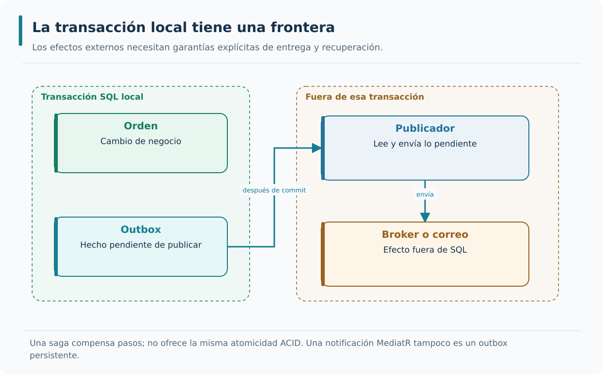

Identifica qué recursos cubre la transacción local y qué efectos necesitan un diseño adicional de entrega o compensación. La figura se distribuye en SVG vectorial y PNG.

### Cuándo usar el patrón Unit of Work

Tiene sentido introducir Unit of Work cuando un caso de uso modifica varias entidades dentro de una misma frontera transaccional o cuando necesitamos controlar explícitamente qué repositorios participan en una confirmación. En operaciones sencillas con un solo contexto puede bastar utilizar el `DbContext` en infraestructura sin otro envoltorio. En cualquiera de los casos, conviene que la aplicación comprenda el momento de éxito y fallo, y que las pruebas documenten qué sucede ante una excepción. Para AceriaApp la separación permite comparar el resultado esperado del caso de uso con la evidencia de filas almacenadas en SQL Server. No debe confundirse facilitar un mock de `CommitAsync` con certificar la atomicidad del proveedor.

```text
Cuándo usar Unit of Work:

Operación con varias entidades → sí.
Coordinación de repositorios   → sí.
Desacoplamiento de transacciones → sí.
Operación con una entidad      → DbContext puede bastar.
Sin requisito de atomicidad    → evaluar abstracción.
```


La tabla muestra cuándo una abstracción explícita de commit ayuda a coordinar varios repositorios y cuándo `DbContext` puede ofrecer suficiente estructura. La decisión debe basarse en un requisito de atomicidad comprobable y no en agregar interfaces por rutina.


El patrón puede existir aunque solo haya una entidad modificada. La decisión relevante es si necesitas otra abstracción sobre la unidad que ya proporciona EF Core.

AceriaApp añade IUnitOfWork para que aplicación ordene la confirmación sin importar DbContext. El valor pedagógico es ver y probar esa frontera.

No mantengas transacciones abiertas mientras esperas al usuario o a un servicio remoto lento. El bloqueo de recursos debe corresponder al trabajo de persistencia necesario.

Documenta quién inicia la operación, quién confirma y quién termina el ámbito. Si hay más de un responsable de confirmar, revisa el diseño antes de añadir más repositorios.

### Aplicación al proyecto del curso

El recorrido de esta etapa conecta los repositorios de órdenes con una confirmación coordinada a través de `IUnitOfWork` y `EfUnitOfWork`. El alumno podrá reconocer cuándo se preparan cambios, quién decide confirmarlos y cuál es la evidencia que demuestra su persistencia. El ejemplo de SQL Server provoca un fallo controlado y compara el estado final de la base con y sin política transaccional, de modo que se pueda observar una diferencia real. Esta comprobación es más rigurosa que contar métodos ejecutados o comprobar solamente que se lanzó una excepción. La teoría del patrón debe servir para explicar el experimento de integración, mientras las prácticas indican cómo construirlo y ejecutarlo sobre el proveedor elegido.

```text
Aplicación al proyecto del curso:

Puerto de salida    → IUnitOfWork.
Adaptador de salida → EfUnitOfWork.
Repositorios        → no confirman cambios.
Unidad de trabajo   → confirma los cambios.
Validación          → test de coherencia.
```


El mapa final distingue puerto, adaptador y repositorios que preparan cambios. La confirmación se ejerce en el punto acordado por el caso de uso y debe estar respaldada por pruebas SQL que demuestren el efecto completo.


La aplicación del patrón Unit of Work prepara el proyecto para los puntos 4.3, 4.4 y 4.5. El punto 4.3 estudiará el patrón Mediator. El punto 4.4 estudiará el Result Pattern. El punto 4.5 estudiará la inyección de dependencias. El punto 4.2 establece la base que se aplicará en los tres puntos siguientes.


El catálogo describe el patrón y las pruebas relacionales demuestran el comportamiento. Ambas piezas deben hablar del mismo límite de confirmación.

La progresión conserva el comportamiento previo y añade el flujo de trabajo con IOrdenTrabajoRepositorio, IUnitOfWork y OrdenesTransaccionales. No atribuyas staging al repositorio heredado que guarda inmediatamente.

Una prueba con fake que cuenta commits demuestra orquestación, pero no atomicidad SQL. Una prueba real de restricciones detecta fallos que el fake nunca produciría.

Ejecuta un alta válida y un fallo que deje la base sin cambios parciales. El punto siguiente reutiliza esos puertos desde un manejador MediatR.

### Alcance de la unidad de trabajo

- El patrón Unit of Work es una abstracción que coordina las operaciones de varios repositorios en una única transacción.
- Una unidad de trabajo tiene tres responsabilidades: mantener el seguimiento de cambios, coordinar la persistencia y exponer la operación de confirmación.
- La unidad de trabajo coordina persistencia sin asumir reglas de negocio ni respuestas HTTP; su contrato no necesita enumerar entidades, aunque su implementación las conozca.
- EF Core implementa el patrón Unit of Work en su clase `DbContext`.
- Una unidad de trabajo personalizada envuelve el `DbContext` y expone solo las operaciones necesarias.
- La unidad de trabajo se limita a la transacción local: la transacción distribuida requiere patrones adicionales.
- El patrón se usa cuando una operación afecta a varias entidades y debe ejecutarse de forma atómica.
- El patrón se complementa con el patrón Repository para coordinar las operaciones de varios repositorios.

---


## Estudio integrador 4.2 — Demostrar atomicidad en SQL Server

### Preparar cambios, enviarlos y confirmarlos son momentos distintos

Un repositorio de trabajo puede agregar dos órdenes al `DbContext` sin enviarlas todavía a la base. EF Core mantiene esas entidades en su seguimiento de cambios. En ese momento, cerrar el contexto descarta los cambios pendientes: no es un rollback de SQL porque aún no se ha ejecutado la escritura. Al llamar a `SaveChangesAsync`, el proveedor prepara y ejecuta los comandos necesarios. Si ese conjunto necesita una transacción, EF Core usa el comportamiento transaccional predeterminado del proveedor relacional.

En la implementación de `EfUnitOfWork`, `CommitAsync` delega en un único `SaveChangesAsync`. Ese es el límite de confirmación elegido para el caso de uso. Si una operación requiriera varios `SaveChanges` dentro de una única unidad atómica, habría que diseñar una transacción explícita que los abarcase. Añadir un método llamado `RollbackAsync` que no accione una transacción no proporciona esa garantía. [La documentación de transacciones de EF Core explica el comportamiento de una confirmación y el control explícito](https://learn.microsoft.com/ef/core/saving/transactions).

### Qué pregunta responde cada clase de prueba

| Técnica | Sirve para observar | Límite de lo demostrado |
|---|---|---|
| Doble de `IUnitOfWork` | Si el caso de uso solicita confirmar | Contar llamadas no ejecuta ni revierte SQL. |
| Contexto con EF InMemory | Operaciones sobre su almacenamiento no relacional | No demuestra una transacción relacional. |
| SQLite | Transacciones y reglas de SQLite | Su comportamiento no certifica el proveedor SQL Server. |
| SQL Server aislado | Escrituras, restricciones y rollback con `UseSqlServer` | Demuestra los escenarios ejecutados en esa configuración. |

El laboratorio usa el último camino para comprobar persistencia y atomicidad. `BaseSqlServer.Crear()` devuelve una conexión a una base única; Testcontainers obtiene SQL Server real cuando no se proporciona `ACERIA_TEST_SQLSERVER`. La misma prueba puede usar LocalDB en Windows mediante esa variable. Cambiar el servidor no convierte una prueba de SQL en una prueba de dominio: sigue dependiendo de un recurso real y debe fallar si ese recurso no está disponible.

### Por qué una excepción no basta para demostrar rollback

Supongamos que se preparan dos órdenes y el test provoca un error antes de enviar la primera. Después consulta la base y encuentra cero filas. Ese resultado sería idéntico aunque no existiera transacción, porque nunca llegó a producirse una escritura. La prueba no ha demostrado que se deshaga nada.

Para distinguir ambos casos se necesita **una escritura real anterior al fallo**. La prueba de `UnitOfWorkFuncionalesTests` provoca el error después de observar el primer INSERT y antes de completar la siguiente escritura. La configuración `sql.MaxBatchSize(1)` impide que el proveedor SQL Server agrupe ambas altas de una forma que impida observar ese punto. El interceptor busca `INSERT INTO` dentro del comando, porque SQL Server puede anteponer otras instrucciones como `SET`. Esta configuración pertenece al escenario de prueba; la aplicación no necesita usar ese tamaño de lote para funcionar correctamente.

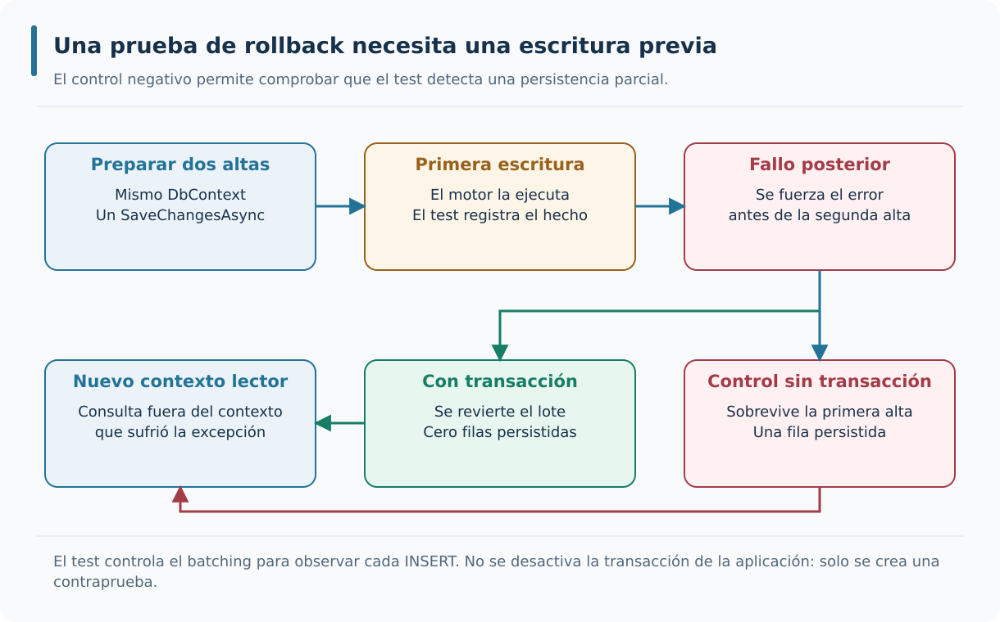

Las dos ramas repiten el mismo fallo controlado. La rama transaccional deja cero filas; el control sin transacción conserva la primera. La diferencia demuestra que la prueba es capaz de detectar una persistencia parcial. La figura se distribuye en SVG y PNG.

El test utiliza `AutoTransactionBehavior.WhenNeeded`, el comportamiento habitual, y lo contrasta con `AutoTransactionBehavior.Never` en una base independiente. La segunda variante es un **control negativo**: se elimina deliberadamente la protección que se está comprobando para ver si cambia el resultado. No es una recomendación para la configuración de la API.

Este extracto muestra la parte que observa el resultado; el montaje de los repositorios y del interceptor aparece completo en las prácticas:

```csharp
db.Database.AutoTransactionBehavior = transacciones;
await Assert.ThrowsAsync<DbUpdateException>(
    () => new EfUnitOfWork(db).CommitAsync());
Assert.Equal(1, fallo.InsertsEjecutados);
await using var verificacion = Contexto(store);
var filasEsperadas = transacciones == AutoTransactionBehavior.Never ? 1 : 0;
Assert.Equal(filasEsperadas, await verificacion.Ordenes.CountAsync());
```


El fragmento compara el resultado de dos políticas transaccionales ante un error. Que se lance `DbUpdateException` no basta para afirmar qué filas quedaron guardadas: la consulta desde otro contexto y la comparación de cantidades permiten comprobar el efecto de la opción elegida.


### Recuperar la aplicación después de un fallo

El rollback se refiere al estado de la base de datos. Las instancias de objetos que ya se han modificado en memoria pueden conservar esos valores después de la excepción. `ChangeTracker.Clear()` abandona el seguimiento de EF Core, pero tampoco rebobina las propiedades de los objetos que aún conserva el llamador. Tras un fallo, el curso termina el ámbito afectado y verifica el resultado con otro contexto. Ese procedimiento hace visible la diferencia entre memoria de aplicación y almacenamiento confirmado.

También hay que situar la frontera: dos repositorios comparten atomicidad cuando participan en el mismo contexto y transacción. Tener dos objetos llamados `EfUnitOfWork` conectados a dos bases diferentes no crea una transacción distribuida. Enviar un mensaje o modificar un archivo tampoco se deshace por revertir SQL. Esos problemas requerirían otra coordinación y quedan fuera de la garantía que se prueba en este punto.

**Comprobación de comprensión.** Explica por qué «no hice commit», «falló antes de escribir» y «escribí y se revirtió» son tres hechos distintos. Después identifica en el test la observación que descarta el segundo caso, la consulta que verifica el tercero y el control que haría visible la ausencia de transacción. Esa lectura permite defender el resultado sin apoyarse únicamente en un contador de pruebas.

---

# Punto 4.3 — Mediator (MediatR)

**Módulo 4:** Patrones de arquitectura

**Objetivos de aprendizaje:**

- Comprender el patrón Mediator y su propósito en una arquitectura hexagonal.
- Identificar la relación entre Mediator y los casos de uso.
- Comprender la diferencia entre comandos, consultas y notificaciones.
- Comprender el papel de MediatR como implementación del patrón.
- Añadir al proyecto `AceriaApp` las clases de validación del patrón Mediator y un test unitario que verifique la validación.

---

## El mensaje expresa la intención; el handler ejecuta el caso de uso


Recorreremos la creación de una orden desde HTTP hasta el handler, los puertos y SQL Server. Esa trayectoria permite valorar qué dependencias desaparecen al introducir el mediador y cuáles siguen siendo necesarias.

### Definición del patrón Mediator

Mediator permite que un componente solicite una operación sin conocer la clase concreta que la ejecutará. En una API con varios casos de uso, este intermediario evita que cada endpoint deba construir o localizar sus propios manejadores. La ventaja es mantener la coordinación cerca de la aplicación y facilitar comportamientos transversales como validación y registro de eventos. Pero no sustituye los límites del dominio: los mensajes necesitan significado, los handlers deben respetar las reglas y el acceso a SQL sigue realizándose a través de puertos. MediatR actúa dentro del proceso, no proporciona por sí mismo comunicación fiable entre microservicios. En AceriaApp estudiaremos el recorrido que comienza en una ruta HTTP, atraviesa el mediador y termina en el caso de uso y su repositorio.

```text
Patrón Mediator:

Componente A ──┐
               │
Componente B ──┼──► Mediator ──► Componente destino
               │
Componente C ──┘
```


El diagrama presenta al mediador como punto de entrega de solicitudes entre componentes internos. Esa mediación reduce dependencias directas, pero sigue funcionando dentro del proceso y necesita contratos de mensajes bien definidos.


El mediador sustituye dependencias directas entre emisores y receptores por contratos de mensajes. El acoplamiento al contrato sigue existiendo y debe diseñarse.

Un endpoint conoce CrearOrdenCommand e ISender. El contenedor resuelve CrearOrdenHandler, que conoce los puertos necesarios para coordinar la orden.

Desacoplar no equivale a ejecutar en otro proceso. MediatR despacha en memoria dentro de la aplicación y una llamada esperada con await sigue formando parte del flujo.

Sigue un comando desde el endpoint hasta su manejador. Debe encontrarse una respuesta tipada y un único manejador apropiado para esa solicitud.

### Mediator en la capa de aplicación

Un handler recibe un mensaje que expresa la intención del consumidor y coordina lo necesario para ejecutarla. En la creación de una orden, el manejador puede construir el agregado mediante sus reglas, pedir al repositorio que lo registre y confirmar la unidad de trabajo. Esta secuencia es una capacidad de aplicación, no un detalle del endpoint. Por eso el handler puede probarse con dobles de repositorio y de confirmación, mientras las pruebas SQL verifican el adaptador concreto. Utilizar MediatR no elimina la necesidad de un diseño claro: si una sola clase atiende todos los comandos y contiene reglas y SQL, el patrón solo añade indirección superficial. El objetivo es localizar las responsabilidades sin fragmentarlas arbitrariamente.

```csharp
public record CrearOrdenCommand(string Cliente, string Material, int Cantidad) : IRequest<Guid>;
public sealed class CrearOrdenHandler(
    IOrdenTrabajoRepositorio repositorio, IUnitOfWork unidad)
    : IRequestHandler<CrearOrdenCommand, Guid>
{
    public async Task<Guid> Handle(CrearOrdenCommand request, CancellationToken ct)
    {
        var orden = new OrdenHexagonal(request.Cliente, request.Material, request.Cantidad);
        await repositorio.AgregarAsync(orden, ct);
        await unidad.CommitAsync(ct);
        return orden.Id;
    }
}
```


El comando de creación llega a un handler que coordina el dominio, el repositorio y la unidad de trabajo. El mediador solo selecciona la clase de destino; las reglas de órdenes y la confirmación SQL pertenecen a otros componentes.


El manejador puede implementar el caso de uso o delegar en uno existente. Ambas alternativas son válidas si evitan duplicar decisiones de negocio.

El ejemplo muestra coordinación directa de entidad, repositorio de trabajo y unidad. La práctica puede delegar en OrdenesTransaccionales para reutilizar la operación del punto anterior.

Usar MediatR desde el dominio acoplaría sus reglas a una biblioteca de aplicación. Reserva los mensajes de transporte interno y sus manejadores para el nivel adecuado.

Prueba el manejador directamente para su lógica y mediante ISender para comprobar registro y pipeline. Son pruebas distintas con fallos distintos.

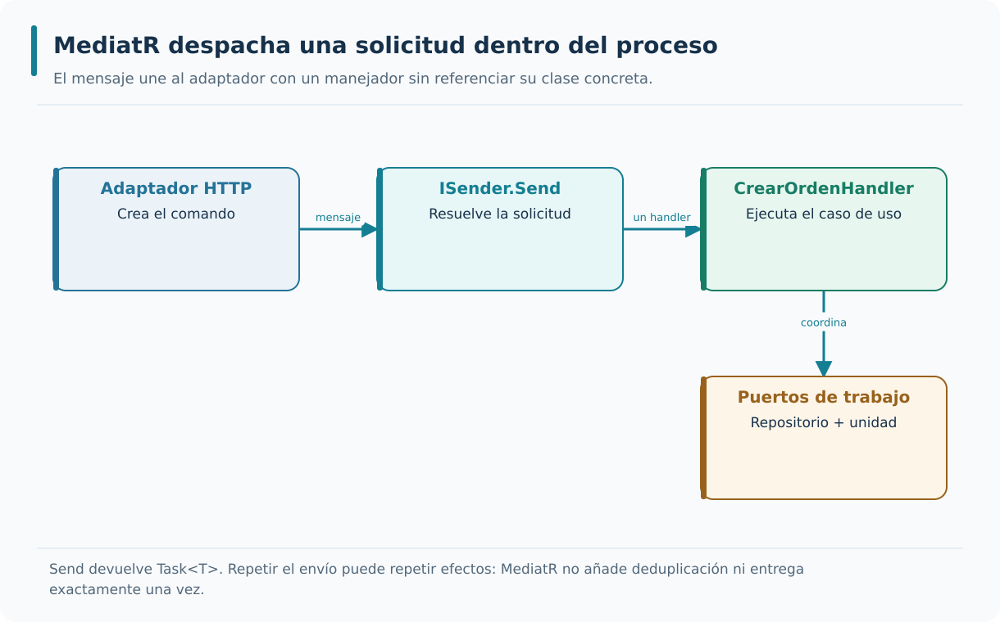

El emisor conoce el mensaje y el mediador; el manejador conoce los puertos. El proceso continúa siendo local. La figura se distribuye en SVG vectorial y PNG.

### Comandos

Un comando representa una intención de modificar el estado. Crear, cancelar o actualizar una orden son operaciones distintas, aunque todas compartan la identidad del agregado. El comando contiene los datos necesarios para solicitar la acción, pero no es la entidad de dominio y no debería asumir su comportamiento. La validación de entrada puede detectar propiedades incorrectas; el agregado y el caso de uso deben proteger además las invariantes del negocio, como prohibir cancelar una orden ya finalizada. En AceriaApp cada comando tendrá un manejador reconocible, y su respuesta expresará qué ocurrió para que el adaptador HTTP devuelva el estado correcto. El nombre del mensaje debería comunicar la intención, no simplemente reproducir un verbo CRUD sin significado funcional.

```csharp
public record CrearOrdenCommand(string Cliente, string Material, int Cantidad) : IRequest<Guid>;
public record CancelarOrdenCommand(Guid Id) : IRequest;
public record ActualizarMaterialCommand(Guid Id, int Cantidad) : IRequest;
```


Los records representan intenciones de crear, cancelar o actualizar. Cada uno contiene datos de entrada y necesita un manejador que aplique las invariantes correspondientes, en lugar de comportarse como una entidad directamente editable.


Un comando expresa intención: crear o finalizar son acciones. Una respuesta con identificador no lo convierte en consulta, porque el criterio es su efecto sobre el estado.

CrearOrdenCommand contiene cliente, material y cantidad. Generar un nuevo GUID en cada ejecución hará dos órdenes si el cliente reintenta sin una estrategia de idempotencia.

MediatR no almacena mensajes ni identifica duplicados. Garantizar repetición segura puede requerir una clave de idempotencia y una restricción persistente sobre esa clave.

Envía dos veces el mismo comando en una prueba de exploración y observa el efecto. Decide después si el contrato de negocio admite duplicados o exige prevención.

### Consultas

Una consulta solicita información sin pretender modificar el estado del sistema. `ObtenerOrdenQuery` puede devolver un DTO individual, mientras `ListarOrdenesQuery` incorpora paginación para responder a un conjunto más grande. El handler de lectura no necesita forzosamente reconstruir todos los agregados de escritura; puede utilizar proyecciones que respondan mejor a la pregunta del consumidor. Separar comandos y consultas ayuda a mantener sus pruebas y responsabilidades, pero no exige crear dos bases de datos ni desplegar servicios distintos. En AceriaApp observaremos que una consulta se limita a leer y que su contrato no expone indiscriminadamente entidades de persistencia. Esta distinción preparará CQRS, que se desarrollará más adelante con ejemplos ejecutables.

```csharp
public record ObtenerOrdenQuery(Guid Id) : IRequest<OrdenDto?>;
public record ListarOrdenesQuery(int Page, int PageSize) : IRequest<List<OrdenDto>>;
public record BuscarMaterialQuery(string Nombre) : IRequest<List<MaterialDto>>;
```


Las queries describen información que desea obtener el consumidor y pueden devolver DTOs de lectura. No deben introducir efectos ocultos ni confirmaciones SQL solo porque utilicen el mismo mecanismo de envío que un comando.


Una consulta describe qué información necesita el consumidor. Separarla de comandos ayuda a revisar efectos, validación y optimización sin imponer bases de datos separadas.

ObtenerOrdenQuery busca por identificador; una lista puede incorporar página y tamaño. La respuesta del manejador puede ser una proyección de aplicación adecuada para lectura.

Dos consultas iguales pueden devolver estados distintos porque otra petición finalizó una orden. No confundas seguridad de lectura con inmutabilidad del mundo observado.

Comprueba que una consulta no crea ni modifica órdenes. Si incorpora caché, explica su caducidad y consistencia sin esconder esas decisiones bajo el nombre Query.

### Notificaciones

Una notificación comunica un hecho o una señal que varios componentes internos pueden necesitar conocer. MediatR permite que un emisor publique `OrdenCreadaNotification` sin invocar directamente a cada observador de correo o auditoría. La idea es útil para reducir acoplamiento local, pero tiene límites importantes: publicar dentro del proceso no garantiza persistencia de la notificación ni recuperación automática cuando el host se interrumpe. Debemos decidir también si la publicación ocurre antes o después de confirmar la base y cómo se tratan los fallos de los observadores. En AceriaApp esto se estudiará como coordinación de componentes internos; RabbitMQ y el patrón outbox resolverán posteriormente necesidades diferentes de mensajería entre procesos.

```csharp
public record OrdenCreadaNotification(Guid Id, string Cliente) : INotification;
public interface ICorreoOrdenes
{
    Task EnviarConfirmacionAsync(Guid id, string cliente, CancellationToken ct);
}
public interface IAuditoriaOrdenes
{
    Task RegistrarCreacionAsync(Guid id, CancellationToken ct);
}
public sealed class EnviarEmailOrdenCreadaHandler(ICorreoOrdenes correo)
    : INotificationHandler<OrdenCreadaNotification>
{
    public Task Handle(OrdenCreadaNotification notification, CancellationToken ct) =>
        correo.EnviarConfirmacionAsync(notification.Id, notification.Cliente, ct);
}
public sealed class RegistrarAuditoriaOrdenCreadaHandler(IAuditoriaOrdenes auditoria)
    : INotificationHandler<OrdenCreadaNotification>
{
    public Task Handle(OrdenCreadaNotification notification, CancellationToken ct) =>
        auditoria.RegistrarCreacionAsync(notification.Id, ct);
}
```


Los handlers de la notificación reciben el hecho de creación y pueden actuar sobre correo o auditoría. Esa publicación local no ofrece por sí sola almacenamiento duradero del evento ni coordinación transaccional de los efectos externos.


Una notificación comunica un hecho y admite cero o más receptores. Los efectos de los receptores no deben depender de un orden implícito de registro.

La creación puede originar auditoría y confirmación por correo mediante puertos separados. Los manejadores completos del ejemplo delegan esos efectos sin conocer SMTP ni almacenamiento concreto.

Cada receptor puede fallar y la publicación puede quedar a medias. Para efectos imprescindibles después de commit, la fiabilidad necesita diseño adicional y pruebas de fallo.

Prueba cada receptor con un doble de su puerto y prueba la publicación completa por separado. No llames a un efecto finalizado antes de conocer cuándo se confirma su dato.

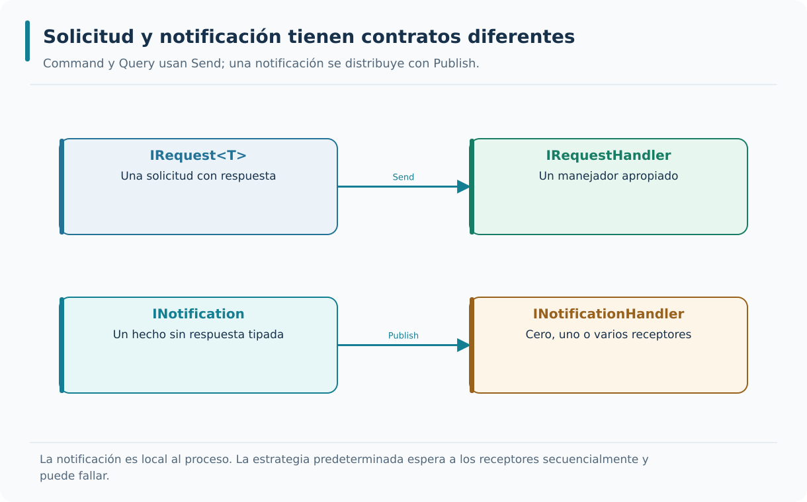

Solicitud y notificación tienen distinta cardinalidad de receptores y distinta forma de respuesta. La figura se distribuye en SVG vectorial y PNG.

### MediatR como implementación del patrón

MediatR utiliza contratos como `IRequest<T>` y `IRequestHandler<,>` para asociar solicitudes con sus manejadores. El registro de la biblioteca en el contenedor de ASP.NET Core permite encontrar los handlers disponibles, pero no prueba que una ruta concreta los utilice. Conviene verificar el ensamblado que se analiza, el ciclo de vida de los colaboradores y el resultado de un envío real. En AceriaApp un comando necesita acceso a repositorio y Unit of Work; esos servicios deben poder resolverse con el ámbito correcto. El mediador facilita la construcción del recorrido, pero la arquitectura se demuestra comprobando dependencias y comportamiento, no simplemente detectando la llamada `AddMediatR`.

```csharp
builder.Services.AddMediatR(cfg =>
{
    cfg.RegisterServicesFromAssemblyContaining<CrearOrdenHandler>();
});
```


El registro por ensamblado permite descubrir handlers y componer sus dependencias. Debemos comprobar la resolución de un mensaje concreto, no limitar la evaluación a que el código de arranque contenga AddMediatR.


El módulo fija MediatR 12.4.1 para que código, paquetes y API sean reproducibles. Esa versión es una elección del curso, no una afirmación sobre la versión más reciente.

Registra el ensamblado que contiene CrearOrdenHandler. Escanear Program solo encuentra manejadores de la API y dejaría sin descubrir los ubicados en aplicación.

AddMediatR registra manejadores, pero no inventa adaptadores ni configura automáticamente todos los validadores. Cada dependencia usada por un manejador también necesita registro.

Resuelve ISender dentro de un ámbito y ejecuta una solicitud real. Eso detecta ensamblados incorrectos y dependencias ausentes que una compilación no descubre.

### Envío de comandos y consultas

El endpoint de órdenes puede recibir un comando y entregarlo a `ISender`, sin conocer `CrearOrdenHandler` ni su implementación de persistencia. Cuando el handler devuelve un identificador, el adaptador HTTP traduce ese resultado a `201 Created` con la ubicación del nuevo recurso. Una consulta seguirá un camino análogo, aunque su semántica no incluya escritura. Esto permite mantener handlers alejados de los tipos HTTP y centralizar el contrato público en el borde. También requiere nombres y flujos claros: abusar de mensajes genéricos puede ocultar quién ejecuta una operación. En AceriaApp queremos que la ruta pueda seguirse sin dificultad hasta el caso de uso y la confirmación SQL.

```csharp
public static class OrdenesEndpoints
{
    public static void MapOrdenesEndpoints(this WebApplication app)
    {
        app.MapPost("/api/v1/ordenes", async (
            CrearOrdenCommand command,
            ISender mediator, CancellationToken ct) =>
        {
            var id = await mediator.Send(command, ct);
            return Results.Created($"/api/v1/ordenes/{id}", new { id });
        });
    }
}
```


El endpoint envía el comando mediante ISender y construye una respuesta Created con el identificador devuelto. Así el adaptador conserva decisiones HTTP y el handler conserva la operación de aplicación.


El endpoint transforma protocolo y envía un mensaje. ISender limita su dependencia a Send cuando no necesita publicar notificaciones.

La firma incluye CancellationToken y lo transmite a Send. El manejador recibe el mismo propósito de cancelación y lo transmite a EF Core mediante los puertos.

Un método de extensión debe estar dentro de una clase estática. Send devuelve Task; añadir Async al nombre por costumbre no crea un método existente.

Comprueba la respuesta HTTP y consulta la ubicación devuelta por una creación. El URI de Location debe corresponder a una ruta de consulta realmente expuesta por la API.

### Publicación de notificaciones

La publicación de notificaciones locales puede activar observadores independientes tras crear una orden, pero su momento de ejecución tiene efectos reales. Si se publican antes de confirmar SQL, un observador puede reaccionar a un hecho que finalmente se revierte. Si se publican después, un fallo del proceso puede impedir que el observador llegue a verlo. Por eso `Publish` no debe confundirse con una cola duradera ni con garantía de entrega exactamente una vez. El ejemplo sirve para mostrar cómo se separa el emisor de los handlers internos; en módulos posteriores se estudiará cómo persistir eventos y recuperarlos tras fallos. La decisión sobre notificar debe vincularse a los requisitos del negocio y a la consistencia que necesitamos.

```csharp
await mediator.Publish(new OrdenCreadaNotification(id, command.Cliente));
```


Publish entrega la notificación a los handlers internos registrados. La decisión de publicar antes o después de guardar es importante y no queda resuelta por el nombre de la llamada al mediador.


Publish espera el trabajo de la estrategia de publicación configurada. Asíncrono describe cómo se espera; no implica una cola duradera ni un proceso separado.

La estrategia predeterminada de esta versión recorre receptores secuencialmente. El diseño no debería usar su orden para ejecutar pasos de una operación de negocio obligatoria.

Si se necesita enviar a otro servicio, una notificación local puede iniciar un adaptador de mensajería, pero sus garantías pertenecen al transporte y al diseño de entrega.

Provoca un fallo en un receptor y observa cuáles llegaron a ejecutarse. Esa evidencia evita asumir aislamiento, ejecución completa o reintento automático que no se configuró.

### MediatR y validación

Los comportamientos de pipeline permiten ejecutar validación, diagnóstico o registro alrededor de un handler sin repetir esas tareas en cada caso de uso. Un `ValidationBehavior` puede localizar validadores de la solicitud y detener la ejecución si la entrada incumple las condiciones acordadas. Su utilidad depende de que la validación se aplique al tipo correcto, se ejecute antes del efecto y traduzca los errores de manera consistente. Registrar un comportamiento no sustituye las invariantes del dominio y tampoco asegura que todas las rutas pasen por el mediador. En AceriaApp comprobaremos que una solicitud inválida no provoca escritura, mientras una válida llega al handler con sus colaboradores correctamente resueltos.

```csharp
public sealed class ValidationBehavior<TRequest, TResponse>(
    IEnumerable<IValidator<TRequest>> validators)
    : IPipelineBehavior<TRequest, TResponse> where TRequest : notnull
{
    public async Task<TResponse> Handle(TRequest request,
        RequestHandlerDelegate<TResponse> next, CancellationToken ct)
    {
        var failures = new List<FluentValidation.Results.ValidationFailure>();
        foreach (var validator in validators)
        {
            var result = await validator.ValidateAsync(request, ct);
            failures.AddRange(result.Errors);
        }
        if (failures.Count > 0)
            throw new ValidationException(failures);
        return await next();
    }
}
```


El comportamiento genérico valida la solicitud antes de invocar next; si encuentra errores, la operación de escritura debe quedar detenida. La prueba debe comprobar precisamente que no se ejecutó el handler rechazado.


Un pipeline aplica comportamiento transversal alrededor de la solicitud. Logging, validación y medición son ejemplos; el orden de registro decide cómo se anidan.

La práctica conecta LoggingBehavior y los ejemplos desarrollan además una variante con FluentValidation. Los validadores se ejecutan secuencialmente para no compartir DbContext de forma concurrente.

La variante que lanza ValidationException necesita traducción HTTP explícita. En 4.4 se estudia otra variante que devuelve Result; no registres ambas para el mismo propósito sin diseñar su interacción.

Registra el comportamiento abierto con AddOpenBehavior y registra `IValidator<T>` para los mensajes que lo necesiten. Un pipeline sin validadores no valida por el solo hecho de existir.

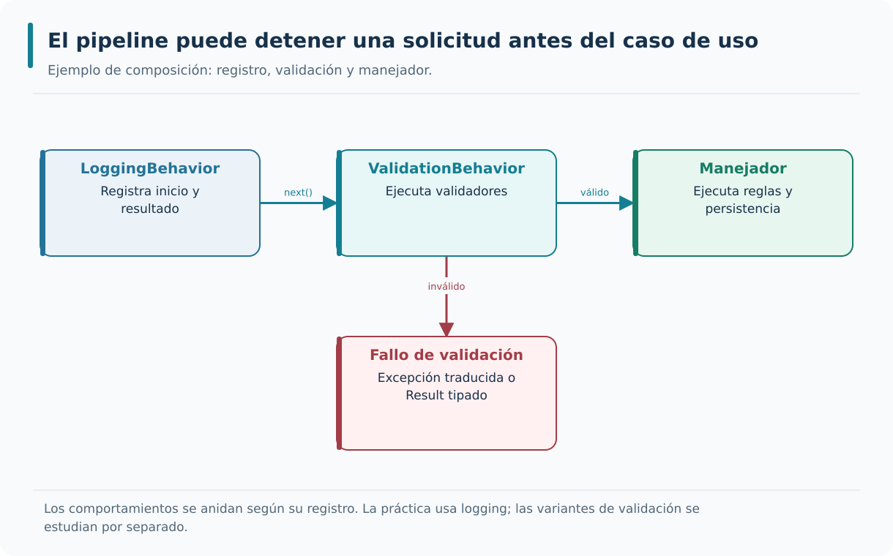

Los comportamientos se anidan; una validación fallida corta el recorrido antes del manejador. La figura se distribuye en SVG vectorial y PNG.

**Registro del comportamiento de validación del ejemplo.** En la raíz de composición, después de registrar los validadores concretos como `IValidator<TRequest>`, el comportamiento abierto se incorpora a MediatR así:

```csharp
builder.Services.AddMediatR(cfg =>
{
    cfg.RegisterServicesFromAssemblyContaining<CrearOrdenHandler>();
    cfg.AddOpenBehavior(typeof(ValidationBehavior<,>));
});
```


La configuración del pipeline determina qué comportamientos participan alrededor del handler. La existencia de AddOpenBehavior no acredita por sí sola el orden de ejecución, que debe observarse con una prueba adecuada.


Este es el registro de la variante con excepciones de validación. La práctica usa su comportamiento de logging; añadir validación exige registrar validadores y traducir `ValidationException` en el adaptador HTTP.

### Aplicación al proyecto del curso

El punto 4.3 conecta la API del curso con comandos, consultas y handlers de aplicación, sin alterar el modelo del dominio ni convertir el mediador en un repositorio. La creación de órdenes permitirá seguir HTTP, mensaje, manejador, puertos y confirmación SQL. Los comportamientos transversales completan ese recorrido cuando son comprobables mediante tests específicos. También distinguiremos una notificación local de la mensajería duradera que aparecerá en la parte distribuida. Un diseño que añade numerosas clases pero obliga a todos los handlers a conocerse directamente no logra el desacoplamiento buscado. La evidencia final debe mostrar qué pieza decide cada aspecto y cómo responde el sistema cuando una condición se incumple.

```text
Aplicación al proyecto del curso:

Comando conectado   → CrearOrdenCommand.
Consulta conectada  → ObtenerOrdenQuery.
Pipeline conectado  → LoggingBehavior.
Manejadores         → implementan IRequestHandler.
MediatR             → registrado con AddMediatR.
Validación          → reglas de entidad y caso de uso.
```


El resumen final conecta comandos, consultas y pipeline de logging. La evidencia relevante consiste en seguir una petición HTTP hasta su handler y el resultado de negocio, no en contabilizar mensajes definidos en un catálogo.


La aplicación del patrón Mediator prepara el proyecto para los puntos 4.4 y 4.5. El punto 4.4 estudiará el Result Pattern. El punto 4.5 estudiará la inyección de dependencias. El punto 4.3 establece la base que se aplicará en los dos puntos siguientes.


El catálogo conserva comandos, consultas y notificaciones como conceptos diferentes. La aplicación funcional debe indicar cuáles están realmente conectados al mediador.

El punto introduce CrearOrdenCommand, ObtenerOrdenQuery y LoggingBehavior sobre los puertos de persistencia existentes. Las notificaciones amplían la teoría sin convertir el sistema en mensajería distribuida.

Registrar un manejador no prueba automáticamente que el endpoint use Send. Mantén una prueba de resolución y otra del recorrido HTTP cuando ese recorrido esté expuesto.

Comprueba que se conservan los casos anteriores y que una solicitud llega al manejador con su respuesta correcta. Después estudia cómo representar fallos esperados con Result.

### El alcance de MediatR en esta aplicación

- El patrón Mediator reduce el acoplamiento entre los componentes al centralizar la comunicación en un objeto mediador.
- En una arquitectura hexagonal, el patrón Mediator se aplica en la capa de aplicación para desacoplar los adaptadores de entrada de los casos de uso.
- Un comando es un mensaje que solicita una acción que modifica el estado del sistema.
- Una consulta es un mensaje que solicita información sin modificar el estado del sistema.
- Una notificación es un mensaje que informa de un evento ocurrido en el sistema.
- MediatR es una biblioteca de .NET que implementa el patrón Mediator.
- El envío de comandos y consultas se realiza con el método asíncrono `Send`.
- La publicación de notificaciones se realiza con el método asíncrono `Publish`.
- MediatR se integra con FluentValidation mediante un comportamiento de pipeline.

---


# Punto 4.4 — Result Pattern

**Módulo 4:** Patrones de arquitectura

**Objetivos de aprendizaje:**

- Comprender el patrón Result y su propósito como alternativa al uso de excepciones.
- Identificar la diferencia entre errores esperados y errores excepcionales.
- Comprender la estructura de un resultado y sus variantes.
- Comprender la integración del Result Pattern con los casos de uso y los adaptadores de entrada.
- Añadir al proyecto `AceriaApp` las clases de validación del Result Pattern y un test unitario que verifique la validación.

---

## Expresar el rechazo del negocio sin confundirlo con una excepción


Seguiremos las situaciones que puede producir un caso de uso de órdenes y cómo se traducen a HTTP. El resultado explícito permitirá comparar fallos esperados, excepciones técnicas y efectos de persistencia.

### Definición del patrón Result

No todos los resultados negativos de una operación son fallos excepcionales de infraestructura. Si un cliente intenta cancelar una orden ya finalizada, la aplicación ha recibido una petición comprensible y puede rechazarla por una regla de negocio. Result Pattern permite expresar ese rechazo como un valor devuelto, junto con el valor de éxito cuando la operación se completa. La firma del caso de uso hace visible que existen ambas posibilidades y obliga a quien lo invoca a tratarlas. Esto no significa esconder excepciones técnicas ni convertir todo código en estructuras genéricas: errores inesperados de SQL, programación o red requieren una estrategia distinta. En AceriaApp utilizaremos un resultado explícito para condiciones que forman parte del comportamiento previsto de órdenes.

```text
Patrón Result:

Result<T> → Éxito con valor T.
Result<T> → Fallo con error.
```


El esquema diferencia un resultado satisfactorio con valor de una respuesta fallida con información de error. Ambas posibilidades forman parte de la firma, lo que evita que el consumidor interprete un GUID vacío o un null ambiguo como si fuera un resultado válido.


Result vuelve visibles dos salidas de negocio: éxito y fallo esperado. La firma informa del contenedor, pero los códigos concretos de error también deben documentarse.

Una orden con cantidad fuera de capacidad puede devolver un fallo conocido. Un timeout del proveedor no debe presentarse automáticamente como cliente no válido.

El patrón no impide excepciones internas ni sustituye cancelación. Tampoco obliga a envolver toda función, incluso aquellas que siempre devuelven un valor válido.

Escribe un test de éxito y otro de fallo esperado. En el fallo comprueba que no se escribió una orden y que no se devolvió un identificador de éxito por defecto.

### Errores esperados frente a errores excepcionales

Un error esperado describe una condición con la que el negocio sabe qué hacer: la orden no existe, su estado impide el cambio o los datos incumplen una regla. Una excepción técnica, en cambio, informa de que no se pudo ejecutar normalmente el mecanismo de la operación, por ejemplo porque SQL Server no responde. Mezclar ambos casos conduce a APIs que devuelven 500 para cualquier rechazo o que presentan una caída real como un simple dato inválido. Result Pattern facilita mantener diferenciados esos caminos, siempre que el error tenga código y significado estables. La aplicación comunica qué ocurrió; el adaptador HTTP decide cómo expresarlo con códigos como 400, 404 o 409. El criterio no es evitar siempre las excepciones, sino utilizarlas donde representan una situación excepcional.

```text
Errores esperados          → Result.
Errores excepcionales      → excepción.
```


Los rechazos previstos de negocio se representan como resultados, mientras las excepciones siguen teniendo sentido para fallos inesperados. La frontera requiere juicio: una base caída no debe comunicarse como si el cliente hubiese escrito mal la cantidad.


La aplicación incorrecta del patrón produce dos síntomas reconocibles. El primero es el uso de excepciones para errores esperados, lo que produce un flujo de control costoso y difícil de seguir. El segundo es el uso del patrón Result para errores excepcionales, lo que oculta condiciones anómalas que deberían propagarse. Los dos síntomas se corrigen clasificando correctamente cada error antes de decidir cómo representarlo.


La clasificación depende del contrato del caso de uso. Un recurso ausente puede ser normal en una búsqueda y una violación de integridad puede revelar un defecto.

OrdenesConResultado representa validación, ausencia y conflicto como tipos de error. El adaptador decide después si corresponde 400, 404 o 409.

No captures Exception para convertir cualquier problema en Failure con el texto del proveedor. Eso ocultaría defectos y podría publicar datos internos del sistema.

Simula un fallo esperado y una excepción inesperada por separado. El primero debe seguir el contrato público; la segunda debe llegar al mecanismo de observabilidad y error configurado.

### Estructura de un resultado

Un `Result<T>` necesita representar al menos dos estados mutuamente excluyentes: éxito con un valor y fallo con información suficiente para comprender el rechazo. Si el consumidor puede acceder a `Value` cuando el resultado es fallido, el contrato se vuelve ambiguo; por eso el ejemplo protege esa lectura y obliga a consultar antes `IsSuccess`. Una fábrica de éxito y otra de fallo facilitan construir resultados consistentes. Sin embargo, un mensaje `string` puede quedarse corto cuando los consumidores deben distinguir distintas causas de error sin analizar texto libre. En AceriaApp se estudia la estructura conceptual y luego se utiliza una implementación que expresa éxito, valor y tipo de error con nombres acordes al proyecto.

```csharp
public sealed class Result<T>
{
    private readonly T? _value;
    public bool IsSuccess { get; }
    public string? Error { get; }
    public T Value => IsSuccess ? _value! :
        throw new InvalidOperationException("Un fallo no tiene valor de éxito.");
    private Result(bool success, T? value, string? error)
    {
        IsSuccess = success;
        _value = value;
        Error = error;
    }
    public static Result<T> Success(T value) => new(true, value, null);
    public static Result<T> Failure(string error)
    {
        ArgumentException.ThrowIfNullOrWhiteSpace(error);
        return new(false, default, error);
    }
}
```


La clase protege la lectura de Value cuando el resultado no tiene éxito y utiliza fábricas para construir estados coherentes. El ejemplo es deliberadamente pequeño; en un contrato público real conviene tipar los errores cuando el consumidor necesita tomar decisiones distintas.


Un resultado debe impedir estados contradictorios. Un constructor privado y factorías válidas son más claros que permitir modificar IsSuccess, Value y Error independientemente.

El tipo simple mostrado prohíbe leer Value en fallo y exige un error no vacío. El tipo funcional del proyecto usa EsExito, Valor, Exito/Fallo, Error y TipoError para la traducción HTTP.

T? no convierte siempre un tipo de valor genérico en `Nullable<T>`. Un Guid.Empty almacenado en un fallo no es una identidad válida que pueda devolverse al consumidor.

Comprueba las invariantes del contenedor y sus dos factorías. Si permites éxito con null, documéntalo mediante T nullable y no lo confundas con la ausencia de éxito.

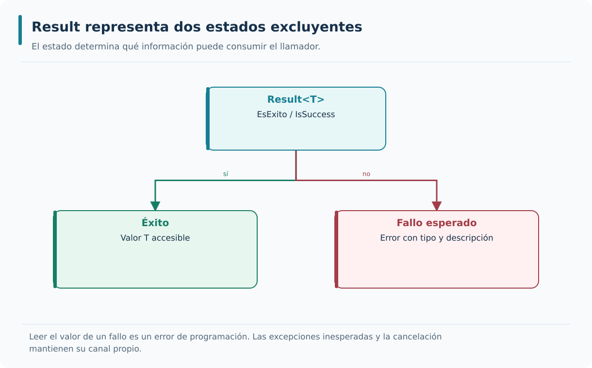

Un resultado representa éxito o fallo. La lectura del valor depende del estado y los errores esperados tienen un tipo estable. La figura se distribuye en SVG vectorial y PNG.

### Variantes del patrón Result

Existen variantes de Result adecuadas a necesidades diferentes: operaciones que devuelven un valor, operaciones sin valor, errores tipados o una colección de errores de validación. No necesitamos elegir la variante con más parámetros por adelantado. Si el caso de uso solo comunica que una acción no está permitida, un resultado sencillo puede ser suficiente; si el adaptador HTTP debe distinguir «no existe» de «conflicto», un tipo de error estable aporta claridad. Lo importante es que la firma permita conocer todos los resultados esperados y evite confundir un valor por defecto con un éxito auténtico. Al diseñar AceriaApp compararemos la expresividad de los contratos sin multiplicar envoltorios que no añaden información.

```text
Variantes del patrón Result:

Result<T>               → valor de éxito y mensaje de error.
Result<T, TError>       → valor de éxito y tipo de error específico.
Result                  → sin valor de éxito.
Result<T> con errores   → lista de errores.
```


Las variantes permiten devolver un valor, un error tipado o varios errores de entrada. La elección debe responder a las necesidades del caso de uso: crear más tipos no aporta claridad si todos se convierten finalmente en el mismo texto genérico.


El mensaje explica un error a una persona; un código o categoría estable permite que otro componente decida sin analizar texto traducido.

El proyecto usa TipoError.Validacion, TipoError.NoEncontrado y TipoError.Conflicto. Un Error conserva información del fallo sin incorporar el concepto de IResult al núcleo.

Añadir muchas variantes sin necesidad complica consumo y pruebas. Elige una forma coherente para el módulo y reserva ejemplos alternativos para comparar sus ventajas.

Construye una tabla de categorías y códigos HTTP en el adaptador. Cambiar el texto de un mensaje no debería modificar accidentalmente la respuesta de 404 a 400.

### Result Pattern en los casos de uso

Un handler de creación puede devolver `Result<Guid>` para comunicar la identidad de la orden o un fallo esperado. De ese modo el flujo de aplicación puede validar la intención, proteger las invariantes y decidir si realiza la persistencia, mientras el endpoint queda encargado de traducir el resultado a HTTP. Esa separación evita que el handler conozca `Results.BadRequest` o `ProblemDetails`, pero exige que el rechazo no sea accidentalmente ignorado. En AceriaApp, cuando una cantidad supera el límite de negocio, no deberían confirmarse cambios SQL ni devolverse un identificador como si se hubiese creado la orden. La prueba necesita observar el resultado y también la ausencia de efectos no permitidos.

```csharp
public record CrearOrdenConResultadoCommand(string Cliente, string Material, int Cantidad)
    : IRequest<Result<Guid>>;
public sealed class CrearOrdenConResultadoHandler(
    IOrdenTrabajoRepositorio repositorio, IUnitOfWork unidad)
    : IRequestHandler<CrearOrdenConResultadoCommand, Result<Guid>>
{
    public async Task<Result<Guid>> Handle(CrearOrdenConResultadoCommand request, CancellationToken ct)
    {
        if (string.IsNullOrWhiteSpace(request.Cliente))
            return Result<Guid>.Failure("El cliente es obligatorio.");
        if (string.IsNullOrWhiteSpace(request.Material))
            return Result<Guid>.Failure("El material es obligatorio.");
        if (request.Cantidad is <= 0 or > 500)
            return Result<Guid>.Failure("La cantidad debe estar entre 1 y 500.");
        var orden = new OrdenHexagonal(request.Cliente, request.Material, request.Cantidad);
        await repositorio.AgregarAsync(orden, ct);
        await unidad.CommitAsync(ct);
        return Result<Guid>.Success(orden.Id);
    }
}
```


El handler devuelve un resultado explícito y solo confirma la orden cuando las condiciones necesarias se cumplen. Un test de fallo debería demostrar que no se escribió en SQL, además de comprobar el mensaje o código de rechazo.


El caso de uso debe devolver éxito después de confirmar los cambios requeridos. Preparar una entidad en memoria todavía no demuestra que la operación haya terminado.

El ejemplo incluye un comando con respuesta `IRequest<Result<Guid>>`, manejador compatible, comprobaciones de entrada, alta pendiente y commit. OrdenesConResultado aplica el mismo criterio en el proyecto.

Result no justifica duplicar reglas inconsistentes. Una validación de entrada puede evitar fallos previsibles mientras la entidad conserva sus invariantes para cualquier llamador.

Prueba que el fallo esperado no llama a AgregarAsync ni a CommitAsync. Prueba también que una excepción de guardado no se convierte en éxito con el GUID generado.

### Result Pattern en los adaptadores de entrada

El adaptador de entrada transforma un resultado de aplicación en un contrato HTTP. Si la creación devuelve éxito, puede responder `201 Created`; si comunica un fallo de validación o conflicto, seleccionará el estado apropiado y explicará la causa de forma segura. No conviene convertir indiscriminadamente todos los fallos en 400: una orden inexistente necesita una semántica distinta de otra que no puede modificarse por su estado. El tipo de error del resultado permite centralizar ese mapeo. En AceriaApp estudiaremos un endpoint que utiliza `Result` sin introducir dependencias HTTP en la aplicación. La corrección se comprobará mediante peticiones que provoquen cada caso, no mediante inspección del operador ternario utilizado para construir la respuesta.

```csharp
app.MapPost("/api/v1/ordenes-con-resultado", async (
    CrearOrdenConResultadoCommand command, ISender mediator, CancellationToken ct) =>
{
    var result = await mediator.Send(command, ct);
    IResult respuesta = result.IsSuccess
        ? Results.Created($"/api/v1/ordenes-con-resultado/{result.Value}", new { id = result.Value })
        : Results.Problem(title: "Solicitud no válida", detail: result.Error, statusCode: 400);
    return respuesta;
});
```


El endpoint traduce el estado del resultado a una respuesta HTTP. Una implementación completa debe distinguir error de validación, ausencia y conflicto; devolver siempre 400 pierde información importante del contrato.


La traducción a HTTP pertenece a API. El núcleo no devuelve Results.BadRequest, ProblemDetails ni números de estado como sustituto de conceptos de negocio.

El ejemplo simple traduce fallos de entrada a 400. La implementación con Error tipado distingue además ausencia con 404 y conflicto con 409.

No conviertas todo Failure en BadRequest si el contrato distingue categorías. Tampoco devuelvas directamente mensajes de excepciones técnicas al cliente.

Comprueba el código, el cuerpo y el tipo de contenido en la prueba HTTP. Para 201 verifica que Location permite recuperar la entidad y no solo que contiene un GUID.

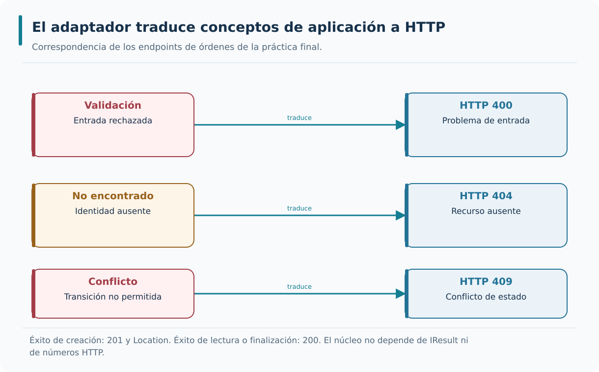

El adaptador convierte categorías de aplicación en respuestas HTTP; el dominio no conoce los códigos. La figura se distribuye en SVG vectorial y PNG.

### Composición de resultados

Las operaciones `Map`, `Bind` y `Match` permiten combinar resultados sin escribir una rama de error completa después de cada paso. `Map` transforma el valor cuando existe éxito; `Bind` encadena una operación que puede fallar; y `Match` convierte ambos estados en una salida final adecuada al consumidor. Esta composición es útil cuando varios cálculos o decisiones deben ejecutarse secuencialmente y un fallo debe detener la cadena. No sustituye la claridad de una operación de negocio bien nombrada, ni debería ocultar que cierta etapa accede a SQL o publica un evento. En AceriaApp la utilizaríamos cuando reduce la repetición del tratamiento de fallos, sin obligar a programar todas las reglas como una cadena funcional difícil de depurar.

```csharp
public static class ResultExtensions
{
    public static Result<U> Map<T, U>(this Result<T> source, Func<T, U> map) =>
        source.IsSuccess ? Result<U>.Success(map(source.Value)) : Result<U>.Failure(source.Error!);
    public static Result<U> Bind<T, U>(this Result<T> source, Func<T, Result<U>> bind) =>
        source.IsSuccess ? bind(source.Value) : Result<U>.Failure(source.Error!);
    public static U Match<T, U>(this Result<T> source, Func<T, U> success, Func<string, U> failure) =>
        source.IsSuccess ? success(source.Value) : failure(source.Error!);
    public static async Task<Result<U>> BindAsync<T, U>(this Result<T> source,
        Func<T, Task<Result<U>>> bind) => source.IsSuccess
        ? await bind(source.Value) : Result<U>.Failure(source.Error!);
}
```


Map transforma un éxito; Bind añade otra operación que puede fallar; Match obliga a tratar ambos caminos. El ejemplo de cantidad permite seguir cómo un fallo interrumpe la composición sin perder la información de rechazo.


Map transforma un valor; Bind encadena otra operación con posibilidad de fallo; Match obliga a tratar ambos estados. No son métodos mágicos incorporados a cualquier Result.

Las extensiones completas acompañan al tipo del bloque 3. BindAsync devuelve `Task<Result<U>>` y acepta una función compatible, evitando mezclar lambdas async con una firma síncrona.

Un método de repositorio que devuelve Task sin valor no puede producir por sí solo `Result<Guid>`. La composición debe devolver explícitamente el identificador tras confirmar.

Verifica el cortocircuito: si falla el primer resultado, el delegado siguiente no debe ejecutarse. Prueba también una excepción inesperada del delegado sin absorberla como error de negocio.

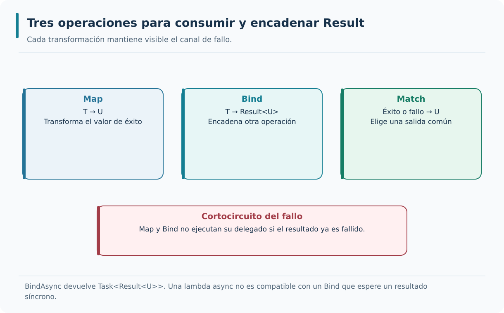

Map transforma, Bind encadena y Match decide una salida; un fallo evita ejecutar los pasos siguientes. La figura se distribuye en SVG vectorial y PNG.

**Ejemplo de composición sin efectos.** Con las extensiones del bloque, el valor se transforma y el siguiente resultado se aplana. La salida es el texto `Cantidad válida: 20`.

```csharp
var salida = Result<int>.Success(10)
    .Map(cantidad => cantidad * 2)
    .Bind(cantidad => cantidad <= 500
        ? Result<int>.Success(cantidad)
        : Result<int>.Failure("Capacidad superada."))
    .Match(valor => $"Cantidad válida: {valor}", error => $"Error: {error}");
```


La validación del pipeline puede producir Result.Failure y evitar que se ejecute el handler. Esa comprobación debe observar el comportamiento real y no limitarse a que exista una clase IPipelineBehavior registrada.


### Result Pattern y validación

La validación puede integrarse en el pipeline de MediatR y devolver un resultado de fallo antes de que el handler ejecute la operación. Eso permite reutilizar reglas sobre el mensaje de entrada sin repetirlas en cada endpoint. Es importante que el comportamiento del pipeline conozca el tipo de respuesta esperado y conserve una semántica de error coherente con la aplicación. Una violación de invariantes del dominio no debería depender exclusivamente de ese pipeline, porque existen otros caminos para invocar el caso de uso. La prueba de AceriaApp debe comprobar que una entrada rechazada no ha confirmado ninguna orden, además de verificar el código de error. La arquitectura mejora cuando esas garantías se expresan claramente en distintos niveles.

```csharp
public sealed class CrearOrdenResultValidationBehavior(
    IEnumerable<IValidator<CrearOrdenConResultadoCommand>> validators)
    : IPipelineBehavior<CrearOrdenConResultadoCommand, Result<Guid>>
{
    public async Task<Result<Guid>> Handle(CrearOrdenConResultadoCommand request,
        RequestHandlerDelegate<Result<Guid>> next, CancellationToken ct)
    {
        var mensajes = new List<string>();
        foreach (var validator in validators)
        {
            var validacion = await validator.ValidateAsync(request, ct);
            mensajes.AddRange(validacion.Errors.Select(e => e.ErrorMessage));
        }
        if (mensajes.Count > 0)
            return Result<Guid>.Failure(string.Join("; ", mensajes));
        return await next();
    }
}
```


El cuadro muestra casos donde un resultado explícito aporta valor y otros donde una excepción representa mejor un fallo técnico. No se trata de eliminar excepciones del lenguaje, sino de distinguir condiciones previstas del negocio.


El comportamiento tiene que construir exactamente el tipo que promete la solicitud. `Result<object>` y `Result<Guid>` son tipos distintos y un cast a object no los vuelve compatibles.

El ejemplo usa un pipeline cerrado para CrearOrdenConResultadoCommand y `Result<Guid>`. Conserva mensajes de validación y omite el manejador cuando hay fallos.

Para generalizar a cualquier T puede diseñarse una factoría tipada o una abstracción apropiada; el ejemplo cerrado evita añadir reflexión y conversiones inseguras al aprendizaje inicial.

Regístralo como `IPipelineBehavior<CrearOrdenConResultadoCommand, Result<Guid>>` y prueba con un validador que falle. Comprueba que next no se ejecutó y que el retorno conserva su tipo.

### Cuándo usar el patrón Result

Result Pattern resulta especialmente apropiado cuando los fallos son resultados normales y previsibles del caso de uso, y el consumidor necesita diferenciarlos sin usar excepciones para controlar el flujo. En operaciones que no poseen fallos esperados más allá de errores técnicos, una envoltura puede aportar poco valor. También hay que evitar resultados que contengan simultáneamente un valor y un error contradictorios o textos imposibles de clasificar. El coste de introducir el patrón se justifica cuando la firma de un método hace más fácil comprender su contrato y comprobar su comportamiento. En AceriaApp la distinción es útil para validar cantidades, estados y recursos inexistentes antes de traducirlos a HTTP.

```text
Cuándo usar Result:

Errores esperados            → sí.
Operaciones frecuentes       → medir, no asumir.
Firma explícita              → sí.
Errores excepcionales        → no.
Operación sin fallo esperado → no.
```


La implementación de AceriaApp combina resultados explícitos con casos de uso y su traducción HTTP. Los nombres españoles del tipo real no deben mezclarse indiscriminadamente con los ejemplos conceptuales escritos con IsSuccess y Failure.


Result tiene sentido cuando el fallo es parte habitual del contrato y el consumidor debe decidir qué hacer. La legibilidad y la coherencia son los criterios principales.

Finalizar una orden ya finalizada puede devolver Conflicto. Obtener una identidad desconocida puede devolver NoEncontrado en un caso de uso que exige una entidad existente.

No hace falta envolver una función aritmética pura que no tiene un fallo esperado en su contrato. Tampoco se gana seguridad ocultando defectos dentro de un Result genérico.

Enumera los fallos de cada operación y comprueba que el consumidor trata todos. Si hay un caso imposible de distinguir sin leer el texto, mejora el modelo de error.

### Aplicación al proyecto del curso

En la evolución del curso, Result se incorpora a los casos de uso de órdenes para comunicar resultados esperados sin trasladar códigos HTTP al núcleo. El patrón se combina con MediatR y con las reglas del dominio, mientras el adaptador construye respuestas 201, 400, 404 o 409 según el tipo de situación. La implementación concreta utiliza `EsExito`, `Valor`, `Exito` y `Fallo`; los ejemplos más pequeños que usan nombres ingleses sirven para estudiar el concepto, no son varias APIs para pegar en la misma clase. La evidencia pedagógica debe incluir una creación exitosa y rechazos que no produzcan escrituras, con pruebas que distingan errores esperados de fallos de infraestructura. Esa claridad prepara la separación de comandos y consultas que desarrollará M05.

```text
Aplicación al proyecto del curso:

Caso de uso          → OrdenesConResultado devuelve Result<T>.
Errores esperados     → Fallo con Error y TipoError.
Éxito                → Exito con Valor.
Adaptadores entrada  → 201/200 o 400/404/409.
Validación           → reglas del caso de uso y entidad.
Pipeline             → LoggingBehavior.
```


La segunda composición demuestra cómo los métodos encadenados devuelven un valor válido o un mensaje de error sin ejecutar pasos posteriores al fallo. Debe interpretarse como ejercicio conceptual y no como sustituto de transacciones o comprobaciones del dominio.


La aplicación del patrón Result prepara el proyecto para el punto 4.5. El punto 4.5 estudiará la inyección de dependencias. El punto 4.4 establece la base que se aplicará en el punto 4.5. La combinación de Mediator, Result y validación explícita del caso de uso mantiene visibles la intención, el resultado y las reglas de cada operación.


El resultado debe conservar su significado desde aplicación hasta el adaptador. El catálogo ayuda a revisar esa coherencia, y las pruebas funcionales demuestran sus consecuencias.

OrdenesConResultado compone los puertos de trabajo y devuelve Result con Error tipado. La API aplica la correspondencia acordada de validación, ausencia y conflicto.

Los ejemplos de pipeline muestran alternativas para integrar validación; su presencia en teoría no significa que todo comportamiento esté registrado en el proyecto ejecutable.

Ejecuta una creación correcta y peticiones que provoquen cada error esperado. Verifica estado de base de datos y respuesta pública para impedir éxitos aparentes o persistencia parcial.

### Qué representa y qué no representa Result

- El patrón Result representa el resultado de una operación como un valor explícito en lugar de como una excepción.
- Los errores se clasifican en esperados y excepcionales. Los esperados se representan con Result, los excepcionales con excepciones.
- Un resultado se estructura con dos propiedades: si la operación ha tenido éxito y el valor o el error asociado.
- El patrón admite varias variantes según las necesidades del proyecto.
- El patrón se aplica en los casos de uso de la capa de aplicación.
- Los adaptadores de entrada traducen el resultado en respuestas HTTP.
- La composición de resultados permite encadenar operaciones con `Map`, `Bind` y `Match`.
- El patrón se integra con FluentValidation mediante un comportamiento de pipeline.
- El patrón se usa cuando los errores son parte del flujo normal del negocio.

---


# Punto 4.5 — Inyección de dependencias

**Módulo 4:** Patrones de arquitectura

**Objetivos de aprendizaje:**

- Comprender el principio de inversión de dependencias y su relación con la inyección de dependencias.
- Comprender los tres ciclos de vida del contenedor de ASP.NET Core.
- Comprender la composición de servicios mediante métodos de extensión.
- Comprender las reglas de registro y las prohibiciones del contenedor.
- Añadir al proyecto `AceriaApp` las clases de validación de la inyección de dependencias y un test unitario que verifique la validación. Cerrar el módulo 4 con el resumen del estado del proyecto.

---

## Componer la aplicación sin trasladar infraestructura al núcleo


Seguiremos la construcción real de un handler y su repositorio mediante las interfaces que requiere. La composición de ASP.NET Core será el lugar donde se eligen tecnologías y ciclos de vida, sin que esa elección cambie las reglas de órdenes.

### Principio de inversión de dependencias

La inversión de dependencias persigue que las reglas estables de una aplicación no se construyan alrededor de detalles tecnológicos que cambian con facilidad. En AceriaApp, un caso de uso que necesita recuperar órdenes debería depender de `IOrdenRepositorio`, no de `OrdenRepositorioSqlServer` ni de la forma en que EF Core ejecuta una consulta. La infraestructura implementa esa necesidad y el host decide qué implementación conectar en cada entorno. Esta relación se suele representar mediante una flecha desde los módulos de alto y bajo nivel hacia la misma abstracción, pero el dibujo solo tiene valor si los proyectos .NET respetan realmente esa dirección. El principio permite probar decisiones de negocio con dobles y sustituir adaptadores sin reescribir las invariantes del dominio. No debe confundirse con la obligación de crear interfaces para cualquier clase utilitaria.

```text
Principio de inversión de dependencias:

Módulo de alto nivel → abstracción ← Módulo de bajo nivel.
```


La abstracción ocupa la frontera entre política de aplicación e implementación técnica. Ambos lados dependen de ella según sus necesidades, pero esa dirección solo está protegida cuando los proyectos y tipos realmente evitan referencias desde el núcleo a SQL Server.


La violación del principio produce tres síntomas reconocibles. El primero es la dependencia directa entre capas: un módulo de alto nivel instancia un módulo de bajo nivel. El segundo es la imposibilidad de sustituir la implementación: el módulo de alto nivel conoce la clase concreta. El tercero es la dificultad de las pruebas: no se puede sustituir la implementación por un doble. Los tres síntomas se corrigen invirtiendo la dependencia y definiendo abstracciones.


Inversión de dependencias decide hacia qué contratos apuntan las referencias; inyección decide cómo recibe un objeto sus colaboradores. Un contenedor automatiza la composición.

Aplicación declara IOrdenTrabajoRepositorio e IUnitOfWork. Infraestructura los implementa; AceriaApp.Api participa en el arranque que conecta todas las piezas.

Añadir una interfaz junto a una clase no garantiza inversión si aplicación sigue dependiendo del ensamblado de infraestructura para conocerla.

Comprueba ProjectReference y namespaces además de constructores. El dominio no necesita conocer el contenedor para que sus objetos se construyan correctamente.

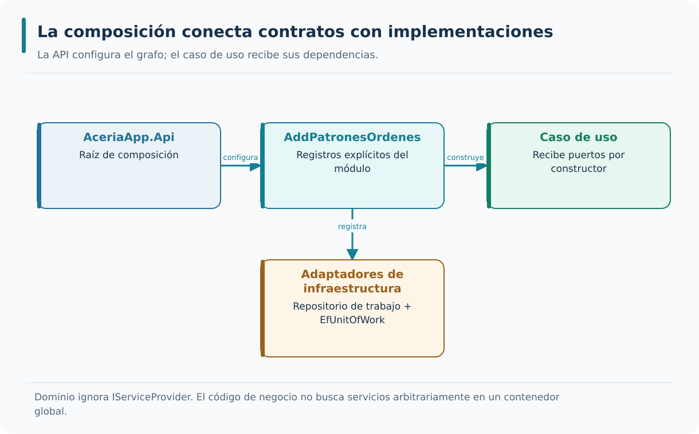

La raíz de composición conoce los adaptadores y enlaza puertos internos con implementaciones exteriores. La figura se distribuye en SVG vectorial y PNG.

### Inyección de dependencias

La inyección de dependencias es el mecanismo mediante el que un objeto recibe los colaboradores que necesita en lugar de construirlos directamente. Un constructor que solicita `IOrdenRepositorio` hace explícita esa necesidad y permite que otra parte de la aplicación decida con qué instancia satisfacerla. Esto reduce acoplamiento y hace más sencillas las pruebas, pero solo funciona bien cuando el contrato tiene significado y no oculta llamadas a un servicio universal. En AceriaApp, `OrdenServicio` se concentra en su caso de uso; no necesita saber la dirección de SQL Server ni cómo registrar EF Core. El registro de la implementación pertenece al borde, donde se conocen las condiciones de ejecución y la configuración del entorno.

```csharp
public class OrdenServicio
{
    private readonly IOrdenRepositorio _repositorio;

    public OrdenServicio(IOrdenRepositorio repositorio)
    {
        _repositorio = repositorio;
    }
}
```


El constructor de OrdenServicio declara la interfaz que necesita y la almacena como colaborador. La creación de la instancia corresponde al host o al test, no a la clase que ejecuta las reglas de la orden.


La inyección por constructor hace visibles las dependencias obligatorias y permite crear objetos completos desde el principio. La construcción manual también es inyección.

Una prueba puede crear OrdenesTransaccionales con un fake de repositorio y otro de unidad. El caso de uso recibe colaboradores sin preguntar cómo fueron construidos.

Inyectar IServiceProvider en cada clase oculta dependencias y permite resolver servicios inesperados. Reserva factorías y ámbitos explícitos para responsabilidades que realmente los necesitan.

Lee el constructor como una declaración de necesidades. Si requiere demasiados servicios, examina la cohesión del caso de uso antes de esconderlos detrás del contenedor.

### El contenedor de dependencias de ASP.NET Core

El contenedor integrado en ASP.NET Core organiza cómo se construyen objetos y qué implementación corresponde a cada interfaz. Mediante `AddScoped`, `AddTransient` o `AddSingleton` podemos controlar el ciclo de vida de colaboradores como repositorios, servicios de aplicación o proveedores de tiempo. No es necesario utilizar un contenedor para aplicar inversión de dependencias, pero facilita el ensamblado de una API con múltiples casos de uso. Conviene distinguir los registros del comportamiento que debe ejecutarse: que una interfaz tenga implementación asociada no demuestra que la ruta HTTP correcta la utilice. En AceriaApp las pruebas de composición deben comprobar que se construye el caso de uso, mientras los tests funcionales ejercen la operación completa.

```csharp
builder.Services.AddScoped<IOrdenRepositorio, OrdenRepositorioSqlServer>();
builder.Services.AddScoped<IOrdenServicio, OrdenServicio>();
builder.Services.AddSingleton<TimeProvider>(TimeProvider.System);
```


Los registros de IOrdenRepositorio, IOrdenServicio y TimeProvider ilustran distintas duraciones. La validez del grafo depende de que todos los colaboradores sean compatibles con el ciclo elegido y puedan resolverse.


IServiceCollection describe registros; IServiceProvider resuelve instancias a partir de ellos. La configuración debe completarse antes de construir el proveedor que usará la aplicación.

AddPatronesOrdenes agrupa los puertos, casos de uso y adaptadores del módulo. AddDbContext aporta HexagonalDbContext con el ciclo scoped habitual.

Evita llamar a BuildServiceProvider dentro de los registros para obtener servicios. Crear otro proveedor puede duplicar singletons y producir grafos con ciclos de vida inesperados.

Resuelve el caso de uso desde un ámbito real y comprueba todas sus dependencias. Una lista de ServiceDescriptor correcta visualmente no demuestra que el grafo se construya.

### Ciclos de vida del contenedor

Los ciclos de vida de los servicios determinan cuánto tiempo se reutiliza una instancia y qué recursos puede compartir. `Transient` crea objetos por resolución; `Scoped` conserva una instancia durante un ámbito, normalmente una petición HTTP; y `Singleton` reutiliza la misma instancia dentro del proveedor de servicios. La elección no depende solo de la comodidad del registro. Un repositorio que utiliza un `DbContext` scoped no debe conservarse como singleton, pues podría retener un contexto ya liberado o utilizarlo de forma concurrente. En AceriaApp una prueba de composición debe detectar dependencias cautivas y ayudar a justificar por qué los adaptadores de persistencia comparten el ámbito del caso de uso. Las clases sin estado también pueden requerir una duración concreta si dependen de otros servicios.

```text
Ciclos de vida del contenedor:

Transient → nueva instancia en cada resolución.
Scoped    → una instancia por ámbito (normalmente petición HTTP).
Singleton → una instancia por proveedor de servicios.
```


Transient, Scoped y Singleton determinan el alcance de reutilización de un objeto. Un repositorio que usa DbContext scoped no debería ser retenido por un singleton, aunque el compilador acepte el registro.


La duración se elige por estado, propiedad de recursos y concurrencia. Scoped significa ámbito, no usuario, sesión del navegador ni proceso completo.

Repositorio y unidad de trabajo comparten HexagonalDbContext dentro de una petición. Otra petición recibe otro contexto, evitando mezclar seguimiento de entidades de usuarios distintos.

Un singleton debe soportar acceso concurrente y no capturar scoped. Un servicio de correo o broker no se vuelve seguro como singleton por tener pocas propiedades.

Resuelve dos veces dentro de un ámbito y una vez desde otro. Usa identidad de objetos para comprobar igualdad dentro del scope y diferencia entre scopes cuando corresponde.

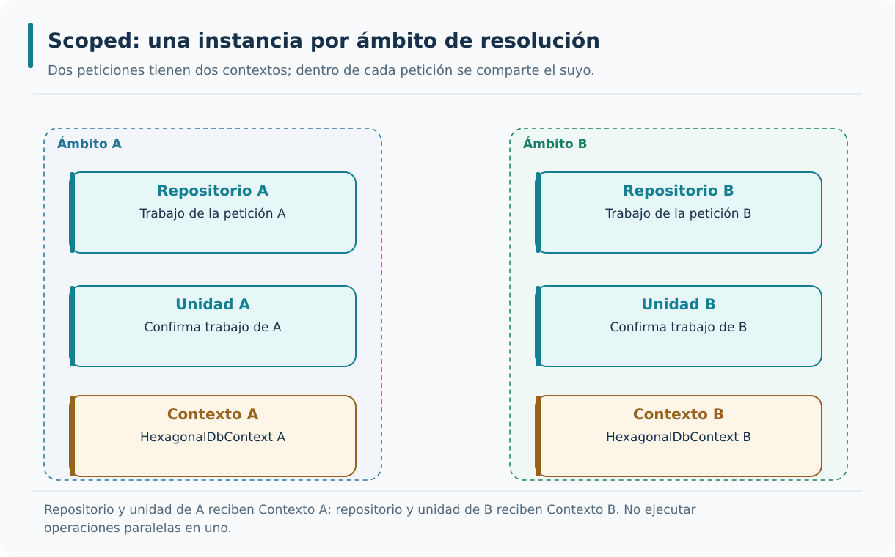

Cada ámbito tiene su propio contexto; repositorio y unidad del mismo ámbito comparten ese contexto. La figura se distribuye en SVG vectorial y PNG.

### Registro de servicios por convención

Agrupar registros mediante métodos de extensión permite que `Program.cs` describa capacidades de la aplicación sin convertirse en una lista interminable de tipos. Un método `AddRepositorios` puede registrar interfaces de órdenes y adaptadores de SQL Server, manteniendo localizadas las decisiones de infraestructura. Esto mejora la navegación cuando la convención es coherente y se acompaña de pruebas, pero no debe ocultar dependencias incorrectas bajo un nombre atractivo. En AceriaApp interesa saber qué clase responde a `IOrdenRepositorio` y qué ámbito utiliza el contexto SQL. El beneficio no está en reducir líneas de código por sí solo, sino en poder entender el grafo que ASP.NET Core construirá cuando una petición necesite persistencia.

```csharp
public static class RepositoriosExtensions
{
    public static IServiceCollection AddRepositorios(this IServiceCollection services)
    {
        services.AddScoped<IOrdenRepositorio, OrdenRepositorioSqlServer>();
        services.AddScoped<IInventarioRepositorio, InventarioRepositorioSqlServer>();
        return services;
    }
}
```


AddRepositorios agrupa contratos y adaptadores para hacer más legible la composición. Conviene que el método no esconda dependencias circulares y que se pruebe qué implementación recibe cada puerto.


Los métodos de extensión organizan la raíz de composición por capacidades o capas. Su valor está en encapsular registros coherentes y dependencias necesarias.

AddPatronesOrdenes permite que Program mantenga una llamada legible. La implementación registra puertos y adaptadores de M4 junto a sus casos de uso.

El método de extensión debe ubicarse donde sea legal conocer las implementaciones. Ponerlo en dominio obligaría a introducir referencias exteriores y rompería el propósito de la separación.

Llama al método desde una prueba de composición y resuelve la capacidad completa. Esa prueba protege mejor que verificar únicamente cuántas líneas contiene Program.

### Registro de servicios por ensamblado

El registro automático por reflexión puede descubrir clases y relacionarlas con interfaces según convenciones de nombre. Esta estrategia reduce instrucciones repetidas cuando el conjunto es grande y sus reglas son estables, pero hace más difícil ver de forma inmediata qué implementaciones se seleccionan. Una clase puede coincidir por su sufijo y no ser el colaborador adecuado; otra puede estar en un ensamblado que no se exploró. Por eso las convenciones deben documentarse, evitar registros ambiguos y verificarse en pruebas que resuelvan los contratos esperados. En AceriaApp compararemos la claridad del registro explícito con la flexibilidad del descubrimiento automático; no se presenta una estrategia universalmente mejor, sino una decisión de mantenimiento que debe justificarse.

```csharp
var assembly = typeof(OrdenServicio).Assembly;
var tipos = assembly.GetTypes()
    .Where(t => t.IsClass && !t.IsAbstract && !t.ContainsGenericParameters
        && t.Name.EndsWith("Servicio", StringComparison.Ordinal))
    .ToList();

foreach (var tipo in tipos)
{
    var interfaz = tipo.GetInterfaces().FirstOrDefault(i => i.Name == "I" + tipo.Name);
    if (interfaz != null)
    {
        services.AddScoped(interfaz, tipo);
    }
}
```


El código de reflexión descubre servicios por convención de nombre, pero la coincidencia de sufijos no demuestra que la clase tenga la responsabilidad esperada. La lista obtenida y su resolución deben verificarse para evitar registros ambiguos.


El escaneo por reflexión automatiza una convención. Debe elegir ensamblados concretos y filtrar clases abstractas, genéricas abiertas y tipos ajenos a la capacidad.

MediatR busca manejadores en el ensamblado de aplicación mediante un tipo marcador. El ejemplo de servicios busca interfaces cuyo nombre coincide con una convención explícita.

Renombrar una clase puede quitarla del registro sin impedir compilar. El trimming y AOT también pueden exigir conservación explícita de metadatos o registros estáticos.

Prueba el conjunto que se espera descubrir. Ante pocos servicios, los registros explícitos son fáciles de revisar y suelen ser suficientes para el módulo.

### Reglas de registro

Las reglas de registro deben proteger la dirección de dependencias que ya diseñamos. Los casos de uso reciben interfaces mediante constructores; el host registra implementaciones concretas; y cada servicio utiliza una duración adecuada a sus recursos. Resolver colaboradores manualmente desde el dominio o conservar una referencia global a `IServiceProvider` suele ocultar dependencias y dificulta probarlas. En AceriaApp el constructor de un handler debería indicar qué puerto necesita sin obligarlo a buscar clases durante su ejecución. Esta visibilidad facilita detectar configuraciones incompletas antes de publicar la API y permite sustituir adaptadores en pruebas. La simplicidad no se mide solo por la cantidad de registros, sino por la facilidad para explicar quién conoce a quién.

```text
Reglas de registro:

1. Resolución intencional de cada contrato.
2. Ciclo adecuado al estado.
3. Inyección por constructor.
4. Resolución manual solo en los bordes justificados.
5. Sin capturar el contenedor.
```


El catálogo de reglas recomienda contratos explícitos, inyección por constructor y ámbitos coherentes. El criterio es que un caso de uso pueda comprenderse a partir de sus dependencias declaradas, sin buscar servicios globalmente.


El contenedor admite varios registros del mismo contrato. La política debe distinguir resolver uno, resolver `IEnumerable<T>` o seleccionar servicios con clave cuando corresponda.

Varios `IValidator<CrearOrdenCommand>` son intencionales: el comportamiento puede recorrerlos. Dos adaptadores de persistencia registrados sin política de selección pueden esconder una configuración equivocada.

El último registro simple prevalece al resolver un único servicio. El orden de registro no debería ser una decisión de negocio escondida que cambie por un método de extensión.

Comprueba la resolución individual y la colección cuando haya varios registros. Activa ValidateScopes y ValidateOnBuild en pruebas, y resuelve los grafos representativos.

### Prohibiciones del contenedor

El contenedor puede introducir problemas si se utiliza como localizador universal de servicios. Un singleton que captura un objeto scoped conserva una dependencia con duración incompatible; un objeto que pide `IServiceProvider` para resolver cualquier cosa oculta lo que realmente necesita; y registrar nuevos servicios en tiempo de ejecución puede producir comportamientos difíciles de reproducir. Estas situaciones no son prohibiciones metafísicas, pero sí señales que exigen un motivo excepcional y pruebas específicas. En AceriaApp preferiremos inyección por constructor, registros durante el arranque y ámbitos controlados. La estructura resultante se puede inspeccionar y probar, mientras que un contenedor pasado a todas las clases debilitaría la frontera entre aplicación e infraestructura.

```text
Prohibiciones del contenedor:

1. No resolver manualmente.
2. No capturar el contenedor.
3. No registrar en tiempo de ejecución.
4. No capturar scoped desde singleton.
```


Las advertencias sobre el contenedor se refieren a dependencias ocultas y a ciclos de vida incompatibles. El ejemplo de scoped capturado por singleton es un problema concreto que debe probarse, no una mera regla de estilo.


La dependencia cautiva aparece cuando un consumidor retiene un colaborador más allá de su ámbito previsto. El caso crítico es singleton que captura DbContext scoped.

Un proceso en segundo plano puede inyectar IServiceScopeFactory, crear un ámbito por operación y resolver dentro de él los servicios de trabajo. Ese uso es composición explícita.

No prohíbas todos los transient dentro de scoped: esa relación es válida. En un singleton un transient retenido requiere revisar seguridad concurrente y liberación de recursos.

Haz una prueba negativa que registre un consumidor singleton con una dependencia scoped y comprueba el fallo de validación. No desactives ValidateScopes para hacer desaparecer el síntoma.

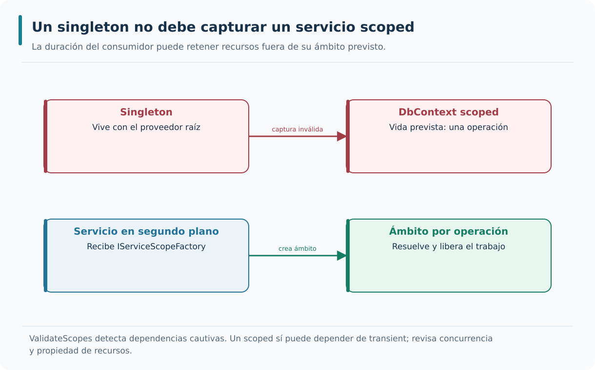

La duración del consumidor no debe extender accidentalmente la del servicio scoped que conserva. La figura se distribuye en SVG vectorial y PNG.

### Inyección de dependencias y tests

La principal ventaja de inyectar un repositorio es poder probar un caso de uso con datos y respuestas controladas sin preparar SQL Server para cada aserción. Un mock puede registrar que la aplicación pidió agregar una orden y devolver un comportamiento determinado, permitiendo comprobar el camino de éxito o error. Eso no acredita que el adaptador real ejecute correctamente sus comandos SQL ni que la transacción se confirme; para esa evidencia se necesita otra prueba de integración. En AceriaApp distinguiremos estas garantías y utilizaremos la inyección para sustituir colaboradores sin alterar el caso de uso. El objetivo no es maximizar el número de mocks, sino hacer que las pruebas identifiquen con claridad la responsabilidad cuyo comportamiento están observando.

```csharp
var repositorioMock = new Mock<IOrdenRepositorio>();
repositorioMock
    .Setup(r => r.AgregarAsync(It.IsAny<OrdenHexagonal>(), It.IsAny<CancellationToken>()))
    .Returns(Task.CompletedTask);
var servicio = new OrdenesCasoUso(repositorioMock.Object);
var resultado = await servicio.CrearAsync("ACX-001", "CHAPA", 10);
Assert.Equal("ACX-001", resultado.Cliente);
repositorioMock.Verify(
    r => r.AgregarAsync(It.IsAny<OrdenHexagonal>(), It.IsAny<CancellationToken>()), Times.Once);
```


El mock suministra un repositorio controlado al caso de uso y permite verificar la operación solicitada. La misma prueba no demuestra que el repositorio SQL real haya escrito filas, tarea de las pruebas de integración.


Las pruebas unitarias construyen la clase con colaboradores controlados; las pruebas de composición verifican que el contenedor de producción sabe construirla.

El ejemplo usa OrdenesCasoUso heredado para mostrar constructor manual. Los nuevos casos de M4 necesitan además el doble de IUnitOfWork y las expectativas de confirmación.

Un fake de memoria compartido entre tests puede introducir contaminación. Crea estado nuevo por prueba y reserva recursos compartidos para fixtures con aislamiento definido.

Combina pruebas de resultado, ausencia de efectos en fallo y registro real. No necesitas arrancar HTTP para verificar una regla que puede comprobarse directamente en aplicación.

### Aplicación al proyecto del curso

El cierre de M04 integra Repository, Unit of Work, MediatR, Result Pattern e inyección de dependencias en un único recorrido. Un endpoint recibe la solicitud, MediatR la entrega al handler, el caso de uso protege las reglas con ayuda del dominio, los puertos permiten persistir y Unit of Work confirma el efecto. El resultado esperado se expresa mediante un contrato que HTTP traduce a la respuesta adecuada. Ningún patrón sustituye a los demás, y añadirlos todos sin una necesidad clara solo multiplicaría clases. En AceriaApp el valor se demuestra cuando el recorrido conserva las reglas y puede probarse por niveles, desde una decisión aislada hasta la persistencia real. Esa integración prepara un modelo de dominio más rico para el siguiente módulo de DDD y CQRS.

```text
Aplicación al proyecto del curso:

Registro de puertos     → interfaces con adaptadores.
Ciclo de vida           → Scoped para la mayoría.
Configuración           → métodos de extensión.
Prohibiciones           → respetadas.
Validación              → test de coherencia.
Cierre del módulo       → resumen del estado.
```


El mapa de cierre reúne las decisiones de composición utilizadas desde los puntos anteriores. El objetivo es seguir un recorrido ejecutable de órdenes y distinguir en qué frontera se encuentra cada patrón.


La aplicación de la inyección de dependencias cierra el módulo 4 y prepara el terreno para el módulo 5. El módulo 5 estudiará la introducción a DDD y CQRS. La inyección de dependencias es la base sobre la que se componen los servicios del dominio. El punto 4.5 cierra el módulo 4 con el resumen del estado del proyecto.


El cierre del módulo enlaza contratos, efectos y composición. No consiste solo en agregar cinco nombres de patrones a un catálogo.

Repository expresa persistencia; Unit of Work confirma; MediatR despacha solicitudes; Result representa fallos esperados; DI conecta sus implementaciones respetando ámbitos.

Los patrones resuelven problemas concretos y añaden costes. Ninguno convierte automáticamente un monolito modular en microservicios ni hace fiable una operación distribuida.

Desde el snapshot final, ejecuta la suite completa, recorre los endpoints de patrones y revisa dependencias. Esa base deja preparados los conceptos de agregados, DDD y CQRS del módulo siguiente.

### Cómo se relacionan los patrones de M04

- El principio de inversión de dependencias establece que los módulos de alto nivel y de bajo nivel deben depender de abstracciones.
- La inyección de dependencias es el mecanismo que permite aplicar el principio.
- El contenedor de ASP.NET Core registra y resuelve las dependencias en tiempo de ejecución.
- Los ciclos de vida del contenedor son `Transient`, `Scoped` y `Singleton`.
- El registro de servicios por convención agrupa los registros en métodos de extensión.
- El registro por ensamblado agrupa los registros según la convención del nombre del tipo.
- Las reglas de registro y sus pruebas ayudan a mantener un contenedor coherente.
- Las dependencias cautivas, ciclos y registros ausentes requieren comprobaciones distintas.
- La inyección de dependencias facilita los tests al permitir la sustitución de dependencias por dobles.

---


## Documentación técnica de consulta

- [Transacciones en EF Core](https://learn.microsoft.com/ef/core/saving/transactions): transacción implícita, control explícito y límites del proveedor.
- [Ciclo de vida de DbContext](https://learn.microsoft.com/ef/core/dbcontext-configuration/): ámbito de unidad de trabajo y ausencia de seguridad para acceso concurrente.
- [MediatR 12.4.1](https://www.nuget.org/packages/MediatR/12.4.1): versión fijada para los ejemplos del módulo y registro de manejadores y comportamientos.
- [Validación asíncrona en FluentValidation](https://docs.fluentvalidation.net/en/latest/async.html): uso de ValidateAsync para reglas síncronas y asíncronas.
- [Directrices de inyección de dependencias en .NET](https://learn.microsoft.com/dotnet/core/extensions/dependency-injection-guidelines): duración, composición y propiedad de los recursos.
