# M05 — Introducción a DDD y CQRS con ASP.NET Core 8 · Teoría

**Autor del curso: JAIME GALLO**

## Cómo estudiar el módulo

Los cinco puntos desarrollan conceptos de DDD, entidades y value objects, casos de uso, separación entre commands y queries y su aplicación a una acería. Se conservan los diez bloques de cada punto, con ejemplos explicados línea a línea, cincuenta ampliaciones aplicadas, quince figuras de detalle y un mapa general. Las explicaciones **Línea N** corresponden al número físico de línea del ejemplo inmediatamente anterior, incluidas las líneas vacías; estas no necesitan una explicación. Cada explicación ocupa su propia viñeta.

El punto de partida es `M04_PATRONES_ARQUITECTURA/PROYECTO/4.5-inyeccion-dependencias`, con su API, capas hexagonales y patrones. M5 añade el contexto de Producción mediante `AceriaApp.Produccion.Dominio`, `AceriaApp.Produccion.Aplicacion` y `AceriaApp.Produccion.Infraestructura`. Estos proyectos mantienen su propio modelo y persistencia, mientras la misma API compone el recorrido anterior y el nuevo. Una frontera de contexto no exige un microservicio independiente.

**Recorrido funcional.** `OrdenProduccion` protege la secuencia Borrador → Planificada → Finalizada y una capacidad didáctica máxima de 500 unidades. `LineaDeOrden` es la entidad hija; `NombreMaterial` y `CantidadProduccion` son value objects. La orden nace con una primera línea. `OrdenesProduccionCasosUso` coordina `CrearAsync`, `ObtenerAsync`, `PlanificarAsync` y `FinalizarAsync` con `ResultadoProduccion<T>`, `IOrdenProduccionRepositorio` e `IProduccionUnitOfWork`; infraestructura implementa `ProduccionDbContext`. CQRS incorpora `CrearOrdenProduccionCommand`, `PlanificarOrdenProduccionCommand` y `FinalizarOrdenProduccionCommand`, además de `ObtenerOrdenProduccionQuery` y `ListarOrdenesProduccionQuery`. `IOrdenProduccionLecturas` proyecta `OrdenProduccionDto` y `LineaProduccionDto` sin seguimiento sobre la misma base de datos del contexto. El cierre incorpora `AgregarLineaAsync`, `AgregarLineaProduccionCommand` y el recorrido HTTP en `/api/v1/produccion/ordenes`.

**Convenciones de los ejemplos.** Los fragmentos abreviados de cada bloque se estudian por separado, con los namespaces de .NET, EF Core, MediatR y ASP.NET Core que correspondan. Interfaces y tipos como `Orden`, `CrearOrdenCommand`, `IOrdenServicio`, `IOrdenEscritura`, `IOrdenLectura`, DTOs y `Result<T>` son contratos didácticos alternativos: no se pegan todos juntos ni sustituyen los nombres de la práctica. Los métodos aislados presuponen los colaboradores indicados. `Result<T>` usa `Success`, `Failure`, `IsSuccess` y `Value`; la implementación usa `ResultadoProduccion<T>` y su API concreta. Las prácticas contienen los archivos completos y los comandos de ejecución. El stack se mantiene en .NET 8, EF Core 8.0.21, MediatR 12.4.1 y FluentValidation 11.11.0.

**Alcance y evidencia.** Los contextos de Aprovisionamiento y Clientes y conceptos como temperatura, colada o facturación sirven para estudiar alternativas. Un catálogo o ADR describe una decisión; no acredita por sí solo que exista un servicio, handler o integración. Las pruebas del modelo, aplicación, persistencia y HTTP comprueban capacidades diferentes. El módulo no implementa Event Sourcing ni sincronización entre bases de lectura y escritura.

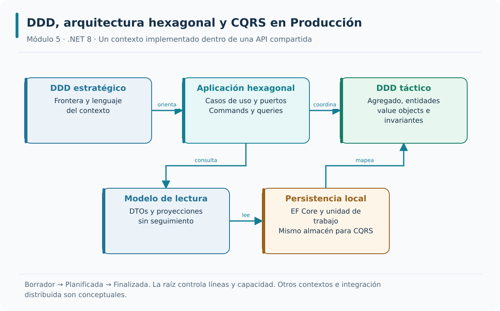

---

# Punto 5.1 — Conceptos básicos de Domain-Driven Design

**Módulo 5:** Introducción a DDD y CQRS

**Objetivos de aprendizaje:**

- Comprender qué es Domain-Driven Design y por qué se aplica al diseño de microservicios.
- Identificar los conceptos básicos de DDD: dominio, subdominio, contexto delimitado y lenguaje ubicuo.
- Comprender la relación entre contexto delimitado y límite de servicio.
- Comprender el papel del lenguaje ubicuo en la comunicación entre negocio y desarrollo.
- Añadir al proyecto `AceriaApp` las clases de validación de contextos delimitados y un test unitario que verifique la validación.
- Delimitar el contexto de Producción en un proyecto de dominio propio y comprobar sus primeras reglas.

---

## Comprender el negocio antes de construir el modelo


Partiremos de las palabras con las que una acería organiza sus decisiones. A partir de ellas distinguiremos contextos, reglas y responsabilidades, para que las entidades y contratos posteriores no sean simplemente una reproducción de tablas.

### Definición de Domain-Driven Design

Domain-Driven Design propone que las decisiones fundamentales del software nazcan de comprender el negocio y de trabajar con quienes conocen sus reglas, no únicamente de escoger frameworks. Una acería utiliza conceptos como orden de fabricación, lote, materia prima y colada, cuyos significados afectan a la forma correcta de registrar y modificar información. Si empezamos diseñando tablas o endpoints sin aclarar esas nociones, podemos construir una API que funciona técnicamente y, sin embargo, permite operaciones que la producción real no admite. DDD combina colaboración, lenguaje compartido y modelos que evolucionan conforme se aprende sobre el dominio. En AceriaApp lo aplicaremos sin confundirlo con la obligación de desplegar microservicios ni de utilizar un patrón para cada objeto. La cuestión es identificar las reglas importantes y representar de manera explícita su significado.

```text
DDD en el centro del desarrollo:

Negocio  ↔  Lenguaje ubicuo  ↔  Código
```

La relación entre negocio, lenguaje y código debe ser de doble dirección: los expertos ayudan a precisar los términos y el comportamiento del software permite comprobar si esos términos siguen representando las reglas. DDD no significa convertir una lista de sustantivos en clases sin más.

DDD se caracteriza por tres propiedades. La primera es que el dominio es el centro del diseño: las decisiones técnicas se subordinan a las necesidades del negocio. La segunda es que el lenguaje es compartido: negocio y desarrollo usan el mismo vocabulario. La tercera es que el modelo evoluciona: el diseño se refina a medida que se comprende mejor el dominio. Las tres propiedades permiten que el sistema resuelva problemas reales del negocio y no problemas técnicos imaginarios.

La aplicación de DDD tiene dos consecuencias prácticas. La primera es que el código refleja el lenguaje del negocio. La segunda es que el equipo comparte un modelo mental común. La combinación de ambas reduce la brecha entre negocio y desarrollo y facilita la evolución del sistema. DDD se aplica con más intensidad en el núcleo del dominio y con menos intensidad en los dominios de soporte.

Empieza por una regla y por las palabras que usa quien la necesita. Una clase llamada Dominio no aporta DDD si el comportamiento sigue oculto en el controlador.

En Producción, una orden pasa de Borrador a Planificada y después a Finalizada. Ese vocabulario permite hablar de transiciones válidas y escribir pruebas comprensibles para quien planifica la planta.

El límite de 500 unidades es una regla didáctica del curso. No representa una capacidad industrial universal; un sistema real necesitaría acordar unidades, productos y capacidades con expertos.

Escribe ejemplos aceptados y rechazados antes de elegir tablas. Una prueba que impide finalizar un borrador demuestra una regla; una lista de nombres de contextos solo demuestra clasificación.

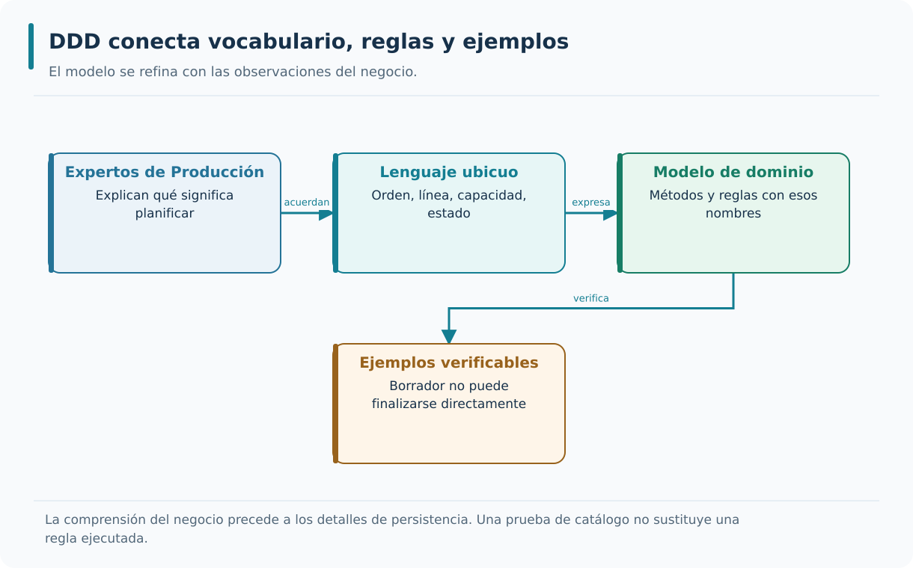

El vocabulario conecta observaciones del negocio, reglas y ejemplos ejecutables; no es una traducción mecánica de tablas. La figura se distribuye en SVG vectorial y PNG.

---

### El dominio y los subdominios

El dominio completo de una empresa suele abarcar capacidades con prioridades y conocimientos distintos. En una acería, Producción organiza órdenes y procesos de fabricación; Aprovisionamiento negocia compras y recepción de material; Clientes mantiene información comercial, y otras capacidades proporcionan servicios generales. La clasificación de subdominios ayuda a decidir dónde invertir esfuerzo de modelado. Un subdominio núcleo contiene conocimiento diferencial que puede justificar más colaboración y diseño propio; un subdominio genérico quizá pueda utilizar soluciones existentes. Esta clasificación es contextual y puede cambiar: Inventario puede ser una capacidad decisiva si la optimización del material condiciona todo el negocio. Antes de crear servicios debemos comprender quién toma cada decisión y qué reglas pertenecen a cada ámbito.

```text
Tipos de subdominio:

Núcleo      → aporta valor diferencial.
Soporte     → apoya al núcleo.
Genérico    → se resuelve con soluciones existentes.
```

Núcleo, soporte y genérico describen tipos de inversión en conocimiento del negocio, no tamaños fijos de microservicios. El lugar que ocupa Inventario dependerá de la estrategia de la acería y puede cambiar cuando se comprenda mejor su importancia.

La clasificación de subdominios tiene dos consecuencias prácticas. La primera es que el esfuerzo de diseño se concentra en el núcleo. La segunda es que los subdominios genéricos se resuelven con soluciones estándar. La combinación de ambas permite que el equipo invierta su tiempo donde aporta más valor.

En el dominio de la acería, el subdominio núcleo es la producción de acero. El subdominio de soporte es la gestión de inventario. El subdominio genérico es la gestión de identidades y accesos. La clasificación se documenta en el ADR del punto y se revisa cuando cambia el contexto del negocio.

Clasifica subdominios por valor diferencial para esta organización, no por la popularidad de un patrón ni por el número de tablas.

Producción se trata como núcleo; Aprovisionamiento y Clientes como soporte. Identidad y acceso puede resolverse como capacidad genérica. Esa clasificación guía dónde se implementa comportamiento propio.

El mismo subdominio puede ser núcleo en otra empresa: para un proveedor de gestión de identidades, autenticación no sería necesariamente genérica. Tampoco subdominio y contexto son sinónimos exactos.

Justifica cada clasificación con una regla o una ventaja de negocio. Revisa el ADR si cambia el producto; contar contextos no demuestra que la frontera elegida sea correcta.

---

### El contexto delimitado

Un contexto delimitado establece el espacio en el que un modelo y su vocabulario tienen un significado coherente. La palabra «orden» puede describir una orden de fabricación en Producción y una orden de compra en Aprovisionamiento; no deberían compartir automáticamente estados, restricciones ni el mismo agregado por utilizar el mismo sustantivo. El límite protege la coherencia interna y obliga a expresar cómo se traducen los conceptos cuando dos contextos colaboran. No exige que cada contexto sea un microservicio ni que disponga de un servidor propio: pueden coexistir en un monolito modular hasta que exista una razón operativa para separarlos. En AceriaApp los límites del modelo se estudiarán antes de decidir cómo desplegarlos.

```text
Contextos delimitados en la acería:

Contexto de producción      → "orden" = orden de fabricación.
Contexto de aprovisionamiento → "orden" = orden de compra.
Contexto de clientes        → "cliente" = empresa compradora.
```

La frontera de un contexto evita que «orden» signifique simultáneamente fabricación y compra dentro de un único modelo. Para integrar esos contextos hacen falta contratos o traducciones explícitas de los conceptos que comparten.

El contexto delimitado se caracteriza por tres propiedades. La primera es que el modelo es consistente dentro de la frontera. La segunda es que los términos tienen un significado preciso dentro de la frontera. La tercera es que la frontera se define por el negocio, no por la técnica. Las tres propiedades permiten que cada contexto tenga su propio modelo sin interferir con los demás.

La definición de contextos delimitados tiene dos consecuencias prácticas. La primera es que cada contexto puede tener su propio modelo de datos. La segunda es que la comunicación entre contextos se realiza con contratos explícitos. La combinación de ambas permite que los equipos trabajen de forma autónoma en cada contexto. Un contexto delimitado puede implementarse como módulo de un monolito o como uno o varios servicios, según sus límites de responsabilidad, operación y despliegue. No impone una correspondencia obligatoria de uno a uno.

Una frontera debe separar significados y propiedad del modelo. Una carpeta ayuda a expresar la frontera, pero las referencias entre proyectos permiten comprobarla.

`AceriaApp.Produccion.Dominio` contiene el modelo de Producción y se conserva separado de las capas `AceriaApp.Hexagonal.*` de M3/M4. La API compone ambos recorridos sin fusionar sus órdenes.

No compartas una entidad mutable `Orden` entre compras y producción para ahorrar un mapeo. El acoplamiento permitiría que una regla de compra alterase el modelo de fabricación.

Comprueba las referencias de proyecto: el dominio de Producción no necesita EF Core, ASP.NET Core ni el dominio hexagonal anterior. Una interfaz de integración puede traducir identificadores cuando aparezca otro contexto.

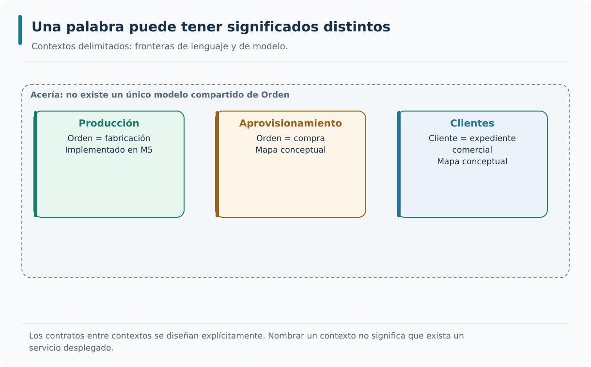

La frontera separa significados. Producción está implementada; los otros contextos orientan el mapa conceptual. La figura se distribuye en SVG vectorial y PNG.

---

### El lenguaje ubicuo

El lenguaje ubicuo es el vocabulario que expertos y desarrolladores acuerdan para hablar de un contexto y que después se refleja en el código, las pruebas y la documentación. Si el responsable de fabricación utiliza «planificar», el modelo no debería llamar indiscriminadamente «guardar» a cualquier transición que cambie una orden. Elegir nombres claros facilita detectar contradicciones entre lo que la aplicación permite y lo que el negocio espera. Ese lenguaje no se redacta una sola vez y se archiva: evoluciona cuando descubrimos nuevas reglas o excepciones. En AceriaApp distinguiremos los términos de Producción de los de compras y clientes, y utilizaremos los nombres para ubicar responsabilidades. La consistencia del vocabulario reduce malentendidos, pero no sustituye pruebas de las invariantes.

```csharp
public sealed class OrdenDeProduccion
{
    public Guid Id { get; } = Guid.NewGuid();
    public string Comprador { get; }
    public string MaterialSolicitado { get; private set; } = "";
    public bool Cancelada { get; private set; }
    public OrdenDeProduccion(string comprador, string material)
    {
        ArgumentException.ThrowIfNullOrWhiteSpace(comprador);
        Comprador = comprador;
        AsignarMaterial(material);
    }
    public void AsignarMaterial(string material)
    {
        if (Cancelada) throw new InvalidOperationException("La orden está cancelada.");
        ArgumentException.ThrowIfNullOrWhiteSpace(material);
        MaterialSolicitado = material;
    }
    public void Cancelar() => Cancelada = true;
}
```

El lenguaje ubicuo identifica expresiones que los expertos y el código utilizan con el mismo significado. Una operación llamada PlanificarOrden debe conservar ese sentido, incluido qué estados permite y qué errores debe producir.

El lenguaje ubicuo se caracteriza por tres propiedades. La primera es que se construye de forma colaborativa: negocio y desarrollo lo acuerdan. La segunda es que se refleja en el código: los nombres coinciden con el lenguaje del negocio. La tercera es que evoluciona con el dominio: el lenguaje se refina a medida que se comprende mejor. Las tres propiedades permiten que el código sea legible para el negocio y que la comunicación sea precisa.

El lenguaje ubicuo debe nombrar también acciones y restricciones. Usa `Planificar` y `Finalizar` cuando tengan significados concretos, en lugar de un `ActualizarEstado` que acepte cualquier texto.

`OrdenProduccion` expresa la orden del nuevo contexto; `LineaDeOrden` expresa un elemento de esa orden. La expresión línea de producción podría significar una instalación física y no es un sinónimo automático.

El fragmento `OrdenDeProduccion` es una variante breve para estudiar lenguaje y encapsulación. No sustituye los tipos específicos de la práctica ni introduce cancelación en su máquina de estados.

Contrasta nombres de métodos, mensajes, pruebas y glosario. Si un mismo término significa dos cosas en un mismo contexto, acláralo antes de multiplicar clases.

---

### El modelo del dominio

Un modelo del dominio no pretende copiar toda la realidad de la empresa. Selecciona las entidades, valores, relaciones y comportamientos necesarios para resolver decisiones concretas. Una orden de producción necesita proteger cantidad, material, estado y transiciones permitidas; no es necesario incorporar de inmediato todos los campos que un sistema de gestión industrial podría almacenar. Las entidades conservan identidad, los objetos de valor expresan conceptos que se comparan por atributos y los agregados delimitan qué reglas deben mantenerse consistentes durante una operación. El modelo se refina a partir de casos de negocio, no de un listado cerrado de clases. En AceriaApp la calidad se observará cuando una operación inválida no pueda dejar el agregado en un estado contradictorio.

```text
Elementos del modelo del dominio:

Entidades          → objetos con identidad propia.
Value objects      → objetos sin identidad propia.
Agregados          → fronteras de consistencia con una raíz.
Servicios dominio  → reglas que no encajan en una entidad o value object.
```

Entidades, objetos de valor, agregados y servicios de dominio cumplen funciones diferentes. La selección depende de identidad, invariantes y límites de consistencia, no de asignar un tipo de clase por cada tabla SQL.

El modelo del dominio se caracteriza por tres propiedades. La primera es que refleja el conocimiento del negocio. La segunda es que es iterativo: se refina a medida que se comprende mejor. La tercera es que es simple: refleja solo las relaciones relevantes. Las tres propiedades permiten que el modelo sea comprensible y mantenible.

Modela solo los conceptos necesarios para proteger las reglas actuales. Una raíz de agregado no es una carpeta que contiene todas las entidades relacionadas.

La orden controla sus líneas y la cantidad total. La restricción de capacidad pertenece a esa frontera, porque añadir una línea debe dejar válida la orden completa.

Los servicios de dominio alojan reglas que no encajan naturalmente en una entidad o value object; no son un contenedor general de persistencia y HTTP. Añadirlos sin necesidad puede vaciar de comportamiento a las entidades.

Para cada regla, identifica quién la protege y qué estado necesita. Si la misma validación se repite en API, repositorio y handler, comprueba qué parte es defensa de entrada y qué parte debe ser única en el dominio.

---

### DDD estratégico y táctico

DDD estratégico y táctico responden a escalas distintas del problema. El enfoque estratégico estudia qué subdominios existen, cómo se delimitan sus modelos y qué relaciones necesitan mantener; el táctico proporciona patrones para expresar identidad, valor, agregados y persistencia dentro de cada contexto. Si diseñamos entidades muy cuidadas pero mezclamos reglas de Producción y Aprovisionamiento en un único modelo ambiguo, los patrones tácticos no corregirán esa frontera. Del mismo modo, un mapa de contextos no demuestra que una orden pueda finalizar de forma segura. En AceriaApp combinaremos ambas miradas: primero acordamos qué significa cada concepto y luego construimos objetos que hagan cumplir sus reglas. El diseño tiene sentido cuando la estrategia y el código se apoyan mutuamente.

```text
DDD estratégico    → contextos delimitados y lenguaje ubicuo.
DDD táctico        → entidades, value objects, agregados, repositorios.
```

La estrategia delimita contextos y el diseño táctico expresa las reglas dentro de ellos. Ambos enfoques necesitan contrastarse: un mapa coherente sin comportamiento y un agregado correcto en una frontera equivocada ofrecen garantías incompletas.

La separación entre los dos niveles tiene dos consecuencias prácticas. La primera es que las decisiones estratégicas orientan las tácticas y se revisan con lo aprendido al implementar. La segunda es que el nivel táctico se aplica dentro de cada contexto delimitado. La combinación de ambas permite que el diseño sea coherente con el negocio y con la organización del equipo.

Usa las decisiones estratégicas para elegir fronteras y las tácticas para preservar reglas dentro de ellas. El aprendizaje puede obligar a revisar ambas.

La separación de Producción es estratégica; elegir `CantidadProduccion`, una colección de líneas y métodos de transición es táctico. La solución continúa ejecutándose como una API compuesta.

Crear agregados antes de entender el negocio puede convertir cada tabla en un agregado sin criterio. Dibujar contextos sin implementar ninguna frontera produce el problema inverso.

En el ADR distingue la decisión de contexto, la regla de agregado y el mecanismo de persistencia. Cada nivel debe tener una razón y una prueba o evidencia apropiada.

---

### DDD y microservicios

DDD puede ayudar a delimitar microservicios porque ofrece fronteras de modelo basadas en capacidades del negocio, pero no determina automáticamente una topología de despliegue. Un contexto delimitado puede mantenerse como módulo de un monolito, y una capacidad compleja podría necesitar varios procesos técnicos sin duplicar su propiedad funcional. Elegir un servicio por entidad suele crear dependencias remotas innecesarias y operaciones difíciles de coordinar. En AceriaApp comenzaremos por el contexto de Producción y su modelo coherente, mientras Aprovisionamiento y Clientes podrán aparecer como contextos de análisis sin fingir que todas sus APIs ya están ejecutadas. Cuando incorporemos comunicación entre procesos, los contratos respetarán las fronteras del modelo que aquí se han establecido.

```text
DDD + microservicios:

Contexto delimitado  →  frontera del modelo; módulo o servicio según necesidad.
Lenguaje ubicuo      →  contrato público del servicio.
Agregado             →  frontera de invariantes y consistencia local.
```

La correspondencia entre contextos y posibles servicios debe leerse como decisión de diseño, no como despliegue obligatorio. Un contexto puede permanecer dentro de un monolito modular y conservar sus propias reglas y contratos.

La combinación de DDD y microservicios tiene dos consecuencias prácticas. La primera es que las fronteras del negocio orientan los límites de los servicios. La segunda es que cada servicio tiene su propio modelo y su propio lenguaje. La combinación de ambas permite que los servicios sean autónomos y que la arquitectura sea sostenible.

Separa la frontera del modelo de la frontera del despliegue. Solo distribuye una capacidad cuando sus beneficios compensen comunicación, recuperación y operación.

El módulo añade proyectos de Producción a la misma solución. Esto demuestra aislamiento del código sin inventar un servicio remoto de compras ni una transacción distribuida.

Un proceso por contexto no garantiza autonomía si comparten tablas y entidades. Un monolito modular puede preservar mejor los contratos mientras el equipo descubre el dominio.

Explica qué cambiaría al extraer Producción: composición, credenciales, contrato de red, latencia y fallos. Sus invariantes deberían conservarse, pero una llamada local no puede tratarse como una llamada remota infalible.

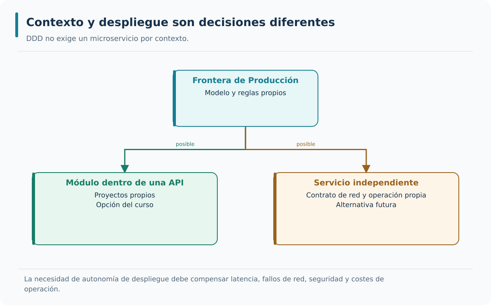

Un contexto es una frontera de modelo; su despliegue puede permanecer modular o separarse cuando exista una razón operativa. La figura se distribuye en SVG vectorial y PNG.

---

### Beneficios de DDD

El principal beneficio de DDD es reducir la distancia entre las decisiones del negocio y las estructuras que el software utiliza para aplicarlas. Una regla de cantidad de fabricación debería reconocerse en los términos y métodos del dominio, no esconderse en un controlador o en una consulta SQL. El lenguaje compartido facilita revisar cambios con expertos y permite formular pruebas comprensibles para quienes conocen el proceso. La evolución del modelo también ayuda a localizar modificaciones cuando aparecen nuevas restricciones. Estas ventajas son especialmente visibles en dominios complejos o con cambios frecuentes; para operaciones CRUD muy simples podría resultar suficiente un diseño menos elaborado. En AceriaApp utilizaremos DDD donde aporta claridad a las reglas reales, sin convertir cada concepto en un patrón por obligación.

```text
Beneficios de DDD:

Comunicación     → lenguaje ubicuo.
Alineación       → límites del sistema = límites del negocio.
Mantenibilidad   → código refleja el modelo.
Evolución        → refinamiento continuo.
```

Los beneficios del lenguaje compartido y del modelo localizado se aprecian cuando una modificación del negocio cambia pocas piezas y puede revisarse con quienes conocen el proceso. No son propiedades que se garanticen con un diagrama.

Los beneficios de DDD tienen dos consecuencias prácticas. La primera es que el sistema resuelve problemas reales del negocio. La segunda es que el equipo comparte un modelo mental común. La combinación de ambas reduce la brecha entre negocio y desarrollo y facilita la evolución del sistema.

Evalúa los beneficios por cambios de negocio que se vuelven comprensibles y localizables. El número de clases no mide calidad de DDD.

Si se cambia la capacidad didáctica de una orden, la regla debe identificarse en el agregado y sus pruebas. El adaptador HTTP solo traduce el resultado de la operación.

Un lenguaje compartido no elimina todos los errores. Reglas incompletas y ejemplos ambiguos siguen produciendo comportamientos incorrectos aunque los nombres sean consistentes.

Recorre una petición rechazada desde el caso de uso hasta la regla y su prueba. Comprueba si un experto puede reconocer la intención y explicar el rechazo sin entender EF Core.

---

### Costes de DDD

Aplicar DDD tiene costes. Requiere colaboración sostenida con expertos, discusión de términos ambiguos y revisión del modelo cuando se descubren excepciones del proceso. También introduce tipos, invariantes y fronteras que pueden parecer excesivos si el problema se reduce a guardar un registro sin reglas relevantes. El error sería confundir complejidad útil del dominio con complejidad accidental de una solución sobrearquitecturada. En una acería existen procesos donde una transición incorrecta puede provocar pérdidas materiales, de modo que representar esas reglas merece atención. Para otras capacidades administrativas puede no ser necesario el mismo nivel de modelado. El criterio será la importancia y variabilidad del conocimiento del negocio, no el número de patrones utilizados.

```text
Costes de DDD:

Inversión inicial       → construcción del lenguaje.
Colaboración continua   → negocio y desarrollo juntos.
Complejidad adicional   → modelo más elaborado.
Dificultad en dominios poco comprendidos.
```

El coste de DDD incluye reuniones, decisiones sobre invariantes y mantenimiento del lenguaje. Ese esfuerzo se justifica sobre todo cuando el conocimiento del negocio tiene importancia suficiente para evitar errores difíciles de corregir.

Los costes de DDD tienen dos consecuencias prácticas. La primera es que DDD no se aplica en todos los dominios. La segunda es que su aplicación se concentra en el núcleo del negocio. La combinación de ambas permite que el esfuerzo se invierta donde aporta más valor.

Aplica el nivel de modelado que justifiquen las reglas. No necesitas agregados complejos para cada catálogo de referencia.

El curso invierte en Producción porque hay capacidad, líneas y una secuencia de estados. Los contextos conceptuales de Clientes y Aprovisionamiento permanecen documentados sin simular implementaciones inexistentes.

El modelado también cuesta coordinación y mantenimiento de pruebas. Reducir todo a CRUD puede ocultar reglas, pero envolver cada cadena en varios tipos sin semántica añade trabajo sin beneficio.

Para cada abstracción nueva, escribe la regla o dependencia que protege. Si no puedes explicarla, considera una representación más sencilla y conserva la decisión revisable.

---

### Aplicación al proyecto del curso

El punto 5.1 aplicará DDD al mapa conceptual de AceriaApp, distinguiendo Producción, Aprovisionamiento y Clientes y definiendo vocabulario para las órdenes. El ejercicio incorpora un catálogo de contextos y comprobaciones que ayudan a razonar sobre límites, pero esas clases no pueden determinar por sí solas si el negocio fue dividido correctamente. La evidencia arquitectónica combina la justificación escrita con reglas que más adelante serán implementadas y probadas sobre el agregado de Producción. También se conservarán las operaciones de la API anterior para permitir una evolución acumulativa. Así el alumno comprenderá qué parte del diseño es una hipótesis de modelo, cuál es una regla ejecutable y cuál requiere aún colaboración con expertos del dominio.

```text
Aplicación al proyecto del curso:

Contextos         → producción, aprovisionamiento, clientes.
Lenguaje ubicuo   → términos del negocio.
Implementación    → contexto Producción aislado dentro de la solución.
Validación        → test de coherencia de contextos.
```

El resumen de contextos de AceriaApp orienta la creación posterior del agregado de Producción. Las clases que validan la descripción del mapa no certifican por sí solas que existan todos los servicios ni que el modelo represente exhaustivamente la acería.

La aplicación de DDD prepara el proyecto para los puntos 5.2 a 5.5. El punto 5.2 estudiará las entidades y los value objects. El punto 5.3 estudiará los casos de uso. El punto 5.4 estudiará la separación entre commands y queries. El punto 5.5 aplicará DDD al dominio de la acería. El punto 5.1 establece la base que se aplicará en los cuatro puntos siguientes.

Distingue tres evidencias: un catálogo describe, un proyecto separa y una prueba ejecuta. Ninguna sustituye por completo a las otras.

5.1 introduce el contexto de dominio de Producción; 5.2 profundiza en entidades y value objects; 5.3 añade aplicación e infraestructura; 5.4 separa CQRS y 5.5 completa el flujo HTTP.

Los nombres de Aprovisionamiento y Clientes en un catálogo no significan que existan endpoints, bases de datos o microservicios para esos contextos.

Parte del snapshot final de M4, con 14 proyectos y 118 pruebas en su línea base, y verifica el inventario nuevo desde los archivos y la ejecución del punto. No reutilices recuentos de una versión anterior del curso.

---

### Qué aporta DDD al modelo de AceriaApp

- Domain-Driven Design es un enfoque que sitúa el dominio del negocio en el centro del proceso de desarrollo.
- El dominio se descompone en subdominios: núcleo, soporte y genérico.
- Un contexto delimitado es una frontera dentro de la cual un modelo es consistente.
- El lenguaje ubicuo es el vocabulario común entre negocio y desarrollo.
- El modelo del dominio incluye entidades, value objects, agregados y servicios de dominio.
- DDD se divide en nivel estratégico y nivel táctico.
- Los contextos orientan las fronteras; DDD también funciona en un monolito modular y no exige un microservicio por contexto.
- DDD aporta beneficios de comunicación, alineación, mantenibilidad y evolución.
- DDD tiene costes de inversión, colaboración, complejidad y dificultad en dominios poco comprendidos.

---


# Punto 5.2 — Entidades y Value Objects

**Módulo 5:** Introducción a DDD y CQRS

**Objetivos de aprendizaje:**

- Comprender el concepto de entidad y su identidad propia.
- Comprender el concepto de value object y su inmutabilidad.
- Identificar las diferencias entre entidad y value object.
- Comprender el papel de los invariantes en el modelo del dominio.
- Añadir al proyecto `AceriaApp` las clases de validación de entidades y value objects y un test unitario que verifique la validación.
- Implementar la raíz OrdenProduccion, LineaDeOrden y value objects con igualdad e invariantes verificadas.

---

## Identidad, valor e invariantes como decisiones de negocio


Seguiremos el ciclo de una orden de producción para distinguir qué necesita identidad, qué puede representarse por valor y qué reglas deben seguir siendo válidas después de persistir y recuperar el modelo.

### Definición de entidad

Una entidad del dominio representa algo cuya identidad importa a lo largo del tiempo, incluso cuando cambian sus atributos. Una orden de producción puede modificar su cantidad o pasar de borrador a planificada y seguir siendo la misma orden; no debemos confundir esa continuidad con el valor actual de sus propiedades. En DDD, la identidad permite localizar al objeto y mantener su historia, pero las modificaciones deben estar controladas por operaciones que protejan sus invariantes. Una entidad no debería convertirse en una bolsa de setters públicos que el resto del sistema modifica sin reglas. En AceriaApp la orden ofrecerá comportamientos comprensibles para la acería y pruebas que demuestren que no acepta estados imposibles. La persistencia de esa identidad en SQL Server es importante, pero constituye una preocupación distinta de la definición del modelo.

```csharp
public sealed class Orden
{
    public Guid Id { get; }
    public string Cliente { get; }
    public int Cantidad { get; private set; }
    public Orden(Guid id, string cliente, int cantidad)
    {
        if (id == Guid.Empty) throw new ArgumentException("Identidad obligatoria.");
        ArgumentException.ThrowIfNullOrWhiteSpace(cliente);
        Id = id;
        Cliente = cliente;
        CambiarCantidad(cantidad);
    }
    public void CambiarCantidad(int nuevaCantidad)
    {
        if (nuevaCantidad <= 0)
        {
            throw new ArgumentOutOfRangeException(nameof(nuevaCantidad));
        }
        Cantidad = nuevaCantidad;
    }
}
```

La entidad Orden conserva un identificador estable y controla la modificación de su cantidad mediante un método que verifica el valor permitido. Una prueba adecuada debe confirmar que el estado no cambia cuando se intenta aplicar una cantidad inválida.

La entidad se caracteriza por tres propiedades. La primera es que tiene identidad propia: se distingue por su identificador, no por sus atributos. La segunda es que su identidad es inmutable: no cambia durante la vida de la entidad. La tercera es que sus atributos pueden cambiar: la entidad evoluciona a lo largo del tiempo. Las tres propiedades permiten que la entidad represente un concepto del negocio con ciclo de vida.

La entidad protege identidad y evolución. El constructor público debe producir un objeto válido; un setter privado no arregla por sí solo una construcción incompleta.

La raíz `OrdenProduccion` conserva su identificador cuando pasa a Planificada. En el ejemplo abreviado, `Orden` recibe identidad, cliente y cantidad y comprueba todo antes de quedar disponible.

Dos instancias cargadas en contextos EF distintos pueden representar la misma orden aunque no sean la misma referencia. La clase no obtiene igualdad por identidad automáticamente por llamarse entidad.

Prueba identificador vacío, cliente vacío y cantidad no positiva. Tras un cambio rechazado, comprueba también que el estado previo siga intacto.

---

### Identidad de una entidad

Elegir una identidad requiere pensar cómo se reconoce el mismo objeto desde distintos procesos y momentos. Algunos dominios disponen de identificadores naturales que siguen siendo estables; otros necesitan claves asignadas o generadas, como GUID o ULID. No conviene basar la identidad de una orden en datos que pueden corregirse, como el nombre del cliente o la cantidad de material. Tampoco debe confundirse el identificador persistido con la referencia a un objeto en memoria: dos instancias pueden representar la misma orden si comparten identidad y cumplen la semántica del modelo. En AceriaApp el identificador permite consultar y modificar una orden a través de peticiones diferentes. La regla de igualdad debe estar documentada y ser compatible con su ciclo de vida, sin exponer detalles de infraestructura.

```text
Tipos de identidad:

Natural   → número de bastidor, DNI, ISBN.
Asignada  → número de factura, código de pedido.
Generada  → Guid, ULID, Snowflake ID.
```

Los identificadores naturales, asignados o generados tienen compromisos diferentes. La elección depende de estabilidad, interoperabilidad y necesidades de trazabilidad, no de seleccionar automáticamente un tipo GUID para todas las entidades.

La elección del tipo de identidad tiene dos consecuencias prácticas. La primera es que la identidad natural requiere unicidad en el dominio. La segunda es que una identidad generada reduce colisiones según el algoritmo y requiere una política de unicidad; un `Guid` aleatorio ofrece una probabilidad de colisión muy baja, no una prueba matemática de ausencia de colisiones. La combinación de ambas permite elegir el tipo de identidad que mejor se adapte al dominio. El curso usa `Guid` como identidad generada para las entidades principales.

Define el ámbito de unicidad y quién asigna la identidad. Un número visible al usuario puede coexistir con una clave técnica.

Producción utiliza `Guid` para raíz y entidades hijas que necesitan trazabilidad. Una eventual numeración de orden legible podría ser un atributo adicional con una restricción propia.

Un ISBN identifica una edición, no cada ejemplar físico; un identificador fiscal puede cambiar o no ser adecuado como clave técnica. Los identificadores naturales requieren analizar el concepto exacto y su estabilidad.

Rechaza `Guid.Empty` al crear entidades y configura claves en persistencia. No confundas una probabilidad baja de colisión con autorización, secreto o comprobación de existencia.

---

### Definición de value object

Un objeto de valor representa un concepto por lo que significa su contenido y no por una identidad independiente. Un importe monetario, una cantidad con unidad o un código de material pueden modelarse como valores que se comparan por sus atributos. Su ventaja aparece cuando concentramos validaciones y operaciones pertinentes en un tipo pequeño: dos importes no pueden sumarse sin comprobar la moneda, y un código de material inválido no debería circular libremente por los casos de uso. La inmutabilidad facilita razonar sobre estos objetos, porque modificar una condición equivale a construir un nuevo valor válido en lugar de alterar uno compartido. En AceriaApp estos tipos ayudarán a mantener reglas coherentes sin repetir comprobaciones de cadenas o decimales en cada handler.

```csharp
public sealed record Dinero
{
    public decimal Cantidad { get; }
    public string Moneda { get; }
    public Dinero(decimal cantidad, string moneda)
    {
        ArgumentException.ThrowIfNullOrWhiteSpace(moneda);
        var codigo = moneda.Trim().ToUpperInvariant();
        if (codigo.Length != 3 || codigo.Any(c => c < 'A' || c > 'Z'))
            throw new ArgumentException("Código de moneda de tres letras.");
        Cantidad = cantidad;
        Moneda = codigo;
    }
    public Dinero Sumar(Dinero otro)
    {
        ArgumentNullException.ThrowIfNull(otro);
        if (Moneda != otro.Moneda)
            throw new InvalidOperationException("No se pueden sumar monedas distintas.");
        return new Dinero(Cantidad + otro.Cantidad, Moneda);
    }
}
```

El record Dinero concentra moneda y cantidad, normaliza el código de divisa y restringe operaciones entre monedas incompatibles. El ejemplo recuerda que un objeto de valor representa reglas sobre el contenido, no una identidad que deba persistir por separado.

El value object se caracteriza por tres propiedades. La primera es que no tiene identidad: se distingue por sus atributos. La segunda es que es inmutable: sus atributos no cambian después de la creación. La tercera es que sus operaciones devuelven nuevos value objects: no modifican el original. Las tres propiedades permiten que el value object represente conceptos del dominio sin ciclo de vida.

Un value object necesita igualdad por valor, protección de invariantes y una representación que no permita eludir sus reglas al copiarlo.

`NombreMaterial` y `CantidadProduccion` se modelan en la práctica como `sealed record class` con getters sin `init`. En el ejemplo `Dinero`, la moneda se normaliza y `Sumar` devuelve otro objeto.

Un record posicional permite copias `with` que pueden saltar validaciones mal ubicadas. Un `readonly record struct` tiene además un valor `default` que no pasa por el constructor; si cero es inválido, el consumidor debe defenderlo o elegir una clase.

Comprueba igualdad de valores equivalentes, desigualdad de valores distintos y ausencia de mutación tras sumar. El ejemplo monetario admite cantidades negativas y solo verifica la forma del código, no un catálogo ISO completo.

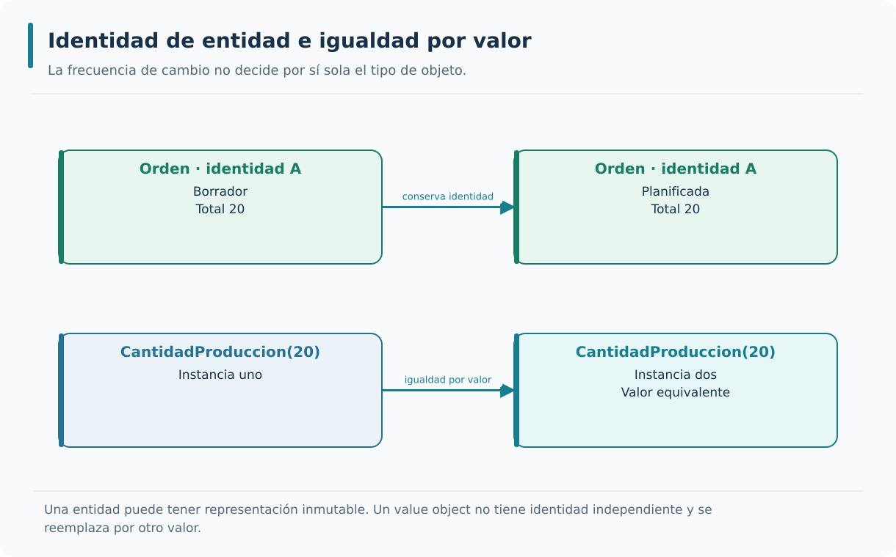

La entidad conserva identidad al cambiar; los value objects equivalentes se comparan por valor y se reemplazan. La figura se distribuye en SVG vectorial y PNG.

---

### Diferencia entre entidad y value object

La diferencia entre entidad y value object no depende de que una clase tenga propiedades con `set` ni de que se guarde en una tabla SQL. Una entidad conserva identidad y ciclo de vida; un valor se reconoce por su contenido y puede reemplazarse por otro equivalente. Por ejemplo, dos órdenes con el mismo material y cantidad siguen siendo órdenes distintas; dos códigos de material normalizados con los mismos caracteres representan el mismo valor. Esta distinción determina cómo se construyen, comparan y modifican los objetos. En AceriaApp conviene aplicar identidad donde el negocio necesita trazabilidad, y utilizar valores cuando lo importante es proteger una magnitud o clasificación. Convertir todos los conceptos en entidades complica las relaciones, mientras asignar objetos de valor a elementos con historia puede borrar información relevante.

```text
Comparación entre entidad y value object:

Aspecto         | Entidad            | Value object
----------------|--------------------|------------------
Identidad       | Propia             | No tiene
Cambio          | Conserva identidad | Se reemplaza el valor
Ciclo de vida   | Sí                 | No
Igualdad        | Por identidad      | Por atributos
```

La comparación entre entidad y valor se centra en identidad y reemplazo. Una orden puede cambiar conservando su identidad; un código de material o una cantidad suele sustituirse por otro valor equivalente.

La distinción entre entidad y value object tiene dos consecuencias prácticas. La primera es que la entidad requiere un identificador único. La segunda es que el value object requiere inmutabilidad. La combinación de ambas permite que cada elemento del modelo tenga la forma adecuada al concepto que representa.

Pregunta si una sustitución por otro objeto con iguales valores cambia el significado de negocio. Esa pregunta es más precisa que preguntar si hay una tabla.

Dos cantidades de 20 unidades son intercambiables. Dos líneas de orden con 20 unidades pueden ser distintas porque tienen identidades y trazabilidad diferentes.

Una entidad representada de forma inmutable sigue siendo entidad si conserva identidad. Un objeto con todos sus setters privados no es automáticamente value object si su igualdad sigue siendo por referencia.

Escribe dos pruebas separadas: identidad estable tras una transición e igualdad de dos value objects construidos independientemente. No uses la misma comprobación para ambas preguntas.

---

### Invariantes del dominio

Una invariante describe una condición que debe mantenerse verdadera durante la vida válida de un agregado. Si una orden no puede contener una cantidad negativa o pasar de finalizada a borrador, el dominio debe impedir esas situaciones con independencia del endpoint o de la tarea que solicite el cambio. Colocar la regla exclusivamente en FluentValidation protege una entrada HTTP concreta, pero no garantiza que otro canal o caso de uso no la omita. Una entidad bien diseñada ofrece operaciones que conservan su estado válido y rechazan transiciones incompatibles. En AceriaApp comprobaremos la regla creando objetos y solicitando cambios desde tests del dominio, sin necesitar SQL Server. Después las pruebas de persistencia confirmarán que el proveedor conserva los valores correctos.

```csharp
public sealed class Orden
{
    public Guid Id { get; }
    public string Cliente { get; }
    public Orden(Guid id, string cliente)
    {
        if (id == Guid.Empty) throw new ArgumentException("Identidad obligatoria.");
        ArgumentException.ThrowIfNullOrWhiteSpace(cliente);
        Id = id;
        Cliente = cliente.Trim();
    }
}
```

El constructor de Orden rechaza identificadores vacíos y clientes sin contenido, de modo que una instancia válida no depende de que HTTP haya ejecutado previamente esas validaciones. El dominio debe proteger su invariantes desde todos los canales.

Los invariantes se caracterizan por tres propiedades. La primera es que se validan en el momento de la creación. La segunda es que se validan en cada modificación. La tercera es que su violación produce un fallo controlado. Las tres propiedades permiten que el modelo del dominio sea consistente en todo momento.

Cada operación pública del agregado debe terminar con sus invariantes satisfechos o fallar sin exponer un estado parcial.

La orden limita el total de sus líneas a 500 unidades. Al añadir una línea, debe validar el total resultante antes de alterar la colección; comprobar solo que la nueva cantidad sea positiva es insuficiente.

Validar el command mejora el mensaje de error, pero no sustituye la defensa del dominio: un test, una importación o un nuevo adaptador pueden invocar la entidad directamente.

Prueba el límite exacto, el valor inmediatamente superior y el estado después del rechazo. Verifica también que no se pueda finalizar una orden en Borrador.

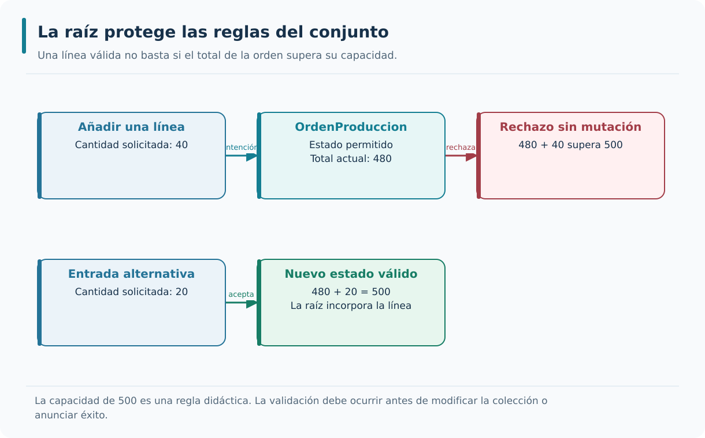

La raíz verifica estado y total antes de permitir una modificación. Las líneas no deben eludir esa entrada. La figura se distribuye en SVG vectorial y PNG.

---

### Composición de value objects

Los objetos de valor pueden componerse para expresar conceptos más ricos sin convertir cada pieza en una entidad. Una dirección combina calle, ciudad y código postal, pero eso no significa que cada parte tenga identidad o ciclo de vida propios. La composición permite repartir validaciones sencillas, como evitar una calle vacía o normalizar determinados formatos, y disponer de un objeto completo que represente la dirección como unidad. No obstante, esas reglas tienen un ámbito: los códigos postales y formatos reales varían según el país, por lo que no deben generalizarse a partir de un ejemplo corto. En AceriaApp aplicaremos la misma idea a materiales y cantidades, conservando la intención de cada tipo. La calidad del modelo se observa cuando el código puede expresar operaciones sin manipular cadenas opacas.

```csharp
public sealed record Calle
{
    public string Valor { get; }
    public Calle(string valor)
    {
        ArgumentException.ThrowIfNullOrWhiteSpace(valor);
        Valor = valor.Trim();
    }
}
public sealed record Ciudad(string Valor);
public sealed record CodigoPostal(string Valor);
public sealed record Direccion
{
    public Calle Calle { get; }
    public Ciudad Ciudad { get; }
    public CodigoPostal CodigoPostal { get; }
    public Direccion(Calle calle, Ciudad ciudad, CodigoPostal codigoPostal)
    {
        ArgumentNullException.ThrowIfNull(calle);
        ArgumentNullException.ThrowIfNull(ciudad);
        ArgumentNullException.ThrowIfNull(codigoPostal);
        ArgumentException.ThrowIfNullOrWhiteSpace(ciudad.Valor);
        ArgumentException.ThrowIfNullOrWhiteSpace(codigoPostal.Valor);
        Calle = calle;
        Ciudad = ciudad;
        CodigoPostal = codigoPostal;
    }
}
public sealed class Cliente
{
    public Guid Id { get; } = Guid.NewGuid();
    public Direccion DireccionFiscal { get; private set; }
    public Cliente(Direccion direccion) => DireccionFiscal = direccion
        ?? throw new ArgumentNullException(nameof(direccion));
    public void CambiarDireccionFiscal(Direccion nueva) => DireccionFiscal = nueva
        ?? throw new ArgumentNullException(nameof(nueva));
}
```

Direccion compone Calle, Ciudad y CodigoPostal para expresar un concepto completo. La composición permite validar partes por separado, pero las reglas concretas deben adaptarse al contexto geográfico y funcional real.

La composición de value objects tiene dos consecuencias prácticas. La primera es que el modelo del dominio se expresa con tipos específicos. La segunda es que la validación de cada componente se realiza en su propio value object. La combinación de ambas permite que el modelo sea más expresivo y que la validación esté distribuida.

La inmutabilidad debe abarcar los componentes. Un record que contiene una lista mutable sigue permitiendo cambios observables a través de esa lista.

Una dirección se sustituye completa cuando cambia; una orden compone cantidades y materiales en sus líneas. El ejemplo de dirección muestra composición y rechazo de componentes vacíos antes de asignarlos a `Cliente`.

`Ciudad` y `CodigoPostal` son envoltorios abreviados en este fragmento; la dirección comprueba que no estén vacíos. Un modelo completo trasladaría reglas geográficas específicas a sus tipos, sin asumir que todos los países usan el mismo formato postal.

Comprueba que reemplazar la dirección de un cliente no cambie otra instancia que compartía la dirección anterior. Protege las colecciones con una vista que no permita añadir o quitar elementos desde fuera.

---

### Persistencia de entidades y value objects

Persistir una entidad y persistir un objeto de valor son problemas relacionados pero no idénticos. La entidad necesita conservar su identidad y sus transiciones; un objeto de valor puede almacenarse como conjunto de columnas, tipo complejo o representación propia según las capacidades de EF Core. El mapeo debe respetar la igualdad, normalización e inmutabilidad que el dominio define, sin forzar a la entidad a exponer setters públicos únicamente para facilitar el ORM. En AceriaApp se utiliza SQL Server real para demostrar que los objetos se reconstruyen correctamente después de guardarse y recuperarse desde otro contexto. Un test que solo compara instancias en memoria no certifica el mapeo de un `CodigoMaterial` ni las restricciones relacionales del proveedor.

```csharp
public sealed record CodigoMaterial
{
    public string Valor { get; }
    public CodigoMaterial(string valor)
    {
        ArgumentException.ThrowIfNullOrWhiteSpace(valor);
        Valor = valor.Trim().ToUpperInvariant();
    }
}
public sealed class OrdenPersistida
{
    public Guid Id { get; private set; }
    public CodigoMaterial Material { get; private set; } = null!;
    private OrdenPersistida() { }
    public OrdenPersistida(Guid id, CodigoMaterial material)
    {
        if (id == Guid.Empty) throw new ArgumentException("Identidad obligatoria.");
        Id = id;
        Material = material ?? throw new ArgumentNullException(nameof(material));
    }
}
public sealed class OrdenConfiguracion : IEntityTypeConfiguration<OrdenPersistida>
{
    public void Configure(EntityTypeBuilder<OrdenPersistida> builder)
    {
        builder.HasKey(o => o.Id);
        builder.Property(o => o.Material)
            .HasConversion(v => v.Valor, v => new CodigoMaterial(v))
            .HasMaxLength(50).IsRequired();
    }
}
```

El mapeo de CodigoMaterial en EF Core debe conservar la normalización del valor al guardarlo y recuperarlo. Solo una prueba con SQL Server puede confirmar que la configuración del proveedor reconstruye correctamente los objetos persistidos.

La persistencia de entidades y value objects tiene dos consecuencias prácticas. La primera es que el mapeo preserva la identidad de las entidades. La segunda es que los value objects se reconstruyen como valores válidos del propietario. La combinación de ambas permite que el modelo del dominio se refleje en el esquema de la base de datos.

Elige el mapeo por la forma del valor y las capacidades concretas de EF Core 8. El dominio no debe incorporar atributos de transporte para facilitar el ORM.

El ejemplo convierte `CodigoMaterial` a una columna y lo reconstruye al leer. La práctica mantiene la configuración de `OrdenProduccion` en Infraestructura y recupera las líneas necesarias para verificar el total.

`OwnsOne` tiene identidad técnica de seguimiento; `ComplexProperty` modela valores sin identidad de entidad; un conversor simple mapea un valor a una columna. No son intercambiables sin revisar consultas, nulabilidad y límites de la versión.

Guarda y vuelve a cargar en un contexto nuevo. Comprueba identidad, material, cantidad y colección; una prueba que solo conserva el objeto en memoria no verifica el mapeo.

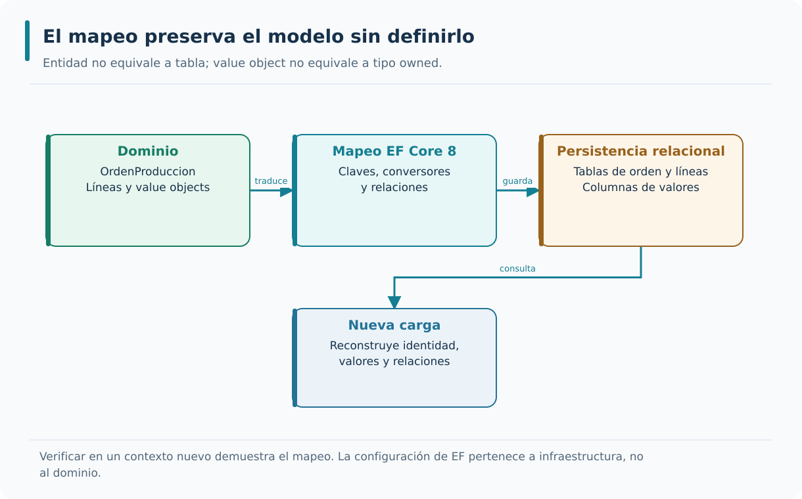

El mapeo convierte el modelo a almacenamiento; los identificadores técnicos de EF no deciden la semántica del dominio. La figura se distribuye en SVG vectorial y PNG.

---

### Cuándo usar entidad y cuándo usar value object

Para escoger entre entidad y valor conviene formular dos preguntas: si el concepto conserva una identidad reconocible y si el negocio necesita seguir su evolución a lo largo del tiempo. La frecuencia de cambios o el número de propiedades no deciden por sí solos. Una cantidad puede reemplazarse por otra sin que exista una «cantidad número 42» que deba rastrearse; una orden necesita identidad aunque sus datos permanezcan sin cambios durante meses. En AceriaApp los códigos y magnitudes pueden modelarse como objetos de valor, mientras las órdenes y elementos con historia permanecen como entidades. La decisión debe explicarse con ejemplos del dominio, no con una regla genérica de clases mutables frente a records inmutables.

```text
Criterios de decisión:

Identidad        → entidad.
Cambio frecuente → no decide por sí solo.
Ciclo de vida    → entidad.
Sin identidad    → value object.
Sin ciclo vida   → value object.
```

La clasificación recuerda que identidad y ciclo de vida son señales más fiables que la mutabilidad del tipo. Un record no se convierte automáticamente en value object correcto si su semántica todavía depende de una identidad oculta.

La decisión tiene dos consecuencias prácticas. La primera es que el modelo del dominio se ajusta a la naturaleza del concepto. La segunda es que la persistencia se adapta al tipo de elemento. La combinación de ambas permite que el modelo sea consistente con el negocio.

Decide por el significado dentro del contexto. El mismo concepto puede modelarse de forma diferente cuando cambian las preguntas del negocio.

Producción puede necesitar solo el nombre del material como value object. Compras podría requerir una entidad Material con proveedor, homologaciones e historial independiente.

No compartas el tipo de Compras por tener el mismo nombre. Tampoco conviertas automáticamente la dirección en entidad porque se cambie muchas veces.

Documenta si importan identidad, historial y reemplazo. Si dos valores equivalentes dejan de ser intercambiables por una regla nueva, revisa la clasificación y las migraciones necesarias.

---

### Errores comunes en entidades y value objects

Un modelo pobre suele aparecer cuando se introduce identidad innecesaria en valores sencillos, cuando una entidad solo contiene setters públicos o cuando las reglas se aplican de forma diferente desde cada entrada. También es problemático confundir igualdad por referencia con igualdad del negocio: dos instancias cargadas desde SQL pueden representar la misma entidad sin ser el mismo objeto de memoria. Los value objects requieren una definición consistente de igualdad y de normalización; las entidades necesitan métodos que preserven sus invariantes. En AceriaApp evitaremos introducir patrones por apariencia y revisaremos qué error de negocio previene cada tipo. Los tests deben demostrar comparaciones, transiciones y persistencia, no solo que los nombres elegidos coinciden con el catálogo DDD.

```text
Errores comunes:

Entidad para concepto sin identidad.
Value object para concepto con identidad.
Value object mutable.
Identidad confundida con referencia en memoria.
Invariantes sin validar.
```

La lista destaca errores habituales: entidades sin comportamiento, objetos de valor con cambios inesperados y reglas que solo viven en endpoints. El criterio de revisión es qué invariante concreta protege cada tipo.

Los errores tienen dos consecuencias prácticas. La primera es que el modelo del dominio no refleja el negocio. La segunda es que la persistencia produce inconsistencias. La combinación de ambas se corrige revisando el modelo con los criterios de decisión.

Evita vías laterales que permitan violar reglas: setters públicos, colecciones mutables, constructores vacíos públicos o valores por defecto inválidos.

La orden debe añadir líneas mediante su método de dominio y exponer una colección de lectura. La línea hija no debe ofrecer una mutación pública que aumente su cantidad saltándose la capacidad total.

Una propiedad de tipo `IReadOnlyList<T>` puede ocultar una lista que sigue siendo modificable mediante conversión si se expone la instancia concreta. Usa una vista de solo lectura o copia y controla también los elementos.

Intenta modificar desde el exterior la colección y sus elementos. Comprueba que solo la raíz permita cambios y que las entradas nulas o inválidas nunca creen una línea persistible.

---

### Aplicación al proyecto del curso

El punto 5.2 lleva el lenguaje de Producción a objetos que protegen datos y estados. El agregado de orden conserva su identidad y ofrece operaciones controladas, mientras los objetos de valor expresan magnitudes o identificadores con reglas propias. El alumno podrá comparar esa estructura con las entidades más simples de los módulos anteriores y reconocer por qué ciertos cambios no deberían exponerse como setters. La implementación sobre EF Core requiere pruebas adicionales para comprobar que los datos y valores se reconstruyen correctamente en SQL Server. Los catálogos descriptivos de entidades y valores ayudan a discutir el diseño, pero la evidencia de un dominio sólido está en su comportamiento, sus invariantes y su persistencia observada.

```text
Modelo conceptual → Orden, Material, Cliente; Dinero, Direccion, Cantidad.
Implementación    → agregado OrdenProduccion y sus objetos de dominio.
Identidad         → estable en raíz e hijos que requieren trazabilidad.
Inmutabilidad     → value objects con invariantes e igualdad por valor.
Comprobación      → catálogo descriptivo y pruebas de comportamiento.
```

El mapa final relaciona el agregado OrdenProduccion con valores de cantidad y material. Su utilidad no es que todo concepto tenga una clase, sino que el alumno pueda demostrar qué estados son posibles y qué datos conserva SQL Server.

La aplicación de entidades y value objects prepara el proyecto para los puntos 5.3, 5.4 y 5.5. El punto 5.3 estudiará los casos de uso. El punto 5.4 estudiará la separación entre commands y queries. El punto 5.5 aplicará DDD al dominio de la acería. El punto 5.2 establece la base que se aplicará en los tres puntos siguientes.

El inventario real del punto debe distinguir tipos de la implementación y ejemplos usados para comparar alternativas.

El modelo ejecutable se centra en `OrdenProduccion`, `LineaDeOrden`, `NombreMaterial` y `CantidadProduccion`. `Dinero` y `Direccion` explican igualdad y composición, pero no implican un módulo financiero o postal implementado.

Un test que clasifica la palabra Dinero como value object no comprueba que su suma, igualdad o serialización sean correctas. Esa evidencia requiere ejecutar el tipo concreto.

Revisa el proyecto de dominio y sus pruebas de comportamiento. Identifica constructor válido, transición válida, rechazo y preservación del estado para cada regla implementada.

---

### Qué distingue una entidad de un valor

- Una entidad es un objeto del dominio que se distingue por su identidad.
- La identidad de una entidad puede ser natural, asignada o generada.
- Un value object es un objeto del dominio que se distingue por sus atributos.
- Un value object es inmutable y no tiene identidad ni ciclo de vida independiente de negocio.
- La diferencia entre entidad y value object se manifiesta en identidad, mutabilidad, ciclo de vida e igualdad.
- Los invariantes son condiciones que deben cumplirse en todo momento en el modelo del dominio.
- Los value objects se componen para formar estructuras más complejas.
- La persistencia de entidades y value objects se realiza de forma distinta.
- La decisión depende de identidad e intercambiabilidad; la mutabilidad de la representación no basta para decidir.

---


# Punto 5.3 — Casos de uso

**Módulo 5:** Introducción a DDD y CQRS

**Objetivos de aprendizaje:**

- Comprender qué es un caso de uso en el contexto de DDD y CQRS.
- Identificar la relación entre caso de uso, puerto de entrada y comando.
- Comprender la orquestación de entidades y value objects en un caso de uso.
- Comprender la coordinación de repositorios y unidad de trabajo en un caso de uso.
- Añadir al proyecto `AceriaApp` las clases de validación de casos de uso y un test unitario que verifique la validación.
- Ejecutar casos de uso con repositorio, unidad de trabajo y persistencia propia de Producción.

---

## Del mensaje de entrada al cambio confirmado


Seguiremos la solicitud de creación de una orden para ver dónde se comprueban datos, dónde se protegen reglas, cómo se coordina el caso de uso y cuándo SQL Server permite observar el resultado.

### Definición de caso de uso

Un caso de uso expresa una acción que el sistema ofrece a un actor y coordina los pasos necesarios para completar su intención. Crear una orden de producción no es simplemente insertar una fila: puede requerir validar entradas, construir un agregado válido, comprobar condiciones del negocio y confirmar el resultado. La capa de aplicación sitúa esa coordinación sin apropiarse de las invariantes de la entidad ni de los detalles tecnológicos de EF Core. Su contrato debería describir lo que el consumidor puede solicitar y qué resultado recibirá, no el endpoint que la expone. En AceriaApp los casos de uso se podrán invocar desde HTTP y probar con colaboradores controlados, mientras la persistencia real queda en adaptadores. Esa separación será especialmente importante cuando aparezcan otros canales y comunicación entre servicios.

```csharp
public interface IOrdenServicio
{
    Task<Result<Guid>> CrearOrdenAsync(CrearOrdenCommand command);
    Task<Result<OrdenDto>> ObtenerOrdenAsync(Guid id);
}
```

El contrato IOrdenServicio expresa operaciones de aplicación y devuelve resultados que diferencian éxito de rechazo. No contiene tipos HTTP ni consultas SQL, de modo que un test puede invocarlo sin arrancar el host de ASP.NET Core.

El caso de uso se caracteriza por tres propiedades. La primera es que expresa una intención del negocio: el nombre describe la operación. La segunda es que coordina los elementos del dominio: entidades, value objects, repositorios y unidad de trabajo. La tercera es que delega las invariantes en entidades, value objects o servicios de dominio, sin duplicarlas en la orquestación. Las tres propiedades permiten que el caso de uso sea la unidad de trabajo de la capa de aplicación.

La aplicación del caso de uso tiene dos consecuencias prácticas. La primera es que la lógica de orquestación se separa de las reglas de negocio. La segunda es que cada caso de uso se prueba de forma aislada. La combinación de ambas permite que la capa de aplicación sea mantenible y testeable.

Un caso de uso debe describir lo que el actor quiere conseguir y coordinar los colaboradores mínimos para lograrlo.

Crear una orden reúne entrada, construcción del agregado, preparación del alta y confirmación. Planificar y finalizar son operaciones distintas porque tienen precondiciones y consecuencias diferentes.

Un método `GuardarTodo` que acepta un grafo externo permite saltar intenciones del negocio. Una operación larga que cruza servicios tampoco se vuelve atómica por llamarse caso de uso.

Comprueba el caso de uso sin HTTP y con puertos controlados. Su resultado debe distinguir éxito, ausencia, entrada inválida y conflicto sin depender de números de estado HTTP.

---

### Relación entre caso de uso y comando

Los comandos describen qué desea cambiar un actor, pero la solicitud no constituye por sí misma un cambio válido del modelo. Un `CrearOrdenCommand` contiene cliente, material y cantidad; el handler interpreta esos datos, hace cumplir las reglas mediante el agregado y coordina su almacenamiento. Esta distinción evita que un record de entrada se convierta en una entidad editable o que el endpoint reproduzca toda la lógica de creación. Utilizar MediatR permite entregar el mensaje al handler correspondiente, aunque no impone automáticamente una arquitectura correcta. En AceriaApp el test de aplicación comprobará que una petición válida produce una orden y que una inválida devuelve un resultado de rechazo sin confirmar cambios. La validez no procede del patrón de mensajería, sino de las invariantes del negocio.

```csharp
public record CrearOrdenCommand(string Cliente, string Material, int Cantidad) : IRequest<Result<Guid>>;

public class CrearOrdenHandler : IRequestHandler<CrearOrdenCommand, Result<Guid>>
{
    private readonly IOrdenRepositorio _repositorio;
    private readonly IUnitOfWork _unitOfWork;

    public CrearOrdenHandler(IOrdenRepositorio repositorio, IUnitOfWork unitOfWork)
    {
        _repositorio = repositorio;
        _unitOfWork = unitOfWork;
    }

    public async Task<Result<Guid>> Handle(CrearOrdenCommand request, CancellationToken ct)
    {
        var orden = new Orden(Guid.NewGuid(), request.Cliente, request.Material, request.Cantidad);
        await _repositorio.AddAsync(orden, ct);
        await _unitOfWork.CommitAsync(ct);
        return Result<Guid>.Success(orden.Id);
    }
}
```

El comando de creación llega a un handler que coordina repositorio y unidad de trabajo. El mensaje no es una entidad persistida: sus datos deben atravesar reglas y producir un agregado válido antes de confirmar.

La relación entre caso de uso y comando tiene dos consecuencias prácticas. La primera es que el caso de uso se invoca con un comando inmutable. La segunda es que el manejador coordina los elementos del dominio. La combinación de ambas permite que el caso de uso sea la unidad de trabajo de la capa de aplicación.

El command transporta intención y datos; el handler coordina la ejecución. No coloques acceso a la base de datos en el constructor del mensaje.

El ejemplo de creación prepara la orden y espera `CommitAsync(ct)` antes de devolver su identificador como éxito. El token llega a los puertos para que el trabajo pendiente pueda cancelarse.

La repetición del mismo mensaje puede crear dos órdenes si no hay deduplicación. MediatR 12.4.1 resuelve un handler dentro del proceso, pero no ofrece entrega persistente ni procesamiento exactamente una vez.

Verifica que un fallo de commit no produzca un resultado exitoso y que una cancelación no se traduzca a validación de negocio. La política de idempotencia se diseña por separado cuando sea necesaria.

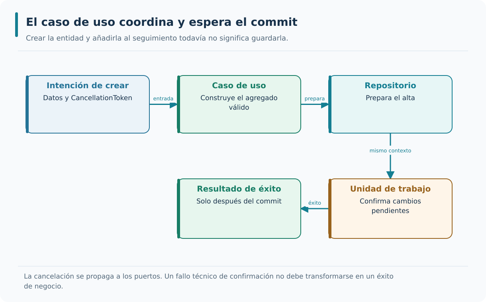

Aplicación prepara el agregado y espera la confirmación; solo después devuelve un resultado de éxito. La figura se distribuye en SVG vectorial y PNG.

---

### Orquestación de entidades y value objects

Un caso de uso puede necesitar información de varias entidades para realizar una decisión. Antes de crear una orden, por ejemplo, puede tener que comprobar que el cliente existe y que el material solicitado pertenece al catálogo permitido; después construirá un agregado cuyo comportamiento protege cantidad y estado. Es importante decidir qué información debe conocer el caso de uso y qué debe permanecer dentro de cada agregado. Si la aplicación modifica directamente todas las propiedades de las entidades, se debilitan sus invariantes. La coordinación debe realizarse mediante puertos que expresen necesidades del negocio, sin filtrar consultas SQL ni clases de transporte. En AceriaApp la orquestación combinará colaboradores, pero las reglas sobre una orden seguirán alojadas en su modelo.

```csharp
public async Task<Result<Guid>> Handle(CrearOrdenCommand request, CancellationToken ct)
{
    var cliente = await _clienteRepositorio.GetByIdAsync(request.ClienteId, ct);
    if (cliente is null)
    {
        return Result<Guid>.Failure("El cliente no existe.");
    }

    var material = await _materialRepositorio.GetByIdAsync(request.MaterialId, ct);
    if (material is null)
    {
        return Result<Guid>.Failure("El material no existe.");
    }

    var orden = new Orden(Guid.NewGuid(), cliente, material, request.Cantidad);
    await _ordenRepositorio.AddAsync(orden, ct);
    await _unitOfWork.CommitAsync(ct);
    return Result<Guid>.Success(orden.Id);
}
```

La orquestación consulta cliente y material, aplica precondiciones y construye la orden. Cada puerto debe expresar la necesidad del negocio sin convertir el caso de uso en dueño de las tablas de varios contextos.

La orquestación tiene dos consecuencias prácticas. La primera es que los errores esperados se representan con el patrón Result. La segunda es que las reglas de negocio residen en las entidades. La combinación de ambas permite que el caso de uso sea legible y que las reglas sean testeables de forma aislada.

Carga solo el estado necesario y deja al dominio decidir las reglas que dependen de ese estado. Aplicación coordina el orden de las llamadas.

El ejemplo de cliente y material supone colaboradores dentro de un límite local conocido. En el contexto implementado, Producción usa sus propios valores y no carga agregados de Clientes o Compras que todavía no existen.

Consultar que un cliente existe y después escribir no elimina una carrera concurrente. Si se integran otros contextos, el contrato debe aclarar si se usa referencia, copia histórica o consulta remota.

Prueba ausencia del colaborador y confirma que no se añade la orden ni se llama al commit. Al fallar una precondición, la operación no debe continuar con un objeto parcialmente construido.

---

### Coordinación de repositorios y unidad de trabajo

Cuando una operación requiere varias escrituras dentro de una misma frontera SQL, el caso de uso debe controlar su confirmación conjunta. Los repositorios preparan los cambios sobre los agregados y Unit of Work determina cuándo se guardan realmente. Esta separación evita que un primer repositorio confirme antes de que un segundo haya terminado una operación relacionada. Sin embargo, el contrato debe corresponder a la transacción que el proveedor puede garantizar: una unidad de trabajo local no convierte varias bases de servicios diferentes en una operación atómica. En AceriaApp la prueba con SQL Server debe demostrar qué filas quedan después de una operación completa y qué sucede ante un fallo. Un mock de `CommitAsync` ayuda a verificar coordinación, pero no certifica rollback real.

```text
Coordinación en el caso de uso:

1. Recuperar entidades con repositorios.
2. Modificar entidades del dominio.
3. Preparar cambios con repositorios sin confirmar.
4. Confirmar transacción con la unidad de trabajo.
5. Devolver el resultado.
```

La secuencia de repositorios y confirmación demuestra que agregar al contexto y ejecutar CommitAsync son momentos distintos. La atomicidad real debe verificarse en SQL Server, especialmente ante fallos intermedios.

La coordinación tiene dos consecuencias prácticas. La primera es que la transacción se gestiona en un único punto. La segunda es que los repositorios no confirman cambios: los dejan pendientes. La combinación de ambas permite que el caso de uso controle la atomicidad de la operación.

El repositorio de escritura prepara cambios y la unidad de trabajo confirma el conjunto en el mismo ámbito. Aclara esta semántica en el contrato.

En Producción, el repositorio y la unidad de trabajo comparten una instancia de `ProduccionDbContext`. Esto permite guardar raíz y líneas de la orden en una única confirmación local.

Dos contextos registrados como scoped no son una transacción común si son instancias o bases distintas. El repositorio inmediato de M3 sigue teniendo otro contrato y no se mezcla accidentalmente con este flujo.

Verifica que preparar un alta no la haga visible desde un contexto nuevo antes del commit. Después de confirmar, vuelve a consultar para comprobar que se guardó el agregado completo.

---

### Casos de uso de escritura y de lectura

Un caso de uso de escritura persigue modificar el estado de negocio; uno de lectura responde una pregunta sobre ese estado. La distinción puede expresarse con métodos diferentes dentro de la aplicación antes de introducir CQRS formal. Listar órdenes, por ejemplo, puede devolver DTOs y aplicar filtros sin reconstruir cada agregado de fabricación; crear una orden necesita hacer cumplir invariantes y confirmar datos. Ambos recorridos pueden utilizar SQL Server y compartir infraestructura mientras sus contratos permanezcan claros. En AceriaApp esta separación permitirá comprender por qué no debemos llamar `SaveChangesAsync` desde una consulta y por qué una lectura puede optimizarse para los datos que realmente necesita el consumidor. No necesitamos dos bases para dar sentido a esas responsabilidades.

```csharp
public async Task<Result<List<OrdenDto>>> ListarOrdenesAsync(ListarOrdenesQuery query, CancellationToken ct)
{
    var ordenes = await _ordenRepositorio.ListarAsync(ct);
    var dtos = ordenes.Select(o => new OrdenDto(o.Id, o.Cliente, o.Cantidad)).ToList();
    return Result<List<OrdenDto>>.Success(dtos);
}
```

La lectura transforma órdenes almacenadas en DTOs destinados a un consumidor. El caso de uso no debería modificar entidades ni confirmar cambios solo para obtener una lista.

La distinción entre escritura y lectura tiene dos consecuencias prácticas. La primera es que los casos de uso de escritura requieren coordinación transaccional. La segunda es que los casos de uso de lectura pueden optimizarse con proyecciones. La combinación de ambas permite que el sistema sea eficiente y coherente.

El modelo de lectura debe responder a la pantalla o al consumidor, sin obligarlo a conocer métodos e invariantes de la entidad.

La lista puede devolver identificador, estado y total mediante DTOs. La escritura necesita reconstruir las líneas porque una nueva línea debe respetar el total del agregado.

El ejemplo que proyecta tras cargar entidades es una primera variante didáctica. Para listas grandes, una proyección en la consulta evita cargar columnas y relaciones innecesarias; CQRS formaliza ese camino en 5.4.

Comprueba lista vacía, detalle inexistente y orden estable de resultados. Limita el volumen con paginación cuando el caso de uso lo requiera; devolver una lista completa no escala por sí solo.

---

### Casos de uso y puertos de entrada

Los puertos de entrada son los contratos mediante los que un actor puede solicitar capacidades de aplicación. `IOrdenServicio` puede exponer crear, consultar, listar o cancelar órdenes con parámetros ligados al negocio y respuestas explícitas. No debería aceptar `HttpContext` o tipos de EF Core como condición para ejecutar una operación, porque eso obligaría a todo consumidor a conocer el protocolo o el proveedor. El adaptador HTTP traduce entradas y salidas mientras el caso de uso mantiene su significado. En AceriaApp los comandos de MediatR pueden funcionar como contratos de solicitud y los servicios como puntos de coordinación; lo importante no es la cantidad de interfaces, sino que las dependencias del núcleo tengan una dirección controlada.

```csharp
public interface IOrdenServicio
{
    Task<Result<Guid>> CrearOrdenAsync(CrearOrdenCommand command, CancellationToken ct);
    Task<Result<OrdenDto>> ObtenerOrdenAsync(Guid id, CancellationToken ct);
    Task<Result<List<OrdenDto>>> ListarOrdenesAsync(ListarOrdenesQuery query, CancellationToken ct);
    Task<Result> CancelarOrdenAsync(CancelarOrdenCommand command, CancellationToken ct);
}
```

El puerto reúne capacidades que la aplicación ofrece a distintos adaptadores. Si una nueva entrada necesita crear una orden, podrá invocar la misma operación sin reimplementar sus invariantes.

La separación entre puerto y caso de uso tiene dos consecuencias prácticas. La primera es que el puerto agrupa los casos de uso por capacidad. La segunda es que los casos de uso se invocan desde distintos adaptadores. La combinación de ambas permite que el sistema se exponga en varios protocolos sin duplicar la lógica.

Un puerto de entrada agrupa una capacidad; no tiene por qué contener todas las operaciones de la aplicación. MediatR es una alternativa para despachar solicitudes.

El caso de uso de Producción se puede invocar desde HTTP y desde pruebas sin cambiar su lógica. Los ejemplos con `IOrdenServicio` muestran la opción de interfaz explícita.

No es obligatorio crear una interfaz de servicio y un handler que dupliquen todas las mismas reglas. Si ambos existen, uno debe delegar y la política debe permanecer en una sola implementación.

Localiza el punto donde se ejecuta cada transición. Verifica que los adaptadores no dupliquen la validación de estado ni llamen directamente a `SaveChangesAsync`.

---

### Casos de uso y adaptadores de entrada

Un adaptador de entrada convierte el protocolo utilizado por un consumidor en una petición de aplicación y traduce la respuesta a su propio lenguaje. En ASP.NET Core eso implica enlazar rutas y cuerpos JSON, enviar un comando o invocar un caso de uso y construir códigos HTTP coherentes. El handler no debería decidir el estado de una orden con reglas copiadas del dominio ni ejecutar SQL directamente. Si mañana un trabajador recibiera una orden desde una cola, podría invocar la misma capacidad y obtener el mismo tratamiento de invariantes. En AceriaApp comprobaremos una petición real y su resultado de persistencia, no solo la presencia de `MapPost` o `ISender` en el código. La separación se demuestra mediante comportamiento equivalente desde los puntos de entrada adecuados.

```csharp
app.MapPost("/api/v1/ordenes", async Task<IResult> (
    CrearOrdenCommand command,
    ISender sender,
    CancellationToken ct) =>
{
    var result = await sender.Send(command, ct);
    if (result.IsSuccess)
        return Results.Created($"/api/v1/ordenes/{result.Value}", new { id = result.Value });
    return Results.BadRequest(new { error = result.Error });
});
```

El endpoint traduce un comando HTTP a la aplicación y convierte el resultado en una respuesta. El error del caso de uso debe mapearse a un estado coherente; no todos los rechazos de negocio equivalen a un 400.

La separación entre adaptador y caso de uso tiene dos consecuencias prácticas. La primera es que el adaptador se mantiene simple. La segunda es que el caso de uso se invoca desde distintos adaptadores. La combinación de ambas permite que el sistema se exponga en varios protocolos sin duplicar la lógica.

El adaptador convierte transporte en una solicitud y resultado de aplicación en transporte. Mantén la semántica HTTP en ese borde.

La ruta real de este módulo es `/api/v1/produccion/ordenes`. Una creación válida devuelve 201; una entrada inválida 400, una identidad ausente 404 y una transición incompatible 409.

El fragmento con `/api/v1/ordenes` es una variante abreviada que solo muestra creación y error de entrada. No es el mapa completo de resultados del proyecto ni sustituye su prefijo de ruta.

Prueba `Location` después de crear y consulta esa identidad. En Minimal APIs, usa un tipo de retorno común como `IResult` cuando las ramas producen respuestas concretas diferentes.

---

### Casos de uso y validación

La validación protege distintas fronteras y no debe concentrarse indiscriminadamente en una sola clase. El adaptador HTTP comprueba que puede interpretar el cuerpo; una validación de mensaje puede rechazar cantidad negativa o campos vacíos; el agregado conserva invariantes que deben cumplirse con independencia del canal. Una regla que depende del estado persistido requiere coordinación de aplicación o dominio según el caso. AceriaApp utiliza FluentValidation y resultados explícitos para comunicar rechazos esperados, pero no presenta esos filtros como sustitutos de los métodos del modelo. La prueba completa debe mostrar que la solicitud inválida produce un estado HTTP adecuado y no genera datos nuevos. Así cada capa conserva una responsabilidad verificable.

```text
Niveles de validación en el caso de uso:

Sintáctica  → deserialización y tipos en el adaptador.
Entrada     → reglas de mensaje, por ejemplo FluentValidation.
Negocio     → invariantes del dominio.
```

La clasificación distingue errores de forma, datos de entrada y reglas del dominio. La protección esencial debe mantenerse aunque un nuevo canal no ejecute el mismo filtro HTTP.

La validación tiene dos consecuencias prácticas. La primera es que los errores de entrada se detectan pronto sin prescindir de la defensa del dominio. La segunda es que los errores se representan con el patrón Result. La combinación de ambas permite que el caso de uso sea consistente con el resto del sistema.

Asigna cada comprobación a quien conoce su significado. El transporte valida formato, aplicación valida entrada y coordinación, y el dominio defiende estados válidos.

Una cantidad negativa se puede rechazar temprano con FluentValidation 11.11.0; la capacidad total se decide al combinar las líneas actuales en `OrdenProduccion`.

Un validador no sustituye una restricción de unicidad ni una política de concurrencia. Tampoco una excepción inesperada de SQL debe convertirse automáticamente en un error del usuario.

Invoca la entidad directamente con una entrada inválida y verifica el rechazo. Después prueba el caso de uso para comprobar que traduce los fallos esperados sin ocultar cancelación ni errores técnicos.

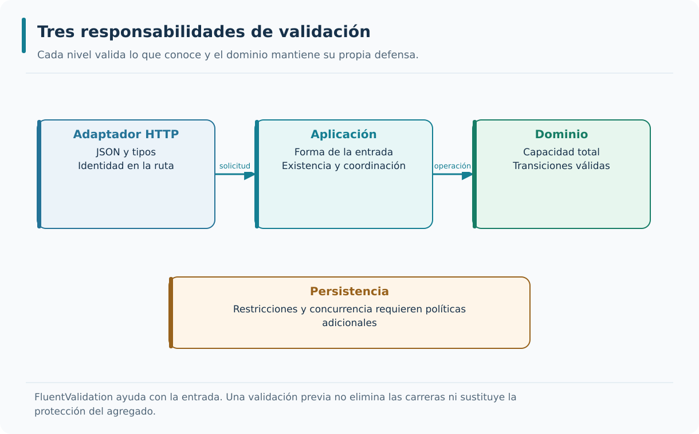

Cada nivel valida lo que conoce. La defensa del dominio continúa siendo necesaria detrás de la validación de entrada. La figura se distribuye en SVG vectorial y PNG.

---

### Casos de uso y transacciones

Las transacciones pertenecen a una frontera de almacenamiento y deben utilizarse para proteger operaciones que el negocio considera indivisibles dentro de ella. Un caso de uso puede cargar una orden, aplicar una transición válida y pedir a Unit of Work que confirme los cambios. El momento del commit determina cuándo otro contexto puede observarlos. Si la operación falla antes de confirmar, el resultado no debería anunciar éxito; si falla después, la aplicación necesita una estrategia coherente para informar del estado real. En AceriaApp los tests sobre SQL Server verifican que la implementación respeta estas garantías y que el dominio no necesita conocer su mecanismo. Más adelante la coordinación entre varios microservicios requerirá decisiones adicionales de mensajería y consistencia eventual.

```text
Transacción en el caso de uso:

1. Cargar y seguir el agregado; todavía no se confirma SQL.
2. Comprobar precondiciones y concurrencia necesaria.
3. Modificación de entidades.
4. Preparar todos los cambios en el mismo contexto.
5. CommitAsync llama a SaveChangesAsync y espera su resultado.
```

Los pasos de la transacción muestran que las escrituras preparadas no equivalen a cambios confirmados. Un test con un contexto independiente permite comprobar cuándo el estado se hizo persistente.

La gestión de transacciones tiene dos consecuencias prácticas. La primera es que la atomicidad local se verifica en el adaptador relacional que implementa la unidad de trabajo. La segunda es que el caso de uso no gestiona la transacción directamente. La combinación de ambas permite que el caso de uso sea simple y que la transacción sea controlada.

Distingue cambios en memoria, guardado y confirmación SQL. La garantía transaccional debe describir qué recursos incluye y qué fallos cubre.

La orden y sus líneas se guardan mediante el mismo contexto de Producción. Las pruebas de persistencia usan `UseSqlServer` y una base SQL Server real aislada por caso, obtenida mediante `BaseSqlServer`. La lectura desde un contexto nuevo comprueba que tanto la raíz como sus líneas se han confirmado.

Un doble del repositorio sirve para comprobar decisiones del caso de uso, pero no demuestra los mapeos ni la atomicidad del motor. Por eso las pruebas de integración conservan SQL Server. Revertir SQL no restaura automáticamente un objeto ya modificado en memoria; la comprobación debe utilizar otro contexto.

Fuerza un fallo antes del commit y comprueba que no aparecen filas nuevas. Si necesitas evitar actualizaciones perdidas entre dos peticiones, añade y prueba una política de concurrencia explícita; este flujo no la obtiene solo por usar UoW.

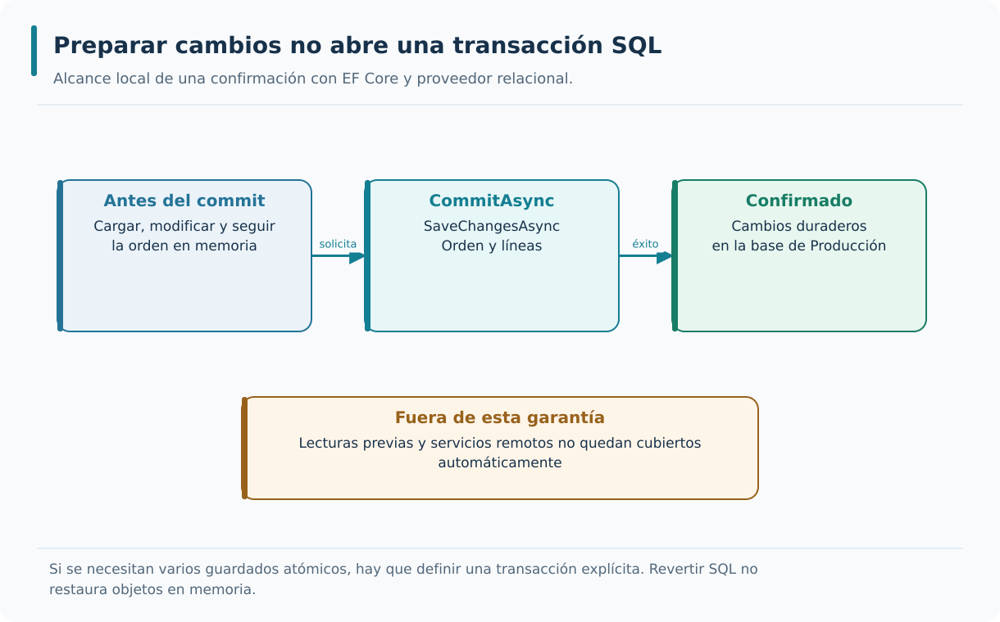

Preparar cambios no equivale a confirmar SQL. La transacción local no cubre por sí sola servicios externos ni lecturas previas. La figura se distribuye en SVG vectorial y PNG.

---

### Aplicación al proyecto del curso

El punto 5.3 une el modelo DDD con la capa de aplicación que ya se había introducido mediante puertos y patrones. El caso de uso de Producción coordina entidades y repositorios, expresa éxito o rechazo mediante Result y utiliza Unit of Work para confirmar. Las lecturas se presentan como operaciones diferentes, adaptadas a los DTO que consumen otras partes del sistema. La implementación debe conservar las invariantes del agregado y demostrar persistencia real cuando anuncia que una orden fue creada. El alumno podrá ejecutar el caso de uso con un colaborador controlado para probar la coordinación y con SQL Server para verificar el recorrido completo. Esa distinción servirá de base para Commands y Queries en el punto siguiente.

```text
Aplicación       → casos de uso de Producción.
Escritura        → repositorio de agregados y unidad de trabajo.
Resultados       → éxito o fallo esperado explícito.
Persistencia     → adaptadores EF Core en Infraestructura.
MediatR          → separación de mensajes y handlers en el punto 5.4.
Comprobación     → casos de uso aislados y persistencia relacional.
```

El mapa final relaciona casos de uso de Producción, puertos y resultados con el proveedor EF Core. El objetivo es comprender el recorrido ejecutable, no contabilizar clases que llevan nombres de patrones.

La aplicación de los casos de uso prepara el proyecto para los puntos 5.4 y 5.5. El punto 5.4 estudiará la separación entre commands y queries. El punto 5.5 aplicará DDD al dominio de la acería. El punto 5.3 establece la base que se aplicará en los dos puntos siguientes.

Enseña cada responsabilidad en el punto donde aparece, para que el alumno pueda verificar el incremento sobre el snapshot anterior.

5.3 incorpora aplicación e infraestructura propias de Producción. Los casos de uso ya funcionan sin exigir que MediatR esté presente en su dominio; la separación de mensajes se concreta después.

Una entrada de catálogo que nombra `IInventarioServicio` no prueba la existencia de inventario ni de coordinación de reservas. El alcance ejecutable continúa limitado a las órdenes de Producción.

Comprueba referencias, resolución de dependencias y una ejecución de crear, obtener, planificar y finalizar. Conserva las pruebas anteriores de M3/M4 para demostrar convivencia de ambos recorridos.

---

### Qué confirma un caso de uso ejecutado

- Un caso de uso es una operación del sistema que expresa una intención del negocio.
- El caso de uso se materializa como un método del puerto de entrada.
- Un caso de uso se invoca con un comando o con una consulta.
- El caso de uso orquesta las entidades, los value objects, los repositorios y la unidad de trabajo.
- Los casos de uso se clasifican en escritura y lectura.
- Los casos de uso se exponen como métodos de los puertos de entrada.
- Los adaptadores de entrada invocan los casos de uso a través del mediador.
- Los casos de uso se validan en tres niveles: sintáctica, semántica y de negocio.
- Los casos de uso gestionan transacciones a través de la unidad de trabajo.

---


# Punto 5.4 — Separación entre Commands y Queries

**Módulo 5:** Introducción a DDD y CQRS

**Objetivos de aprendizaje:**

- Comprender el principio de separación entre comandos y consultas.
- Identificar las diferencias entre el modelo de escritura y el modelo de lectura.
- Comprender la relación entre CQRS y la separación de modelos.
- Comprender los beneficios y los costes de aplicar CQRS.
- Añadir al proyecto `AceriaApp` las clases de validación de la separación entre comandos y consultas y un test unitario que verifique la validación.
- Separar comandos y consultas reales con MediatR y proyecciones a DTOs sin seguimiento.

---

## Desarrollo teórico

### Bloque 1 — Definición de CQRS

CQRS es el acrónimo de Command Query Responsibility Segregation. Es un patrón arquitectónico que separa las operaciones de escritura de las operaciones de lectura. La separación se aplica en el modelo, en los manejadores y, opcionalmente, en las bases de datos. El patrón fue formulado por Greg Young como una evolución del principio de separación entre comandos y consultas de Bertrand Meyer. CQRS no es una arquitectura completa: es una técnica que se aplica donde aporta valor. La separación permite que el modelo de escritura y el modelo de lectura evolucionen de forma independiente.

```text
CQRS:

Escritura → Command → CommandHandler → Modelo de escritura.
Lectura   → Query   → QueryHandler   → Modelo de lectura.
```

- **Línea 1:** `CQRS:` → identifica el tema de las líneas siguientes.

- **Línea 3:** `Escritura → Command → CommandHandler → Modelo de escritura.` → flujo de escritura.

- **Línea 4:** `Lectura   → Query   → QueryHandler   → Modelo de lectura.` → relaciona el concepto con su responsabilidad dentro del ejemplo.

CQRS se caracteriza por tres propiedades. La primera es que separa las operaciones de escritura de las de lectura. La segunda es que permite que cada modelo evolucione de forma independiente. La tercera es que se aplica donde aporta valor: no es una obligación en todos los contextos. Las tres propiedades permiten que el sistema sea más simple en las operaciones y más eficiente en las lecturas.

La aplicación de CQRS tiene dos consecuencias prácticas. La primera es que el modelo de escritura se centra en las reglas de negocio. La segunda es que el modelo de lectura se centra en las consultas. La combinación de ambas permite que cada modelo tenga la forma adecuada a su propósito. CQRS se aplica con más intensidad en sistemas con lecturas complejas o con alto volumen de lectura.

#### Ampliación didáctica aplicada a AceriaApp

**La decisión arquitectónica.** Separa responsabilidades donde cambia la forma de trabajar: escritura protege reglas y lectura entrega información. No confundas CQRS con la obligación de desplegar dos aplicaciones.

**Ejemplo concreto en AceriaApp.** Producción usa el agregado para modificar una orden y DTOs para consultarla. Ambos caminos pueden compartir base de datos y ejecutarse en la misma API.

**Riesgo, alternativa y límite.** MediatR facilita despacho, pero se puede usar CQRS sin MediatR y MediatR sin CQRS. Event Sourcing decide qué se guarda como registro del estado y no forma parte obligatoria de esta separación.

**Comprobación técnica y aprendizaje.** Sigue una escritura y una lectura hasta sus puertos. Comprueba que la lectura no necesita métodos de transición ni una unidad de trabajo para guardar.

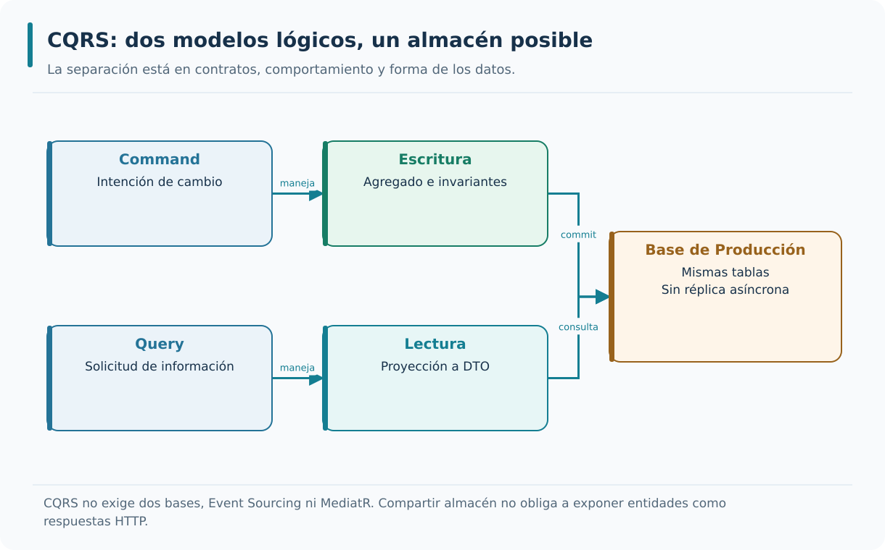

*Interpretación del gráfico:* Commands y queries tienen contratos y modelos distintos. La separación puede usar la misma base de datos. La figura se distribuye en SVG vectorial y PNG.

---

### Bloque 2 — Commands

Un command es un mensaje que solicita una acción que modifica el estado del sistema. Los commands se nombran con un verbo que expresa una acción solicitada: `CrearOrden`, `CancelarOrden`, `ActualizarMaterial`. Un command contiene los datos necesarios para ejecutar la acción. Un command devuelve un resultado cuando la acción produce un valor. El contrato del command no garantiza procesamiento exactamente una vez ni idempotencia. Los reintentos y la repetición de una petición necesitan una política explícita. Los commands se envían al modelo de escritura.

```csharp
public record CrearOrdenCommand(string Cliente, string Material, int Cantidad) : IRequest<Result<Guid>>;
public record CancelarOrdenCommand(Guid Id, string Motivo) : IRequest<Result>;
public record ActualizarCantidadCommand(Guid Id, int NuevaCantidad) : IRequest<Result>;
```

- **Línea 1:** `public record CrearOrdenCommand(string Cliente, string Material, int Cantidad) : IRequest<Result<Guid>>;` → command de creación con retorno.

- **Línea 2:** `public record CancelarOrdenCommand(Guid Id, string Motivo) : IRequest<Result>;` → command de cancelación.

- **Línea 3:** `public record ActualizarCantidadCommand(Guid Id, int NuevaCantidad) : IRequest<Result>;` → command de actualización.

Los commands se caracterizan por tres propiedades. La primera es que expresan una intención de cambio. La segunda es que un manejador procesa cada envío. La tercera es que la idempotencia debe diseñarse según la operación; MediatR no deduplica envíos. Las tres propiedades permiten que los commands sean la unidad de trabajo de las operaciones de escritura.

#### Ampliación didáctica aplicada a AceriaApp

**La decisión arquitectónica.** Un command representa una intención, no un hecho ya sucedido. Su nombre debe indicar qué se solicita y su resultado si fue aceptado.

**Ejemplo concreto en AceriaApp.** Planificar una orden cambia Borrador a Planificada. Si ya está finalizada, el dominio rechaza la intención y el adaptador devuelve conflicto.

**Riesgo, alternativa y límite.** Que un command devuelva un identificador o un resultado no rompe CQRS. La separación no exige que toda escritura sea `void`. Los reintentos requieren decidir si repetir debe devolver el éxito anterior o un conflicto.

**Comprobación técnica y aprendizaje.** Envía dos veces una transición y observa el contrato real. No supongas deduplicación, orden de entrega o idempotencia porque el mensaje sea un record.

---

### Bloque 3 — Queries

Una query es un mensaje que solicita información sin modificar el estado del sistema. Las queries se nombran con un sustantivo o con un verbo de consulta en infinitivo: `ObtenerOrden`, `ListarOrdenes`, `BuscarMaterial`. Una query contiene los criterios de búsqueda. Una query devuelve un resultado con los datos solicitados. Una query correcta no cambia el estado de negocio; repetirla no añade efectos de negocio, aunque la respuesta pueda variar si otros actores escriben. Las queries se envían al modelo de lectura.

```csharp
public record ObtenerOrdenQuery(Guid Id) : IRequest<Result<OrdenDto>>;
public record ListarOrdenesQuery(int Page, int PageSize) : IRequest<Result<List<OrdenResumenDto>>>;
public record BuscarMaterialQuery(string Nombre) : IRequest<Result<List<MaterialDto>>>;
```

- **Línea 1:** `public record ObtenerOrdenQuery(Guid Id) : IRequest<Result<OrdenDto>>;` → query de detalle.

- **Línea 2:** `public record ListarOrdenesQuery(int Page, int PageSize) : IRequest<Result<List<OrdenResumenDto>>>;` → query de lista paginada.

- **Línea 3:** `public record BuscarMaterialQuery(string Nombre) : IRequest<Result<List<MaterialDto>>>;` → query de búsqueda.

Las queries se caracterizan por tres propiedades. La primera es que expresan una solicitud de información. La segunda es que repetidas no añaden efectos al negocio, sin prometer datos idénticos en momentos distintos. La tercera es que no modifican el estado del sistema. Las tres propiedades permiten que las queries sean la unidad de trabajo de las operaciones de lectura.

#### Ampliación didáctica aplicada a AceriaApp

**La decisión arquitectónica.** Una query entrega información sin cambiar el estado de negocio. Su contrato incluye qué ocurre si faltan datos y cómo se limita el resultado.

**Ejemplo concreto en AceriaApp.** El detalle de Producción devuelve un DTO y la lista devuelve proyecciones. `AsNoTracking` evita seguimiento de entidades cargadas para lectura, y no hay llamada a commit en ese camino.

**Riesgo, alternativa y límite.** `AsNoTracking` no prohíbe técnicamente ejecutar SQL de escritura en otra línea; la ausencia de efectos se verifica por contrato y prueba. Repetir una consulta puede devolver un estado nuevo si otra petición modificó la orden.

**Comprobación técnica y aprendizaje.** Consulta varias veces y comprueba que no aparecen nuevas filas ni cambian estados. Verifica detalle inexistente y colección vacía como resultados distintos.

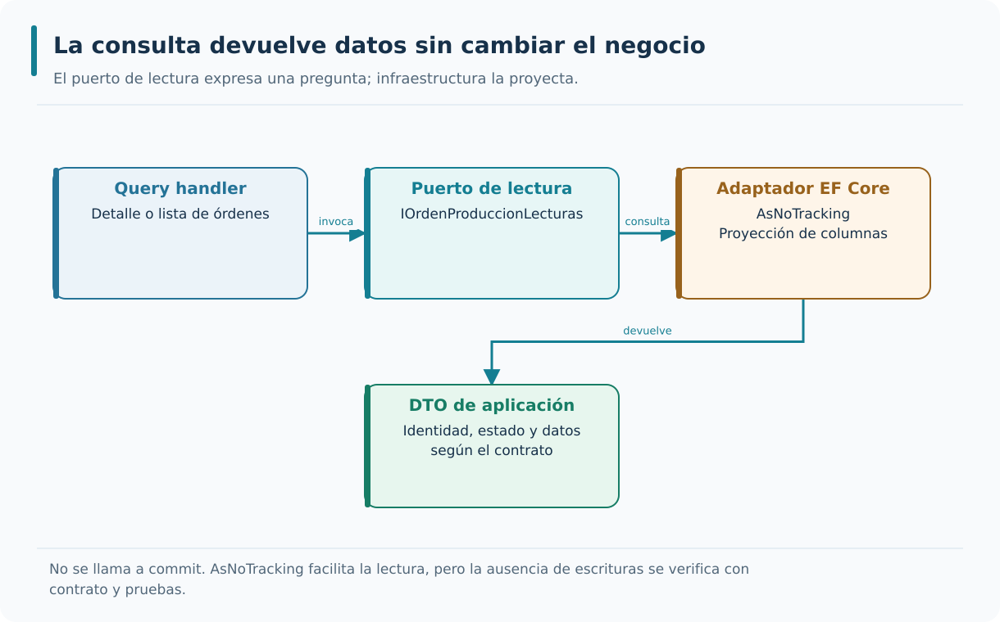

*Interpretación del gráfico:* La query proyecta DTOs sin transición de dominio ni commit. La ausencia de seguimiento facilita una lectura liviana. La figura se distribuye en SVG vectorial y PNG.

---

### Bloque 4 — Separación de modelos

CQRS permite que el modelo de escritura y el modelo de lectura sean distintos. El modelo de escritura se centra en las reglas de negocio: contiene las entidades, los value objects y los invariantes. El modelo de lectura se centra en las consultas: contiene proyecciones, DTOs y vistas. Los dos modelos pueden usar tecnologías distintas. Los dos modelos pueden usar bases de datos distintas. La separación permite que cada modelo evolucione de forma independiente.

```text
Separación de modelos:

Modelo de escritura  → entidades, value objects, invariantes.
Modelo de lectura    → proyecciones, DTOs, vistas.
```

- **Línea 1:** `Separación de modelos:` → identifica el tema de las líneas siguientes.

- **Línea 3:** `Modelo de escritura  → entidades, value objects, invariantes.` → relaciona el concepto con su responsabilidad dentro del ejemplo.

- **Línea 4:** `Modelo de lectura    → proyecciones, DTOs, vistas.` → relaciona el concepto con su responsabilidad dentro del ejemplo.

La separación de modelos tiene dos consecuencias prácticas. La primera es que cada modelo se optimiza para su propósito. La segunda es que reduce el acoplamiento, aunque contratos, campos compartidos y cambios de esquema pueden exigir adaptar ambos modelos. La combinación de ambas permite que el sistema sea más eficiente y más mantenible.

#### Ampliación didáctica aplicada a AceriaApp

**La decisión arquitectónica.** Diseña DTOs alrededor de preguntas concretas. Un DTO de lectura no necesita contener toda la estructura interna del agregado.

**Ejemplo concreto en AceriaApp.** Para un listado basta con identidad, cliente, material, cantidad total y estado según el contrato elegido. Para modificar líneas se recupera la raíz con sus hijos y se invocan sus métodos.

**Riesgo, alternativa y límite.** No devuelvas directamente la entidad desde el endpoint: expondrías estado interno y acoplarías el consumidor a cambios del modelo. Separar modelos tampoco elimina todo impacto de una migración compartida.

**Comprobación técnica y aprendizaje.** Revisa el SQL o la proyección y comprueba qué datos se cargan. El DTO debe ser construible sin disparar una transición de negocio.

---

### Bloque 5 — Beneficios de CQRS

CQRS aporta cuatro beneficios principales. El primero es la separación de responsabilidades: las operaciones de escritura y las de lectura se gestionan por separado. El segundo es la optimización: cada modelo se optimiza para su propósito. El tercero es la escalabilidad: el modelo de lectura puede escalarse de forma independiente del modelo de escritura. El cuarto es la evolución: cada modelo evoluciona de forma independiente. Los cuatro beneficios se materializan cuando el sistema tiene lecturas complejas o alto volumen de lectura.

```text
Beneficios de CQRS:

Separación de responsabilidades.
Optimización por modelo.
Escalabilidad independiente.
Evolución independiente.
```

- **Línea 1:** `Beneficios de CQRS:` → identifica el tema de las líneas siguientes.

- **Línea 3:** `Separación de responsabilidades.` → primer beneficio.

- **Línea 4:** `Optimización por modelo.` → segundo beneficio.

- **Línea 5:** `Escalabilidad independiente.` → tercer beneficio.

- **Línea 6:** `Evolución independiente.` → cuarto beneficio.

Los beneficios tienen dos consecuencias prácticas. La primera es que el sistema se adapta mejor a las cargas desiguales. La segunda es que cada modelo puede evolucionar con independencia. La combinación de ambas permite que el sistema sea más eficiente y más mantenible.

#### Ampliación didáctica aplicada a AceriaApp

**La decisión arquitectónica.** Mide el beneficio que buscas: menor coste de consulta, contrato más claro o evolución independiente del consumidor. La separación es un medio.

**Ejemplo concreto en AceriaApp.** Una pantalla de órdenes no necesita cargar todas las reglas ni seguir cada entidad. El puerto de lectura puede seleccionar los campos exactos sobre las mismas tablas.

**Riesgo, alternativa y límite.** Escalar lectores de forma independiente exige decisiones de infraestructura adicionales. Dos handlers en el mismo proceso y la misma base no proporcionan por sí solos capacidad ilimitada ni aislamiento de carga.

**Comprobación técnica y aprendizaje.** Compara consultas y volumen materializado antes de añadir otra base. Conserva pruebas de contrato para que una optimización no cambie filtros, orden o interpretación del estado.

---

### Bloque 6 — Costes de CQRS

CQRS también tiene costes. El primer coste es la complejidad adicional: la separación requiere dos modelos, dos conjuntos de manejadores y, opcionalmente, dos bases de datos. El segundo coste aparece con proyecciones actualizadas de forma asíncrona: la lectura puede ir por detrás de la escritura, por lo que se necesita tratar la consistencia eventual. El tercer coste es la duplicación: algunos conceptos se modelan en ambos modelos. El cuarto coste es la sincronización cuando se mantienen copias separadas: los cambios deben propagarse y su entrega y reconstrucción deben verificarse. Los costes se aceptan cuando el dominio lo justifica.

```text
Costes de CQRS:

Complejidad adicional.
Consistencia eventual si hay propagación asíncrona.
Duplicación de conceptos.
Sincronización cuando se mantienen copias separadas.
```

- **Línea 1:** `Costes de CQRS:` → identifica el tema de las líneas siguientes.

- **Línea 3:** `Complejidad adicional.` → primer coste.

- **Línea 4:** `Consistencia eventual si hay propagación asíncrona.` → segundo coste.

- **Línea 5:** `Duplicación de conceptos.` → tercer coste.

- **Línea 6:** `Sincronización cuando se mantienen copias separadas.` → cuarto coste.

Los costes tienen dos consecuencias prácticas. La primera es que CQRS no se aplica en todos los contextos. La segunda es que su aplicación se concentra donde aporta valor. La combinación de ambas permite que el esfuerzo se invierta donde produce beneficio.

#### Ampliación didáctica aplicada a AceriaApp

**La decisión arquitectónica.** Acepta solamente los costes necesarios para la variante elegida. Los modelos separados requieren mantener contratos; la replicación asíncrona añade otra categoría de problemas.

**Ejemplo concreto en AceriaApp.** El curso usa la misma persistencia para escritura y lectura de Producción. No necesita un publicador de eventos ni un proceso de reconstrucción de proyecciones para consultar la orden guardada.

**Riesgo, alternativa y límite.** Si se introduce una copia de lectura, habrá que tratar retrasos, duplicados, orden de eventos, recuperación y observabilidad. Una caché también necesita una política de invalidación.

**Comprobación técnica y aprendizaje.** Enumera componentes realmente desplegados y garantías probadas. No describas consistencia eventual, outbox o consumidores como capacidades del módulo si solo aparecen en una figura conceptual.

---

### Bloque 7 — CQRS con un único modelo de datos

CQRS se puede aplicar con un almacén de datos compartido y modelos lógicos diferentes. Los commands usan el agregado y los puertos de escritura; las queries devuelven DTOs mediante un puerto de lectura. Ambos pueden consultar las mismas tablas. Tener dos clases llamadas Handler no basta si ambas obligan a usar exactamente el mismo modelo. Esta variante ofrece separación real sin añadir una segunda base de datos ni propagación asíncrona.

```csharp
public sealed class CrearOrdenHandler(IOrdenEscritura escritura)
    : IRequestHandler<CrearOrdenCommand, Result<Guid>>
{
    public Task<Result<Guid>> Handle(CrearOrdenCommand request, CancellationToken ct)
        => escritura.CrearAsync(request, ct);
}
public sealed class ObtenerOrdenHandler(IOrdenLectura lectura)
    : IRequestHandler<ObtenerOrdenQuery, Result<OrdenDto>>
{
    public Task<Result<OrdenDto>> Handle(ObtenerOrdenQuery request, CancellationToken ct)
        => lectura.ObtenerAsync(request.Id, ct);
}
```

- **Línea 1:** `public sealed class CrearOrdenHandler(IOrdenEscritura escritura)` → declara la clase del ejemplo con responsabilidad explícita.

- **Línea 2:** `: IRequestHandler<CrearOrdenCommand, Result<Guid>>` → asocia el tipo de solicitud con su tipo de respuesta.

- **Línea 3:** `{` → abre el bloque actual.

- **Línea 4:** `public Task<Result<Guid>> Handle(CrearOrdenCommand request, CancellationToken ct)` → acepta la cancelación de la operación.

- **Línea 5:** `=> escritura.CrearAsync(request, ct);` → delega la operación en el colaborador o expresión indicada.

- **Línea 6:** `}` → cierra el bloque actual.

- **Línea 7:** `public sealed class ObtenerOrdenHandler(IOrdenLectura lectura)` → declara la clase del ejemplo con responsabilidad explícita.

- **Línea 8:** `: IRequestHandler<ObtenerOrdenQuery, Result<OrdenDto>>` → asocia el tipo de solicitud con su tipo de respuesta.

- **Línea 9:** `{` → abre el bloque actual.

- **Línea 10:** `public Task<Result<OrdenDto>> Handle(ObtenerOrdenQuery request, CancellationToken ct)` → acepta la cancelación de la operación.

- **Línea 11:** `=> lectura.ObtenerAsync(request.Id, ct);` → delega la operación en el colaborador o expresión indicada.

- **Línea 12:** `}` → cierra el bloque actual.

La aplicación con un único modelo de datos tiene dos consecuencias prácticas. La primera es que la separación se realiza en los contratos y los caminos de lectura y escritura. La segunda es que puede conservarse el almacén existente, aunque índices y proyecciones todavía necesiten ajustes. La combinación de ambas permite que CQRS se aplique sin duplicar la infraestructura.

#### Ampliación didáctica aplicada a AceriaApp

**La decisión arquitectónica.** Comparte el almacén cuando sea suficiente, conservando puertos y formas de datos distintos. La lectura de cambios confirmados depende además del aislamiento y de si se usan réplicas.

**Ejemplo concreto en AceriaApp.** Los handlers de commands delegan en los casos de uso; los de queries usan lectura proyectada y sin seguimiento sobre la misma base de Producción.

**Riesgo, alternativa y límite.** Las clases vacías que declaran `IRequestHandler` no compilan porque falta `Handle`. El ejemplo contiene implementaciones delegadas y presupone los puertos abreviados indicados en las convenciones.

**Comprobación técnica y aprendizaje.** Verifica creación seguida de lectura y revisa que las consultas no llamen al repositorio de escritura ni al commit. Mantener una base no obliga a un modelo de objetos único.

---

### Bloque 8 — CQRS con dos modelos de datos

CQRS también admite almacenes separados. Por ejemplo, la escritura puede usar una base relacional y la lectura una base documental, otra base relacional o una caché. La propagación puede usar eventos, captura de cambios u otro mecanismo. Si es asíncrona, introduce una ventana de consistencia eventual y exige recuperación y observabilidad. Es una variante con más coste operativo, no una versión obligatoriamente más correcta de CQRS. Event Sourcing es otra decisión: guardar eventos como estado de referencia no es un requisito de CQRS.

```text
CQRS con dos modelos:

Escritura → base de datos relacional.
Lectura   → base de datos documental o caché.
Propagación → eventos.
```

- **Línea 1:** `CQRS con dos modelos:` → identifica el tema de las líneas siguientes.

- **Línea 3:** `Escritura → base de datos relacional.` → modelo de escritura.

- **Línea 4:** `Lectura   → base de datos documental o caché.` → relaciona el concepto con su responsabilidad dentro del ejemplo.

- **Línea 5:** `Propagación → eventos.` → mecanismo de sincronización.

La aplicación con dos modelos de datos tiene dos consecuencias prácticas. La primera es que cada modelo se optimiza para su propósito. La segunda es que la consistencia entre modelos es eventual. La combinación de ambas permite que el sistema sea más eficiente pero también más complejo.

#### Ampliación didáctica aplicada a AceriaApp

**La decisión arquitectónica.** Separa almacenes por una necesidad medida y diseña el recorrido completo de propagación. La elección de motor es independiente del nombre CQRS.

**Ejemplo concreto en AceriaApp.** Como variante futura, una orden confirmada podría alimentar una vista de producción por turno. Esa vista sería una proyección, no otra entidad compartida que el command modifique por referencia.

**Riesgo, alternativa y límite.** Si se guarda la orden y después falla la publicación, se puede perder la actualización. Outbox e idempotencia ayudan a tratar ese fallo; una notificación local de MediatR no equivale a entrega durable.

**Comprobación técnica y aprendizaje.** Define retraso tolerable, indicador de versión y reconstrucción antes de prometer la vista. Esta variante no está implementada en el módulo y sus garantías no se infieren de las pruebas locales.

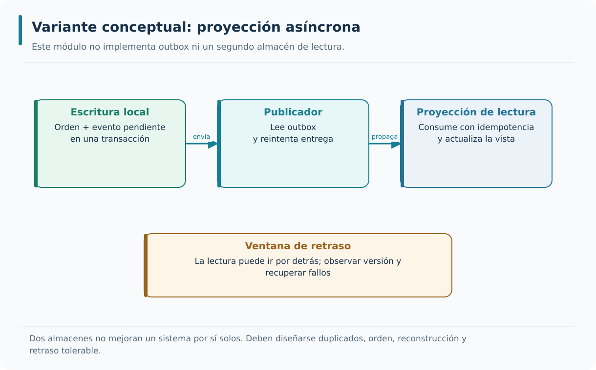

*Interpretación del gráfico:* La variante asíncrona necesita entrega durable y consumidores idempotentes. Es conceptual y no está implementada aquí. La figura se distribuye en SVG vectorial y PNG.

---

### Bloque 9 — Cuándo aplicar CQRS

CQRS puede aportar valor cuando lectura y escritura necesitan modelos distintos, las consultas son complejas o las cargas son desiguales. No mejora el rendimiento por nombrar mensajes: hay que medir consultas, índices y volumen. En CRUD simple puede añadir una separación innecesaria. La consistencia fuerte no impide CQRS: un almacén compartido puede leer cambios confirmados sin mantener otra proyección asíncrona. La experiencia del equipo y el coste operativo orientan una adopción gradual.

```text
Cuándo aplicar CQRS:

Lecturas complejas         → sí.
Alto volumen de lectura    → medir antes de separar almacenes.
Requisitos distintos       → sí.
CRUD simple                → valorar si compensa.
Consistencia fuerte        → posible con almacén compartido.
Sin experiencia            → empezar por una separación pequeña.
```

- **Línea 1:** `Cuándo aplicar CQRS:` → identifica el tema de las líneas siguientes.

- **Línea 3:** `Lecturas complejas         → sí.` → relaciona el concepto con su responsabilidad dentro del ejemplo.

- **Línea 4:** `Alto volumen de lectura    → medir antes de separar almacenes.` → relaciona el concepto con su responsabilidad dentro del ejemplo.

- **Línea 5:** `Requisitos distintos       → sí.` → relaciona el concepto con su responsabilidad dentro del ejemplo.

- **Línea 6:** `CRUD simple                → valorar si compensa.` → relaciona el concepto con su responsabilidad dentro del ejemplo.

- **Línea 7:** `Consistencia fuerte        → posible con almacén compartido.` → relaciona el concepto con su responsabilidad dentro del ejemplo.

- **Línea 8:** `Sin experiencia            → empezar por una separación pequeña.` → relaciona el concepto con su responsabilidad dentro del ejemplo.

La decisión de aplicar CQRS tiene dos consecuencias prácticas. La primera es que el sistema se adapta a las cargas desiguales. La segunda es que el sistema añade complejidad. La combinación de ambas se valora según el contexto del proyecto. El curso aplica CQRS con un único modelo de datos.

#### Ampliación didáctica aplicada a AceriaApp

**La decisión arquitectónica.** Adopta el mínimo nivel de separación que resuelva el problema. La consistencia fuerte y CQRS no son incompatibles por definición.

**Ejemplo concreto en AceriaApp.** El módulo necesita comandos que protejan capacidad y estado, y consultas que presenten DTOs. Esa diferencia justifica una separación pequeña dentro de la misma aplicación.

**Riesgo, alternativa y límite.** Un CRUD de referencias puede permanecer sencillo. Dividir almacenes por anticipación puede aumentar el coste de mantenimiento sin mejorar la consulta que realmente limita al sistema.

**Comprobación técnica y aprendizaje.** Justifica CQRS con un caso de escritura y uno de lectura que necesiten modelos distintos. Documenta qué evidencia exigirías antes de añadir replicación o servicios separados.

---

### Bloque 10 — Aplicación al proyecto del curso

El contexto de Producción separa commands y queries en mensajes y manejadores distintos. Los commands coordinan los casos de uso de escritura y el agregado; las queries usan un puerto de lectura que devuelve DTOs sin seguimiento. Ambos caminos acceden a la misma persistencia del contexto, sin un segundo almacén de lectura. Los ejemplos `CrearOrdenCommand` y `ObtenerOrdenQuery` ilustran contratos abreviados; la práctica usa los nombres específicos de Producción. Las pruebas verifican efectos de escritura y ausencia de escrituras en las queries, además del catálogo de mensajes.

```text
Commands       → intención de crear o cambiar una orden de Producción.
Queries        → detalle y lista mediante DTOs.
Manejadores    → contratos de lectura y escritura distintos.
Base de datos  → compartida dentro del contexto de Producción.
Lectura        → sin seguimiento y sin SaveChangesAsync.
Validación     → pruebas de comportamiento y catálogo de mensajes.
```

- **Línea 1:** `Commands       → intención de crear o cambiar una orden de Producción.` → CrearOrdenCommand, CancelarOrdenCommand.

- **Línea 2:** `Queries        → detalle y lista mediante DTOs.` → ObtenerOrdenQuery, ListarOrdenesQuery.

- **Línea 3:** `Manejadores    → contratos de lectura y escritura distintos.` → separados por tipo.

- **Línea 4:** `Base de datos  → compartida dentro del contexto de Producción.` → única.

- **Línea 5:** `Lectura        → sin seguimiento y sin SaveChangesAsync.` → solicita confirmar los cambios y espera el resultado de persistencia.

- **Línea 6:** `Validación     → pruebas de comportamiento y catálogo de mensajes.` → test de coherencia.

La aplicación de CQRS prepara el proyecto para el punto 5.5, donde se aplicará DDD al dominio de la acería. El punto 5.5 cerrará el módulo 5 con el resumen del estado del proyecto. El punto 5.4 establece la base que se aplicará en el punto 5.5.

#### Ampliación didáctica aplicada a AceriaApp

**La decisión arquitectónica.** Comprueba la separación en dependencias y efectos, además de en nombres de clases. Los sufijos Command y Query son convenciones, no garantías.

**Ejemplo concreto en AceriaApp.** El recorrido real conserva `ResultadoProduccion<T>` y mensajes propios de Producción. Sus lecturas usan DTOs y sus escrituras pasan por el agregado y la unidad de trabajo.

**Riesgo, alternativa y límite.** El `Result<T>` abreviado de los fragmentos no es una segunda implementación que deba copiarse encima de la práctica. La API concreta se toma de los archivos del snapshot correspondiente.

**Comprobación técnica y aprendizaje.** Revisa las pruebas de handlers, lectura sin seguimiento y endpoints. Un catálogo puede detectar clasificación errónea de un mensaje, pero no demuestra que una query sea libre de escrituras.

---

### Resumen rápido de la teoría

- CQRS es un patrón arquitectónico que separa las operaciones de escritura de las de lectura.
- Un command es un mensaje que solicita una acción que modifica el estado del sistema.
- Una query es un mensaje que solicita información sin modificar el estado.
- La separación de modelos permite que cada modelo evolucione de forma independiente.
- CQRS aporta beneficios de separación, optimización, escalabilidad y evolución.
- CQRS añade contratos y manejadores; la consistencia eventual y sincronización aparecen al mantener copias asíncronas.
- CQRS se puede aplicar con un único modelo de datos o con dos modelos de datos.
- CQRS se aplica cuando el sistema tiene lecturas complejas o alto volumen de lectura.

---


## Estudio integrador 5.4 — Consistencia de comandos y consultas sobre SQL Server

### La separación de responsabilidades no exige dos bases

En AceriaApp, un command expresa una intención de negocio y una query obtiene una representación de lectura. Ambos caminos llegan a la misma base de Producción. El command opera mediante el agregado y confirma sus cambios; la query construye un DTO sin modificar el agregado. Esta es una variante de CQRS con un almacén compartido. No necesita duplicar bases ni añadir una sincronización asíncrona para separar responsabilidades. [La descripción oficial del patrón distingue esta variante de la que utiliza almacenes separados](https://learn.microsoft.com/azure/architecture/patterns/cqrs).

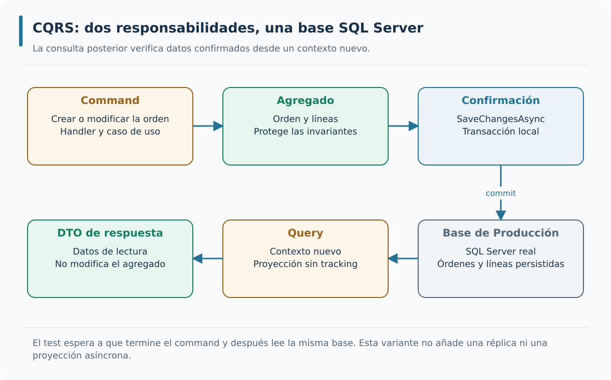

*Interpretación del gráfico:* La confirmación es la frontera entre modificar el agregado y poder observar el cambio persistido. La query recorre el camino de lectura y devuelve un DTO. En el test se utiliza un contexto nuevo para que la respuesta no proceda del objeto que acaba de escribir. La figura también se incluye en PNG.

La base de la aplicación del alumno se llama `AceriaProduccion`. En las pruebas, la factoría utiliza una base con nombre único y conserva `UseSqlServer`. El servidor puede venir de Testcontainers o de `ACERIA_TEST_SQLSERVER`, igual que en M02–M04. El nombre de la base de pruebas cambia para aislar datos; los contratos de comandos, consultas y repositorios no necesitan saberlo.

### Qué significa leer después de confirmar

Un command satisfactorio debe haber terminado la confirmación prevista por su caso de uso antes de que el test lance la query de comprobación. La query posterior consulta la misma base y puede observar los datos confirmados. Esto comprueba la secuencia escrita en el test; no equivale a garantizar que dos operaciones concurrentes vean siempre el mismo estado bajo cualquier nivel de aislamiento.

Tampoco debe confundirse `AsNoTracking` con «leer datos sin confirmar». Ese método evita que el contexto registre las entidades leídas para seguir sus cambios; no desactiva las reglas de transacción del motor. En esta aplicación, la proyección a DTO y la ausencia de guardado forman parte del contrato de lectura. Alterar un DTO recibido por el consumidor no debe modificar una orden persistida.

### Una comprobación que atraviesa el límite de persistencia

Este fragmento resume el recorrido del test con `ProduccionApiFactory`; requiere los namespaces habituales de pruebas, MediatR, aplicación e inyección de dependencias. No reemplaza el test completo del laboratorio.

```csharp
using var factory = new ProduccionApiFactory();
Guid id;
using (var escritura = factory.Services.CreateScope())
{
    var sender = escritura.ServiceProvider.GetRequiredService<ISender>();
    var resultado = await sender.Send(new CrearOrdenProduccionCommand("Axia", "Acero", 40));
    Assert.True(resultado.EsExito);
    id = resultado.Valor;
}
using var lectura = factory.Services.CreateScope();
var consultas = lectura.ServiceProvider.GetRequiredService<ISender>();
var detalle = await consultas.Send(new ObtenerOrdenProduccionQuery(id));
Assert.True(detalle.EsExito);
Assert.Equal(40, detalle.Valor.CantidadTotal);
```

- **Línea 1:** Construye un host de prueba con SQL Server aislado y los registros de aplicación e infraestructura.
- **Línea 2:** Reserva el identificador que permitirá leer la orden desde otro ámbito.
- **Líneas 3-4:** Abren el ámbito de escritura; sus dependencias scoped comparten el ciclo de vida de esa operación.
- **Línea 5:** Resuelve el mediador que localizará el manejador del command.
- **Línea 6:** Solicita crear la orden y espera a que termine el caso de uso, incluida la confirmación prevista.
- **Líneas 7-8:** Exigen éxito antes de utilizar el identificador devuelto.
- **Línea 9:** Termina el ámbito de escritura. El siguiente paso no reutiliza su contexto seguido por EF Core.
- **Líneas 10-11:** Crean otro ámbito y resuelven el mediador para el camino de lectura.
- **Línea 12:** Ejecuta la query con el identificador de la orden confirmada; su manejador usa el puerto de lectura.
- **Líneas 13-14:** Comprueban éxito y cantidad en la representación recuperada. La lectura constituye evidencia adicional al resultado del command.

En el laboratorio también se comprueba directamente la base con `factory.NuevoContexto()`. Esa observación complementaria permite revisar la raíz y sus líneas, el estado confirmado y los valores normalizados. La comprobación de queries añade que el contexto no sigue entidades y que no se invoca `SaveChanges`. Son propiedades relacionadas, pero ninguna sustituye a las demás.

### Mapeos del agregado que necesitan el proveedor real

| Elemento del modelo | Decisión de persistencia | Comprobación esperada |
|---|---|---|
| Identidad de la orden | GUID generado por el dominio | El mismo identificador se recupera tras guardar. |
| Líneas de la orden | Relación con clave foránea y colección del agregado | Se reconstruyen las líneas de esa orden. |
| Nombre de material | Conversión entre value object y valor de columna | El valor normalizado vuelve al reconstruir el objeto. |
| Cantidad | Conversión y reglas del dominio | El valor válido persiste y la regla rechaza una entrada inválida. |
| Estado | Representación configurada por EF Core | Un contexto nuevo observa la transición confirmada. |
| DTO de lectura | Proyección y ausencia de guardado | La query no muta el agregado ni añade una confirmación. |

Una prueba que construye `OrdenProduccion` en memoria verifica sus invariantes. Para afirmar que EF Core puede reconstruir ese agregado se necesita además guardar y leer a través de `ProduccionDbContext`. Aquí SQL Server importa porque las conversiones, las relaciones y la traducción de consultas se ejecutan con su proveedor. Un resultado válido con otro motor no reemplaza esa comprobación.

### Dónde termina esta garantía de consistencia

Si en otro diseño se construye una base de lectura separada mediante eventos, aparecerá un intervalo entre la confirmación del command y la actualización de esa base. Habrá que definir cómo manejar retrasos, reintentos, duplicados y errores de sincronización. Ese es un problema adicional de la variante con almacenes separados; no se debe atribuir al CQRS del curso un mecanismo que todavía no tiene.

**Comprobación de comprensión.** Sigue una orden desde `CrearOrdenProduccionCommand` hasta el DTO de su query. Identifica la validación del agregado, el momento de confirmación, el cambio de ámbito y la lectura SQL. Después explica por qué un handler que solo devuelve un GUID, sin persistir, haría fallar la segunda mitad del recorrido. Esa es la diferencia entre demostrar un resultado en memoria y demostrar el estado confirmado del sistema.

---

# Punto 5.5 — Aplicación al dominio de la acería

**Módulo 5:** Introducción a DDD y CQRS

**Objetivos de aprendizaje:**

- Comprender cómo se aplican los conceptos de DDD al dominio concreto de la acería.
- Identificar las entidades, los value objects y los agregados del dominio de la acería.
- Comprender la relación entre contextos delimitados y servicios de la acería.
- Comprender el papel de los casos de uso y CQRS en el dominio de la acería.
- Añadir al proyecto `AceriaApp` las clases de validación del modelo del dominio de la acería y un test unitario que verifique la validación. Cerrar el módulo 5 con el resumen del estado del proyecto.
- Completar el recorrido HTTP de creación, líneas y estados de Producción y comprobar éxitos y rechazos.

---

## Desarrollo teórico

### Bloque 1 — El dominio de la acería

El dominio de la acería es el área de conocimiento del negocio siderúrgico. Incluye la producción de acero, la gestión de materias primas, la gestión de clientes y la facturación. El dominio se organiza en contextos delimitados que reflejan las áreas del negocio. Cada contexto tiene su propio lenguaje ubicuo, su propio modelo y sus propias reglas. El dominio de la acería es lo suficientemente complejo para justificar la aplicación de DDD. La complejidad proviene de la variedad de materiales, la diversidad de procesos y la coordinación entre áreas.

```text
Dominio de la acería:

Producción         → órdenes de fabricación.
Aprovisionamiento  → órdenes de compra.
Clientes           → registro de clientes.
Facturación        → emisión de facturas.
```

- **Línea 1:** `Dominio de la acería:` → identifica el tema de las líneas siguientes.

- **Línea 3:** `Producción         → órdenes de fabricación.` → contexto de fabricación.

- **Línea 4:** `Aprovisionamiento  → órdenes de compra.` → contexto de compras.

- **Línea 5:** `Clientes           → registro de clientes.` → contexto de clientes.

- **Línea 6:** `Facturación        → emisión de facturas.` → contexto de facturación.

El dominio de la acería se caracteriza por tres propiedades. La primera es que tiene varios subdominios con lenguajes distintos. La segunda es que los subdominios se coordinan para producir el resultado final. La tercera es que las reglas del negocio son específicas de cada subdominio. Las tres propiedades permiten que el dominio sea un caso de estudio representativo para la aplicación de DDD.

La aplicación de DDD al dominio de la acería tiene dos consecuencias prácticas. La primera es que el modelo refleja el lenguaje del negocio siderúrgico. La segunda es que cada contexto puede mantener su modelo dentro de un módulo propio o de un servicio, según la decisión de despliegue. La combinación de ambas permite que el sistema sea mantenible y que evolucione con el negocio.

#### Ampliación didáctica aplicada a AceriaApp

**La decisión arquitectónica.** Usa el mapa de la acería para explicar límites, pero elige un recorrido vertical pequeño que se pueda ejecutar y probar de extremo a extremo.

**Ejemplo concreto en AceriaApp.** El módulo implementa órdenes de Producción con cliente, material, cantidades, líneas y estados. Aprovisionamiento, Clientes y Facturación ayudan a explicar otros significados del negocio.

**Riesgo, alternativa y límite.** El caso didáctico no controla hornos ni certifica procesos industriales. Temperatura, colada y producto terminado son ejemplos de posibles conceptos que exigirían reglas y datos adicionales.

**Comprobación técnica y aprendizaje.** Separa en el mapa lo conceptual y lo implementado. Para cada capacidad ejecutable, señala una clase, una operación de aplicación y una prueba que la ejercite.

---

### Bloque 2 — Contexto de producción

**Alcance del modelo.** Este bloque describe el mapa conceptual de la acería. La implementación del módulo se concentra en Producción; los nombres de otros contextos y las capacidades no presentes en la práctica son variantes de diseño, no servicios ya implementados.

El contexto de producción es el subdominio núcleo de la acería. Contiene las reglas de fabricación del acero. Las entidades principales son la orden de producción, la línea de producción y el producto terminado. Los value objects principales son la cantidad, el peso y la temperatura. Los invariantes principales son la cantidad mínima, la temperatura de fusión y la secuencia de operaciones. El contexto de producción aporta el valor diferencial al negocio.

```text
Contexto de producción:

Entidades       → OrdenProduccion, LineaProduccion, ProductoTerminado.
Value objects   → Cantidad, Peso, Temperatura.
Invariantes     → cantidad mínima, temperatura de fusión, secuencia.
```

- **Línea 1:** `Contexto de producción:` → identifica el tema de las líneas siguientes.

- **Línea 3:** `Entidades       → OrdenProduccion, LineaProduccion, ProductoTerminado.` → OrdenProduccion, LineaProduccion, ProductoTerminado.

- **Línea 4:** `Value objects   → Cantidad, Peso, Temperatura.` → Cantidad, Peso, Temperatura.

- **Línea 5:** `Invariantes     → cantidad mínima, temperatura de fusión, secuencia.` → cantidad mínima, temperatura de fusión, secuencia.

El contexto de producción se caracteriza por tres propiedades. La primera es que contiene las reglas específicas de la fabricación. La segunda es que coordina varios elementos del dominio. La tercera es que su modelo refleja el lenguaje del negocio siderúrgico. Las tres propiedades permiten que el contexto sea el núcleo del sistema.

#### Ampliación didáctica aplicada a AceriaApp

**La decisión arquitectónica.** Concentra las invariantes de la orden en la raíz. El estado debe limitar qué operaciones pueden modificar sus líneas y cuándo se permite finalizar.

**Ejemplo concreto en AceriaApp.** La secuencia es Borrador → Planificada → Finalizada. La primera línea se crea con la orden; las líneas adicionales deben respetar la capacidad total de 500 unidades y las transiciones permitidas.

**Riesgo, alternativa y límite.** La figura conceptual menciona instalaciones y producto terminado, pero el tipo `LineaDeOrden` es un hijo de la orden. No representa una máquina física ni demuestra medición de temperatura.

**Comprobación técnica y aprendizaje.** Comprueba el estado inicial, cada transición válida y los saltos rechazados. Verifica que una operación rechazada no altere cantidad total, líneas ni estado.

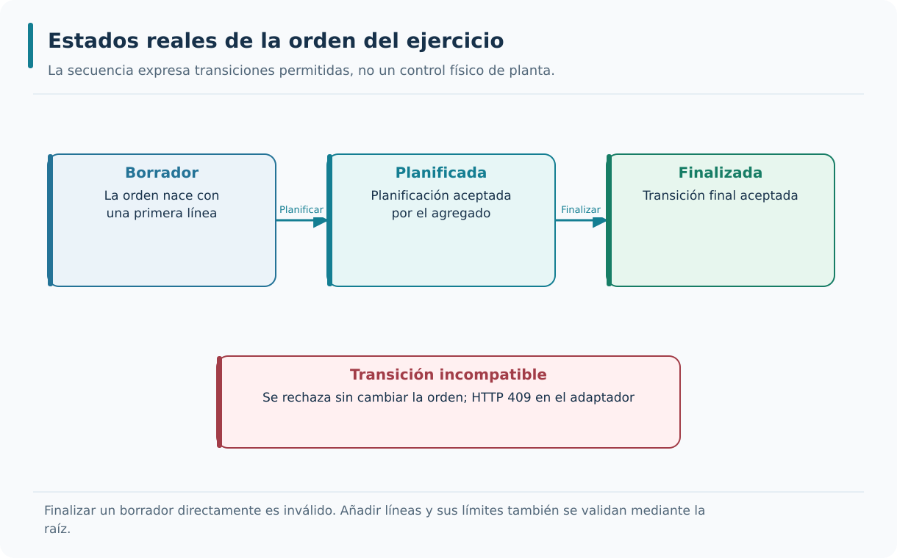

*Interpretación del gráfico:* Solo las transiciones definidas se aceptan. Las flechas describen estados del ejercicio, no fases de un proceso industrial real. La figura se distribuye en SVG vectorial y PNG.

---

### Bloque 3 — Contexto de aprovisionamiento

**Alcance del modelo.** Este bloque describe el mapa conceptual de la acería. La implementación del módulo se concentra en Producción; los nombres de otros contextos y las capacidades no presentes en la práctica son variantes de diseño, no servicios ya implementados.

El contexto de aprovisionamiento es un subdominio de soporte de la acería. Contiene las reglas de compra de materias primas. Las entidades principales son la orden de compra, el proveedor y el material. Los value objects principales son la cantidad, el precio y la fecha de entrega. Los invariantes principales son la cantidad mínima del pedido, el plazo de entrega y las condiciones de pago. El contexto de aprovisionamiento apoya al núcleo sin aportar valor diferencial.

```text
Contexto de aprovisionamiento:

Entidades       → OrdenCompra, Proveedor, Material.
Value objects   → Cantidad, Precio, FechaEntrega.
Invariantes     → cantidad mínima, plazo, condiciones de pago.
```

- **Línea 1:** `Contexto de aprovisionamiento:` → identifica el tema de las líneas siguientes.

- **Línea 3:** `Entidades       → OrdenCompra, Proveedor, Material.` → OrdenCompra, Proveedor, Material.

- **Línea 4:** `Value objects   → Cantidad, Precio, FechaEntrega.` → Cantidad, Precio, FechaEntrega.

- **Línea 5:** `Invariantes     → cantidad mínima, plazo, condiciones de pago.` → cantidad mínima, plazo, condiciones de pago.

El contexto de aprovisionamiento se caracteriza por tres propiedades. La primera es que contiene las reglas de compra. La segunda es que coordina varios elementos del dominio. La tercera es que su modelo refleja el lenguaje del negocio de compras. Las tres propiedades permiten que el contexto apoye al núcleo del sistema.

#### Ampliación didáctica aplicada a AceriaApp

**La decisión arquitectónica.** Un futuro contexto de compras debe tener reglas y propiedad de datos propias. Producción no debe modificar directamente sus órdenes de compra.

**Ejemplo concreto en AceriaApp.** Producción usa el nombre del material necesario para su orden. Si después se conectan compras o inventario, un contrato explícito podrá comunicar disponibilidad o recepción.

**Riesgo, alternativa y límite.** Compartir una tabla de materiales entre contextos puede facilitar una primera consulta y a la vez permitir cambios que rompan ambos modelos. Una reserva distribuida requiere tratar ausencia, retraso y compensación.

**Comprobación técnica y aprendizaje.** Documenta qué significa material en cada contexto y qué dato mínimo intercambiarían. Este módulo no comprueba stock ni crea proveedores porque esas capacidades siguen siendo conceptuales.

---

### Bloque 4 — Contexto de clientes

**Alcance del modelo.** Este bloque describe el mapa conceptual de la acería. La implementación del módulo se concentra en Producción; los nombres de otros contextos y las capacidades no presentes en la práctica son variantes de diseño, no servicios ya implementados.

El contexto de clientes es un subdominio de soporte de la acería. Contiene las reglas de gestión de clientes. Las entidades principales son el cliente y el contacto. Los value objects principales son la dirección, el teléfono y el correo. Los invariantes principales son la razón social obligatoria, el identificador fiscal único y la dirección completa. El contexto de clientes apoya al núcleo sin aportar valor diferencial.

```text
Contexto de clientes:

Entidades       → Cliente, Contacto.
Value objects   → Direccion, Telefono, Correo.
Invariantes     → razón social, identificador fiscal, dirección completa.
```

- **Línea 1:** `Contexto de clientes:` → identifica el tema de las líneas siguientes.

- **Línea 3:** `Entidades       → Cliente, Contacto.` → Cliente, Contacto.

- **Línea 4:** `Value objects   → Direccion, Telefono, Correo.` → Direccion, Telefono, Correo.

- **Línea 5:** `Invariantes     → razón social, identificador fiscal, dirección completa.` → razón social, identificador fiscal, dirección completa.

El contexto de clientes se caracteriza por tres propiedades. La primera es que contiene las reglas de gestión de clientes. La segunda es que coordina varios elementos del dominio. La tercera es que su modelo refleja el lenguaje del negocio comercial. Las tres propiedades permiten que el contexto apoye al núcleo del sistema.

#### Ampliación didáctica aplicada a AceriaApp

**La decisión arquitectónica.** Distingue el dato que necesita Producción del expediente comercial completo. Una referencia o copia puede ser suficiente según el requisito de trazabilidad.

**Ejemplo concreto en AceriaApp.** La orden conserva el cliente necesario para el ejemplo. El mapa conceptual de Clientes añade contactos, dirección fiscal y reglas de identificación, pero no existe un servicio comercial completo en este módulo.

**Riesgo, alternativa y límite.** Una cadena con el nombre del cliente no demuestra que el cliente esté registrado ni que un identificador fiscal sea único. Esas garantías requieren contrato, persistencia y pruebas propias.

**Comprobación técnica y aprendizaje.** Explica qué ocurriría si cambia la razón social: actualizar la orden histórica o conservar la copia original son decisiones diferentes que deben acordarse antes de implementar integración.

---

### Bloque 5 — Agregados del dominio de la acería

**Alcance del modelo.** Este bloque describe el mapa conceptual de la acería. La implementación del módulo se concentra en Producción; los nombres de otros contextos y las capacidades no presentes en la práctica son variantes de diseño, no servicios ya implementados.

Un agregado es un grupo de entidades y value objects que se tratan como una unidad. El agregado tiene una raíz que controla las modificaciones y la preservación de invariantes; los hijos pueden exponerse para lectura sin permitir mutaciones que salten la raíz. Los agregados definen fronteras de consistencia para sus invariantes; conviene mantenerlos pequeños y diseñar explícitamente la coordinación entre agregados. En el dominio de la acería, el agregado `OrdenProduccion` agrupa la orden y sus líneas. El agregado `OrdenCompra` agrupa la orden y sus líneas de compra. El agregado `Cliente` agrupa el cliente y sus contactos.

```text
Agregados del dominio:

OrdenProduccion  → raíz: OrdenProduccion. Contiene: LineaProduccion.
OrdenCompra      → raíz: OrdenCompra. Contiene: LineaCompra.
Cliente          → raíz: Cliente. Contiene: Contacto.
```

- **Línea 1:** `Agregados del dominio:` → identifica el tema de las líneas siguientes.

- **Línea 3:** `OrdenProduccion  → raíz: OrdenProduccion. Contiene: LineaProduccion.` → raíz OrdenProduccion con LineaProduccion.

- **Línea 4:** `OrdenCompra      → raíz: OrdenCompra. Contiene: LineaCompra.` → raíz OrdenCompra con LineaCompra.

- **Línea 5:** `Cliente          → raíz: Cliente. Contiene: Contacto.` → raíz Cliente con Contacto.

Los agregados del dominio de la acería se caracterizan por tres propiedades. La primera es que tienen una raíz única. La segunda es que agrupan varias entidades y value objects. La tercera es que definen los límites transaccionales. Las tres propiedades facilitan preservar invariantes; la atomicidad al persistir requiere además un adaptador transaccional correcto.

#### Ampliación didáctica aplicada a AceriaApp

**La decisión arquitectónica.** Delimita el agregado por lo que debe permanecer consistente en una operación. La relación entre objetos por sí sola no obliga a incluirlos en la misma frontera.

**Ejemplo concreto en AceriaApp.** `OrdenProduccion` controla `LineaDeOrden` y el total. Añadir una línea pasa por la raíz; el repositorio recupera la orden con la información necesaria para proteger la capacidad.

**Riesgo, alternativa y límite.** Incluir todas las órdenes de un cliente en un solo agregado aumentaría carga y contención. Las referencias entre agregados suelen expresarse con identidades y contratos de coordinación.

**Comprobación técnica y aprendizaje.** Prueba el total tras varias líneas y el rechazo al exceder 500. Verifica que la colección expuesta no permita introducir una línea que la raíz no haya validado.

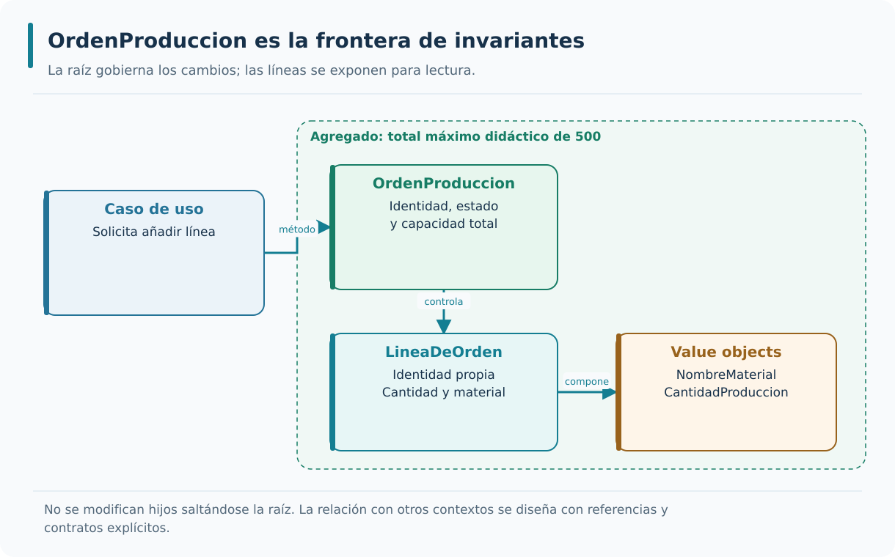

*Interpretación del gráfico:* La raíz controla líneas y capacidad total. Las operaciones externas no mutan hijos saltándose esa frontera. La figura se distribuye en SVG vectorial y PNG.

---

### Bloque 6 — Lenguaje ubicuo de la acería

El lenguaje ubicuo de la acería se construye con los términos del negocio siderúrgico. Los términos principales son orden de producción, línea de producción, colada, producto terminado, materia prima, proveedor, cliente, contacto, cantidad, peso y temperatura. El lenguaje es específico de cada contexto. El lenguaje se refleja en el código: los nombres de las clases y los métodos coinciden con los términos del negocio. El lenguaje evoluciona con el negocio.

```text
Lenguaje ubicuo de la acería:

Producción        → orden de producción, colada, producto terminado.
Aprovisionamiento → orden de compra, proveedor, materia prima.
Clientes          → cliente, contacto, dirección fiscal.
```

- **Línea 1:** `Lenguaje ubicuo de la acería:` → identifica el tema de las líneas siguientes.

- **Línea 3:** `Producción        → orden de producción, colada, producto terminado.` → términos del contexto de producción.

- **Línea 4:** `Aprovisionamiento → orden de compra, proveedor, materia prima.` → términos del contexto de aprovisionamiento.

- **Línea 5:** `Clientes          → cliente, contacto, dirección fiscal.` → términos del contexto de clientes.

El lenguaje ubicuo se caracteriza por tres propiedades. La primera es que se construye de forma colaborativa con el negocio. La segunda es que se refleja en el código. La tercera es que evoluciona con el dominio. Las tres propiedades permiten que el código sea legible para el negocio y que la comunicación sea precisa.

#### Ampliación didáctica aplicada a AceriaApp

**La decisión arquitectónica.** Mantén un glosario que indique contexto, significado y ejemplo. Una misma palabra puede ser válida con significados distintos si la frontera es explícita.

**Ejemplo concreto en AceriaApp.** Orden de producción es la raíz; línea de orden es su componente. Planificada significa que se aceptó la planificación del ejemplo, no que un horno real ya haya iniciado una colada.

**Riesgo, alternativa y límite.** Copiar vocabulario industrial sin validarlo puede dar una falsa apariencia de precisión. Colada y producto terminado permanecen en el mapa conceptual hasta que existan reglas específicas.

**Comprobación técnica y aprendizaje.** Revisa que pruebas, mensajes y respuesta HTTP usen el mismo significado de estado. Si el negocio cambia una definición, actualiza el glosario y las pruebas que expresan la regla.

---

### Bloque 7 — Casos de uso del dominio de la acería

**Alcance del modelo.** Este bloque describe el mapa conceptual de la acería. La implementación del módulo se concentra en Producción; los nombres de otros contextos y las capacidades no presentes en la práctica son variantes de diseño, no servicios ya implementados.

Los casos de uso del dominio de la acería reflejan las operaciones del negocio. Los casos de uso de producción incluyen crear orden, asignar material, iniciar colada y finalizar producto. Los casos de uso de aprovisionamiento incluyen crear orden de compra, recibir material y registrar proveedor. Los casos de uso de clientes incluyen registrar cliente, actualizar contacto y consultar historial. Cada caso de uso coordina las entidades y los value objects del contexto.

```text
Casos de uso del dominio:

Producción        → crear orden, asignar material, iniciar colada, finalizar producto.
Aprovisionamiento → crear orden de compra, recibir material, registrar proveedor.
Clientes          → registrar cliente, actualizar contacto, consultar historial.
```

- **Línea 1:** `Casos de uso del dominio:` → identifica el tema de las líneas siguientes.

- **Línea 3:** `Producción        → crear orden, asignar material, iniciar colada, finalizar producto.` → casos de uso del contexto de producción.

- **Línea 4:** `Aprovisionamiento → crear orden de compra, recibir material, registrar proveedor.` → casos de uso del contexto de aprovisionamiento.

- **Línea 5:** `Clientes          → registrar cliente, actualizar contacto, consultar historial.` → casos de uso del contexto de clientes.

Los casos de uso se caracterizan por tres propiedades. La primera es que expresan operaciones del negocio. La segunda es que coordinan los elementos del dominio. La tercera es que devuelven un resultado explícito. Las tres propiedades permiten que los casos de uso sean la unidad de operación de cada contexto.

#### Ampliación didáctica aplicada a AceriaApp

**La decisión arquitectónica.** El flujo ejecutable debe demostrar cómo colaboran las capas y qué pasa cuando una operación no está permitida.

**Ejemplo concreto en AceriaApp.** La práctica permite crear, obtener, planificar y finalizar una orden; en 5.5 añade líneas desde la API. La secuencia completa pasa por aplicación, dominio, repositorio y unidad de trabajo.

**Riesgo, alternativa y límite.** Crear orden de compra, recibir materiales o registrar clientes son capacidades posibles del mapa, no endpoints implementados aquí. No se simula su éxito mediante catálogos.

**Comprobación técnica y aprendizaje.** Ejecuta crear → añadir línea → consultar → planificar → finalizar → consultar. Incluye entradas inválidas y una transición rechazada para demostrar que el flujo protege reglas y no solo el camino feliz.

---

### Bloque 8 — Commands y queries del dominio de la acería

**Alcance del modelo.** Este bloque describe el mapa conceptual de la acería. La implementación del módulo se concentra en Producción; los nombres de otros contextos y las capacidades no presentes en la práctica son variantes de diseño, no servicios ya implementados.

Los commands del dominio de la acería reflejan las operaciones de escritura. Los commands de producción incluyen `CrearOrdenProduccionCommand`, `AsignarMaterialCommand`, `IniciarColadaCommand` y `FinalizarProductoCommand`. Las queries del dominio de la acería reflejan las operaciones de lectura. Las queries de producción incluyen `ObtenerOrdenProduccionQuery`, `ListarOrdenesProduccionQuery` y `BuscarColadasQuery`. Los commands y las queries se separan en el modelo.

```text
Commands y queries del dominio:

Commands producción        → CrearOrdenProduccionCommand, AsignarMaterialCommand.
Queries producción         → ObtenerOrdenProduccionQuery, ListarOrdenesProduccionQuery.
Commands aprovisionamiento → CrearOrdenCompraCommand, RecibirMaterialCommand.
Queries aprovisionamiento  → ObtenerOrdenCompraQuery, ListarProveedoresQuery.
```

- **Línea 1:** `Commands y queries del dominio:` → identifica el tema de las líneas siguientes.

- **Línea 3:** `Commands producción        → CrearOrdenProduccionCommand, AsignarMaterialCommand.` → commands del contexto de producción.

- **Línea 4:** `Queries producción         → ObtenerOrdenProduccionQuery, ListarOrdenesProduccionQuery.` → queries del contexto de producción.

- **Línea 5:** `Commands aprovisionamiento → CrearOrdenCompraCommand, RecibirMaterialCommand.` → commands del contexto de aprovisionamiento.

- **Línea 6:** `Queries aprovisionamiento  → ObtenerOrdenCompraQuery, ListarProveedoresQuery.` → queries del contexto de aprovisionamiento.

Los commands y las queries se caracterizan por tres propiedades. La primera es que los commands modifican el estado. La segunda es que las queries no modifican el estado. La tercera es que ambos se separan en el modelo. Las tres propiedades permiten que el sistema sea claro y eficiente.

#### Ampliación didáctica aplicada a AceriaApp

**La decisión arquitectónica.** Nombra los mensajes por contexto e intención, y separa los datos de entrada de las respuestas que necesitan los lectores.

**Ejemplo concreto en AceriaApp.** La ampliación de 5.5 incorpora el command de añadir línea y la ruta `/{id}/lineas` bajo `/api/v1/produccion/ordenes`. Las queries consultan la orden y su estado sin confirmar cambios.

**Riesgo, alternativa y límite.** `IniciarColadaCommand`, `FinalizarProductoCommand` y `BuscarColadasQuery` siguen siendo ejemplos conceptuales. Su aparición en un listado no implica handlers, rutas o sensores existentes.

**Comprobación técnica y aprendizaje.** Comprueba el registro MediatR y el handler correspondiente para cada mensaje real. Verifica que la identidad de ruta selecciona la orden y que el cuerpo solo aporta los datos de la operación.

---

### Bloque 9 — Integración de DDD y CQRS en el dominio de la acería

**Alcance del modelo.** Este bloque describe el mapa conceptual de la acería. La implementación del módulo se concentra en Producción; los nombres de otros contextos y las capacidades no presentes en la práctica son variantes de diseño, no servicios ya implementados.

La integración de DDD y CQRS en el dominio de la acería produce un sistema con contextos delimitados y separación entre escritura y lectura. Cada contexto tiene su propio modelo de dominio y su propio modelo de lectura. Los casos de uso coordinan las entidades y los value objects. Los commands y las queries se separan en manejadores. La integración permite que el sistema sea mantenible y que evolucione con el negocio.

```text
Integración de DDD y CQRS:

Contexto de producción:
- Modelo de escritura: OrdenProduccion, LineaProduccion.
- Modelo de lectura: OrdenProduccionDto, OrdenProduccionResumenDto.
- Commands: CrearOrdenProduccionCommand, AsignarMaterialCommand.
- Queries: ObtenerOrdenProduccionQuery, ListarOrdenesProduccionQuery.
```

- **Línea 1:** `Integración de DDD y CQRS:` → identifica el tema de las líneas siguientes.

- **Línea 3:** `Contexto de producción:` → título del contexto.

- **Línea 4:** `- Modelo de escritura: OrdenProduccion, LineaProduccion.` → modelo de escritura.

- **Línea 5:** `- Modelo de lectura: OrdenProduccionDto, OrdenProduccionResumenDto.` → modelo de lectura.

- **Línea 6:** `- Commands: CrearOrdenProduccionCommand, AsignarMaterialCommand.` → commands.

- **Línea 7:** `- Queries: ObtenerOrdenProduccionQuery, ListarOrdenesProduccionQuery.` → queries.

La integración tiene dos consecuencias prácticas. La primera es que cada contexto tiene su propio modelo. La segunda es que la escritura y la lectura se separan. La combinación de ambas permite que el sistema sea mantenible y eficiente.

#### Ampliación didáctica aplicada a AceriaApp

**La decisión arquitectónica.** Integra DDD, arquitectura hexagonal y CQRS sin confundir sus responsabilidades: modelo, dirección de dependencias y separación de lectura y escritura.

**Ejemplo concreto en AceriaApp.** La API envía una intención; aplicación coordina; el agregado protege invariantes; infraestructura persiste; la lectura devuelve un DTO. El mismo recorrido convive con los módulos hexagonales y patrones anteriores.

**Riesgo, alternativa y límite.** Un DTO de resumen distinto no demuestra una segunda base de datos. Una carpeta Producción tampoco demuestra aislamiento si se referencian entidades de otros contextos.

**Comprobación técnica y aprendizaje.** Sigue un command y una query desde HTTP hasta su efecto persistido. Revisa que las referencias apunten hacia contratos internos y que el dominio compile sin infraestructura.

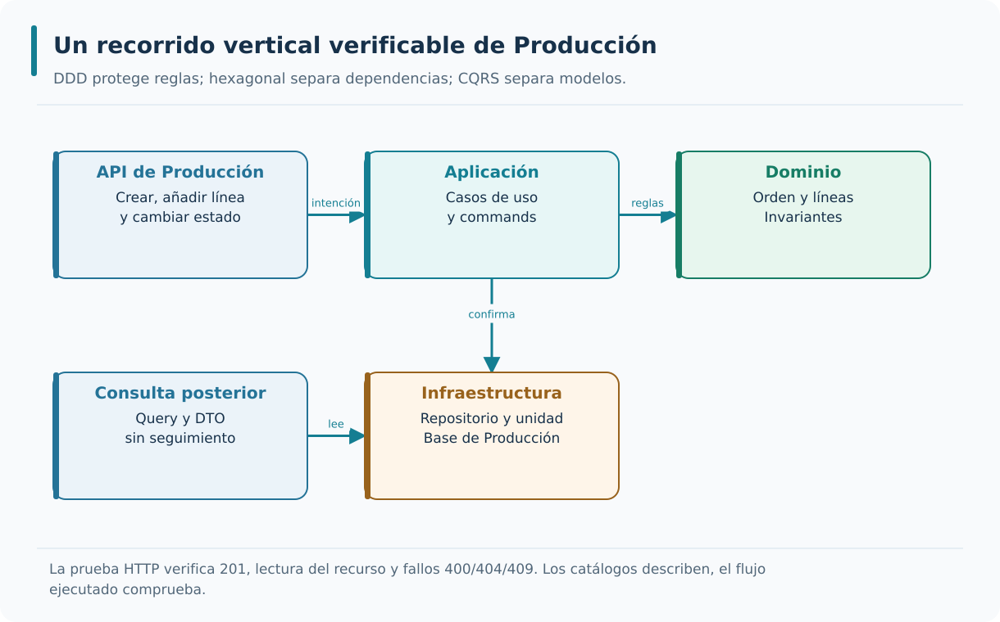

*Interpretación del gráfico:* La escritura preserva invariantes y confirma; una lectura posterior verifica el resultado mediante el modelo de lectura. La figura se distribuye en SVG vectorial y PNG.

---

### Bloque 10 — Cierre del módulo 5

El módulo 5 ha introducido Domain-Driven Design y CQRS. El módulo ha cubierto los conceptos básicos de DDD, las entidades y los value objects, los casos de uso, la separación entre commands y queries y la aplicación al dominio de la acería. El módulo combina catálogos de validación arquitectónica con un contexto de Producción ejecutable: agregado, value objects, casos de uso, persistencia y lectura CQRS. Un catálogo describe decisiones, pero no prueba por sí mismo que existan las clases ni que funcione una transacción. El módulo cierra con el resumen del estado del proyecto y prepara el terreno para el módulo 6, donde se estudiará la comunicación entre microservicios.

```text
Cierre del módulo 5:

Conceptos DDD          → contextos, lenguaje ubicuo, subdominios.
Entidades y VOs        → identidad, inmutabilidad, invariantes.
Casos de uso           → puertos de entrada, Result, unidad de trabajo.
Commands y queries     → separación de modelos, CQRS.
Aplicación al dominio  → contextos de producción, aprovisionamiento y clientes.
```

- **Línea 1:** `Cierre del módulo 5:` → identifica el tema de las líneas siguientes.

- **Línea 3:** `Conceptos DDD          → contextos, lenguaje ubicuo, subdominios.` → contextos, lenguaje ubicuo, subdominios.

- **Línea 4:** `Entidades y VOs        → identidad, inmutabilidad, invariantes.` → identidad, inmutabilidad, invariantes.

- **Línea 5:** `Casos de uso           → puertos de entrada, Result, unidad de trabajo.` → puertos de entrada, Result, unidad de trabajo.

- **Línea 6:** `Commands y queries     → separación de modelos, CQRS.` → separación de modelos, CQRS.

- **Línea 7:** `Aplicación al dominio  → contextos de producción, aprovisionamiento y clientes.` → contextos de producción, aprovisionamiento y clientes.

El cierre del módulo 5 tiene dos consecuencias prácticas. La primera es que el proyecto tiene una base sólida de DDD y CQRS. La segunda es que el proyecto está preparado para la comunicación entre servicios. La combinación de ambas permite que el sistema evolucione hacia la arquitectura de microservicios.

#### Ampliación didáctica aplicada a AceriaApp

**La decisión arquitectónica.** Cierra el módulo con evidencia reproducible del estado real. Diferencia pruebas de catálogos, pruebas de dominio, aplicación, persistencia y recorrido HTTP.

**Ejemplo concreto en AceriaApp.** El resultado es un contexto de Producción funcional en una API compartida: identidad y valores protegidos, agregado con líneas, casos de uso, CQRS y endpoints de órdenes.

**Riesgo, alternativa y límite.** No se ha implementado comunicación entre servicios, Event Sourcing, outbox ni control industrial de planta. Son decisiones posteriores que deberán tener contratos y pruebas propios.

**Comprobación técnica y aprendizaje.** Usa el inventario, las prácticas y el informe de ejecución del módulo para comprobar proyectos y pruebas actuales. La transición a M6 parte de estas garantías locales, sin atribuirles atomicidad distribuida.

---

### Resumen rápido de la teoría

- El dominio de la acería se organiza en contextos delimitados que reflejan las áreas del negocio.
- El contexto de producción es el subdominio núcleo de la acería.
- Los contextos de aprovisionamiento y clientes son subdominios de soporte.
- Los agregados definen fronteras de consistencia para sus invariantes; conviene mantenerlos pequeños y diseñar explícitamente la coordinación entre agregados.
- El lenguaje ubicuo se construye con los términos del negocio siderúrgico.
- Los casos de uso reflejan las operaciones del negocio.
- Los commands y las queries reflejan la separación entre escritura y lectura.
- La integración de DDD y CQRS produce un sistema mantenible y eficiente.
- El módulo 5 cierra con el resumen del estado del proyecto.

---

## Documentación oficial para profundizar

- [Modelo de dominio y agregados en .NET](https://learn.microsoft.com/dotnet/architecture/microservices/microservice-ddd-cqrs-patterns/microservice-domain-model): identidad, comportamiento y fronteras del agregado.
- [CQRS con modelos separados y almacén compartido](https://learn.microsoft.com/azure/architecture/patterns/cqrs): variantes y decisiones de persistencia.
- [Aplicación simplificada de CQRS y DDD](https://learn.microsoft.com/dotnet/architecture/microservices/microservice-ddd-cqrs-patterns/apply-simplified-microservice-cqrs-ddd-patterns): separación lógica sin exigir dos bases ni Event Sourcing.
- [Transacciones en EF Core](https://learn.microsoft.com/ef/core/saving/transactions): alcance de `SaveChanges`, transacciones explícitas y comportamiento del proveedor.
- [Novedades de EF Core 8](https://learn.microsoft.com/ef/core/what-is-new/ef-core-8.0/whatsnew): tipos complejos y límites específicos de EF8. La documentación de versiones posteriores puede describir capacidades que no existen en el stack del curso.
