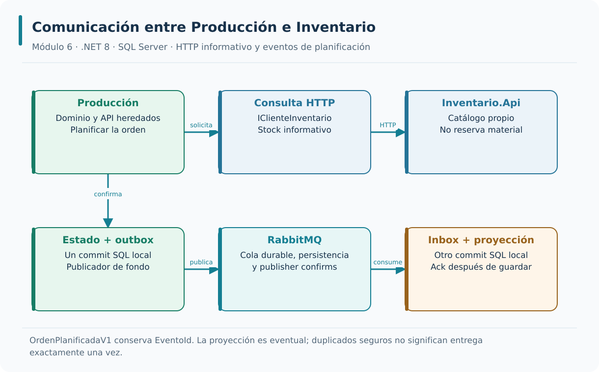
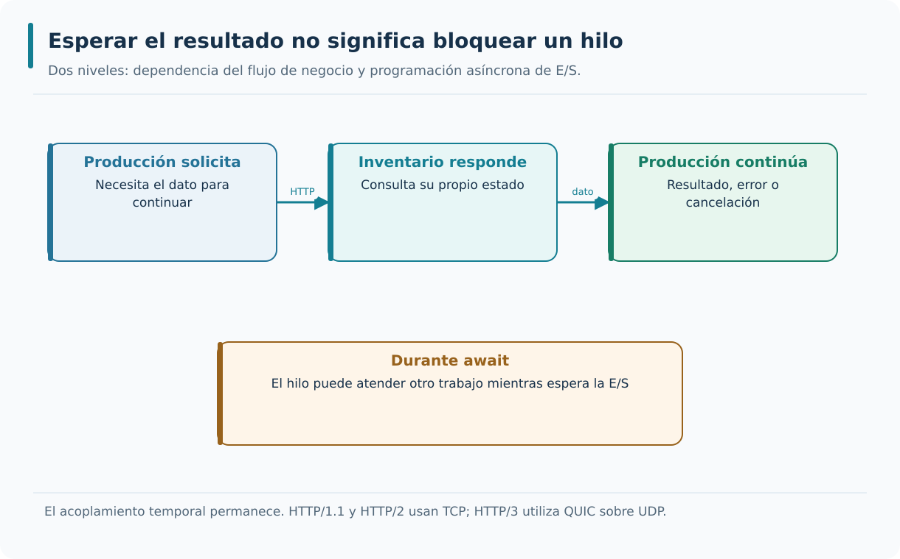
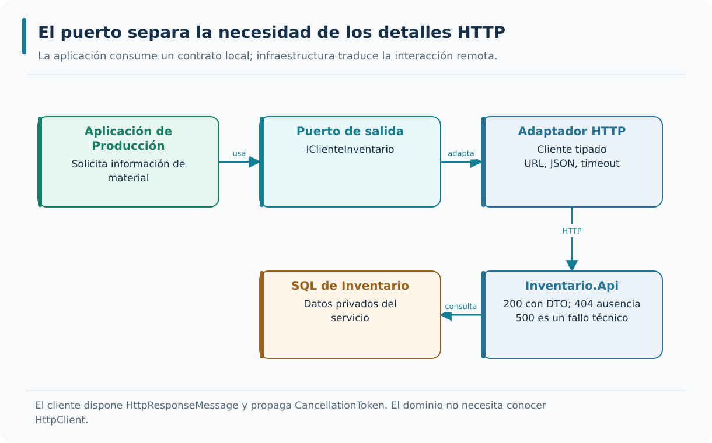
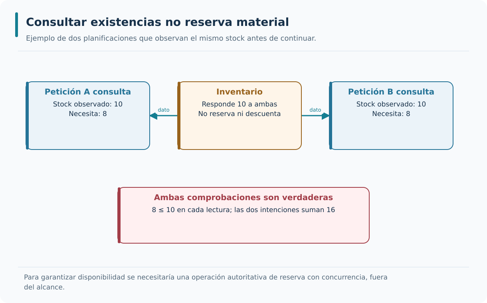
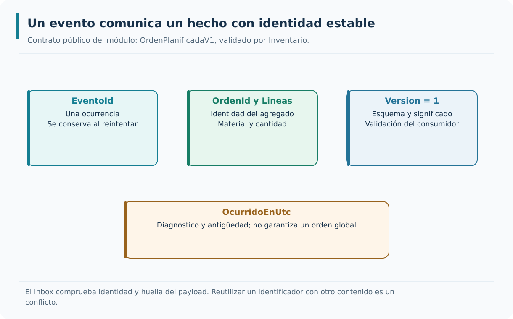
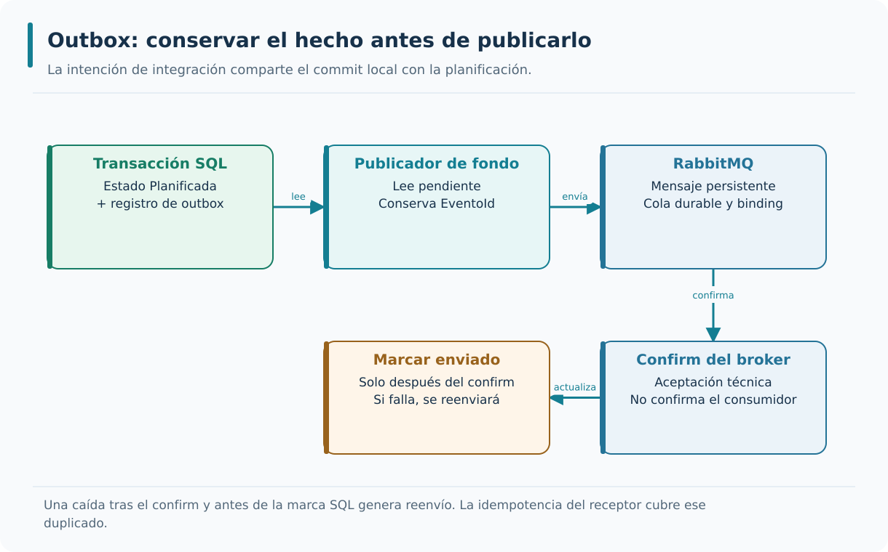
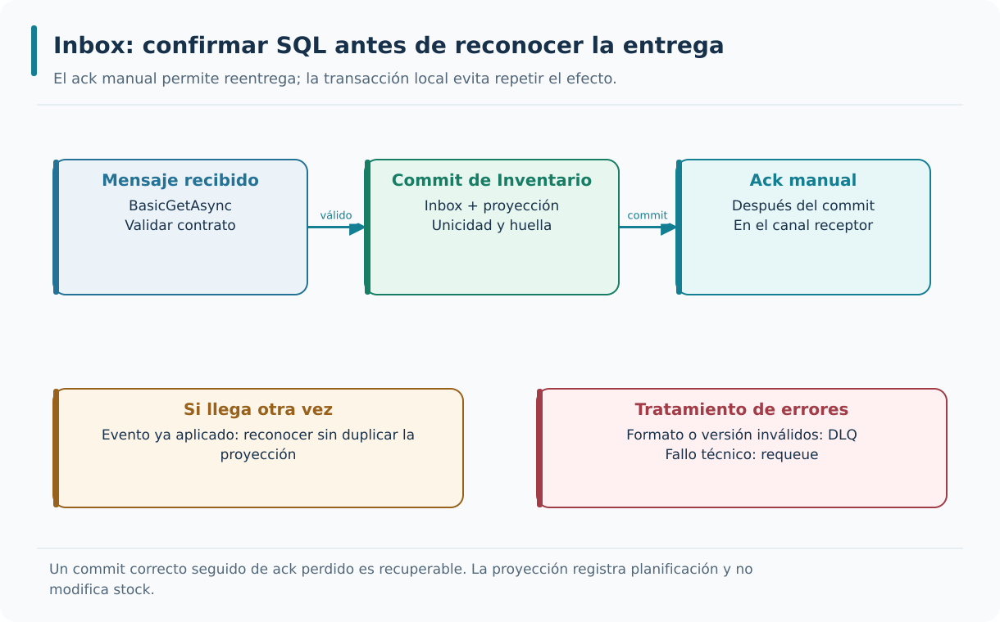
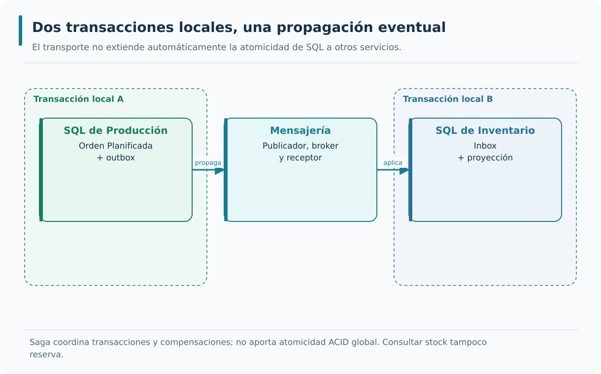
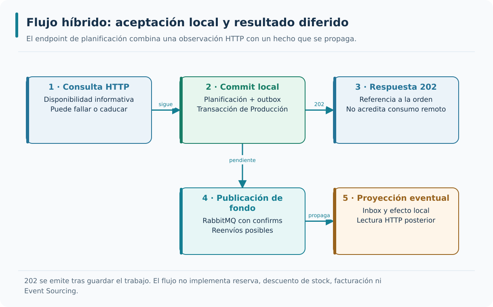
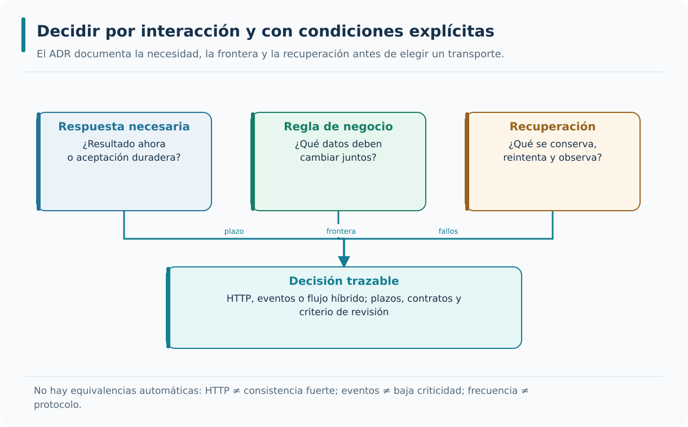

# M06 — Comunicación entre microservicios con ASP.NET Core 8 · Teoría

**Autor del curso: JAIME GALLO**

## Cómo estudiar el módulo

La teoría del módulo 6 enlaza el modelo de Producción construido hasta M05 con una nueva frontera real, `Inventario.Api`. El objetivo es comprender qué sucede cuando dos procesos colaboran y dejan de compartir memoria y transacciones. Se estudian por separado la consulta HTTP y la propagación de hechos mediante RabbitMQ, antes de combinarlas para justificar las decisiones de diseño.

Los fragmentos muestran ideas concretas y los diagramas ayudan a relacionarlas con los servicios; las prácticas contienen los archivos completos, la configuración de los entornos y las comprobaciones ejecutables. La lectura de existencias sigue siendo informativa: ni la consulta ni el evento reservan o descuentan stock. Los diagramas se conservan en SVG y PNG.

**Punto de partida.** Se continúa desde `M05_DDD_CQRS/PROYECTO/5.5-dominio-aceria`. La API heredada mantiene el contexto de Producción, sus entidades, value objects, casos de uso, commands, queries y persistencia SQL Server. El módulo añade `Inventario.Api` como proceso independiente. La frontera de red obliga a diseñar errores, cancelación y contratos; no autoriza a compartir tablas ni entidades entre contextos.

**Recorrido funcional.** El punto 6.1 consulta disponibilidad informativa mediante el puerto `IClienteInventario` y un cliente HTTP tipado. El punto 6.2 comunica `OrdenPlanificadaV1` con outbox SQL unido al cambio de estado de Producción, RabbitMQ y un consumidor con inbox SQL que registra una proyección de planificación en Inventario. El punto 6.3 combina consulta HTTP, planificación local y outbox, respuesta `202 Accepted` y propagación en segundo plano. La lectura de la proyección es eventual. Ninguno de esos pasos reserva ni descuenta stock.

**Convenciones de ejemplos.** Los fragmentos se estudian de forma independiente y muestran las partes relevantes; las prácticas contienen archivos completos, nombres y rutas de ejecución. Los ejemplos C# presuponen los namespaces correspondientes de `System.Net`, `System.Net.Http.Json`, `System.Text.Json`, ASP.NET Core y, donde se indique, `RabbitMQ.Client`. DTOs y interfaces auxiliares de los ejemplos son contratos didácticos; no se copian todos juntos. El stack del recorrido es .NET 8, EF Core 8 y SQL Server real, con RabbitMQ.Client 7.1.2 para los ejemplos de mensajería. El tiempo de estudio y laboratorio depende de las instalaciones, diagnóstico y pruebas: las prácticas ampliadas no se prometen en veintisiete minutos.

**Operación de los trabajadores.** La publicación y el consumo se habilitan por configuración. El consumidor usa `BasicGetAsync` con sondeo y ack manual para que el laboratorio sea fácil de observar; no se presenta como diseño de alto rendimiento. Los errores de formato o versión se dirigen a DLQ y los fallos técnicos se reencolan. La proyección usa unicidad por EventoId y OrdenId y una huella del payload para detectar reutilización incompatible de identidad.

**Alcance y evidencia.** Reserva, liberación, facturación, Saga, coordinación distribuida y Event Sourcing sirven para analizar alternativas cuando se nombran como ejemplos conceptuales. No se presentan como capacidades implementadas. Una lista de conceptos o un test de coherencia no sustituye a pruebas de comportamiento, persistencia, mensajería y recorrido HTTP. Los mecanismos de confiabilidad tienen supuestos y límites: no se promete entrega ni efecto global «exactamente una vez».



El mapa muestra cómo Producción confirma estado y outbox en una transacción local. La consulta HTTP es informativa. Publicador, broker y consumidor propagan el hecho a otra transacción local, con posible retraso y reentrega.

---

# Punto 6.1 — Comunicación síncrona mediante HTTP

**Módulo 6:** Comunicación entre microservicios
**Objetivos de aprendizaje:**

- Comprender qué es la comunicación síncrona entre microservicios.
- Identificar el papel de HTTP y de los clientes tipados en la comunicación síncrona.
- Comprender la relación entre comunicación síncrona y acoplamiento temporal.
- Comprender los riesgos de la comunicación síncrona en sistemas distribuidos.
- Aplicar los conceptos al recorrido real de Producción e Inventario y verificar su comportamiento.

---

## Comprender la dependencia temporal de una llamada HTTP

La consulta de inventario nos permite estudiar qué significa necesitar una respuesta remota, cómo se representa ese contrato en .NET y qué riesgos aparecen al esperar a otro proceso. Analizaremos primero la interacción HTTP, después la separación mediante un cliente tipado y finalmente la evidencia que debe obtenerse antes de considerar fiable la integración.

### Definición de comunicación síncrona

Cuando un caso de uso necesita consultar otro servicio antes de decidir, aparece una dependencia temporal: la petición de Producción no puede concluir correctamente sin conocer el resultado de Inventario. Esta interacción es síncrona desde el punto de vista del negocio, aunque el código emplee `async` y `await` para no ocupar un hilo durante la espera de E/S. Conviene separar esos dos significados de «síncrono». El cliente envía una solicitud, recibe una respuesta o un fallo y debe interpretar ambos. HTTP/1.1 y HTTP/2 se transportan sobre TCP; HTTP/3 utiliza QUIC sobre UDP. Ninguna versión elimina la necesidad de acotar el tiempo de espera ni de saber qué hacer si el destino no responde.

```text
Comunicación síncrona:

Servicio A → petición HTTP → Servicio B.
Servicio A ← respuesta HTTP ← Servicio B.
```

El esquema representa los dos sentidos del intercambio: la petición sale del servicio A hacia el B y la respuesta regresa al solicitante antes de que pueda proseguir la operación dependiente.

En este recorrido, el emisor espera la respuesta; también el receptor debe estar disponible en el momento de la petición, y finalmente la comunicación tiene un tiempo de espera máximo. La interacción resulta sencilla de comprender, pero también introduce una dependencia temporal que deberá controlarse.

En la práctica, el flujo de datos es directo y fácil de seguir y el fallo del servicio destino afecta al servicio origen. De ese modo, la comunicación resulta simple pero también frágil ante fallos.

Distingue dos niveles de asincronía. En el nivel del programa, un método devuelve Task y libera el hilo mientras espera E/S. En el nivel del negocio, Producción sigue necesitando el resultado de Inventario para decidir su siguiente paso. Usar async no rompe esa dependencia temporal.

Cuando un planificador solicita información de CHAPA-3MM, el cliente HTTP espera los datos. Mientras llega la respuesta, ASP.NET Core puede atender otras solicitudes. La continuación del caso de uso se ejecuta después del await; no significa que toda la API se detenga.

No sustituyas await por .Result o .Wait() para hacer la lectura más «síncrona». Esas llamadas bloquean un hilo y pueden perjudicar la capacidad del servidor. Tampoco lances una Task sin observarla: perderías errores y la relación entre la solicitud y su resultado.

Introduce un retraso controlado en Inventario y observa dos hechos distintos: aumenta la latencia de la operación dependiente y otras rutas independientes pueden seguir respondiendo. Después cancela la solicitud y comprueba que el token llega al cliente. El experimento explica dependencia temporal sin confundirla con bloqueo de hilos.



La interacción espera el resultado remoto, mientras await permite liberar el hilo durante la E/S.

---

### HTTP como protocolo de comunicación síncrona

HTTP nos proporciona un contrato de intercambio comprensible para servicios desarrollados de manera independiente: método y URI identifican la operación solicitada; las cabeceras expresan condiciones y metadatos; el cuerpo transporta, cuando corresponde, una representación del recurso. La respuesta combina un estado HTTP con cabeceras y contenido opcional. En una consulta de Inventario importa distinguir un `200` válido, un `404` que representa ausencia y un fallo técnico que impide conocer el dato. HTTP/2 y HTTP/3 aportan mecanismos de multiplexación y compresión de cabeceras, pero su rendimiento sigue dependiendo de la red, de la ejecución remota y del contrato de aplicación.

```csharp
using var response = await httpClient.GetAsync("api/v1/materiales/CHAPA-3MM", ct);
response.EnsureSuccessStatusCode();
var material = await response.Content.ReadFromJsonAsync<MaterialDto>(cancellationToken: ct);
if (material is null) throw new InvalidDataException("Respuesta JSON vacía.");
```

`using var response = await httpClient.GetAsync("api/v1/materiales/CHAPA-3MM", ct);` envía GET con cancelación y dispone la respuesta al salir del ámbito; el cliente ya está inyectado; `response.EnsureSuccessStatusCode();` rechaza estados distintos de 2xx; el siguiente bloque distingue específicamente 404; `var material = await response.Content.ReadFromJsonAsync<MaterialDto>(cancellationToken: ct);` deserializa el contrato y propaga el token también durante la lectura; `if (material is null) throw new InvalidDataException("Respuesta JSON vacía.");` rechaza un cuerpo que no contiene el DTO esperado, en vez de inventar un resultado válido.

Es un protocolo de petición-respuesta, está soportado por todas las plataformas y se integra con herramientas de monitorización. En conjunto, estas condiciones hacen que la comunicación síncrona sea universal y observable.

El contrato HTTP incluye ruta, método, códigos de estado, tipo de contenido y cuerpo. Una conexión exitosa solo indica que hubo intercambio de bytes; una respuesta 200 con un cuerpo incompatible sigue incumpliendo el contrato que necesita el consumidor.

Para una consulta de material, 200 con DTO representa un material conocido, 404 representa que ese recurso no existe y 500 o 503 representan un fallo técnico. Esos resultados no deben reducirse todos a false: de lo contrario una caída de Inventario se presentaría como falta real de stock.

HTTP/3 usa QUIC y no TCP. La diferencia de transporte no modifica la necesidad de validar el resultado ni convierte una lectura de stock en una reserva. TLS, autenticación y permisos también deben diseñarse según el entorno; una URL local del laboratorio no es una política de despliegue.

Comprueba por separado respuestas 200, 404, 500 y JSON inválido. Asegura que HttpResponseMessage se dispone aun cuando la deserialización lance una excepción. El cliente puede reutilizar conexiones administradas por la factoría sin conservar indefinidamente los objetos de respuesta.

---

### Clientes HTTP tipados

En lugar de repartir llamadas HTTP por controladores y casos de uso, definiremos un puerto de aplicación para consultar Inventario y lo implementaremos con un cliente tipado. `IClienteInventario` expresa lo que Producción necesita conocer; `ClienteInventarioHttp` se encarga de construir la URI, enviar la petición y traducir la respuesta. El registro con `AddHttpClient` utiliza `IHttpClientFactory`, que administra los manejadores subyacentes y facilita establecer una configuración común. Este diseño permite probar el caso de uso sin levantar un servidor remoto y evita que el dominio dependa de `HttpClient` o de las entidades persistidas por Inventario.

```csharp
public interface IClienteInventario
{
    Task<MaterialDto?> ObtenerMaterialAsync(string nombre, CancellationToken ct);
    Task<bool> MaterialDisponibleAsync(string nombre, int cantidad, CancellationToken ct);
}

public sealed class ClienteInventarioHttp(HttpClient httpClient) : IClienteInventario
{
    public async Task<MaterialDto?> ObtenerMaterialAsync(string nombre, CancellationToken ct)
    {
        var ruta = $"api/v1/materiales/{Uri.EscapeDataString(nombre)}";
        using var response = await httpClient.GetAsync(ruta, ct);
        if (response.StatusCode == HttpStatusCode.NotFound) return null;
        response.EnsureSuccessStatusCode();
        return await response.Content.ReadFromJsonAsync<MaterialDto>(cancellationToken: ct)
            ?? throw new InvalidDataException("El inventario devolvió un cuerpo vacío.");
    }

    public async Task<bool> MaterialDisponibleAsync(string nombre, int cantidad, CancellationToken ct)
    {
        if (cantidad <= 0) throw new ArgumentOutOfRangeException(nameof(cantidad));
        var material = await ObtenerMaterialAsync(nombre, ct);
        return material is not null && material.Stock >= cantidad;
    }
}
```

`public interface IClienteInventario` define el puerto que usa la aplicación; el dominio no conoce HttpClient; `Task<MaterialDto?> ObtenerMaterialAsync(string nombre, CancellationToken ct);` distingue material inexistente con null y admite cancelación; `Task<bool> MaterialDisponibleAsync(string nombre, int cantidad, CancellationToken ct);` expresa una consulta informativa de disponibilidad; `public sealed class ClienteInventarioHttp(HttpClient httpClient) : IClienteInventario` implementa el puerto mediante un cliente tipado inyectado; usa constructor primario de C# 12.

`using var response = await httpClient.GetAsync(ruta, ct);` envía la solicitud con cancelación y garantiza la disposición de la respuesta; `response.EnsureSuccessStatusCode();` propaga como error técnico un 500, 503 u otro estado no satisfactorio; `return await response.Content.ReadFromJsonAsync<MaterialDto>(cancellationToken: ct)` deserializa JSON con el token de cancelación; `return material is not null && material.Stock >= cantidad;` compara el dato recibido; no reserva stock ni protege frente a otras operaciones.

Encapsula las llamadas al servicio destino; expone métodos específicos del servicio; y centraliza la configuración. En conjunto, estas condiciones hacen que la comunicación síncrona sea mantenible y testeable.

El puerto IClienteInventario expresa lo que necesita Producción, mientras el adaptador sabe de URL, códigos HTTP y JSON. Esta separación permite probar el caso de uso con un doble del puerto y probar el mapeo del adaptador con respuestas HTTP controladas.

ObtenerMaterialAsync puede devolver null para un 404 definido por contrato. MaterialDisponibleAsync compara la cantidad con el stock de ese instante. El nombre y la documentación deben hacer visible que se trata de una observación; no existe una sección crítica distribuida entre leer y planificar.

No exportes una entidad EF de Inventario para evitar escribir un DTO. Eso acoplaría el contrato a tablas, navegaciones y decisiones internas. El consumidor puede traducir el DTO remoto a una representación local, y los errores técnicos deben seguir siendo distinguibles de un resultado de negocio negativo.

Prueba un nombre que contiene espacios o caracteres reservados, una cantidad no positiva, una cancelación y un error 500. Comprueba que el escape de la ruta evita cambiar su estructura. Estas pruebas revisan comportamiento y contrato, no solo que exista una interfaz con el nombre esperado.



La aplicación depende de un puerto; el adaptador traduce HTTP y la base de Inventario sigue siendo privada.

---

### Configuración del cliente HTTP tipado

Un cliente tipado no queda bien diseñado únicamente por recibir `HttpClient` mediante inyección de dependencias. Necesita una URL base conocida, tiempos de espera coherentes, cabeceras apropiadas y una política clara de tratamiento de respuestas. `AddHttpClient` concentra esas opciones en el punto de composición de la aplicación, en vez de repetirlas cada vez que se consulta un material. La duración de los clientes también importa: capturar un cliente tipado transitorio en un servicio singleton puede impedir que se aproveche correctamente la renovación de sus manejadores. La configuración de desarrollo debe poder sustituirse sin modificar el caso de uso.

```csharp
builder.Services.AddHttpClient<IClienteInventario, ClienteInventarioHttp>(client =>
{
    client.BaseAddress = new Uri(builder.Configuration["Inventario:BaseUrl"]!);
    client.Timeout = TimeSpan.FromSeconds(5);
    client.DefaultRequestHeaders.Accept.ParseAdd("application/json");
});
```

`builder.Services.AddHttpClient<IClienteInventario, ClienteInventarioHttp>(client =>` registra el adaptador tipado para el puerto de aplicación; `{` abre la configuración central del cliente; `client.BaseAddress = new Uri(builder.Configuration["Inventario:BaseUrl"]!);` lee la URL del entorno; la configuración debe validarse al arrancar; `client.Timeout = TimeSpan.FromSeconds(5);` limita la espera de una llamada a cinco segundos en este ejemplo.

`client.DefaultRequestHeaders.Accept.ParseAdd("application/json");` solicita una representación JSON mediante Accept; `});` cierra el registro de dependencias.

La configuración se centraliza en un único punto. También la factoría administra los manejadores subyacentes y sus conexiones. De ese modo, la comunicación síncrona resulta robusta y mantenible.

Centralizar configuración permite cambiar el destino por entorno sin recompilar el dominio. La configuración debe validar que la URL existe, es absoluta y usa un esquema admitido. Un operador debería descubrir un error de configuración al arrancar, no tras la primera petición de un usuario.

El laboratorio ejecuta Producción e Inventario como procesos distintos. Sus direcciones base deben corresponder a los puertos elegidos en las prácticas. El cliente añade rutas relativas; una barra inicial puede sustituir el prefijo de una URL base con subruta y cambiar el recurso solicitado.

La factoría administra manejadores y conexiones, no una garantía de disponibilidad. El timeout de cinco segundos es una decisión de ejemplo que debe coordinarse con el presupuesto del endpoint y con la política de reintentos. Tres intentos de cinco segundos no caben en una solicitud que promete terminar en seis.

Arranca con una URL incorrecta y revisa el mensaje de diagnóstico; luego usa la dirección válida y comprueba la consulta real. Revisa la vida del consumidor del cliente tipado: un singleton que lo captura puede impedir la renovación esperada de sus dependencias.

---

### Acoplamiento temporal

El acoplamiento temporal surge cuando el avance de una operación depende de que otra aplicación esté respondiendo en ese momento. En AceriaApp puede ser razonable esperar una consulta informativa de existencias antes de mostrar datos al planificador. No sería razonable exigir esa misma respuesta remota para cada actividad que pueda registrarse localmente y propagarse después. Esta distinción se decide por operación, no por el nombre del servicio. Además, un resultado que tarda demasiado puede ser tan inútil como un servicio caído: por ello hay que establecer presupuestos de latencia y representar explícitamente la indisponibilidad.

```text
Acoplamiento temporal:

Servicio A espera → Servicio B responde → Servicio A continúa.
Servicio A espera → Servicio B no responde → Servicio A falla.
```

El esquema contrasta una respuesta recibida con la imposibilidad de completar la operación cuando el destino no contesta; no implica que las demás funciones del servicio de origen dejen de atender peticiones.

En la práctica, la disponibilidad del servicio destino afecta al servicio origen y la latencia del servicio destino afecta a la latencia del servicio origen. De ese modo, la comunicación síncrona resulta directa pero también frágil.

Una cadena síncrona suma dependencias de tiempo y disponibilidad. Si A necesita B y B necesita C, el usuario de A observa retrasos y fallos de toda la cadena. El diseño debe justificar cada dependencia antes de añadir políticas que solo intentan amortiguarla.

Producción consulta Inventario para informar una planificación. Si Inventario tarda, el usuario espera antes de conocer si esa comprobación pudo realizarse. Una consulta independiente de órdenes ya guardadas puede mantenerse disponible aunque esa integración falle; el fallo pertenece a una operación concreta.

Un valor de caché puede servir para una pantalla informativa si se muestra su antigüedad y el negocio admite desactualización. No sería correcto convertir esa caché en prueba de una reserva. Un fallback es una variante del contrato, no un truco para hacer desaparecer fallos del panel.

Mide duración del endpoint y duración de la llamada saliente con la misma correlación. Detén Inventario y verifica que la operación dependiente termina dentro de su límite y expresa indisponibilidad. Comprueba además una ruta sin esa dependencia para detectar un acoplamiento accidental de toda la API.

---

### Riesgos de la comunicación síncrona

Una cadena de peticiones entre procesos convierte pequeñas demoras y fallos locales en un riesgo para todo el recorrido. Si Inventario responde lentamente, Producción espera más; si devuelve errores o deja de responder, la operación dependiente puede terminar con un fallo. Bajo carga, las solicitudes pendientes también consumen conexiones y otros recursos, lo que favorece la saturación. No significa que toda la API de Producción deba detenerse: sus rutas independientes pueden seguir funcionando. El diseño debe identificar esa frontera para evitar reintentos indiscriminados, fallos en cascada y diagnósticos en los que una caída de red acaba presentada como una falta real de stock.

```text
Riesgos de la comunicación síncrona:

Fallo en cascada.
Latencia acumulada.
Saturación.
Disponibilidad.
```

`Fallo en cascada.` primer riesgo; `Latencia acumulada.` segundo riesgo; `Saturación.` tercer riesgo; `Disponibilidad.` cuarto riesgo.

La comunicación síncrona requiere políticas de resiliencia; por su parte, la comunicación síncrona requiere monitorización. De ese modo, los riesgos se mitigan con timeouts, reintentos y circuit breakers.

Un fallo en cascada aparece cuando cada servicio conserva demasiadas solicitudes mientras espera a otro. Aunque await no bloquee un hilo durante E/S, las tareas pendientes consumen memoria, conexiones, tiempo y capacidad de concurrencia. La programación asíncrona no sustituye el control de carga.

Imagina cien consultas simultáneas desde Producción hacia un Inventario lento. Si cada fallo provoca tres reintentos inmediatos, el destino puede recibir cientos de solicitudes adicionales justo cuando necesita recuperarse. El número de intentos debe analizarse junto con la concurrencia.

Los límites de concurrencia y colas de espera acotadas protegen recursos. Un circuit breaker rechaza temporalmente llamadas a una dependencia que falla; no arregla el servicio remoto ni prueba ausencia de stock. La métrica útil incluye rechazos, duración y recuperación, no solo excepciones.

Prueba un fallo controlado con carga moderada y observa cuántas llamadas salen realmente. Cuenta intentos por operación, mide p95 de latencia y comprueba que la cancelación detiene reintentos pendientes. Estos datos permiten distinguir una política protectora de una amplificación del incidente.

---

### Mitigación de los riesgos

El primer remedio ante una dependencia remota no consiste en multiplicar reintentos. Hay que decidir cuánto tiempo puede esperar el caso de uso y qué fallos son transitorios. Un timeout limita la espera; los reintentos con retroceso pueden ayudar en lecturas seguras si no sobrecargan un destino ya degradado; un circuit breaker evita seguir insistiendo durante una avería sostenida. Una respuesta alternativa solo es admisible si su significado de negocio está definido. Para Inventario, utilizar un valor inventado de existencias sería peligroso: una respuesta de caché debería indicar su antigüedad y nunca confundirse con una reserva confirmada.

```csharp
using var limite = CancellationTokenSource.CreateLinkedTokenSource(ct);
limite.CancelAfter(TimeSpan.FromSeconds(2));

using var response = await httpClient.GetAsync("api/v1/materiales/CHAPA-3MM", limite.Token);
response.EnsureSuccessStatusCode();
```

`using var limite = CancellationTokenSource.CreateLinkedTokenSource(ct);` combina cancelación del llamador con un presupuesto local de espera; `limite.CancelAfter(TimeSpan.FromSeconds(2));` solicita cancelación al agotarse dos segundos; no deshace trabajo remoto ya confirmado; `using var response = await httpClient.GetAsync("api/v1/materiales/CHAPA-3MM", limite.Token);` propaga el presupuesto a la llamada y dispone la respuesta; `response.EnsureSuccessStatusCode();` no transforma una respuesta de error en éxito; los reintentos se deciden por separado.

La comunicación síncrona se vuelve más robusta; a la vez, la comunicación síncrona se vuelve más compleja. De ese modo, los riesgos se controlan a costa de añadir código.

Ordena las decisiones: presupuesto total, timeout por intento, errores transitorios, número máximo de reintentos, espera con jitter y límites de concurrencia. Un reintento es una nueva ejecución y exige saber si repetir la operación puede alterar el negocio.

Un GET informativo puede reintentarse ante ciertos fallos transitorios, respetando cancelación y, cuando aplique, Retry-After. Un POST que planifica o reserva necesita una identidad de solicitud y comportamiento idempotente antes de reintentarse con seguridad. Un 400 por entrada inválida no mejora repitiéndolo.

El fragmento muestra presupuesto y cancelación, no una política completa de reintentos. Las APIs de resiliencia varían según el paquete y su versión; las prácticas son la referencia de las dependencias instaladas. No se presenta una llamada antigua de Polly como si fuera intercambiable con cualquier versión.

Comprueba que la operación termina dentro del presupuesto total y que no quedan solicitudes nuevas después de cancelar. Para una escritura, simula que el servidor confirma y la respuesta se pierde: el cliente debe reconocer el resultado como incierto o recuperar por identidad, en vez de repetir a ciegas.

---

### Comunicación síncrona y consistencia

Recibir una respuesta HTTP correcta no convierte las operaciones de dos microservicios en una transacción común. Cada servicio administra sus propios cambios y puede confirmar datos mientras el otro falla después. La consistencia estricta de una invariante requiere examinar quién posee los datos y dónde se encuentra la frontera transaccional. Cuando una actividad atraviesa varios propietarios, pueden necesitarse compensaciones, idempotencia o una Saga, pero ninguna se obtiene de forma automática por usar una llamada síncrona. En este módulo la consulta de stock es informativa: la planificación se confirma localmente y su comunicación posterior se tratará con eventos.

```text
Comunicación síncrona y consistencia:

Servicio A crea orden → Servicio B descuenta stock.
Si Servicio B falla → Servicio A debe compensar.
```

El diagrama presenta una operación distribuida hipotética en la que el segundo servicio descuenta existencias y el primero podría necesitar compensar un cambio local. No describe una reserva implementada por AceriaApp.

El ejemplo de crear una orden y descontar stock es conceptual; no corresponde a una capacidad implementada del módulo. La operación distribuida no es atómica. También la compensación se implementa explícitamente. Esto permite que el sistema mantenga la coherencia a costa de añadir complejidad.

La regla importante es qué datos deben cambiar juntos. Dos servicios tienen normalmente transacciones locales diferentes. Una respuesta HTTP de éxito de Inventario no hace atómico un commit posterior de Producción; un fallo entre ambos deja un estado intermedio que necesita tratamiento.

Como ejemplo conceptual, reservar material y crear una orden podrían exigir una reserva identificada, su caducidad y una liberación compensatoria. Una compensación es otra operación de negocio, puede fallar y no borra necesariamente efectos externos ya observados. Esta alternativa no forma parte del recorrido implementado.

En el curso se consulta stock y luego se planifica localmente. Entre ambos instantes otra operación puede cambiar existencias: es una carrera de comprobación y uso. La promesa correcta es información observada, no garantía de material ni ausencia de sobreasignación.

Dibuja una línea temporal con dos peticiones que leen el mismo stock y después planifican. Si ambas cumplen la comprobación, has demostrado por qué una consulta previa no protege una invariante de inventario. Para imponerla habría que cambiar el contrato y el propietario de la reserva.



Dos lectores pueden observar el mismo stock. Consultar antes de planificar no reserva unidades ni evita una carrera.

---

### Cuándo usar comunicación síncrona

La elección de HTTP debe partir de una pregunta operativa concreta: ¿necesita este paso el resultado actual del otro servicio para continuar? Una lectura que debe mostrarse inmediatamente al usuario suele justificar petición y respuesta, siempre que se admita el coste de espera y se diseñe el fallo. Una operación que puede aceptarse ahora y completarse más tarde puede utilizar mensajería. Ambos estilos pueden coexistir y ambos requieren contratos, seguridad y observabilidad. La decisión no debe convertirse en una regla simplista según la cual todas las consultas sean síncronas y todas las escrituras deban ser eventos.

```text
Criterios para HTTP:

Resultado necesario ahora: candidato natural.
Lectura o escritura: ambas son posibles.
Latencia y disponibilidad: definir presupuesto y fallo.
Trabajo diferible: considerar mensajería.
Consistencia: diseñar invariantes, no inferirlas del protocolo.
```

`Criterios para HTTP:` identifica los criterios que guían la interacción; `Resultado necesario ahora: candidato natural.` la dependencia del resultado favorece petición-respuesta; `Lectura o escritura: ambas son posibles.` evita limitar HTTP a operaciones de lectura; `Latencia y disponibilidad: definir presupuesto y fallo.` exige un contrato de latencia y comportamiento ante fallos.

`Trabajo diferible: considerar mensajería.` el procesamiento diferido puede reducir dependencia temporal; `Consistencia: diseñar invariantes, no inferirlas del protocolo.` la consistencia depende de las fronteras de datos y coordinación.

En la práctica, la comunicación síncrona se aplica donde aporta valor y la comunicación asíncrona se aplica donde la síncrona no es adecuada. Así, el sistema puede elegir el estilo adecuado a cada operación.

Formula la pregunta del actor antes de elegir transporte: «¿qué hay ahora?», «¿se aceptó mi solicitud?» y «¿terminó el trabajo?» son preguntas diferentes. Una respuesta HTTP puede contestar cualquiera si el contrato define su alcance, mientras un evento comunica un hecho a destinatarios desacoplados.

Consultar una orden suele encajar en GET. Planificar una orden puede entrar por POST y devolver el resultado de una transacción local. La propagación posterior a Inventario puede viajar como evento sin cambiar que la entrada del usuario haya sido HTTP.

No conviertas los criterios en prohibiciones. Una lectura puede usar una proyección local eventual y una escritura puede usar HTTP con idempotencia. Una llamada sencilla de bajo riesgo puede seguir siendo apropiada aunque pudiera hacerse asíncrona, si el coste operativo adicional no se justifica.

Para cada interacción redacta una frase con el resultado esperado, el plazo y el fallo visible. Después compara si una respuesta inmediata o una aceptación diferida satisfacen esa frase. La decisión deja de depender de preferencias por una tecnología y se puede revisar con requisitos concretos.

---

### El cliente de Inventario dentro de AceriaApp

En el primer recorrido real, Producción conserva su modelo y utiliza `IClienteInventario` para consultar el proceso independiente `Inventario.Api`. El adaptador HTTP tipado interpreta el resultado del endpoint de materiales y diferencia los datos válidos de la ausencia del recurso y de los errores de transporte o contrato. La URL, el timeout y las cabeceras se configuran en infraestructura, de manera que el caso de uso no se convierte en un controlador remoto. Verificaremos el comportamiento en dos niveles: pruebas aisladas del adaptador y peticiones entre los dos procesos con SQL Server disponible. La consulta no reserva ni descuenta existencias.

El punto prepara la publicación de eventos y el flujo híbrido. No cambia el propietario del stock ni garantiza material por consultar antes de planificar.

```text
Aplicación al proyecto del curso:

Origen: API de Producción heredada de M5.
Destino: Inventario.Api, proceso separado.
Puerto: IClienteInventario.
Adaptador: cliente HTTP tipado con AddHttpClient.
Resultado: disponibilidad informativa, sin reserva.
Persistencia: SQL Server real en los contextos correspondientes.
```

`Aplicación al proyecto del curso:` presenta las responsabilidades del recorrido práctico; `Origen: API de Producción heredada de M5.` mantiene el punto de entrada y el dominio de Producción; `Destino: Inventario.Api, proceso separado.` introduce una frontera de proceso y de red; `Puerto: IClienteInventario.` protege a la aplicación de los detalles del transporte.

`Adaptador: cliente HTTP tipado con AddHttpClient.` encapsula URL, estados HTTP y deserialización; `Resultado: disponibilidad informativa, sin reserva.` no promete exclusión ni descuento de material; `Persistencia: SQL Server real en los contextos correspondientes.` verifica persistencia con el proveedor real del curso.


El paso desde M5 conserva el dominio y la persistencia de Producción y añade una frontera real con Inventario. La arquitectura hexagonal sigue siendo útil: la aplicación depende del puerto y el adaptador implementa el transporte; no se mueve la lógica del agregado al controlador HTTP.

La comprobación de disponibilidad debe ejercitarse con ambos procesos y SQL Server. Una respuesta de Inventario demuestra que se atravesó la red y se obtuvo un contrato; una consulta SQL posterior demuestra persistencia. Un test que solo enumera «HTTP» o «cliente tipado» no demuestra ese recorrido.

El punto no implementa una reserva de material. Un resultado disponible puede caducar inmediatamente. Esa limitación se conserva en los puntos siguientes: registrar una planificación en otro contexto no equivale a descontar stock, bloquear unidades o cumplir una promesa de entrega.

Verifica casos satisfactorios y de fallo con el servicio remoto activo, detenido y cancelado. Relaciona la evidencia con el requisito correspondiente y conserva los resultados para el cierre. Las prácticas ampliadas incluyen ejecución y diagnóstico; su duración depende del entorno y no se fija artificialmente en veintisiete minutos.

---

### Ideas fundamentales para continuar

- Una interacción síncrona espera un resultado; await no bloquea un hilo durante E/S.
- HTTP/1.1 y HTTP/2 usan TCP; HTTP/3 usa QUIC. HTTP admite lecturas y escrituras.
- El puerto expresa la necesidad local y el cliente tipado encapsula transporte, deserialización y errores.
- 404 indica ausencia por contrato; 500 no debe convertirse en material inexistente.
- Timeouts, cancelación, límites y reintentos seguros controlan riesgos, sin eliminar fallos.
- Consultar stock no reserva material ni garantiza consistencia entre servicios.

---

# Punto 6.2 — Comunicación asíncrona basada en eventos (introducción)

**Módulo 6:** Comunicación entre microservicios
**Objetivos de aprendizaje:**

- Comprender qué es la comunicación asíncrona basada en eventos.
- Identificar la diferencia entre eventos de dominio y eventos de integración.
- Comprender el papel del publicador y del consumidor de eventos.
- Comprender los beneficios y los costes de la comunicación asíncrona.
- Aplicar los conceptos al recorrido real de Producción e Inventario y verificar su comportamiento.

---

## Comunicar hechos sin esperar a sus consumidores

Una planificación pertenece a Producción aunque Inventario deba conocerla. Separaremos la confirmación local del transporte del evento, estudiaremos las garantías de RabbitMQ y veremos por qué outbox e inbox son necesarios para soportar fallos y reentregas sin inventar una transacción global.

### Definición de comunicación asíncrona

En una comunicación asíncrona basada en eventos, quien produce un hecho confirmado no necesita esperar a que todos sus consumidores finalicen el trabajo. Producción puede registrar que una orden fue planificada y preparar su publicación; Inventario actualizará su proyección cuando reciba el mensaje. La llamada al broker sí puede implicar una confirmación técnica y, al usar `await`, esperar esa E/S no bloquea un hilo del servidor. Lo decisivo es que el flujo de negocio ya no necesita una respuesta inmediata del consumidor. Esta separación introduce nuevos problemas que hay que diseñar: durabilidad, retrasos, duplicados, orden y recuperación.

```text
Comunicación asíncrona:

Servicio A → publica evento → Broker → Servicio B consume.
Servicio A continúa sin esperar el efecto del consumidor.
```

El mensaje pasa del productor al broker y de allí al consumidor. El proceso emisor continúa sin esperar a que se complete el efecto remoto, aunque la confirmación técnica de publicación sea una operación distinta.

El publicador no espera el efecto de negocio del consumidor, el publicador y el consumidor no necesitan estar disponibles al mismo tiempo y el broker almacena y enruta mensajes según la topología y las políticas configuradas; la aplicación sigue siendo responsable de publicar, confirmar, reintentar y procesar correctamente. En conjunto, estas condiciones hacen que la interacción sea desacoplada temporalmente.

El publicador no depende de la disponibilidad del consumidor; a la vez, el consumidor no necesita invocar una instancia concreta del publicador, aunque depende del significado, esquema y reglas de evolución de su contrato. En consecuencia, el sistema resulta más resiliente y más evolutivo.

El desacoplamiento temporal desplaza la espera, no elimina dependencias. Producción no espera el efecto remoto, pero necesita confirmar su propio estado y conservar el evento pendiente. El publicador necesita después conectarse al broker, y el consumidor necesita su base de datos.

Una orden planificada puede quedar confirmada mientras Inventario está detenido. Al volver el consumidor, el mensaje permite crear la proyección pendiente. La experiencia del usuario debe aceptar que la vista de Inventario vaya por detrás de la orden, y permitir identificar qué está pendiente.

Una publicación «fire and forget» en memoria puede perderse al terminar el proceso. El outbox hace duradera la intención dentro de la misma transacción local. No sustituye al worker que la envía ni a la capacidad de almacenamiento necesaria durante una interrupción prolongada.

Detén el consumidor, planifica una orden y comprueba que el estado local y el registro pendiente existen. Reactiva la entrega y observa la convergencia. Si el broker también está detenido, la prueba debe demostrar conservación en SQL, no fingir que un mensaje ya fue aceptado por RabbitMQ.

---

### Eventos de dominio y eventos de integración

No es lo mismo detectar un cambio dentro del dominio que publicar una promesa de integración para otros contextos. Un evento de dominio expresa algo que acaba de ocurrir en un modelo determinado; un evento de integración comunica a otros servicios una representación estable de ese hecho. El dominio no debería depender de RabbitMQ ni enviar por sí mismo mensajes de infraestructura. En AceriaApp, la transición de una orden a Planificada justifica el contrato `OrdenPlanificadaV1`, mientras la infraestructura se ocupa de transportarlo. Versionar ese contrato impide que los detalles privados del agregado se conviertan accidentalmente en la API de todos los consumidores.

```text
Eventos de dominio    → dentro de un contexto.
Eventos de integración → entre contextos.
```

La primera relación se mantiene dentro del contexto que origina el hecho; la segunda publica una representación apropiada para que otro contexto lo conozca.

El modelo del dominio no conoce el broker. También los eventos de integración se diseñan como contratos públicos. Esto contribuye a que el dominio sea independiente de la infraestructura de mensajería.

Un evento de dominio expresa un hecho útil dentro del modelo; un evento de integración publica una parte estable de ese hecho para otros contextos. No es obligatorio serializar directamente el objeto interno. La traducción permite ocultar detalles que cambiarán con el diseño del agregado.

Producción comunica OrdenPlanificadaV1 porque su transición se confirmó. Inventario necesita identificador de orden y líneas para construir una proyección. No necesita las navegaciones EF, los servicios de dominio ni toda la historia interna de la orden.

Publicar antes del commit permitiría que otro contexto actuara sobre un hecho que después se revierte. Publicar después sin outbox deja otra ventana: el proceso puede morir tras guardar y antes de enviar. Guardar estado y mensaje pendiente juntos cierra esa pérdida local de intención.

Revisa dependencias de proyecto y contenido del JSON. El dominio no debe referenciar RabbitMQ.Client. La prueba relevante fuerza un fallo de persistencia y confirma que no quedan una transición y un evento discordantes en la base local.

---

### Estructura de un evento

Un evento necesita identidad y significado antes de necesitar una cola. El identificador único permite reconocer una reentrega; el tipo y la versión permiten seleccionar el tratamiento correcto; la fecha de ocurrencia aporta contexto temporal, y la carga útil contiene los datos que el consumidor está autorizado a conocer. La fecha no garantiza un orden global, porque existen diferencias entre relojes y reintentos. Si una regla exige orden dentro de una orden de producción, será necesario incorporar una secuencia o una versión del agregado y definir cómo tratar los mensajes desordenados. El contrato debe permanecer suficientemente estable para evolucionar sin coordinar todos los despliegues.

```csharp
public sealed record LineaPlanificadaV1(string Material, int Cantidad);

public sealed record OrdenPlanificadaV1(
    Guid EventoId,
    Guid OrdenId,
    DateTimeOffset OcurridoEnUtc,
    IReadOnlyList<LineaPlanificadaV1> Lineas,
    int Version = 1);
```

`public sealed record LineaPlanificadaV1(string Material, int Cantidad);` representa una línea del contrato compartido de planificación; `public sealed record OrdenPlanificadaV1(` nombra el hecho y la versión de su contrato de integración; `Guid EventoId,` mantiene identidad estable durante los reintentos del mismo evento; `Guid OrdenId,` correlaciona la publicación con la orden de Producción.

`DateTimeOffset OcurridoEnUtc,` expresa el instante con zona UTC; no constituye un orden global; `IReadOnlyList<LineaPlanificadaV1> Lineas,` incluye las líneas necesarias para construir la proyección sin consultar tablas ajenas; `int Version = 1);` declara la versión admitida del contrato; el consumidor valida este valor.

Es inmutable. Al mismo tiempo, contiene la información necesaria para que el consumidor reaccione; además, su nombre expresa un hecho ya ocurrido, como `OrdenPlanificada`, y no una instrucción como `PlanificarOrden`. En conjunto, estas condiciones hacen que el evento sea un contrato estable y explícito.

Estos contratos pertenecen a `AceriaApp.Comunicacion.Contratos`. El consumidor valida `Version`, la identidad y el contenido; una versión incompatible exige una estrategia de convivencia. La clave primaria por EventoId, el índice único por OrdenId y la huella del contenido permiten detectar duplicados y rechazar una identidad reutilizada con otro payload.

La identidad del evento representa una ocurrencia, no un intento de transporte. Reenviar la misma fila de outbox debe conservar EventoId. Si se genera otro Guid al reintentar, el inbox verá un hecho diferente y no podrá deduplicarlo con esa identidad.

OrdenPlanificadaV1 expresa el hecho y su versión. OrdenId permite correlacionarlo con el agregado; las líneas aportan el contenido que Inventario necesita. El instante UTC ayuda a medir antigüedad y diagnóstico, mientras una secuencia por orden sería necesaria si futuros eventos exigieran aplicar cambios en orden.

Un record reduce mutaciones accidentales, pero IReadOnlyList no vuelve inmutables los elementos de una lista externa por arte de magia. Construye una instantánea antes de serializar. La compatibilidad depende también de nombres JSON, campos obligatorios y significado, no solo del sufijo V1.

Serializa, deserializa y compara la identidad y los datos de una orden con varias líneas. Repite la publicación y verifica que EventoId se conserva. Introduce un campo desconocido y documenta qué evolución admite el consumidor, evitando suponer que todas las modificaciones son compatibles.



EventoId identifica el hecho; OrdenId correlaciona el agregado; la versión y el contenido forman un contrato estable.

---

### Publicador de eventos

Publicar un evento significa convertir una decisión local ya confirmada en información que otro contexto puede procesar. En una implementación directa, el publicador conoce cómo serializar y enviar a un exchange de RabbitMQ; esos detalles pertenecen a infraestructura. La dificultad aparece cuando guardar el cambio en SQL Server funciona, pero la publicación falla, o viceversa. AceriaApp utiliza un outbox para registrar en la misma transacción el estado de Producción y la intención de publicar `OrdenPlanificadaV1`. Un trabajador independiente envía posteriormente los mensajes pendientes y gestiona su estado de publicación, sin afirmar que las dos operaciones formen una transacción distribuida.

El fragmento ilustra la parte de transporte con RabbitMQ.Client 7.1.2. Presupone una conexión administrada y topología declarada: exchange, cola durable y binding. El trabajador conserva el EventoId, espera confirms y solo después marca la fila como enviada. La conexión y los canales necesitan una política de ciclo de vida y concurrencia explícita. La clave de enrutamiento y el tipo coinciden con la práctica. El fragmento añade `MessageId` como metadato opcional; el receptor implementado obtiene `EventoId` del contrato JSON para deduplicar.

```csharp
var opciones = new CreateChannelOptions(
    publisherConfirmationsEnabled: true,
    publisherConfirmationTrackingEnabled: true);
await using var canal = await conexion.CreateChannelAsync(opciones, ct);
var cuerpo = JsonSerializer.SerializeToUtf8Bytes(evento);
var propiedades = new BasicProperties
{
    Persistent = true,
    ContentType = "application/json",
    MessageId = evento.EventoId.ToString(),
    Type = "orden.planificada.v1"
};
await canal.BasicPublishAsync(
    exchange: "aceria.eventos",
    routingKey: "orden.planificada.v1",
    mandatory: true,
    basicProperties: propiedades,
    body: cuerpo,
    cancellationToken: ct);
```

`var opciones = new CreateChannelOptions(` configura el canal del cliente RabbitMQ.Client 7.1.2; `publisherConfirmationsEnabled: true,` activa las confirmaciones del broker; `publisherConfirmationTrackingEnabled: true);` activa su seguimiento para esperar y detectar confirmación negativa o devolución; `await using var canal = await conexion.CreateChannelAsync(opciones, ct);` crea y dispone un canal asíncrono; la conexión pertenece al componente de infraestructura.

`var cuerpo = JsonSerializer.SerializeToUtf8Bytes(evento);` serializa el contrato con la identidad persistida en el outbox; `var propiedades = new BasicProperties` construye metadatos del mensaje; `mandatory: true,` solicita detectar mensajes que no se pueden enrutar a ninguna cola; `cancellationToken: ct);` propaga la cancelación; un resultado incierto conserva la fila pendiente del outbox.


El publicador de infraestructura transforma el contrato en una operación del broker. El worker del outbox decide qué registros siguen pendientes y cuándo puede marcarlos como enviados. Esperar una confirmación técnica no significa que Inventario haya ejecutado su transacción.

La práctica usa RabbitMQ.Client 7.1.2 con IChannel y métodos Async. El ejemplo muestra confirms, persistencia, identidad y publicación mandatory; presupone exchange, cola durable y binding ya declarados. En producción interesa reutilizar conexiones y administrar canales sin uso concurrente inseguro.

Existe una ventana inevitable entre recibir confirmación y marcar el outbox. Si el proceso cae ahí, reenviará el evento al reiniciar. Ese duplicado es preferible a perder la intención y explica por qué el consumidor necesita inbox. La recuperación automática de conexión tampoco reenvía por sí sola todos los mensajes inciertos.

Prueba el recorrido con el broker caído y después disponible. Comprueba que no se marca enviado al fallar, que el mismo EventoId llega tras reintentar y que una ruta sin cola no pasa por éxito silencioso. No basta con que BasicPublishAsync retorne si el canal no tiene configuradas las confirmaciones que el diseño presupone.



Estado y outbox se confirman juntos. El confirm del broker precede a marcar enviado, y esa ventana admite duplicados.

---

### Consumidor de eventos

Un consumidor no es solo una función que deserializa JSON. Debe reconocer el contrato y su versión, decidir qué hacer con un mensaje no válido, preservar su propio estado y confirmar al broker el procesamiento en el momento adecuado. El consumidor de Inventario registra una proyección local de la planificación recibida, pero no reserva el stock. Como RabbitMQ puede redeliver mensajes, el consumidor emplea un inbox y claves únicas para que el mismo evento no duplique su efecto. Un error técnico reintentable y un contrato incompatible merecen tratamientos diferentes, incluida una cola de mensajes muertos cuando corresponda.

En el curso, OrdenPlanificadaV1 crea una proyección de planificación en Inventario. Inbox y proyección se guardan en una transacción SQL local y el ack se envía después. El algoritmo describe la frontera de idempotencia. Como alternativa conceptual, un evento de creación podría iniciar una reserva o facturación, pero esos efectos requieren reglas adicionales y no están implementados aquí.

```text
Recepción y efecto local:

1. Deserializar y validar OrdenPlanificadaV1.
2. Iniciar una transacción SQL en Inventario.
3. Registrar EventoId en inbox con unicidad.
4. Guardar la proyección de planificación.
5. Confirmar la transacción local.
6. Enviar ack manual en el canal receptor.
Duplicado confirmado: reconocer sin repetir el efecto.
```

`Recepción y efecto local:` describe el algoritmo; el receptor real usa la API asíncrona del cliente; `1. Deserializar y validar OrdenPlanificadaV1.` valida esquema y campos antes de tocar el estado; `2. Iniciar una transacción SQL en Inventario.` define una unidad atómica para deduplicación y proyección; `3. Registrar EventoId en inbox con unicidad.` la restricción única protege también frente a consumidores concurrentes.

`4. Guardar la proyección de planificación.` registra información de planificación; no modifica existencias; `5. Confirmar la transacción local.` hace duraderos inbox y proyección juntos; `6. Enviar ack manual en el canal receptor.` solo después del commit permite al broker retirar la entrega; `Duplicado confirmado: reconocer sin repetir el efecto.` una reentrega puede resolverse sin duplicar la proyección.


El consumidor tiene dos responsabilidades distintas: interpretar el mensaje y confirmar un efecto local. La recepción no es el éxito de negocio. El ack manual debe enviarse después del commit; enviarlo antes permite perder el trabajo si el proceso muere antes de guardarlo.

Inventario registra una proyección de la planificación, junto con EventoId en su inbox SQL. Al recibir el mismo hecho otra vez, reconoce que ya aplicó el efecto y no duplica la vista. No reserva ni descuenta stock: una proyección informativa conserva la semántica del módulo.

Un simple «si no existe, insertar» sin unicidad tiene una carrera entre consumidores. La restricción de base de datos y el manejo del conflicto son necesarios. Inbox y proyección deben compartir transacción; si se guardan separados, un fallo entre ambos puede dejar un evento marcado sin efecto.

Reenvía el mismo mensaje y comprueba una sola proyección y una sola identidad procesada. Simula caída tras commit y antes del ack: la reentrega debe ser segura. El recorrido usa BasicGetAsync con sondeo didáctico y ack manual, no suscripción push. Si se amplía a AsyncEventingBasicConsumer, el cuerpo debe deserializarse o copiarse dentro del callback antes de conservarlo fuera de su memoria válida.

---

### Broker de mensajería

RabbitMQ desacopla a los procesos mediante exchanges, colas, enlaces y confirmaciones. No hay que confundir una cola compartida por varios trabajadores, que distribuye el trabajo entre ellos, con varias colas suscritas al mismo exchange, que permiten a varios consumidores recibir su propia copia. La persistencia de mensajes, los acknowledgements y la recuperación son responsabilidades compartidas entre configuración del broker y código de la aplicación; el nombre de una cola no garantiza durabilidad. En nuestro laboratorio se utiliza sondeo con `BasicGetAsync` y reconocimiento manual para poder observar cada paso, sin presentarlo como el método de máximo rendimiento.

```text
Topología de publicación y suscripción:

Producción publica en un exchange.
Cola durable de Inventario: una copia por evento enrutado.
Instancias de Inventario en esa cola: consumidores competidores.
Otra suscripción necesita otra cola y su enlace.
Confirmación del broker y ack del consumidor son distintos.
```

`Topología de publicación y suscripción:` separa el mecanismo de distribución de sus garantías; `Producción publica en un exchange.` el exchange enruta, no sustituye al almacenamiento de las colas; `Cola durable de Inventario: una copia por evento enrutado.` una cola durable mantiene su definición al reiniciar el broker; `Instancias de Inventario en esa cola: consumidores competidores.` las instancias reparten trabajo; no forman una difusión por instancia.

`Otra suscripción necesita otra cola y su enlace.` cada suscripción independiente tiene su propia copia; `Confirmación del broker y ack del consumidor son distintos.` confirmar publicación no significa haber confirmado el efecto SQL remoto.

Proporciona almacenamiento, enrutamiento y confirmaciones bajo condiciones de operación definidas, desacopla al publicador del consumidor y permite varios consumidores. En conjunto, estas condiciones hacen que el sistema sea escalable y resiliente.

En RabbitMQ, exchange, binding y cola tienen responsabilidades diferentes. El exchange aplica reglas de enrutamiento; la cola conserva mensajes y los ofrece a consumidores. La durabilidad de la cola conserva su definición, mientras la persistencia del mensaje expresa cómo debe almacenarse su contenido.

Inventario tiene una suscripción al hecho de planificación. Si ejecutas dos instancias sobre la misma cola, comparten el trabajo. Si en una ampliación conceptual Facturación necesitara una copia independiente, tendría su propia cola y su contrato de consumo; no basta añadir otra instancia a la cola de Inventario.

RabbitMQ, Azure Service Bus y Kafka ofrecen modelos y garantías diferentes. Comparar sus nombres no elige una topología. Deben evaluarse retención, repetición, orden, disponibilidad, permisos y operación; una cola de trabajo y un log particionado no son intercambiables sin rediseñar el consumidor.

Inspecciona la topología y verifica qué ocurre cuando falta el binding. Después arranca dos consumidores de la misma cola y observa reparto, no difusión. Estas pruebas distinguen la distribución de mensajes de la deduplicación de efectos en SQL.

---

### Garantías de entrega

Las garantías de entrega deben formularse siempre indicando qué sistema y qué efecto se están observando. «Como máximo una vez» acepta la pérdida para evitar reentregas; «al menos una vez» permite reintentar, pero obliga a tolerar duplicados. El efecto de negocio «exactamente una vez» no queda garantizado por utilizar RabbitMQ, ni por confirmar la recepción de un mensaje. AceriaApp combina outbox en Producción, confirmaciones del broker e inbox con restricciones SQL en Inventario para aproximarse a un efecto idempotente ante reentregas. Aun así, cortes, fallos de configuración y operaciones externas requieren ensayos de recuperación específicos.

```text
Semánticas y límites:

Como máximo una vez: puede perderse el mensaje.
Al menos una vez: diseñar para duplicados y recuperación.
Exactamente una vez: especificar ámbito; no asumir efecto global.
Curso: outbox + confirms + ack manual + inbox transaccional.
```

`Semánticas y límites:` obliga a nombrar el alcance de una garantía; `Como máximo una vez: puede perderse el mensaje.` evitar reintentos puede evitar duplicados, pero admite pérdida; `Al menos una vez: diseñar para duplicados y recuperación.` la reentrega requiere operaciones idempotentes; `Exactamente una vez: especificar ámbito; no asumir efecto global.` no se atribuye una garantía global al broker.

`Curso: outbox + confirms + ack manual + inbox transaccional.` combina mecanismos de transporte con atomicidad y deduplicación locales.

La entrega como mínimo una vez requiere idempotencia en el consumidor; a la vez, un efecto local único requiere deduplicación persistente y una transacción que incluya el efecto. Un registro inbox separado de la actualización de negocio deja una ventana de pérdida o duplicación. Así, el sistema puede elegir la garantía adecuada a cada operación.

Las confirmaciones del publicador cubren el tramo hacia el broker; los acknowledgements del consumidor cubren el tramo de entrega hacia la aplicación. Ninguna de ellas convierte automáticamente dos bases de datos y un broker en una transacción única.

El caso más instructivo es «commit correcto, ack perdido». RabbitMQ puede entregar de nuevo y el inbox evita repetir la proyección. En el lado del publicador, «confirm recibido, marca de outbox no guardada» también genera un reenvío. Ambos casos deben compartir la misma identidad del evento.

La expresión «exactamente una vez» necesita un ámbito concreto. La implementación busca un único efecto local para un EventoId mediante unicidad y transacción, bajo sus supuestos de almacenamiento. No promete una entrega única ni que cualquier llamada externa realizada dentro del handler sea automáticamente idempotente.

Construye una tabla de fallos antes y después de cada commit y confirmación. Para cada fila explica si se reintenta, se deduplica o se requiere intervención. Una prueba de duplicado demuestra una propiedad acotada; no demuestra por sí sola recuperación frente a pérdida de disco o restauraciones inconsistentes.



Inbox y proyección comparten commit. Una caída después del commit y antes del ack provoca reentrega segura mediante deduplicación.

---

### Beneficios de la comunicación asíncrona

Los eventos permiten que Producción confirme su transacción local sin esperar a que Inventario actualice la proyección. Esto reduce el acoplamiento temporal y facilita que los consumidores tengan ciclos de despliegue y escalado diferentes. También permite que se añadan suscripciones que interpreten el mismo hecho para otros fines, sin modificar el agregado productor. Sin embargo, la capacidad del sistema sigue siendo finita: una cola que crece sin control, una base de datos saturada o un almacenamiento agotado siguen siendo fallos operativos. La ventaja existe cuando el equipo puede medir retrasos, recuperar consumidores y gestionar sus contratos.

```text
Beneficios de la comunicación asíncrona:

Desacoplamiento temporal.
Desacoplamiento de conocimiento.
Escalabilidad.
Resiliencia.
```

`Desacoplamiento temporal.` primer beneficio; `Desacoplamiento de conocimiento.` segundo beneficio; `Escalabilidad.` tercer beneficio; `Resiliencia.` cuarto beneficio.

El sistema se adapta mejor a las cargas desiguales. También el sistema tolera mejor los fallos. En consecuencia, el sistema resulta más robusto.

Una cola permite desacoplar ritmo de llegada y ritmo de trabajo durante un intervalo. Esa elasticidad es útil cuando Inventario puede ponerse al día después de un pico. El beneficio se mide por retraso tolerable y recuperación, no solo por haber introducido un broker.

Si llegan veinte planificaciones por segundo durante un minuto y el consumidor procesa treinta, puede absorber la carga. Si llegan cuarenta de forma sostenida, el pendiente crecerá. Escalar consumidores ayuda solo mientras SQL, el trabajo y las claves de concurrencia admitan esa paralelización.

El desacoplamiento de conocimiento elimina la llamada directa a un destinatario concreto, pero conserva dependencia de contrato. Un evento que cambia de significado puede romper consumidores aunque el productor nunca conozca sus direcciones. La autonomía necesita compatibilidad y propiedad explícita.

Mide edad del evento más antiguo, tasa de entrada y salida, tamaño de outbox y tiempo de recuperación. Detener y reanudar el consumidor debería mostrar acumulación y vaciado. Si el pendiente nunca disminuye, la solución necesita capacidad o reducción de carga, no solo más reintentos.

---

### Costes de la comunicación asíncrona

Introducir mensajería cambia una llamada directa por un protocolo distribuido que hay que operar. Ahora existen outbox, broker, consumidores, confirmaciones, mensajes muertos y proyecciones que pueden estar temporalmente retrasadas. Los duplicados exigen idempotencia; las versiones necesitan compatibilidad; y el diagnóstico requiere seguir un hecho a través de procesos distintos. Esa complejidad no invalida los eventos, pero obliga a reservarlos para interacciones cuyo desacoplamiento y necesidad de durabilidad compensen el coste. En AceriaApp la proyección de Inventario se reconoce como eventual: un evento publicado no implica que ya haya sido procesado.

```text
Costes de la comunicación asíncrona:

Complejidad.
Consistencia eventual.
Idempotencia.
Observabilidad.
```

`Complejidad.` primer coste; `Consistencia eventual.` segundo coste; `Idempotencia.` tercer coste; `Observabilidad.` cuarto coste.

En la práctica, la comunicación asíncrona no se aplica en todos los contextos y su aplicación se concentra donde aporta valor. Conviene concentrar el esfuerzo allí donde aporte un beneficio real.

La consistencia eventual significa que una vista derivada puede retrasarse respecto de la fuente y debe converger cuando el sistema se recupera. No equivale a aceptar cualquier divergencia indefinida. El contrato debe definir un plazo razonable y cómo detectar una planificación que no progresa.

En el curso, la orden puede estar planificada y la proyección de Inventario aún ausente. La interfaz debe distinguir «pendiente de propagación» de «orden inexistente». El estado visible depende del recurso consultado y del instante, por lo que conviene conservar identificadores de correlación.

Un mensaje inválido reencolado continuamente puede ocupar al consumidor e impedir progreso. Una operación real necesita límite de intentos, clasificación entre fallo transitorio y permanente y un camino de diagnóstico o reproceso. Las capacidades no implementadas deben describirse como trabajo adicional, no como garantías de una biblioteca.

Revisa qué evidencia une solicitud HTTP, OrdenId, EventoId, fila de outbox y registro inbox. Evita registrar cuerpos completos con información innecesaria. Un diagnóstico útil permite responder qué se confirmó, qué sigue pendiente y dónde debe actuar el operador.

---

### La propagación de planificaciones en AceriaApp

El segundo recorrido completa la separación entre registrar una planificación y comunicarla. Producción guarda la transición a Planificada junto con el mensaje del outbox en su base SQL Server. Un publicador envía `OrdenPlanificadaV1` a RabbitMQ y el consumidor de `Inventario.Api` valida el mensaje, registra su identificador en el inbox y actualiza la proyección en una transacción local. La prueba debe demostrar tanto el camino normal como la interrupción del broker y la reentrega duplicada. Ninguna parte de este circuito equivale a reservar existencias ni a ejecutar una transacción atómica entre los dos servicios.

La comunicación se prueba con broker real, mensajes persistentes, cola durable, confirms y ack manual. Los ejemplos conceptuales de OrdenCreada, OrdenCancelada, reserva, liberación y Facturacion.Api permiten discutir alternativas, pero no forman parte de este recorrido. El punto siguiente decide dónde conviene combinar consulta inmediata y propagación eventual.

```text
Aplicación al proyecto del curso:

Producción confirma estado y outbox en la misma transacción SQL.
Un publicador en segundo plano envía OrdenPlanificadaV1.
RabbitMQ enruta mensajes persistentes a una cola durable.
Inventario.Api confirma inbox y proyección en su transacción SQL.
La lectura de la proyección es eventual.
No se reserva stock ni se implementa facturación.
```

`Aplicación al proyecto del curso:` delimita el recorrido implementado; `Producción confirma estado y outbox en la misma transacción SQL.` evita perder la intención de integración tras guardar el estado; `Un publicador en segundo plano envía OrdenPlanificadaV1.` reintenta la publicación manteniendo EventoId; `RabbitMQ enruta mensajes persistentes a una cola durable.` requiere además confirms, rutas correctas y almacenamiento disponible.

`Inventario.Api confirma inbox y proyección en su transacción SQL.` vincula la deduplicación con el efecto local; `La lectura de la proyección es eventual.` puede existir retraso entre ambas bases; `No se reserva stock ni se implementa facturación.` mantiene las alternativas de negocio fuera del alcance acreditado.


La integración añade dos commits locales unidos por mensajería. Producción confirma su estado y la intención de publicación; Inventario confirma la deduplicación y la vista. El periodo entre ambos es parte del diseño y debe ser visible en pruebas y documentación.

El recorrido publica OrdenPlanificadaV1 y registra su proyección. Un ejemplo de OrdenCreada u OrdenCancelada para reservar, liberar o facturar puede servir para discutir un diseño futuro, pero exigiría nuevas reglas, contratos, permisos, compensaciones y pruebas. Aquí no acredita capacidades existentes.

No deduzcas recuperación completa porque una cola sea durable. El outbox necesita un publicador activo; el consumidor necesita SQL disponible; las confirmaciones pueden perderse y generar duplicados. Incluso en el recorrido satisfactorio deben comprobarse la identidad del mensaje y el orden de los commits.

Obtén evidencia de estado local, fila pendiente, publicación confirmada, inbox y proyección. Repite el evento y detén temporalmente un componente. El cierre debe indicar qué escenarios se ejecutaron realmente y separar pruebas de comportamiento de validadores que solo describen el catálogo arquitectónico.

---

### Ideas fundamentales para continuar

- El productor no espera el efecto del consumidor, pero sí conserva y confirma su intención local.
- Eventos de dominio e integración tienen ámbitos distintos; el contrato público se versiona.
- EventoId identifica el hecho y se conserva al reintentar; un timestamp no ordena globalmente.
- Outbox vincula estado e intención; confirms verifican el tramo hasta el broker.
- Inbox y efecto local comparten transacción; el ack se envía después del commit.
- Las reentregas son posibles. Durabilidad y deduplicación no prometen un efecto global exactamente una vez.
- La práctica proyecta una planificación en Inventario sin reserva ni facturación.

---

# Punto 6.3 — Cuándo utilizar cada enfoque

**Módulo 6:** Comunicación entre microservicios
**Objetivos de aprendizaje:**

- Comprender los criterios para elegir entre comunicación síncrona y asíncrona.
- Identificar los factores técnicos y organizativos que influyen en la decisión.
- Comprender los patrones híbridos que combinan ambos enfoques.
- Comprender el impacto de la decisión en la consistencia y la resiliencia.
- Aplicar los conceptos al recorrido real de Producción e Inventario y verificar su comportamiento.

---

## Elegir el mecanismo a partir del resultado que necesita el negocio

La decisión final no consiste en declarar un ganador entre HTTP y los eventos. Reuniremos criterios de latencia, consistencia, volumen y operación para explicar por qué la consulta de material y la propagación de una planificación requieren recorridos diferentes dentro de una misma aplicación.
### La decisión como parte del diseño arquitectónico

No existe una elección universal entre HTTP y mensajería. Cada interacción de AceriaApp debe justificar qué respuesta necesita el iniciador, cuál es el coste de esperar, quién posee el estado y qué sucede cuando una dependencia no responde. Por eso resulta útil documentar la decisión en un ADR: deja constancia de las alternativas, las suposiciones y las consecuencias esperadas. El criterio se revisará cuando cambien la criticidad, el volumen o las capacidades operativas. Lo importante no es asociar un estilo a cada servicio, sino comprender qué parte de cada recorrido exige respuesta inmediata y cuál puede evolucionar de forma diferida.

```text
Decisión de comunicación:

Interacción A → comunicación síncrona.
Interacción B → comunicación asíncrona.
Interacción C → comunicación híbrida.
```

La representación compara el intercambio HTTP, la propagación por eventos y la combinación de ambos estilos en un único recorrido de negocio.

Se toma por interacción y no por sistema, se basa en criterios explícitos y se documenta para que sea trazable. En conjunto, estas condiciones hacen que la elección sea razonada y que se revise cuando cambien las circunstancias.

El sistema se adapta a las necesidades de cada interacción; a la vez, la arquitectura es más flexible. En consecuencia, el sistema resulta coherente y mantenible.

La unidad de decisión es una interacción con una necesidad concreta. Elegir «todos los servicios usan eventos» oculta diferencias entre consultar un dato, aceptar una intención y notificar un hecho. Una misma orden puede recorrer las tres formas a lo largo de su vida.

En AceriaApp, consultar existencias es una interacción inmediata; propagar la planificación es una interacción diferida; el endpoint que combina consulta y commit local forma un flujo híbrido. La coherencia consiste en que cada contrato declara qué sabe y qué promete.

Un ADR debe incluir contexto, alternativas, decisión, consecuencias y condiciones de revisión. No necesita una lista de modas arquitectónicas. Si el requisito cambiara a «garantizar material disponible», habría que revisar la frontera de reserva, aunque HTTP y RabbitMQ siguieran disponibles.

Lee el ADR desde la perspectiva de otro equipo: debe poder identificar el dato autoritativo, la latencia admitida y qué ocurre al fallar. Si solo afirma que un enfoque es «más escalable», añade una situación concreta y la evidencia necesaria para validar esa ventaja.

---

### Criterios técnicos: necesidad de respuesta inmediata

Antes de elegir tecnología conviene distinguir tres momentos: recibir una solicitud, aceptar una operación de manera duradera y completar el trabajo solicitado. Una respuesta inmediata puede necesitar el resultado del destino, pero también puede limitarse a comunicar que el trabajo quedó registrado. El estado `202 Accepted` describe aceptación para procesamiento posterior, no finalización. El cliente necesita entonces un identificador y una forma de consultar el avance o el resultado. En AceriaApp esa distinción evita mostrar una planificación propagada a Inventario cuando solo se ha confirmado la transición local y el outbox.

```text
Respuesta que necesita el actor:

Resultado remoto ahora: evaluar petición-respuesta.
Aceptación duradera ahora: HTTP 202 y trabajo posterior.
Resultado más tarde: estado consultable y plazo observable.
```

`Respuesta que necesita el actor:` distingue el significado de la respuesta; `Resultado remoto ahora: evaluar petición-respuesta.` el siguiente paso depende del resultado; `Aceptación duradera ahora: HTTP 202 y trabajo posterior.` aceptar no equivale a completar; `Resultado más tarde: estado consultable y plazo observable.` el retraso requiere una experiencia de usuario y una política de recuperación.

Una interacción puede devolver aceptación inmediata y completar el trabajo después. Un proceso de fondo también puede necesitar una respuesta HTTP para dar su siguiente paso. De ese modo, el estilo se ajusta a la naturaleza de la operación.

La palabra «inmediata» requiere un plazo y un significado. Un actor puede necesitar un número de seguimiento en dos segundos y aceptar el resultado final después. Ese diseño permite una confirmación síncrona de aceptación y procesamiento asíncrono sin engañar al usuario.

El flujo híbrido devuelve 202 cuando la planificación local y su outbox se han guardado. La respuesta no afirma que Inventario ya tenga la proyección. Un recurso consultable permite revisar el estado, y cada GET posterior sigue siendo una interacción de petición-respuesta.

No devuelvas 202 antes de conservar el trabajo de forma duradera. Si la única referencia queda en una cola en memoria y el proceso termina, el usuario recibió una aceptación que el sistema no puede cumplir. Tampoco uses 202 como sustituto de un error de validación conocido.

Fuerza un fallo de guardado local y comprueba que no se responde aceptación. En el caso correcto, consulta inmediatamente y luego tras el procesamiento para ver el estado eventual. El contrato de respuesta y la evidencia SQL deben contar la misma historia.

---

### Criterios técnicos: tolerancia al fallo

La pregunta sobre la tolerancia al fallo no se responde clasificando una operación como «crítica» y eligiendo automáticamente HTTP. Una operación muy importante quizá deba admitirse de forma duradera para poder completarse cuando se recupere una dependencia; otra quizá deba fallar inmediatamente porque no dispone del dato que exige su regla. Hay que especificar cuánto retraso es tolerable, cómo se notifica el estado desconocido y qué ocurre ante duplicados o interrupciones. Los reintentos también pueden producir nuevos efectos si una escritura no es idempotente. La estrategia correcta empieza por el comportamiento requerido, no por la biblioteca disponible.

```text
Preguntas ante un fallo:

¿Se puede retrasar el trabajo?
¿Qué datos deben conservarse antes de aceptar?
¿Puede repetirse una solicitud o un evento?
¿Cómo se detecta y recupera un resultado desconocido?
```

`Preguntas ante un fallo:` evalúa el fallo sin asociar criticidad a un protocolo; `¿Se puede retrasar el trabajo?` determina si el trabajo puede diferirse; `¿Qué datos deben conservarse antes de aceptar?` fija el límite de aceptación duradera; `¿Puede repetirse una solicitud o un evento?` exige idempotencia donde haya repetición.

`¿Cómo se detecta y recupera un resultado desconocido?` evita equiparar timeout con ausencia de efecto.

El criterio exige diseñar la recuperación de cada interacción. Los timeouts limitan esperas HTTP, pero no prueban que una escritura remota no haya ocurrido. Un outbox conserva una intención de integración tras un commit local, pero no completa por sí solo el trabajo remoto. La elección debe expresar qué se conserva, qué se reintenta y qué intervención necesita un fallo permanente.

Separa tolerancia a pérdida, tolerancia a retraso y tolerancia a duplicación. Un proceso crítico puede tolerar unos minutos de demora pero ninguna pérdida; otro necesita una respuesta instantánea y prefiere rechazar la operación cuando no puede comprobar un requisito.

La proyección de planificación puede esperar mientras Inventario se recupera, siempre que Producción conserve el evento y se observe el retraso. La consulta informativa previa puede fallar y entonces el endpoint debe decidir explícitamente cómo responder; el outbox no repara una consulta que nunca produjo datos.

Un timeout no distingue siempre entre «el servidor no hizo nada» y «lo hizo pero perdí la respuesta». La idempotencia de comandos HTTP y la identidad de eventos resuelven problemas relacionados, pero se implementan en fronteras diferentes. No confundas la clave de una solicitud con un Guid nuevo en cada intento.

Para cada fallo de la matriz escribe el dato que sobrevive y el componente que reintenta. Comprueba que un rechazo técnico no aparece como un rechazo de negocio. Esa separación evita que una indisponibilidad temporal se convierta en una decisión incorrecta sobre existencias.

---

### Criterios técnicos: consistencia requerida

Una respuesta rápida no garantiza que dos bases de datos estén de acuerdo. Cuando una invariante requiere atomicidad, debe examinarse primero si los datos que la protegen pueden vivir bajo un mismo propietario y una sola transacción local. Separarlos añade coordinación y posibilidad de estados intermedios. Si el negocio admite consistencia eventual, el productor puede confirmar su cambio y transmitir el hecho, pero el consumidor necesitará reglas para retrasos, reentregas, secuencias y errores de recuperación. HTTP, eventos y Sagas responden a necesidades distintas: ninguno resuelve por sí solo las invariantes mal delimitadas.

```text
Consistencia requerida:

Invariante atómica: definir un propietario y una transacción.
Propagación diferida: observar retraso y convergencia.
Saga: transacciones locales y compensaciones.
HTTP o eventos: no sustituyen la frontera de consistencia.
```

`Consistencia requerida:` formula el requisito antes de elegir transporte; `Invariante atómica: definir un propietario y una transacción.` busca una frontera que pueda proteger la regla; `Propagación diferida: observar retraso y convergencia.` la proyección puede ir por detrás sin ser un error por sí sola; `Saga: transacciones locales y compensaciones.` no promete atomicidad ACID global.

`HTTP o eventos: no sustituyen la frontera de consistencia.` ambos estilos requieren un diseño explícito de los datos.

Una Saga coordina transacciones locales con compensaciones y estados intermedios, sin proporcionar aislamiento ni atomicidad ACID global. Two-Phase Commit constituye otra forma de coordinación, con participantes compatibles y costes de disponibilidad. Por su parte, la consistencia eventual exige convergencia y recuperación; algunas operaciones necesitan compensación y otras solo una proyección idempotente. De ese modo, el estilo se ajusta a los requisitos de consistencia.

Una invariante necesita un propietario capaz de hacerla cumplir en su frontera transaccional. Si no se permite que el stock disponible baje de cero, consultar desde Producción y guardar en otra base no protege esa regla. Inventario necesitaría una operación autoritativa de reserva o consumo.

El módulo utiliza una regla más limitada: la transición de la orden y su evento pendiente se confirman juntos en Producción. En Inventario, inbox y proyección se confirman juntos. La atomicidad es local en cada caso y entre ambas bases hay una ventana eventual.

Una Saga puede modelar pasos, estados y compensaciones de una reserva futura. No convierte lecturas intermedias en aislamiento serializable ni hace que todos los participantes reviertan a la vez. Two-Phase Commit tampoco es una solución automática disponible por usar HTTP; requiere participantes y coordinación específicos.

Comprueba con una transacción fallida que no queda solo uno de los cambios locales. Después demuestra que ambos contextos pueden observar estados distintos durante una interrupción. Entender las dos observaciones permite describir con precisión qué garantiza el sistema y qué retrasa.



Existen dos transacciones locales; el broker no convierte sus commits en una transacción global.

---

### Criterios técnicos: volumen y frecuencia

El volumen de mensajes no basta para escoger entre un endpoint y una cola. Una petición HTTP puede funcionar a alta concurrencia si dispone de capacidad y límites adecuados; una cola puede amortiguar picos siempre que después haya recursos suficientes para procesarlos. Para decidir conviene medir tasa de llegada, tamaño de cada mensaje, latencia percentil, profundidad de cola y coste de operar las dependencias. También importa si el usuario espera durante el recorrido o si puede continuar mientras se procesa. En AceriaApp, una consulta de material y la notificación de una planificación tienen presupuestos de latencia y consecuencias diferentes.

```text
Capacidad y carga:

Tasa de llegada: mensajes o solicitudes por segundo.
Tasa de servicio: trabajo que puede completarse por segundo.
Si llegada supera servicio, aumenta la espera acumulada.
Medir percentiles de latencia, backlog y edad del pendiente.
Reutilizar conexiones en HTTP y en mensajería.
```

`Capacidad y carga:` describe la carga sin una receta binaria; `Tasa de llegada: mensajes o solicitudes por segundo.` mide cuánto trabajo entra; `Tasa de servicio: trabajo que puede completarse por segundo.` mide cuánto trabajo finaliza realmente; `Si llegada supera servicio, aumenta la espera acumulada.` una cola amortigua picos, pero no crea capacidad.

`Medir percentiles de latencia, backlog y edad del pendiente.` hace visible la saturación y el retraso; `Reutilizar conexiones en HTTP y en mensajería.` evita deducir el protocolo solo de la frecuencia.

Las tasas y tamaños condicionan capacidad, almacenamiento y límites del broker; por su parte, hay que evaluar la concurrencia y reutilización de conexiones en ambos estilos. De ese modo, el estilo se ajusta a la carga del sistema.

La capacidad se razona con tasas y tiempo. Si entran cien eventos por segundo y salen ochenta, se acumulan veinte cada segundo mientras persista esa diferencia. Una cola ofrece un lugar para esperar, pero aumenta almacenamiento y latencia del resultado final.

En Producción, la latencia del endpoint híbrido incluye consulta HTTP y commit local; la latencia de integración añade espera de outbox, broker y consumidor. Medir solo el tiempo del POST puede ocultar que Inventario tarda muchos minutos en reflejar la planificación.

La frecuencia no determina por sí sola la tecnología. HTTP usa conexiones persistentes y RabbitMQ mantiene conexiones de larga vida. Abrir una conexión por mensaje o por consulta desperdicia recursos, pero la solución es administrar su ciclo de vida, no elegir un protocolo a partir de una regla simplista.

Mide dos presupuestos: respuesta al actor y tiempo hasta la proyección. Prueba un pico que el sistema pueda drenar y otro que revele saturación. Define límites y alerta sobre la edad del pendiente, porque una cola pequeña con un mensaje muy antiguo también puede indicar un error permanente.

---

### Criterios organizativos: autonomía de equipos

Los límites técnicos influyen en la coordinación de equipos, pero no la sustituyen. Un evento puede permitir que el productor despliegue sin esperar al consumidor, siempre que la semántica y las versiones de su contrato sean compatibles. Una API HTTP bien versionada ofrece la misma posibilidad para cambios compatibles. Por ello la autonomía real depende de establecer propietarios, reglas de evolución y una política para retirar contratos antiguos. Compartir clases de dominio o bases de datos puede destruir esa autonomía aunque se utilice un broker. En el curso mantendremos contratos de integración explícitos entre Producción e Inventario.

```text
Autonomía de equipos:

Propietario claro de cada contrato y de sus datos.
Cambios compatibles y despliegues independientes.
Versiones y retirada acordadas para HTTP y eventos.
Mensajes antiguos pueden permanecer pendientes.
```

`Autonomía de equipos:` relaciona autonomía con acuerdos verificables; `Propietario claro de cada contrato y de sus datos.` determina quién cambia y opera cada contrato; `Cambios compatibles y despliegues independientes.` evita exigir despliegue simultáneo para cambios compatibles; `Versiones y retirada acordadas para HTTP y eventos.` ambos transportes necesitan evolución controlada.

`Mensajes antiguos pueden permanecer pendientes.` el consumidor debe tolerar contratos emitidos antes de su despliegue.

La autonomía requiere contratos estables; a la vez, incluso un equipo coordinado necesita compatibilidad durante un despliegue gradual y con mensajes antiguos pendientes. De ese modo, el estilo se ajusta a la organización del equipo.

La autonomía real depende de poder desplegar cambios compatibles, identificar propietarios y mantener contratos antiguos durante la transición. El transporte no elimina conversaciones entre equipos sobre significado, datos obligatorios o eliminación de campos.

Producción puede añadir información opcional a una nueva evolución del evento si los consumidores existentes la toleran. Si cambia el significado de Cantidad o las unidades, no basta conservar el mismo nombre JSON: el contrato ha cambiado semánticamente y necesita una transición acordada.

Los mensajes pendientes hacen que convivan versiones antiguas con código nuevo. Una API HTTP también puede recibir solicitudes de clientes desactualizados. Retirar un contrato exige observar uso, comunicar un plazo y comprobar que los consumidores pueden migrar o reprocesar.

Guarda ejemplos representativos del contrato y prueba que el consumidor actual interpreta los mensajes admitidos. En el ADR identifica quién decide un cambio incompatible y quién opera la cola. Esa responsabilidad es más útil que etiquetar automáticamente «alta autonomía» como «asíncrona».

---

### Criterios organizativos: madurez operativa

La madurez operativa determina si un equipo puede sostener el estilo de comunicación elegido cuando aparecen fallos reales. HTTP requiere tiempos de espera, métricas y diagnósticos; la mensajería añade visibilidad de colas, retención, duplicados, reintentos y procedimientos de reproceso. Elegir eventos sin saber recuperar mensajes sería ocultar complejidad, no eliminarla. Pero la falta de experiencia tampoco cambia por sí sola un requisito de durabilidad: puede justificar menor alcance inicial, formación o un servicio administrado. Nuestro laboratorio separa mecanismos mínimos observables de garantías que solo podrían acreditarse con pruebas operativas más amplias.

```text
Capacidad operativa necesaria:

Detectar fallos y retrasos.
Relacionar solicitud, orden y evento.
Reintentar sin duplicar efectos.
Recuperar mensajes inválidos o pendientes.
Asignar responsables y comprobar restauración.
```

`Capacidad operativa necesaria:` convierte madurez en tareas observables; `Detectar fallos y retrasos.` mide salud y tiempo pendiente, no solo procesos encendidos; `Relacionar solicitud, orden y evento.` sigue el flujo entre componentes; `Reintentar sin duplicar efectos.` la recuperación exige idempotencia.

`Recuperar mensajes inválidos o pendientes.` un error permanente necesita tratamiento definido; `Asignar responsables y comprobar restauración.` la operación incluye personas y procedimientos.

La madurez operativa requiere inversión en herramientas. También la falta de madurez requiere simplicidad. De ese modo, el estilo se ajusta a la capacidad del equipo.

Operar mensajería significa saber qué hacer cuando el trabajo deja de avanzar. Tener un broker encendido no demuestra que las rutas existan, el publicador reciba confirmación o el consumidor pueda confirmar SQL. Cada tramo necesita señales observables.

Un diagnóstico mínimo sigue OrdenId y EventoId, muestra pendientes de outbox y reconoce duplicados del inbox. Permite responder si la orden se guardó, si el broker aceptó el mensaje y si Inventario aplicó su proyección. Cada afirmación requiere su evidencia específica.

El recorrido envía errores de formato o versión a una cola de errores (DLQ) y reencola fallos técnicos. Esa distinción evita repetir indefinidamente un contrato imposible de interpretar, pero el requeue técnico inmediato puede crear bucles si el fallo persiste. Reintento diferido, alertas, retención, restauración y reproceso asistido requieren diseño adicional.

Realiza un ejercicio de recuperación con instrucciones reproducibles: detener consumidor, generar trabajo, observar pendiente y reanudar. Incluye un mensaje inválido en un entorno de prueba y documenta el resultado real. La capacidad del equipo se demuestra recuperando un escenario, no enumerando herramientas.

---

### Patrones híbridos

En un proceso de negocio es habitual combinar petición-respuesta y propagación por eventos. El cliente puede consultar material por HTTP, solicitar la planificación de una orden y recibir `202 Accepted` cuando el cambio local y su outbox quedaron registrados. Inventario recibe más tarde el evento y actualiza su proyección. Una consulta HTTP posterior puede mostrar el nuevo estado; el sondeo sigue siendo petición-respuesta aunque la operación completa sea diferida. La combinación no es una contradicción arquitectónica: permite escoger el estilo apropiado para cada frontera, siempre que las respuestas no confundan «aceptado» con «terminado».

```text
Flujo híbrido del curso:

Consultar stock informativo por HTTP.
Planificar la orden y guardar outbox en SQL.
Responder 202 con referencia a la orden.
Publicar y consumir en segundo plano.
Consultar la proyección, que puede aparecer después.
```

`Flujo híbrido del curso:` combina interacción inmediata y propagación posterior; `Consultar stock informativo por HTTP.` obtiene una observación de existencias, sin reservar; `Planificar la orden y guardar outbox en SQL.` confirma solo el estado y la intención de integración locales; `Responder 202 con referencia a la orden.` el contrato comunica que la propagación continúa pendiente.

`Publicar y consumir en segundo plano.` los trabajadores conservan y deduplican la entrega; `Consultar la proyección, que puede aparecer después.` la consulta HTTP posterior puede no ver todavía el evento.

Los patrones híbridos tienen dos consecuencias prácticas. En la práctica, combinan las ventajas de ambos estilos y añaden complejidad a la implementación. Así, el sistema se adapte a interacciones complejas.

Un flujo híbrido debe conservar el significado de cada etapa. La consulta de stock produce una observación. El commit local produce una orden planificada y un evento pendiente. La publicación produce aceptación por el broker. El consumo produce una proyección de Inventario.

El usuario recibe 202 después del commit local, antes de que el flujo remoto deba terminar. La vista eventual puede consultarse más tarde. Si el consumidor estuvo detenido, la planificación local sigue existiendo y la lectura remota puede mostrar todavía ausencia de proyección.

No mantengas una transacción SQL abierta mientras esperas a que Inventario consuma el evento: reintroduciría dependencia temporal y bloquearía recursos sin aportar una transacción global. Tampoco atribuyas Event Sourcing al uso de outbox; el estado autoritativo sigue guardado como estado actual del agregado.

Verifica el orden de los hitos con marcas y consultas. Una prueba debe poder observar el estado local antes del remoto sin considerarlo fallo, y comprobar convergencia cuando el consumidor vuelve. La ausencia permanente o un error no recuperado sí exige diagnóstico.



202 confirma aceptación local tras guardar. La proyección se actualiza después y no representa una reserva de material.

---

### Matriz de decisión

Una matriz de decisión ayuda a comparar alternativas sin convertirlas en reglas automáticas. Para cada interacción anotaremos si requiere respuesta inmediata, cuánto fallo tolera, qué consistencia exige, qué carga espera y qué capacidades de operación tiene el equipo. HTTP y mensajería se evalúan frente a esas condiciones y se documenta la opción en un ADR. Una celda de una tabla no demuestra que el sistema esté bien integrado; esa conclusión exige verificar contratos, errores y comportamiento real. La matriz debe acompañar al razonamiento, no sustituirlo.

```text
Registro de decisión por interacción:

Necesidad del actor y plazo esperado.
Datos que confirma la respuesta.
Frontera transaccional e identidad de reintento.
Política de fallo, duplicados y recuperación.
Métricas y criterio para revisar la decisión.
```

`Registro de decisión por interacción:` resume lo que debe justificar el ADR; `Necesidad del actor y plazo esperado.` define la experiencia del actor; `Datos que confirma la respuesta.` aporta semántica concreta al resultado; `Frontera transaccional e identidad de reintento.` delimita atomicidad y repetición.

`Política de fallo, duplicados y recuperación.` explica cómo se mantiene la corrección ante fallos; `Métricas y criterio para revisar la decisión.` hace que la decisión sea revisable con evidencia.

La decisión se basa en criterios explícitos; por su parte, la decisión se documenta y se revisa. De ese modo, la elección resulta razonada y trazable.

| Criterio | Petición-respuesta HTTP | Eventos y procesamiento diferido |
|---|---|---|
| Resultado necesario ahora | Natural si el destino responde dentro del presupuesto | Puede requerir aceptación y consulta posterior |
| Interrupción del destino | La operación dependiente necesita rechazo o alternativa explícita | Puede acumular trabajo si se conserva y existe capacidad |
| Consistencia | No aporta una transacción global | Requiere convergencia y manejo del retraso |
| Volumen y picos | Limitar concurrencia y medir latencia | Amortiguar picos y medir edad del pendiente |
| Frecuencia | Reutilizar conexiones | Reutilizar conexiones; no decide por sí sola |
| Autonomía | Contratos compatibles y propietarios claros | Contratos compatibles, versiones y consumidores pendientes |
| Madurez operativa | Diagnóstico HTTP, límites y recuperación | Lo anterior más topología, reentrega y reproceso |
| Criticidad | Diseñar aceptación, idempotencia y resultado incierto | Diseñar conservación, idempotencia y recuperación |


La matriz sirve para organizar preguntas y consecuencias, no para sumar votos mecánicamente. Un requisito obligatorio de atomicidad o de plazo puede descartar una opción aunque otros criterios parezcan favorecerla. Debe quedar claro cuál es la restricción dominante.

Para la disponibilidad informativa, importa responder pronto con un dato o un error explícito. Para la proyección de planificación, importa conservar el hecho y recuperarlo aunque Inventario esté detenido. Para una reserva garantizada futura, habría que definir otra operación y otra frontera de consistencia.

No escribas «síncrona = fuerte» o «asíncrona = no crítica». Tampoco «alta frecuencia = HTTP». Esas equivalencias mezclan objetivos, transporte y propiedades que solo aparecen bajo un diseño concreto. La tabla corregida explica ventajas y costes sin prometer resultados automáticos.

Aplica la matriz a un caso nuevo y redacta un ADR breve. Otra persona debería poder cuestionar la decisión cambiando una premisa, como el plazo admisible o la pérdida tolerable. Si la conclusión no cambia ante ningún requisito, probablemente se eligió la tecnología antes de razonar.



La elección depende de respuesta, invariante y recuperación por interacción; no de una clasificación binaria del sistema.

---

### Cierre del módulo 6

Al cerrar el módulo, AceriaApp dispone de dos formas complementarias de colaboración entre sus servicios. La consulta HTTP de Inventario responde a una necesidad inmediata de información; la planificación de Producción se confirma localmente y se propaga mediante `OrdenPlanificadaV1`, outbox, RabbitMQ e inbox. El resultado observable depende de varios niveles de evidencia: pruebas del puerto y adaptador, transacciones SQL, intercambio de mensajes y peticiones entre procesos. Conviene poder explicar qué ocurre si falla Inventario, si se interrumpe el broker o si un evento llega dos veces. Comprender esas situaciones prepara la observabilidad y resiliencia del módulo siguiente.

El cierre prepara observabilidad y resiliencia: seguimiento de una solicitud, correlación de una orden y evento, retraso pendiente y recuperación. El sistema no se considera completo por añadir un broker; debe poder explicar qué confirmó cada componente y qué queda pendiente.

```text
Cierre del módulo 6:

HTTP: cliente tipado, errores diferenciados y cancelación.
Eventos: outbox, broker, confirms, consumidor e inbox.
Híbrido: consulta informativa, planificación y proyección eventual.
Decisión: criterios técnicos, organizativos y ADR.
Evidencia: compilación, pruebas, SQL y recorrido HTTP entre procesos.
```

`Cierre del módulo 6:` relaciona aprendizaje y comprobación; `HTTP: cliente tipado, errores diferenciados y cancelación.` resume la comunicación inmediata; `Eventos: outbox, broker, confirms, consumidor e inbox.` resume la propagación duradera y deduplicada; `Híbrido: consulta informativa, planificación y proyección eventual.` declara el flujo real y sus límites.

`Decisión: criterios técnicos, organizativos y ADR.` documenta por qué cada interacción usa un estilo; `Evidencia: compilación, pruebas, SQL y recorrido HTTP entre procesos.` distingue la ejecución real de un catálogo de conceptos.


El cierre integra lo aprendido sin ampliar silenciosamente el alcance. Producción conserva su modelo DDD y su acceso SQL; Inventario aporta un servicio separado con consulta HTTP y proyección de planificación. Los puertos mantienen las decisiones del caso de uso fuera de los detalles de transporte.

La evidencia debe cubrir compilación, pruebas útiles y ejecución entre procesos con SQL Server y RabbitMQ. El catálogo de decisiones y los ADR ayudan a comprender el diseño, mientras los resultados HTTP, filas SQL y observación de mensajes demuestran que el recorrido ocurrió.

Quedan fuera la reserva garantizada, el descuento de stock, Facturacion.Api y Event Sourcing. Tampoco se promete tolerancia ilimitada a fallos: los reintentos necesitan datos conservados, capacidad y componentes que recuperen servicio. Estas fronteras permiten ampliar el sistema con honestidad técnica.

Revisa un caso satisfactorio, un error HTTP remoto, una interrupción del broker, una reentrega duplicada y una lectura temporalmente atrasada según las pruebas disponibles. Registra qué se ejecutó y qué quedó pendiente. Esa revisión prepara observabilidad y resiliencia sin confundir el aprendizaje con una garantía industrial universal.

---

### Ideas fundamentales para continuar

- La decisión se toma por interacción con necesidades, plazos y fallos explícitos.
- Criticidad, consistencia y transporte son dimensiones diferentes.
- Una Saga no proporciona atomicidad ACID global y Event Sourcing no es un patrón híbrido por definición.
- Volumen y frecuencia se analizan con tasas, capacidad, latencia y retraso acumulado.
- HTTP y eventos requieren contratos compatibles y capacidad de operación.
- El flujo híbrido confirma localmente y devuelve 202 antes de completar la proyección remota.
- El ADR y las pruebas registran decisiones y evidencia diferentes.

---

## Mapa del contrato HTTP del recorrido

| Proceso | Método y ruta | Significado |
|---|---|---|
| Inventario.Api | `GET /api/v1/materiales/{material}` | Consulta el material; 404 se distingue del fallo técnico |
| API de Producción | `GET /api/v1/comunicacion/materiales/{material}` | Demuestra el cliente HTTP tipado desde 6.1 |
| API de Producción | `POST /api/v1/comunicacion/ordenes/{id}/planificar` | Desde 6.2 confirma planificación y outbox, devuelve 202; en 6.3 añade consulta informativa previa |
| Inventario.Api | `GET /api/v1/planificaciones/{ordenId}` | Lee la proyección eventual de una planificación |

Los códigos concretos de rechazo y los cuerpos completos se comprueban en las prácticas. Un 202 confirma aceptación local y no acredita consumo remoto ni reserva de existencias.

## Bibliografía oficial y lecturas de ampliación

- [Microsoft Learn: IHttpClientFactory](https://learn.microsoft.com/en-us/dotnet/core/extensions/httpclient-factory). Registro de clientes tipados y administración de manejadores.
- [Microsoft Learn: directrices para HttpClient](https://learn.microsoft.com/en-us/dotnet/fundamentals/networking/http/httpclient-guidelines). Ciclo de vida de conexiones y clientes.
- [RFC 9110: HTTP Semantics](https://www.rfc-editor.org/rfc/rfc9110.html). Métodos, códigos de estado y significado de 202 Accepted.
- [RFC 9114: HTTP/3](https://www.rfc-editor.org/rfc/rfc9114.html). Transporte QUIC y semántica de HTTP/3.
- [RabbitMQ: API .NET/C#](https://www.rabbitmq.com/client-libraries/dotnet-api-guide). IChannel, operaciones asíncronas, concurrencia y seguridad de la memoria del consumidor.
- [RabbitMQ: publisher confirms](https://www.rabbitmq.com/tutorials/tutorial-seven-dotnet). Configuración y espera de confirmaciones en el cliente .NET.
- [RabbitMQ: acknowledgements y confirms](https://www.rabbitmq.com/docs/confirms). Alcance diferente de las confirmaciones del publicador y del consumidor.
- [RabbitMQ: reliability guide](https://www.rabbitmq.com/docs/reliability). Pérdidas de conexión, reenvíos, duplicados y responsabilidades de aplicación.
- [RabbitMQ .NET Client: migración a v7](https://github.com/rabbitmq/rabbitmq-dotnet-client/blob/main/v7-MIGRATION.md). Cambios de API y validez del cuerpo durante el callback.

Las referencias amplían los mecanismos. El contrato y el alcance del laboratorio se verifican con los archivos y resultados de las prácticas del módulo.
