# M07 — Observabilidad y resiliencia con ASP.NET Core 8 · Teoría

**Autor del curso: JAIME GALLO**

## Cómo estudiar el módulo

Este módulo muestra cómo diagnosticar y limitar los fallos de una aplicación que se ejecuta en varios procesos. Partiremos de Producción e Inventario, conectados por HTTP y RabbitMQ desde M06, para comprender las diferencias entre registrar actividad, comprobar dependencias, traducir errores y recuperar una lectura remota.

Cada concepto se desarrolla junto con su consecuencia concreta en AceriaApp. Los ejemplos de código conservan sus contratos y los diagramas SVG y PNG siguen mostrando las relaciones entre componentes; los archivos ejecutables y las pruebas de laboratorio permanecen en las prácticas. No se confundirá una capacidad declarada en el catálogo con otra implementada y verificada.

**Punto de partida.** Se continúa desde `M06_COMUNICACION_MICROSERVICIOS/PROYECTO/6.3-cuando-usar-cada-enfoque`, con 29 proyectos, 18 proyectos de pruebas, 283 pruebas y 34 documentos en docs. Permanecen .NET 8, EF Core 8 y SQL Server Express/LocalDB, las API de Producción e Inventario, el cliente HTTP, RabbitMQ y los mecanismos de outbox e inbox. La lectura de stock sigue siendo informativa: no reserva ni descuenta existencias.

**Recorrido.** El punto 7.1 añade Serilog JSON y correlación segura entre procesos. El 7.2 separa salud del proceso y acceso a dependencias. El 7.3 normaliza fallos inesperados con IExceptionHandler y ProblemDetails, conservando Result y sus códigos de negocio. El 7.4 aplica Polly v8 únicamente al cliente de lectura de Inventario, con límites de intentos, tiempo y circuito. La integración técnica compartida reside en `AceriaApp.Observabilidad`; el dominio no depende de ASP.NET, Serilog ni Polly.

**Convenciones.** Los fragmentos son ejemplos independientes. Algunos utilizan contratos conceptuales para centrar la explicación; los archivos completos, paquetes fijados, namespaces, rutas y pruebas están en las prácticas. Los ejemplos de Polly usan `Microsoft.Extensions.Http.Resilience` y namespaces de Polly; los de salud usan `Microsoft.Extensions.Diagnostics.HealthChecks` y `Microsoft.AspNetCore.Diagnostics.HealthChecks`. El fragmento AddDbContextCheck requiere su integración específica de EF Core. El tiempo de estudio depende de instalación, ensayos y diagnóstico; no se promete ejecutar el material ampliado en veintisiete minutos.

**Alcance y evidencia.** El laboratorio no despliega un backend de logs, métricas ni tracing distribuido completo. Los catálogos de análisis se conservan y se acompañan de comportamiento real. Las pruebas controladas verifican secuencias exactas; los recorridos entre procesos y las dependencias SQL/AMQP reales verifican su integración. Una configuración declarada, una simulación o un test omitido no acreditan una capacidad ejecutada. Los contenidos terminan con el cierre de M7.

**Alcance de los logs seguros.** Las comprobaciones de privacidad se aplican a los nuevos eventos propios de M7: resumen HTTP, manejo de excepciones y callbacks de Polly. Excluyen rutas crudas, query strings, cuerpos, Authorization y mensajes libres de excepciones; un enricher elimina RequestPath heredado de los scopes. Los workers de M6 y EF conservan logging heredado y no quedan acreditados como auditados integralmente por esas pruebas.

---

# Punto 7.1 — Logging

**Módulo 7:** Observabilidad y resiliencia

**Objetivos de aprendizaje:**

- Comprender el papel del logging en sistemas distribuidos.
- Identificar los niveles de log y su uso adecuado.
- Comprender la diferencia entre logging estructurado y logging no estructurado.
- Comprender la integración de Serilog con ASP.NET Core.
- Aplicar los conceptos al comportamiento real de AceriaApp y contrastar sus resultados con pruebas.

---

## Reconstruir una operación entre servicios mediante logs

Primero estudiaremos qué convierte un evento de log en evidencia útil. A continuación incorporaremos Serilog y correlación entre Producción e Inventario, diferenciando las señales necesarias para diagnosticar de los datos sensibles que no deben registrarse.

### Definición de logging

Cuando Producción consulta Inventario, el resultado de negocio no basta para comprender cómo se comportó el sistema. También necesitamos evidencia sobre la petición recibida, el tiempo empleado, la dependencia consultada y el resultado obtenido. El logging registra esos hechos como eventos que pueden revisarse después, pero un mensaje aislado no sustituye la visión completa del recorrido. En una aplicación distribuida, cada proceso escribe por su cuenta y la correlación permite reconstruir qué eventos pertenecen a la misma operación. En AceriaApp utilizaremos registros estructurados para diagnosticar sin almacenar el contenido sensible de las solicitudes.

```text
Logging en sistemas distribuidos:

Servicio A → evento → destino de logs.
Servicio B → evento → destino de logs.
Servicio C → evento → destino de logs.
Correlación → identificador común.
```

`Servicio A → evento → destino de logs.` primer servicio; `Servicio B → evento → destino de logs.` segundo servicio; `Servicio C → evento → destino de logs.` tercer servicio; `Correlación → identificador común.` identificador para correlacionar.

Registra eventos; pueden ser texto libre o eventos estructurados, siendo estos últimos preferibles para análisis automático; asocia cada evento con un nivel; y permite la correlación entre servicios. Estas propiedades aportan evidencia de ejecución y ayudan al diagnóstico; no garantizan por sí solas observabilidad completa ni auditoría duradera.

Los errores se diagnostican con información precisa; al mismo tiempo, el comportamiento del sistema se audita. Ambas condiciones permiten que el sistema sea mantenible y que los problemas se resuelvan con rapidez.

Un evento útil responde a una pregunta concreta: qué operación se intentó, en qué servicio, con qué resultado y en cuánto tiempo. Logging es una de las señales de observabilidad. Los mensajes no sustituyen métricas agregadas ni una traza distribuida; tampoco constituyen por sí solos un registro de auditoría con garantías de conservación.

Al consultar CHAPA-3MM, Producción genera un resumen de petición y propaga un identificador a Inventario. Dos eventos con el mismo CorrelationId permiten relacionar las peticiones, aunque cada proceso escriba en su propia consola JSON. Servicio y marca temporal evitan confundir emisores.

Registrar cada instrucción produce volumen sin explicar mejor el negocio. Un log de «inicio» sin resultado puede corresponder a éxito, cancelación o caída del proceso. Prioriza un evento final con campos estables y conserva los eventos de negocio que aportan información diferente.

Ejecuta una lectura correcta y otra con Inventario detenido. Localiza los resúmenes por correlación y compara estado y duración. Si solo sabes que se llamó a un método, falta evidencia del resultado; añade información al límite de la operación, no mensajes indiscriminados.

---

### Niveles de log

Los niveles de log permiten decidir qué información merece aparecer durante una operación normal y cuál debe reservarse para el diagnóstico. `Trace` y `Debug` aportan detalle; `Information` describe actividad esperada; `Warning` advierte de situaciones anómalas; `Error` identifica operaciones fallidas, y `Critical` indica fallos que comprometen una parte esencial del sistema. Un nivel no expresa automáticamente importancia de negocio: registrar un error con demasiada frecuencia puede ocultar fallos más relevantes. El criterio práctico consiste en elegir niveles estables y comprobar qué eventos aparecen cuando cambia el mínimo configurado.

```text
Niveles de log:

Trace       → información muy detallada.
Debug       → información de depuración.
Information → operación normal.
Warning     → situación anómala.
Error       → error que impide una operación.
Critical    → error que afecta a todo el sistema.
```

`Trace       → información muy detallada.` información muy detallada; `Debug       → información de depuración.` información de depuración; `Information → operación normal.` operación normal; `Warning     → situación anómala.` situación anómala.

`Error       → error que impide una operación.` error que impide una operación; `Critical    → error que afecta a todo el sistema.` error que afecta a todo el sistema.

Los niveles se caracterizan por tres propiedades. Cada nivel tiene un uso específico; el nivel mínimo se configura por entorno; y los niveles permiten filtrar los eventos. Estas condiciones permiten que el logging sea útil sin generar ruido excesivo.

Microsoft.Extensions.Logging define seis niveles de eventos, desde Trace hasta Critical, además del valor None que desactiva la emisión. Serilog los representa como Verbose, Debug, Information, Warning, Error y Fatal. El adaptador traduce los nombres: no hay que crear una segunda escala propia.

Una consulta que termina correctamente admite Information. Un fallo transitorio recuperado puede producir Warning. Una petición que termina en error inesperado corresponde a Error. Critical se reserva para una condición grave que impide continuar el servicio, no para cualquier 500 individual.

Un 404 esperado no significa necesariamente un incidente. Elevar todos los fallos funcionales a Error vuelve inservibles los filtros. Tampoco conviertas el nivel en una regla de negocio: cambiar Information a Warning no debe modificar la respuesta ni los efectos de la operación.

Con nivel mínimo Warning, verifica que se ocultan los eventos Information sin alterar el comportamiento HTTP. Después vuelve a Information y comprueba que reaparecen. La prueba separa filtrado de logs de ejecución del caso de uso.

---

### Logging estructurado

Un mensaje como «consulta terminada en 120 ms» es legible, pero obliga a interpretar su texto para obtener datos. En el logging estructurado, la duración, el servicio, el resultado y la correlación se registran como propiedades con nombre y tipo. Así pueden filtrarse y agregarse sin analizar frases cambiantes. Las plantillas conservan la estructura del evento mientras los valores varían entre solicitudes. En AceriaApp evitaremos interpolar cuerpos o identificadores sensibles y utilizaremos campos permitidos para conocer el comportamiento de la consulta de Inventario.

```csharp
logger.LogInformation(
    "Orden {OrdenId} creada con {CantidadLineas} líneas",
    orden.Id,
    orden.Lineas.Count);
```

`logger.LogInformation(` registra un evento de nivel Information; `"Orden {OrdenId} creada con {CantidadLineas} líneas",` mantiene una plantilla estable con dos propiedades; `orden.Id,` aporta la identidad técnica de la orden; `orden.Lineas.Count);` aporta un contador y evita datos personales del cliente.

Las propiedades son tipadas; las propiedades se pueden filtrar; y los eventos pueden serializarse en JSON conservando sus propiedades. Estas condiciones permiten que el análisis de logs sea automático y preciso.

La plantilla es estable y los valores viajan separados. El nombre OrdenId se convierte en una propiedad consultable; interpolar una cadena antes de llamar al logger pierde esa separación. El JSON es una representación posible de los eventos, no la definición del logging estructurado.

Un evento «Orden {OrdenId} planificada con {CantidadLineas} líneas» permite buscar una orden o agrupar por número de líneas sin analizar la redacción. El identificador técnico se ha elegido deliberadamente; el nombre o dirección del cliente no son necesarios para esa pregunta.

La desestructuración de un objeto completo puede arrastrar datos privados, navegaciones de EF o cientos de propiedades. Usa una lista explícita de campos. Conservar tipos también importa: una duración numérica se puede agregar; una cadena como «tardó mucho» no aporta una medida.

Parsea como JSON los eventos propios nuevos de M7 y verifica propiedades y tipos. Prueba caracteres especiales para confirmar que el serializador los escapa. Busca un dato sensible centinela en todos los eventos de esa categoría; el ensayo no acredita una auditoría de los workers heredados de M6 ni de todo EF.

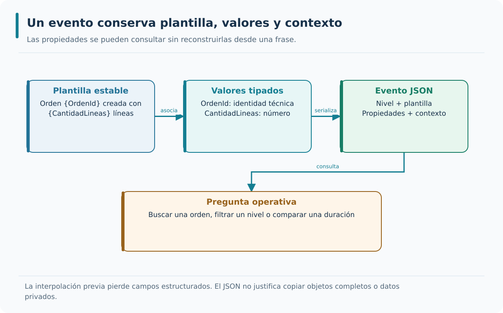

Una plantilla estable conserva propiedades tipadas; el texto interpolado ya no distingue sus valores como campos.

---

### Serilog como biblioteca de logging

Serilog proporciona una implementación de logging estructurado para .NET que se integra con los mecanismos habituales de ASP.NET Core. Permite elegir destinos o sinks, enriquecer eventos con propiedades de contexto y determinar su formato. En este módulo emplearemos salida JSON en consola para poder comprobar qué escribe cada proceso sin desplegar una plataforma de centralización. Un sink a archivo puede estudiarse como alternativa, pero exige decisiones propias sobre rotación, acceso y retención. La biblioteca facilita registrar eventos; no garantiza por sí sola que todos los registros sean seguros o formen una auditoría completa.

```csharp
Log.Logger = new LoggerConfiguration()
    .MinimumLevel.Information()
    .Enrich.FromLogContext()
    .WriteTo.Console(new JsonFormatter())
    .CreateLogger();
```

`Log.Logger = new LoggerConfiguration()` crea la configuración; `.MinimumLevel.Information()` establece el nivel mínimo; `.Enrich.FromLogContext()` añade propiedades del contexto; `.WriteTo.Console(new JsonFormatter())` escribe en consola en JSON.

`.CreateLogger();` crea el logger.

Es una biblioteca de logging estructurado; permite configurar sinks y enrichers; y se integra con ASP.NET Core. Estas condiciones permiten que el logging sea flexible y estructurado.

Un sink determina dónde se escribe; un enricher añade contexto; un formatter decide cómo se representa. Son responsabilidades diferentes. El curso fija Serilog.AspNetCore 8.0.3 y escribe JSON en consola para que ambos procesos puedan observarse sin instalar un servidor de análisis adicional.

LogContext añade CorrelationId durante el alcance de una petición. Una propiedad Servicio distingue Produccion de Inventario. JsonFormatter conserva valores con nombres, de modo que un lector puede reunir las líneas de ambas consolas sin cambiar las plantillas del código.

Un archivo local requiere rotación, retención, permisos y tratamiento de disco lleno. El ejemplo de sink de archivo sirve como alternativa conceptual; el recorrido entregado utiliza consola. Añadir otro sink no garantiza que los eventos se entreguen de forma duradera ni que sobrevivan a cualquier caída.

Arranca la API, realiza una petición y parsea cada línea emitida. Verifica que no se mezclan mensajes de texto libre con los eventos esperados. Si dos proveedores escriben el mismo evento, corrige su registro en el arranque antes de añadir filtros que oculten el duplicado.

---

### Integración de Serilog con ASP.NET Core

Integrar Serilog afecta al arranque de la aplicación y a la forma en que se emiten los eventos de ASP.NET Core. `UseSerilog` conecta la infraestructura de logging con el host; los sinks y los niveles efectivos determinan la salida observada. Conviene distinguir el resumen de una petición HTTP de los mensajes internos emitidos por librerías y trabajadores. En AceriaApp el resumen deberá utilizar un conjunto limitado de campos, sin query strings, cuerpo, credenciales ni texto libre de excepciones. La integración se considerará válida cuando las peticiones reales produzcan JSON estructurado con la información prevista y no filtren datos centinela.

```csharp
var builder = WebApplication.CreateBuilder(args);

builder.Host.UseSerilog((context, config) =>
{
    config
        .MinimumLevel.Information()
        .Enrich.FromLogContext()
        .WriteTo.Console(new JsonFormatter());
});
```

`var builder = WebApplication.CreateBuilder(args);` crea el constructor; `builder.Host.UseSerilog((context, config) =>` configura Serilog en el host; `config` comienza la configuración; `.MinimumLevel.Information()` establece el nivel mínimo.

`.Enrich.FromLogContext()` añade propiedades del contexto; `.WriteTo.Console(new JsonFormatter());` escribe en consola en JSON.

Reemplaza el logger por defecto. Por otra parte, unifica los logs de ASP.NET Core y de la aplicación. La tercera es que permite configurar sinks y enrichers. Estas condiciones permiten que el logging sea coherente en todo el sistema.

La aplicación consume `ILogger<T>`; el arranque conecta esa abstracción a Serilog. El dominio no necesita conocer sinks ni HttpContext. La biblioteca AceriaApp.Observabilidad concentra la integración técnica de ambas API, mientras cada host conserva su nombre de servicio y su configuración.

El orden de middleware permite establecer correlación antes de registrar el resumen y de gestionar una excepción. El resumen observa el resultado final del flujo. En las prácticas se registra método, plantilla de ruta, estado y duración, evitando copiar URL, query string o cuerpo.

Los scopes de ASP.NET pueden añadir RequestPath aunque la plantilla propia no lo solicite. CamposHttpSeguros elimina esa propiedad después de FromLogContext. También se limitan categorías automáticas, pero los workers de M6 y los eventos heredados de EF conservan su logging: no se afirma una auditoría integral de esas fuentes.

Envía una petición con un parámetro centinela y una cabecera Authorization de prueba. Revisa los nuevos resúmenes HTTP de ambas API: deben conservar correlación y resultado, y omitir ambos valores y RequestPath. Verifica también los eventos propios de errores y Polly; el alcance de la comprobación debe quedar explícito.

---

### Correlación de logs

Una operación distribuida genera eventos en procesos diferentes y puede intercalar su ejecución con otras solicitudes concurrentes. Para reconstruirla necesitamos una identidad de correlación que entre por HTTP, se valide antes de usarla y se propague al cliente saliente. El valor no debe aceptarse sin límites ni introducirse directamente en mensajes que puedan ser manipulados por un tercero. En AceriaApp la misma correlación enlazará el resumen de Producción con el de Inventario, conservando el nombre del servicio y marcas temporales para interpretar el orden local. Correlación no equivale a tracing distribuido completo, pero aporta una primera relación verificable.

```csharp
app.Use(async (context, next) =>
{
    var values = context.Request.Headers["X-Correlation-ID"];
    var candidate = values.Count == 1 ? values[0] : null;
    var valid = candidate is { Length: >= 1 and <= 64 }
        && candidate.All(c => char.IsAsciiLetterOrDigit(c) || c is '-' or '_');
    var id = valid ? candidate! : Guid.NewGuid().ToString("N");
    context.Items["CorrelationId"] = id;
    context.Response.Headers["X-Correlation-ID"] = id;
    context.Response.OnStarting(() =>
    {
        context.Response.Headers["X-Correlation-ID"] = id;
        return Task.CompletedTask;
    });
    using (LogContext.PushProperty("CorrelationId", id))
    {
        await next();
    }
});
```

`app.Use(async (context, next) =>` registra el middleware antes del flujo que necesita correlación; `{` abre el cuerpo; `var values = context.Request.Headers["X-Correlation-ID"];` lee todos los valores de la cabecera; `var candidate = values.Count == 1 ? values[0] : null;` acepta como candidata una única entrada.

`context.Response.OnStarting(() =>` registra una acción justo antes de enviar cabeceras; `context.Response.Headers["X-Correlation-ID"] = id;` restituye la cabecera si el manejador de errores limpió la respuesta; `});` cierra el registro de OnStarting; `});` termina el registro del middleware.

El identificador se propaga entre servicios; se añade a cada evento; y permite agrupar los eventos disponibles de la operación. Estas condiciones permiten que el diagnóstico sea preciso en sistemas distribuidos.

Un identificador recibido por red es entrada no confiable. El middleware acepta exactamente un valor de entre 1 y 64 caracteres ASCII alfanuméricos, guion o subrayado. Si falta o no cumple, genera un valor nuevo; la respuesta y la llamada saliente usan el valor ya validado.

Una petición con X-Correlation-ID: lote-42 conserva ese valor en la respuesta y en la llamada a Inventario. OnStarting vuelve a escribir la cabecera justo antes de enviarla, incluso si el manejador de excepciones limpió las cabeceras. Una petición paralela con lote-43 mantiene su propio contexto.

CorrelationId agrupa eventos, pero no prueba identidad del cliente ni autorización. Tampoco sustituye TraceId y SpanId de Activity o un sistema de tracing. El contexto de una petición no debe quedar retenido después de terminar; using delimita correctamente las propiedades de LogContext.

Prueba valor válido, ausente, demasiado largo, varios valores y caracteres no permitidos. Comprueba que un valor rechazado no aparece ni en logs ni en la petición remota. Ejecuta solicitudes concurrentes y verifica que los grupos de eventos no intercambian identificadores.

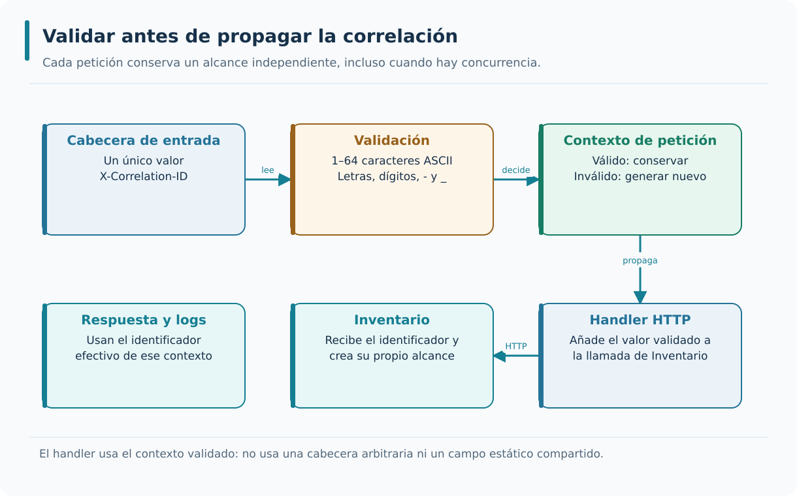

La entrada se valida antes de llegar al contexto, la respuesta y el handler HTTP saliente. El alcance de cada petición mantiene aisladas las solicitudes concurrentes.

---

### Logging de errores

Un registro de error sirve para entender qué falló y dónde, no para copiar indiscriminadamente la excepción y la petición del usuario. El tipo de fallo, la operación y la correlación suelen aportar más información útil que guardar una URL completa o un cuerpo HTTP. Las excepciones pueden incluir secretos en sus mensajes, y una pila también puede revelar detalles internos. Por ello, los nuevos eventos de M07 registran únicamente campos permitidos y trasladan al cliente una respuesta pública acotada. Forzaremos errores controlados para comprobar tanto el diagnóstico disponible como la ausencia de datos sensibles.

```csharp
try
{
    await next();
}
catch (Exception ex) when (ex is not OperationCanceledException)
{
    Log.Error("Fallo no controlado de tipo {ExceptionType}", ex.GetType().Name);
    throw;
}
```

`try` inicia el bloque ilustrativo; `{` abre la región protegida; `await next();` ejecuta el siguiente componente; `}` cierra la región.

`catch (Exception ex) when (ex is not OperationCanceledException)` evita clasificar aquí la cancelación como fallo inesperado; `{` abre el tratamiento; `Log.Error("Fallo no controlado de tipo {ExceptionType}", ex.GetType().Name);` registra el tipo sin el mensaje ni la excepción completa; `throw;` conserva la pila al propagar el error.

Registra información suficiente y permitida del fallo; añade propiedades del contexto; y complementa la gestión de errores. Estas condiciones permiten que el diagnóstico sea preciso.

Registrar una excepción completa puede incluir credenciales, SQL, rutas o información del usuario en Message, Data e InnerException. El laboratorio registra tipo de fallo y contexto técnico permitido. Una captura amplia solo tiene sentido en el límite que decide cómo responder o limpiar recursos.

Si una consulta genera una excepción con un mensaje centinela, el evento puede indicar ExceptionType = InvalidOperationException y conservar CorrelationId. El cliente recibe un error genérico. El equipo localiza el incidente por la correlación sin devolver ni publicar el texto arbitrario.

Capturar, registrar y relanzar en cada capa produce varios eventos para un único fallo. Establece un responsable del registro final. Si se relanza, throw conserva la pila; throw ex la altera. La cancelación solicitada por el usuario no se clasifica automáticamente como fallo inesperado.

Fuerza una excepción controlada y cuenta los eventos del error. Busca el centinela tanto en JSON como en la respuesta HTTP. A continuación cancela una petición lenta: la ausencia de un 500 fabricado demuestra que se diferencia el abandono del cliente de un fallo interno.

---

### Buenas prácticas de logging

Una política de logging útil combina señales seleccionadas, plantillas estables y límites claros sobre la información que puede salir del proceso. Registrar todas las instrucciones produce ruido y puede elevar el coste de almacenamiento sin aclarar el problema. En cambio, conocer el resultado y duración de una operación remota permite distinguir latencia, fallo y cancelación. Debe establecerse qué nivel utiliza cada evento, cómo se correlaciona y qué datos se excluyen incluso cuando proceden de scopes heredados. La verificación incluye revisar los registros generados, no solo comprobar que existe un método `LogInformation` en el código.

```text
Buenas prácticas de logging:

1. Logging estructurado.
2. Plantillas con propiedades.
3. Sin información sensible.
4. Nivel mínimo por entorno.
5. Correlación con identificador.
```

`1. Logging estructurado.` primera práctica; `2. Plantillas con propiedades.` segunda práctica; `3. Sin información sensible.` tercera práctica; `4. Nivel mínimo por entorno.` cuarta práctica.

`5. Correlación con identificador.` quinta práctica.

Las buenas prácticas se caracterizan por tres propiedades. Producen logs útiles; protegen la información sensible; y permiten el análisis automático. Estas condiciones permiten que el logging sea un activo del sistema.

La selección de campos debe ser positiva: una lista de propiedades necesarias resulta más auditable que serializar todo y quitar algunas. Para las peticiones se usan Servicio, CorrelationId, TraceId, método, plantilla de ruta, estado y duración. Para mensajería se conservan EventoId y OrdenId donde proceda.

La plantilla /api/materiales/{codigo} agrupa lecturas sin almacenar cada URL concreta. La duración numérica permite localizar lentitud. El estado HTTP distingue ausencia, indisponibilidad y éxito; la respuesta completa no es necesaria para hacer esa clasificación.

Hash de un dato sensible no equivale automáticamente a anonimización. Tampoco una cabecera que «normalmente es inocua» puede copiarse sin validar. Evita cuerpos, query strings, Authorization y valores arbitrarios de excepciones. La correlación admitida no cambia estas reglas.

Introduce un centinela diferente en cada canal de entrada y busca los valores en los nuevos resúmenes HTTP, eventos propios de excepción y callbacks de Polly. Comprueba que mantienen los campos necesarios para diagnosticar. El logging heredado de workers M6 y EF exige otra revisión; esta prueba no acredita su privacidad completa.

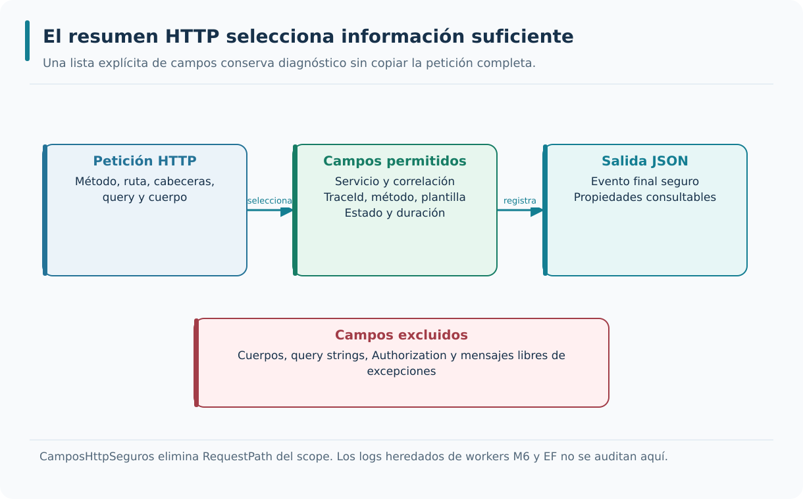

Los nuevos eventos propios de M7 seleccionan campos operativos y excluyen datos libres y RequestPath heredado del scope. No se afirma una auditoría completa de workers M6 o EF.

---

### Configuración por entorno

El mismo servicio necesita distinto grado de detalle en desarrollo, pruebas y producción. La configuración por entorno establece el nivel mínimo y los destinos apropiados, mientras las propiedades de los eventos deberían conservar su significado. Un nivel más verboso puede ayudar a diagnosticar durante el desarrollo, pero no justifica exponer Authorization, rutas completas o excepciones libres. Tampoco conviene asumir que cambiar `appsettings` afecta automáticamente a todos los proveedores si la integración no está configurada. Contrastaremos dos configuraciones conocidas con peticiones iguales para verificar qué eventos cambian y cuáles permanecen filtrados.

```json
{
  "Serilog": {
    "MinimumLevel": {
      "Default": "Information",
      "Override": {
        "Microsoft": "Warning",
        "Microsoft.Hosting.Lifetime": "Information"
      }
    }
  }
}
```

`{` abre el objeto raíz; `"Serilog": {` abre la sección de Serilog; `"MinimumLevel": {` abre la sección de nivel mínimo; `"Default": "Information",` nivel por defecto.

`"Override": {` abre la sección de sobrescritura; `"Microsoft": "Warning",` nivel para Microsoft; `"Microsoft.Hosting.Lifetime": "Information"` nivel para el ciclo de vida; `}` cierra la sección de Serilog.

El nivel se ajusta por entorno; la configuración se documenta; y la configuración se versiona. Estas condiciones permiten que el logging se adapte a cada contexto.

Los niveles dependen del objetivo operativo; Debug en desarrollo o Warning en pruebas son ejemplos, no obligaciones universales. En un test de logging debes habilitar el nivel que pretendes verificar. La configuración declarada solo tiene efecto si el arranque la lee o establece los valores equivalentes.

El componente AddLoggingAceria recibe servicio y configuración. En el laboratorio, Observabilidad:NivelMinimo usa Information por defecto y appsettings.Production.json establece Warning. Un diagnóstico temporal puede cambiar el nivel y volver después al habitual; el cambio no modifica contratos HTTP ni permite capturar información privada.

ReadFrom.Configuration requiere la integración y los paquetes correspondientes; escribir una sección Serilog no configura mágicamente el logger. Mantén los secretos fuera de archivos versionados y documenta qué valores acepta el componente de registro de este curso.

Arranca con dos configuraciones conocidas y observa un evento que debe filtrarse en una de ellas. Verifica también que el resumen final sigue presente en la configuración de referencia. Contrastar el archivo y la salida evita confundir intención de configuración con configuración aplicada.

---

### Logging seguro en AceriaApp

En el recorrido de AceriaApp, Producción e Inventario incorporan eventos JSON que identifican servicio, operación, resultado, duración y correlación. Los nuevos registros de petición y tratamiento de excepciones evitan cuerpos, query strings y credenciales. La práctica distinguirá la existencia de una configuración de la evidencia obtenida ejecutando dos procesos. También reconocerá una limitación importante: los mensajes heredados de M06 y los emitidos por EF Core no quedan automáticamente auditados por las pruebas sobre los nuevos eventos de M07. El objetivo es construir una base de diagnóstico verificable, no proclamar una solución integral de observabilidad.

```text
Aplicación al proyecto del curso:

Biblioteca     → Serilog.
Sinks          → consola JSON.
Enrichers      → LogContext.
Correlación    → X-Correlation-Id.
Nivel          → configurado por entorno.
Validación     → coherencia y comportamiento real.
```

`Biblioteca     → Serilog.` Serilog; `Sinks          → consola JSON.` consola JSON; `Enrichers      → LogContext.` LogContext; `Correlación    → X-Correlation-Id.` X-Correlation-Id.

`Nivel          → configurado por entorno.` configurado por entorno; `Validación     → coherencia y comportamiento real.` coherencia y comportamiento real.

La aplicación del logging prepara el proyecto para los puntos 7.2, 7.3 y 7.4. El punto 7.2 estudiará los health checks. El punto 7.3 estudiará la gestión de excepciones. El punto 7.4 estudiará el retry y el circuit breaker mediante Polly. El punto 7.1 establece la base que se aplicará en los tres puntos siguientes.

El catálogo de conceptos ayuda a discutir decisiones, pero la observabilidad se acredita con eventos emitidos por procesos reales. El módulo conserva ese análisis y lo acompaña de middleware, propagación HTTP y pruebas de salida JSON. Una validación de cadenas no prueba esas capacidades.

La lectura desde Producción hasta Inventario deja dos resúmenes relacionados y una cabecera de respuesta. Los eventos de outbox e inbox heredados continúan aportando identidades de mensajes; el módulo no añade un backend de trazas ni promete una traza distribuida completa de todo el broker.

Un test unitario de un formateador puede pasar mientras el host olvida registrar el middleware. Por eso las pruebas combinan componentes aislados y un recorrido HTTP entre dos procesos. Los fallos de infraestructura se verifican con servicios reales cuando el escenario depende de ellos.

Compara la evidencia de una prueba de configuración con la del recorrido real: la primera confirma una regla, la segunda el cableado y la emisión. Explica qué afirma cada una. Esa distinción se reutiliza al evaluar salud, errores y resiliencia en los puntos siguientes.

---

## Resumen rápido de la teoría

- El logging registra eventos que ocurren durante la ejecución del sistema.
- Los niveles de log son Trace, Debug, Information, Warning, Error y Critical.
- El logging estructurado usa propiedades tipadas en lugar de cadenas.
- Serilog es una biblioteca de logging estructurado para .NET.
- La integración de Serilog con ASP.NET Core se realiza con `UseSerilog`.
- La correlación de logs vincula eventos de distintos servicios con un identificador común.
- El logging de errores selecciona información técnica permitida y contexto correlacionado, evitando detalles sensibles.
- Las buenas prácticas son logging estructurado, plantillas con propiedades, sin información sensible, nivel por entorno y correlación.
- La configuración por entorno ajusta el nivel mínimo según el contexto.

---

# Punto 7.2 — Health Checks

**Módulo 7:** Observabilidad y resiliencia

**Objetivos de aprendizaje:**

- Comprender qué son los health checks y su propósito en sistemas distribuidos.
- Identificar los tipos de health checks: liveness, readiness y startup.
- Comprender el papel de los health checks en orquestadores y balanceadores.
- Comprender la integración de health checks con ASP.NET Core.
- Aplicar los conceptos al comportamiento real de AceriaApp y contrastar sus resultados con pruebas.

---

## Distinguir vida, preparación y estado de las dependencias

Una sonda de salud solo resulta útil cuando sabemos qué comprueba y qué decisión habilita. Separaremos liveness de readiness y explicaremos cómo leer las respuestas durante una caída de SQL Server o RabbitMQ sin confundir una dependencia caída con un proceso muerto.

### Definición de health check

Un health check expone una respuesta acotada sobre un conjunto elegido de comprobaciones del servicio. Esa respuesta es útil para un operador o un balanceador, pero no resume toda la corrección funcional de una API. Un proceso puede estar vivo aunque SQL Server no responda, y una base de datos accesible no demuestra que todas las reglas de Producción se ejecuten correctamente. En AceriaApp separaremos las rutas que comprueban vida del proceso y preparación para atender operaciones dependientes. El significado de cada endpoint es más importante que devolver simplemente un `200`.

```text
Health check:

Orquestador → consulta health check → Servicio.
Respuesta: 200 OK → disponible.
Respuesta: 503 Service Unavailable → no disponible.
```

`Orquestador → consulta health check → Servicio.` el orquestador consulta el estado; `Respuesta: 200 OK → disponible.` el servicio está disponible; `Respuesta: 503 Service Unavailable → no disponible.` el servicio no está disponible.

Expone el estado del servicio; se consulta de forma periódica; y permite traducir el estado interno a una decisión operativa. Estas condiciones permiten que los sistemas externos tomen decisiones sobre el servicio.

Los servicios no disponibles se detectan de forma automática. Por otra parte, una plataforma configurada puede reiniciar procesos o retirar instancias del balanceador sin intervención manual. Ambas condiciones permiten que el sistema sea más resiliente.

Un health check responde a una pregunta operativa delimitada, no certifica que toda la aplicación funcione. El resultado es una observación puntual con un contrato HTTP. La plataforma consumidora decide qué hacer con esa señal; exponer una ruta por sí solo no reinicia ni retira instancias.

En AceriaApp, /health/live confirma que el proceso puede responder. /health/ready comprueba acceso a SQL Server y, cuando se habilitan los trabajadores, a RabbitMQ. Si SQL cae, el proceso sigue vivo aunque temporalmente no esté listo para el conjunto de operaciones que necesita persistencia.

Un endpoint que siempre responde Healthy no representa el estado de las dependencias. El extremo contrario, consultar todo en cada sonda, añade carga y puede crear una cadena de falsas alarmas. Define las dependencias imprescindibles y evita ejecutar cambios de negocio desde una sonda.

Detén SQL Server y consulta ambas rutas. Readiness debe fallar y liveness permanecer disponible. Reinicia la dependencia y comprueba la recuperación. El resultado enseña a distinguir un proceso operativo de una operación de negocio realizable.

---

### Tipos de health check

Liveness, readiness y startup responden a situaciones distintas del ciclo de vida. Liveness indica si el proceso debe seguir considerándose operativo; readiness expresa si está preparado para recibir cierto tráfico; startup permite tolerar un arranque que requiere más tiempo. Mezclar las tres comprobaciones puede crear reinicios inútiles cuando una dependencia externa falla. En nuestra aplicación, detener SQL Server debe afectar a readiness, no hacer que liveness considere muerto a un proceso que aún puede atender rutas independientes. Cada sonda debe definir qué revisa, cuánto puede tardar y qué acción debería desencadenar.

```text
Tipos de health check:

Liveness  → el servicio está vivo. Si falla, se reinicia.
Readiness → el servicio está listo. Si falla, se retira del balanceador.
Startup   → margen de arranque; al agotar el umbral puede reiniciarse.
```

`Liveness  → el servicio está vivo. Si falla, se reinicia.` el servicio está vivo; `Readiness → el servicio está listo. Si falla, se retira del balanceador.` el servicio está listo; `Startup   → margen de arranque; al agotar el umbral puede reiniciarse.` el servicio ha arrancado.

Los tres tipos se caracterizan por tres propiedades. Cada tipo tiene un propósito específico; cada tipo se consulta en un momento distinto; y cada tipo provoca una decisión distinta, aunque los ejecute el mismo orquestador. Estas condiciones permiten que el sistema detecte problemas de forma precisa.

Liveness pregunta si conviene reiniciar este proceso; readiness pregunta si conviene enviarle tráfico ahora; startup permite un arranque prolongado antes de activar las otras evaluaciones. Los umbrales pertenecen a la plataforma. Una sonda de startup que supera su límite de fallos también puede provocar reinicio.

Una migración o inicialización lenta puede necesitar protección de arranque. Una caída compartida de SQL no se arregla reiniciando todas las API. AceriaApp expone live y ready; startup se estudia como concepto operativo y no se presenta como despliegue Kubernetes incluido.

Usar la misma lista de comprobaciones para live y ready destruye su diferencia, aunque las URLs sean distintas. Tampoco cada sonda tiene necesariamente un consumidor diferente: un mismo orquestador puede ejecutar las tres con políticas distintas.

Escribe la acción esperada ante tres situaciones: proceso bloqueado, SQL inaccesible y arranque aún en curso. Comprueba que la ruta elegida comunica la causa adecuada. Si todas las respuestas proponen reiniciar, el diseño probablemente está mezclando responsabilidades.

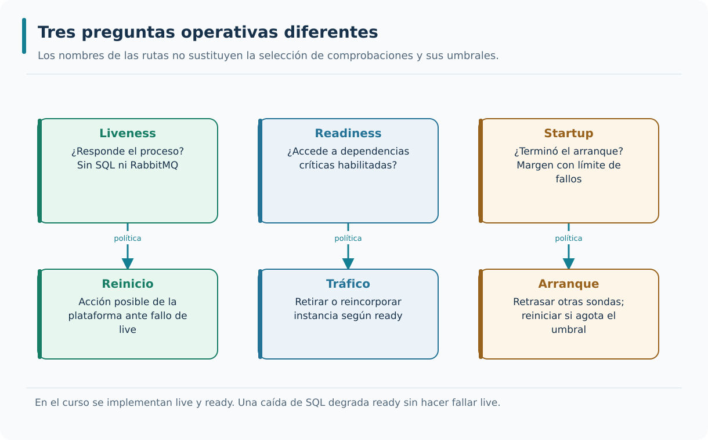

Una dependencia caída afecta readiness. Liveness permanece independiente y startup concede margen limitado durante el arranque.

---

### Health checks y disponibilidad

La disponibilidad debe medirse en relación con una capacidad concreta y con una ventana temporal, no deducirse de una sola petición al endpoint de salud. Una comprobación que devuelve `200` indica que las condiciones seleccionadas se cumplen en ese instante. Las peticiones de negocio pueden seguir fallando por motivos no incluidos en la sonda. También conviene distinguir un servicio no preparado de uno muerto: un balanceador quizá deba retirar tráfico sin reiniciar el proceso. En el laboratorio contrastaremos las sondas con solicitudes reales durante una caída de SQL Server para comprender esos límites.

```text
Disponibilidad:

200 OK → servicio disponible.
503 Service Unavailable → servicio no disponible.
Sin respuesta → fallo de observación: proceso, red o timeout.
```

`200 OK → servicio disponible.` el servicio responde; `503 Service Unavailable → servicio no disponible.` el servicio responde con error; `Sin respuesta → fallo de observación: proceso, red o timeout.` no se obtuvo respuesta; la causa requiere diagnóstico.

Se mide de forma automática; se expone con health checks; y se usa para tomar decisiones. Estas condiciones permiten que el sistema sea observable y gestionable.

La fracción de sondas exitosas mide disponibilidad de esa sonda desde ese observador. La disponibilidad funcional requiere definir qué operaciones cuentan, qué resultados son válidos y durante qué periodo se mide. Un 200 de salud no garantiza que una orden concreta pueda planificarse.

Inventario puede responder a ready y mantener una proyección retrasada porque hay mensajes pendientes. El acceso a SQL y AMQP es real, pero no equivale a haber vaciado outbox o inbox ni a cumplir un objetivo de frescura. Salud, latencia y progreso son preguntas diferentes.

Ausencia de respuesta admite varias causas: red interrumpida, timeout, resolución de nombre o proceso detenido. Etiquetarla siempre como «servicio caído» oculta el lugar de observación. Un muestreo cada treinta segundos tampoco detecta necesariamente un fallo que dura solo cinco.

Compara una serie de sondas con el resultado de peticiones de negocio durante un fallo controlado. Registra desde dónde se realiza cada medida. Explica por qué dos observadores pueden obtener resultados distintos sin que uno de los registros sea falso.

---

### Health checks en ASP.NET Core

ASP.NET Core ofrece servicios de health checks que pueden registrarse con `AddHealthChecks` y exponerse por rutas mediante `MapHealthChecks`. La selección de comprobaciones no debe quedar implícita: las etiquetas o predicados permiten separar las dependencias que determinan readiness de la prueba mínima de liveness. Una comprobación de DbContext necesita la integración correspondiente de EF Core y una conexión realmente configurada. En AceriaApp revisaremos el registro y el resultado de ejecución, primero con SQL accesible y después con la dependencia detenida, sin confundir configuración con comportamiento probado.

```csharp
builder.Services.AddHealthChecks()
    .AddDbContextCheck<AceriaDbContext>("database", tags: new[] { "ready" })
    .AddCheck("self", () => HealthCheckResult.Healthy(), tags: new[] { "live" });

app.MapHealthChecks("/health/live", new HealthCheckOptions
{
    Predicate = check => check.Tags.Contains("live")
});
app.MapHealthChecks("/health/ready", new HealthCheckOptions
{
    Predicate = check => check.Tags.Contains("ready")
});
```

`builder.Services.AddHealthChecks()` registra el servicio de salud; `.AddDbContextCheck<AceriaDbContext>("database", tags: new[] { "ready" })` etiqueta la comprobación de EF Core exclusivamente para readiness; `.AddCheck("self", () => HealthCheckResult.Healthy(), tags: new[] { "live" });` registra una comprobación del propio proceso; `app.MapHealthChecks("/health/live", new HealthCheckOptions` mapea la ruta de liveness.

`{` abre sus opciones; `Predicate = check => check.Tags.Contains("live")` selecciona únicamente los checks con tag live; `});` termina la configuración de liveness; `app.MapHealthChecks("/health/ready", new HealthCheckOptions` mapea la ruta de readiness.

La integración con ASP.NET Core se caracteriza por tres propiedades. El soporte es nativo; las comprobaciones se registran en el contenedor; y los endpoints se exponen con `MapHealthChecks`. Estas condiciones permiten que los health checks se integren con la aplicación.

AddHealthChecks registra comprobaciones; MapHealthChecks selecciona cuáles ejecuta una ruta. Los tags son etiquetas y Predicate las filtra. Sin ese filtro, dos endpoints ejecutan todas las comprobaciones registradas. La separación semántica debe quedar escrita en opciones, no únicamente en el nombre de la URL.

El ejemplo marca self como live y database como ready. AddDbContextCheck usa la integración de EF Core para comprobar conectividad y requiere Microsoft.Extensions.Diagnostics.HealthChecks.EntityFrameworkCore. En el recorrido funcional se usa una comprobación SQL específica con una consulta real, tiempo acotado y cancelación.

Conectividad no prueba que todas las tablas o permisos de negocio sean correctos. No ejecutes migraciones desde el health check. Además, el registro de un check no hace que el servidor empiece a servir HTTP: el host debe construir y ejecutar su pipeline.

Revisa los predicados y ejecuta las dos rutas con SQL detenido. Si live falla por la base de datos, inspecciona primero la selección de checks. Comprueba después que ready realmente abre la conexión y consulta, en lugar de inspeccionar solo un objeto de configuración.

---

### Health checks personalizados

Hay dependencias que no pueden representarse con una comprobación genérica. Un `IHealthCheck` personalizado permite consultar un recurso concreto con cancelación y límite de duración, y devolver un estado apropiado sin introducir esas responsabilidades en el dominio. La ruta de readiness de AceriaApp comprobará SQL Server y, cuando los trabajadores estén habilitados, también la conexión necesaria con RabbitMQ. Es importante que las comprobaciones sean ligeras: no deben crear una carga superior al tráfico que intentan proteger. Un fallo controlado debe reflejarse en readiness sin exponer detalles internos en la respuesta pública.

```csharp
public class RabbitMqHealthCheck : IHealthCheck
{
    private readonly IConnection _connection;

    public RabbitMqHealthCheck(IConnection connection)
    {
        _connection = connection;
    }

    public Task<HealthCheckResult> CheckHealthAsync(
        HealthCheckContext context,
        CancellationToken ct)
    {
        return _connection.IsOpen
            ? Task.FromResult(HealthCheckResult.Healthy("RabbitMQ disponible"))
            : Task.FromResult(HealthCheckResult.Unhealthy("RabbitMQ no disponible"));
    }
}
```

`public class RabbitMqHealthCheck : IHealthCheck` health check personalizado; `{` abre el cuerpo; `private readonly IConnection _connection;` dependencia de la conexión; `public RabbitMqHealthCheck(IConnection connection)` constructor.

`{` abre el cuerpo del constructor; `_connection = connection;` asigna la conexión; `}` cierra el constructor; `CancellationToken ct)` token de cancelación.

Comprueba un recurso específico; devuelve un estado específico; y se registra en el contenedor. Estas condiciones permiten que el sistema compruebe cualquier recurso.

Un IHealthCheck personalizado implementa una prueba pequeña con un resultado interpretable. Para RabbitMQ, IsOpen de una conexión ya existente es una indicación local y puede tardar en reflejar un corte. La práctica realiza conexión AMQP con espera limitada, cancela cuando corresponde y libera recursos.

Con workers habilitados, una credencial de broker incorrecta impide readiness aunque la API siga respondiendo a live. Con workers deshabilitados, el broker no forma parte de esa comprobación. SQL sigue siendo una dependencia crítica de los casos de uso persistentes.

Abrir conexiones ilimitadas desde sondas muy frecuentes puede agravar la caída. Ajusta frecuencia, timeout y concurrencia; evita un retry largo dentro de la propia sonda. Healthy acredita la comprobación elegida, no permisos de todos los exchanges ni consumo correcto de cada mensaje.

Ensaya broker sano, puerto inaccesible y credenciales no válidas en un entorno de prueba. Verifica duración acotada, estado no saludable y ausencia de credenciales en la respuesta. Comprueba que cancelar la petición no deja una operación esperando indefinidamente.

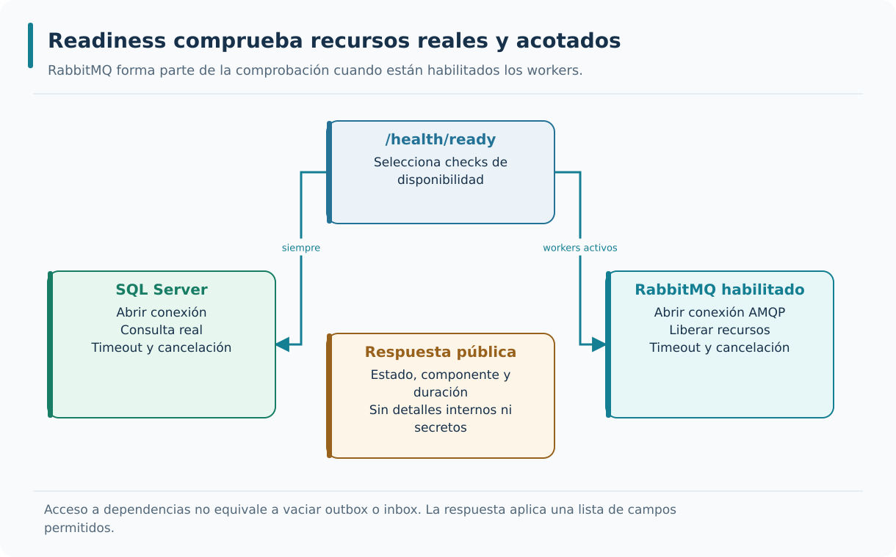

Ready comprueba SQL y añade RabbitMQ cuando los workers están habilitados. Cada operación tiene espera limitada y cancelación.

---

### Formato de la respuesta

El resultado de una sonda puede publicarse como texto sencillo o como JSON de estructura acordada. Un JSON resulta útil para herramientas automáticas, pero no debería incluir mensajes de excepción, cadenas de conexión ni valores de configuración. El código HTTP y el cuerpo deben expresar el mismo estado: una respuesta que diga Unhealthy con `200` puede confundir a un operador que decide solo por el estado. En AceriaApp utilizaremos un esquema estable y validaremos las respuestas durante fallos provocados, con especial atención a los centinelas secretos que nunca deben aparecer en el documento público.

```csharp
app.MapHealthChecks("/health/ready", new HealthCheckOptions
{
    Predicate = check => check.Tags.Contains("ready"),
    ResponseWriter = async (context, report) =>
    {
        context.Response.ContentType = "application/json";
        var response = new
        {
            status = report.Status.ToString(),
            checks = report.Entries.Select(e => new
            {
                name = e.Key,
                status = e.Value.Status.ToString(),
                durationMs = e.Value.Duration.TotalMilliseconds
            })
        };
        await context.Response.WriteAsJsonAsync(response);
    }
});
```

`app.MapHealthChecks("/health/ready", new HealthCheckOptions` configura el endpoint; `{` abre el cuerpo; `Predicate = check => check.Tags.Contains("ready"),` selecciona comprobaciones de readiness; `ResponseWriter = async (context, report) =>` configura el escritor de respuesta.

`{` abre el cuerpo del lambda; `status = report.Status.ToString(),` estado general; `status = e.Value.Status.ToString(),` estado de la comprobación; `durationMs = e.Value.Duration.TotalMilliseconds` duración numérica sin descripción interna ni excepción.

Se adapta al consumidor; se documenta; y se versiona con el resto de la API. Estas condiciones permiten que el health check sea legible y procesable.

La respuesta pública se construye con una lista permitida de campos: estado general, nombre y estado de cada componente, y duración. Las descripciones de checks y las excepciones pueden contener servidores, rutas o cadenas de conexión, por lo que no se serializan automáticamente.

Un consumidor puede ver database = Unhealthy y su duración sin conocer la contraseña ni el mensaje del proveedor SQL. El estado HTTP sigue siendo decisivo para un balanceador; el JSON añade detalle operativo limitado para una persona o un monitor.

HealthStatus admite Healthy, Degraded y Unhealthy. ASP.NET Core trata Healthy y Degraded como 200 por defecto y Unhealthy como 503. El laboratorio configura explícitamente Degraded y Unhealthy como 503 en sus rutas de salud: un estado degradado también deja de considerarse listo.

Provoca una excepción que contenga un centinela secreto. Comprueba el código HTTP y el esquema del JSON, y busca el centinela en todos los campos. Verifica que la duración sea numérica y que una descripción interna no aparezca por haber serializado report.Entries directamente.

---

### Health checks y contenedores

Los contenedores y orquestadores pueden ejecutar sondas periódicas para decidir reinicios o elegibilidad de tráfico. Docker permite declarar `HEALTHCHECK`, mientras Kubernetes distingue `livenessProbe`, `readinessProbe` y `startupProbe`. Esas declaraciones no equivalen a demostrar que una imagen haya sido construida o que exista un clúster funcionando. Nuestro módulo estudia el significado de las rutas y cómo podrían consumirse desde esos entornos; el despliegue completo se trata en un módulo práctico separado. Para interpretar cualquier sonda hay que conocer puerto, intervalo, timeout y umbral de fallos.

```text
Health checks en contenedores:

Dockerfile → HEALTHCHECK.
Kubernetes → livenessProbe, readinessProbe, startupProbe.
```

`Dockerfile → HEALTHCHECK.` health check en Docker; `Kubernetes → livenessProbe, readinessProbe, startupProbe.` health checks en Kubernetes.

Los health checks se definen en la configuración del contenedor; el orquestador consulta los endpoints; y las acciones configuradas pueden ejecutarse de forma automática. Estas condiciones permiten que el sistema sea auto-recuperable.

El contenedor empaqueta el proceso; el orquestador aplica una política sobre las sondas. Docker HEALTHCHECK marca un estado de salud, pero Docker por sí solo no reinicia automáticamente un contenedor solo por estar unhealthy. Kubernetes sí aplica acciones según el tipo de probe y sus umbrales.

La misma API de AceriaApp podría ejecutarse sin contenedores y conservar /health/live y /health/ready. Los tests del módulo invocan esas rutas y dependencias; la explicación de contenedores muestra cómo consumirlas, sin afirmar que se haya añadido un clúster al ejercicio.

El comando de comprobación necesita una herramienta presente en la imagen. Copiar un HEALTHCHECK que usa curl sin instalarlo informa de un fallo del comando, no de la API. Los intervalos y timeouts deben dejar margen al arranque y evitar cargas innecesarias.

Para evaluar una configuración, identifica ruta, puerto, comando, timeout, periodo y umbral de fallos. Describe qué componente ejecuta el reinicio o retirada. Esta lectura evita atribuir a una respuesta 503 efectos que dependen de configuración externa.

---

### Health checks y balanceadores

Un balanceador necesita señales para decidir a qué instancias puede enviar nuevas peticiones. Readiness puede ayudar a retirar temporalmente un destino que depende de una base de datos inaccesible, pero la decisión suele emplear intervalos y umbrales para evitar cambios bruscos por un fallo aislado. Además, retirar tráfico nuevo no cancela automáticamente las peticiones ya iniciadas. En AceriaApp veremos cómo las respuestas de salud se relacionan con la capacidad real de atender una consulta. La ruta de liveness no debe utilizarse como sustituto indiscriminado de readiness.

```text
Balanceador y health checks:

Instancia 1 → 200 OK → recibe tráfico.
Instancia 2 → 503 → no recibe tráfico.
Instancia 3 → 200 OK → recibe tráfico.
```

`Instancia 1 → 200 OK → recibe tráfico.` primera instancia disponible; `Instancia 2 → 503 → no recibe tráfico.` segunda instancia no disponible; `Instancia 3 → 200 OK → recibe tráfico.` tercera instancia disponible.

El balanceador consulta periódicamente; el balanceador retira las instancias no disponibles; y el tráfico se distribuye solo entre instancias disponibles. Estas condiciones permiten que el sistema sea tolerante a fallos.

Un balanceador decide por instancia y normalmente necesita varios resultados para retirarla o reincorporarla. La transición no es instantánea: hay periodo de consulta, umbral y peticiones que ya estaban en curso. Readiness reduce nuevas asignaciones, no cancela mágicamente todas las solicitudes existentes.

Si dos instancias de Producción usan SQL diferentes y una pierde acceso, la sonda puede retirar solo esa instancia. Si comparten un SQL detenido, ambas fallarán: la sonda hace visible una dependencia común, pero no crea una réplica de base de datos ni capacidad adicional.

Comprobar un servicio remoto no esencial en todas las instancias puede retirar toda la aplicación por una función secundaria. Antes de incluir una dependencia, pregunta qué operaciones deben dejar de recibir tráfico. En el curso se usa un criterio simple documentado, sin enrutamiento por capacidad.

Razona qué ocurre entre la primera sonda fallida y la retirada efectiva. El cliente todavía necesita timeout y una respuesta coherente durante esa ventana. Salud y resiliencia se complementan porque operan a escalas y con responsabilidades diferentes.

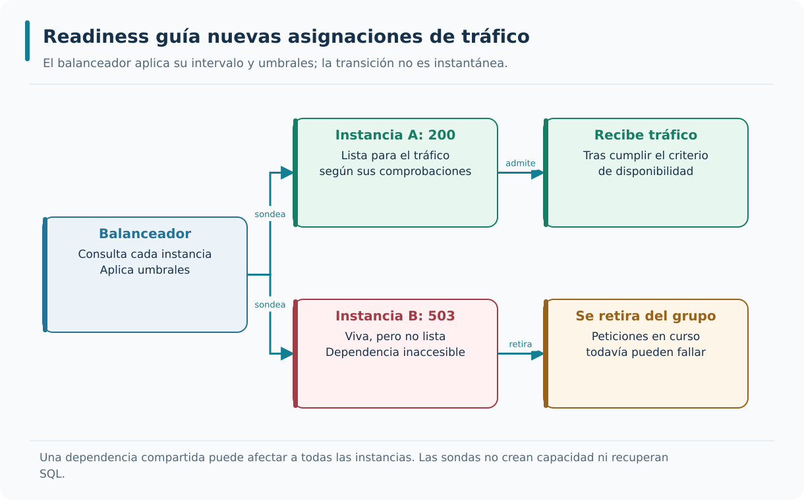

El balanceador usa umbrales para retirar o reincorporar instancias. Las peticiones en curso todavía necesitan su propio control de fallos.

---

### Buenas prácticas de health checks

Una sonda de salud bien diseñada es barata, predecible y tiene un significado operativo claro. Conviene separar vida y preparación, comprobar solo dependencias críticas en readiness, incorporar timeouts y evitar información sensible en el cuerpo. El resultado de una sonda no debería depender de ejecutar complejas reglas de negocio ni de crear más problemas durante una degradación. También necesitamos conocer qué ocurre cuando hay muchos sondeos concurrentes. La práctica medirá las respuestas en escenarios controlados y distinguirá la infraestructura real del catálogo conceptual de comprobaciones.

```text
Buenas prácticas de health checks:

1. Endpoints separados para liveness y readiness.
2. Solo recursos críticos en readiness.
3. Startup check para arranques lentos.
4. Sin información sensible.
5. Tiempos e intervalos configurados.
```

`1. Endpoints separados para liveness y readiness.` primera práctica; `2. Solo recursos críticos en readiness.` segunda práctica; `3. Startup check para arranques lentos.` tercera práctica; `4. Sin información sensible.` cuarta práctica.

`5. Tiempos e intervalos configurados.` quinta práctica.

Las buenas prácticas se caracterizan por tres propiedades. Producen health checks útiles; protegen la información sensible; y permiten el diagnóstico. Estas condiciones permiten que los health checks sean un activo del sistema.

Diseña sondas baratas, sin efectos de negocio y con tiempo máximo. El token de cancelación debe llegar a las operaciones SQL y AMQP, y los recursos abiertos deben liberarse. Una configuración de timeout que no se propaga al trabajo real solo limita la espera del observador.

Una consulta mínima a SQL acredita que se abre una conexión y se recibe respuesta. Una conexión AMQP acredita acceso al broker. Ninguna sonda debe crear una orden, modificar stock ni publicar un evento para «ver si funciona»: esos efectos pertenecen a pruebas de integración controladas.

Las sondas pueden convertirse en ruido de logs o en una carga repetitiva. No registres secretos al explicar por qué falló una dependencia. Los endpoints públicos entregan un resumen acotado; los detalles de diagnóstico requieren su propio canal y control de acceso.

Mide cuántas operaciones externas causa una llamada a ready y qué sucede al cancelarla. Repite con dependencias lentas y comprueba que el tiempo observado se mantiene dentro del margen esperado. Verifica además que los datos de negocio no han cambiado.

---

### Sondas de salud de AceriaApp

AceriaApp publica `/health/live` para comprobar el proceso y `/health/ready` para evaluar dependencias necesarias. SQL Server participa en readiness; RabbitMQ se considera según la configuración efectiva de los trabajadores. El comportamiento debe observarse con los servicios disponibles y con una dependencia interrumpida, verificando tanto el estado HTTP como la estructura del cuerpo devuelto. Esta evidencia no autoriza a declarar alta disponibilidad ni una integración completa con Kubernetes. Permite, en cambio, comprender qué información necesitaría un futuro gateway o balanceador para retirar una instancia sin reiniciarla por un fallo ajeno.

```text
Aplicación al proyecto del curso:

Endpoint liveness  → /health/live.
Endpoint readiness → /health/ready.
Comprobaciones     → SQL y broker cuando se habilitan workers.
Formato            → JSON.
Validación         → coherencia y dependencias reales.
```

`Endpoint liveness  → /health/live.` /health/live; `Endpoint readiness → /health/ready.` /health/ready; `Comprobaciones     → SQL y broker cuando se habilitan workers.` SQL y broker cuando se habilitan workers; `Formato            → JSON.` JSON.

`Validación         → coherencia y dependencias reales.` coherencia y dependencias reales.

La aplicación de health checks prepara el proyecto para los puntos 7.3 y 7.4. El punto 7.3 estudiará la gestión de excepciones. El punto 7.4 estudiará el retry y el circuit breaker mediante Polly. El punto 7.2 establece la base que se aplicará en los dos puntos siguientes.

El módulo añade dos rutas con significado diferente y conserva /health de Inventario. MapSaludAceria expone live sin checks externos y ready con tres comprobaciones SQL en Producción y una en Inventario; RabbitMQ se añade si WorkersActivos está habilitado. El contrato se verifica sobre las API ejecutadas, además del catálogo.

La secuencia de ensayo es estado inicial sano, dependencia detenida, observación de live/ready y recuperación. Repetirla para SQL y RabbitMQ muestra que el estado depende de recursos efectivos, no de una variable booleana manipulada en memoria.

Readiness no acredita que todos los mensajes estén procesados ni que la proyección ya incluya la última orden. Mantén esa distinción al combinar salud con el recorrido de M6. Tampoco declares cobertura de SQL real a partir de un doble, SQLite o un proveedor InMemory.

Anota por escenario los estados esperados y observados, los workers habilitados y el recurso afectado. Una prueba debe fallar si la dependencia requerida no está disponible al inicio, en lugar de omitirse. Así la evidencia describe un ensayo realizado y no una intención.

---

## Resumen rápido de la teoría

- Un health check expone el estado del servicio.
- Los tipos de health check son liveness, readiness y startup.
- Los health checks aportan señales de salud; la disponibilidad funcional requiere medir operaciones definidas.
- ASP.NET Core ofrece soporte nativo para health checks.
- Los health checks personalizados comprueban recursos específicos.
- La respuesta se puede formatear en JSON.
- Los contenedores usan health checks para detectar servicios no disponibles.
- Los balanceadores usan health checks para decidir qué instancias reciben tráfico.
- Las buenas prácticas son endpoints separados, solo recursos críticos, startup check, sin información sensible y tiempos configurados.

---

# Punto 7.3 — Gestión de excepciones

**Módulo 7:** Observabilidad y resiliencia

**Objetivos de aprendizaje:**

- Comprender la diferencia entre excepciones esperadas y excepcionales.
- Identificar el papel del manejador global de excepciones.
- Comprender el formato problem details como respuesta uniforme de error.
- Comprender la relación entre excepciones y el patrón Result.
- Aplicar los conceptos al comportamiento real de AceriaApp y contrastar sus resultados con pruebas.

---

## Mantener un contrato HTTP coherente cuando algo falla

Las operaciones esperadas seguirán utilizando sus resultados de negocio. Para excepciones inesperadas añadiremos un límite común que proteja la información interna y publique Problem Details, conservando la semántica HTTP existente y la identidad de diagnóstico.

### Definición de gestión de excepciones

Una excepción puede aparecer en el repositorio, en un adaptador HTTP o en el propio pipeline de ASP.NET Core. La gestión de excepciones establece cómo registrar un fallo inesperado y cómo comunicarlo sin exponer detalles internos. El lugar adecuado para traducirlo suele ser el límite HTTP, cuando todavía no se ha empezado a escribir la respuesta. En AceriaApp conservaremos los resultados de negocio explícitos y utilizaremos un manejador global para fallos que el caso de uso no puede resolver. El objetivo es mantener un contrato de error coherente sin convertir todo resultado negativo en una excepción.

```text
Gestión de excepciones:

Excepción → captura → registro → traducción → respuesta.
```

`Excepción → captura → registro → traducción → respuesta.` flujo de la gestión.

Captura las excepciones no controladas; registra la excepción con contexto; y traduce la excepción en una respuesta uniforme. Estas condiciones permiten que el sistema sea predecible y diagnosticable.

El cliente recibe una respuesta coherente. También el equipo dispone de información para diagnosticar. Ambas condiciones permiten que el sistema sea robusto y observable.

Gestionar una excepción implica decidir qué parte se maneja y qué información sale del proceso. El límite HTTP traduce un fallo técnico a un contrato público, pero no deshace automáticamente una transacción ya confirmada ni recupera un proceso que terminó de forma abrupta.

Si un endpoint falla antes de escribir la respuesta, el manejador puede producir un 500 uniforme y añadir correlación. Si ya envió cabeceras o bytes, no puede sustituirlos por otro documento JSON válido. Ese límite forma parte del diseño y de sus pruebas.

Un catch general que devuelve éxito oculta el fallo y permite que el cliente tome decisiones con información falsa. El manejador debe conservar la condición de error. Cuando el cliente canceló, responder como si hubiera un fallo interno añade ruido y puede escribir en una conexión ya cerrada.

Provoca un error antes de iniciar la respuesta y otro después de iniciarla. Verifica un único documento de error en el primer caso y ausencia de reescritura en el segundo. La diferencia explica por qué «manejador global» no significa que todo fallo pueda repararse.

---

### Excepciones esperadas y excepcionales

Una cantidad inválida, una orden inexistente y la caída inesperada de una dependencia no deberían representarse necesariamente del mismo modo. Los dos primeros son situaciones que la aplicación conoce y puede expresar mediante `Result` con un código de negocio; el tercero exige una política técnica de tratamiento de fallos. La cancelación solicitada por el cliente añade otro caso con semántica propia. Distinguirlos permite probar cada condición sin capturar indiscriminadamente `Exception`. En AceriaApp preservaremos los estados HTTP ya definidos antes de introducir el nuevo manejador global.

```text
Excepciones esperadas    → patrón Result.
Excepciones excepcionales → excepciones.
```

`Excepciones esperadas    → patrón Result.` se representan como valores; `Excepciones excepcionales → excepciones.` se representan como excepciones.

Las excepciones esperadas no se capturan con `try/catch`; al mismo tiempo, las excepciones excepcionales se capturan en el manejador global. Ambas condiciones permiten que el flujo de errores sea explícito y controlado.

Es más preciso hablar de errores esperados y fallos inesperados que de «excepciones esperadas». Un resultado de negocio puede ser negativo sin que el programa funcione mal. El contrato del caso de uso expresa ese resultado; una excepción interrumpe una ruta que no pudo completarse normalmente.

Una orden inexistente produce el resultado previsto y el endpoint responde 404. Un conflicto de estado conserva 409. La indisponibilidad técnica de Inventario se distingue de la ausencia de material y mantiene 503. No conviene convertir las tres situaciones en el mismo 500.

Un fallo de red es esperable en sentido operativo, aunque una biblioteca lo represente con excepción. La clasificación depende del contrato de la capa. En infraestructura se traduce a una indisponibilidad conocida; el dominio no necesita conocer HttpRequestException.

Para cada caso escribe: condición, representación en aplicación y respuesta HTTP. Incluye validación, ausencia, conflicto, indisponibilidad y error de programación. Una tabla que solo enumera tipos de Exception omite los resultados ordinarios y no explica el contrato completo.

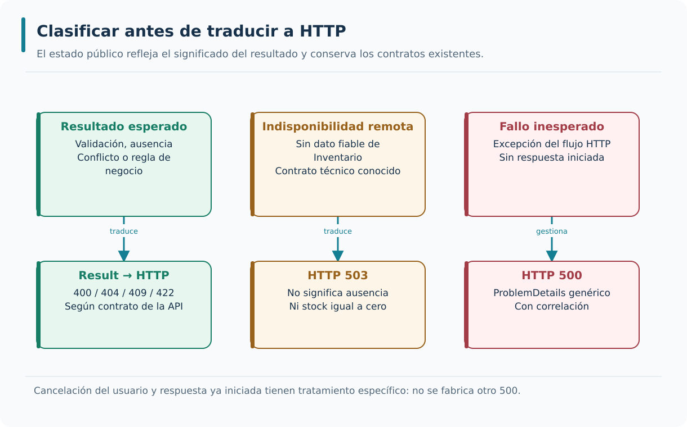

Los resultados esperados conservan su traducción HTTP; los fallos inesperados se gestionan en el límite. Cancelación y respuesta iniciada requieren caminos específicos.

---

### Excepciones personalizadas

Las excepciones personalizadas pueden expresar fallos que requieren una traducción específica, pero no deben convertirse en un inventario paralelo de todas las reglas de negocio. Si una condición puede ser un resultado esperado de un caso de uso, un tipo `Result` suele hacerla más visible. Cuando se usan excepciones conocidas, el manejador debe tomar la decisión por tipo o código estable, no por interpretar el texto libre del mensaje. En AceriaApp evitaremos que un cambio en la redacción de una excepción modifique inesperadamente el estado HTTP o revele detalles internos al consumidor.

```csharp
public class OrdenNoEncontradaException : Exception
{
    public Guid OrdenId { get; }

    public OrdenNoEncontradaException(Guid ordenId)
        : base($"La orden con identificador '{ordenId}' no existe.")
    {
        OrdenId = ordenId;
    }
}
```

`public class OrdenNoEncontradaException : Exception` excepción personalizada; `{` abre el cuerpo; `public Guid OrdenId { get; }` propiedad con el identificador; `public OrdenNoEncontradaException(Guid ordenId)` constructor.

`: base($"La orden con identificador '{ordenId}' no existe.")` invoca al constructor base; `{` abre el cuerpo del constructor; `OrdenId = ordenId;` asigna el identificador; `}` cierra el constructor.

Representa una condición específica del dominio; incluye información contextual; y se puede traducir en una respuesta específica. Estas condiciones permiten que el manejador global produzca respuestas coherentes.

Una excepción personalizada aporta un significado técnico que la capa consumidora puede reconocer. No es una obligación convertir cada resultado de negocio en una clase de excepción. OrdenNoEncontradaException sirve para entender sintaxis o integrar código heredado; AceriaApp mantiene la ausencia ordinaria como Result.

InventarioNoDisponibleException comunica que no se obtuvo un dato remoto fiable. El adaptador la usa después de agotar su política o recibir un fallo de transporte. El consumidor sabe distinguir esa situación del resultado «material inexistente» sin depender de nombres de excepciones de Polly.

Un mensaje descriptivo interno no debe convertirse directamente en detail de ProblemDetails. Tampoco se debe usar texto de Message para escoger un estado HTTP: cambia con la traducción, el proveedor o la versión. Usa tipos o códigos estables y un mensaje público controlado.

Cambia el mensaje de una excepción de prueba sin cambiar su tipo. El estado HTTP debe permanecer igual y el mensaje libre debe seguir oculto. Después verifica que un Result de ausencia mantiene 404 sin recorrer el manejador de fallos inesperados.

---

### Manejador global de excepciones

Un manejador global mediante `IExceptionHandler` centraliza la respuesta a fallos inesperados dentro de la parte del pipeline que puede controlar. Registra la incidencia con un conjunto seguro de propiedades y genera un documento público cuando aún no han empezado a salir bytes. Si la respuesta ya se inició, no puede sustituirse sin más por otro JSON: hay que reconocer ese límite y evitar escrituras adicionales que corrompan el intercambio. En AceriaApp la correlación se establecerá antes del manejo para que tanto el diagnóstico como la respuesta pública puedan referirse a la misma operación.

```csharp
builder.Services.AddProblemDetails();
builder.Services.AddExceptionHandler<ManejadorExcepciones>();

var app = builder.Build();
app.UseMiddleware<CorrelacionMiddleware>();
app.UseExceptionHandler();
app.MapControllers();
app.Run();
```

`builder.Services.AddProblemDetails();` registra los servicios del formato de error; `builder.Services.AddExceptionHandler<ManejadorExcepciones>();` registra la implementación IExceptionHandler completa de las prácticas; `var app = builder.Build();` construye el host después de registrar servicios; `app.UseMiddleware<CorrelacionMiddleware>();` establece correlación antes de gestionar errores.

`app.UseExceptionHandler();` activa el middleware que usa el manejador; `app.MapControllers();` mapea controladores detrás del límite de errores; `app.Run();` ejecuta la aplicación; es un fragmento de integración del arranque.

Centraliza el manejo de fallos del flujo HTTP que puede interceptar; registra la excepción; y devuelve una respuesta uniforme. Estas condiciones permiten que el sistema sea predecible.

ASP.NET Core 8 ofrece IExceptionHandler para separar el comportamiento del manejador del arranque. AddExceptionHandler registra la implementación; AddProblemDetails registra el servicio de escritura; UseExceptionHandler coloca el middleware. Los tres cumplen papeles distintos y se necesitan en el orden apropiado.

La implementación comprueba cancelación y respuesta iniciada, registra contexto permitido y genera un ProblemDetails 500 con título genérico, traceId y correlationId. Si RequestAborted está cancelado antes de iniciar la respuesta, registra estado 499 sin cuerpo; es una convención local, no un estado HTTP estándar ni una garantía de entrega al cliente desconectado.

TryHandleAsync devuelve true solo si se ha gestionado la excepción. Devolver false no significa fabricar una respuesta de éxito; permite continuar el mecanismo de manejo. Si el escritor no acepta el formato solicitado, la implementación completa debe disponer de una salida coherente sin duplicar la respuesta.

Prueba el contrato completo: status HTTP, Content-Type, campos públicos y correlación. Envía también un Accept que no seleccione JSON y verifica el comportamiento de fallback documentado. No basta con llamar al método aislado si el host nunca registra UseExceptionHandler.

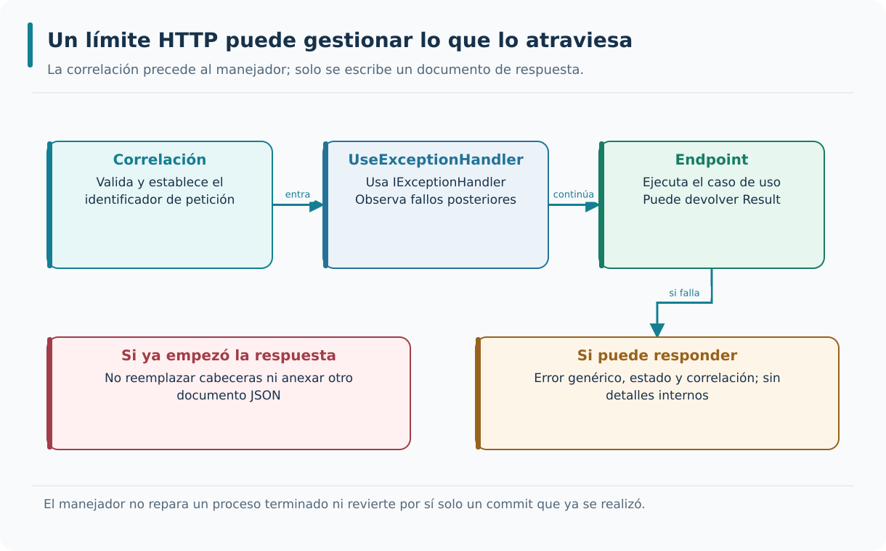

La correlación debe existir antes del manejo. Una respuesta ya iniciada no puede reemplazarse por otro documento de error.

---

### Problem details como formato de error

Problem Details ofrece una representación normalizada de errores HTTP, definida actualmente por RFC 9457, sucesora de RFC 7807. Sus campos describen tipo, título, estado y detalles públicos del problema, pero no obligan a revelar mensajes internos ni pilas de ejecución. Una API que responde con `500` y un documento que declara `404` está incumpliendo su propio contrato. En AceriaApp separaremos las respuestas esperadas de los fallos inesperados y añadiremos un identificador de diagnóstico apropiado. La estructura del documento y el estado HTTP se comprobarán juntos en los ensayos.

```json
{
  "type": "about:blank",
  "title": "Recurso no encontrado",
  "status": 404,
  "detail": "La orden con identificador '123' no existe.",
  "instance": "/api/v1/ordenes/123"
}
```

`{` abre el objeto; `"type": "about:blank",` tipo del error; `"title": "Recurso no encontrado",` título; `"status": 404,` código.

`"detail": "La orden con identificador '123' no existe.",` detalle; `"instance": "/api/v1/ordenes/123"` instancia; `}` cierra el objeto.

Estructura la respuesta de error; es uniforme en toda la API; y facilita el consumo por parte de los clientes. Estas condiciones permiten que las respuestas de error sean predecibles.

ProblemDetails es un formato de representación, no un catálogo universal de errores. RFC 9457 sustituye RFC 7807. Type identifica la clase del problema; title resume; status debe concordar con el estado HTTP; detail e instance pueden omitirse si no aportan información pública segura.

Un 500 del laboratorio usa «Error interno» y un identificador de correlación. El consumidor puede mostrar un mensaje genérico y guardar ese identificador para soporte. No necesita rutas de archivos, SQL ni una pila de llamadas para interpretar que la operación falló.

No uses una URL ficticia como si fuera documentación de errores publicada. About:blank es válido cuando se usa la semántica del estado HTTP. La forma de los errores esperados heredados no cambia automáticamente por añadir AddProblemDetails; el contrato existente debe conservarse deliberadamente.

Deserializa la respuesta como JSON y verifica tipos y valores. Contrasta status del cuerpo con el código de transporte. Comprueba que el centinela secreto de la excepción no está presente y que las extensiones traceId o correlationId contienen únicamente identificadores previstos.

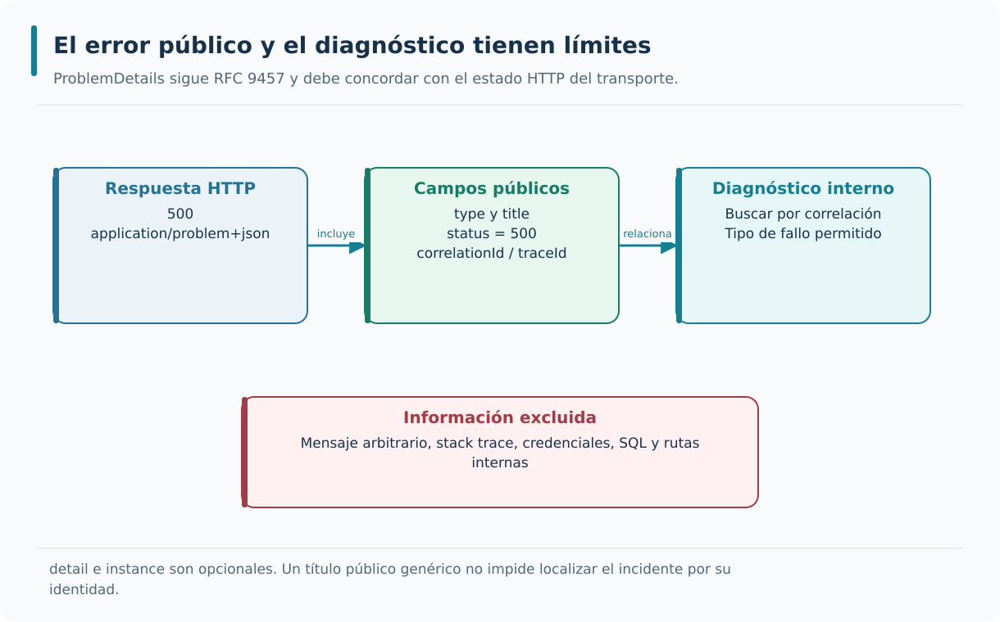

El contrato público describe el problema y su identidad de diagnóstico; omite detalles internos y concuerda con el estado HTTP.

---

### Traducción de excepciones a códigos HTTP

Traducir fallos a códigos HTTP exige conocer la semántica de la operación, no construir una tabla genérica a partir del nombre de cada excepción. Una ausencia conocida puede expresarse con `404`, una validación con el estado previsto por el contrato y una dependencia indisponible con `503`; un fallo inesperado tiene otra naturaleza. El nuevo manejador no debe eclipsar los resultados `Result` que ya traducían correctamente las rutas de Producción. En AceriaApp probaremos casos reales y errores inyectados para comprobar que la introducción del middleware conserva el significado de los estados existentes.

```csharp
var (status, title) = exception switch
{
    OrdenNoEncontradaException => (StatusCodes.Status404NotFound, "Recurso no encontrado"),
    ValidacionException => (StatusCodes.Status400BadRequest, "Error de validación"),
    ConflictoException => (StatusCodes.Status409Conflict, "Conflicto de estado"),
    RecursoNoProcesableException => (StatusCodes.Status422UnprocessableEntity, "No procesable"),
    _ => (StatusCodes.Status500InternalServerError, "Error interno")
};
```

`var (status, title) = exception switch` comienza la traducción; `OrdenNoEncontradaException => (StatusCodes.Status404NotFound, "Recurso no encontrado"),` caso 404; `ValidacionException => (StatusCodes.Status400BadRequest, "Error de validación"),` caso 400; `ConflictoException => (StatusCodes.Status409Conflict, "Conflicto de estado"),` caso 409.

`RecursoNoProcesableException => (StatusCodes.Status422UnprocessableEntity, "No procesable"),` caso 422; `_ => (StatusCodes.Status500InternalServerError, "Error interno")` caso por defecto.

Cada excepción tiene un código específico; las excepciones no reconocidas tienen un código por defecto; y la traducción es centralizada. Estas condiciones permiten que las respuestas de error sean coherentes.

La traducción pertenece al borde de la aplicación, porque HTTP es un detalle del adaptador de entrada. Los errores esperados mantienen 400, 404, 409 o 422 según el contrato ya definido. Los fallos inesperados reciben 500 y la indisponibilidad remota conocida mantiene 503.

Una validación de formato puede justificar 400; una regla de negocio que impide procesar una petición válida puede justificar 422. No se decide buscando una palabra en el mensaje. En una API consistente, el mismo código de aplicación se traduce del mismo modo en todos los endpoints.

Capturar ArgumentException globalmente y devolver 400 puede ocultar un bug interno que lanza ese tipo. Solo traduce tipos de excepción cuyo contrato y origen conoces. El ejemplo de switch es un adaptador didáctico para clases explícitas, no una razón para abandonar Result.

Ejecuta una matriz con un caso real de cada estado preservado y un fallo desconocido. Comprueba que el manejador nuevo no intercepta resultados ya resueltos. Incluye indisponibilidad de Inventario para evitar que una mejora de formato cambie accidentalmente 503 por 500.

---

### Excepciones y logging

Una excepción debe registrarse en el límite que dispone de contexto suficiente para diagnosticarla y decidir su respuesta. Registrar y relanzar en cada capa puede multiplicar el mismo error en la consola sin aportar información nueva. También es peligroso copiar el mensaje de la excepción, porque una dependencia puede incluir consultas o secretos. En los eventos nuevos de AceriaApp conservaremos tipo y datos operativos permitidos, y probaremos que un centinela incluido en una query o en una excepción no aparece ni en JSON ni en Problem Details. Este enfoque permite investigar el error sin publicar su contenido.

```csharp
Log.Error("Fallo no controlado de tipo {ExceptionType}", exception.GetType().Name);
```

`Log.Error("Fallo no controlado de tipo {ExceptionType}", exception.GetType().Name);` registra el tipo con una plantilla estable; LogContext aporta correlación sin copiar la excepción completa.

El evento identifica el tipo de fallo y permite correlacionarlo; se añaden propiedades del contexto; y el nivel se ajusta al tipo de excepción. Estas condiciones permiten que el diagnóstico sea preciso.

El registro final debe tener un único responsable. El resumen HTTP responde cuánto duró y cómo terminó; el evento de excepción añade el tipo de fallo y su correlación. Ambos pueden coexistir porque responden preguntas diferentes, siempre que no se replique la excepción en cada capa.

Ante InvalidOperationException, Serilog registra un evento de error con nombre de tipo y contexto validado. El resumen muestra 500. El cliente devuelve la correlación al equipo y este localiza ambos eventos sin tener que buscar el texto de un mensaje interno.

La gravedad depende del impacto: un fallo aislado no exige Critical. El middleware y Polly pueden emitir excepciones completas, por lo que el laboratorio limita esas categorías y genera eventos propios seguros. Esta decisión no modifica ni audita todos los logs heredados de los workers de M6 o de EF.

Provoca un error con una query y una excepción que contengan centinelas distintos. Verifica que ninguno aparece en los nuevos eventos propios de error y en el resumen HTTP; comprueba también que no heredan RequestPath. Cuenta los eventos esperados y relaciona sus identificadores para comprobar diagnóstico y minimización de datos.

---

### Excepciones y patrón Result

El patrón `Result` facilita representar el fracaso esperado de una operación sin utilizar excepciones como control normal del flujo. Permite expresar ausencia, validación o conflicto según el contrato acordado. Las excepciones siguen siendo apropiadas para fallos inesperados que no pueden resolverse en esa operación, como una avería técnica no absorbida por el adaptador. Ambos mecanismos se complementan si las capas respetan sus responsabilidades. En AceriaApp la prueba distinguirá una respuesta de negocio negativa, una persistencia correcta y una avería del repositorio, observando cómo cada camino llega a HTTP.

```csharp
public async Task<Result<Guid>> Handle(CrearOrdenCommand request, CancellationToken ct)
{
    var cliente = await _clienteRepositorio.GetByIdAsync(request.ClienteId, ct);
    if (cliente is null)
    {
        return Result<Guid>.Failure("El cliente no existe.");
    }

    var orden = new Orden(Guid.NewGuid(), cliente, request.Cantidad);
    await _ordenRepositorio.AddAsync(orden, ct);
    await _unitOfWork.CommitAsync(ct);
    return Result<Guid>.Success(orden.Id);
}
```

`public async Task<Result<Guid>> Handle(CrearOrdenCommand request, CancellationToken ct)` método de manejo; `{` abre el cuerpo; `var cliente = await _clienteRepositorio.GetByIdAsync(request.ClienteId, ct);` recupera el cliente; `if (cliente is null)` valida que existe.

`return Result<Guid>.Failure("El cliente no existe.");` devuelve un fallo esperado; `var orden = new Orden(Guid.NewGuid(), cliente, request.Cantidad);` crea la orden; `await _ordenRepositorio.AddAsync(orden, ct);` persiste; `await _unitOfWork.CommitAsync(ct);` confirma la transacción.

Los errores esperados no lanzan excepciones; los errores excepcionales se capturan en el manejador global; y el flujo de errores es explícito. Estas condiciones permiten que el sistema sea coherente.

Result hace explícita la posibilidad de un resultado de negocio negativo en la firma y obliga al consumidor a considerarlo. Las excepciones conservan su papel para fallos técnicos y condiciones no previstas. El ejemplo es conceptual: las prácticas usan los contratos Result y entidades que el proyecto ya contiene.

Un cliente inexistente devuelve Failure antes de construir y guardar una orden. Si el commit de SQL falla, no se devuelve Success. El límite HTTP transforma ese fallo según su contrato, sin declarar que se haya persistido una operación que no llegó a confirmar.

Atrapar cualquier excepción y convertirla en Failure("no existe") confunde error de infraestructura con ausencia. También hay que respetar cancelación: no debe transformarse en una validación fallida. El token se propaga a consultas y commit para que el trabajo pueda detenerse.

Comprueba tres rutas distintas: ausencia conocida, persistencia correcta y fallo del repositorio. Observa valor devuelto, escrituras realizadas y respuesta HTTP. La separación demuestra que un sistema puede manejar errores de negocio de forma normal sin ocultar los fallos técnicos.

---

### Buenas prácticas de gestión de excepciones

La consistencia del manejo de errores depende de decisiones pequeñas: capturar únicamente donde puede hacerse algo útil, no ocultar fallos con respuestas inventadas y no escribir documentos de error cuando la respuesta ya comenzó. Conviene separar mensajes diagnósticos internos de los textos que recibe el cliente y probar también cancelaciones y combinaciones de entorno. Un modo de desarrollo puede exponer más información bajo controles explícitos, pero producción debe conservar la salida segura prevista. En AceriaApp el resultado de estas decisiones se comprobará con solicitudes, no solamente revisando el registro del middleware.

```text
Buenas prácticas de gestión de excepciones:

1. No usar excepciones para el flujo normal.
2. Capturar solo las excepciones manejables.
3. No capturar excepciones genéricas sin propósito.
4. Registrar las excepciones con contexto.
5. Devolver respuestas uniformes.
```

`1. No usar excepciones para el flujo normal.` primera práctica; `2. Capturar solo las excepciones manejables.` segunda práctica; `3. No capturar excepciones genéricas sin propósito.` tercera práctica; `4. Registrar las excepciones con contexto.` cuarta práctica.

`5. Devolver respuestas uniformes.` quinta práctica.

Las buenas prácticas se caracterizan por tres propiedades. Producen un flujo de errores explícito; facilitan el diagnóstico; y mantienen la coherencia de la API. Estas condiciones permiten que la gestión de excepciones sea un activo del sistema.

Captura cuando puedes recuperar, traducir con contexto o liberar recursos; deja que el resto llegue al límite apropiado. La centralización reduce duplicación, pero no sustituye las transacciones, la disposición de recursos ni el tratamiento específico de cancelación.

Un endpoint de diagnóstico genera un fallo controlado para verificar el manejador. Solo se registra cuando el entorno es Development y una opción explícita lo habilita. En Production la ruta no existe, aunque la opción esté activada por error.

Una bandera de configuración sin comprobación de entorno deja expuesta una función de fallo intencional. Por otro lado, la Developer Exception Page revela detalles útiles para desarrollo y no debe convertirse en el contrato público del servicio. Los ensayos deben distinguir ambos comportamientos.

Prueba la combinación de entorno y opción: Development activado permite el ensayo, Development desactivado y Production no exponen la ruta. Comprueba además cancelación y respuesta iniciada. Son casos donde un manejador aparentemente correcto puede producir un segundo error.

---

### Errores HTTP en AceriaApp

El tercer punto incorpora un manejador global para fallos inesperados, preservando el patrón `Result` y los códigos funcionales definidos en módulos anteriores. El contrato público utiliza Problem Details y una correlación adecuada; los registros de error nuevos se limitan a propiedades permitidas. También se comprueba qué ocurre cuando la respuesta ya se inició y qué rutas quedan fuera del manejo. El alumno debe poder explicar quién decide cada estado HTTP y cómo se rastrea un fallo sin copiar mensajes privados. Esa base será necesaria para interpretar después reintentos, timeouts y circuitos abiertos.

```text
Aplicación al proyecto del curso:

Manejador global     → IExceptionHandler y UseExceptionHandler.
Formato              → Problem details.
Excepciones esperadas → Result.
Excepciones excepcionales → manejador global.
Registro             → Serilog.
Validación           → coherencia y respuestas reales.
```

`Manejador global     → IExceptionHandler y UseExceptionHandler.` IExceptionHandler y UseExceptionHandler; `Formato              → Problem details.` Problem details; `Excepciones esperadas → Result.` Result; `Excepciones excepcionales → manejador global.` manejador global.

`Registro             → Serilog.` Serilog; `Validación           → coherencia y respuestas reales.` coherencia y respuestas reales.

La aplicación de la gestión de excepciones prepara el proyecto para el punto 7.4. El punto 7.4 estudiará el retry y el circuit breaker mediante Polly. El punto 7.3 establece la base que se aplicará en el punto 7.4.

El resultado del punto es un límite HTTP predecible: fallos inesperados con ProblemDetails, resultados esperados preservados y contexto seguro para diagnóstico. La biblioteca compartida evita que las API de Producción e Inventario implementen versiones incompatibles de esa regla.

Una consulta de Inventario puede fallar por transporte, por ausencia o por un error interno del servidor. El cliente conserva esas distinciones. En el punto siguiente, la política de resiliencia decide qué fallos transitorios merecen otro intento antes de devolver indisponibilidad.

Centralizar el formato no permite ignorar quién es responsable de la recuperación. El manejador HTTP no debe reejecutar una operación de negocio completa después de un fallo desconocido. Un commit pudo haberse realizado antes de perderse la respuesta.

Recorre la tabla de estados anterior y explica qué capa toma cada decisión. Verifica que la correlación atraviesa el error igual que una respuesta correcta. Un diagnóstico útil conecta la respuesta pública y los eventos internos sin exponer la implementación al cliente.

---

## Resumen rápido de la teoría

- La gestión de excepciones controla los errores de forma uniforme.
- Las excepciones se clasifican en esperadas y excepcionales.
- Las excepciones esperadas se representan con el patrón Result.
- Las excepciones excepcionales se representan con excepciones.
- Las excepciones personalizadas representan condiciones específicas del dominio.
- El manejador centraliza fallos del pipeline HTTP que puede interceptar; cancelación y respuesta iniciada requieren tratamiento específico.
- El formato problem details estructura las respuestas de error.
- La traducción de fallos conocidos se centraliza sin sustituir los resultados de negocio existentes.
- Las excepciones se registran con el nivel adecuado.
- Las buenas prácticas son: no usar excepciones para el flujo normal, capturar solo lo manejable, no capturar genéricas sin propósito, registrar con contexto y devolver respuestas uniformes.

---

# Punto 7.4 — Retry y Circuit Breaker mediante Polly

**Módulo 7:** Observabilidad y resiliencia

**Objetivos de aprendizaje:**

- Comprender los patrones de resiliencia Retry y Circuit Breaker.
- Identificar las situaciones en las que se aplica cada patrón.
- Comprender la combinación de patrones en una política de resiliencia.
- Comprender la integración de Polly con ASP.NET Core.
- Aplicar los conceptos al comportamiento real de AceriaApp y contrastar sus resultados con pruebas.

---

## Acotar fallos remotos sin inventar resultados de negocio

Con los fallos ya visibles, podremos decidir cuándo esperar, reintentar una lectura o abrir un circuito. Polly v8 servirá para estudiar estas estrategias y sus interacciones, con pruebas que comprueben intentos, cancelaciones y resultados reales.

### Definición de resiliencia

La resiliencia es la capacidad de mantener o recuperar una función cuando alguna dependencia falla, responde tarde o queda degradada. En sistemas distribuidos no existe una llamada remota infalible: la red y los procesos pueden interrumpirse incluso si el código de ambos servicios es correcto. La resiliencia no significa ocultar todos los problemas; a veces la respuesta honesta es declarar indisponibilidad. Para la lectura informativa de Inventario estudiaremos límites de duración, reintentos seguros y un circuito que evita insistir sobre un destino claramente degradado, sin alterar el dominio ni inventar existencias.

```text
Patrones de resiliencia:

Retry          → reintenta operaciones fallidas.
CircuitBreaker → corta el flujo cuando el destino falla.
Timeout        → limita el tiempo de espera.
Bulkhead       → aísla recursos por operación.
```

`Retry          → reintenta operaciones fallidas.` reintenta operaciones fallidas; `CircuitBreaker → corta el flujo cuando el destino falla.` corta el flujo cuando el destino falla; `Timeout        → limita el tiempo de espera.` limita el tiempo de espera; `Bulkhead       → aísla recursos por operación.` aísla recursos por operación.

Los fallos se contienen dentro de límites definidos; el sistema puede recuperarse automáticamente cuando el recurso vuelve a estar disponible; y la degradación es controlada. Estas condiciones permiten que el sistema sea robusto y predecible.

El sistema tolera fallos transitorios; al mismo tiempo, el sistema evita la saturación por fallos en cascada. Ambas condiciones permiten que el sistema sea tolerante a fallos.

La resiliencia limita el impacto de fallos y permite recuperarse cuando las condiciones lo permiten. No elimina los fallos ni garantiza siempre una respuesta exitosa. Devolver indisponibilidad de forma rápida y honesta puede ser mejor resultado que mantener recursos ocupados durante un tiempo indefinido.

Producción necesita consultar Inventario. Un corte breve puede resolverse con un nuevo intento; una caída sostenida exige dejar de insistir; una respuesta demasiado lenta debe agotar su presupuesto. Cada mecanismo actúa sobre una dimensión diferente del mismo problema.

Bulkhead y limitación de concurrencia sirven para aislar recursos, pero no se implementan como un nuevo subsistema en este módulo. Añadir patrones sin medir su interacción aumenta complejidad. La política concreta se limita al cliente de consulta, sin alterar mensajes, contratos o entidades del dominio.

Clasifica un corte de una petición, una caída de treinta segundos y una respuesta de duración ilimitada. Identifica qué estrategia acota cada caso y cuál será la respuesta cuando no haya recuperación. La explicación debe incluir tanto el éxito recuperado como el fallo final.

---

### Patrón Retry

Retry puede ser útil cuando una lectura falla por un problema transitorio y existe una posibilidad razonable de que el siguiente intento funcione. Pero cada reintento vuelve a enviar trabajo al destino y consume tiempo del presupuesto total. Las respuestas como `404` o una validación fallida no se corrigen por repetirlas; tampoco debe reintentarse una cancelación voluntaria. En AceriaApp limitaremos los intentos a las lecturas HTTP idempotentes y utilizaremos escenarios controlados para verificar el número exacto de envíos, tanto con una secuencia recuperable como con errores permanentes.

```csharp
var retry = new HttpRetryStrategyOptions
{
    MaxRetryAttempts = 2,
    Delay = TimeSpan.FromMilliseconds(200),
    BackoffType = DelayBackoffType.Exponential,
    UseJitter = true
};
retry.DisableForUnsafeHttpMethods();
```

`var retry = new HttpRetryStrategyOptions` crea opciones HTTP de Polly v8 con su clasificación transitoria; `{` abre las opciones; `MaxRetryAttempts = 2,` permite dos reintentos, además del intento inicial; `Delay = TimeSpan.FromMilliseconds(200),` establece la demora base.

`BackoffType = DelayBackoffType.Exponential,` aumenta la espera con retroceso exponencial; `UseJitter = true` desincroniza las esperas con variación aleatoria; `};` termina las opciones; `retry.DisableForUnsafeHttpMethods();` deshabilita reintentos para métodos mutantes; el recorrido solo usa GET.

Reintenta operaciones fallidas; el intervalo puede ser fijo o exponencial; y se aplica a fallos transitorios. Estas condiciones permiten que el sistema recupere errores temporales.

Dos reintentos significan como máximo tres intentos: el inicial y dos adicionales. Se reintentan fallos de transporte, timeout de intento y estados 408, 429 y 5xx. No se reintentan 400, 401, 403, 404 ni cancelación solicitada por el usuario. La decisión combina semántica del método y del fallo.

Si Inventario devuelve 503 y después 200, la lectura puede recuperarse. Un 404 es un resultado definitivo de esa consulta y vuelve inmediatamente al consumidor. La demora inicial de 200 ms crece exponencialmente y el jitter desincroniza clientes; no promete tiempos exactos de 200 y 400 ms.

Un retry multiplica carga cuando el destino ya está degradado. Además, Retry-After puede pedir una espera mayor que la tolerada por el usuario: el timeout total exterior mantiene el límite. No se debe reintentar BrokenCircuitException para insistir contra un circuito abierto.

Usa un transporte controlado que devuelva 503, 503 y 200, y cuenta tres envíos. Repite con 404 y con cancelación: solo debe ejecutarse lo permitido. Una prueba de configuración que inspecciona MaxRetryAttempts no demuestra que el predicado de fallos sea correcto.

---

### Patrón Circuit Breaker

Un circuit breaker evita que una aplicación siga realizando llamadas que probablemente fracasen durante una avería sostenida. El circuito comienza cerrado; al acumular suficientes fallos, puede abrirse y rechazar temporalmente nuevos intentos. Después de un intervalo permite probar si el destino se ha recuperado. Las transiciones dependen de umbrales, periodos de muestreo y número mínimo de llamadas; no basta una excepción aislada para asumir que el circuito debería abrir. En AceriaApp distinguiremos una lectura fallida de la apertura efectiva y de la posterior recuperación de Inventario.

```text
Estados del circuit breaker:

Cerrado     → operaciones normales.
Abierto     → operaciones fallan inmediatamente.
Semiabierto → operación de prueba.
```

`Cerrado     → operaciones normales.` operaciones normales; `Abierto     → operaciones fallan inmediatamente.` operaciones fallan inmediatamente; `Semiabierto → operación de prueba.` operación de prueba.

Evita la saturación del destino; falla rápido cuando el destino no está disponible; y se recupera de forma automática. Estas condiciones permiten que el sistema sea tolerante a fallos sostenidos.

El circuito de este módulo evalúa una proporción de fallos dentro de una ventana, con un mínimo de muestras. Con cuatro muestras mínimas y proporción 0,5, necesita suficiente actividad antes de abrir. Los fallos no tienen que ser consecutivos. Abierto rechaza nuevas ejecuciones sin llamar al transporte.

Una secuencia de cuatro resultados, 200, 503, 200, 503, alcanza dos fallos de cuatro dentro de diez segundos. Al abrir, la siguiente llamada falla rápido. Tras cinco segundos, una nueva solicitud puede actuar como prueba de recuperación; esperar no genera por sí mismo tráfico de prueba.

El circuito no es un retry y no repara Inventario. Se comparte por cliente y destino; recrearlo en cada llamada borra su historial. Con retry por fuera del circuito, cada intento que llega al transporte contribuye a las muestras, no solamente el resultado final de la petición del usuario.

Observa contador de envíos y transiciones de estado usando reloj controlado o señales. Verifica apertura, bloqueo sin envío, prueba tras el intervalo y cierre después del éxito. Si la prueba falla, el circuito debe volver a abrir, conservando el periodo de protección.

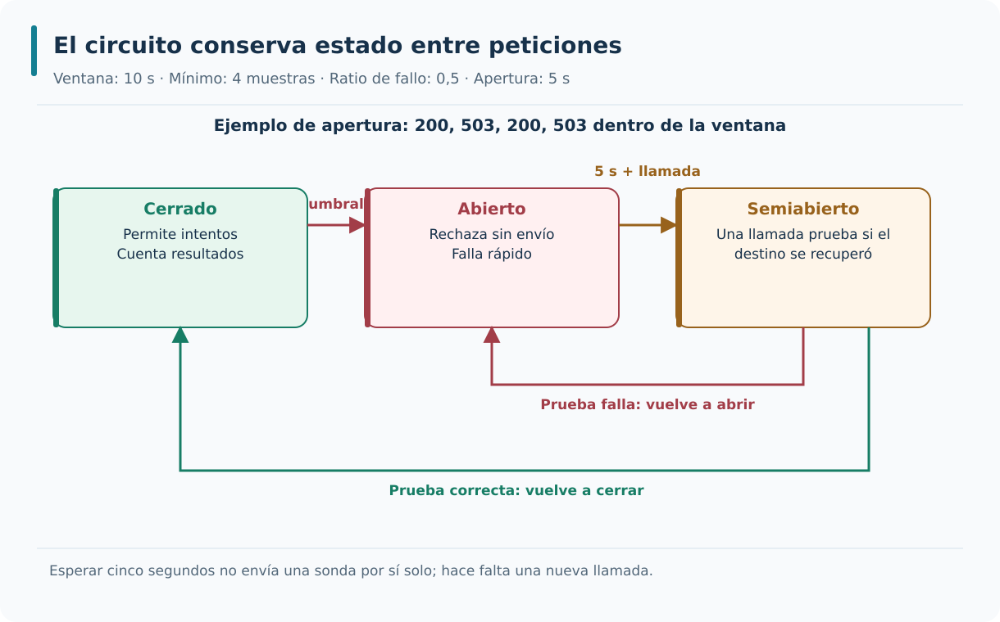

El circuito abre al cumplir muestras y proporción de fallo; una llamada posterior al periodo de apertura prueba recuperación. Una prueba fallida vuelve a abrir.

---

### Combinación de patrones

Las políticas de resiliencia no se aplican de manera independiente del orden de composición. Un timeout externo limita el presupuesto de toda la operación; uno por intento acota cada envío; retry puede incluir tiempos de espera entre intentos; y el circuit breaker observa fallos según la posición que ocupa en la tubería. Una configuración mal ordenada podría prolongar una solicitud más de lo previsto o contabilizar errores incorrectamente. En AceriaApp estudiaremos la secuencia efectiva del pipeline antes de ensayar latencias y cancelaciones, y no reintentaremos escrituras por el mero hecho de disponer de una biblioteca.

```csharp
httpClientBuilder.AddResilienceHandler("inventario", pipeline =>
{
    pipeline.AddTimeout(TimeSpan.FromSeconds(6));
    pipeline.AddRetry(retry);
    pipeline.AddCircuitBreaker(circuito);
    pipeline.AddTimeout(TimeSpan.FromSeconds(1));
}).SelectPipelineByAuthority();
```

`httpClientBuilder.AddResilienceHandler("inventario", pipeline =>` registra una única canalización nombrada en el cliente; `{` abre su configuración; `pipeline.AddTimeout(TimeSpan.FromSeconds(6));` envuelve todo con el presupuesto total; `pipeline.AddRetry(retry);` usa las opciones de retry ya definidas.

`pipeline.AddCircuitBreaker(circuito);` usa las opciones de circuito definidas en el bloque 6; `pipeline.AddTimeout(TimeSpan.FromSeconds(1));` limita el intento que llega al transporte; `}).SelectPipelineByAuthority();` comparte estado por autoridad; las opciones se construyen una vez en el arranque.

Cada patrón cubre un aspecto distinto; el orden de aplicación determina el comportamiento; y la combinación produce un sistema robusto. Estas condiciones permiten que la resiliencia sea completa.

El orden es de fuera hacia dentro: timeout total de 6 s, retry, circuito, timeout de intento de 1 s y transporte. El límite exterior cubre ejecución y esperas; el interior limita cada intento. El circuito observa resultados de los intentos permitidos, mientras retry decide si habrá otro.

Una petición puede consumir un segundo en un intento lento, esperar la demora y volver a intentar. Si un Retry-After solicita diez segundos, el presupuesto total corta la operación antes de esperarlos completos. La cancelación del usuario se propaga hacia dentro y puede terminarla antes.

Los timeouts de Polly son cooperativos: el callback debe usar el token recibido. Un trabajo que ignora cancelación puede seguir ejecutándose. La práctica lee el cuerpo HTTP dentro del handler para que también quede acotado, y desactiva el timeout propio de HttpClient. Superponer otros handlers completos multiplicaría intentos y límites.

Dibuja la envoltura y sigue el token desde fuera hasta HttpClient. Ensaya intento lento y espera de retry larga. Comprueba que cada prueba valida el límite correcto: un timeout de intento puede reintentarse, el agotamiento del total concluye la operación completa.

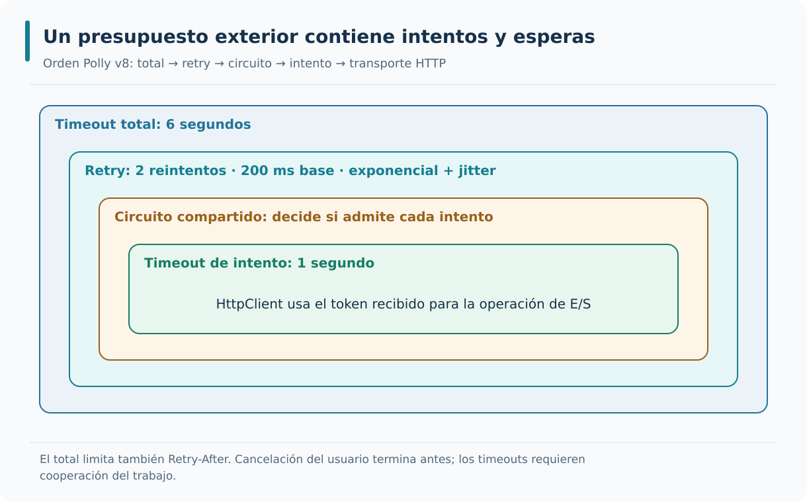

Las estrategias se anidan de fuera hacia dentro. El límite total cubre intentos y demoras, y la cancelación se propaga hasta el transporte.

---

### Polly como biblioteca de resiliencia

Polly v8 permite componer estrategias de resiliencia en una tubería y se integra con clientes HTTP a través de extensiones de .NET. Entre sus estrategias se encuentran reintentos, timeout, circuit breaker y otras que no necesariamente se utilizan en nuestro laboratorio. La disponibilidad de un método de configuración no demuestra que una petición haya pasado por esa política. En AceriaApp el cliente tipado de lectura de Inventario registrará un handler concreto que las pruebas deberán ejercer con respuestas y retrasos controlados. El resto de las operaciones no recibirá automáticamente las mismas reglas de reintento.

```csharp
builder.Services.AddHttpClient<IClienteInventario, ClienteInventarioHttp>()
    .AddResilienceHandler("inventario", pipeline =>
    {
        pipeline.AddTimeout(TimeSpan.FromSeconds(6));
        pipeline.AddRetry(retry);
        pipeline.AddCircuitBreaker(circuito);
        pipeline.AddTimeout(TimeSpan.FromSeconds(1));
    }).SelectPipelineByAuthority();
```

`builder.Services.AddHttpClient<IClienteInventario, ClienteInventarioHttp>()` registra el cliente tipado que implementa el puerto de consulta; `.AddResilienceHandler("inventario", pipeline =>` asocia la canalización al cliente; `{` abre las estrategias; `pipeline.AddTimeout(TimeSpan.FromSeconds(6));` limita la operación completa.

`pipeline.AddRetry(retry);` aplica las opciones HTTP de retry previamente configuradas; `pipeline.AddCircuitBreaker(circuito);` comparte el circuito asociado al cliente; `pipeline.AddTimeout(TimeSpan.FromSeconds(1));` acota cada intento; `}).SelectPipelineByAuthority();` separa estado por destino; presupone retry y circuito del bloque 6.

Ofrece políticas para varios patrones; se integra con `HttpClient`; y las políticas se combinan. Estas condiciones permiten que la resiliencia se aplique de forma declarativa.

Polly v8 usa estrategias y ResiliencePipeline. La integración Microsoft.Extensions.Http.Resilience permite configurar una canalización asociada a IHttpClientFactory. Los ejemplos usan AddResilienceHandler, AddRetry y AddCircuitBreaker; las recetas antiguas con Policy y WrapAsync pertenecen a otra API.

El cliente tipado de Inventario conserva su puerto de aplicación. La resiliencia se añade en infraestructura y en el registro de servicios, sin hacer que el dominio dependa de Polly. La canalización nombrada mantiene estado entre peticiones y SelectPipelineByAuthority separa el circuito por esquema, host y puerto del destino.

No mezcles fragmentos v7 y v8 suponiendo que solo cambian los nombres. La configuración, los predicados y la integración difieren. La versión de paquetes se fija en las prácticas y se restaura y compila; la documentación general puede mostrar una versión posterior.

Localiza en el proyecto el único handler de resiliencia del cliente de Inventario. Verifica que su registro se usa realmente y que dos llamadas sucesivas comparten el circuito. Un pipeline construido dentro de ObtenerAsync podría compilar y, aun así, impedir toda apertura útil.

---

### Configuración de políticas

Cada número de una política implica una consecuencia visible: duración máxima, número de intentos, espera entre reintentos, ventana de muestreo y tiempo de apertura. No deben escogerse de forma aislada ni por copiar una configuración popular. Hay que relacionarlos con el presupuesto de latencia del caso de uso y con la capacidad del destino para soportar nuevas solicitudes. En AceriaApp los valores efectivos se fijan en la configuración de arranque, se contrastan con pruebas deterministas y se revisan cuando la carga o la operación cambian. La política es una hipótesis operativa que necesita observación.

```csharp
var retry = new HttpRetryStrategyOptions
{
    MaxRetryAttempts = 2,
    Delay = TimeSpan.FromMilliseconds(200),
    BackoffType = DelayBackoffType.Exponential,
    UseJitter = true
};
retry.DisableForUnsafeHttpMethods();

var circuito = new HttpCircuitBreakerStrategyOptions
{
    FailureRatio = 0.5,
    MinimumThroughput = 4,
    SamplingDuration = TimeSpan.FromSeconds(10),
    BreakDuration = TimeSpan.FromSeconds(5)
};
```

`var retry = new HttpRetryStrategyOptions` crea opciones de retry HTTP con predicados transitorios de la integración; `{` abre las opciones; `MaxRetryAttempts = 2,` permite como máximo tres intentos en total; `Delay = TimeSpan.FromMilliseconds(200),` establece demora base de 200 ms.

`BackoffType = DelayBackoffType.Exponential,` usa retroceso exponencial; `UseJitter = true` añade jitter; `var circuito = new HttpCircuitBreakerStrategyOptions` crea opciones de circuito HTTP; `{` abre las opciones de circuito.

Los parámetros se ajustan al contexto; la configuración se documenta; y la configuración se versiona. Estas condiciones permiten que la resiliencia sea coherente.

Los parámetros forman una política conjunta, no cuatro números independientes. La ventana de diez segundos exige cuatro muestras y ratio 0,5; apertura de cinco segundos regula cuándo intentar recuperación; el intento de un segundo y el total de seis segundos acotan espera y trabajo.

Con tráfico bajo, tres fallos en diez segundos no alcanzan MinimumThroughput = 4 y no abren el circuito. La petición sigue teniendo límites de retry y timeout. Con tráfico alto, varios intentos de distintas peticiones pueden completar el mínimo rápidamente.

Los valores son didácticos y deben documentarse por destino. No los presentes como recomendación universal para cualquier red. El jitter dificulta afirmar una duración exacta; la prueba debe centrarse en límites, número de envíos y eventos observables, sin sleeps largos y frágiles.

Construye una tabla de parámetro, unidad, propósito y efecto si se duplica. Después verifica valores efectivos y comportamiento. Un cambio de apertura puede mejorar recuperación o generar nuevas oleadas; valorar ese compromiso es más importante que memorizar una constante.

---

### Retry y idempotencia

Reintentar una escritura remota cuyo resultado se desconoce puede duplicar efectos: el servidor quizá confirmó la transacción y solo se perdió la respuesta. En cambio, repetir una lectura HTTP idempotente no debe crear un segundo cambio de negocio, aunque el dato observado pueda variar entre intentos. Esta diferencia obliga a configurar los predicados de retry según método, respuesta y cancelación. El cliente de Inventario de AceriaApp aplica la política únicamente a consultas admitidas y no a comandos de planificación ni a publicaciones de mensajes. El comportamiento se verifica contando solicitudes reales.

```csharp
var retry = new HttpRetryStrategyOptions { MaxRetryAttempts = 2 };
retry.DisableForUnsafeHttpMethods();

using var response = await httpClient.GetAsync(
    "/api/materiales/CHAPA-3MM", ct);
```

`var retry = new HttpRetryStrategyOptions { MaxRetryAttempts = 2 };` configura el límite de retry antes de registrar la canalización; `retry.DisableForUnsafeHttpMethods();` deshabilita repetición automática de métodos mutantes; `using var response = await httpClient.GetAsync(` usa el cliente ya configurado y dispone su respuesta; `"/api/materiales/CHAPA-3MM", ct);` propaga cancelación a una consulta de lectura; la ruta es ilustrativa.

Las operaciones idempotentes se pueden reintentar; repetir una operación con efectos exige un contrato de idempotencia implementado y verificado; y la idempotencia se implementa en el servicio. Estas condiciones permiten que el reintento sea seguro.

Idempotencia describe el efecto previsto de repetir una operación, no exige que cada respuesta sea idéntica. GET puede devolver datos más recientes sin dejar de ser una lectura segura. El curso restringe retry a lectura; POST, PUT, PATCH y DELETE no se reintentan automáticamente.

Si un POST crea una orden y la respuesta se pierde, repetirlo podría crear otra. Un identificador en una cabecera no basta: el servidor tendría que guardar de forma atómica la identidad, la huella de la petición y el resultado, con reglas de concurrencia y retención.

Aunque HTTP define PUT y DELETE como idempotentes en su semántica, la política del módulo adopta una restricción más conservadora y no los reintenta. Tampoco se reutiliza el mismo HttpRequestMessage manualmente para varios envíos; la integración administra el transporte del cliente configurado.

Ejecuta un fallo transitorio con GET y con cada método mutante. Compara el número de llamadas al transporte: solo la lectura puede aumentar. Relaciona este resultado con outbox e inbox de M6, donde la identidad estable y la deduplicación protegen efectos en una frontera distinta.

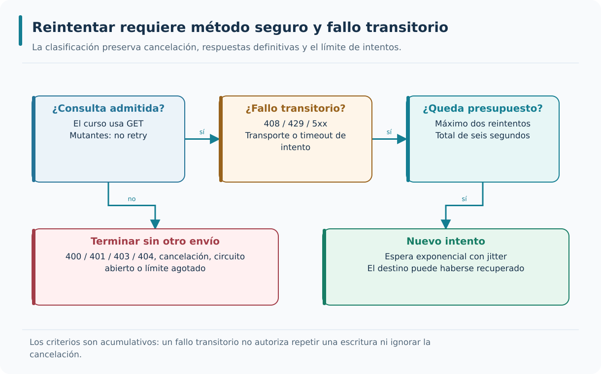

Solo una operación admitida y un fallo transitorio pueden reintentarse. Método mutante, cancelación, 404 o circuito abierto detienen la repetición automática.

---

### Circuit Breaker y fallback

Un circuit breaker puede combinarse con un fallback cuando existe una alternativa de negocio expresamente admitida, como una lectura de caché con antigüedad conocida. Pero devolver existencias ficticias para ocultar la caída de Inventario haría incorrecta una decisión posterior. Si no existe una alternativa válida, la API debe representar que no pudo conocer el dato. En AceriaApp utilizaremos la apertura del circuito para evitar llamadas innecesarias durante una caída y mantendremos una respuesta de indisponibilidad clara, sin transformar el error técnico en un «material no disponible».

```csharp
try
{
    return await ConsultarMaterialRealAsync(codigo, ct);
}
catch (BrokenCircuitException ex)
{
    throw new InventarioNoDisponibleException("Inventario no está disponible temporalmente.", ex);
}
```

`try` delimita el ejemplo conceptual de adaptación; `{` abre la consulta; `return await ConsultarMaterialRealAsync(codigo, ct);` consulta mediante el cliente configurado y conserva cancelación; `}` termina la región.

`catch (BrokenCircuitException ex)` reconoce que el circuito no permitió el envío; `{` abre la traducción; `throw new InventarioNoDisponibleException("Inventario no está disponible temporalmente.", ex);` comunica indisponibilidad conservando causa interna; no fabrica stock cero; `}` cierra la traducción; la práctica incluye también timeout y cancelación.

Una alternativa debe tener semántica explícita y válida; el sistema sigue operando con funcionalidad degradada; y el fallback se registra en los logs. Estas condiciones permiten que el sistema sea tolerante a fallos.

Fallback es una alternativa explícita, no cualquier valor que evite una excepción. Para disponibilidad de material, devolver cero inventado confunde «no se pudo consultar» con «no hay existencias». El laboratorio conserva la indisponibilidad y su respuesta 503 cuando el circuito está abierto o se agota el tiempo.

Una interfaz podría mostrar un último dato conocido si existe una política clara de antigüedad y lo marca como obsoleto. Ese diseño sería distinto de usar un MaterialDto nuevo con cantidad cero. El módulo no incorpora una caché ni una reserva que hagan seguro continuar la planificación.

Una respuesta alternativa debe respetar invariantes del negocio. Convertir indisponibilidad en éxito silencioso puede ser más dañino que fallar. La excepción de circuito abierto pertenece a infraestructura y se traduce al contrato local sin exponer detalles de Polly al dominio.

Detén Inventario hasta abrir el circuito y solicita material. Verifica indisponibilidad, ausencia de stock ficticio y falta de envíos mientras el circuito protege el destino. Después recupéralo y comprueba que un éxito real vuelve a ofrecer datos auténticos.

---

### Buenas prácticas de resiliencia

Las políticas de resiliencia deben observarse como un conjunto: límites de espera, reintentos exclusivamente seguros, circuito ante fallos repetidos y cancelación que se propaga correctamente. Un timeout no arregla la indisponibilidad, solo la acota; un retry no añade capacidad a un servidor saturado; y un circuit breaker requiere elegir umbrales coherentes con el tráfico real. En AceriaApp separaremos pruebas deterministas de los componentes de la política y recorridos de integración entre procesos. Esa distinción evita concluir que una estrategia ha funcionado en producción por haberla declarado en el contenedor.

```text
Buenas prácticas de resiliencia:

1. Timeout en todas las llamadas externas.
2. Retry solo en operaciones idempotentes.
3. Circuit breaker en destinos que fallan.
4. Registrar reintentos y aperturas.
5. Ajustar parámetros al contexto.
```

`1. Timeout en todas las llamadas externas.` primera práctica; `2. Retry solo en operaciones idempotentes.` segunda práctica; `3. Circuit breaker en destinos que fallan.` tercera práctica; `4. Registrar reintentos y aperturas.` cuarta práctica.

`5. Ajustar parámetros al contexto.` quinta práctica.

Las buenas prácticas se caracterizan por tres propiedades. Producen un sistema robusto; la resiliencia es observable; y los parámetros se ajustan al contexto. Estas condiciones permiten que la resiliencia sea un activo del sistema.

Prueba las decisiones de la política y sus límites. La observación útil incluye intentos, demoras, aperturas y resultado final con contexto seguro. No registres cuerpos ni mensajes libres de excepciones durante callbacks de resiliencia: las mismas reglas de privacidad siguen vigentes.

Una prueba controlada valida que 503 seguido de 200 se recupera, que 404 no se reintenta y que un circuito abierto no llama al transporte. Una prueba entre procesos detiene y recupera Inventario para comprobar que el registro del host y el cliente real usan esa política.

Los doubles son adecuados para secuencias exactas y reloj virtual, pero no prueban SQL, RabbitMQ ni conectividad entre procesos. A la inversa, una prueba de red con esperas fijas no es la mejor manera de verificar cada transición temporal de la biblioteca.

Separa evidencia determinista de estrategia y evidencia de integración real. Comprueba que una cancelación voluntaria no se reintenta ni se transforma en 500. Conserva el fallo si falta infraestructura requerida: un test omitido no demuestra una recuperación que nunca ocurrió.

---

### Diagnóstico y recuperación al cierre de M07

El cierre del módulo reúne cuatro capacidades complementarias: eventos de logging seguros y correlacionados, sondas de salud con significado diferenciado, errores HTTP estables y políticas de resiliencia en las lecturas remotas de Inventario. Ninguna reemplaza a las demás. Los logs ayudan a investigar lo ocurrido, health checks informan sobre preparación, Problem Details comunica fallos y Polly acota la interacción con dependencias. El resultado se acredita mediante pruebas controladas y recorridos con SQL Server y RabbitMQ reales, sin fingir que existe una plataforma integral de trazas o un despliegue tolerante a cualquier fallo.

```text
Aplicación al proyecto del curso:

Cliente HTTP      → políticas de retry, circuit breaker y timeout.
Parámetros        → ajustados por destino.
Registro          → reintentos y aperturas.
Validación        → coherencia, estrategias y HTTP real.
Cierre del módulo → resumen del estado del proyecto.
```

`Cliente HTTP      → políticas de retry, circuit breaker y timeout.` políticas de retry, circuit breaker y timeout; `Parámetros        → ajustados por destino.` ajustados por destino; `Registro          → reintentos y aperturas.` reintentos y aperturas; `Validación        → coherencia, estrategias y HTTP real.` coherencia, estrategias y HTTP real.

`Cierre del módulo → resumen del estado del proyecto.` resumen del estado del proyecto.

El proyecto tiene una base sólida de observabilidad y resiliencia; al mismo tiempo, cada mecanismo tiene límites y pruebas documentados. Ambas condiciones permiten que el sistema evolucione hacia la arquitectura de microservicios completa.

El cierre une observación, salud, errores y resiliencia sin cambiar las reglas del dominio. La consulta sigue siendo informativa y no reserva stock. Outbox e inbox mantienen su función de M6; los nuevos mecanismos hacen más visible y acotado el comportamiento de las fronteras técnicas.

Durante una caída de Inventario, Producción puede registrar la correlación, limitar intentos, abrir el circuito y responder indisponibilidad. Sus sondas informan del alcance de sus propias dependencias. Al recuperar Inventario, una prueba del circuito permite retomar lecturas reales.

Ningún catálogo de nombres ni test de coherencia acredita por sí solo ese recorrido. Tampoco disponer de estos mecanismos equivale a garantizar alta disponibilidad, entrega exactamente una vez o una plataforma completa de observabilidad. Las afirmaciones se limitan a lo implementado y comprobado.

Como ejercicio de cierre, explica una operación correcta, una cancelada, una fallida y una recuperada, indicando evidencia, respuesta y capa responsable. Contrasta la teoría con las cuatro etapas ejecutables y sus pruebas. El módulo termina aquí, sin desarrollar contenidos de módulos posteriores.

---

## Resumen rápido de la teoría

- La resiliencia es la capacidad de un sistema para recuperarse de fallos.
- Los patrones de resiliencia son retry, circuit breaker, timeout y bulkhead.
- El patrón Retry reintenta operaciones fallidas con un intervalo.
- El patrón Circuit Breaker corta el flujo cuando el destino falla de forma sostenida.
- Los patrones se combinan en una política completa.
- Polly es una biblioteca de .NET para la implementación de patrones de resiliencia.
- La configuración de políticas se realiza en el arranque.
- El retry requiere idempotencia en las operaciones.
- Un fallback necesita una alternativa válida; el curso responde indisponibilidad sin inventar stock.
- Las buenas prácticas son: timeout en todas las llamadas, retry solo en idempotentes, circuit breaker en destinos que fallan, registrar reintentos y aperturas, y ajustar parámetros al contexto.

---

## Síntesis operativa del módulo

| Pregunta | Mecanismo | Evidencia que aporta | Límite |
|---|---|---|---|
| ¿Qué ocurrió en una petición? | Logs JSON y correlación | Servicio, resultado, duración e identidad técnica | No reconstruye eventos que nunca se registraron |
| ¿Puede responder el proceso? | /health/live | Respuesta del host sin dependencias externas | No acredita SQL ni progreso de mensajes |
| ¿Accede a dependencias necesarias? | /health/ready | Consulta SQL y conexión AMQP cuando corresponde | No prueba todos los casos de uso ni vaciado del outbox |
| ¿Cómo se comunica un fallo inesperado? | IExceptionHandler y ProblemDetails | Error público uniforme y correlación | No puede reescribir una respuesta iniciada |
| ¿Merece otro intento una lectura? | Retry acotado | Recuperación de fallos transitorios admitidos | No repite métodos mutantes ni cancelación |
| ¿Conviene dejar de llamar al destino? | Circuito compartido | Rechazo rápido y prueba de recuperación | No repara la dependencia ni inventa datos |

## Bibliografía oficial y lecturas de ampliación

- [Serilog.AspNetCore: integración y correspondencia de versiones](https://github.com/serilog/serilog-aspnetcore).
- [Logging en .NET: niveles, categorías y plantillas](https://learn.microsoft.com/dotnet/core/extensions/logging).
- [Health checks en ASP.NET Core 8](https://learn.microsoft.com/aspnet/core/host-and-deploy/health-checks?view=aspnetcore-8.0).
- [Manejo de errores en ASP.NET Core 8](https://learn.microsoft.com/aspnet/core/fundamentals/error-handling?view=aspnetcore-8.0).
- [RFC 9457: Problem Details for HTTP APIs](https://www.rfc-editor.org/rfc/rfc9457.html).
- [Resiliencia HTTP en .NET](https://learn.microsoft.com/dotnet/core/resilience/http-resilience).
- [Polly v8: retry](https://www.pollydocs.org/strategies/retry.html) y [circuit breaker](https://www.pollydocs.org/strategies/circuit-breaker.html).
- [Polly: timeout y cancelación cooperativa](https://www.pollydocs.org/strategies/timeout.html).
- [Kubernetes: liveness, readiness y startup](https://kubernetes.io/docs/concepts/configuration/liveness-readiness-startup-probes/).
- [Dockerfile HEALTHCHECK](https://docs.docker.com/reference/dockerfile/#healthcheck).

Las referencias amplían los conceptos. El recorrido reproducible conserva las versiones fijadas en sus archivos de proyecto; no exige adoptar una API posterior que aparezca en la documentación general.
