# M08 — Publicación mediante API Gateway con YARP · Teoría

**Autor del curso: JAIME GALLO**

## Cómo estudiar el módulo

La teoría del módulo 8 estudia cómo publicar una entrada HTTP estable para Producción e Inventario sin trasladar sus reglas al gateway. Primero precisaremos las responsabilidades del patrón; después configuraremos YARP, seguiremos la selección y transformación de rutas y distribuiremos lecturas entre dos instancias de Inventario.

Los ejemplos y diagramas muestran las decisiones que justifican cada componente. Las prácticas contienen los archivos completos y los ensayos de ejecución; los gráficos se conservan en SVG y PNG. El catálogo de rutas conceptuales no acredita servicios o políticas inexistentes, y la lectura de existencias no realiza reservas.

**Punto de partida.** El acumulado de M07 termina en 7.4, con 34 proyectos, 22 proyectos de pruebas, 403 pruebas y 42 documentos. Se conservan .NET 8, EF Core 8, SQL Server Express/LocalDB, Producción, Inventario, RabbitMQ y outbox/inbox. El gateway no modifica la lectura informativa del stock: no reserva ni descuenta existencias.

**Recorrido.** 8.1 modela y valida el contrato conceptual. 8.2 añade AceriaApp.Gateway con Yarp.ReverseProxy 2.2.0 sobre net8.0. 8.3 estudia selección y transformaciones con un alias limitado de Inventario. 8.4 reparte entre dos instancias con RoundRobin y salud activa. Los catálogos originales se conservan como ejercicios de análisis y se acompañan de comportamiento HTTP real.

**Contrato del laboratorio.** Gateway escucha en 5100; Producción en 5105; Inventario en 5106 y su segunda instancia final en 5107. Los prefijos públicos de Producción son /api/v1/ordenes, /api/v1/produccion y /api/v1/comunicacion; los de Inventario son /api/v1/materiales y /api/v1/planificaciones. El alias /inventario se limita a esos recursos de Inventario y elimina ese prefijo antes del envío. No publica diagnósticos internos mediante un comodín global. En Inventario se admiten GET y HEAD; las escrituras a sus recursos públicos se rechazan con 405.

**Convenciones.** Los fragmentos son ejemplos independientes y algunos reducen la configuración para estudiar una sola relación. Los nombres aceria-ordenes, aceria-inventario y aceria-clientes de un ejemplo de red son ASCII y conceptuales; no acreditan contenedores instalados ni un servicio Clientes ejecutable. Las direcciones y opciones completas del recorrido local se fijan en las prácticas. Los textos de catálogo que declaran autenticación, cuotas, ponderación o health checks no implementan esas capacidades.

**Alcance y evidencia.** El proxy conserva método, cuerpo, query y resultados de la API; no reintenta automáticamente escrituras ni inventa éxitos ante fallo remoto. Se distinguen pruebas del catálogo, pruebas con Kestrel controlado y recorridos entre servicios con SQL Server y RabbitMQ reales. Autenticación, rate limiting de producción, autoscaling y alta disponibilidad global quedan como capacidades de diseño, sin presentarlas como implementadas por un indicador booleano. Las cifras finales se obtienen de ejecuciones sobre la revisión concreta.

---

# Punto 8.1 — Introducción al patrón API Gateway

**Módulo 8:** Publicación mediante API Gateway

**Objetivos de aprendizaje:**

- Comprender qué es un API Gateway y su papel en una arquitectura de microservicios.
- Identificar las responsabilidades del API Gateway y las que no le corresponden.
- Comprender la diferencia entre API Gateway y balanceador de carga.
- Comprender la relación entre API Gateway y los servicios de la acería.
- Añadir al proyecto `AceriaApp` las clases de validación de API Gateway y pruebas que verifiquen la validación, distinguiéndolas del comportamiento funcional del proxy.

## Establecer una entrada HTTP sin trasladar el dominio al proxy

Partiremos del problema que surge cuando los clientes conocen varias direcciones internas. El patrón API Gateway permite definir un contrato exterior y deja que cada servicio mantenga sus propias reglas y persistencia. Analizaremos sus límites antes de introducir YARP.

### Definición de API Gateway

Un gateway permite que el cliente utilice un contrato HTTP estable sin conocer el número ni la ubicación de los procesos internos. Recibe la solicitud como servidor, determina qué backend es responsable y la reenvía como cliente. Esa función no convierte al gateway en propietario de las reglas de Producción o Inventario. En AceriaApp publicaremos una entrada en el puerto 5100 para que las consultas de órdenes y materiales puedan seguir rutas distintas sin anunciar al consumidor los puertos internos 5105 y 5106. La exposición pública de una dirección no garantiza por sí sola el aislamiento de red del destino.

```text
API Gateway:

Cliente → Gateway → Servicio A.
                 → Servicio B.
                 → Servicio C.
```

Es el punto de entrada único; oculta la topología interna; y centraliza las preocupaciones transversales. Estas condiciones permiten que los servicios internos sean autónomos.

Los clientes se simplifican: solo conocen un punto de entrada; además, se evita anunciar las direcciones internas como contrato público; impedir acceso directo requiere controles de red adicionales. Ambos factores permiten que el sistema sea más seguro y más mantenible.

La dirección pública es un contrato que puede mantenerse aunque cambien los procesos internos. El gateway es un proxy inverso: recibe HTTP como servidor y lo envía como cliente al destino configurado.

En AceriaApp el alumno usa localhost:5100. La ruta de órdenes conduce a Producción en 5105; materiales y planificaciones conducen a Inventario en 5106. El servicio responsable conserva sus casos de uso y su persistencia.

Ocultar la dirección no impide alcanzar un puerto conocido. El aislamiento exige reglas de red, exposición de puertos y políticas de acceso. El laboratorio mantiene los puertos internos accesibles para poder compararlos durante las pruebas.

Compara la misma consulta por el gateway y por el servicio. Deben coincidir estado y significado del cuerpo; los registros deben permitir identificar ambos procesos. Detener el gateway debe afectar al acceso público sin detener los backends.

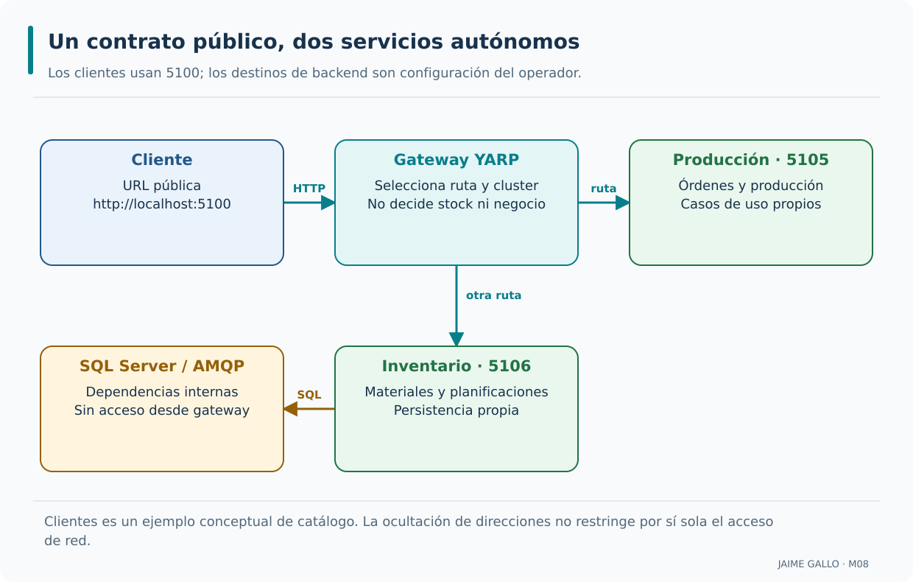

El cliente conoce el gateway y cada ruta selecciona el servicio responsable. Producción e Inventario mantienen sus dependencias detrás de sus propios límites. La conexión interna de Inventario con SQL/AMQP no implica acceso del gateway a esos recursos. Clientes no aparece como proceso porque pertenece al catálogo conceptual. Los puertos internos siguen disponibles para comprobar el laboratorio; la figura no acredita aislamiento de red.

---

### Responsabilidades del API Gateway

El enrutamiento es la responsabilidad esencial del gateway, pero no la única capacidad que puede incorporar. Según el sistema, también puede aplicar políticas de autenticación y autorización, límites de peticiones, observabilidad, transformaciones de protocolo o agregación de respuestas. Cada función tiene coste y debe justificarse: centralizar no significa llevar al gateway las invariantes del dominio. Para AceriaApp comenzaremos por la selección de rutas con YARP y distinguiremos con claridad las capacidades realmente registradas en el pipeline de aquellas que el catálogo menciona únicamente como hipótesis de arquitectura.

```text
Responsabilidades del API Gateway:

Enrutamiento        → dirigir la petición al servicio.
Traducción          → convertir protocolos.
Agregación          → combinar respuestas.
Políticas transversales → autenticación, autorización, rate limiting.
```

Las responsabilidades del gateway requieren decisiones de configuración y componentes verificables. Cada responsabilidad es independiente; combinan configuración declarativa y componentes específicos cuando la función lo necesita; y el alcance depende de las políticas y rutas configuradas. Estas condiciones permiten que el gateway sea configurable y mantenible.

Enrutamiento es la responsabilidad mínima. Traducción de protocolos y agregación son posibilidades arquitectónicas que requieren código y decisiones adicionales; no aparecen automáticamente al registrar un proxy inverso.

El gateway docente conduce órdenes a Producción y materiales a Inventario. No compone una respuesta de cliente con varios servicios ni consume mensajes RabbitMQ para responder HTTP. Su configuración determina la superficie publicada.

Agregar respuestas puede acoplar latencias y fallos: una petición pasa a depender de varios servicios. Antes de introducir esa función, define qué ocurre ante datos parciales y qué parte pertenece a una aplicación específica, por ejemplo un BFF.

Localiza una ruta pública, su ClusterId y sus destinos. Esa cadena explica quién recibe una petición. Una prueba que solo comprueba nombres de servicios valida la declaración; una petición real acredita el enrutamiento efectivo.

---

### Lo que un API Gateway no debe hacer

El gateway no debería convertirse en una segunda aplicación de negocio. Si decide cuándo puede finalizarse una orden, duplica las reglas de Producción y dificulta su evolución. Tampoco resuelve por sí solo la disponibilidad global: una sola instancia de gateway puede ser un punto de fallo y una ruta configurada hacia un servicio inaccesible seguirá fallando. En AceriaApp las comprobaciones de negocio y la persistencia continúan en los servicios; el proxy conserva el significado de los estados HTTP y comunica los errores de transporte. La disponibilidad de varias instancias de gateway requeriría un diseño de despliegue adicional.

```text
Lo que un API Gateway no debe hacer:

- Contener reglas de negocio.
- Transformar el modelo del dominio.
- Ser un punto único de fallo.
- Almacenar estado de negocio o de sesión exclusivo de una instancia.
- Acceder directamente a la base de datos.
```

`- Contener reglas de negocio.` las reglas residen en los servicios; `- Transformar el modelo del dominio.` solo enruta; `- Ser un punto único de fallo.` se despliega con redundancia; `- Almacenar estado de negocio o de sesión exclusivo de una instancia.` evita que una sesión o un dato de negocio dependa de una única copia local; las conexiones y la salud son estado técnico permitido.

`- Acceder directamente a la base de datos.` solo enruta.

El gateway se mantiene simple. También los servicios internos conservan su autonomía. Ambos factores permiten que el gateway sea sustituible sin afectar a la lógica de negocio.

El límite hexagonal coloca las decisiones del negocio en los casos de uso y el dominio. El gateway es un adaptador de entrada independiente; no necesita referencias a entidades, repositorios ni DbContext para reenviar HTTP.

La regla que rechaza una planificación no válida sigue ejecutándose en Producción. Un cambio de ruta pública no modifica esa regla. SQL Server y RabbitMQ permanecen detrás de sus servicios, fuera del proceso AceriaApp.Gateway.

Sin estado de sesión exclusivo no significa sin ningún estado: YARP mantiene conexiones, configuración y estados operativos de salud. Esos datos técnicos no deben convertirse en la única copia de información funcional necesaria para atender una petición.

Revisa las referencias del proyecto Gateway y el camino de una escritura. Debe ser el servicio quien valide y persista. Comprueba también que cada instancia del gateway podría arrancar con la misma configuración sin importar una sesión local de negocio.

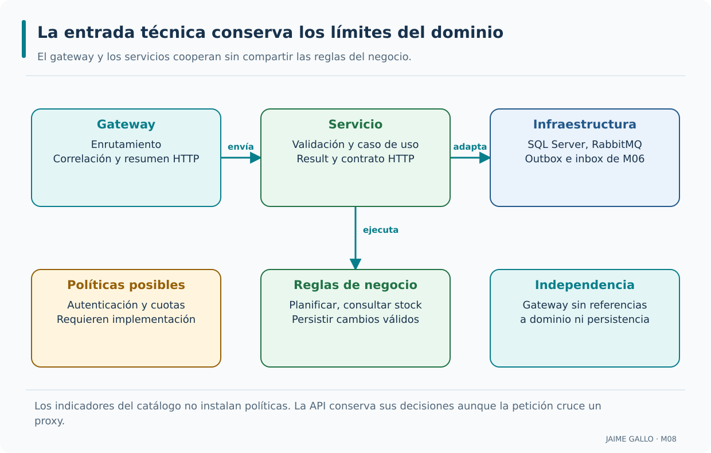

La fila superior identifica el recorrido técnico hasta la infraestructura de cada servicio. Las tarjetas inferiores distinguen políticas que podrían añadirse, reglas que sí pertenecen a los casos de uso y referencias que el gateway debe evitar. La ausencia de un enlace a las políticas posibles es deliberada: no se presentan autenticación y cuotas como componentes implementados. Una nueva regla de planificación se modifica en su servicio, no en el proxy.

---

### Diferencia entre API Gateway y balanceador

Gateway y balanceador contestan preguntas distintas. El primero decide a qué servicio corresponde una ruta pública, mientras que el segundo selecciona una instancia concreta entre destinos equivalentes de un mismo servicio. Una misma solución puede aplicar ambas decisiones en dos etapas. En el laboratorio, las rutas de órdenes conducen a Producción y las de materiales a Inventario; más adelante un cluster de Inventario tendrá dos destinos en 5106 y 5107. Cambiar de recurso no es lo mismo que alternar instancias: la primera selección depende del contrato de la API; la segunda, de la política de distribución.

```text
Diferencia entre API Gateway y balanceador:

Balanceador → distribuye entre instancias del mismo servicio.
Gateway     → enruta entre servicios distintos.
```

El balanceador distribuye entre instancias y puede operar en capa de transporte o de aplicación; el gateway trabaja en capa de aplicación; y ambos se complementan. Estas condiciones permiten que el sistema sea escalable y seguro.

Gateway y balanceador describen funciones distintas que pueden convivir en un producto. Existen balanceadores de capa 4 y de capa 7. YARP opera sobre HTTP y también puede seleccionar una instancia dentro de un cluster.

Primero, /api/v1/materiales selecciona el servicio Inventario. Después, en 8.4, RoundRobin elige entre sus procesos 5106 y 5107. La primera decisión se basa en la ruta; la segunda se basa en el conjunto de destinos disponibles.

Añadir réplicas del gateway protege el punto de entrada; añadir réplicas de Inventario aumenta sus destinos. Son escalados diferentes. Ninguno elimina por sí solo un fallo compartido de SQL Server ni resuelve una configuración errónea distribuida a todas las réplicas.

Dibuja ambas decisiones para una consulta. Si la ruta cambia de órdenes a materiales, cambia el servicio; si cambia solo la identidad de instancia de Inventario, ha actuado el balanceo conservando el mismo contrato HTTP.

---

### Patrones de API Gateway

Existen varias formas de delimitar el gateway: una entrada común para todos los consumidores, gateways adaptados a tipos de cliente o entradas separadas por dominio. Ninguna es universalmente preferible. Un gateway específico puede simplificar las necesidades de una interfaz, pero multiplica componentes y exige mantener sus contratos. En AceriaApp emplearemos una entrada única con prefijos explícitos para Producción e Inventario, sin crear una aplicación Clientes inexistente. El criterio de diseño será publicar únicamente recursos conocidos y comprobar qué consumidores necesitan realmente una interfaz diferente.

```text
Patrones de API Gateway:

Gateway único       → un gateway para todos.
Gateway por cliente → un gateway por cliente.
Gateway por dominio → un gateway por dominio.
BFF                 → un gateway por interfaz.
```

La elección de una variante del patrón depende de las necesidades concretas del sistema. Cada patrón tiene un propósito específico; la elección depende del contexto; y los patrones se pueden combinar. Estas condiciones permiten que el gateway se adapte a las necesidades del sistema.

Un BFF adapta una API a las necesidades de una interfaz concreta. Un gateway común prioriza contratos y políticas compartidas. La separación por dominio puede reflejar propiedad de equipos o distintos ciclos de publicación.

AceriaApp usa un único punto de entrada docente para que el recorrido sea observable. Los catálogos contemplan órdenes, inventario y clientes; Clientes permanece como ejemplo conceptual, sin introducir un tercer backend que no existe en el proyecto acumulativo.

Crear un gateway por cliente sin diferencias funcionales multiplica despliegues y configuración. A la inversa, concentrar toda composición de pantallas en un gateway común puede convertirlo en una aplicación con demasiados cambios y dependencias.

Para justificar otra variante, escribe qué necesidad cambia: datos, autorización, latencia o versión. Si la única diferencia es la dirección del backend, una configuración por entorno suele resolverla sin añadir otro patrón.

---

### Funciones transversales del API Gateway

Autenticación, autorización, cuotas, registro y correlación suelen considerarse políticas transversales, pero escribir sus nombres en una clase de configuración no significa haberlas implantado. Cada una requiere un componente efectivo en el pipeline y pruebas que demuestren cómo trata las peticiones. En AceriaApp YARP se utilizará principalmente para enrutar, transformar determinadas URLs y distribuir tráfico. Los ejemplos de políticas ayudan a razonar sobre una futura evolución, sin atribuir al laboratorio una protección que no se ha programado. La seguridad de cada servicio sigue siendo responsabilidad de toda la arquitectura.

```text
Funciones transversales:

Autenticación       → verificar identidad.
Autorización        → verificar permisos.
Limitación de tasa  → evitar abuso.
Registro            → registrar peticiones.
Monitorización      → medir rendimiento.
```

Las funciones transversales solo existen operativamente cuando su política se incorpora al pipeline. Su alcance se define por las políticas y el pipeline; se configuran de forma declarativa; y se pueden desactivar por ruta. Estas condiciones permiten que el gateway sea configurable.

Una preocupación transversal requiere registro, configuración y orden de ejecución. Tener una propiedad booleana llamada AplicaAutenticacion no ejecuta un autenticador; una cuota declarada necesita un limitador y una política aplicable a la ruta.

El catálogo original conserva los indicadores para expresar una revisión de diseño. La ampliación funcional implementa correlación, resumen HTTP seguro y encaminamiento; no presenta esos indicadores como acreditación de autenticación, autorización o cuotas de producción.

El registro indiscriminado de peticiones puede copiar cuerpos y credenciales. Se conserva el criterio de M07: propiedades técnicas seleccionadas y mensajes públicos seguros. La observación debe aportar diagnóstico sin introducir datos sensibles innecesarios.

Distingue en una revisión tres evidencias: intención del catálogo, registro de middleware y comportamiento observado. Para afirmar que una política opera, una prueba debe mostrar tanto una petición admitida como otra rechazada por esa política.

---

### API Gateway y seguridad

Al publicar una entrada HTTP concentramos una parte importante de la superficie de ataque. Eso permite establecer políticas comunes, siempre que realmente estén habilitadas y se mantenga la defensa de los servicios internos. Un gateway que oculta puertos en su configuración no impide acceder directamente a ellos si la red los deja expuestos. Para AceriaApp se utilizarán rutas explícitas y no un comodín global que revele diagnósticos o endpoints internos. También habrá que distinguir métodos de solo lectura de escrituras: Inventario aceptará GET y HEAD en sus recursos públicos y rechazará otros métodos con el comportamiento previsto.

```text
Seguridad en el API Gateway:

Autenticación       → verificar identidad.
Autorización        → verificar permisos.
Validación entrada  → comprobar formato.
Protección ataques  → limitar tasa ayuda a mitigar abuso.
```

Se aplica en el punto de entrada; centraliza las políticas; y protege a los servicios internos. Estas propiedades contribuyen a un diseño de seguridad que también necesita controles en servicios y red.

El borde es un lugar adecuado para aplicar controles compartidos, pero cada servicio conserva la autorización de sus operaciones. La validación técnica en el proxy no reemplaza las invariantes del dominio ni la validación del caso de uso.

El laboratorio delimita los prefijos publicados y valida la correlación de entrada. Un valor inválido se sustituye en el borde antes de propagarse. No se identifica al usuario mediante X-Canal, que es una marca técnica estable del recorrido.

Si un backend sigue accesible, un cliente puede intentar evitar el gateway. Además, confiar en cabeceras reenviadas exige conocer los proxies autorizados. Una cabecera que contiene un nombre de usuario no prueba identidad por sí misma.

Intenta una ruta no publicada y un endpoint interno de diagnóstico. Verifica que no se alcanzan mediante un comodín abierto. Separa ese ensayo de una revisión de autenticación, que requiere un mecanismo y credenciales concretos fuera de este alcance.

---

### API Gateway y observabilidad

El gateway observa las peticiones que entran y los resultados que regresa cada backend; esto ofrece una oportunidad para medir latencia y errores desde el borde del sistema. No sustituye el diagnóstico interno: un `503` puede surgir del proxy, de la red o del propio servicio, y se necesita correlación para saber dónde se produjo. En AceriaApp se conservarán los registros y health checks de M07 y se estudiará qué información aporta YARP durante el reenvío. No se presupone la existencia de un backend de métricas ni de trazas distribuidas completas por haber instalado un paquete NuGet.

```text
Observabilidad en el API Gateway:

Registro          → registrar todas las peticiones.
Latencia          → medir el tiempo de cada petición.
Contadores        → contar peticiones por servicio, capacidad posible.
Correlación       → propagar identificador.
```

Se concentra en el gateway; se integra con las herramientas existentes; y contribuye al diagnóstico entre procesos cuando se integra con las señales de los servicios. Estas condiciones permiten que el sistema sea observable.

La latencia del gateway mide el recorrido que él observa; no explica por sí sola cuánto tiempo consumió cada dependencia. La correlación une eventos, mientras una traza distribuida completa añade relaciones temporales entre operaciones.

Una consulta de Producción que llama a Inventario puede compartir CorrelationId con el resumen HTTP del gateway. El nombre del servicio y la identidad de instancia permiten ubicar el emisor sin confundir varios procesos que escriben JSON simultáneamente.

Registrar la query o el cuerpo completo para diagnosticar transformaciones puede exponer información. Las pruebas controladas pueden inspeccionar esos valores en un servidor de prueba sin habilitar ese volcado en los logs normales del laboratorio.

Envía una correlación válida y otra inválida. La primera se conserva; la segunda debe generar un valor efectivo coherente entre respuesta y servicios. Compara una consulta correcta con una caída de backend sin interpretar todo error como fallo de negocio.

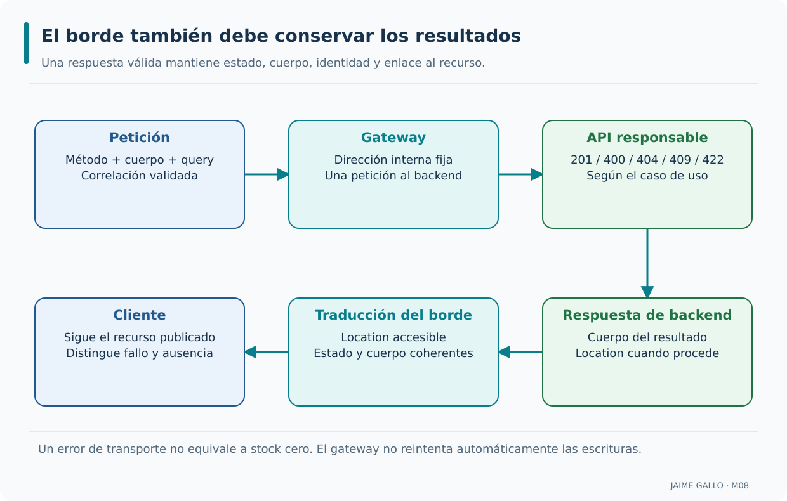

La fila superior sigue la petición y la inferior el regreso de la respuesta. El estado funcional lo decide la API y el gateway conserva su significado. Location necesita una dirección que el cliente pueda seguir por el contrato público. El identificador efectivo de correlación permite relacionar los dos sentidos. Un fallo entre procesos produce un error técnico; el borde no inventa un cuerpo de éxito para ocultarlo.

---

### Ventajas e inconvenientes del API Gateway

Un gateway facilita a los clientes encontrar los servicios, mantener direcciones estables y aplicar determinadas políticas en un único lugar. A cambio introduce otro proceso que hay que desplegar, observar y proteger. También puede convertirse en cuello de botella si no dispone de capacidad suficiente o si acumula responsabilidades del dominio. En el laboratorio comprobaremos una ventaja tangible: una misma URL pública sigue siendo válida cuando cambia un destino interno. Las desventajas no se ocultarán tras un indicador de «gateway activo»: se estudiarán errores, disponibilidad y comportamiento bajo fallos.

```text
Ventajas:

Simplificación del cliente.
Centralización de políticas.
Ocultación de la topología.
Observabilidad.

Inconvenientes:

Punto único de fallo.
Latencia adicional.
Complejidad operativa.
```

`Simplificación del cliente.` primera ventaja; `Centralización de políticas.` segunda ventaja; `Ocultación de la topología.` tercera ventaja; `Observabilidad.` cuarta ventaja.

`Punto único de fallo.` primer inconveniente; `Latencia adicional.` segundo inconveniente; `Complejidad operativa.` tercer inconveniente.

El valor del gateway debe medirse frente a su coste de operación y a sus responsabilidades reales. Las ventajas se materializan en sistemas con varios servicios; los inconvenientes se mitigan con redundancia y monitorización; y la decisión se documenta en un ADR. Estas condiciones permiten que la adopción del gateway sea razonada.

La adopción añade una dependencia en el camino público. Su beneficio debe evaluarse junto con latencia, coste operativo, disponibilidad y propiedad de la configuración. La redundancia es una estrategia de despliegue, no una propiedad automática de la biblioteca.

En el curso un solo proceso facilita el seguimiento del tráfico. Dos instancias de Inventario permiten estudiar reparto y recuperación, pero el gateway local y la base compartida continúan siendo componentes cuyo fallo afecta al recorrido.

Más reglas en el borde aumentan las combinaciones que comprobar. Una actualización que publica accidentalmente un prefijo interno puede afectar a todos los servicios. Conviene revisar la superficie pública como contrato y mantener una alternativa de reversión.

El ADR-031 explica la decisión y sus consecuencias. Contrasta una ventaja concreta, como no cambiar la URL del cliente al mover Inventario, con su coste verificable: otro proceso que arrancar, configurar, observar y probar.

---

### Publicación de AceriaApp a través de un gateway

El primer punto utiliza un catálogo conceptual para clasificar rutas y responsabilidades, pero también prepara el comportamiento ejecutable de YARP. Producción ofrece las rutas de órdenes, producción y comunicación; Inventario publica materiales y planificaciones en modo informativo. El gateway escuchará en 5100 y reenviará a los puertos internos apropiados, sin publicar un servicio Clientes que aún no existe. La validación del catálogo sirve para explicar relaciones; solo las pruebas HTTP demostrarán que un método y una ruta reales se envían al backend esperado. El gateway tampoco altera el stock ni la semántica de los casos de uso.

```text
Aplicación al proyecto del curso:

Gateway          → YARP.
Rutas            → catálogo conceptual; Producción e Inventario ejecutables.
Políticas        → registro y correlación; cuotas conceptuales.
Punto de entrada → único.
Validación       → test de coherencia.
```

La aplicación del API Gateway prepara el proyecto para los puntos 8.2, 8.3 y 8.4. El punto 8.2 estudiará la configuración básica de YARP. El punto 8.3 estudiará el enrutamiento de peticiones. El punto 8.4 estudiará el balanceo de carga básico. El punto 8.1 establece la base que se aplicará en los tres puntos siguientes.

El punto 8.1 prepara un modelo explícito para revisar rutas sin confundirlo con el proxy. RutaGateway describe datos; ValidadorApiGateway comprueba decisiones; CatalogoRutas proporciona un conjunto reproducible para estudiar esas comprobaciones.

Se conservan las tres rutas conceptuales de órdenes, inventario y clientes con autenticación, tasa y correlación declaradas. La integración posterior publica recursos existentes de Producción e Inventario, y conserva Clientes únicamente como ejemplo de análisis.

Un test verde del catálogo no prueba que el puerto 5100 esté escuchando ni que la API de destino haya contestado. Tampoco prueba la aplicación efectiva de sus tres políticas. Los ensayos de proxy se incorporan a partir de la etapa 8.2.

El reto calcula total de rutas, servicios distintos y rutas con autenticación declarada: el catálogo produce 3, 3 y 3. Explica el significado de esas cifras y después identifica qué evidencia adicional se necesita para comprobar tráfico real.

---

### Conceptos que conviene consolidar

- Un API Gateway es un componente que actúa como punto de entrada único a un conjunto de servicios.
- El gateway oculta la topología interna y centraliza las preocupaciones transversales.
- Las responsabilidades del gateway son enrutamiento, traducción, agregación y políticas transversales.
- El gateway mantiene fuera las reglas y persistencia de negocio; evita estado de sesión exclusivo y requiere redundancia para mitigar un fallo del punto de entrada.
- El balanceador distribuye entre instancias del mismo servicio; el gateway enruta entre servicios distintos.
- Los patrones de gateway son gateway único, por cliente, por dominio y BFF.
- Las funciones transversales son autenticación, autorización, limitación de tasa, registro y monitorización.
- El gateway es el punto donde se aplican las políticas de seguridad y se concentra la observabilidad.
- Las ventajas son simplificación, centralización, ocultación y observabilidad. Los inconvenientes son punto único de fallo, latencia adicional y complejidad operativa.

---

# Punto 8.2 — Configuración básica de YARP

**Módulo 8:** Publicación mediante API Gateway

**Objetivos de aprendizaje:**

- Comprender qué es YARP y su papel como implementación del patrón API Gateway.
- Identificar los conceptos de ruta y cluster en YARP.
- Comprender la configuración de YARP en `appsettings.json`.
- Comprender la integración de YARP con ASP.NET Core.
- Añadir al proyecto `AceriaApp` las clases de validación de la configuración de YARP y pruebas que verifiquen la validación, distinguiéndolas del comportamiento funcional del proxy.

## Convertir rutas públicas en destinos mediante YARP

La implementación del gateway requiere una relación explícita entre rutas, clusters y direcciones. Veremos cómo ASP.NET Core incorpora YARP, cómo se organiza su configuración y qué significa transformar una petición sin alterar su intención de negocio.

### Definición de YARP

YARP, sigla de Yet Another Reverse Proxy, es una biblioteca de Microsoft para construir proxies inversos sobre ASP.NET Core. No es una plataforma externa que sustituya a nuestros servicios; se integra en una aplicación .NET que recibe y reenvía tráfico HTTP. AceriaApp añade `AceriaApp.Gateway` sobre .NET 8 con `Yarp.ReverseProxy` 2.2.0, aprovechando el pipeline habitual de configuración y dependencias. El proyecto debe arrancar como proceso propio y escuchar en el puerto público 5100. Instalar el paquete no demuestra el enrutamiento: necesitaremos configurar rutas, clusters y destinos verificables.

```text
YARP:

Cliente → YARP → Servicio interno.
```

Es una biblioteca de .NET; además, se integra con ASP.NET Core. La tercera es que la configuración es declarativa. Estas condiciones permiten que el gateway sea configurable y mantenible.

El gateway se construye con el mismo stack que los servicios. A la vez, la configuración se versiona con el código. Ambos factores permiten que el gateway sea coherente con el resto del sistema.

YARP aporta componentes de proxy integrados en el modelo de ASP.NET Core. El proyecto que lo hospeda decide configuración, observación, políticas y despliegue. El paquete docente está fijado a Yarp.ReverseProxy 2.2.0 y el proyecto a net8.0.

AceriaApp.Gateway es un proceso separado de Producción e Inventario. Tener el mismo lenguaje no exige compartir el dominio: el contrato entre procesos sigue siendo HTTP, con sus códigos y cuerpos.

Actualizar una biblioteca puede cambiar contratos o valores predeterminados. Se estudian aquí las capacidades usadas por la versión fijada; los archivos completos de las prácticas son la referencia reproducible para paquetes y opciones de arranque.

Identifica TargetFramework y PackageReference en el proyecto Gateway. Arranca el proceso y consulta una ruta publicada con backend disponible. La carga correcta de un paquete acredita instalación; la respuesta reenviada acredita ejecución del proxy.

---

### Concepto de ruta en YARP

Una ruta de YARP define qué solicitudes públicas acepta el proxy y a qué cluster deben dirigirse. Su patrón no es una ruta de base de datos, sino una regla de coincidencia sobre método, host, path y otras condiciones admitidas. Cada regla tiene un identificador y un `ClusterId` que conecta la superficie pública con un conjunto de destinos. En AceriaApp no utilizaremos un patrón global que intercepte cualquier URL: las rutas se restringirán a prefijos concretos. Así podremos comprobar que una petición válida se reenvía y que un endpoint no publicado permanece fuera del contrato del gateway.

```json
{
  "Routes": {
    "ordenes-route": {
      "ClusterId": "ordenes-cluster",
      "Match": {
        "Path": "/api/v1/ordenes/{**catch-all}"
      }
    }
  }
}
```

`{` abre un objeto en el contexto mostrado; `"Routes": {` abre la sección de rutas; `"ordenes-route": {` declara la ruta de órdenes; `"ClusterId": "ordenes-cluster",` asocia la ruta al cluster.

`"Match": {` abre la sección de coincidencia; `"Path": "/api/v1/ordenes/{**catch-all}"` patrón de coincidencia; `}` cierra el objeto abierto en el contexto anterior; `}` cierra el objeto abierto en el contexto anterior.

Tiene un identificador único; tiene un patrón de coincidencia; y está asociada a un cluster. Estas condiciones permiten que el enrutamiento sea declarativo.

Una ruta relaciona condiciones de entrada con un cluster. Match decide elegibilidad; ClusterId decide el conjunto de backend; Transforms adapta la petición seleccionada. Cada parte responde a una pregunta distinta y puede revisarse por separado.

Una regla sobre /api/v1/ordenes conduce a Producción. Las rutas de materiales y planificaciones conducen a Inventario. No se publica automáticamente toda ruta que un servicio pueda atender; cada prefijo público se elige deliberadamente.

Un catch-all global simplifica un ejemplo, pero puede publicar administración o diagnóstico del backend. Una lista de métodos también forma parte del contrato: omitir un método necesario puede impedir una operación válida y admitir todos puede ampliar la superficie.

Ensaya una URL admitida, otra fuera de prefijo y un método no autorizado por la regla correspondiente. Comprueba en el servidor de prueba si recibió la petición; una respuesta de error aislada no identifica siempre quién la originó.

---

### Concepto de cluster en YARP

El cluster representa el destino lógico de una ruta y contiene una o varias direcciones HTTP concretas. Separar rutas de clusters evita repetir los mismos destinos para varias URLs públicas; también permite cambiar las instancias sin alterar el contrato del cliente. En el primer recorrido, Producción e Inventario se representan con destinos locales conocidos. Más adelante añadiremos una segunda instancia de Inventario para estudiar balanceo. Las direcciones deben incluir esquema y puerto correctos: una URI mal configurada puede cumplir un validador sintáctico y, aun así, apuntar a un proceso que nunca llega a responder.

```json
{
  "Clusters": {
    "ordenes-cluster": {
      "Destinations": {
        "ordenes-primary": {
          "Address": "http://aceria-ordenes:5001/"
        }
      }
    }
  }
}
```

`{` abre un objeto en el contexto mostrado; `"Clusters": {` abre la sección de clusters; `"ordenes-cluster": {` declara el cluster de órdenes; `"Destinations": {` abre la sección de destinos.

`"ordenes-primary": {` declara el destino principal; `"Address": "http://aceria-ordenes:5001/"` declara una dirección de ejemplo con nombre ASCII; debe resolverse en la red del emisor; `}` cierra el objeto abierto en el contexto anterior; `}` cierra el objeto abierto en el contexto anterior.

Tiene un identificador único; contiene una lista de destinos; y puede incluir políticas. Estas condiciones permiten que el destino sea configurable.

El cluster agrupa destinos intercambiables para el contrato de una ruta. Las políticas de balanceo, transporte y salud pertenecen a ese conjunto. El identificador de destino es una clave de configuración y no un dato que el cliente elige libremente.

Inventario comienza con una dirección local y termina con dos, 5106 y 5107. Ambas deben atender materiales y planificaciones con semántica compatible. Un destino de Producción no sería una réplica válida para ese cluster.

DestinationConfig expone Address, Health, Host y Metadata; no incluye Weight. Se puede conservar una intención de ponderación en un modelo docente, pero aplicarla requiere una política personalizada que interprete los metadatos.

Revisa que cada URI incluya esquema y puerto correctos y que el backend escuche allí. El indicador TieneDireccionValida del catálogo solo expresa una declaración; la validación funcional requiere usar direcciones concretas y comprobar una respuesta.

---

### Relación entre ruta y cluster

La ruta responde qué recurso pidió el cliente; el cluster indica qué conjunto de backends puede atenderlo. Varias rutas pueden compartir un cluster si pertenecen al mismo servicio, y un cluster puede tener más de un destino. Esta separación facilita que la API pública evolucione de forma independiente de la topología física. En AceriaApp las rutas de materiales y planificaciones apuntarán al cluster de Inventario, mientras que las rutas de órdenes apuntarán al de Producción. La coherencia del `ClusterId` se comprueba en configuración y se confirma enviando solicitudes reales.

```text
Relación ruta-cluster:

Ruta A referencia Cluster X.
Ruta B referencia Cluster X.
Ruta C referencia Cluster Y.
```

`Ruta A referencia Cluster X.` expresa la relación o la condición del ejemplo que se está analizando; `Ruta B referencia Cluster X.` expresa la relación o la condición del ejemplo que se está analizando; `Ruta C referencia Cluster Y.` expresa la relación o la condición del ejemplo que se está analizando.

Varias rutas pueden apuntar al mismo cluster; la separación permite evolucionar ambos de forma independiente; y la relación se expresa con el `ClusterId`. Estas condiciones permiten que la configuración sea modular.

La referencia ClusterId evita duplicar listas de destinos en cada ruta. Varias reglas pueden compartir un cluster si todas necesitan el mismo servicio y políticas compatibles. Un error en esa referencia debe detectarse al cargar o validar la configuración.

Materiales y planificaciones comparten el cluster de Inventario. La segunda instancia se añade una vez al cluster final; no se copia su dirección en cada ruta. Las operaciones públicas conservan su URL cuando cambia la topología.

Compartir cluster también comparte políticas. Si dos operaciones requieren distintas características de transporte o afinidad, conviene revisar si necesitan conjuntos separados, aun cuando algunas direcciones coincidan. La separación debe responder a un requisito explícito.

Sigue dos rutas hasta el mismo ClusterId y enumera sus destinos. Después localiza la política de ese cluster. El ejercicio distingue una decisión de publicación de una decisión operativa sin asignar reglas de negocio al gateway.

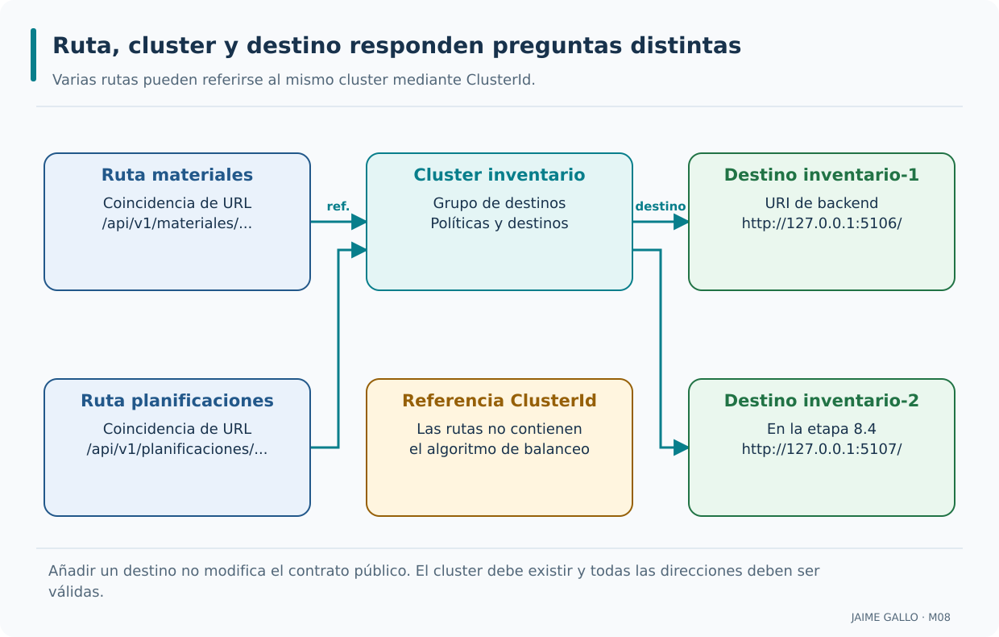

Las dos rutas de la izquierda se relacionan con el mismo cluster de Inventario. Las tarjetas centrales explican la referencia compartida y las de la derecha muestran los destinos disponibles en la evolución del módulo. Añadir la segunda instancia cambia el conjunto de servidores sin cambiar la URL pública. El segundo destino aparece en 8.4; no debe asumirse que está disponible durante las etapas anteriores.

---

### Integración de YARP con ASP.NET Core

YARP se incorpora al pipeline mediante el registro de servicios con `AddReverseProxy` y la publicación de endpoints con `MapReverseProxy`. El registro configura cómo funcionará el proxy; el mapeo permite que las rutas seleccionadas respondan a solicitudes entrantes. Es importante no confundir ambos pasos ni suponer que el middleware convierte cualquier controlador de la aplicación en un destino. En `AceriaApp.Gateway` la configuración se cargará desde los archivos previstos y los ensayos mostrarán qué backend recibe cada petición. También se verificará el comportamiento cuando ese backend esté detenido.

```csharp
var builder = WebApplication.CreateBuilder(args);
builder.Services.AddReverseProxy()
    .LoadFromConfig(builder.Configuration.GetSection("ReverseProxy"));

var app = builder.Build();
app.MapReverseProxy();
app.Run();
```

`var builder = WebApplication.CreateBuilder(args);` crea el constructor; `builder.Services.AddReverseProxy()` registra los servicios de YARP; `.LoadFromConfig(builder.Configuration.GetSection("ReverseProxy"));` carga la configuración; `var app = builder.Build();` construye la aplicación.

`app.MapReverseProxy();` añade el middleware de YARP; `app.Run();` arranca el servidor.

Reutiliza el modelo de middleware de ASP.NET Core. También la configuración se carga desde `appsettings.json`. La tercera es que YARP se combina con otros middlewares. Estas condiciones permiten que el gateway sea coherente con el resto del sistema.

AddReverseProxy registra servicios; LoadFromConfig suministra rutas y clusters; MapReverseProxy publica sus endpoints. El orden del middleware exterior determina qué información está disponible antes de reenviar y cómo se observan los resultados.

La correlación de M07 se establece antes del proxy para que la petición saliente use un valor validado. El resumen HTTP y el tratamiento de errores se integran en el host sin mover dependencias de SQL ni casos de uso al gateway.

La sobrecarga sin argumentos de MapReverseProxy incluye el pipeline estándar. Al usar una sobrecarga con configuración de pipeline no debe suponerse que se conservaron todos los componentes. Añadir middleware puede cambiar qué fallos quedan dentro de su alcance.

Localiza las tres llamadas en Program.cs y distingue qué se ejecuta al arrancar de lo que ocurre por petición. Usa un backend Kestrel controlado para comprobar que el proxy mantiene método, query y cuerpo.

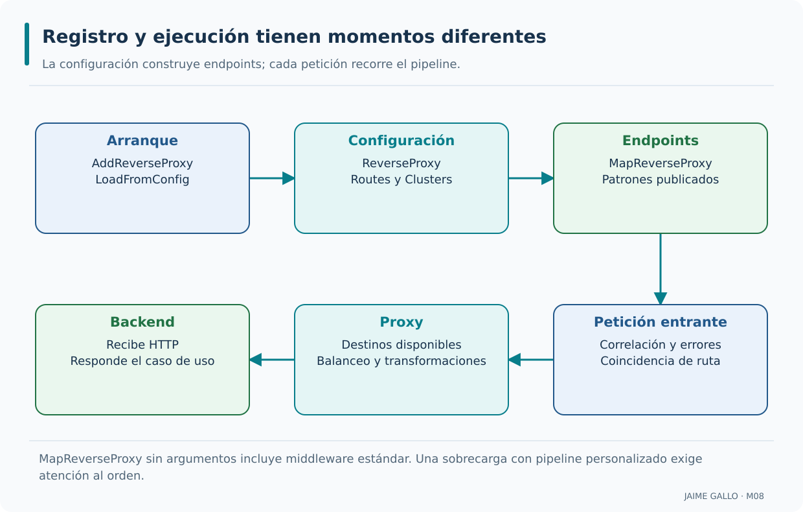

La fila superior describe decisiones de arranque y publicación de endpoints; la inferior sigue una petición ya recibida. La correlación precede al envío, el proxy selecciona un destino y el servicio resuelve el caso de uso. Las flechas no indican que AddReverseProxy se ejecute por cada petición. El middleware estándar y las sobrecargas personalizadas requieren una revisión distinta de sus componentes.

---

### Estructura de la configuración

Una configuración legible separa la sección `ReverseProxy` en rutas y clusters. Las rutas identifican patrones públicos y referencias a clusters; los clusters enumeran destinos mediante direcciones concretas. Esta estructura hace posible revisar una relación completa sin leer todo el código de arranque. En AceriaApp la configuración de desarrollo señalará `localhost:5105` para Producción y `localhost:5106` para Inventario. El documento puede analizarse estáticamente, pero la evidencia de integración exige que el proyecto Gateway arranque y que las APIs respondan con los contratos esperados.

```json
{
  "ReverseProxy": {
    "Routes": {
      "ordenes-route": {
        "ClusterId": "ordenes-cluster",
        "Match": {
          "Path": "/api/v1/ordenes/{**catch-all}"
        }
      }
    },
    "Clusters": {
      "ordenes-cluster": {
        "Destinations": {
          "ordenes-primary": {
            "Address": "http://aceria-ordenes:5001/"
          }
        }
      }
    }
  }
}
```

`"ReverseProxy": {` abre la sección de YARP; `"Routes": {` abre la sección de rutas; `"ordenes-route": {` declara la ruta de órdenes; `"ClusterId": "ordenes-cluster",` asocia la ruta al cluster.

`"Clusters": {` abre la sección de clusters; `"ordenes-cluster": {` declara el cluster de órdenes; `"Destinations": {` abre la sección de destinos; `"ordenes-primary": {` declara el destino principal.

Se organiza en secciones; se documenta; y se versiona con el código. Estas condiciones permiten que la configuración sea coherente y trazable.

ReverseProxy es la sección que se enlaza con IConfiguration. Routes y Clusters son sus colecciones principales; la estructura jerárquica del JSON importa tanto como los nombres. Un fragmento aislado puede ser correcto sin constituir un archivo completo.

El ejemplo reduce la configuración a una ruta conceptual de órdenes y un destino de su servicio para estudiar la referencia. Las prácticas incluyen la configuración completa de cada etapa, con sus rutas de Producción e Inventario y puertos docentes.

La configuración admite actualización cuando la fuente la notifica; eso no vuelve inocuo un cambio de destino. Debe validarse que la revisión cargada publica el mismo contrato y que los nuevos servidores realmente atienden las operaciones esperadas.

Comprueba que cada ClusterId de Routes existe en Clusters y que cada Address es una URI de backend conocida. Introducir un nombre arbitrario elegido desde una petición abriría una capacidad diferente y peligrosa que el laboratorio no implementa.

---

### Transformaciones de YARP

Las transformaciones permiten modificar determinados aspectos de una solicitud antes de reenviarla. Pueden ajustar la ruta, añadir una cabecera o establecer un parámetro de consulta, siempre según una regla explícita. No deben utilizarse para reescribir arbitrariamente el modelo del dominio ni para esconder una API mal diseñada. AceriaApp incorpora un alias `/inventario` que elimina únicamente ese prefijo antes de alcanzar los recursos publicados del servicio de Inventario. Comprobaremos la URI entrante y la recibida por el backend, evitando dar por hecho que cualquier transformación declarada tiene un efecto probado.

```json
{
  "Transforms": [
    {
      "PathRemovePrefix": "/inventario"
    },
    {
      "RequestHeader": "X-Canal",
      "Set": "Gateway"
    }
  ]
}
```

`{` abre un objeto en el contexto mostrado; `"Transforms": [` abre la lista de transformaciones; `{` abre un objeto en el contexto mostrado; `"PathRemovePrefix": "/inventario"` elimina únicamente el prefijo de alias /inventario antes de enviar al backend.

`},` cierra el objeto abierto en el contexto anterior; `{` abre un objeto en el contexto mostrado; `"RequestHeader": "X-Canal",` selecciona o establece una cabecera de la petición saliente; el valor mostrado es literal; `"Set": "Gateway"` establece el valor literal mostrado; no genera un identificador dinámico.

Cada transformación debe responder a una necesidad concreta de adaptación del contrato. Modifican la petición; se configuran por ruta; y se combinan en una lista. Estas condiciones permiten que el gateway adapte las peticiones al destino.

Las transformaciones de petición se configuran por ruta y modifican el mensaje saliente. La dirección del destino aporta esquema, autoridad y base de ruta; no se usa una transformación genérica para aceptar un host arbitrario del cliente.

El alias docente elimina /inventario y añade X-Canal con el literal Gateway. La correlación sigue el middleware validado; no se configura como una cadena constante. El recurso interno conserva /api/v1/materiales o /api/v1/planificaciones.

PathRemovePrefix debe corresponder a la diferencia real entre contratos. Eliminar /api/v1 de un backend que también espera ese prefijo produciría otra ruta y posiblemente un 404. Una transformación válida sintácticamente puede ser incorrecta funcionalmente.

Escribe antes y después de una URL concreta y comprueba la petición recibida por el servidor controlado. Compara también la query original y las cabeceras elegidas; cada modificación debe tener un propósito documentado.

---

### Configuración por entorno

Las direcciones internas cambian al pasar de procesos locales a redes de contenedores u otros entornos. El gateway debe conservar las rutas públicas siempre que sea posible y sustituir la configuración de destinos según el entorno, en vez de recompilar el código. `appsettings.Development.json` y `appsettings.Production.json` pueden expresar diferencias de despliegue, pero ninguna dirección conceptual representa automáticamente un contenedor ejecutable. En AceriaApp el laboratorio de Windows utiliza puertos locales; cualquier paso hacia nombres de red internos requiere un despliegue real que los resuelva.

```text
Configuración por entorno:

Desarrollo → direcciones locales.
Producción → direcciones del clúster.
```

Cada entorno tiene su propia configuración; la configuración se separa en archivos; y la configuración se versiona. Estas condiciones permiten que el gateway se adapte a cada contexto.

Los proveedores de configuración permiten variar valores sin recompilar el gateway. Desarrollo y contenedores tienen topologías distintas: localhost significa la máquina del proceso que realiza la llamada, no el equipo del usuario.

El recorrido local usa 127.0.0.1 y puertos 5105, 5106 y 5107. En una red de contenedores podrían usarse nombres como aceria-inventario; el nombre debe resolverse desde el contenedor del gateway y el puerto debe ser el interno correcto.

Una configuración de producción de ejemplo no constituye un despliegue de producción. Certificados, resolución DNS, controles de red, secretos y redundancia requieren decisiones adicionales. No deben incluirse contraseñas dentro del JSON versionado.

Documenta desde dónde se ejecuta cada proceso y qué dirección usa para hablar con el otro. Una conexión correcta desde el navegador del alumno no prueba resolución desde una red distinta. Comprueba siempre desde el contexto real del emisor.

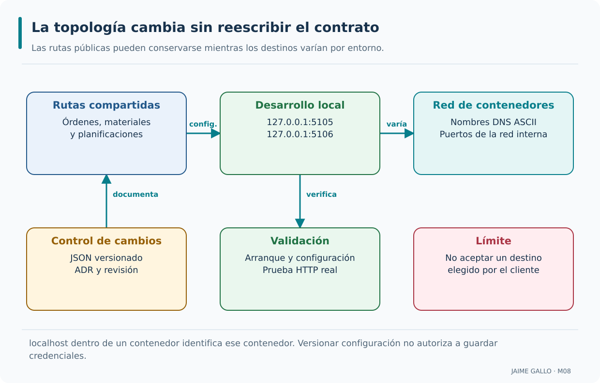

La superficie pública puede conservarse al sustituir direcciones locales por nombres de una red interna. Las tarjetas inferiores añaden las condiciones de una modificación controlada: revisión, comprobación y destinos fijados por el operador. La flecha entre entornos representa una alternativa de despliegue, no un reenvío que pase por ambos. El contexto del proceso emisor determina cómo se resuelve localhost y cada nombre DNS.

---

### Buenas prácticas de configuración de YARP

Configurar YARP exige mantener coherencia entre identificadores de rutas, clusters y destinos. Los patrones deben ser específicos para evitar publicaciones accidentales y las transformaciones necesitan una razón de contrato. La configuración debe revisarse junto con los estados HTTP y métodos permitidos, porque una respuesta inesperada puede proceder del backend y no del proxy. En AceriaApp se ensayarán lecturas, métodos rechazados y caída de destinos, y se verificará que una ruta no publicada no llega a un servicio interno. El criterio de corrección es el comportamiento observado.

```text
Buenas prácticas de configuración de YARP:

1. Identificadores descriptivos.
2. Configuración separada por entorno.
3. Transformaciones solo cuando son necesarias.
4. Documentar en el ADR.
5. Validar con un test.
```

`1. Identificadores descriptivos.` primera práctica; `2. Configuración separada por entorno.` segunda práctica; `3. Transformaciones solo cuando son necesarias.` tercera práctica; `4. Documentar en el ADR.` cuarta práctica.

`5. Validar con un test.` quinta práctica.

Una configuración comprensible muestra con claridad sus rutas y destinos; protegen la coherencia; y permiten el análisis automático. Estas condiciones permiten que la configuración sea un activo del sistema.

Los identificadores descriptivos y un ADR permiten revisar cambios sin deducir intención a partir de direcciones. La comprobación debe abarcar estructura, superficie pública y comportamiento del destino, no limitarse a que el JSON se pueda analizar.

El catálogo conserva tres clusters conceptuales y comprueba sus indicadores. La configuración ejecutable se ajusta a los dos servicios reales. Esta distinción permite conservar el ejercicio original y, a la vez, aprender qué evidencia falta en una revisión solo estática.

Duplicar configuración entre entornos facilita divergencias silenciosas. Mantén claras las opciones que cambian y prueba los caminos importantes después de ajustar direcciones o políticas. No ocultes un fallo cambiando la prueba para que solo inspeccione una cadena.

Revisa la relación ruta-cluster-destino y después ejecuta una lectura y una escritura publicadas. En una escritura, inspecciona el estado y Location además del cuerpo. Un 201 con enlace inalcanzable incumple una parte del contrato.

---

### Configuración de YARP en AceriaApp

El recorrido ejecutable introduce `AceriaApp.Gateway` como proyecto independiente, con YARP configurado para Producción e Inventario. Las rutas públicas permiten consultar recursos de cada contexto desde 5100; las direcciones 5105 y 5106 continúan siendo internas a la topología lógica del laboratorio, aunque accesibles para las comparaciones locales. El ejemplo de Clientes permanece en el catálogo como posibilidad futura, no como backend disponible. El alumno debe contrastar ruta pública, cluster configurado y respuesta real, incluida la indisponibilidad de un destino, sin confundir un registro válido con una integración exitosa.

```text
Aplicación al proyecto del curso:

Proyecto gateway  → AceriaApp.Gateway.
Configuración     → appsettings.json.
Rutas             → catálogo conceptual; Producción e Inventario ejecutables.
Clusters          → direcciones de los servicios.
Transformaciones  → canal y prefijo de alias; correlación en middleware.
Validación        → test de coherencia.
```

La aplicación de YARP prepara el proyecto para los puntos 8.3 y 8.4. El punto 8.3 estudiará el enrutamiento de peticiones con detalle. El punto 8.4 estudiará el balanceo de carga básico. El punto 8.2 establece la base que se aplicará en los dos puntos siguientes.

La etapa 8.2 añade el proceso Gateway al acumulado, además de los modelos originales de análisis. El validador conceptual y las pruebas de proxy cumplen propósitos complementarios: intención de configuración y circulación efectiva de HTTP.

ClusterYarp conserva identificador, destinos y sus dos indicadores. El reto suma tres clusters y tres destinos con configuración por entorno declarada: 3, 3 y 3. Las rutas reales publican los recursos existentes de Producción e Inventario.

El servicio Clientes del catálogo no se convierte en una dependencia que haya que arrancar. No debe afirmarse que el gateway docente ofrece autenticación o cuotas porque un modelo las declara. La independencia del proceso también se revisa en sus referencias.

Comprueba el comportamiento con el backend disponible y detenido. El segundo caso debe comunicar un fallo técnico; nunca debe devolver un objeto de éxito construido por el proxy. Reserva las cifras de tests para los resultados ejecutados sobre la revisión final.

---

### Conceptos que conviene consolidar

- YARP es una biblioteca de .NET para construir proxies inversos y gateways.
- Una ruta en YARP define la relación entre una petición entrante y un cluster.
- Un cluster en YARP define el conjunto de destinos.
- La relación entre ruta y cluster es de muchos a uno.
- YARP se integra con ASP.NET Core con `AddReverseProxy` y `MapReverseProxy`.
- La configuración se organiza en las secciones `Routes` y `Clusters`.
- Las transformaciones modifican la petición antes de enviarla al destino.
- La configuración se ajusta por entorno.
- Las buenas prácticas son identificadores descriptivos, configuración por entorno, transformaciones necesarias, documentación en ADR y validación con test.

---

# Punto 8.3 — Enrutamiento de peticiones

**Módulo 8:** Publicación mediante API Gateway

**Objetivos de aprendizaje:**

- Comprender el proceso de coincidencia de rutas en YARP.
- Identificar los patrones de ruta y su precedencia.
- Comprender las transformaciones de ruta, cabecera y consulta.
- Comprender el orden de aplicación de las rutas.
- Añadir al proyecto `AceriaApp` las clases de validación del enrutamiento de YARP y pruebas que verifiquen la validación, distinguiéndolas del comportamiento funcional del proxy.

## Elegir rutas y transformar peticiones con criterios verificables

La existencia de varias reglas no basta para saber qué ocurrirá con una URL. Estudiaremos coincidencia, precedencia, métodos, cabeceras y transformaciones, comparando la solicitud pública con el mensaje efectivo recibido por Producción o Inventario.

### Proceso de coincidencia de rutas

Cuando varias reglas pueden coincidir con una petición, YARP necesita seleccionar un endpoint conforme a su orden, especificidad y restricciones. Esa selección utiliza el enrutamiento de ASP.NET Core y no depende simplemente del orden en que aparecen las entradas del archivo JSON. Una misma URL puede admitirse con un método y rechazarse con otro. En AceriaApp se definirán prefijos concretos para que los recursos de Producción e Inventario no entren en conflicto. La prueba útil consiste en enviar casos similares que cambian un único aspecto de la coincidencia y observar qué regla acaba aplicándose.

```text
Proceso de coincidencia:

Petición → condiciones de coincidencia y precedencia → seleccionar endpoint → aplicar ruta.
```

Las rutas se ordenan por prioridad; se selecciona un endpoint según los criterios aplicables; y la evaluación ocurre en cada petición. Estas condiciones permiten que el enrutamiento sea predecible.

El orden de las rutas importa. También se aplica el endpoint seleccionado según prioridad y condiciones de coincidencia. Ambos factores permiten que el enrutamiento sea determinista.

La selección se integra con endpoint routing de ASP.NET Core. No consiste en recorrer propiedades del JSON hasta encontrar la primera coincidencia textual. Se combinan Order, especificidad y condiciones que producen un endpoint válido o un fallo de selección.

Una consulta de materiales coincide con su superficie publicada y conduce al cluster de Inventario. Una URL fuera de esa superficie debe terminar en el borde sin descubrir un endpoint interno simplemente porque el backend conoce su ruta.

Dos reglas igualmente elegibles pueden producir ambigüedad. Cambiar el orden de las propiedades del archivo no es una solución fiable. Debe precisarse el contrato o ajustar Order y condiciones para que la elección sea deliberada.

Construye una tabla con URL, método y regla esperada. Incluye una petición válida, otra fuera de ruta y una que diferencia condiciones. Confirma en un backend controlado cuál se recibió y conserva la tabla como explicación del ensayo.

---

### Patrones de ruta

Un patrón de ruta describe segmentos literales, parámetros y restricciones que deben satisfacer las URLs recibidas. Un parámetro puede capturar un identificador, pero su forma válida no demuestra que exista un recurso con ese identificador. Los comodines demasiado amplios aumentan el riesgo de publicar endpoints internos. En AceriaApp diferenciaremos los prefijos públicos de Producción y el alias limitado de Inventario. La especificidad del patrón y las condiciones de método ayudarán a evitar que el proxy trate una petición de escritura como si fuera una consulta autorizada.

```json
{
  "Match": {
    "Path": "/api/v1/ordenes/{id:guid}",
    "Methods": [ "GET" ]
  }
}
```

`{` abre un objeto en el contexto mostrado; `"Match": {` abre la sección de coincidencia; `"Path": "/api/v1/ordenes/{id:guid}",` patrón de ruta con parámetro y restricción; `"Methods": [ "GET" ]` restringe el método HTTP.

`}` cierra el objeto abierto en el contexto anterior; `}` cierra el objeto abierto en el contexto anterior.

Usa la sintaxis de ASP.NET Core; puede incluir restricciones; y se declara en la configuración. Estas condiciones permiten que el enrutamiento sea expresivo.

Un parámetro captura un segmento; una restricción participa en la coincidencia. El patrón {id:guid} exige una forma compatible con Guid, pero no demuestra que el recurso exista ni que el usuario tenga permiso para leerlo.

El catálogo original conserva la ruta conceptual de órdenes por id y su catch-all. Las prácticas reales respetan los contratos existentes del acumulado. Los ejemplos de patrones muestran sintaxis y no cambian el tipo de identificador de una API previa.

Un catch-all captura varios segmentos y amplía el conjunto de rutas admitidas. El alias de Inventario debe limitarse a materiales y planificaciones; no debe abrir el backend entero con /inventario/{**resto} sin filtro.

Compara un valor con forma válida, otro que viola una restricción y otro inexistente que sí la cumple. Distingue rechazo de coincidencia y ausencia del recurso: ambos pueden producir 404, pero recorren partes distintas del sistema.

---

### Precedencia de rutas

La precedencia importa cuando dos reglas son candidatas para una misma solicitud. YARP combina `Order`, especificidad de patrones y condiciones de coincidencia; por eso no puede afirmarse que la primera regla escrita sea siempre la elegida. Para estudiar el caso conviene construir URLs que coincidan con varias configuraciones de prueba y comparar la selección efectiva. En AceriaApp las rutas publicadas se mantendrán deliberadamente diferenciadas, y cualquier regla de alias deberá poder justificarse sin ampliar inadvertidamente el acceso. El resultado debe verificarse con peticiones, no solo inspeccionando una lista ordenada.

```text
Precedencia de rutas:

Ruta específica  → mayor especificidad con el mismo Order.
Ruta general     → menor especificidad con el mismo Order.
```

Se basa en la especificidad; se puede ajustar con `Order`; y garantiza el orden de evaluación. Estas condiciones permiten que el enrutamiento sea predecible.

Order es una prioridad explícita: los valores menores preceden a mayores. Si no se distingue por Order, interviene la especificidad del patrón y otras condiciones. La configuración no debe depender de empates ambiguos.

El catálogo asigna órdenes 1 a 4 a reglas conceptuales y valida que no sean negativos. Esa limitación es una regla de ese ejercicio; YARP admite valores negativos, por lo que no debe describirse como una restricción del framework.

Dar siempre prioridad extrema a una regla general puede eclipsar una específica. Un ejemplo con dos reglas que no se solapan no demuestra precedencia, aunque sus valores estén ordenados. La prueba necesita una petición que pudiera elegir entre ambas.

Ensaya una coincidencia solapada y registra qué destino recibió la petición. Cambia una prioridad en una copia aislada y explica el efecto. La regla elegida debe deducirse del contrato, no del orden de escritura del JSON.

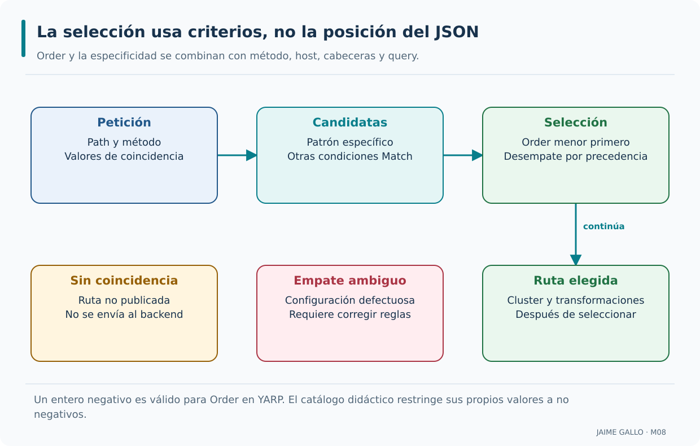

La selección combina criterios antes de aplicar las transformaciones de la ruta elegida. Las dos tarjetas inferiores de la izquierda representan resultados que necesitan tratamiento propio: no coincidencia y ambigüedad. Un valor negativo de Order es válido en YARP, aunque el catálogo didáctico lo rechace por una política local. La posición textual del JSON no es el mecanismo de selección y no resuelve un empate.

---

### Transformaciones de ruta

`PathRemovePrefix` permite que un consumidor utilice una URL pública con un prefijo adicional mientras el backend recibe la ruta que ya entiende. También existen transformaciones como `PathSet` o `PathPattern`, apropiadas para contratos distintos. La transformación debe actuar después de seleccionar la ruta y antes de reenviar la petición. En AceriaApp el alias `/inventario/api/v1/materiales` se convertirá en `/api/v1/materiales` al llegar a Inventario. Esa equivalencia no significa que el gateway deba exponer todos los endpoints del backend: el alias estará limitado a los recursos publicados.

```json
{
  "Transforms": [
    { "PathRemovePrefix": "/inventario" }
  ]
}
```

`{` abre un objeto en el contexto mostrado; `"Transforms": [` abre la lista de transformaciones; `{ "PathRemovePrefix": "/inventario" }` elimina únicamente el prefijo de alias /inventario antes de enviar al backend; `]` cierra la colección de elementos del contexto mostrado.

`}` cierra el objeto abierto en el contexto anterior.

Modificar el path requiere distinguir la coincidencia inicial de la URL finalmente enviada. Modifican la ruta de la petición; se aplican después de la coincidencia; y se combinan en una lista. Estas condiciones permiten que el enrutamiento sea flexible.

La coincidencia usa la URL de entrada. La transformación se aplica después para construir la petición saliente. Esta separación permite un alias público sin obligar al backend a conocer ese alias.

El ejemplo /inventario/api/v1/materiales elimina solo /inventario y llega como /api/v1/materiales. PathSet reemplazaría la ruta; PathPattern la construiría con valores capturados. Son operaciones distintas y no deben usarse de forma intercambiable.

Una transformación de petición no arregla por sí sola Location de una respuesta. Si una creación devuelve un enlace interno, el borde debe asegurar que el cliente reciba una URL pública válida sin alterar la identidad del recurso creado.

Anota URL entrante, prefijo eliminado y ruta resultante. Comprueba el valor recibido por el servidor y sigue cualquier Location devuelto al crear. Así se comprueba el contrato en ambas direcciones.

---

### Transformaciones de cabecera

Las cabeceras HTTP pueden aportar correlación, información de proxy y metadatos de comunicación. YARP permite transformarlas, pero conviene decidir si una cabecera existente se reemplaza, se añade o debe conservarse. Algunas cabeceras tienen significado de seguridad y no deberían aceptarse ciegamente del cliente. En AceriaApp emplearemos ejemplos controlados, como una cabecera de canal o correlación, para observar lo que llega al destino. La transformación de cabeceras no implementa autenticación ni autorización; esas funciones requieren comprobaciones explícitas en el pipeline y en los servicios.

```json
{
  "Transforms": [
    { "RequestHeader": "X-Canal", "Set": "Gateway" },
    { "RequestHeader": "X-Forwarded-Host", "Set": "aceria.local" }
  ]
}
```

`{` abre un objeto en el contexto mostrado; `"Transforms": [` abre la lista de transformaciones; `{ "RequestHeader": "X-Canal", "Set": "Gateway" },` selecciona o establece una cabecera de la petición saliente; el valor mostrado es literal; `{ "RequestHeader": "X-Forwarded-Host", "Set": "aceria.local" }` selecciona o establece una cabecera de la petición saliente; el valor mostrado es literal.

`]` cierra la colección de elementos del contexto mostrado; `}` cierra el objeto abierto en el contexto anterior.

Modificar cabeceras exige decidir qué valores se aceptan, sustituyen o propagan. Modifican las cabeceras; se aplican por ruta; y se combinan en una lista. Estas condiciones permiten que el enrutamiento añada contexto.

Set reemplaza un valor y Append agrega otro. Para quitar una cabecera de petición existe RequestHeaderRemove; no se configura una operación Remove genérica dentro de RequestHeader. La respuesta tiene sus transformaciones específicas.

X-Canal=Gateway es deliberadamente constante y permite reconocer el alias en una prueba. X-Correlation-ID debe ser un valor efectivo por petición: se valida o genera antes del envío y se conserva entre procesos.

Un cliente puede enviar su propia X-Canal. Reemplazarla evita confundirla con la marca elegida para el ejemplo, pero no convierte esa marca en credencial. Tampoco deben copiarse ciegamente Host o cabeceras de reenvío recibidas de un origen no confiable.

Envía una X-Canal distinta y comprueba el valor que recibe el backend. Haz un ensayo separado para correlación y revisa que la sustitución de un valor inválido se haga una sola vez en el borde.

---

### Transformaciones de consulta

Los parámetros de consulta pueden conservarse, añadirse o derivarse de valores capturados durante el enrutamiento. Una transformación como `QueryValueParameter` no equivale a modificar la ruta, y `QueryRouteParameter` utiliza información del patrón seleccionado. En AceriaApp podemos mantener una query original, por ejemplo `pagina=1`, y estudiar cómo se incorpora otro valor sin perder la intención del cliente. La prueba debe comprobar la URL efectiva vista por Inventario, no limitarse a que el gateway devuelva `200`. También hay que preservar correctamente codificación y valores existentes.

```json
{
  "Transforms": [
    { "QueryRouteParameter": "id", "Set": "id" },
    { "QueryValueParameter": "canal", "Set": "gateway" }
  ]
}
```

`{` abre un objeto en el contexto mostrado; `"Transforms": [` abre la lista de transformaciones; `{ "QueryRouteParameter": "id", "Set": "id" },` obtiene el valor capturado id y lo establece en la consulta saliente; `{ "QueryValueParameter": "canal", "Set": "gateway" }` establece el marcador literal canal=gateway en la consulta saliente.

`]` cierra la colección de elementos del contexto mostrado; `}` cierra el objeto abierto en el contexto anterior.

Modificar la query exige preservar la información original del cliente y comprender cómo se agregan los nuevos parámetros. Añaden parámetros de consulta; usan valores literales o de ruta; una cabecera requiere código personalizado; y se combinan en una lista. Estas condiciones permiten que el enrutamiento enriquezca la petición.

QueryValueParameter establece o añade un valor literal; QueryRouteParameter obtiene el valor de un parámetro capturado por la ruta. Copiar una cabecera a query requiere una transformación de código y una revisión de qué datos pueden exponerse.

El ejemplo usa QueryRouteParameter para id y QueryValueParameter para canal=gateway. El alias funcional utiliza el segundo caso y conserva los parámetros originales. No depende de una clave inexistente llamada QueryParameterFromHeader.

Mover datos de una cabecera a query cambia su visibilidad: las URL pueden aparecer en históricos o registros de intermediarios. La transformación no debe emplearse para desplazar secretos o tokens. Un marcador de canal no es información de identidad.

Prueba una query original como pagina=1 y verifica su conservación junto con canal=gateway. Para un valor capturado, comprueba la codificación de caracteres y el nombre exacto de la clave, sin construir URL mediante concatenación insegura.

---

### Orden de aplicación de las transformaciones

Cuando una ruta declara varias transformaciones, su orden puede afectar el resultado final. No existe una regla universal que ejecute primero todas las transformaciones de path y después todas las de cabeceras: deben interpretarse conforme a la configuración y al pipeline de YARP. En AceriaApp seguiremos el recorrido de una URL desde que coincide con el alias `/inventario` hasta que se elimina ese prefijo y se aplican otras modificaciones admitidas. Escribir el antes y el después de cada fase ayuda a detectar errores de doble prefijo, pérdida de query y reenvío incorrecto.

```text
Orden de aplicación:

1. Leer la lista Transforms de la ruta.
2. Aplicar sus operaciones en el orden declarado.
3. Comprobar el mensaje resultante; no hay reordenación por tipo.
```

`1. Leer la lista Transforms de la ruta.` identifica una decisión de la secuencia o de la lista de comprobación mostrada; `2. Aplicar sus operaciones en el orden declarado.` identifica una decisión de la secuencia o de la lista de comprobación mostrada; `3. Comprobar el mensaje resultante; no hay reordenación por tipo.` identifica una decisión de la secuencia o de la lista de comprobación mostrada.

Las transformaciones se aplican en orden; el orden determina el resultado; y el orden se documenta. Estas condiciones permiten que el enrutamiento sea predecible.

La lista Transforms expresa la secuencia. No existe un reordenamiento universal que ejecute primero todos los cambios de ruta, luego cabeceras y después query. Las dependencias entre operaciones deben quedar claras en esa lista.

En el alias se elimina el prefijo, se establece X-Canal y se añade canal. Ese orden coincide con el ejemplo elegido; no constituye una regla general impuesta por YARP. Dos cambios sobre el mismo campo pueden dar resultados distintos al invertirse.

Una transformación de respuesta pertenece a otra fase y no debe mezclarse conceptualmente con la preparación de la petición. Además, editar la ruta no vuelve a ejecutar la selección del endpoint original como si hubiera llegado una petición nueva.

Compara la lista con la petición observada por Kestrel. Para estudiar dependencia, usa una copia controlada con dos operaciones sobre la misma ruta. Documenta la secuencia exacta que produce el resultado esperado.

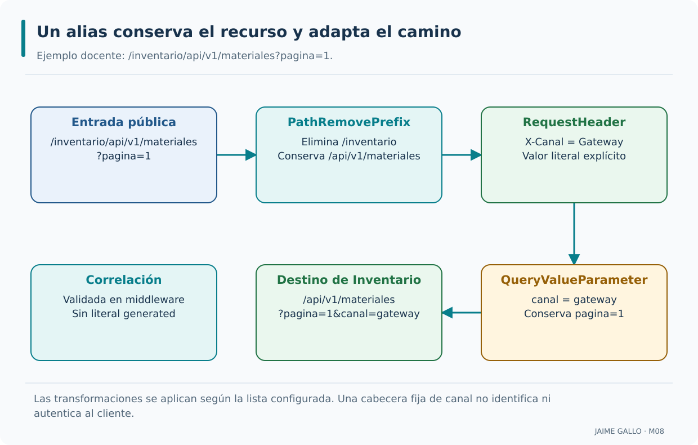

El recorrido parte de una URL que ya coincide con una ruta publicada. PathRemovePrefix quita únicamente /inventario; la query conserva pagina=1 y añade el marcador de canal. La correlación se representa aparte porque se valida en middleware y no se convierte en un literal de configuración. Las flechas reproducen el orden de este ejemplo, sin imponer una secuencia universal por tipo de transformación.

---

### Enrutamiento basado en cabeceras

Una regla puede seleccionar solicitudes a partir de condiciones sobre cabeceras, además de ruta y método. Esto es útil para versiones o contratos diferenciados, pero la cabecera debe tratarse como dato del cliente, no como evidencia automática de identidad. Coincidir con `Authorization` no equivale a verificar un token ni a conceder permisos. En AceriaApp el ejemplo distingue el valor esperado, otro valor y la ausencia de la cabecera, para comprender cómo cambia la elegibilidad de rutas. La autorización real exige otra capa de comprobaciones.

```json
{
  "Match": {
    "Path": "/api/v1/ordenes/{**catch-all}",
    "Headers": [
      { "Name": "X-Client", "Values": [ "mobile" ] }
    ]
  }
}
```

`{` abre un objeto en el contexto mostrado; `"Match": {` abre la sección de coincidencia; `"Path": "/api/v1/ordenes/{**catch-all}",` patrón de ruta; `"Headers": [` abre la lista de condiciones de cabecera.

`{ "Name": "X-Client", "Values": [ "mobile" ] }` condición de cabecera; `]` cierra la colección de elementos del contexto mostrado; `}` cierra el objeto abierto en el contexto anterior; `}` cierra el objeto abierto en el contexto anterior.

La ruta se selecciona según la cabecera; la condición se declara en `Match`; y permite variantes por cliente. Estas condiciones permiten que el enrutamiento sea flexible.

Headers permite condiciones adicionales de coincidencia. Hosts tiene su propio criterio de configuración; una condición sobre Authorization no verifica la firma ni los permisos de un token. Enrutamiento y autenticación responden a cuestiones diferentes.

El ejemplo X-Client=mobile muestra selección por un valor de cabecera. Es un caso conceptual para comprender Match.Headers; no se introduce una aplicación móvil o una identidad nueva en el proyecto acumulativo.

Un valor controlado por el cliente puede cambiar qué regla coincide. Si se usa para aislar versiones o inquilinos, hacen falta políticas que comprueben que el cliente está autorizado a esa selección. La simple coincidencia no ofrece esa garantía.

Envía el valor esperado, un valor distinto y ninguna cabecera. Compara las reglas elegibles en los tres casos. No uses un resultado de coincidencia como evidencia de que se haya autenticado a la persona.

---

### Buenas prácticas de enrutamiento

Una estrategia de enrutamiento mantenible utiliza patrones específicos, prioridades justificadas y transformaciones limitadas al contrato que se publica. También hay que comprobar el estado que regresa el backend y distinguirlo de un error del proxy: un `404` funcional, un método rechazado y un destino caído representan problemas distintos. En AceriaApp la revisión incluirá éxito, prefijo desconocido, método no admitido y fallo de conexión. Las redirecciones y cabeceras como `Location` merecen atención cuando la API crea recursos, porque la URL interna no debería filtrarse como única referencia pública.

```text
Buenas prácticas de enrutamiento:

1. Con el mismo Order, aprovechar la especificidad de las rutas.
2. Restricciones en los parámetros.
3. Transformaciones solo cuando son necesarias.
4. Documentar el orden de las rutas.
5. Validar con un test.
```

`1. Con el mismo Order, aprovechar la especificidad de las rutas.` usa la especificidad como criterio de precedencia sin ignorar una prioridad Order explícita; `2. Restricciones en los parámetros.` segunda práctica; `3. Transformaciones solo cuando son necesarias.` tercera práctica; `4. Documentar el orden de las rutas.` cuarta práctica.

`5. Validar con un test.` quinta práctica.

Una política de enrutamiento clara permite explicar por qué una petición llega a determinado destino; protegen la coherencia; y permiten el análisis automático. Estas condiciones permiten que el enrutamiento sea un activo del sistema.

Las buenas prácticas se traducen en casos de prueba concretos. Especificidad, restricciones y prioridades deben evitar ambigüedades; las transformaciones deben conservar la semántica del recurso y justificar cada cambio.

Las pruebas del catálogo verifican cuatro reglas ordenadas, con ruta y cabecera declaradas en todas y consulta en dos. Las pruebas funcionales verifican que la URL pública, método y mensaje saliente producen el resultado esperado en un servidor real.

Tener siempre un flag de transformación true no es un requisito de YARP. Una ruta puede reenviarse sin modificar nada. Mantener esa exigencia en el validador original sirve al ejercicio, pero no debe obligar a añadir modificaciones inútiles al proxy.

Incluye éxito, método no admitido, prefijo desconocido y error del backend en la revisión. Inspecciona Location en creaciones y verifica que un fallo no se convierte en éxito. Esos casos prueban decisiones diferentes del contrato.

---

### Rutas públicas de AceriaApp

Al completar el enrutamiento, AceriaApp dispone de rutas públicas acotadas por prefijo y método, además de un alias que adapta únicamente los recursos de Inventario acordados. La selección depende de las reglas efectivas y las transformaciones modifican solo lo necesario para que el backend reciba un mensaje válido. El método GET o HEAD de Inventario mantiene su sentido de lectura; las escrituras no se habilitan por existir un comodín de proxy. Las pruebas deben distinguir contrato no encontrado, método rechazado y fallo técnico de un destino para no atribuir al gateway decisiones de negocio que pertenecen al servicio.

```text
Aplicación al proyecto del curso:

Orden de rutas       → Order y especificidad; evitar ambigüedad.
Transformaciones ruta → eliminar prefijo.
Transformaciones cabecera → X-Canal=Gateway; correlación mediante middleware.
Transformaciones consulta → canal=gateway como valor literal.
Validación           → test de coherencia.
```

La aplicación del enrutamiento prepara el proyecto para el punto 8.4. El punto 8.4 estudiará el balanceo de carga básico. El punto 8.3 establece la base que se aplicará en el punto 8.4.

La etapa 8.3 conserva ReglaEnrutamiento y sus validaciones y añade comportamiento real del alias. El objetivo es explicar cómo una regla declarada termina en una petición HTTP verificable, sin mezclar conceptos de catálogo y endpoint.

El reto cuenta cuatro reglas, cuatro con transformación de ruta, cuatro con cabecera y dos con consulta. El resultado 4,4,4,2 describe los indicadores del catálogo y no significa que se hayan enviado cuatro peticiones de red.

El prefijo eliminado en la integración es /inventario, no /api/v1. Se añade un literal de canal y se propaga correlación validada. Los endpoints internos continúan fuera de la superficie pública aun cuando compartan backend.

Ejecuta el alias con un recurso publicado y comprueba que llega al mismo recurso interno. Después intenta una ruta interna no publicada. La primera prueba acredita adaptación; la segunda comprueba que el alias no se volvió un acceso irrestricto.

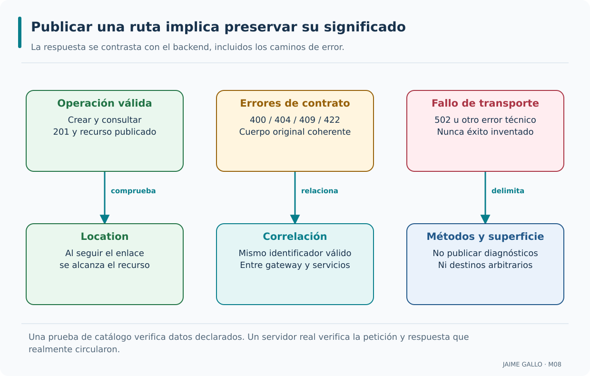

Las tres columnas presentan aspectos paralelos: resultado funcional, error de contrato y fallo de transporte. Cada uno tiene comprobaciones distintas, por lo que un único test de estado 200 resulta insuficiente. Seguir Location y comprobar la correlación completan el análisis de una respuesta válida. Delimitar métodos y superficie protege el contrato de publicación; no equivale a instalar un sistema de autorización.

---

### Conceptos que conviene consolidar

- El proceso de coincidencia de rutas determina qué ruta se aplica a una petición.
- Los patrones de ruta definen la estructura de la URL que la ruta acepta.
- La precedencia de rutas determina el orden de evaluación.
- Las transformaciones de ruta modifican la ruta de la petición.
- Las transformaciones de cabecera modifican las cabeceras.
- Las transformaciones de consulta modifican los parámetros de consulta.
- El orden de aplicación de las transformaciones determina el resultado final.
- El enrutamiento basado en cabeceras permite variantes por cliente.
- Las buenas prácticas son prioridades explícitas cuando se necesitan, especificidad sin ambigüedad, restricciones en parámetros, transformaciones necesarias, documentación del orden y validación con test.

---

# Punto 8.4 — Balanceo de carga básico

**Módulo 8:** Publicación mediante API Gateway

**Objetivos de aprendizaje:**

- Comprender qué es el balanceo de carga y su papel en una arquitectura de microservicios.
- Identificar los algoritmos de balanceo soportados por YARP.
- Comprender la configuración de destinos múltiples y pesos.
- Comprender la integración del balanceo con los health checks.
- Añadir al proyecto `AceriaApp` las clases de validación de balanceo de carga y pruebas que verifiquen la validación, distinguiéndolas del comportamiento funcional del proxy. Cerrar el módulo 8 y el curso con el resumen final del estado del proyecto.

## Repartir las lecturas de Inventario entre instancias saludables

Una vez elegido el servicio, el gateway todavía puede decidir qué instancia recibe la petición. Incorporaremos una segunda ejecución de Inventario y estudiaremos RoundRobin, health checks y los límites de escalado, diferenciando el ensayo local de un despliegue de alta disponibilidad.

### Definición de balanceo de carga

Balancear carga consiste en repartir solicitudes de un mismo servicio entre varias instancias capaces de atender su contrato. El objetivo no es que cada petición utilice siempre una instancia diferente, sino distribuir trabajo y sostener la disponibilidad cuando cambian las condiciones. En AceriaApp el gateway podrá dirigir lecturas de Inventario a los puertos 5106 y 5107, que representan dos procesos del mismo servicio. Producción conservará inicialmente un único destino. Para interpretar el resultado deberemos identificar qué instancia respondió y comprobar que ambas observan los datos coherentemente.

```text
Balanceo de carga:

Petición → Balanceador → Instancia 1.
                      → Instancia 2.
                      → Instancia 3.
```

Distribuye el tráfico entre varias instancias; permite el escalado horizontal; y se basa en un algoritmo de distribución. Estas condiciones permiten que el sistema sea escalable y tolerante a fallos.

El balanceo reparte solicitudes entre instancias equivalentes y permite seguir atendiendo nuevas peticiones cuando un destino se retira por fallo, siempre que los demás conserven capacidad y acceso a las dependencias. Esa mejora de disponibilidad depende de las condiciones reales del sistema y no puede deducirse únicamente del número de entradas configuradas.

Balancear significa elegir un destino para cada solicitud entre candidatos elegibles. No implica replicar peticiones ni crear réplicas. La disponibilidad del conjunto y la compatibilidad funcional de sus miembros preceden a cualquier algoritmo.

La etapa final mantiene un gateway en 5100 y dos procesos Inventario en 5106 y 5107. Las lecturas conservan el contrato; una identidad técnica de instancia permite observar el reparto sin alterar las reglas del dominio.

La caída de una dependencia compartida puede inutilizar ambas instancias. Del mismo modo, conservar sesión exclusivamente en memoria de una instancia puede hacer que una solicitud posterior falle al ir a otra. El balanceador no sincroniza ese estado.

Envía varias consultas y observa las identidades que contestan. Después compara sus cuerpos funcionales y la persistencia tras reiniciar un proceso. El reparto debe conservar significado y datos, además de alternar emisores.

---

### Algoritmos de balanceo

Round robin, selección aleatoria y políticas basadas en solicitudes pendientes distribuyen el tráfico con criterios diferentes. La política de YARP se establece en el cluster y actúa sobre los destinos que en ese momento resultan elegibles. No debe confundirse una secuencia ideal de catálogo con la distribución efectiva cuando hay fallos, sondeos de salud o concurrencia. AceriaApp utilizará `RoundRobin` para estudiar un comportamiento fácil de observar y registrar. La prueba comparará identidades de instancia y resultados funcionales, sin prometer una alternancia perfecta bajo cualquier carga.

```text
Algoritmos de balanceo:

RoundRobin          → distribución cíclica.
Random              → distribución aleatoria.
LeastRequests       → instancia con menos peticiones.
PowerOfTwoChoices   → mejor entre dos aleatorias.
Peso                → distribución según peso.
```

Cada algoritmo distribuye el trabajo con una hipótesis diferente sobre las instancias disponibles. Cada algoritmo tiene un propósito específico; la elección depende del contexto; y el algoritmo se configura por cluster. Estas condiciones permiten que el balanceo se adapte a cada situación.

RoundRobin recorre candidatos; Random selecciona al azar; LeastRequests compara solicitudes activas; PowerOfTwoChoices limita la comparación a dos candidatos aleatorios. Ninguna de estas políticas mide automáticamente la capacidad real de CPU.

AceriaApp usa RoundRobin explícito para que el reparto resulte observable. El catálogo original también muestra PowerOfTwoChoices y LeastRequests para comparar decisiones. El balanceo ponderado se conserva como concepto y exige una implementación adicional en YARP.

Un resultado de una muestra pequeña no demuestra equilibrio estadístico de una política aleatoria. Tampoco una alternancia de asignación garantiza orden de finalización: dos backend pueden responder a velocidades diferentes y los clientes pueden concurrir.

Identifica la política configurada y el conjunto disponible antes de interpretar la secuencia. Para el ensayo docente usa solicitudes controladas y registra las identidades; evita deducir un porcentaje de capacidad a partir de dos respuestas.

---

### Configuración de destinos múltiples

Un cluster de YARP puede declarar varios elementos en `Destinations`, cada uno con identificador y dirección propia. El gateway elige entre ellos según su política y el estado conocido de salud. Para AceriaApp los dos destinos de Inventario escuchan en 5106 y 5107; ambos deben ofrecer el mismo contrato de lectura y acceso coherente a los datos. Configurar dos entradas no demuestra que existan dos procesos vivos. Verificaremos que los dos servidores arrancan, que responden a las mismas consultas y que el gateway permite observar su reparto.

```json
{
  "Clusters": {
    "ordenes-cluster": {
      "Destinations": {
        "ordenes-1": { "Address": "http://aceria-ordenes-1:5001/" },
        "ordenes-2": { "Address": "http://aceria-ordenes-2:5001/" },
        "ordenes-3": { "Address": "http://aceria-ordenes-3:5001/" }
      }
    }
  }
}
```

`{` abre un objeto en el contexto mostrado; `"Clusters": {` abre la sección de clusters; `"ordenes-cluster": {` declara el cluster de órdenes; `"Destinations": {` abre la sección de destinos.

`"ordenes-1": { "Address": "http://aceria-ordenes-1:5001/" },` declara una dirección de ejemplo con nombre ASCII; debe resolverse en la red del emisor; `"ordenes-2": { "Address": "http://aceria-ordenes-2:5001/" },` declara una dirección de ejemplo con nombre ASCII; debe resolverse en la red del emisor; `"ordenes-3": { "Address": "http://aceria-ordenes-3:5001/" }` declara una dirección de ejemplo con nombre ASCII; debe resolverse en la red del emisor; `}` cierra el objeto abierto en el contexto anterior.

Cada destino tiene un identificador único; la dirección puede variar por instancia; y los destinos se configuran por cluster. Estas condiciones permiten que el balanceo sea configurable.

Destinations declara identificadores y direcciones. Tener dos entradas solo crea dos candidatos de configuración; deben existir procesos escuchando y compartir un contrato compatible. La política de salud puede reducir el conjunto efectivo.

Los destinos reales de Inventario son http://127.0.0.1:5106/ y http://127.0.0.1:5107/. Se conserva Producción en su cluster. No se añade una réplica de Clientes para satisfacer una cifra del catálogo conceptual.

Direcciones duplicadas con nombres distintos no producen redundancia real. Dos procesos en la misma máquina tampoco protegen frente a caída del equipo. El laboratorio estudia la pérdida de proceso, y sus conclusiones no deben extenderse a todos los fallos posibles.

Arranca ambas instancias, comprueba readiness de cada una y consulta la identidad a través del gateway. Luego detén una y verifica la transición tras la detección. Una lista con dos URL no basta para acreditar esta secuencia.

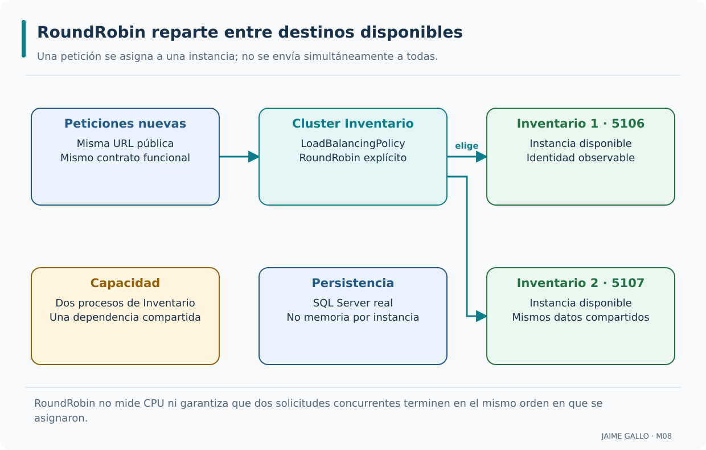

El cluster decide una asignación por solicitud y las sucesivas asignaciones recorren los destinos elegibles. Las flechas que salen del cluster representan destinos alternativos; no son un envío simultáneo ni una llamada entre réplicas. Ambas dependen del estado persistente del servicio. La identidad técnica observada permite demostrar reparto sin convertir el número de instancia en una regla de negocio ni en una garantía de alta disponibilidad global.

---

### Pesos de destino

Los pesos expresan preferencias de distribución cuando se usa una política de balanceo que realmente los interpreta. Declarar un campo de peso o incluir un valor en un catálogo no altera por sí solo el algoritmo `RoundRobin` del laboratorio. Una proporción 2:1 es una expectativa estadística que requiere una política ponderada adecuada, suficiente número de solicitudes y destinos elegibles. En AceriaApp estudiaremos esta distinción para no presentar la configuración nominal como capacidad ejecutada. La evidencia debe mostrar la política efectiva y el patrón de asignación observado.

```json
{
  "Destinations": {
    "ordenes-1": { "Address": "http://aceria-ordenes-1:5001/", "Metadata": { "peso-conceptual": "2" } },
    "ordenes-2": { "Address": "http://aceria-ordenes-2:5001/", "Metadata": { "peso-conceptual": "1" } }
  }
}
```

`{` abre un objeto en el contexto mostrado; `"Destinations": {` abre la sección de destinos; `"ordenes-1": { "Address": "http://aceria-ordenes-1:5001/", "Metadata": { "peso-conceptual": "2" } },` declara metadatos conceptuales; una política personalizada tendría que interpretarlos; `"ordenes-2": { "Address": "http://aceria-ordenes-2:5001/", "Metadata": { "peso-conceptual": "1" } }` declara metadatos conceptuales; una política personalizada tendría que interpretarlos.

`}` cierra el objeto abierto en el contexto anterior; `}` cierra el objeto abierto en el contexto anterior.

La utilidad de un peso depende de que la política efectiva lo interprete. Permiten distribuir de forma ponderada; se usan con instancias de distinta capacidad; y se configuran por destino. Estas condiciones permiten que el balanceo se adapte a la capacidad.

Un peso expresa una proporción deseada, por ejemplo 2:1 bajo condiciones estables. Su cumplimiento depende del algoritmo, del conjunto sano y del número de solicitudes. No es una promesa de latencia ni de uso de CPU.

El catálogo conserva TienePesos para estudiar esa intención. El JSON del ejemplo emplea Metadata con una clave de peso conceptual; una política personalizada tendría que leerla y aplicarla. Las políticas incorporadas no lo hacen por añadir esa clave.

DestinationConfig no define Weight. Publicar esa propiedad como nativa enseñaría una capacidad inexistente. El laboratorio funcional usa RoundRobin sin ponderación; desarrollar una política ponderada queda como ampliación arquitectónica separada.

Distingue tres niveles: proporción explicada, metadato presente y algoritmo implementado. Solo el tercero puede acreditar reparto ponderado. Si se implementara, harían falta pruebas con fallos de destinos y muestras suficientes, además de la prueba de configuración.

---

### Algoritmo de balanceo en YARP

YARP ofrece políticas de balanceo que se configuran mediante `LoadBalancingPolicy`, entre ellas `RoundRobin`, `Random`, `LeastRequests`, `PowerOfTwoChoices` y `FirstAlphabetical`. Cada una busca resolver un criterio de distribución distinto, y su efecto depende del conjunto de destinos disponibles. En AceriaApp utilizaremos la política RoundRobin, no un algoritmo ponderado inventado por los ejemplos. La prueba verificará el registro efectivo de esa opción y que las respuestas proceden de distintas instancias cuando ambas están saludables.

```json
{
  "Clusters": {
    "ordenes-cluster": {
      "LoadBalancingPolicy": "RoundRobin",
      "Destinations": {
        "ordenes-1": { "Address": "http://aceria-ordenes-1:5001/" },
        "ordenes-2": { "Address": "http://aceria-ordenes-2:5001/" }
      }
    }
  }
}
```

`{` abre un objeto en el contexto mostrado; `"Clusters": {` abre la sección de clusters; `"ordenes-cluster": {` declara el cluster; `"LoadBalancingPolicy": "RoundRobin",` configura el algoritmo.

`"Destinations": {` abre la sección de destinos; `"ordenes-1": { "Address": "http://aceria-ordenes-1:5001/" },` declara una dirección de ejemplo con nombre ASCII; debe resolverse en la red del emisor; `"ordenes-2": { "Address": "http://aceria-ordenes-2:5001/" }` declara una dirección de ejemplo con nombre ASCII; debe resolverse en la red del emisor; `}` cierra el objeto abierto en el contexto anterior.

Se configura por cluster; determina la distribución; y se documenta. Estas condiciones permiten que el balanceo sea predecible.

LoadBalancingPolicy selecciona una implementación registrada en el contenedor. La política se aplica sobre destinos disponibles, no necesariamente sobre toda la colección original. La selección predeterminada es PowerOfTwoChoices si no se indica otra.

La etapa 8.4 escribe RoundRobin para que la decisión sea visible y revisable. En 8.2, con un único destino, cambiar de algoritmo no añade redundancia ni produce un reparto observable entre procesos.

YARP incluye también FirstAlphabetical, útil para una selección preferente; el validador didáctico conserva su lista original de cuatro políticas. Esa lista local no pretende enumerar todas las extensiones posibles ni todos los valores admitidos por YARP.

Localiza la opción efectiva del cluster y comprueba que el pipeline incluye balanceo. Un nombre correcto en JSON no garantiza el comportamiento si se sustituyó el pipeline estándar sin registrar el middleware necesario.

---

### Balanceo y health checks

El balanceo solo puede reaccionar a una caída de un destino si conoce de algún modo su estado. YARP puede utilizar comprobaciones de salud activas, con intervalos y umbrales que evitan retirar una instancia por un único resultado anómalo. Durante ese tiempo todavía pueden producirse peticiones fallidas, y una llamada que ya estaba en curso no desaparece por retirar el destino. En AceriaApp las sondas de Inventario se relacionarán con los endpoints de M07 para comprobar caída y recuperación de una de las dos instancias. Este ensayo no equivale a garantizar disponibilidad sin interrupción.

```text
Balanceo y health checks (HealthyAndUnknown):

Destino 1 → healthy → recibe tráfico.
Destino 2 → unhealthy → no recibe tráfico.
Destino 3 → healthy → recibe tráfico.
```

Los health checks excluyen las instancias no disponibles; el balanceo se ajusta de forma automática; y el sistema se recupera de fallos de instancias. Estas condiciones permiten que el balanceo sea resiliente.

Las sondas activas examinan readiness periódicamente y las políticas actualizan la salud por destino. Las pasivas usan resultados de tráfico. La detección tiene una demora y no puede impedir un fallo que ocurra después de haber seleccionado una instancia.

El ensayo final consulta /health/ready cada segundo, con timeout de un segundo y umbral de dos fallos consecutivos. HealthyAndUnknown excluye destinos unhealthy y produce 503 cuando no quedan candidatos; al recuperarse, una sonda satisfactoria permite reincorporarlos.

HealthyOrPanic es una alternativa que vuelve a habilitar todos si ninguno queda elegible. No expresa el mismo contrato que fallar sin backend sano. Los valores operativos se eligen para observar el laboratorio y no se presentan como ajuste universal de producción.

Verifica tres escenarios separados: pierde una instancia, pierde ambas y recupera una. Espera a la condición observable con un límite, en vez de suponer una transición instantánea. No se reintentan automáticamente escrituras para ocultar una caída.

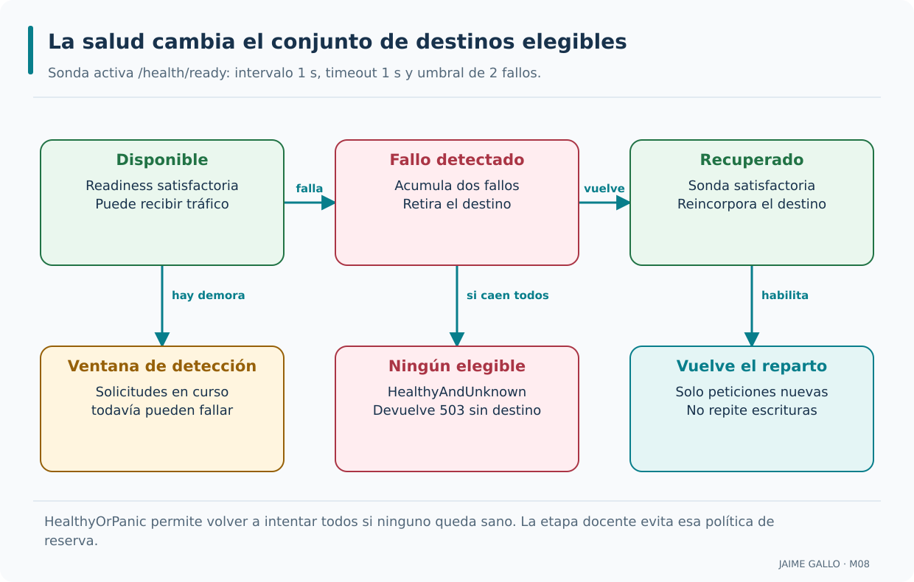

La fila superior expone estados operativos sucesivos y la inferior sus efectos. El umbral introduce una ventana durante la que una petición aún puede fallar al intentar el destino detenido. HealthyAndUnknown evita seleccionar servidores marcados unhealthy cuando todos han caído. Al observar recuperación se habilitan nuevas asignaciones; no se repite una escritura anterior ni se garantiza que una petición que ya estaba en curso termine bien.

---

### Balanceo en contenedores

Al desplegar servicios en contenedores, los destinos pueden representarse mediante nombres de red, servicios del orquestador o direcciones de instancias específicas. La elección determina quién balancea realmente: YARP, la red del orquestador o ambos en etapas distintas. En Kubernetes, por ejemplo, un Service puede distribuir tráfico entre pods, mientras que YARP podría ver solo la dirección del Service. AceriaApp utiliza puertos locales para demostrar el algoritmo de forma observable. Las direcciones de contenedor que aparezcan en ejemplos son conceptuales hasta que se construya y compruebe el despliegue correspondiente.

```text
Balanceo en contenedores:

Kubernetes → Service balancea entre pods.
Docker Swarm → Service balancea entre tasks.
Gateway → balancea entre instancias del servicio.
```

El orquestador balancea entre instancias; el gateway enruta entre servicios y puede balancear entre instancias de cada servicio; y ambos se complementan. Estas condiciones permiten que el sistema sea escalable.

La plataforma puede ofrecer una dirección de servicio que reparta entre réplicas, o YARP puede conocer cada destino. La elección determina quién descubre instancias y quién observa su salud. Duplicar capas no garantiza una distribución mejor.

El laboratorio local usa dos destinos explícitos y procesos controlados para observar identidad y fallos. SQL Server y RabbitMQ reales validan la continuidad del acumulado; esa infraestructura no convierte el ejercicio en un despliegue Kubernetes.

Si YARP apunta a una única dirección de Service, su health check observa ese acceso y no necesariamente cada pod. Una red de contenedores también cambia el significado de localhost. Deben documentarse el responsable del reparto y la resolución DNS.

Representa la dirección que ve el gateway y enumera qué instancias puede observar directamente. Usa nombres ASCII en una red de contenedores y prueba desde el emisor real. No atribuyas al gateway conocimiento que solo tiene el orquestador.

---

### Estrategias de escalado

Escalar verticalmente aumenta recursos de una instancia; escalar horizontalmente añade instancias. Ninguno de los dos cambios garantiza mejorar el resultado si todas dependen de una base de datos saturada o de una cola con capacidad insuficiente. El escalado automático exige además métricas, umbrales y un orquestador que ejecute la decisión. En AceriaApp levantar una segunda instancia de Inventario demuestra el efecto del balanceo local, pero no implementa autoscaling. La utilidad de escalar se evaluará observando comportamiento y límites compartidos, no contando procesos sin medir sus dependencias.

```text
Estrategias de escalado:

Horizontal → añade instancias.
Vertical   → aumenta recursos.
Automático → ajusta instancias según métricas.
```

La elección de una estrategia de escalado debe partir de la carga y de los límites de las dependencias. Cada estrategia tiene un propósito; la elección depende de la carga; y el balanceo distribuye entre las instancias. Estas condiciones permiten que el sistema sea escalable.

Escalar horizontalmente añade procesos; verticalmente aumenta recursos por proceso; automatizar requiere métricas, umbrales y una plataforma que ejecute cambios. El balanceador solo distribuye solicitudes entre los destinos que conoce.

Dos instancias de Inventario permiten ensayar reparto sin cambiar la API pública. Ambas acceden al estado persistente del servicio. El gateway, SQL y RabbitMQ requieren su propio análisis de capacidad y disponibilidad.

Añadir procesos puede aumentar la presión sobre SQL y agotar conexiones. Un autoscaler tampoco reacciona sin demora: necesita señales y tiempo de arranque. Más réplicas no corrigen bloqueos, consultas ineficientes ni efectos duplicados de una escritura.

Observa latencia, errores y recursos antes de justificar otra instancia. Explica qué cuello de botella se pretende aliviar y cómo se comprobaría. El curso no instala autoscaling; conserva el concepto y delimita la evidencia obtenida con procesos locales.

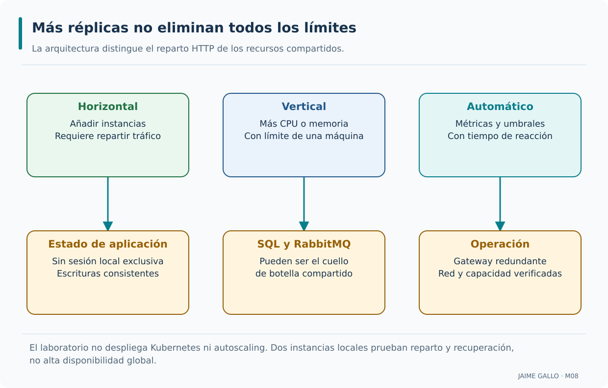

Las columnas separan tres formas de aumentar capacidad y sus condicionantes. El estado, las dependencias compartidas y la operación del punto de entrada siguen requiriendo diseño. Más procesos HTTP pueden trasladar la saturación a SQL. Los mecanismos de autoscaling y orquestación se estudian como alternativas; la evidencia del laboratorio corresponde a procesos locales y dependencias reales controladas, sin afirmar un despliegue Kubernetes.

---

### Buenas prácticas de balanceo de carga

Un diseño de balanceo fiable combina varios destinos equivalentes, sondas de salud apropiadas, política de distribución conocida y registros que permitan seguir la instancia elegida. Debe comprobarse qué ocurre cuando cae una instancia, cuando fallan todas y cuando la instancia vuelve a estar sana. También importan las sesiones con estado y la consistencia de los datos compartidos. En AceriaApp el inventario tiene una lectura informativa y utiliza una base SQL conocida; el experimento no valida por sí mismo otras cargas ni un despliegue de alta disponibilidad.

```text
Buenas prácticas de balanceo de carga:

1. Al menos dos instancias por servicio.
2. Algoritmo adecuado al contexto.
3. Combinar con health checks.
4. Registrar métricas por instancia.
5. Validar con un test.
```

`1. Al menos dos instancias por servicio.` primera práctica; `2. Algoritmo adecuado al contexto.` segunda práctica; `3. Combinar con health checks.` tercera práctica; `4. Registrar métricas por instancia.` cuarta práctica.

`5. Validar con un test.` quinta práctica.

El balanceo resiliente requiere observar la salud real de los destinos; permiten el diagnóstico; y permiten el análisis automático. Estas condiciones permiten que el balanceo sea un activo del sistema.

Dos instancias son una condición útil para estudiar reparto, pero no garantizan alta disponibilidad. La salud de dependencias, la capacidad de la superviviente y la coherencia del estado condicionan el resultado del fallo.

La comprobación docente identifica cada instancia, conserva respuestas de negocio y observa retirada y recuperación. Los ensayos de catálogos se mantienen junto a las pruebas del proxy y las pruebas de integración con infraestructura real.

Una prueba que solo alterna un contador en memoria no demuestra persistencia compartida; una prueba que solo inspecciona dos URL no demuestra reparto. Deben conservarse cuerpos, códigos y efectos además de la identidad técnica.

Recorre el estado inicial, la caída de una instancia, la caída total y la recuperación. Registra qué resultado distingue cada fase. Evita contar como éxito un test omitido o una respuesta sintética que no alcanzó ningún backend.

---

### El gateway como cierre del recorrido arquitectónico

El módulo termina con un gateway YARP que publica las rutas de Producción e Inventario, aplica transformaciones acotadas y distribuye las consultas de Inventario entre dos instancias con RoundRobin y comprobaciones de salud. El recorrido completo conserva los casos de uso, la persistencia y los mecanismos de comunicación anteriores. La lectura de stock continúa siendo informativa y los códigos de error reflejan tanto resultados de negocio como fallos de transporte. El alumno debe poder reconstruir el gateway desde las prácticas y distinguir lo que ejecuta el código de las alternativas descritas en el catálogo. Ese cierre prepara el despliegue con Docker sin darlo por realizado.

```text
Aplicación al proyecto del curso:

Clusters          → Inventario: dos destinos; Producción: uno.
Política          → configurada por cluster.
Health checks     → excluyen instancias no disponibles.
Validación        → test de coherencia.
Cierre del módulo → resumen del estado del proyecto.
Cierre del curso  → resumen final del proyecto completo.
```

El proyecto reúne los mecanismos docentes de arquitectura de microservicios estudiados, con sus límites operativos explícitos. También el alumno dispone de todos los artefactos acumulados. Ambos factores permiten que el alumno aplique lo aprendido a proyectos reales.

El cierre reúne la arquitectura acumulativa: APIs, límites hexagonales, patrones, DDD/CQRS, HTTP y mensajería, observabilidad, resiliencia y gateway. La coherencia del recorrido se demuestra con artefactos y resultados reproducibles.

ClusterBalanceo conserva el catálogo de tres clusters y siete destinos declarados. Su reto produce total 3, destinos 7, clusters con pesos 1 y con health checks 3. El proxy real usa dos servicios, con dos instancias de Inventario y RoundRobin.

Los 307 tests de la conversación original no representan el repositorio actual: M07 aporta 403 pruebas y M08 conserva 42 de catálogo más las funcionales nuevas. Las cifras finales se publican solo a partir de ejecuciones verificadas, manteniendo los retos aislados.

El alumno debe poder reconstruir cada etapa desde las prácticas, ejecutar los ensayos y explicar sus límites. Ese resultado permite trasladar criterios a otro proyecto; no certifica un despliegue de producción ni una disponibilidad global que el laboratorio no ha medido.

---

### Conceptos que conviene consolidar

- El balanceo de carga distribuye el tráfico entre varias instancias de un servicio.
- Los algoritmos estudiados son round-robin, random, least-requests, power-of-two-choices y ponderación; esta última necesita una política personalizada en YARP.
- La configuración de destinos múltiples se realiza en la sección `Destinations` del cluster.
- Los pesos de destino permiten distribuir la carga de forma ponderada.
- YARP soporta varios algoritmos con la propiedad `LoadBalancingPolicy`.
- El balanceo se combina con los health checks para excluir instancias no disponibles.
- El balanceo en contenedores se realiza con el orquestador.
- Las estrategias de escalado son horizontal, vertical y automático.
- Las buenas prácticas son al menos dos instancias, algoritmo adecuado, combinar con health checks, registrar métricas y validar con test.
- El módulo 8 cierra con el resumen del estado del proyecto. El curso cierra con el resumen final.

---

## Fuentes técnicas y criterios de lectura

La documentación oficial respalda los contratos de YARP utilizados; los fragmentos del curso se adaptan al laboratorio y la versión NuGet fijada. Los enlaces de Microsoft Learn pueden mostrar la edición vigente del sitio. Para reproducir el proyecto se mantienen net8.0 y Yarp.ReverseProxy 2.2.0.

- [Configuración de rutas, clusters y destinos de YARP](https://learn.microsoft.com/en-us/aspnet/core/fundamentals/servers/yarp/config-files): jerarquía ReverseProxy, enlace con IConfiguration y ejemplos de opciones.
- [Transformaciones de petición](https://learn.microsoft.com/en-us/aspnet/core/fundamentals/servers/yarp/transforms-request): PathRemovePrefix, RequestHeader, RequestHeaderRemove, QueryValueParameter y QueryRouteParameter; aplicación en el orden configurado.
- [Transformaciones de petición y respuesta y extensibilidad](https://learn.microsoft.com/en-us/aspnet/core/fundamentals/servers/yarp/transforms): transformaciones en código y configuración de rutas.
- [Balanceo en YARP](https://learn.microsoft.com/en-us/aspnet/core/fundamentals/servers/yarp/load-balancing): políticas incorporadas y extensión mediante ILoadBalancingPolicy.
- [DestinationConfig de YARP 2.2](https://learn.microsoft.com/en-us/dotnet/api/yarp.reverseproxy.configuration.destinationconfig?view=yarp-2.2): propiedades Address, Health, Host y Metadata; no existe Weight incorporada.
- [Salud de destinos](https://learn.microsoft.com/en-us/aspnet/core/fundamentals/servers/yarp/dests-health-checks): salud activa y pasiva, ConsecutiveFailures y políticas HealthyAndUnknown y HealthyOrPanic.
- [Coincidencia por cabeceras y precedencia](https://learn.microsoft.com/en-us/aspnet/core/fundamentals/servers/yarp/header-routing): condiciones de Match y efecto de Order.

## Cierre del módulo y del curso

El recorrido conserva los ocho módulos: introducción a microservicios, APIs REST, arquitectura hexagonal, patrones, DDD/CQRS, comunicación, observabilidad/resiliencia y publicación con gateway. En M08 las declaraciones de catálogo se contrastan con un proceso de proxy independiente, rutas publicadas, adaptación de mensajes y reparto entre instancias. El alumno puede explicar qué servicio decide cada resultado y qué prueba sostiene cada afirmación.

El material práctico conserva cuatro etapas acumulativas, cuatro retos aislados y los documentos de decisión correspondientes. Reconstrucción, pruebas de comportamiento y evidencia de integración se verifican sobre archivos concretos. La persistencia SQL y la mensajería mantienen los contratos anteriores; el gateway aporta un borde HTTP y no sustituye esas responsabilidades. El cierre de una ejecución requiere los informes efectivos del proyecto y no se deduce del número histórico de ejemplos del temario.
